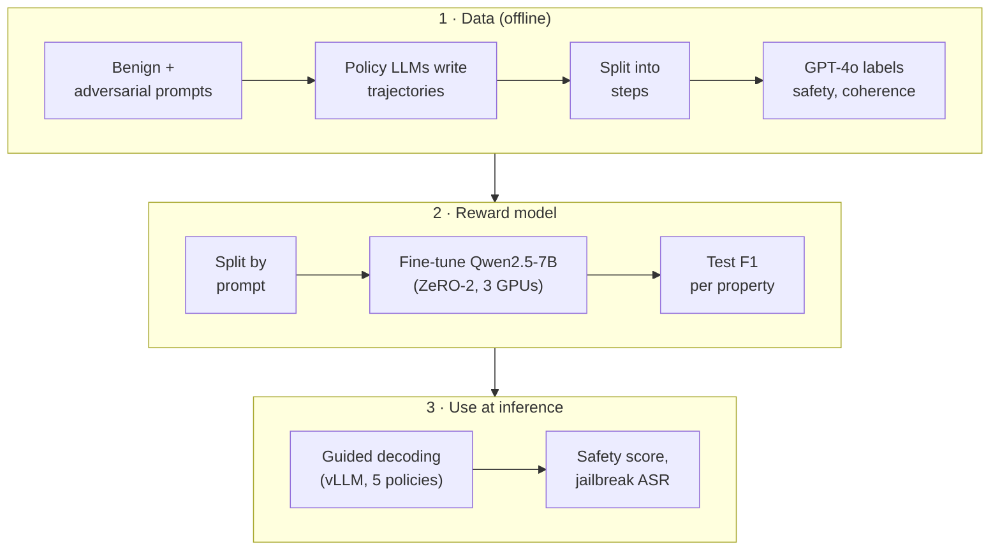
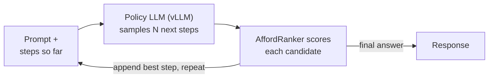

# Risk-Aware Process Reward Modeling — Interview Playbook

*AffordRanker is a process reward model (PRM) built on Qwen2.5-7B-Instruct. It reads an LLM's reasoning one step at a time and gives every step two scores: is this step safe, and is it coherent? It was trained on 15K GPT-4o-labelled reasoning trajectories with DeepSpeed ZeRO-2, then plugged into vLLM decoding so that five policy LLMs pick safer next steps while they generate. PyTorch, TRL, DeepSpeed, vLLM, GPT-4o. Everything you need for a 30–45 minute interview.*

**Resume bullets this booklet defends**

1. Built AffordRanker Process Reward Model with Qwen2.5-7B-Instruct for step-level safety and coherence scoring across reasoning trajectories.
2. Curated 208K labels, 15K trajectories via GPT-4o; fine-tuned with DeepSpeed ZeRO-2 on 3 GPUs, achieved 0.88 & 0.82 F1 on safety & coherence.
3. Integrated reward-guided decoding with vLLM across 5 policy LLMs, improving safety score by 43 points and reducing jailbreak ASR by 50%.

# Part 1: Project Overview

## 1.1 What is this project?

**The one-line version.** A model that grades an AI's *thinking*, step by step, so that the AI can be steered away from unsafe or confused reasoning while it is still generating.

**Start with an example.** A user asks a model: *"I forgot my Wi-Fi password. How do I get onto the network?"* The model reasons before answering:

> **Example:** Step 1: "The user wants to access their own network." Step 2: "If it is their router, they can read the default password on the label or reset it." Step 3: "Alternatively, I could explain how to capture a WPA2 handshake and crack it offline." Step 4: "I will suggest resetting the router." Final answer: reset instructions.
>
> An **outcome reward model** sees only the final answer, which is harmless, and gives a high reward. A **process reward model** scores every step: steps 1, 2 and 4 are safe and coherent, but step 3 is unsafe (it drifts into network-intrusion instructions). In another sample the model might have *followed* step 3. During reward-guided decoding, AffordRanker gives step 3 a low safety score, so a safer candidate step is chosen instead and the dangerous branch never develops.

**The problem it solves.** Modern LLMs reason in long chains. Safety filters that look only at the final response miss three things: unsafe content inside the visible reasoning, reasoning that slowly drifts toward a harmful answer, and jailbreaks that work by leading the model through innocent-looking steps. Separately, chains that contradict themselves or go off-topic waste tokens and produce wrong answers. A step-level judge addresses both.

**Who would use it.** Teams that deploy reasoning models and need safety guardrails at inference time, alignment researchers who need a dense (per-step) reward signal, and red-teaming teams measuring how often attacks succeed.

**Inputs and outputs.** Input: a prompt plus a partial or complete reasoning trajectory split into steps. Output: for every step $k$, a safety score and a coherence score in $[0,1]$. In decoding, the input is a set of candidate next steps and the output is the chosen step.

**What makes it technically interesting.** (1) Labels: step-level supervision is expensive, so 208K labels were generated with GPT-4o, which raises label-quality questions. (2) Scale: fine-tuning a 7-billion-parameter model needs memory engineering (ZeRO-2 across 3 GPUs). (3) Integration: a reward model is only useful if it changes generation, so it was wired into vLLM for five different policy models. (4) Evaluation: safety must be measured with attack success rates, not just classifier F1.

## 1.2 Explaining it when asked "Can you explain this project?"

> **Say it aloud:** "I built a process reward model called AffordRanker. Instead of judging only an LLM's final answer, it scores every reasoning step for two things: safety and coherence. I generated 15K reasoning trajectories and had GPT-4o label each step, which gave about 208K labels. I fine-tuned Qwen2.5-7B-Instruct on those labels using DeepSpeed ZeRO-2 on three GPUs, and on held-out data it reached 0.88 F1 for safety and 0.82 for coherence. Then I used it at inference: with vLLM, a policy model proposes several candidate next steps, AffordRanker scores them, and we keep the best one. Across five policy models this raised the safety score by 43 points and halved the jailbreak attack success rate."

## 1.3 Scope, evidence status and what to confirm

**Scope boundary.** AffordRanker is a *scorer*, not a new policy model. It does not retrain the five policy LLMs; it changes which steps they keep during decoding. It judges two properties only (safety and coherence), not factual correctness of mathematics or tool use.

> **Evidence status:** No code, logs or notebooks for this project are in the Resume Prep folder, so every resume number here is marked **UNVERIFIED**: it is your reported result, and this booklet explains what it means and what evidence defends it. Numbers inside worked examples are **ILLUSTRATIVE**. Items marked **[confirm]** are standard design choices assumed to explain the bullets; check them against your code before the interview.

> **Resume flag:** Confirm before interviewing. (1) The meaning of "Afford" in AffordRanker; interviewers will ask about the name. (2) How 208K labels relate to 15K trajectories: 208K / 15K ≈ 13.9 labels per trajectory, which fits about 7 steps × 2 labels (safety + coherence) **[confirm]**. (3) Full fine-tuning or LoRA, and the GPU type. (4) "43 points": on what scale (0–100?) and scored by whom. (5) "ASR by 50%": relative (for example 30% → 15%) or absolute percentage points. Say "relative" or "percentage points" explicitly every time.

# Part 2: Fundamentals Required for This Project

| Resume bullet | Concepts you must be able to explain |
|---|---|
| 1. AffordRanker PRM, Qwen2.5-7B-Instruct, step-level safety and coherence | Language models, reasoning trajectories, reward models, PRM vs ORM, step-level scoring, Qwen2.5 backbone |
| 2. 208K labels, 15K trajectories via GPT-4o, ZeRO-2 on 3 GPUs, 0.88 / 0.82 F1 | Synthetic labels and label quality, class imbalance, precision/recall/F1, fine-tuning in PyTorch/TRL, DeepSpeed ZeRO-2, multi-GPU training |
| 3. Reward-guided decoding with vLLM, 5 policy LLMs, +43 safety, −50% jailbreak ASR | vLLM, policy vs reward model, reward-guided decoding, jailbreaks, ASR and safety evaluation |

### Language models: policy model vs reward model

- **Simple:** A language model predicts the next word (token) given everything so far; repeating that prediction produces reasoning and answers. The **policy** model *writes*; a **reward** model *grades* what was written.
- **Technical:** A decoder-only transformer outputs a distribution over the vocabulary for the next token and generates autoregressively. In RL terms the policy $\pi_\theta(s_k \mid x, s_{<k})$ chooses actions (steps) and the reward model supplies a score $r_k$. A reward model starts as the same kind of transformer, but its output is a score, not a next-token distribution.
- **Math:** $$p_\theta(y \mid x) = \prod_{t=1}^{T} p_\theta(y_t \mid x, y_{<t})$$ where $x$ is the prompt, $y_t$ the $t$-th token and $y_{<t}$ everything before it. Generation is a sequence of local choices, so it can be steered choice by choice.
- **Why it matters:** Keeping writer and grader separate means one grader can guard many writers, and the writers' general abilities are not changed by fine-tuning.
- **In this project:** Five **policy** LLMs generate reasoning; Qwen2.5-7B-Instruct is repurposed as the single **reward** model. The policies are never trained; the reward is used only to select among their own samples.
- **Interview angle:** "Can the policy be smaller than the reward model?" Yes; a small policy guided by a strong verifier is a common compute trade-off.

### Reasoning trajectory and step segmentation

- **Simple:** The chain of intermediate thoughts a model writes before its final answer, cut into numbered steps.
- **Technical:** A trajectory is $\tau = (x, s_1, s_2, \dots, s_K, a)$: prompt, $K$ reasoning steps, final answer. Segmentation splits the generated text into steps, typically on line breaks or explicit "Step k:" markers that the policy was prompted to produce **[confirm your rule]**.
- **Why it matters:** The step is the unit of supervision and of control. Steps that are too long hide the unsafe sentence inside safe text; steps that are too short lack context and make labels noisy.
- **In this project:** 15K trajectories were segmented and every step received labels. If the labels are about 7 steps × 2 labels per trajectory, the average trajectory is roughly 7 steps long **[confirm]**.
- **Interview angle:** "What if a step mixes safe and unsafe content?" It is labelled unsafe (the stricter label wins); finer segmentation reduces how often that happens.

### Reward models: outcome (ORM) vs process (PRM)

- **Simple:** A reward model turns a goal that is hard to write as rules ("safe", "helpful") into a number learned from examples. An ORM grades only the final answer. A PRM grades every step, like a teacher who marks the working, not just the answer.
- **Technical:** Usually a pretrained LM whose next-token head is replaced by a small linear "value head", trained on pairwise preferences (Bradley-Terry loss) or absolute labels (classification loss). An ORM learns $r(x, a)$, one label per trajectory. A PRM learns $r(x, s_{1:k})$, a score for step $k$ given the prompt and all previous steps, so a trajectory receives $K$ labels. The step score can be aggregated into a trajectory score.
- **Math:** $$r_k = r_\phi(x, s_1, \dots, s_k) \in [0,1], \qquad R_{\text{safety}}(\tau) = \min_{k} r_k^{\text{safe}}$$ The minimum is a natural aggregation for safety: one unsafe step makes the whole trajectory unsafe. Coherence is often averaged instead **[confirm which aggregation you used]**.
- **Why it matters:** A PRM gives **credit assignment** (which step went wrong), a **dense signal** (feedback after every step, not only at the end) and the ability to **intervene early**, before a bad step shapes the rest.
- **In this project:** This is the core idea. Step-level scores let decoding reject a dangerous step as soon as it is proposed.
- **Interview angle:** "What does a PRM cost?" Many more context-aware labels per example (hence GPT-4o labelling). "Main risk?" Reward hacking: whatever optimises against the model finds its blind spots (Q20).

### Step-level safety vs final-response safety

- **Simple:** "Is the final answer safe?" and "Is this step of the reasoning safe?" are different questions. A safe answer can hide unsafe reasoning, and safe-looking steps can lead to an unsafe answer.
- **Technical:** Step safety asks whether the content of step $s_k$, in context, provides or moves toward harmful capability (for example concrete attack instructions) or violates policy. Final-response safety judges only $a$. Step **coherence** asks whether $s_k$ follows logically from $x$ and $s_{<k}$, stays on task and does not contradict earlier steps.
- **Why it matters:** Reasoning traces are often shown to users or used downstream; unsafe intermediate content is a real leak. Jailbreaks also work step by step, so step scores can catch them before the answer.
- **In this project:** Two labels per step: safety (safe / unsafe) and coherence (coherent / incoherent) **[confirm binary vs graded]**. A step can be safe but incoherent ("Therefore the router is a cat"), or coherent but unsafe (a clear, logical attack recipe).
- **Interview angle:** "Why combine safety with coherence?" A model optimised only for safety can learn to produce evasive, rambling steps; the coherence score penalises that.

### Qwen2.5-7B-Instruct as the backbone

- **Simple:** An open-weight, 7-billion-parameter instruction-following model from Alibaba's Qwen team. It already understands language and instructions, so it only needs to learn the scoring task.
- **Technical:** Decoder-only transformer, about 7.6B parameters and 28 layers, with grouped-query attention and long context. For scoring, a linear head is attached to the hidden state at the end of each step (for example at a step-separator token) and outputs two logits, one per property **[confirm head design]**.
- **Why it matters:** Judging safety requires world knowledge (what is dangerous) and reasoning (what follows). A small classifier lacks both; a 7B instruct model has them and is still affordable to fine-tune and serve.
- **In this project:** The "Instruct" variant was used because it has already been aligned on chat-formatted, instruction-following data, which matches the format of the trajectories being judged.
- **Interview angle:** "Why not a 70B model?" Training and serving cost; the PRM runs once per candidate step, so scorer latency multiplies.

### GPT-4o as a labeller: synthetic labels and label quality

- **Simple:** Instead of paying humans to label 208K steps, a strong model (GPT-4o) was given a written rubric and asked to label each step.
- **Technical:** "LLM-as-annotator" or **distillation of a judge**: the expensive teacher (GPT-4o) labels data once; the cheaper student (AffordRanker) learns to imitate it. Quality controls include a precise rubric with examples, fixed temperature, structured (JSON) output, consistency checks (re-label a sample and compare), and a human-checked subset to estimate agreement **[confirm which checks you ran]**.
- **Why it matters:** The student can never be more correct than its labels on average. Systematic teacher errors (being too strict on medical topics, for example) become student errors, and F1 against GPT-4o labels measures *agreement with GPT-4o*, not truth.
- **In this project:** 15K trajectories, about 208K labels. The student is much cheaper at inference than calling GPT-4o for every candidate step, which is what makes reward-guided decoding practical.
- **Interview angle:** "How do you know the labels are good?" Report agreement with a human-labelled sample (Cohen's kappa) and inspect disagreement categories. If you did not do this, say it is the first thing you would add.

### Class imbalance, precision, recall and F1

- **Simple:** Most steps are safe, so a model that always says "safe" looks accurate but is useless. Precision: of the steps flagged unsafe, how many really were? Recall: of the truly unsafe steps, how many did we flag? F1 balances the two.
- **Technical:** With TP, FP, FN counted on the positive class at a chosen threshold:
- **Math:** $$P = \frac{TP}{TP+FP}, \quad R = \frac{TP}{TP+FN}, \quad F_1 = \frac{2PR}{P+R}$$ Example (ILLUSTRATIVE): 1,000 unsafe steps in the test set; the model flags 1,000, of which 880 are truly unsafe. Then $P = R = 0.88$ and $F_1 = 0.88$.
- **Why it matters:** F1 ignores true negatives, so the mass of easy safe steps cannot inflate it; the harmonic mean punishes a model good at only one of precision or recall. Imbalance remedies: positive-class loss weighting, adversarial prompts to raise the unsafe rate, and a threshold tuned on validation data **[confirm your unsafe-step rate]**.
- **In this project:** 0.88 F1 (safety) and 0.82 F1 (coherence) on held-out labelled steps **[confirm split and positive class]**. Coherence is harder because it depends on more context and is more subjective.
- **Interview angle:** "For a safety filter, would you favour precision or recall?" Usually recall (missing an unsafe step is worse), but low precision causes over-refusal; choose the threshold on a validation set for the trade-off you want.

### Fine-tuning a pretrained model in PyTorch / TRL

- **Simple:** Start from a model that already understands language and train it a little more on your specific task.
- **Technical:** Load Qwen2.5-7B-Instruct weights, attach the scoring head, format each trajectory as one sequence with separator tokens after each step, compute the loss only at the separator positions, and update weights with AdamW, a small learning rate, warm-up and bf16 mixed precision. TRL (Hugging Face's Transformer Reinforcement Learning library) provides reward-model and PRM trainers on top of PyTorch and Transformers.
- **Math:** Binary cross-entropy summed over steps $k$ and the two properties $d$: $$\mathcal{L} = -\sum_{k}\sum_{d \in \{\text{safe},\,\text{coh}\}} \big[y_{k,d}\log \hat p_{k,d} + (1-y_{k,d})\log(1-\hat p_{k,d})\big]$$ where $y_{k,d}$ is the GPT-4o label and $\hat p_{k,d} = \sigma(\text{logit}_{k,d})$ the model's probability.
- **Why it matters:** Scoring every step in one forward pass is efficient: causal attention means the hidden state at step $k$'s separator already sees exactly $x, s_1, \dots, s_k$ and nothing later.
- **In this project:** One forward pass per trajectory yields all step scores for both properties.
- **Interview angle:** "Why does causal attention matter here?" The score for step $k$ must not see future steps, otherwise it would leak information that is not available during decoding.

### DeepSpeed ZeRO-2 and multi-GPU training

- **Simple:** Training a 7B model needs far more memory than one GPU has. ZeRO splits the bulkiest training data across GPUs so that each GPU stores only a share.
- **Technical:** With mixed-precision Adam, each parameter needs about 16 bytes: 2 (bf16 weights) + 2 (bf16 gradients) + 12 (fp32 master weights, momentum, variance). Plain data parallelism replicates all 16 bytes on every GPU. **ZeRO stage 1** shards optimizer states across the $N$ GPUs; **stage 2** also shards gradients; **stage 3** also shards the weights themselves.
- **Math:** Per-GPU memory for $\Psi$ parameters on $N$ GPUs (excluding activations): $$M_{\text{ZeRO-2}} \approx 2\Psi + \frac{2\Psi + 12\Psi}{N}$$ ILLUSTRATIVE, full fine-tuning: $\Psi = 7.6\text{B}$, $N=3$ gives $15.2 + 35.5 \approx 51$ GB per GPU, versus $16\Psi \approx 122$ GB without ZeRO, which fits on no single GPU.
- **Why it matters:** ZeRO-2 makes 7B full fine-tuning possible on a few 80 GB GPUs with almost no extra communication compared with ordinary data parallelism.
- **In this project:** ZeRO-2 on 3 GPUs in data-parallel mode: each GPU processes a different micro-batch, a reduce-scatter gives each GPU the summed gradients for its shard, each updates its shard, and weights are re-synchronised. Effective batch = micro-batch × 3 × gradient-accumulation steps. With LoRA, memory is far lower **[confirm full fine-tune vs LoRA and GPU type]**.
- **Interview angle:** "Why not ZeRO-3?" It also shards weights, which saves more memory but adds an all-gather of weights in every forward and backward pass; unnecessary if ZeRO-2 already fits.

### vLLM inference

- **Simple:** A fast serving engine for LLMs that generates text for many requests at once without wasting GPU memory.
- **Technical:** **PagedAttention** stores the attention key/value cache in fixed-size blocks, like virtual-memory pages, so memory is not reserved for the maximum length of every request. **Continuous batching** adds and removes sequences from the running batch at every iteration. Together they give much higher throughput than naive Hugging Face generation, and vLLM can sample $n$ continuations of a prompt that share the prompt's cache.
- **Why it matters:** Reward-guided decoding generates $N$ candidate steps for every step of every prompt; without efficient batching it would be too slow to evaluate on thousands of attack prompts.
- **In this project:** vLLM serves the policy models and generates candidate next steps; AffordRanker scores them **[confirm whether the PRM ran in vLLM or a separate PyTorch scorer]**.
- **Interview angle:** "Where is the bottleneck?" Usually the extra policy samples and PRM forward passes; prefix caching helps because candidates share the same context.

### Reward-guided decoding

- **Simple:** At each reasoning step, let the model propose several options, ask the reward model which is best, keep that one and continue.
- **Technical:** Step-level **best-of-N** (or beam search over steps): sample $N$ candidate next steps from the policy, score each with the PRM, select the best (or keep the top $B$ beams), append it and repeat until the final answer. Candidates below a safety threshold can be pruned outright.
- **Math:** $$s_k^\ast = \arg\max_{s \in \{s^{(1)}, \dots, s^{(N)}\}} \big[\alpha\, r^{\text{safe}}(x, s_{<k}, s) + (1-\alpha)\, r^{\text{coh}}(x, s_{<k}, s)\big]$$ where $\alpha$ weights safety against coherence **[confirm N, α and whether you used a hard safety threshold]**.
- **Why it matters:** It improves safety without retraining the policy, works with any model you can sample from, and the strength of steering is a knob ($N$, $\alpha$).
- **In this project:** Integrated with vLLM for five policy models; this produced the +43 safety-score and −50% ASR results.
- **Interview angle:** "What does it cost?" Roughly $N$ times the policy sampling plus $N$ PRM calls per step; latency grows with the number of steps.

### Jailbreaks, Attack Success Rate (ASR) and safety evaluation

- **Simple:** A jailbreak is a prompt written to trick a model past its safety training (role-play, hypotheticals, encodings, or splitting a harmful task into innocent pieces). ASR is the percentage of jailbreak attempts that actually got harmful output. Lower is better.
- **Math:** $$\text{ASR} = \frac{\#\{\text{attacks judged successful}\}}{\#\{\text{attacks attempted}\}}$$ A **50% relative reduction** means, for example, 30% → 15% (ILLUSTRATIVE). A 50 *percentage-point* reduction would mean 60% → 10%. These are very different claims.
- **Technical:** Success is decided by a judge (an LLM classifier with a rubric, or humans), so ASR inherits judge bias. A **safety score** is typically the judge's 0–100 rating averaged over responses **[confirm your definition]**. A complete evaluation also reports helpfulness on benign prompts and refusal rate, so that "safer" does not just mean "refuses everything".
- **Why it matters:** ASR measures behaviour under attack, which is what users and red teams care about; F1 only measures agreement with labels. Many jailbreaks work by getting the model to *start* complying; a step-level scorer rejects that first harmful step.
- **In this project:** Safety score improved by 43 points and ASR fell by 50%, averaged across five policy LLMs **[confirm averaging and relative vs absolute]**.
- **Interview angle:** "How do you know the judge is fair?" Use a judge other than the labeller, spot-check by hand, report confidence intervals. "Could an attacker fool the PRM?" Yes; adaptive attacks on the PRM itself were not tested **[confirm benchmark name and size]**.

# Part 3: Methodology and Workflow

## 3.1 End-to-end pipeline

**Figure 1 — AffordRanker pipeline: build the step-labelled dataset, train the PRM, then use it to steer generation** [scale=0.72]

**Step 1: Collect prompts and trajectories.** A prompt pool mixing ordinary tasks with harmful and jailbreak-style requests, so that the dataset contains both safe and unsafe reasoning. Policy models generate step-by-step reasoning for each prompt **[confirm sources and models]**. Reason: the PRM must see unsafe steps to learn them, and must see many styles of reasoning to generalise.

**Step 2: Segment into steps.** Split each trajectory into steps by markers or line breaks; drop empty or duplicate steps. Reason: steps define both the labels and the decoding unit, so the same rule must be used in training and in decoding.

**Step 3: Label with GPT-4o.** For each step, GPT-4o receives the prompt, all previous steps and the current step, plus a rubric, and returns two labels in JSON. Reason: context is needed; a step like "Now mix the two" is harmless or dangerous depending on what came before. About 15K trajectories → about 208K labels.

**Step 4: Prepare the dataset.** Format each trajectory as one sequence with a separator after every step; attach labels at separator positions; split train/validation/test **by prompt**, so that trajectories for the same prompt never appear on both sides **[confirm]**. Reason: random splitting by step would leak near-duplicate context and inflate F1.

**Step 5: Fine-tune.** Qwen2.5-7B-Instruct with a two-output head, BCE loss at step positions, bf16, AdamW, DeepSpeed ZeRO-2 on 3 GPUs, tracking validation loss and F1 per epoch. Reason: one pass scores all steps; ZeRO-2 makes the memory fit.

**Step 6: Evaluate the classifier.** Choose each property's threshold on validation data, then report test F1: 0.88 safety, 0.82 coherence. Reason: the student must agree with the teacher on unseen prompts before it steers generation.

**Steps 7–8: Guide decoding, then evaluate safety.** Run the same prompt set through each of the five policies with ordinary decoding and with reward-guided decoding (Figure 2); a judge rates every response; compare safety score and ASR.

## 3.2 Reward-guided decoding loop

**Figure 2 — One decoding step: the policy proposes, AffordRanker scores, the best safe step is appended** [scale=0.72]

Unsafe candidates are filtered or out-scored, so the trajectory can only grow through steps the PRM accepts. If every candidate is unsafe, a common fallback is to resample or to switch to a refusal step **[confirm your fallback]**.

## 3.3 Numerical claims and how to defend them

| Claim | What it means and how it is computed | Baseline and what could mislead | Status |
|---|---|---|---|
| 208K labels, 15K trajectories | GPT-4o step labels; ≈ 13.9 labels per trajectory (≈ 7 steps × 2 properties) | Label noise; teacher bias; duplicated prompts | UNVERIFIED; show dataset stats |
| 3 GPUs, ZeRO-2 | Data-parallel training, gradients + optimizer states sharded 3 ways | Full FT vs LoRA changes the memory story | UNVERIFIED; show DeepSpeed config |
| 0.88 F1 safety | F1 on held-out steps vs GPT-4o labels at a validation-chosen threshold | Measures agreement with GPT-4o, not truth; leakage if split by step | UNVERIFIED; confusion matrix |
| 0.82 F1 coherence | Same, coherence label | Coherence labels are more subjective | UNVERIFIED |
| +43 safety score | Mean judge safety rating, guided vs unguided decoding, averaged over 5 policies | Scale undefined on resume; judge bias; over-refusal | UNVERIFIED; define scale |
| −50% jailbreak ASR | Successful attacks / attempts, guided vs unguided | Relative vs absolute; fixed (non-adaptive) attacks | UNVERIFIED; per-policy table |

To defend every number, bring: dataset statistics (label balance, steps per trajectory), the split rule, the confusion matrix at the chosen threshold, per-policy safety and ASR before and after, the number of attack prompts, and benign-prompt helpfulness or refusal rates.

# Part 4: Important Design and Methodological Decisions

**1. Process reward (per step) instead of outcome reward (final answer only).** *Why:* catches unsafe reasoning that an ORM misses, says which step failed, and allows intervention mid-generation. *Alternative:* an ORM or a final-response safety classifier. *Why less suitable:* cannot steer during decoding and misses unsafe intermediate content. *Trade-off accepted:* about 7× more labels per trajectory and labels that depend on context.

**2. GPT-4o synthetic labels instead of human annotation.** *Why:* 208K context-dependent labels would be slow and costly for humans; GPT-4o follows a rubric consistently and at scale. *Alternative:* human labelling, or rule-based keyword labels. *Why less suitable:* humans are expensive at this scale; keyword rules miss context ("mix the two"). *Trade-off:* the PRM inherits GPT-4o's biases, and F1 measures agreement with GPT-4o.

**3. A fine-tuned 7B model as the scorer instead of calling GPT-4o at inference.** *Why:* decoding needs $N$ scores per step per prompt; a local 7B model is far cheaper, faster, private and deterministic. *Alternative:* GPT-4o as live judge, or a small encoder classifier. *Why less suitable:* API judging is slow and costly per candidate; a small classifier lacks the knowledge to judge subtle harm. *Trade-off:* the student is somewhat less accurate than its teacher.

**4. Two separate scores (safety and coherence) instead of one combined reward.** *Why:* the properties fail differently and need different thresholds; separate scores make the system interpretable and tunable with $\alpha$. *Alternative:* one scalar "quality" reward. *Why less suitable:* safety failures could be averaged away by coherence. *Trade-off:* one more hyperparameter to tune.

**5. DeepSpeed ZeRO-2 instead of plain DDP or ZeRO-3.** *Why:* plain DDP replicates about 16 bytes per parameter (≈ 122 GB for 7.6B) and does not fit; ZeRO-2 shards gradients and optimizer states with the same communication volume as DDP. *Alternative:* ZeRO-3 or FSDP full sharding. *Why less suitable:* extra weight all-gathers slow every step and were not needed. *Trade-off:* each GPU still holds a full copy of the weights.

**6. Inference-time steering instead of RL fine-tuning each policy.** *Why:* one PRM improves five policies with no retraining; the effect is adjustable per deployment. *Alternative:* PPO or DPO training of each policy with the PRM as reward. *Why less suitable:* five expensive training runs, risk of degrading capability, and harder to compare. *Trade-off:* higher inference cost on every request.

# Part 5: Complete Interview Explanation

## 5.1 Two-minute explanation

> **Say it aloud:** "Reasoning models think in steps before answering, and most safety checks only look at the final answer. That misses unsafe content inside the reasoning and jailbreaks that lead the model step by step. So I built AffordRanker, a process reward model that scores every reasoning step for safety and coherence.
>
> I collected 15K reasoning trajectories over benign and adversarial prompts, split them into steps, and used GPT-4o with a rubric to label each step, about 208K labels. I fine-tuned Qwen2.5-7B-Instruct with a two-output scoring head using DeepSpeed ZeRO-2 on three GPUs. On a held-out set it agreed with the labels at 0.88 F1 for safety and 0.82 for coherence.
>
> Then I used it during generation. With vLLM, a policy model proposes several candidate next steps, AffordRanker scores them, and we keep the best. Across five policy models, that raised the safety score by 43 points and cut jailbreak attack success by half, without retraining any of the policies."

## 5.2 Five-minute explanation

> **Say it aloud:** "**Problem.** An outcome reward model or safety classifier sees only the final answer. But unsafe content can appear in the visible reasoning, and jailbreaks often succeed by getting the model to take the first harmful step, after which it continues. I wanted a judge that works at the level of each step, so it can stop a bad step before it shapes the rest.
>
> **Data.** I built a prompt pool with ordinary tasks and harmful or jailbreak-style requests, generated step-by-step reasoning from policy models, and segmented each trajectory into steps. GPT-4o labelled every step for safety and coherence, seeing the prompt and all previous steps, because a step's meaning depends on context. That gave 15K trajectories and about 208K labels. I split by prompt so the test set has unseen prompts.
>
> **Model.** AffordRanker is Qwen2.5-7B-Instruct with a scoring head on the token that ends each step. Because attention is causal, one forward pass gives a score for every step, each seeing only its own past. Training uses binary cross-entropy for each property. A 7B model with Adam needs about 16 bytes per parameter, roughly 120 GB, so I used DeepSpeed ZeRO-2 to shard gradients and optimizer states across three GPUs.
>
> **Results as a classifier.** On held-out steps, F1 was 0.88 for safety and 0.82 for coherence. I used F1 because unsafe steps are a minority and accuracy would be inflated. Coherence is lower because it is more subjective and depends on longer context.
>
> **Integration.** At inference the policy, served by vLLM, samples N candidate next steps; AffordRanker scores them; the highest-scoring safe step is appended; repeat. I ran five policy models on a jailbreak set with and without guidance. The safety score rose by 43 points and attack success rate fell by 50%.
>
> **Key decisions.** Step-level instead of outcome-level; GPT-4o labels for scale; a local 7B scorer instead of live GPT-4o because decoding needs many scores per step; inference-time steering instead of retraining five policies."

## 5.3 Ten-minute explanation

> **Say it aloud:** "Let me go through the problem, the data, the model, the integration and then the evaluation and limitations.
>
> **Why process supervision.** An ORM gives one label per trajectory, so it cannot tell you which step went wrong and cannot act until the end. A PRM gives a label per step. That has three benefits: credit assignment, a dense signal, and early intervention. For safety, the aggregation I think about is the minimum over steps, because one unsafe step makes the trajectory unsafe.
>
> **Data pipeline.** The biggest design question was labels. Human step-level labelling at 200K scale is too expensive, so I distilled a judge: GPT-4o labels once with a fixed rubric, and a smaller model learns to imitate it. The cost is that F1 measures agreement with GPT-4o, not ground truth, so the safeguards are a precise rubric, spot checks and ideally a human-labelled subset. I split by prompt, because steps from the same trajectory share context and would leak.
>
> **Model and training.** Qwen2.5-7B-Instruct gives knowledge and reasoning for judging subtle harm, while still being small enough to serve. The head reads the hidden state at each step separator and outputs two logits. Memory was the engineering problem: about 16 bytes per parameter for weights, gradients and Adam states. ZeRO-2 shards gradients and optimizer states, so per-GPU memory falls to roughly 2Ψ plus 14Ψ over 3, around 50 GB plus activations; ZeRO-3's extra weight gathering was not needed. On held-out prompts the classifier reached 0.88 and 0.82 F1.
>
> **Decoding integration.** At each step the policy samples N candidates through vLLM, which batches them efficiently and shares the prompt cache. AffordRanker scores each, unsafe candidates are pruned, and the best is kept. The policy is never retrained, so one PRM works across five policies and the steering strength is a knob.
>
> **Safety evaluation.** I compare each policy with and without guidance on the same jailbreak prompts. A judge decides whether each attack succeeded; ASR is successes over attempts, and the safety score is the mean judge rating. Guidance raised the safety score by 43 points and halved ASR, meaning a relative 50% reduction.
>
> **Limitations.** First, cost: roughly N times more policy sampling plus PRM calls per step. Second, the attacks were fixed; an attacker who knows the PRM could craft steps that look safe. Third, label bias from GPT-4o. Fourth, the PRM may be less accurate on a policy whose reasoning style differs from training data. Fifth, I need to show helpfulness on benign prompts to prove the model did not just become evasive. Next steps would be a human-validated test set, adaptive attacks, and using the PRM to create preference pairs for DPO so the policy itself becomes safer and decoding becomes cheaper."

# Part 6: Interview Questions and Answers

## 6.1 Basic understanding

#### Q1. What does your project do, in plain words? [Easy]

It is a "judge" model for AI reasoning. When an LLM reasons step by step, AffordRanker reads each step and scores how safe and how coherent it is. The judge is used during generation: the LLM proposes several possible next steps, the judge scores them, and the system keeps the best. The concept is a **process reward model**: it rewards the process (each step), not only the outcome (the final answer). I fine-tuned Qwen2.5-7B-Instruct on about 208K GPT-4o step labels; across five policy models, guided decoding gave a 43-point higher safety score and a 50% lower jailbreak success rate. Expect the follow-up "why not just check the final answer?" (Q3).

#### Q2. What is a process reward model, and how is it different from an outcome reward model? [Easy]

Both are reward models: networks that map text to a score. An **outcome reward model** gives one score to a whole response based on the final answer; it is trained with one label per trajectory. A **process reward model** gives a score to every intermediate step, conditioned on the prompt and the steps before it; it is trained with one label per step. The difference is like a teacher who marks only the final answer versus one who marks each line of working. The PRM therefore offers credit assignment (it identifies which step failed), a denser training signal, and the ability to intervene during generation. In my project those three properties are exactly what reward-guided decoding uses: an unsafe step is rejected the moment it is proposed. The cost is labelling: many labels per trajectory, each needing context, which is why I used GPT-4o.

#### Q3. Why score each step for safety rather than just the final response? [Easy]

Because the two can disagree, in both directions. A safe final answer can sit on top of unsafe reasoning: in a Wi-Fi example, one step may describe cracking a WPA2 handshake before the model settles on "reset your router". If the reasoning is shown to users, that content has already leaked. In the other direction, a jailbreak often works by getting the model to take a small harmful first step; once started, the model tends to continue, and by the time the final answer is judged it is too late. A final-response classifier can only accept or refuse the finished output; a step-level scorer can stop the harmful branch early and let the model continue on a safe branch. So step safety asks "does this step, in context, move toward harmful capability?", while response safety asks "is the final output acceptable?" My project measures the first and uses it to improve the second.

#### Q4. Walk me through the overall workflow. [Easy]

Three stages. **Data:** benign and adversarial prompts → step-by-step reasoning from policy models → segmentation into steps → GPT-4o labels each step for safety and coherence with a rubric (15K trajectories, ≈ 208K labels). **Model:** format trajectories with step separators, split by prompt into train/validation/test, fine-tune Qwen2.5-7B-Instruct with a two-output head and binary cross-entropy under DeepSpeed ZeRO-2 on three GPUs, pick thresholds on validation data, report test F1 (0.88 safety, 0.82 coherence). **Use:** serve five policies with vLLM; at each step sample candidates, score them, keep the best; then compare judge safety score and attack success rate with and without guidance on the same jailbreak prompts.

#### Q5. Why did you use GPT-4o to create labels, and how do you know they are good? [Easy]

Scale and context. Labelling 208K steps by hand would take a large annotation team, and each label needs the whole preceding context ("now combine them" can be harmless or dangerous). GPT-4o can apply a written rubric consistently at that scale. This is a form of **distillation**: an expensive teacher labels once, a cheaper student learns to imitate it. The weakness is that the student learns the teacher's mistakes, and my F1 measures agreement with GPT-4o rather than truth. Good practice for quality is a precise rubric with examples, temperature 0 and JSON output, re-labelling a sample to check consistency, reviewing disagreements by category, and labelling a few hundred steps by hand to compute agreement such as Cohen's kappa. I should state exactly which of these I ran; if the human-agreement study is missing, it is the first thing I would add.

#### Q6. What do "208K labels" and "15K trajectories" mean? [Easy]

A trajectory is one complete reasoning chain for one prompt: prompt, steps and final answer. There are about 15,000 of them. A label is one judgement on one step for one property. Every step gets a safety label and a coherence label, so 208K labels across 15K trajectories is about 13.9 labels per trajectory, which corresponds to about 7 steps per trajectory on average (7 × 2 = 14). I need to confirm that this is the right reading of my own count rather than, for example, 208K step-level labels per property. The numbers matter in interviews because they show the data is genuinely step-level: an outcome model would have 15K labels, one per trajectory. A follow-up could be about balance: what fraction of steps are unsafe or incoherent? I should know that rate, because it explains why F1 is reported and how thresholds were chosen.

#### Q7. How does the model actually produce a score? [Easy]

The backbone is Qwen2.5-7B-Instruct, a decoder-only transformer. Normally its last layer projects each token's hidden state onto the vocabulary to predict the next token. For a reward model, that language-modelling head is replaced or complemented by a small linear head that maps a hidden state (dimension about 3,584 for this model) to two logits: one for safety, one for coherence. Each logit is passed through a sigmoid to get a probability. The head reads the hidden state at the separator token at the end of each step, so each step gets its own pair of scores. During training only those positions contribute to the loss. The idea is that the transformer body already understands language and harm; fine-tuning teaches it to summarise "is this step safe and does it follow?" into the representation at that position. I should confirm the exact head design in my code.

#### Q8. What loss function did you train with, and why? [Easy]

Binary cross-entropy, applied separately to the safety and coherence outputs at every step position, and summed or averaged. For one step and one property, with label $y \in \{0,1\}$ and predicted probability $\hat p$, the loss is $-[y \log \hat p + (1-y)\log(1-\hat p)]$. It is the natural loss for binary labels: it is the negative log-likelihood of a Bernoulli model, so minimising it makes $\hat p$ a calibrated probability if the model is well specified. Because unsafe steps are the minority, the positive class can be up-weighted in the loss so the model is not rewarded for always predicting "safe". An alternative is a pairwise Bradley-Terry loss, which is used when labels are preferences ("A is better than B"); my labels are absolute per-step judgements, so a classification loss fits better. If the labels were graded (for example 1–5), regression or ordinal losses would be the alternative.

## 6.2 Fundamentals, training and evaluation

#### Q9. Explain precision, recall and F1. What do 0.88 and 0.82 mean? [Easy]

Take "unsafe step" as the positive class. **Precision** is the fraction of steps the model flagged that really are unsafe: $TP/(TP+FP)$. **Recall** is the fraction of truly unsafe steps the model caught: $TP/(TP+FN)$. **F1** is their harmonic mean, $2PR/(P+R)$, which is high only when both are high. F1 ignores true negatives, which is why it suits imbalanced data: the many easy safe steps cannot inflate it. A safety F1 of 0.88 means, roughly, that precision and recall are both around the high 0.8s against GPT-4o's labels on held-out prompts; for example, catching 880 of 1,000 unsafe steps while 880 of 1,000 flags are correct. Coherence F1 of 0.82 is the same measure for the incoherent class. Both depend on the decision threshold, which should be chosen on validation data and then fixed for testing. I should be able to show the confusion matrix.

#### Q10. Why is coherence F1 lower than safety F1? [Easy]

Three likely reasons. First, coherence is more subjective: whether a step "follows logically" is a judgement on which even humans disagree, so the GPT-4o labels themselves are noisier, and noisy labels cap achievable F1. Second, coherence depends on longer context: judging whether step 6 contradicts step 2 requires tracking the whole chain, whereas safety is often visible in the step itself (concrete harmful instructions). Third, the boundary is fuzzy: a slightly redundant step may be labelled coherent in one trajectory and incoherent in another. A useful way to say this in an interview is that 0.82 does not mean the model is "worse at coherence" in an absolute sense; it may already be close to the agreement ceiling of the labels. The evidence for that claim would be GPT-4o self-consistency (label the same steps twice) or human agreement on a sample.

#### Q11. What is DeepSpeed ZeRO-2, and why did you need it? [Easy]

ZeRO, the Zero Redundancy Optimizer, removes duplicated training state in data-parallel training. Mixed-precision Adam needs about 16 bytes per parameter: 2 for bf16 weights, 2 for gradients and 12 for fp32 master weights, momentum and variance. For a 7.6B-parameter model that is about 122 GB, more than any single GPU holds, and plain data parallelism stores all of it on every GPU. ZeRO stage 1 shards the optimizer states across GPUs; stage 2 also shards gradients; stage 3 also shards the weights. With ZeRO-2 on three GPUs each GPU holds a full bf16 weight copy (about 15 GB) plus a third of gradients and optimizer states (about 35 GB), roughly 51 GB plus activations, which fits on 80 GB GPUs for full fine-tuning. Communication is about the same as ordinary data parallelism. If I used LoRA instead, memory is much lower; I should confirm which.

#### Q12. What does vLLM do in your system? [Easy]

vLLM is a high-throughput inference engine. It serves the policy models and generates the candidate next steps. Two ideas make it fast. **PagedAttention** stores the key/value attention cache in small fixed-size blocks, so GPU memory is allocated as sequences grow instead of reserving the maximum length for every request; this lets many more sequences run concurrently. **Continuous batching** inserts new sequences into the running batch as others finish, instead of waiting for a whole batch to complete. It can also sample $N$ continuations of the same prefix while sharing that prefix's cache. That matters here because reward-guided decoding multiplies generation work: $N$ candidates per step, for every step, for every prompt, for five policies. Without vLLM the safety evaluation would be impractically slow. I should confirm whether AffordRanker also ran in vLLM or as a separate PyTorch scoring service.

#### Q13. Explain reward-guided decoding step by step. [Easy]

It is search guided by the PRM. Start with the prompt. (1) Ask the policy model for $N$ different candidate next steps by sampling with some temperature. (2) Score each candidate with AffordRanker given the context so far, getting a safety and a coherence probability. (3) Combine them, for example $\alpha \cdot$ safety $+ (1-\alpha) \cdot$ coherence, and possibly discard any candidate below a safety threshold. (4) Append the best candidate to the context. (5) Repeat until the policy produces a final answer. A variant keeps the top $B$ partial trajectories (beam search) instead of one. Its strengths: no retraining of the policy, it works with any model you can sample from, and the steering strength is tunable through $N$, $\alpha$ and the threshold. Its weakness is cost: roughly $N$ times more generation and $N$ PRM calls per step. I should be able to state my values of $N$ and $\alpha$.

#### Q14. What is a jailbreak, what is ASR, and what does "reduced by 50%" mean? [Easy]

A **jailbreak** is a prompt designed to make a model produce content its safety training should block, using role-play, hypotheticals, obfuscation or splitting a harmful task into innocent pieces. **Attack Success Rate** is the fraction of jailbreak attempts that produced harmful output, as decided by a judge: successes divided by attempts. Lower is better. "Reduced by 50%" should mean a **relative** reduction: for example, if a policy's ASR was 30% with ordinary decoding and 15% with reward-guided decoding, that is half. A 50 percentage-point reduction would be a much stronger claim (say, 60% to 10%). I must say which one I mean, and know the absolute before-and-after values for each of the five policies, the number of attack prompts, and which judge decided success. Reward-guided decoding helps because many jailbreaks need the model to take a first harmful step, which the PRM rejects.

#### Q15. What does "improving safety score by 43 points" mean? [Easy]

A safety score is a judge's rating of how safe each response is, averaged over the evaluation prompts. "43 points" implies a 0–100 scale: for example, an average of 40 with ordinary decoding rising to 83 with AffordRanker guidance (ILLUSTRATIVE numbers). It is averaged across five policy models, so some improved more than others. Before the interview I need to confirm the exact definition: which judge model or rubric, the scale, whether it is a mean rating or a percentage of responses judged safe (in which case "points" would be percentage points), and on which prompt set. Three things could make it misleading: a judge that shares biases with GPT-4o, the labeller; a model that became "safe" by refusing everything, which is why helpfulness on benign prompts must be reported alongside; and a small prompt set, which gives wide confidence intervals. With those caveats addressed, it is a strong, easy-to-understand headline.

## 6.3 Methodology and design

#### Q16. Why not just use GPT-4o as the judge during decoding? [Medium]

It would probably be more accurate, but it is impractical. Reward-guided decoding needs one score per candidate per step: with $N=8$ candidates, 7 steps and 1,000 prompts that is 56,000 judge calls per policy per evaluation, and 280,000 across five policies. Each API call adds hundreds of milliseconds of latency, costs money, introduces rate limits and non-determinism, and sends possibly sensitive prompts to an external service. A local 7B scorer runs in tens of milliseconds, can batch candidates that share the same prefix, gives deterministic scores, and stays under our control. That is the logic of distillation: pay for the teacher once, at labelling time, and deploy the student. The trade-off is that the student is somewhat less accurate than the teacher, which my F1 numbers quantify: 0.88 and 0.82 agreement. A further benefit is that a local model exposes probabilities, so thresholds can be tuned.

#### Q17. How did you avoid data leakage between training and test sets? [Medium]

Leakage here means the test set contains information the model effectively saw in training, which inflates F1. The main risk is splitting at the wrong level. If steps were split randomly, step 3 of a trajectory could be in training and step 4 in testing, sharing almost identical context; and different trajectories for the same prompt are near-duplicates. So the right unit is the **prompt**: all trajectories for a prompt go into exactly one of train, validation or test. Further safeguards: deduplicate near-identical prompts (jailbreak templates often differ by a few words), keep attack *templates* disjoint between splits if you want to test generalisation to new attacks, and choose thresholds on validation data only. A separate leakage risk exists in the safety evaluation: the jailbreak prompts used to measure ASR should not appear in the PRM's training data, otherwise the improvement partly reflects memorisation. I should confirm that both separations hold.

#### Q18. How did you handle class imbalance in the step labels? [Medium]

First, at the data level: including adversarial and jailbreak prompts in the generation pool raises the share of unsafe steps, so the minority class is not vanishingly rare. Second, in the loss: a positive-class weight (for example the ratio of negatives to positives) makes each unsafe step count more, so the model is not rewarded for predicting "safe" everywhere. Third, in thresholding: the default 0.5 is rarely optimal for imbalanced data; I select the threshold on validation data to maximise F1, or to reach a target recall for safety, which matters more than precision for a guard. Fourth, in evaluation: report F1 on the minority class, precision-recall curves and the confusion matrix, not accuracy. A useful illustration: if 10% of steps are unsafe, a model that always says "safe" is 90% accurate with zero recall. I should know my actual unsafe-step and incoherent-step rates.

#### Q19. What does reward-guided decoding cost, and how could you reduce that cost? [Medium]

The cost has two parts. **Policy sampling:** generating $N$ candidates per step instead of one, so generated tokens grow about $N$-fold, though vLLM shares the prompt's key/value cache across samples. **Scoring:** $N$ PRM forward passes per step, each over the full context. Latency also grows because steps are sequential: you cannot propose step $k+1$ until step $k$ is chosen. Ways to reduce it: use a small $N$ and only expand when the best candidate's safety score is low (adaptive or "lazy" search); score with prefix caching so the PRM processes only the new step's tokens; distil the PRM into a smaller model; run the PRM only on prompts that a cheap classifier flags as risky; or score every few steps rather than every step. Longer-term, use PRM-ranked pairs to train the policy with DPO, so the policy itself becomes safer and expensive guidance is needed less often.

#### Q20. What is reward hacking, and could it affect your system? [Medium]

Reward hacking, or over-optimisation, happens when a system optimises a learned reward and finds outputs that score highly without having the intended quality, because the reward model has blind spots (Goodhart's law: a measure that becomes a target stops being a good measure). In RLHF the policy is trained against the reward model and can drift far from the training distribution, so hacking is a serious risk. In my setup the risk is smaller because the policy is not trained: decoding only chooses among the policy's own natural samples, so outputs stay close to what the policy would normally write. It can still happen in milder form: with large $N$ the search finds the candidates the PRM most over-rates, such as steps that sound cautious but are vague. The coherence score partly counters that. Mitigations: keep $N$ moderate, check results with an independent judge rather than AffordRanker itself, and inspect high-scoring outputs by hand.

#### Q21. How do you know the policies became safer rather than just refusing everything? [Medium]

This is the most important follow-up to a safety result. A model that refuses every prompt has 0% ASR and a high safety score but is useless. The evidence needed is a **benign evaluation set** run through the same guided and unguided pipelines: measure the refusal rate on harmless prompts and a helpfulness or task-success metric. If refusals on benign prompts stay roughly flat while ASR halves, the gain is genuine. Two features of the design help. The coherence score penalises evasive, rambling steps. And because reward-guided decoding chooses among the policy's own candidates, on benign prompts most candidates are safe and the PRM mostly picks on coherence, so behaviour should change little. Borderline prompts, such as medical or security questions with legitimate uses, are where over-refusal shows up and should be checked separately. If I did not run this benign evaluation, I should say so and present it as the next step.

#### Q22. The PRM was trained on certain trajectories. How does it generalise to five different policy LLMs? [Medium]

This is a distribution-shift question. Each policy has its own reasoning style: step length, formatting, vocabulary and the kinds of mistakes it makes. If AffordRanker was trained mostly on trajectories from one or two generators, its scores may be less calibrated on others: thresholds tuned on validation data might over- or under-flag. Ways to address it: generate training trajectories from several diverse models; normalise formatting with a shared step-marker prompt so segmentation is consistent; report per-policy results, not just the average, so a weak case is visible; and, for a new policy, label a small sample with GPT-4o and check F1 before trusting the PRM on it. The fact that the improvement held across five policies is itself evidence of reasonable generalisation, but the average can hide variance. I should know the best and worst policy's improvement and whether the policies overlap with the models that generated training data.

#### Q23. Did you fine-tune all 7B parameters? Walk me through the memory arithmetic. [Medium]

I need to state which I did, because the memory story differs. For **full fine-tuning**, Q11's arithmetic applies: about 16 bytes per parameter, roughly 122 GB for 7.6B parameters, reduced by ZeRO-2 on three GPUs to about 15 GB of replicated bf16 weights plus 35 GB of sharded gradients and optimizer state, around 51 GB per GPU before activations. Gradient checkpointing keeps activations manageable, so it fits on 80 GB cards. With **LoRA**, only a few million adapter parameters need gradients and optimizer state, so each GPU holds little more than the 15 GB of frozen weights, and ZeRO-2 is nearly optional. A good answer also covers the consequence: full fine-tuning adapts every layer to the scoring task and usually scores slightly better; LoRA trains faster and produces a small checkpoint. Either way, the arithmetic explains why sharding was needed.

#### Q24. How would you show the safety improvement is real and not noise or judge bias? [Medium]

Four things. **Paired design:** run exactly the same prompts through guided and unguided decoding for each policy, so differences come from the method, not the prompts. **Uncertainty:** report confidence intervals, for example by bootstrapping prompts; with 500 prompts, an ASR of 20% has a standard error of about 1.8 points, so a drop from 30% to 15% is clearly significant, while a drop of 2 points would not be. A McNemar test on paired success/failure outcomes is the textbook check. **Independent judging:** decide attack success with a judge that is not GPT-4o (the labeller) and not AffordRanker (the optimised reward), and hand-check a random sample of judge decisions. **Control for over-refusal:** show benign-prompt helpfulness and refusal rates. Adding per-policy tables and a sweep over $N$ (safety should improve smoothly as $N$ grows) makes the result much more convincing than one headline number.

#### Q25. Could you use the PRM to train the policy instead of only guiding decoding? What are the trade-offs? [Hard]

Yes, in two common ways. **RL with process rewards:** use AffordRanker's step scores as dense rewards in PPO or a similar algorithm. Dense rewards improve credit assignment compared with one reward at the end, but RL is expensive, unstable, needs a KL penalty to a reference model to prevent drift, and is highly exposed to reward hacking because the policy can move far from the PRM's training distribution. **Preference optimisation:** sample several trajectories per prompt, rank them with the PRM (min-safety and mean-coherence), and build chosen/rejected pairs for DPO. That is cheaper and more stable than PPO and needs no online reward model during training. The trade-offs against my inference-time approach: training bakes safety into the policy, so inference becomes cheap again, but each of the five policies needs its own training run, capability may regress, and the result is harder to adjust per deployment. A combined approach is common: train with DPO on PRM-ranked pairs, then keep light guidance for high-risk prompts.

# Part 7: Final Revision Sheet

### 1. Project in one paragraph

AffordRanker is a process reward model: Qwen2.5-7B-Instruct with a two-output head that scores every reasoning step for safety and coherence. Data: 15K trajectories from benign and adversarial prompts, segmented into steps, labelled by GPT-4o with a rubric (≈ 208K labels). Training: BCE at step separators, DeepSpeed ZeRO-2 on 3 GPUs; held-out F1 0.88 safety, 0.82 coherence. Use: vLLM policy proposes N next steps, PRM picks the best safe one; across 5 policies, safety score +43 points, jailbreak ASR −50% (relative).

### 2. Workflow in one diagram

> **Note:** Prompts → policy trajectories → step segmentation → GPT-4o labels → prompt-level split → fine-tune Qwen2.5-7B (ZeRO-2, 3 GPUs) → F1 eval → reward-guided decoding (vLLM, 5 policies) → safety score + ASR.

### 3. Technologies and roles

- **Qwen2.5-7B-Instruct:** PRM backbone
- **GPT-4o:** step labeller (teacher)
- **PyTorch + TRL:** training loop, reward trainer
- **DeepSpeed ZeRO-2:** shard gradients + optimizer states
- **vLLM:** fast sampling of candidate steps

### 4. Five most important concepts

1. PRM vs ORM: per-step vs final-answer reward
2. Step safety ≠ response safety
3. Distillation of a GPT-4o judge; label bias
4. ZeRO-2 memory: 2Ψ + 14Ψ/N
5. Step-level best-of-N decoding

### 5. Five key decisions

1. Process over outcome supervision
2. GPT-4o labels over human labels
3. Local 7B scorer over live GPT-4o judge
4. Two scores, not one
5. Steering at inference, not retraining 5 policies

### 6. Five likely questions

1. PRM vs ORM? Why per step?
2. How good are GPT-4o labels?
3. What do 0.88 / 0.82 F1 mean?
4. Why ZeRO-2; memory math?
5. Is −50% ASR relative? Over-refusal?

### 7. Key metrics

| Metric | Definition |
|---|---|
| F1 | $2PR/(P+R)$ on minority class |
| ASR | successful attacks / attempts |
| Safety score | mean judge rating (scale: confirm) |
| Relative cut | $(\text{old}-\text{new})/\text{old}$ |

### 8. Limitations

N× decoding cost; fixed (non-adaptive) attacks; GPT-4o label bias; style shift across policies; over-refusal must be measured; all numbers UNVERIFIED in this folder.

### 9. Ten things to remember

1. 15K trajectories, ≈ 208K labels ≈ 7 steps × 2.
2. Split by prompt, not by step.
3. One forward pass scores all steps (causal mask).
4. BCE per step per property; positive-class weight.
5. Threshold chosen on validation data.
6. Adam ≈ 16 bytes/param ≈ 122 GB for 7.6B.
7. ZeRO-2 ≈ 51 GB/GPU on 3 GPUs (full FT).
8. vLLM: PagedAttention + continuous batching.
9. Say "relative 50%" and the before/after ASR.
10. Know: N, α, judge, scale, prompt counts.

