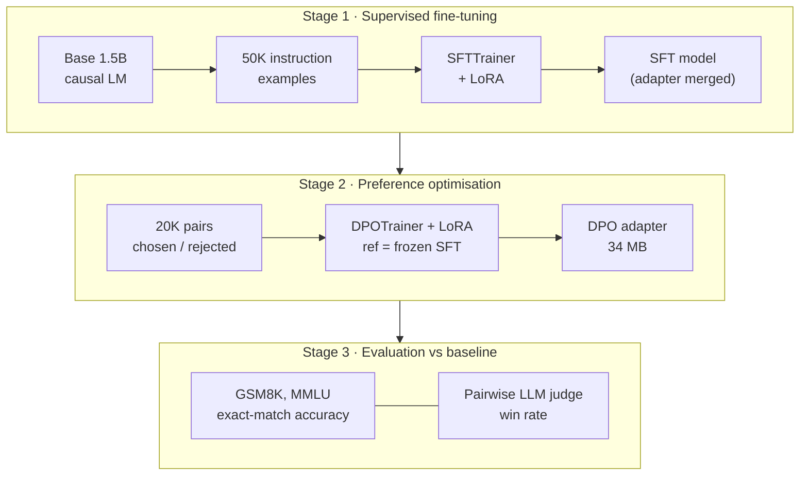
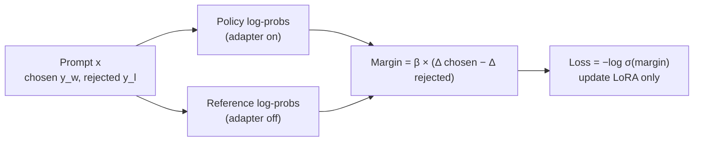

# LLM Post-Training: SFT + DPO with LoRA — Interview Playbook

*An end-to-end post-training pipeline for a 1.5-billion-parameter causal language model: supervised fine-tuning (SFT) on 50K instruction examples teaches it to follow instructions, then Direct Preference Optimization (DPO) on 20K preference pairs teaches it which of two answers people prefer. Both stages train LoRA adapters (8.4M trainable parameters, a 34 MB checkpoint instead of 3 GB) with Hugging Face TRL and PEFT, tracked in Weights & Biases, and evaluated with GSM8K, MMLU and LLM-as-a-Judge pairwise comparisons. Everything you need for a 30–45 minute interview.*

**Resume bullets this booklet defends**

1. Built an end-to-end SFT and DPO pipeline for a 1.5B causal LLM using 50K instruction and 20K preference pairs using Hugging Face TRL.
2. Applied LoRA/PEFT to 8.4M trainable parameters, reducing checkpoint size from 3GB to 34MB while tracking training/evaluations in W&B.
3. Achieved 67.8% DPO win rate, with +8.3 GSM8K and +3.1 MMLU over baseline using pairwise evaluation and LLM-as-a-Judge evaluation.

# Part 1: Project Overview

## 1.1 What is this project?

**The one-line version.** I took a small pretrained language model and taught it, in two cheap stages, to follow instructions and to give the kind of answers people prefer.

**Start with an example.** Ask a base (pretrained-only) model: *"A shop sells pens at 3 for 2 rupees. How much do 12 pens cost?"* A base model has learned to continue internet text, so it may continue with another question, a list of shop names, or a half-finished forum post. After **SFT**, it answers in the right format: a short worked solution ending in "8 rupees". After **DPO**, when it could give either a clear step-by-step answer or a rambling one with an arithmetic slip, it has learned to prefer the clear, correct style, because it was trained on thousands of pairs where the better answer was marked "chosen" and the worse one "rejected".

**The problem it solves.** Pretraining gives a model knowledge and language skill but not behaviour: it does not know it should answer, how long to be, or which of several plausible answers is better. Post-training fixes that. Doing it with full fine-tuning is expensive in GPU memory and produces a full 3 GB copy of the model for every experiment. This project builds a reproducible, low-cost pipeline: LoRA makes each stage train less than 1% of the weights, and DPO replaces the complex reinforcement-learning stage of classic RLHF with a simple classification-style loss.

**Who would use it.** ML engineers adapting open models to a domain or product style, research teams comparing alignment methods, and anyone who must post-train on one or two GPUs.

**Inputs and outputs.** Inputs: a pretrained 1.5B causal LM, 50K (instruction, response) examples, and 20K (prompt, chosen, rejected) triples. Outputs: an SFT LoRA adapter, a DPO LoRA adapter, W&B training logs, and an evaluation report (GSM8K accuracy, MMLU accuracy, pairwise win rate).

**What makes it technically interesting.** Two training objectives that do different jobs; low-rank adaptation and why it works; the role of the frozen reference model in DPO; and evaluation, where an LLM judge is convenient but biased and benchmark gains must be checked for significance and contamination.

## 1.2 Explaining it when asked "Can you explain this project?"

> **Say it aloud:** "I built a post-training pipeline for a 1.5-billion-parameter language model using Hugging Face TRL. First, supervised fine-tuning on 50K instruction–response examples teaches the model to follow instructions. Then Direct Preference Optimization on 20K preference pairs, each with a chosen and a rejected answer, teaches it which answers are better, without training a separate reward model or running PPO. Both stages use LoRA, so only 8.4 million parameters are trained, and the saved checkpoint is 34 MB instead of 3 GB. I tracked everything in Weights & Biases. On evaluation, an LLM judge preferred the DPO model's answers 67.8% of the time in pairwise comparisons, and the model gained 8.3 points on GSM8K maths and 3.1 points on MMLU over the baseline."

## 1.3 Scope, evidence status and what to confirm

**Scope boundary.** Post-training only: no pretraining, no new architecture, no reward-model training and no online RL. The model is a 1.5B causal LM; the specific base model and the datasets are not named on the resume.

> **Evidence status:** No code, logs or W&B runs for this project are in the Resume Prep folder, so every resume number is marked **UNVERIFIED**: it is your reported result, and this booklet explains what evidence defends it. Numbers in worked examples are **ILLUSTRATIVE**. Items marked **[confirm]** are standard design choices assumed to explain the bullets.

> **Resume flag:** Confirm before interviewing. (1) Base model name and dataset sources. (2) "Baseline" for +8.3 / +3.1: the base model or the SFT model? (3) Win rate 67.8%: DPO model versus which model, how many prompts, which judge, and how ties were counted. (4) Wording: GSM8K and MMLU are scored automatically against reference answers, not by "pairwise evaluation and LLM-as-a-Judge"; those two methods produce the win rate. Say this precisely. (5) LoRA rank, alpha and target modules that give 8.4M parameters.

**Two numbers already check out.** 1.5B parameters × 2 bytes (bf16) = 3.0 GB, the full checkpoint. 8.4M parameters × 4 bytes (fp32) = 33.6 MB ≈ 34 MB, the adapter checkpoint. So the adapter was most likely saved in fp32 **[confirm]**.

# Part 2: Fundamentals Required for This Project

| Resume bullet | Concepts you must be able to explain |
|---|---|
| 1. End-to-end SFT + DPO, 1.5B causal LLM, 50K instruction / 20K preference pairs, TRL | Causal LM, tokenisation and loss, pretraining vs post-training, SFT, preference data, DPO, reference model, Transformers/TRL |
| 2. LoRA/PEFT, 8.4M trainable params, 3 GB → 34 MB, W&B | LoRA and low rank, PEFT, trainable vs total parameters, checkpoint size, W&B, training/validation loss and overfitting |
| 3. 67.8% win rate, +8.3 GSM8K, +3.1 MMLU, pairwise + LLM-as-a-Judge | GSM8K, MMLU, pairwise evaluation, LLM-as-a-Judge, win rate, significance |

### Causal language model, tokenisation and the training loss

- **Simple:** A model that reads text left to right and predicts the next piece of text. Text is first cut into tokens (word pieces), and the model learns by being penalised whenever it gives the true next token low probability.
- **Technical:** A decoder-only transformer with a **causal mask**: position $t$ attends only to positions $\le t$. A tokenizer (byte-pair encoding) maps text to integer IDs. Training minimises cross-entropy between the predicted distribution and the actual next token.
- **Math:** $$\mathcal{L}_{\text{LM}} = -\frac{1}{T}\sum_{t=1}^{T} \log p_\theta(y_t \mid y_{<t})$$ $p_\theta(y_t \mid y_{<t})$ is the model's probability for the true token $y_t$ given the previous ones. The sequence log-probability $\log \pi_\theta(y \mid x) = \sum_t \log p_\theta(y_t \mid x, y_{<t})$ is what DPO uses later.
- **Why it matters:** Every stage here, SFT and DPO alike, is built from these token log-probabilities.
- **In this project:** A 1.5B-parameter causal LM; prompts are wrapped in the model's chat template so SFT, DPO and evaluation all see the same format **[confirm template]**.
- **Interview angle:** "Why 'causal'?" Because generation must not peek at future tokens; the mask enforces it during training.

### Pretraining vs post-training

- **Simple:** Pretraining is reading the internet to learn language and facts. Post-training is the short finishing school that teaches manners: answer the question, in a helpful format, preferring good answers.
- **Technical:** Pretraining uses trillions of tokens of raw text and next-token loss. Post-training uses far less, curated data: SFT on demonstrations, then preference optimisation (RLHF with PPO, or DPO), sometimes followed by further RL.
- **Why it matters:** Most of a model's knowledge comes from pretraining; post-training mostly shapes *how* that knowledge is expressed. This explains why MMLU (knowledge) moves less than formatting-sensitive scores.
- **In this project:** Starts from pretrained weights; 50K SFT examples and 20K preference pairs are tiny compared with pretraining, which is why LoRA is enough.
- **Interview angle:** "Can post-training add knowledge?" A little, but mainly it unlocks and formats what is already there.

### Supervised fine-tuning (SFT) and instruction tuning

- **Simple:** Show the model thousands of examples of "instruction → good response" and train it to imitate the responses.
- **Technical:** Next-token cross-entropy on (prompt, response) pairs, usually with the **prompt tokens masked** so loss is computed only on the response (TRL's completion-only training). Instruction tuning is SFT on diverse instructions so the model generalises to new ones.
- **Why it matters:** Teaches format, turn-taking and task following. It is also the **starting point and reference** for DPO: DPO works best when the model already produces reasonable answers.
- **In this project:** 50K instruction examples, trained with TRL's `SFTTrainer` and a LoRA adapter **[confirm masking and epochs]**.
- **Interview angle:** "What can SFT not do?" It only says "imitate this"; it never sees a bad answer, so it cannot learn what to avoid. That is DPO's job.

### Preference data: chosen and rejected responses

- **Simple:** For one prompt, two answers, with a label saying which is better. The better one is "chosen", the worse one "rejected".
- **Technical:** A dataset of triples $(x, y_w, y_l)$: prompt, winning response, losing response. Labels come from humans, a stronger model, or rules (for maths, correct vs incorrect final answer). Preferences are relative, which is easier and more consistent to label than absolute scores.
- **Why it matters:** Contrast carries information that demonstrations cannot: *why* one answer is better (correctness, clarity, safety, length).
- **In this project:** 20K preference pairs **[confirm source and how chosen/rejected were decided]**. Pairs where chosen and rejected are nearly identical teach little; pairs where the "chosen" one is merely longer teach length bias.
- **Interview angle:** "What makes a good pair?" A clear quality difference on the dimension you care about, with minimal confounds such as length.

### Direct Preference Optimization (DPO)

- **Simple:** Push the model to make the chosen answer more likely and the rejected answer less likely, but measured relative to where the model started, so it does not drift too far.
- **Technical:** Classic RLHF trains a reward model on preferences, then maximises reward with PPO under a KL penalty to a reference model. DPO shows that this KL-regularised objective has a closed-form optimal policy, so the policy itself defines an *implicit reward* $\beta \log \frac{\pi_\theta}{\pi_{\text{ref}}}$, and the preference loss can be minimised directly on the policy with no reward model and no sampling.
- **Math:** $$\mathcal{L}_{\text{DPO}} = -\log \sigma\!\Big(\beta\Big[\log\tfrac{\pi_\theta(y_w \mid x)}{\pi_{\text{ref}}(y_w \mid x)} - \log\tfrac{\pi_\theta(y_l \mid x)}{\pi_{\text{ref}}(y_l \mid x)}\Big]\Big)$$ $\pi_\theta$: model being trained; $\pi_{\text{ref}}$: frozen SFT model; $y_w, y_l$: chosen and rejected; $\sigma$: sigmoid; $\beta$: strength of the tie to the reference (often 0.1). The bracket is the **margin**: how much more the model has raised the chosen answer than the rejected one, relative to the reference. The loss falls as the margin grows.
- **Why it matters:** RLHF-like alignment with the stability and simplicity of supervised training: one loss, two models (one frozen), no reward model, no generation during training.
- **In this project:** TRL's `DPOTrainer` on 20K pairs, starting from the SFT model, with LoRA.
- **Interview angle:** "What does DPO lose compared with PPO?" It is offline: it learns only from fixed pairs and never explores its own new outputs.

### Reference model and policy model in DPO

- **Simple:** The reference model is a frozen copy of the SFT model. The policy is the copy being trained. DPO judges every change relative to the reference.
- **Technical:** The log-ratio $\log \pi_\theta / \pi_{\text{ref}}$ measures how far the policy has moved on each response; $\beta$ controls the implicit KL penalty. Small $\beta$ lets the policy move far; large $\beta$ keeps it close. With LoRA, TRL can compute reference log-probs by **disabling the adapter** instead of loading a second model.
- **Why it matters:** Without the reference, the easiest way to raise "chosen minus rejected" is to wreck fluency (for example making all text unlikely except a few patterns). The anchor prevents degenerate solutions.
- **In this project:** Reference = SFT model. A typical LoRA recipe merges the SFT adapter into the base, then trains a new DPO adapter on top so "adapter off" equals the SFT model **[confirm]**.
- **Interview angle:** "What if the reference is the base model, not SFT?" The base model gives poor probabilities on chat-formatted answers, so the log-ratios are noisy and training is less stable.

### LoRA: low-rank adaptation

- **Simple:** Instead of changing a huge weight matrix, freeze it and learn a small "correction" made of two thin matrices whose product has the same shape.
- **Technical:** For a frozen weight $W_0 \in \mathbb{R}^{d \times k}$, learn $B \in \mathbb{R}^{d \times r}$ and $A \in \mathbb{R}^{r \times k}$ with rank $r \ll \min(d,k)$. $B$ starts at zero so training starts exactly at the pretrained model. After training, $BA$ can be merged into $W_0$, so inference costs nothing extra.
- **Math:** $$W = W_0 + \frac{\alpha}{r} BA, \qquad \text{trainable params per matrix} = r(d+k)$$ ILLUSTRATIVE: $d = k = 2048$, $r = 16$: $16 \times 4096 = 65{,}536$ trainable parameters instead of $4.19$M, about 1.6%.
- **Why it matters:** Fine-tuning updates appear to be low-rank in practice: adapting to a task needs only a few new directions in weight space. LoRA exploits that to cut gradient and optimizer memory and checkpoint size by orders of magnitude.
- **In this project:** 8.4M trainable parameters, about 0.56% of 1.5B. The count equals $r \times \sum (d+k)$ over every adapted matrix in every layer **[confirm r, α, target modules]**.
- **Interview angle:** "What does α do?" It scales the update; with $\alpha/r$ fixed, changing $r$ does not require re-tuning the learning rate as much.

### PEFT, trainable vs total parameters, and checkpoint size

- **Simple:** PEFT (parameter-efficient fine-tuning) means training only a small add-on while the big model stays frozen. You save only the add-on.
- **Technical:** Hugging Face's `peft` library wraps a model with adapters (LoRA here) and marks base weights as frozen. Total parameters still run in the forward pass; trainable parameters are the only ones with gradients and optimizer states. The saved checkpoint contains only the adapter weights plus a small config.
- **Math:** checkpoint size ≈ parameters × bytes per parameter. Full model: $1.5 \times 10^9 \times 2\text{ B} = 3.0$ GB (bf16). Adapter: $8.4 \times 10^6 \times 4\text{ B} = 33.6$ MB (fp32). Training memory for Adam state also scales with trainable parameters: $8.4\text{M} \times 12\text{ B} \approx 0.1$ GB instead of $1.5\text{B} \times 12\text{ B} = 18$ GB.
- **Why it matters:** Cheap experiments (dozens of adapters fit in the space of one model), one GPU is enough, and many task adapters can share one base model in serving.
- **In this project:** 3 GB → 34 MB, about 90× smaller. To use the adapter you still need the 3 GB base model.
- **Interview angle:** "So the deployed model is 34 MB?" No; the *checkpoint you save per experiment* is 34 MB. Serving needs base + adapter, or a merged 3 GB model.

### Hugging Face Transformers, TRL and Weights & Biases

- **Simple:** Transformers loads models and tokenizers; TRL provides ready-made trainers for SFT and DPO; W&B records every training run so runs can be compared.
- **Technical:** `transformers` provides `AutoModelForCausalLM`, tokenizers and chat templates. `trl` provides `SFTTrainer` and `DPOTrainer`, which handle masking, padding, reference log-probs and the DPO loss, and integrate with `peft`. W&B logs losses, learning rate, gradient norm, evaluation metrics and config for every run; DPOTrainer also logs implicit rewards for chosen and rejected answers, their margin and the reward accuracy.
- **Why it matters:** Using maintained trainers avoids subtle bugs (wrong masking, wrong log-prob sums); experiment tracking makes results reproducible and comparisons honest.
- **In this project:** TRL for both stages; W&B for training curves and evaluation tables **[confirm what was logged]**.
- **Interview angle:** "What would you look at in W&B for DPO?" Rising reward margin and reward accuracy, and whether chosen log-probs are falling too (Q22).

### Training loss, validation loss and overfitting

- **Simple:** Training loss shows how well the model fits the data it learns from; validation loss shows how well it does on held-out data. When training loss keeps falling but validation loss rises, the model is memorising.
- **Technical:** Hold out a split of the SFT and preference data; evaluate loss periodically. Overfitting signs: widening train–validation gap, DPO reward accuracy near 100% on training pairs but not on validation pairs, and degraded fluency. Remedies: fewer epochs, lower learning rate, smaller rank, dropout on LoRA, early stopping on validation loss.
- **Why it matters:** Small post-training datasets are easy to overfit, and DPO in particular can over-optimise the margin within one or two epochs.
- **In this project:** Validation curves in W&B chose the checkpoints that were evaluated **[confirm epochs and selection rule]**.
- **Interview angle:** "Is lower DPO loss always better?" No; very low loss can mean over-optimisation. Check generation quality and benchmarks.

### GSM8K and MMLU

- **Simple:** GSM8K is a set of grade-school maths word problems; MMLU is a large multiple-choice exam across 57 subjects. Both are scored automatically.
- **Technical:** **GSM8K** test set: 1,319 problems; the model writes a solution, the final number is extracted and compared with the reference (exact match accuracy). **MMLU**: about 14K four-option questions; accuracy over all, usually few-shot (often 5-shot), scored by the option the model picks. Scores depend on prompt format and few-shot setup, so baseline and model must use identical settings.
- **Math:** Standard error of an accuracy $p$ over $n$ questions: $\sqrt{p(1-p)/n}$. GSM8K at $p \approx 0.5$: about 1.4 points. MMLU: about 0.4 points. So +8.3 on GSM8K is about 6 standard errors; +3.1 on MMLU is about 7. Both are far beyond noise if the setup is identical (paired tests are even stronger).
- **Why it matters:** GSM8K measures multi-step reasoning; MMLU measures broad knowledge. Post-training should help the first more than the second.
- **In this project:** +8.3 GSM8K and +3.1 MMLU, in accuracy **points**, over the baseline **[confirm baseline model, shots and harness]**.
- **Interview angle:** "Could the gain be contamination?" If training data contained test problems; check n-gram overlap.

### Pairwise evaluation, LLM-as-a-Judge and win rate

- **Simple:** Give a strong LLM a prompt and two answers (one from each model) and ask which is better. The win rate is how often your model wins.
- **Technical:** For a held-out prompt set, generate one answer from each model, present both to a judge LLM with a rubric, record win/tie/loss. Known biases: **position bias** (prefers the first or second slot; fix by judging both orders), **length bias** (prefers longer answers), and **self-preference** (prefers its own model family).
- **Math:** $$\text{win rate} = \frac{W + \tfrac{1}{2}T}{W + T + L}$$ (one common tie convention). Over $n = 500$ prompts, the standard error at 0.68 is about 2.1 points, so 67.8% is clearly above 50%.
- **Why it matters:** Open-ended quality (helpfulness, clarity) has no reference answer; pairwise judging is cheap and correlates reasonably with human preference.
- **In this project:** 67.8% DPO win rate **[confirm: versus SFT or base, number of prompts, judge, tie rule]**.
- **Interview angle:** "How do you know the judge is not just preferring longer answers?" Compare lengths, use length-controlled judging or instruct the judge to ignore length.

# Part 3: Methodology and Workflow

## 3.1 End-to-end pipeline

**Figure 1 — Two-stage post-training: SFT teaches the format, DPO teaches preferences; both train LoRA adapters only** [scale=0.72]

**Step 1: Prepare data.** Apply one chat template to every example; deduplicate; remove items that overlap with GSM8K or MMLU test questions; hold out validation splits. Reason: identical formatting across stages and evaluation, and no contamination.

**Step 2: SFT.** Load the base model, wrap with LoRA, train with `SFTTrainer` on 50K examples with loss on response tokens only, track train/validation loss in W&B, keep the best checkpoint. Reason: the model must produce sensible, well-formatted answers before preference learning; this model also becomes the DPO reference.

**Step 3: Merge, then DPO.** Merge the SFT adapter into the base weights; attach a fresh LoRA adapter; run `DPOTrainer` on 20K pairs with $\beta$ around 0.1 **[confirm]**. Reference log-probs come from the same model with the adapter disabled. Monitor reward margin, reward accuracy, chosen/rejected log-probs and validation loss. Reason: DPO needs the reference to equal the starting policy.

**Step 4: Evaluate.** Run GSM8K and MMLU with identical prompts and shot counts for baseline and trained models; generate answers on a held-out prompt set from both models and judge pairwise in both orders. Reason: benchmarks measure capability against reference answers; the judge measures open-ended preference.

**Step 5: Report.** W&B tables with every configuration and metric; the adapter checkpoint (34 MB) and config for reproduction.

## 3.2 What one DPO update does

**Figure 2 — One DPO update: compare how much the policy, relative to the frozen reference, prefers the chosen answer over the rejected one** [scale=0.72]

A positive margin means the policy has raised the chosen answer more than the rejected one, relative to the reference. The gradient is largest for pairs the model currently gets wrong (negative margin), so learning focuses on mistakes.

## 3.3 Numerical claims and how to defend them

| Claim | What it means and how it is computed | Baseline and what could mislead | Status |
|---|---|---|---|
| 1.5B causal LLM | Decoder-only pretrained model | Name the base model | UNVERIFIED |
| 50K / 20K pairs | SFT examples / preference triples | Source, cleaning, overlap with tests | UNVERIFIED |
| 8.4M trainable | $r \sum (d+k)$ over adapted matrices ≈ 0.56% of 1.5B | Depends on r and target modules | UNVERIFIED; show `print_trainable_parameters` |
| 3 GB → 34 MB | 1.5B × 2 B (bf16) vs 8.4M × 4 B (fp32) | Serving still needs the base model | Arithmetic consistent; UNVERIFIED |
| 67.8% win rate | DPO answers judged better in pairwise LLM judging | Opponent model, ties, position/length bias, n | UNVERIFIED |
| +8.3 GSM8K | Accuracy points vs baseline, exact match on 1,319 problems | Baseline identity, shots, contamination | UNVERIFIED |
| +3.1 MMLU | Accuracy points vs baseline on ≈ 14K questions | Prompt-format sensitivity | UNVERIFIED |

To defend these, bring: the base model name, dataset sources and cleaning steps, the LoRA config, W&B curves for both stages, the evaluation harness and settings, per-benchmark baseline and trained scores, and the judge prompt with win/tie/loss counts.

# Part 4: Important Design and Methodological Decisions

**1. SFT then DPO, not either alone.** *Why:* SFT teaches format and task following by imitation; DPO teaches relative quality from contrast. DPO from a base model has poor reference probabilities; SFT alone never learns what to avoid. *Alternative:* SFT only, or DPO only. *Trade-off:* two stages to tune and two datasets to curate.

**2. DPO instead of RLHF with PPO.** *Why:* no separate reward model, no sampling during training, one stable supervised-style loss, and far less memory (PPO needs policy, reference, reward and value models). *Alternative:* PPO. *Why less suitable here:* complex, unstable on small budgets, many hyperparameters. *Trade-off:* DPO is offline; it cannot explore and improve beyond the fixed pairs.

**3. LoRA instead of full fine-tuning.** *Why:* 0.56% of parameters trainable; optimizer state drops from about 18 GB to 0.1 GB; checkpoints 34 MB; fits one GPU. *Alternative:* full fine-tuning. *Why less suitable:* memory and storage cost for each experiment, higher risk of forgetting. *Trade-off:* slightly lower ceiling on large distribution shifts.

**4. Merge the SFT adapter before DPO, and use "adapter off" as the reference.** *Why:* the reference must equal the starting policy, and disabling the adapter gives it without a second model in memory. *Alternative:* load a separate reference model. *Trade-off:* one merge step; the merged SFT model must be kept for reproducibility.

**5. Benchmarks plus LLM-judge pairwise evaluation.** *Why:* benchmarks have reference answers but only cover narrow skills; pairwise judging covers open-ended quality but is biased. Together they cross-check. *Alternative:* human evaluation. *Why less suitable:* slow and costly at this scale. *Trade-off:* must control judge position and length bias.

**6. Track everything in W&B.** *Why:* comparable runs, visible over-optimisation (margin rising while chosen log-probs fall), reproducible configs. *Alternative:* local logs. *Trade-off:* small setup cost.

# Part 5: Complete Interview Explanation

## 5.1 Two-minute explanation

> **Say it aloud:** "Pretrained language models know a lot but do not behave like assistants. I built a two-stage post-training pipeline for a 1.5B causal model with Hugging Face TRL. Stage one is supervised fine-tuning on 50K instruction–response examples, which teaches the model to follow instructions in the right format. Stage two is Direct Preference Optimization on 20K pairs, each with a chosen and a rejected answer. DPO raises the likelihood of chosen answers relative to rejected ones, measured against a frozen copy of the SFT model, so it gets RLHF-style alignment without a reward model or PPO.
>
> Both stages use LoRA, so only 8.4 million parameters train, about half a percent, and each checkpoint is 34 MB instead of 3 GB. I tracked runs in Weights & Biases. An LLM judge preferred the DPO model's answers 67.8% of the time in pairwise comparisons, and the model gained 8.3 points on GSM8K and 3.1 on MMLU over the baseline."

## 5.2 Five-minute explanation

> **Say it aloud:** "**Problem.** After pretraining, a model continues text; it does not reliably answer questions or prefer good answers. Full fine-tuning and PPO-based RLHF are expensive and fragile on a small budget, so I wanted a cheap, reproducible pipeline.
>
> **SFT.** I format 50K instruction examples with the chat template and train with next-token cross-entropy on the response tokens only. That teaches the format and the habit of answering. It cannot teach what to avoid, because it only ever sees good examples.
>
> **DPO.** Each of the 20K preference examples has a prompt, a chosen answer and a rejected answer. DPO computes, for both answers, how much more likely the current model makes them than the frozen SFT reference, and pushes the chosen answer's increase above the rejected one's through a logistic loss scaled by β. Because the reward is implicit in those log-ratios, there is no separate reward model and no sampling during training.
>
> **LoRA.** Each adapted weight matrix gets a low-rank update B times A. Only those small matrices train: 8.4M parameters. The adapter saves as 34 MB, which matches 8.4M parameters in fp32, while the full model in bf16 is 3 GB. I merged the SFT adapter before DPO, so disabling the DPO adapter gives exactly the reference model.
>
> **Evaluation.** GSM8K and MMLU are scored by exact match against reference answers, with identical settings for baseline and trained model: +8.3 and +3.1 points. For open-ended quality, a judge LLM compared answers pairwise in both orders: 67.8% win rate. GSM8K improving more than MMLU makes sense: post-training mainly improves reasoning format, not stored knowledge.
>
> **Decisions.** SFT then DPO because they do different jobs; DPO over PPO for stability and cost; LoRA over full fine-tuning for memory and storage; both benchmarks and a judge to cross-check."

## 5.3 Ten-minute explanation

> **Say it aloud:** "I will cover the objectives, the LoRA mechanics, what I monitored, the evaluation, and limitations.
>
> **Why two objectives.** SFT is maximum likelihood on demonstrations: it moves probability toward the shown answers but never away from anything. DPO is a contrastive objective. Its loss is minus log sigmoid of β times the difference of two log-ratios: the policy-over-reference ratio for the chosen answer minus the same ratio for the rejected one. Intuitively, it is logistic regression on 'which answer is better', where the model's own log-ratios act as the reward. β sets how tightly the policy stays near the reference: small β allows large moves and risks over-optimisation; large β changes little.
>
> **Why DPO works without a reward model.** RLHF maximises reward minus a KL penalty. That problem has a closed-form optimum where the policy is the reference reweighted by the exponential of the reward. Inverting it expresses the reward as β log policy over reference, plus a term that cancels in pairwise comparisons. Plugging that into the Bradley-Terry preference model gives the DPO loss.
>
> **LoRA.** Fine-tuning updates have low intrinsic rank, so W0 plus alpha over r times BA captures them. B starts at zero, so training starts from the pretrained model. Trainable parameters per matrix are r times d plus k. With 8.4M trainable parameters, optimizer state is about a hundred megabytes instead of 18 GB, and checkpoints are 34 MB.
>
> **Monitoring.** In W&B I watched SFT train and validation loss; for DPO the reward margin, reward accuracy, and chosen and rejected log-probs. A known failure is both log-probs falling while the margin rises: the model is pushing the rejected answer down faster than it raises the chosen one, which can hurt fluency. Validation curves decide when to stop.
>
> **Evaluation design.** Benchmarks: identical prompts and shot counts for baseline and model. The standard error for GSM8K's 1,319 problems is about 1.4 points, so +8.3 is well beyond noise; MMLU's 14K questions give about 0.4, so +3.1 is significant too. I would also check contamination. Pairwise judging: answers shown in both orders to remove position bias, lengths compared to detect length bias, win rate with ties counted half.
>
> **Limitations.** DPO is offline and can exploit length or style correlations in the pairs. An LLM judge is not a human. Benchmark gains at 1.5B can be sensitive to prompt format. LoRA's low rank may limit larger domain shifts. Next steps: length-controlled win rates, a small human evaluation, iterative or online DPO with fresh pairs from the current model, and a comparison against full fine-tuning on a subset."

# Part 6: Interview Questions and Answers

## 6.1 Basic understanding

#### Q1. What did you build, in plain words? [Easy]

A pipeline that turns a pretrained 1.5B language model into a better assistant in two stages. **Supervised fine-tuning** shows it 50K examples of instructions with good responses and trains it to imitate them, which teaches it to answer in the right format. **Direct Preference Optimization** shows it 20K prompts, each with a better and a worse answer, and trains it to prefer the better one. Both stages train small LoRA adapters instead of all weights, so experiments are cheap: 8.4M trainable parameters and a 34 MB checkpoint. I used Hugging Face TRL for training and Weights & Biases for tracking. The trained model won 67.8% of pairwise comparisons judged by an LLM and gained 8.3 points on GSM8K and 3.1 on MMLU over the baseline.

#### Q2. What is the difference between pretraining and post-training? [Easy]

Pretraining teaches a model language and world knowledge by next-token prediction on trillions of tokens of raw text. The result is a strong text continuer, not an assistant: given a question it may continue with another question. Post-training uses much smaller, curated data to shape behaviour. It usually has a supervised stage (imitate good demonstrations) and a preference stage (prefer better answers), implemented with RLHF/PPO or, as here, DPO. A useful mental model: pretraining decides *what the model knows*; post-training decides *how it uses and expresses it*. That is why my GSM8K gain, which depends on reasoning format, is larger than my MMLU gain, which mostly reflects stored knowledge. Post-training is also cheap enough for parameter-efficient methods like LoRA because only a small behavioural shift is needed.

#### Q3. What is SFT, and how is the loss computed? [Easy]

Supervised fine-tuning trains the model to reproduce good responses. Each example is a prompt and a target response, formatted with the model's chat template into one token sequence. The loss is the usual next-token cross-entropy, but computed only on the response tokens: the prompt tokens are masked so the model is not trained to generate user instructions. Concretely, for each response token the model is penalised by $-\log p(\text{true token} \mid \text{everything before})$, averaged over tokens. Instruction tuning is SFT on many diverse tasks, so the model generalises to instructions it has not seen. In my pipeline SFT runs on 50K examples with TRL's `SFTTrainer` and a LoRA adapter. Its limitation is that it only says "do this"; it never sees a bad answer, so it cannot learn what to avoid, which is why DPO follows.

#### Q4. What is a preference pair? [Easy]

A preference pair is a triple: a prompt, a **chosen** response and a **rejected** response, where the chosen one is judged better. Judgements can come from humans, from a stronger model, or from rules such as "the correct final answer wins" for maths. Relative judgements are easier and more consistent than absolute scores: people disagree on whether an answer is a 6 or a 7 out of 10, but agree more on which of two is better. The contrast is informative: it shows the model what distinguishes good from bad, such as correctness, clarity or safety. Pair quality matters. If chosen answers are systematically longer, DPO learns "be long" rather than "be good". If the two answers are almost identical, the pair teaches little. I used 20K pairs; I should be able to state their source and how chosen and rejected were decided.

#### Q5. Explain DPO intuitively. [Easy]

DPO takes each preference pair and asks: compared with where the model started, has it made the chosen answer more likely than the rejected answer? It measures "where the model started" with a frozen reference model, the SFT model. For each answer it computes the log-ratio of the policy's probability to the reference's probability, which says how much training has raised or lowered that answer. The loss is $-\log \sigma(\beta \times (\text{chosen ratio} - \text{rejected ratio}))$: it is small when the chosen answer has gained much more than the rejected one, and large when the model still prefers the wrong one. So DPO is essentially logistic regression on "which answer is better", where the model's own log-ratios serve as the reward. No reward model is trained and no text is generated during training, which makes it simple and stable.

#### Q6. What is the reference model, and why does DPO need it? [Easy]

The reference model is a frozen copy of the model at the start of DPO, here the SFT model. DPO measures every change relative to it: the log-ratio $\log \pi_\theta(y \mid x) - \log \pi_{\text{ref}}(y \mid x)$ is how much training has moved the probability of answer $y$. The reference serves as an anchor, playing the role of the KL penalty in RLHF. Without it, the model could increase the gap between chosen and rejected answers in degenerate ways, for example by making all text very unlikely except a few patterns, which destroys fluency. With LoRA, the reference does not need a second copy in memory: TRL computes reference log-probabilities by running the same model with the adapter switched off. That works only if "adapter off" equals the SFT model, which is why the SFT adapter is merged into the base before DPO.

#### Q7. What does β control in DPO? [Easy]

β scales the margin inside the sigmoid and acts as the strength of the implicit KL constraint to the reference model. With **small β** (for example 0.01–0.05), the loss saturates only after large changes in the log-ratios, so the policy moves far from the reference: stronger preference learning, but more risk of over-optimisation, verbosity and lost fluency. With **large β** (for example 0.5), small changes already make the loss small, so the policy stays close to the reference and changes little. A common default is about 0.1. In practice you choose β by watching validation reward accuracy, the chosen log-probabilities and actual generations, and by evaluating a few values on the win rate. I should state the β I used **[confirm]** and whether I swept it.

#### Q8. Why do SFT before DPO? Are they not doing the same thing? [Easy]

They do different jobs and complement each other. SFT is imitation: it moves probability toward demonstrated answers and teaches format, turn-taking and the habit of answering. DPO is contrast: it learns which of two answers is better and pushes probability away from worse ones. DPO directly on a base model works poorly for two reasons. The base model's probabilities for chat-formatted answers are low and noisy, so the log-ratios against the reference are unstable. And the preference data's responses are usually from an instruction-following model, far from what a base model would write, so the policy is learning off-distribution. SFT first brings the model close to the distribution of the preference data and gives DPO a sensible reference. Conversely, SFT alone cannot learn to avoid errors that look similar to good answers; DPO can.

#### Q9. What is LoRA, and how does it work? [Easy]

LoRA, low-rank adaptation, fine-tunes a model by learning a small correction to each chosen weight matrix instead of changing the matrix itself. For a frozen matrix $W_0$ of size $d \times k$, it learns $B$ ($d \times r$) and $A$ ($r \times k$) with small rank $r$, and uses $W_0 + \frac{\alpha}{r} BA$. $B$ starts at zero, so training starts exactly at the pretrained model. Only $A$ and $B$ get gradients, so trainable parameters per matrix drop from $dk$ to $r(d+k)$; for a 2048 × 2048 matrix with $r = 16$, that is 65K instead of 4.2M. It works because fine-tuning updates tend to have low intrinsic rank: adapting to a new task needs only a few new directions. After training, $BA$ can be merged into $W_0$, so inference is no slower.

#### Q10. Explain 8.4M trainable parameters and 3 GB to 34 MB. [Easy]

The model has about 1.5 billion parameters. LoRA adds small matrices to selected layers and trains only those: 8.4 million parameters, about 0.56% of the total. The count is $r \times \sum(d + k)$ over every adapted matrix in every layer, so it depends on the rank and which modules (query, key, value, output, MLP projections) were adapted **[confirm]**. Checkpoint size is parameters times bytes per parameter. The full model in bf16 is $1.5\text{B} \times 2$ bytes = 3 GB. The adapter is $8.4\text{M} \times 4$ bytes (fp32) = 33.6 MB, which matches the 34 MB claim. Training memory benefits too: Adam keeps about 12 bytes of state per trainable parameter, so about 0.1 GB instead of 18 GB. One caveat to state clearly: to *use* the adapter you still need the 3 GB base model.

#### Q11. What do Transformers, TRL and PEFT each do in your pipeline? [Easy]

**Transformers** loads the pretrained model and tokenizer, provides the chat template that formats conversations, and runs forward passes and generation. **PEFT** wraps the model with LoRA adapters, freezes base weights, reports trainable versus total parameters, and saves or merges adapters. **TRL** provides the trainers: `SFTTrainer` handles formatting, packing or padding and response-only loss; `DPOTrainer` computes policy and reference log-probabilities for chosen and rejected answers, the DPO loss and its diagnostics, and can use the "adapter off" trick for the reference. **Weights & Biases** records configs, losses, learning rate, gradient norms and evaluation tables per run. Using maintained trainers matters because the subtle parts, such as summing log-probs over only response tokens and handling padding, are where hand-written implementations usually have bugs.

## 6.2 Evaluation

#### Q12. What are GSM8K and MMLU, and what do +8.3 and +3.1 mean? [Easy]

**GSM8K** is a benchmark of grade-school maths word problems; its test set has 1,319 problems. The model writes a solution, the final number is extracted, and accuracy is the share that exactly match the reference. **MMLU** has about 14K multiple-choice questions across 57 subjects, from law to physics, and measures broad knowledge; it is usually run few-shot. "+8.3 GSM8K" means 8.3 accuracy **points** higher than the baseline (for example 40.0% → 48.3%, ILLUSTRATIVE), not 8.3% relative. Same for +3.1 MMLU. Both must use identical prompts, shot counts and extraction rules for baseline and model. I need to confirm what "baseline" is: the untouched base model or the SFT model. Note that these are scored automatically against reference answers, not by the LLM judge.

#### Q13. What is LLM-as-a-Judge pairwise evaluation, and what does a 67.8% win rate mean? [Easy]

For each prompt in a held-out set, I generate one answer from the DPO model and one from the comparison model, show both to a strong judge LLM with a rubric, and ask which is better or whether they tie. The win rate is the share of comparisons the DPO model wins, with ties often counted as half: $(W + T/2)/(W+T+L)$. A 67.8% win rate means the judge preferred the DPO model in roughly two out of three comparisons; 50% would mean no difference. With 500 prompts, the standard error is about 2 points, so the result is clearly above chance. It is used because open-ended answers have no single correct reference. I must be able to say which model was the opponent (SFT or base), how many prompts, which judge, and the tie convention **[confirm]**.

#### Q14. How did you detect overfitting? [Easy]

By comparing training and validation curves in W&B. For SFT, I held out part of the 50K examples and evaluated loss periodically: training loss that keeps falling while validation loss flattens and rises means memorisation. For DPO, the useful validation signals are reward accuracy (the share of held-out pairs where the chosen answer has the larger implicit reward) and the reward margin. If training reward accuracy approaches 100% while validation accuracy stalls, the model is fitting the specific pairs. I also watched the absolute log-probability of chosen answers: if it falls steadily, the model may be degrading even though the margin looks good. Remedies are early stopping on validation metrics, fewer epochs (DPO often needs only one to three), a lower learning rate, a smaller LoRA rank or LoRA dropout, and checking real generations rather than trusting the loss alone.

#### Q15. What assumptions does DPO make, and when does it fail? [Easy]

DPO assumes preferences follow a **Bradley-Terry model**: the probability that answer A beats B depends on the difference of their (implicit) rewards. It assumes the reference model is a good starting point and covers the kinds of answers in the data, and it learns only from the fixed offline pairs. It fails or degrades when: preference labels are noisy or inconsistent (it fits the noise); pairs contain confounds such as length, so it learns "longer is better"; the responses in the pairs come from a very different model than the policy (off-distribution log-ratios); β is too small, causing over-optimisation; or the task needs exploration beyond the data, which online RL can do and DPO cannot. A known symptom is both chosen and rejected log-probs falling during training, which can harm fluency even as the loss improves.

## 6.3 Methodology and design

#### Q16. Why DPO instead of RLHF with PPO? [Medium]

PPO-based RLHF has three stages: SFT, train a reward model on preferences, then optimise the policy with PPO against that reward while a KL penalty keeps it close to the reference. During PPO you need four models (policy, reference, reward model and a value model), you must generate samples online, and training is sensitive to many hyperparameters; it can diverge or collapse. DPO shows that the KL-regularised reward-maximisation problem has a closed-form optimum, so the reward can be written in terms of the policy itself, and the preference loss can be minimised directly with one supervised-style loss, two models (one frozen) and no generation during training. For a 1.5B model on a small budget, that is decisive. The trade-off: PPO is online and can explore and improve on its own new outputs; DPO is limited to the fixed pairs, which is why iterative DPO (re-collecting pairs from the current model) is a common extension.

#### Q17. Why LoRA instead of full fine-tuning, and does it hurt quality? [Medium]

Memory, storage and safety of experiments. Full fine-tuning of 1.5B parameters with Adam needs about 16 bytes per parameter (weights, gradients, optimizer state), roughly 24 GB before activations, and DPO adds reference computations. With LoRA, gradients and optimizer state exist only for 8.4M parameters, so training fits a single modest GPU, and each experiment saves a 34 MB adapter instead of 3 GB. LoRA also reduces catastrophic forgetting, because the base weights are frozen. On quality: for instruction tuning and preference alignment, which are small behavioural shifts, LoRA usually comes close to full fine-tuning, especially when applied to all linear layers with a reasonable rank. It can fall behind on large domain shifts or new knowledge. The honest answer is that I did not run a full fine-tuning comparison **[confirm]**; a small ablation on a subset would quantify the gap.

#### Q18. How do you know the improvements are real and meaningful? [Medium]

Four checks. **Same setup:** baseline and trained model are evaluated with identical prompts, shots, decoding settings and answer extraction, otherwise differences reflect the harness, not the model. **Statistical noise:** the standard error is about 1.4 points for GSM8K's 1,319 problems and 0.4 points for MMLU's 14K questions, so +8.3 and +3.1 are far beyond noise; a paired test (McNemar) on per-question correctness is even stronger, and seeds or multiple samples show variance. **Contamination:** check n-gram overlap between training data and test questions; overlap inflates gains. **Judge validity:** judge both answer orders, compare answer lengths, and ideally hand-check a sample to confirm the judge agrees with humans. Finally, an ablation helps attribute gains: base → SFT → SFT + DPO shows how much each stage contributes, which also clarifies what "baseline" means.

#### Q19. What biases does an LLM judge have, and how did you control them? [Medium]

Three main ones. **Position bias:** judges tend to favour the answer in a particular slot. Control: judge every pair twice with the order swapped and count a win only if consistent, or average the two. **Length (verbosity) bias:** judges often prefer longer, more detailed answers even when not better; DPO can exploit this if chosen answers in the training pairs were longer. Control: report average lengths for both models, instruct the judge to ignore length, or use a length-controlled win rate. **Self-preference:** a judge may favour outputs resembling its own model family. Control: use a judge unrelated to the models that produced training data. Also use a clear rubric, temperature 0, and a structured verdict. Finally, check agreement between the judge and a small human-labelled sample. I should state which controls I actually used **[confirm]**.

#### Q20. Why would DPO improve GSM8K by 8.3 but MMLU only by 3.1? [Medium]

Because they measure different things. GSM8K rewards **multi-step reasoning in a clean format**: write out steps, avoid arithmetic slips, end with a clearly extractable number. SFT on instruction data and DPO on pairs where correct, clear solutions are chosen over sloppy ones directly target that behaviour, and answer-extraction failures in a weak baseline also disappear. MMLU mostly measures **stored knowledge** across 57 subjects in a multiple-choice format; post-training cannot add much knowledge with 70K examples, so gains come mainly from better instruction following and answer formatting. That pattern, a large reasoning-benchmark gain and a small knowledge-benchmark gain, is what one would expect and makes the results more credible, not less. If MMLU had jumped by 10 points, I would suspect contamination or a formatting artefact in the baseline evaluation.

#### Q21. How did you choose LoRA rank, alpha and target modules? [Medium]

Rank $r$ sets capacity: higher rank means more trainable parameters and more expressive updates, with diminishing returns. Alpha scales the update by $\alpha/r$; a common heuristic is $\alpha = 2r$ or $\alpha = r$, which keeps the effective step size stable when changing rank. Target modules decide where adapters go: attention projections only (query, key, value, output) is cheapest, while adding the MLP projections (gate, up, down) usually helps instruction and reasoning tasks because much of the model's computation is in the MLP. The trainable count is $r \sum(d+k)$, so for a given model the 8.4M figure pins down a combination of rank and modules **[confirm the exact config]**. The selection method should be empirical: a small sweep on validation loss and a quick benchmark, keeping the smallest configuration that does not lose quality. Dropout on LoRA layers helps with small datasets.

#### Q22. What would you look for in W&B to know DPO is working or failing? [Medium]

DPOTrainer logs the implicit rewards $\beta \log(\pi_\theta/\pi_{\text{ref}})$ for chosen and rejected answers. **Healthy:** the reward margin (chosen minus rejected) rises steadily; reward accuracy on validation pairs climbs well above 50% and stabilises; validation loss falls; gradient norm is stable. **Warning signs:** training accuracy near 100% while validation accuracy stalls (overfitting); the margin growing mainly because rejected rewards plunge while chosen rewards also fall, meaning the model is lowering the probability of *both* answers, which often shows up as degraded fluency or longer, odd generations; loss collapsing within a fraction of an epoch (data too easy, or β too small); and average generation length drifting upward (length exploitation). Always pair the curves with sampled generations logged as W&B tables, because a good-looking loss can hide bad text.

#### Q23. How would you deploy the trained model? [Medium]

Two options. **Merge** the LoRA adapter into the base weights ($W = W_0 + \frac{\alpha}{r}BA$) and serve one ordinary 3 GB model. This gives zero extra latency and works with any inference engine. **Keep adapters separate** and load one base model with many small adapters, switching per request; engines such as vLLM support serving multiple LoRA adapters on one base. That is attractive when you have many task- or customer-specific variants, because each is 34 MB rather than 3 GB, at the cost of a small per-request overhead. Before deployment I would quantise for memory if needed and re-run the evaluations after quantisation, run safety checks (DPO can change refusal behaviour), and set up monitoring of output length and user feedback. The training pipeline itself is not a deployed service; it is reproducible from the configs in W&B.

#### Q24. What happens if the preference data is noisy or biased? [Medium]

DPO fits whatever the labels say, so noise and bias go straight into the model. **Random noise** (some pairs flipped) weakens the signal and makes the model overfit to inconsistent examples; reward accuracy on validation stays low. Remedies: filter pairs where multiple judges disagree, drop pairs with tiny quality differences, or use variants designed for noisy labels (conservative DPO with label smoothing, or IPO, which bounds the margin). **Systematic bias** is worse because it looks like a real signal: if chosen answers are longer, more confident or more formal, DPO learns that style. Checks: compare length and style statistics between chosen and rejected sets before training, and control for them in evaluation. For maths, rule-based preferences (correct final answer wins) are cleaner than judge-based ones. Knowing where my 20K pairs came from is essential to answer this convincingly **[confirm]**.

#### Q25. Why can DPO train without a reward model? Sketch the reasoning. [Hard]

RLHF maximises expected reward minus $\beta$ times the KL divergence from the reference. That objective has a known closed-form optimum: $\pi^\ast(y \mid x) \propto \pi_{\text{ref}}(y \mid x)\exp(r(x,y)/\beta)$, the reference reweighted toward high-reward answers. Rearranging gives the reward in terms of the optimal policy: $r(x,y) = \beta \log \frac{\pi^\ast(y \mid x)}{\pi_{\text{ref}}(y \mid x)} + \beta \log Z(x)$, where $Z(x)$ is a normaliser that depends only on the prompt. Preference data is modelled with Bradley-Terry: $P(y_w \succ y_l) = \sigma(r(x,y_w) - r(x,y_l))$. In that difference, $\beta \log Z(x)$ cancels, because both answers share the same prompt. Substituting the policy for $\pi^\ast$ and maximising the likelihood of observed preferences gives exactly the DPO loss. So the policy *is* the reward model implicitly; that is the meaning of the paper's subtitle, "your language model is secretly a reward model".

# Part 7: Final Revision Sheet

### 1. Project in one paragraph

Two-stage post-training of a 1.5B causal LM with Hugging Face TRL. SFT on 50K instruction examples (response-only loss) teaches format; DPO on 20K chosen/rejected pairs, with the frozen SFT model as reference, teaches preferences without a reward model or PPO. LoRA trains 8.4M parameters (0.56%); checkpoints 34 MB vs 3 GB. W&B tracks curves and DPO diagnostics. Results: 67.8% LLM-judge pairwise win rate; +8.3 GSM8K, +3.1 MMLU accuracy points over baseline.

### 2. Workflow in one diagram

> **Note:** Base 1.5B → chat-template data → SFT + LoRA (50K) → merge → DPO + LoRA (20K, ref = SFT, β) → GSM8K / MMLU exact match + pairwise LLM judge → W&B report.

### 3. Technologies and roles

- **Transformers:** model, tokenizer, chat template
- **PEFT / LoRA:** adapters, freeze base
- **TRL:** SFTTrainer, DPOTrainer
- **W&B:** runs, curves, eval tables

### 4. Five most important concepts

1. SFT = imitation; DPO = contrast
2. DPO loss: −log σ(β·[Δchosen − Δrejected])
3. Reference model = KL anchor
4. LoRA: W₀ + (α/r)BA, r(d+k) params
5. Judge biases: position, length, self

### 5. Five key decisions

1. SFT before DPO
2. DPO over PPO
3. LoRA over full fine-tuning
4. Merge SFT; adapter-off reference
5. Benchmarks + LLM judge together

### 6. Five likely questions

1. Explain DPO and β.
2. Why SFT first?
3. 8.4M params and 34 MB: show the math.
4. Is +8.3 significant? What baseline?
5. How did you control judge bias?

### 7. Key metrics

| Metric | Definition |
|---|---|
| Win rate | $(W+T/2)/(W+T+L)$ |
| GSM8K | exact-match accuracy, 1,319 Qs |
| MMLU | MC accuracy, ≈ 14K Qs, 57 subjects |
| Reward acc. | share of pairs with chosen reward > rejected |

### 8. Limitations

Offline DPO cannot explore; judge bias; length exploitation; benchmark format sensitivity; no full-FT comparison; dataset sources and baseline to confirm; numbers UNVERIFIED.

### 9. Ten things to remember

1. 3 GB = 1.5B × 2 B; 34 MB ≈ 8.4M × 4 B.
2. 0.56% of parameters trainable.
3. B starts at zero; merge after training.
4. β ≈ 0.1: small β = moves far.
5. Reference = SFT model, adapter off.
6. Prompt tokens masked in SFT.
7. GSM8K SE ≈ 1.4 pts; MMLU ≈ 0.4.
8. "Points", not percent.
9. Judge both orders; compare lengths.
10. GSM8K/MMLU are not judged by the LLM.

