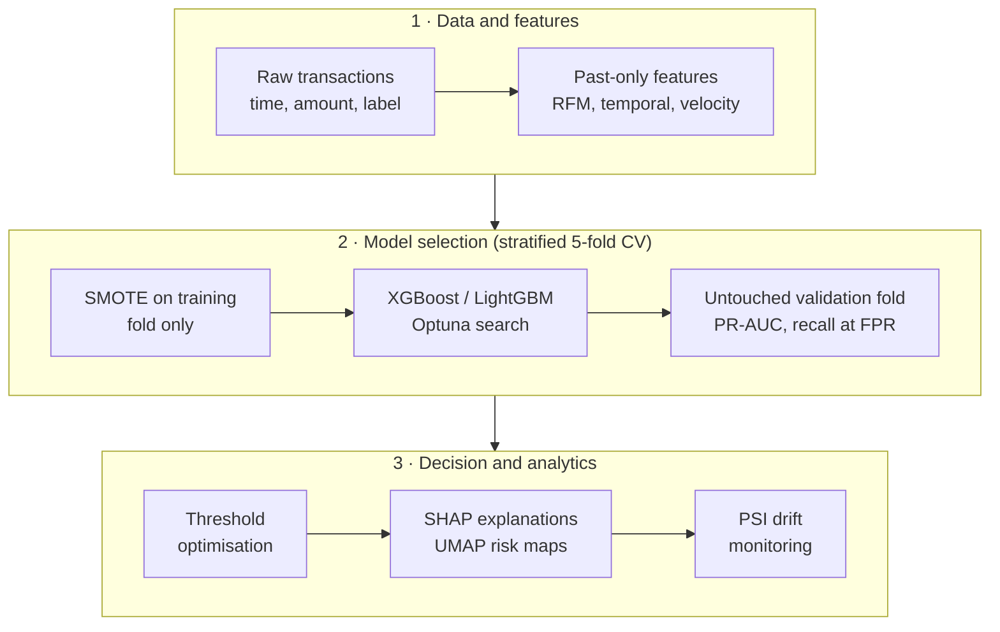
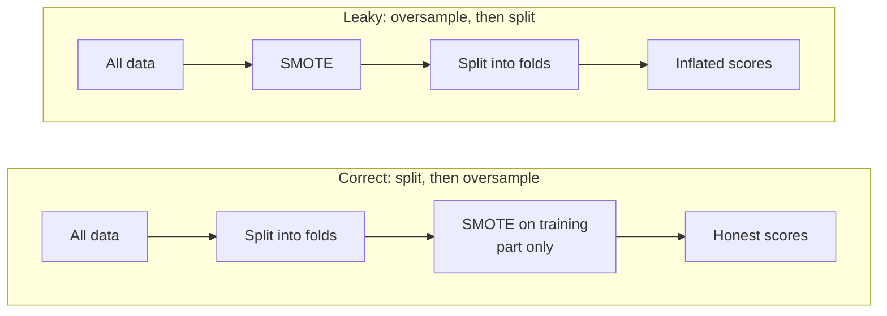

# Fraud Detection & Risk Analysis Platform — Interview Playbook

*An interpretable machine-learning system for detecting fraudulent card transactions when fraud is extremely rare (0.17% of 284K transactions). It engineers RFM, temporal and velocity features, trains XGBoost (with LightGBM as a comparison) using fold-local SMOTE inside stratified 5-fold cross-validation, tunes hyperparameters with Optuna, explains predictions with SHAP, visualises risk structure with UMAP, monitors drift with the Population Stability Index, and is tracked in MLflow, tested with pytest (87% coverage) and built by GitHub Actions. This is the ML-engineering edition. Everything you need for a 30–45 minute interview.*

**Resume bullets this booklet defends**

1. Built fraud classifier on 284K transactions with 0.17% prevalence; XGBoost achieved 0.914 PR-AUC and 0.82 Recall at 1% false-positive rate.
2. Engineered RFM, temporal, velocity features with fold-local SMOTE; optimised XGBoost using Optuna and stratified 5-fold cross-validation.
3. Built SHAP/UMAP risk analytics with threshold optimisation & PSI drift monitoring, achieving 87% pytest coverage and GitHub Actions CI/CD.

# Part 1: Project Overview

## 1.1 What is this project?

**The one-line version.** Given a card transaction, output a fraud-risk score, explain why the score is high, and decide whether to flag it, while monitoring whether the data the model sees is changing.

**Start with an example.** Imagine 100,000 transactions in a day, of which 170 are fraud (0.17%). A card that normally makes two grocery purchases a day suddenly makes six purchases in ten minutes, each larger than its usual amount, at 3 a.m. No single field is suspicious, but together they are. The model turns that history into features ("6 transactions in the last hour", "amount is 5× this card's average", "night-time"), outputs a score such as 0.97, and SHAP explains that the velocity and amount-ratio features pushed the score up. An analyst reviews it; the transaction is blocked.

**The problem it solves.** Fraud costs money directly (chargebacks) and indirectly (customer trust). The ML difficulty is that fraud is rare, so naive models learn to say "legitimate" for everything; errors have very different costs; fraud patterns change over time; and decisions must be explainable to analysts, customers and regulators.

**Who would use it.** A fraud-operations team (analysts reviewing flagged transactions), risk managers choosing alert thresholds, and ML engineers maintaining the model in production.

**Inputs and outputs.** Input: transaction records (time, amount and other attributes) and, for training, a fraud label. Output: a probability-like risk score per transaction, a flag at a chosen threshold, SHAP explanations, UMAP risk maps, and PSI drift reports.

**What makes it technically interesting.** Evaluation under extreme imbalance (why PR-AUC, why recall at a fixed false-positive rate); leakage traps (oversampling before splitting, features that peek into the future); gradient boosting and its tuning; and the engineering around the model: explainability, drift monitoring, experiment tracking, tests and CI.

## 1.2 Explaining it when asked "Can you explain this project?"

> **Say it aloud:** "I built a fraud-detection pipeline on 284K card transactions where only 0.17% are fraud. Because of that imbalance, accuracy is meaningless, so I evaluated with PR-AUC and with recall at a fixed 1% false-positive rate. I engineered recency-frequency-monetary, time-of-day and velocity features, and trained XGBoost with stratified 5-fold cross-validation, applying SMOTE oversampling only inside each training fold so that no synthetic data leaked into validation. Optuna tuned the hyperparameters. XGBoost reached 0.914 PR-AUC and 82% recall at a 1% false-positive rate. Around the model I built SHAP explanations, UMAP visualisations, threshold optimisation and PSI drift monitoring, with MLflow tracking, 87% pytest coverage and a GitHub Actions pipeline."

## 1.3 Scope, evidence status and what to confirm

**Scope boundary.** Offline modelling, evaluation and monitoring tooling. It is not a live, real-time card-authorisation system, and it does not handle case management or customer communication.

> **Evidence status:** No code, notebooks or MLflow runs for this project are in the Resume Prep folder, so every resume number is marked **UNVERIFIED**: your reported result, with the evidence needed to defend it. Numbers in worked examples are **ILLUSTRATIVE**. Items marked **[confirm]** are standard choices assumed to explain the bullets.

> **Resume flag:** Confirm before interviewing. (1) **Dataset.** 284K transactions at 0.17% fraud matches the public ULB / Kaggle credit-card dataset (284,807 transactions, 492 frauds, two days, PCA features V1–V28 plus Time and Amount). That dataset has **no card or customer ID**, so per-customer RFM and velocity features cannot be computed directly; be ready to say exactly how you built them (another dataset, a derived key, or global time-window features). (2) **The two headline numbers.** On a test set with 0.17% fraud, if recall were 0.82 at exactly 1% FPR, PR-AUC could not exceed about 0.85 (proof in 3.3). Either 0.82 recall is reached at a much lower FPR (then say "at ≤ 1% FPR"), the two numbers come from different evaluation sets, or PR-AUC was computed on a rebalanced set, which would be leakage. Know which. (3) Whether 0.914 is the cross-validation mean or a separate held-out test.

# Part 2: Fundamentals Required for This Project

| Resume bullet | Concepts you must be able to explain |
|---|---|
| 1. 284K transactions, 0.17% prevalence, XGBoost, 0.914 PR-AUC, 0.82 recall at 1% FPR | Binary classification, class imbalance, accuracy paradox, precision/recall/F1/FPR, ROC-AUC vs PR-AUC, gradient boosting, XGBoost vs LightGBM |
| 2. RFM, temporal, velocity features; fold-local SMOTE; Optuna; stratified 5-fold CV | Feature engineering, data leakage, stratified CV, SMOTE, fold-local resampling, hyperparameter optimisation |
| 3. SHAP/UMAP analytics, threshold optimisation, PSI drift, 87% pytest, GitHub Actions | SHAP (global vs local), UMAP, thresholds, PSI, data vs concept drift, MLflow, testing, CI/CD |

### Class imbalance and why accuracy misleads

- **Simple:** When 99.83% of transactions are legitimate, a model that always says "legitimate" is 99.83% accurate and catches no fraud at all.
- **Technical:** Accuracy is dominated by the majority class. Imbalance also biases training: the loss is mostly about legitimate transactions, so the minority boundary is learned poorly. Remedies: resampling (SMOTE, undersampling), class weights (XGBoost's `scale_pos_weight`), and metrics focused on the positive class.
- **Math:** ILLUSTRATIVE, 100,000 transactions with 170 frauds. "Always legitimate": accuracy $= 99{,}830 / 100{,}000 = 99.83\%$, recall $= 0$. A model that catches 140 frauds with 1,000 false alarms: accuracy $= (140 + 98{,}830)/100{,}000 = 98.97\%$, *lower* than the useless model, yet it stops 82% of fraud.
- **Why it matters:** You must choose metrics that reward catching the rare class.
- **In this project:** 0.17% prevalence means about 98 frauds per fold in 5-fold CV of 284K rows, so metrics are also noisy across folds.
- **Interview angle:** "What is the base rate's effect on precision?" Even a tiny false-positive rate produces many false alarms relative to the few frauds.

### Scores, thresholds and the confusion matrix

- **Simple:** The model outputs a fraud score $\hat p(x) \approx P(\text{fraud} \mid x)$; a threshold $t$ turns it into a decision ("flag if $\hat p \ge t$"). Recall: what share of fraud did we catch? Precision: what share of our alerts were really fraud? False-positive rate: what share of legitimate customers did we wrongly flag?
- **Math:** $$\text{Recall} = \frac{TP}{TP+FN}, \quad \text{Precision} = \frac{TP}{TP+FP}, \quad \text{FPR} = \frac{FP}{FP+TN}, \quad F_1 = \frac{2PR}{P+R}$$
- **Technical:** Lowering the threshold raises recall and FPR together and usually lowers precision. **Threshold optimisation** chooses $t$ to meet a business constraint (for example FPR ≤ 1%, or a fixed analyst review capacity) or to minimise expected cost $C_{FN}\cdot FN + C_{FP}\cdot FP$, using validation data only.
- **Why it matters:** FPR has legitimate customers in the denominator, so it measures customer friction; precision has alerts in the denominator, so it measures analyst workload.
- **In this project:** 0.82 recall at 1% FPR. ILLUSTRATIVE scale: 1% of 284,315 legitimate transactions is about 2,843 false alarms, against about 403 frauds caught (0.82 × 492), which is a precision of about 12%.
- **Interview angle:** "Is 0.5 the right threshold?" Almost never under imbalance (SMOTE also shifts scores). "Why recall at fixed FPR rather than F1?" Operations fix a tolerable false-alarm rate first.

### ROC-AUC vs PR-AUC, and recall at a fixed FPR

- **Simple:** ROC-AUC asks how well the model ranks fraud above legitimate overall. PR-AUC asks how precise the alerts stay as you catch more fraud. Recall at 1% FPR is one specific point on the ROC curve.
- **Technical:** The ROC curve plots recall (TPR) against FPR over all thresholds; ROC-AUC equals the probability a random fraud scores above a random legitimate transaction. The PR curve plots precision against recall; its area (average precision) depends on prevalence. With 0.17% fraud, FPR barely moves when thousands of false alarms appear (the denominator is huge), so ROC-AUC looks excellent (often > 0.97) even for weak models, while PR-AUC exposes the false alarms. A random model has ROC-AUC 0.5 but PR-AUC equal to the prevalence, 0.0017.
- **Math:** Average precision $= \sum_n (R_n - R_{n-1})\,P_n$, the precision at each threshold weighted by the recall gained.
- **Why it matters:** PR-AUC summarises the whole precision-recall trade-off; recall at 1% FPR describes the single operating point the business would use. They answer different questions and both are needed.
- **In this project:** 0.914 PR-AUC (about 540× the random baseline) and 0.82 recall at 1% FPR **[confirm they come from the same test data; see 3.3]**.
- **Interview angle:** "Is PR-AUC comparable across datasets?" No; it depends on prevalence. ROC-AUC is prevalence-independent.

### Decision trees, gradient boosting, XGBoost and LightGBM

- **Simple:** A decision tree asks a sequence of yes/no questions ("amount > 500?", "more than 3 transactions in the last hour?"). Boosting builds many small trees one after another, each correcting the mistakes of the ones before.
- **Technical:** Gradient boosting fits an additive model of $M$ trees. Each new tree is fitted to the negative gradient of the loss (for log-loss, roughly "label minus current predicted probability"), and added with a small learning rate $\eta$.
- **Math:** $$F_m(x) = F_{m-1}(x) + \eta\, h_m(x), \qquad \hat p(x) = \sigma(F_M(x))$$ $h_m$ is the $m$-th tree, $\eta$ the learning rate (shrinkage), $\sigma$ the sigmoid. XGBoost adds a regularised objective $\sum_i \ell(y_i, \hat y_i) + \sum_m \big(\gamma T_m + \tfrac{\lambda}{2}\lVert w_m\rVert^2\big)$ that penalises the number of leaves $T_m$ and large leaf weights $w_m$.
- **Why it matters:** Trees capture non-linear interactions ("high amount *and* night *and* new merchant") and need no feature scaling; boosting with shrinkage is among the strongest methods for tabular data.
- **In this project:** XGBoost is the main model (level-wise trees, second-order gradients, `scale_pos_weight`). LightGBM, the comparison, grows trees leaf-wise with histogram binning: faster, but prone to overfit a few hundred positives unless `num_leaves` is constrained. Logistic regression is the natural baseline **[confirm baselines and LightGBM score]**.
- **Interview angle:** "Bagging vs boosting?" Random forests average independent deep trees to cut variance; boosting adds shallow trees sequentially to cut bias.

### Feature engineering: RFM, temporal and velocity features

- **Simple:** Turn raw transactions into signals about behaviour. RFM: how **R**ecently did this card transact, how **F**requently, and how much **M**oney? Temporal: what time is it? Velocity: how fast are transactions arriving right now?
- **Technical:** Recency = time since the previous transaction; frequency = count in a trailing window (1 h, 24 h); monetary = mean or total amount in the window and the current amount's ratio to it. Temporal: hour of day (cyclically encoded with sine and cosine), night flag. Velocity: transactions or spend per window, change versus the usual rate. All windows must use **only past transactions** (strictly before the current timestamp).
- **Why it matters:** Fraud is a deviation from normal behaviour; behaviour lives in history, not in one row. These features often matter more than model choice.
- **In this project:** RFM, temporal and velocity features **[confirm the grouping key: per card, or global time windows if the dataset has no card ID; see 1.3]**.
- **Interview angle:** "How do you avoid leakage in these features?" Compute rolling windows that end strictly before the transaction, and never use statistics computed over the whole dataset (Q18).

### Data leakage and stratified cross-validation

- **Simple:** Leakage is when information that would not be available at prediction time sneaks into training or evaluation, making results look better than reality. Cross-validation estimates performance by training and testing on different splits.
- **Technical:** **Stratified $k$-fold** splits data into $k$ folds with the same fraud rate in each (here about 98 frauds per fold); each fold is the validation set once, and metrics are averaged. Leakage sources: preprocessing fitted on all data (scalers, SMOTE, target encoders), features using future information, and duplicates across splits. Random folds also ignore time order; a time-based split is more realistic when fraud patterns drift.
- **Why it matters:** With only about 98 positives per fold, an unstratified split could leave a fold with very few frauds and wildly unstable metrics.
- **In this project:** Stratified 5-fold CV, with every fitted transformation (including SMOTE) inside the training fold.
- **Interview angle:** "Would you use a time-based split?" Yes, as a final check: train on earlier transactions, test on later ones (Q18).

### SMOTE and fold-local SMOTE

- **Simple:** SMOTE creates synthetic fraud examples by drawing points between real fraud examples, so the model sees more of the rare class. Fold-local means doing it only on the training part of each fold.
- **Technical:** For a minority point $x_i$, pick one of its $k$ nearest minority neighbours $x_{nn}$ and create $x_{\text{new}} = x_i + \lambda (x_{nn} - x_i)$ with $\lambda \sim U(0,1)$. **If SMOTE runs before splitting**, synthetic points built from a validation fraud end up in training, so the model is tested on near-copies of what it trained on, inflating recall and PR-AUC. Synthetic points can also land in the validation set itself, changing its class balance. Fold-local SMOTE (for example an `imblearn` Pipeline inside CV) fixes both.
- **Why it matters:** Oversampling-before-splitting is one of the most common causes of unrealistically good fraud results.
- **In this project:** SMOTE fitted inside each training fold only; validation folds keep the true 0.17% prevalence.
- **Interview angle:** "Does SMOTE change predicted probabilities?" Yes, it inflates them, because training prevalence is artificial; recalibrate or choose thresholds on untouched validation data.

### Optuna hyperparameter optimisation

- **Simple:** An automatic search for the best model settings (tree depth, learning rate and so on) that learns from previous trials which regions look promising.
- **Technical:** Each trial samples hyperparameters, runs stratified 5-fold CV and returns the mean PR-AUC. The default sampler, **TPE** (Tree-structured Parzen Estimator), models which values produced good and bad results and samples more from the good region; **pruning** stops unpromising trials early. Typical XGBoost search space: `max_depth`, `learning_rate`, `n_estimators`, `subsample`, `colsample_bytree`, `min_child_weight`, `gamma`, `lambda`, `scale_pos_weight`, plus SMOTE's ratio and $k$.
- **Why it matters:** Far more efficient than grid search when there are many hyperparameters.
- **In this project:** Optuna maximised CV PR-AUC **[confirm objective, trial count]**. Reporting the best CV score from the same folds used for tuning is optimistic; nested CV or a separate test set fixes it (Q20).
- **Interview angle:** "Why PR-AUC as the objective?" It matches the imbalanced evaluation and does not depend on a threshold.

### SHAP: global and local explanations

- **Simple:** SHAP splits a prediction into contributions from each feature: "velocity added +2.1 to the risk score, amount ratio added +1.3, time of day subtracted 0.4".
- **Technical:** SHAP values come from Shapley values in cooperative game theory: a feature's contribution averaged over all orders in which features could be added. They are additive: $f(x) = \phi_0 + \sum_j \phi_j$, where $\phi_0$ is the average model output and $\phi_j$ feature $j$'s contribution (for XGBoost, in log-odds). **TreeSHAP** computes them exactly and fast for tree ensembles. **Local:** one transaction's explanation. **Global:** mean $|\phi_j|$ across transactions ranks features; beeswarm and dependence plots show direction and interactions.
- **Why it matters:** Analysts need reasons to act; regulators and customers may require explanations; global SHAP also reveals leakage (a suspiciously dominant feature).
- **In this project:** SHAP summaries for global importance and per-alert explanations for analysts.
- **Interview angle:** "Is SHAP causal?" No; it explains the model, not the world, and splits credit arbitrarily among correlated features (Q23).

### UMAP for risk visualisation

- **Simple:** UMAP squashes many features into two dimensions so you can see the data as a map, where similar transactions sit close together.
- **Technical:** UMAP (Uniform Manifold Approximation and Projection) builds a nearest-neighbour graph in high dimensions and finds a low-dimensional layout preserving local neighbourhoods. Key parameters: `n_neighbors` (local vs global structure) and `min_dist` (cluster tightness). Distances between far-apart clusters and cluster sizes are not reliable.
- **Why it matters:** Lets analysts see whether fraud forms distinct clusters (several fraud types), sits among legitimate points (hard cases), or whether new data lands in unseen regions (drift).
- **In this project:** UMAP maps of transactions coloured by label and risk score **[confirm inputs: raw features or SHAP values]**. **SHAP vs UMAP:** SHAP explains *why the model* scored a transaction; UMAP shows *how the data* is arranged. One is attribution, the other unsupervised visualisation.
- **Interview angle:** "Would you train on UMAP features?" Possible, but leakage-prone if fitted on all data; it is mainly an analysis tool here.

### Population Stability Index (PSI): data drift vs concept drift

- **Simple:** PSI measures how much a feature's (or the score's) distribution has shifted between a reference period and now.
- **Math:** Bin the reference distribution (for example into 10 deciles); let $e_i$ and $a_i$ be the reference and current shares in bin $i$: $$\text{PSI} = \sum_i (a_i - e_i)\,\ln\frac{a_i}{e_i}$$ Rule of thumb: < 0.1 stable; 0.1–0.25 moderate shift; > 0.25 significant shift. ILLUSTRATIVE: one bin moving from 10% to 20% contributes $0.1 \times \ln 2 \approx 0.069$.
- **Technical:** **Data drift** (covariate shift): $P(x)$ changes, which PSI detects without labels. **Concept drift**: $P(y \mid x)$ changes, for example fraudsters change tactics so the same features mean something different; it needs labels (which arrive late via chargebacks) to detect, through falling precision or recall.
- **Why it matters:** Models decay silently; PSI is a cheap early warning.
- **In this project:** PSI on key features and on the score distribution, with alert thresholds **[confirm reference window]**.
- **Interview angle:** "PSI is high: do you retrain?" First investigate (pipeline bug? seasonality? real change?), then check performance on recent labels.

### MLflow, pytest coverage and GitHub Actions CI/CD

- **Simple:** MLflow records every experiment; pytest checks the code works; GitHub Actions runs those checks automatically on every change.
- **Technical:** **MLflow** logs parameters, metrics, artifacts (models, plots) and versions models in a registry. **pytest** unit tests cover feature functions (windows exclude the current row), the CV pipeline (SMOTE only on training folds), metric functions and PSI; **87% coverage** means 87% of code lines executed during tests, which shows breadth, not correctness. **GitHub Actions** runs linting and tests on each push or pull request, and can build artifacts.
- **Why it matters:** ML code fails silently; tests on leakage-prone logic protect the evaluation itself.
- **In this project:** MLflow tracking, 87% coverage, CI on GitHub Actions **[confirm what CD deploys, if anything]**.
- **Interview angle:** "What is worth testing in ML code?" Leakage guards, feature correctness on tiny hand-made examples, and metric implementations.

# Part 3: Methodology and Workflow

## 3.1 End-to-end pipeline

**Figure 1 — From raw transactions to an explained, monitored fraud score** [scale=0.72]

**Step 1: Clean and order the data.** Sort by time, remove exact duplicates, check missing values, and keep a time-ordered final hold-out if possible. Reason: time order is needed for past-only features and for realistic testing.

**Step 2: Engineer features.** RFM, temporal and velocity features with windows that end strictly before each transaction; log-transform amounts. Reason: behaviour over time separates fraud from normal use better than single-row fields.

**Step 3: Cross-validate with fold-local SMOTE.** Stratified 5-fold split; inside each fold, fit SMOTE (and any scaler) on the training part only, train, and score the untouched validation part. Reason: realistic estimates with the true 0.17% prevalence in validation.

**Step 4: Tune with Optuna.** Each trial = one hyperparameter set evaluated by mean CV PR-AUC; TPE sampling and pruning; log every trial to MLflow. Reason: efficient search, reproducible history.

**Step 5: Choose the threshold.** On out-of-fold predictions, pick the threshold that meets the FPR constraint (1%) or minimises expected cost; report recall, precision and FPR at that point. Reason: the business acts on decisions, not scores.

**Step 6: Explain and visualise.** TreeSHAP for global importance and per-alert reasons; UMAP maps of transactions by label and score. Reason: analyst trust, debugging, leakage detection.

**Step 7: Monitor and engineer.** Store reference distributions; compute PSI on new batches (alerts at 0.1 and 0.25). pytest (87% coverage) and GitHub Actions guard the leakage logic; MLflow records every run. Reason: detect drift early and keep results reproducible.

## 3.2 Fold-local SMOTE versus the leaky version

**Figure 2 — SMOTE must be fitted inside each training fold; oversampling first lets synthetic copies of validation frauds into training** [scale=0.72]

## 3.3 Numerical claims and how to defend them

| Claim | What it means and how it is computed | Baseline and what could mislead | Status |
|---|---|---|---|
| 284K, 0.17% | ≈ 284,807 transactions, ≈ 492 frauds | Dataset identity; no card ID if ULB data | UNVERIFIED; confirm source |
| 0.914 PR-AUC | Average precision of out-of-fold or test scores | Random = 0.0017; CV mean vs test; tuned on same folds | UNVERIFIED |
| 0.82 recall at 1% FPR | Recall at the threshold where 1% of legitimate are flagged | ≈ 2,843 false alarms vs ≈ 403 caught (precision ≈ 12%) | UNVERIFIED; see check below |
| 5-fold stratified | ≈ 98 frauds per validation fold | Fold variance; random (not time) split | UNVERIFIED |
| 87% coverage | Lines executed by pytest | Coverage ≠ correctness | UNVERIFIED; coverage report |

> **Confirm:** Consistency check on the two headline numbers, using full-dataset counts. If recall is 0.82 at exactly 1% FPR, every threshold that catches more than 82% of fraud flags at least 2,843 legitimate transactions, so precision there is at most $492/(492 + 2{,}843) \approx 0.15$. Average precision is then at most $0.82 \times 1 + 0.18 \times 0.15 \approx 0.85$, below 0.914. Possible explanations: (a) 82% recall is actually reached at a far lower FPR (an AP of 0.914 suggests precision near 0.9 at that recall, an FPR around 0.02%), so "at 1% FPR" is a loose upper bound; (b) the two numbers come from different splits; (c) PR-AUC was computed on an oversampled or balanced set, which is invalid. Check your notebook and state the precise version.

# Part 4: Important Design and Methodological Decisions

**1. PR-AUC and recall at fixed FPR instead of accuracy or ROC-AUC.** *Why:* accuracy rewards predicting "legitimate"; ROC-AUC stays high despite thousands of false alarms because FPR's denominator is huge. *Alternative:* accuracy, ROC-AUC, F1. *Trade-off:* PR-AUC depends on prevalence, so it is not comparable across datasets; report ROC-AUC alongside.

**2. XGBoost instead of logistic regression.** *Why:* captures non-linear interactions among amount, time and velocity without manual crosses; robust to scaling and outliers; strong on tabular data. *Alternative:* logistic regression (interpretable, calibrated, fast) as the baseline. *Trade-off:* less transparent, hence SHAP; more hyperparameters, hence Optuna.

**3. Fold-local SMOTE instead of SMOTE on the whole dataset.** *Why:* keeps synthetic points derived from validation frauds out of training and keeps validation at true prevalence. *Alternative:* global SMOTE (leaky) or class weights (`scale_pos_weight`). *Trade-off:* slower CV; SMOTE distorts probabilities, so thresholds come from untouched data. Class weights are a simpler alternative worth comparing.

**4. Stratified 5-fold CV instead of one random split.** *Why:* with about 492 frauds, a single split gives very noisy metrics; stratification guarantees about 98 frauds per fold; five estimates show variance. *Alternative:* time-based split. *Trade-off:* random folds ignore time order, so a final time-ordered hold-out is the stronger test.

**5. Optuna (TPE) instead of grid or random search.** *Why:* many interacting hyperparameters; TPE focuses trials on promising regions, pruning saves time. *Alternative:* grid search (exponential cost) or random search. *Trade-off:* tuning on the same folds used for reporting is optimistic.

**6. SHAP for explanation, UMAP for exploration.** *Why:* SHAP gives consistent per-prediction attributions; UMAP gives a visual map of structure and drift. *Alternative:* XGBoost gain importance, t-SNE. *Trade-off:* SHAP is not causal; UMAP distances between clusters are not meaningful.

# Part 5: Complete Interview Explanation

## 5.1 Two-minute explanation

> **Say it aloud:** "This is a fraud-detection pipeline on 284K card transactions where only 0.17% are fraud. The main challenge is imbalance: a model that predicts 'legitimate' every time is 99.8% accurate and useless, so I evaluated with PR-AUC and with recall at a 1% false-positive rate, which is how a fraud team thinks: how much fraud do we catch for a tolerable rate of false alarms?
>
> I built recency, frequency, monetary, time-of-day and velocity features, using only past transactions. I trained XGBoost with stratified 5-fold cross-validation, applying SMOTE only inside each training fold, so no synthetic copies of validation frauds leaked into training. Optuna tuned hyperparameters. The result was 0.914 PR-AUC and 82% recall at a 1% false-positive rate.
>
> Around the model I added SHAP explanations for analysts, UMAP maps of the risk landscape, threshold optimisation, and PSI drift monitoring, with MLflow tracking, 87% test coverage and GitHub Actions CI."

## 5.2 Five-minute explanation

> **Say it aloud:** "**Problem.** Fraud is rare, costly and changes over time, and decisions must be explainable. Out of 284K transactions about 490 are fraud.
>
> **Metrics first.** Accuracy is useless at 0.17%. ROC-AUC is also flattering, because even thousands of false alarms are a tiny fraction of 284K legitimate transactions. PR-AUC measures how precise alerts stay as recall increases; its random baseline is the prevalence, 0.0017. And recall at a fixed false-positive rate matches operations: they fix how many legitimate customers they are willing to disturb.
>
> **Features.** Fraud is abnormal behaviour, so I computed recency, frequency and monetary features, cyclical time-of-day features and velocity features such as transactions per hour, with windows that end strictly before each transaction to avoid peeking into the future.
>
> **Training and validation.** XGBoost, because boosted trees capture interactions like 'large amount at night after a burst of transactions'. Stratified 5-fold CV keeps about 98 frauds per fold. SMOTE creates synthetic frauds by interpolating between neighbours, but if you do it before splitting, synthetic versions of validation frauds end up in training and scores are inflated. So SMOTE runs inside each training fold. Optuna's TPE sampler searched depth, learning rate, regularisation and the SMOTE ratio, maximising CV PR-AUC.
>
> **Results.** 0.914 PR-AUC and 0.82 recall at 1% FPR.
>
> **Around the model.** Threshold optimisation chooses the operating point from out-of-fold predictions. SHAP explains each alert. UMAP shows how fraud clusters. PSI compares current feature and score distributions with a reference to warn of drift before labels arrive. MLflow logs experiments, pytest covers 87% of code including leakage guards, and GitHub Actions runs it all on every push."

## 5.3 Ten-minute explanation

> **Say it aloud:** "Let me go deeper into evaluation, leakage, the model, decisions, and what could go wrong.
>
> **Evaluation subtleties.** PR-AUC averages precision over all recall levels; recall at 1% FPR is one operating point. Read them with the base rate: 1% FPR on 284K legitimate transactions is about 2,800 false alarms against about 400 frauds caught. If 82% recall really needed a full 1% FPR, average precision could not exceed about 0.85, so with 0.914 the 82% must be reached at a much lower FPR. I check consistency like that before presenting numbers.
>
> **Leakage.** Three traps. Oversampling before splitting, solved by fold-local SMOTE. Features that use future data, solved by past-only windows. And tuning on the same folds you report, which is optimistic; nested CV or a final hold-out fixes it. Also, random folds ignore time. A time-ordered hold-out is the most realistic test, because fraud patterns drift.
>
> **Model.** XGBoost adds shallow trees sequentially, each fitting the gradient of log-loss, with shrinkage and regularisation; it captures interactions that logistic regression cannot. SMOTE versus class weights is an empirical question; class weights are simpler and do not invent data.
>
> **Decisions.** The score is not the decision. The threshold is chosen on out-of-fold predictions to meet an FPR limit or to minimise expected cost. Because SMOTE inflates scores, the threshold must come from data with true prevalence.
>
> **Explainability and monitoring.** TreeSHAP gives exact additive contributions in log-odds for each prediction; globally it ranks features and can reveal leakage, such as an ID-like feature dominating. UMAP is unsupervised visualisation; it shows whether fraud forms separate clusters or hides among normal transactions. SHAP explains the model; UMAP explains the data. PSI detects shifts in feature and score distributions without labels; concept drift needs labels, which arrive late.
>
> **Limitations.** The public dataset, if that is the source, covers two days and has anonymised PCA features, which limits feature engineering and drift analysis. Random CV may be optimistic compared with a time split. SMOTE can create unrealistic points. Next steps: a time-based hold-out, cost-based thresholds with real costs, probability calibration, and comparing SMOTE with class weights."

# Part 6: Interview Questions and Answers

## 6.1 Basic understanding

#### Q1. What does your project do? [Easy]

It scores card transactions for fraud risk and turns the score into an explainable, monitored decision. Data: 284K transactions, 0.17% fraud. I engineered behavioural features (recency, frequency and monetary value of spending, time of day, transaction velocity), trained XGBoost with stratified 5-fold cross-validation and SMOTE applied only within training folds, tuned it with Optuna, and evaluated it with imbalance-aware metrics: 0.914 PR-AUC and 0.82 recall at a 1% false-positive rate. Around the model, I built the parts a fraud team needs: threshold optimisation to choose an operating point, SHAP to explain each alert, UMAP to visualise risk structure, and PSI to detect drift. Engineering-wise it is tracked in MLflow, tested with pytest at 87% coverage, and run through GitHub Actions CI. It is an offline modelling and monitoring system, not a live authorisation service.

#### Q2. Why is accuracy a poor metric here? Give numbers. [Easy]

Because accuracy is dominated by the legitimate class. With 100,000 transactions and 170 frauds, a model that always says "legitimate" scores 99.83% accuracy and catches nothing. A useful model that catches 140 frauds but raises 1,000 false alarms scores 98.97%, *lower* than the useless model, while stopping 82% of fraud. So accuracy can rank models backwards. What matters is how much fraud is caught (recall), how many alerts are real (precision) and how many good customers are disturbed (false-positive rate). That is why I report PR-AUC and recall at a fixed false-positive rate, and why validation folds must keep the true prevalence.

#### Q3. Explain precision, recall and false-positive rate with this project's numbers. [Easy]

Recall is the share of actual frauds caught, $TP/(TP+FN)$. Precision is the share of alerts that are real fraud, $TP/(TP+FP)$. False-positive rate is the share of legitimate transactions wrongly flagged, $FP/(FP+TN)$. Using full-dataset counts (about 492 frauds and 284,315 legitimate): recall 0.82 means about 403 frauds caught and 89 missed. An FPR of 1% means about 2,843 legitimate transactions flagged. Precision at that point would be $403/(403 + 2{,}843) \approx 12\%$. The important lesson is that a small FPR still produces many false alarms when legitimate transactions vastly outnumber fraud. FPR measures customer friction; precision measures analyst workload. A team usually fixes one (for example "at most 1% of customers disturbed") and maximises recall subject to it.

#### Q4. What is PR-AUC, and why use it instead of ROC-AUC? [Easy]

PR-AUC is the area under the precision-recall curve, usually computed as average precision: precision at each threshold weighted by how much recall that threshold adds. ROC-AUC is the area under the curve of recall versus false-positive rate. Under heavy imbalance ROC-AUC is flattering: because FPR divides by the huge number of legitimate transactions, even thousands of false alarms barely move it, so weak models still score above 0.95. PR-AUC uses precision, which divides by the number of alerts, so false alarms hurt immediately. Baselines show the difference: a random model has ROC-AUC 0.5 but PR-AUC equal to the prevalence, 0.0017. My 0.914 is therefore far above random. One caveat: PR-AUC depends on prevalence, so it cannot be compared across datasets with different fraud rates; I would report ROC-AUC alongside for comparability.

#### Q5. What does "0.82 recall at 1% FPR" mean, and how does it differ from PR-AUC? [Easy]

It is one operating point: set the threshold so that 1% of legitimate transactions are flagged, then measure the share of fraud caught, here 82%. PR-AUC is a summary over all thresholds; it says how well the model ranks fraud above legitimate transactions across the whole precision-recall trade-off. A team deploys one threshold, so the operating point is what they experience; PR-AUC is what you compare models with. They must be consistent. If 82% recall truly needed a full 1% FPR, every higher-recall threshold would have precision below about 15%, capping average precision near 0.85, not 0.914. So with 0.914, 82% recall must be reachable at a much lower FPR, or the two numbers come from different evaluations. I need to confirm which in my notebook and phrase it precisely, for example "82% recall at ≤ 1% FPR".

#### Q6. How does gradient boosting, and XGBoost in particular, work? [Easy]

Gradient boosting builds an ensemble of small decision trees sequentially. It starts with a constant prediction (the log-odds of the base rate). Each new tree is fitted to the errors of the current ensemble, specifically the negative gradient of the loss; for log-loss that is roughly "true label minus predicted probability". The tree's output is added with a small learning rate, so each tree makes a modest correction: $F_m = F_{m-1} + \eta h_m$. After hundreds of trees the sum, passed through a sigmoid, is the fraud probability. XGBoost adds second-order (Hessian) information for better split choices, regularisation on the number of leaves and leaf weights, row and column subsampling, efficient histogram split finding and built-in handling of missing values and class imbalance (`scale_pos_weight`). The result is strong, fast and well-regularised for tabular data.

#### Q7. Why XGBoost rather than logistic regression? [Easy]

Logistic regression is linear in its features: it cannot represent "large amount *and* at night *and* after a burst of transactions" unless I hand-craft that interaction. Trees learn such interactions automatically through successive splits. XGBoost also handles skewed amounts and outliers without scaling, deals with missing values natively, and is typically among the strongest models on tabular data. Logistic regression still has real advantages: it is fast, calibrated, easy to explain with coefficients and a strong baseline. The right practice is to run it as a baseline and show the gain. The cost of XGBoost is interpretability and tuning: I addressed the first with SHAP and the second with Optuna. I also had LightGBM in the stack as a second strong learner, to check that the result is not specific to one library **[confirm baseline scores]**.

#### Q8. What are RFM, temporal and velocity features, and why do they help? [Easy]

They turn one transaction into a description of behaviour. **RFM**: recency (time since the previous transaction), frequency (number of transactions in a trailing window) and monetary value (average or total spend, and the current amount relative to it). **Temporal**: hour of day, encoded with sine and cosine so 23:00 and 01:00 are close, and a night flag. **Velocity**: how quickly transactions or spend are accumulating right now, for example transactions in the last hour versus the usual rate. Fraud often looks like a burst of unusual activity: many transactions quickly, larger amounts, odd hours. A single row cannot express "unusual for this card"; history can. The critical rule is that windows include only transactions strictly before the current one. Note the dataset question in 1.3: if the data has no card ID, explain the grouping key you used **[confirm]**.

## 6.2 Fundamentals, training and evaluation

#### Q9. What is SMOTE? [Easy]

SMOTE, Synthetic Minority Over-sampling Technique, creates new examples of the rare class so the model sees a more balanced training set. For a fraud example, it finds its $k$ nearest fraud neighbours (often $k = 5$), picks one, and creates a synthetic point on the line segment between them: $x_{\text{new}} = x_i + \lambda(x_{nn} - x_i)$ with $\lambda$ random in $[0,1]$. Unlike duplicating frauds, it adds variety, which can help the model learn a broader fraud region instead of memorising individual points. Limitations: interpolated points may be unrealistic, especially for categorical or count features; it can blur the boundary when frauds sit among legitimate transactions; and it inflates predicted probabilities because training prevalence is artificial. So thresholds and calibration must use data with the true prevalence, and SMOTE must be compared with simpler class weighting.

#### Q10. Why must SMOTE be fold-local? What goes wrong otherwise? [Easy]

If SMOTE runs on the whole dataset before cross-validation, two leaks happen. First, synthetic frauds are interpolated from real frauds that later land in validation folds; the training fold then contains near-copies of validation examples, so the model is effectively tested on what it has seen, inflating recall and PR-AUC. Second, synthetic points can land in the validation fold itself, so validation no longer has the true 0.17% prevalence, and precision-based metrics become meaningless. Fold-local SMOTE splits first, then oversamples only the training part of each fold; validation stays untouched real data. In code this is an `imblearn` Pipeline (SMOTE then XGBoost) passed into the cross-validation loop, so resampling is refitted per fold automatically. The same rule applies to every fitted transformation: scalers, encoders, feature selection.

#### Q11. Why stratified 5-fold cross-validation? [Easy]

Cross-validation trains on four folds and validates on the fifth, rotating so each fold is validation once, then averages the metric. That uses all data for evaluation and shows variance across folds. **Stratification** keeps the fraud rate equal in every fold. With about 492 frauds, each fold has about 98; an unstratified random split could give one fold 70 and another 125, making metrics swing for reasons unrelated to the model. Five folds is a common balance: each validation fold is large enough to contain a meaningful number of frauds, and training uses 80% of data. I would report the mean and the spread (standard deviation) of PR-AUC across folds. The limitation is that random folds ignore time; a time-ordered hold-out is a stronger final test for a drifting problem like fraud.

#### Q12. What did Optuna do? [Easy]

Optuna searched hyperparameters automatically. Each trial proposes a configuration (for example `max_depth`, `learning_rate`, `n_estimators`, `subsample`, `colsample_bytree`, `min_child_weight`, regularisation terms and SMOTE's sampling ratio), runs the full stratified 5-fold CV with fold-local SMOTE, and returns the mean PR-AUC. Its default sampler, TPE, splits past trials into good and bad groups, models the distribution of hyperparameters in each, and proposes values likely to come from the good group, so later trials concentrate on promising regions. Pruning stops trials whose early folds are clearly worse. Compared with grid search, this needs far fewer trials for many interacting parameters. Every trial was logged to MLflow, so the search is reproducible **[confirm number of trials and final parameters]**.

#### Q13. What is SHAP? What is the difference between global and local explanations? [Easy]

SHAP assigns each feature a contribution to a specific prediction, based on Shapley values from game theory: a feature's average marginal contribution over all orders in which features could be added. The contributions add up exactly: model output = base value + sum of feature contributions. For XGBoost these are in log-odds. **Local** explanation: for one transaction, SHAP shows which features pushed its score up or down, for example "velocity +2.1, amount ratio +1.3, daytime −0.4". That is what an analyst needs to act on an alert. **Global** explanation: averaging absolute SHAP values over many transactions ranks features by overall importance, and beeswarm or dependence plots show direction and interactions. TreeSHAP computes exact values quickly for tree models. Globally, SHAP also helps catch leakage: a suspiciously dominant feature is a red flag.

#### Q14. What is UMAP, and how does it differ from SHAP? [Easy]

UMAP is a dimensionality-reduction method: it builds a nearest-neighbour graph of the data in high dimensions and finds a 2D layout that preserves local neighbourhoods, so similar transactions appear close together. Coloured by label or risk score, the map shows whether fraud forms distinct clusters (possibly different fraud types), whether some fraud hides among legitimate points (hard cases), and whether new data falls into unfamiliar regions (a visual drift check). SHAP and UMAP answer different questions. SHAP is **model attribution**: why did the model give this transaction this score? UMAP is **unsupervised data visualisation**: how is the data arranged? A caution with UMAP: local neighbourhoods are meaningful, but distances between clusters and cluster sizes are not, and results depend on `n_neighbors` and `min_dist`. It is an analysis tool, not a source of evidence for metrics.

#### Q15. What is PSI, and how is it computed? [Easy]

The Population Stability Index measures how much a distribution has shifted between a reference sample (usually the training period) and a current sample. Bin the reference into, say, ten deciles; compute the share of reference and current data in each bin, $e_i$ and $a_i$; then $\text{PSI} = \sum_i (a_i - e_i)\ln(a_i/e_i)$. Each term is non-negative, so any shift adds to it. Common rules of thumb: below 0.1 stable, 0.1 to 0.25 moderate shift worth investigating, above 0.25 significant shift. For example, if one decile grows from 10% to 20% of transactions, that bin alone contributes about 0.069. I computed PSI on key features and on the model's score distribution. It needs no labels, which matters because fraud labels arrive weeks later through chargebacks. Empty bins need a small floor to avoid division by zero.

## 6.3 Methodology, decisions and scenarios

#### Q16. How did you choose the decision threshold? [Medium]

The threshold turns scores into actions, so I chose it from out-of-fold predictions, which have the true 0.17% prevalence and were not used for training. Two common rules. **Constraint-based:** pick the lowest threshold whose FPR is at most 1% (or whose alert volume fits analyst capacity), then report the recall and precision there. **Cost-based:** minimise expected cost $C_{FN}\cdot FN + C_{FP}\cdot FP$, where a missed fraud costs roughly its amount plus handling, and a false alarm costs review time and customer friction; with costs, the optimal threshold is where the marginal cost of an extra false alarm equals the marginal saving of an extra caught fraud. Two cautions: SMOTE inflates scores, so a threshold of 0.5 means nothing; and a threshold tuned on one period must be re-checked when distributions drift, which PSI on the score distribution helps detect.

#### Q17. Are your two headline numbers consistent with each other? [Medium]

This is worth checking before an interviewer does. If recall were 0.82 at exactly 1% FPR on data with 0.17% fraud, then any threshold catching more than 82% of fraud would flag at least about 2,843 legitimate transactions, against at most 492 frauds, so precision there is at most about 15%. Average precision is then bounded by roughly $0.82 \times 1 + 0.18 \times 0.15 \approx 0.85$, which is below 0.914. So both statements cannot be exact on the same test set. The likely explanations are: 82% recall is reached at a much lower FPR, making "1% FPR" a loose upper bound; the two numbers come from different evaluations (for example CV versus a hold-out); or PR-AUC was computed on rebalanced data, which would be invalid. I would check the notebook and present the precise version, which shows careful reasoning about metrics.

#### Q18. How do you avoid temporal leakage in features and validation? [Medium]

Two layers. **Features:** every rolling window must use only transactions strictly before the current timestamp; a window that includes the current row or future rows lets the model "see" the burst it is supposed to predict. Global statistics (dataset-wide means used for normalisation, or target encodings) must be computed on training data only. Tests should check this on small hand-made sequences. **Validation:** stratified random folds mix past and future, so the model can learn from transactions that happened after the ones it is validated on. That is acceptable for model comparison on a short, stable period, but a final **time-ordered hold-out** (train on earlier, test on later transactions, perhaps with a gap) is the realistic test, because in production the model always predicts the future. If performance drops on the time split, the random-CV number was optimistic.

#### Q19. SMOTE versus class weights versus undersampling: how would you choose? [Medium]

All three address imbalance differently. **Class weights** (`scale_pos_weight` ≈ negatives/positives in XGBoost) make each fraud count more in the loss without inventing data; simple, fast, no leakage risk. **Undersampling** discards legitimate transactions to balance classes; fast, but throws away information. **SMOTE** creates synthetic frauds by interpolation; it can help the model generalise around sparse frauds but can also create unrealistic points and blur the boundary. All three inflate predicted probabilities relative to true prevalence, so thresholds or calibration must come from untouched data. The choice should be empirical: compare them under identical CV on PR-AUC and recall at the target FPR. On tree models, class weights often perform about as well as SMOTE. I used fold-local SMOTE **[confirm whether you compared it with class weights]**; if not, that is the first ablation I would add.

#### Q20. Was the Optuna tuning biased? [Medium]

Somewhat, if the reported score is the best CV score from the same folds used for tuning. Optuna tries many configurations and keeps the one with the highest CV PR-AUC; part of that winner's advantage is luck on those particular folds, so its CV score overstates performance on new data. This is selection bias, a mild form of overfitting to the validation set. Two standard fixes. **Nested CV:** an inner loop tunes hyperparameters, and an outer loop evaluates the tuned pipeline on folds never seen by tuning. **Separate hold-out:** tune with CV on the development set, then evaluate once on a held-out (ideally later-in-time) test set. With about 492 frauds, the noise across folds is real, so the bias can be noticeable. I should state whether 0.914 is the tuned CV score or a hold-out score **[confirm]**.

#### Q21. What is the difference between data drift and concept drift, and what do you do when PSI raises an alert? [Medium]

**Data drift** means the input distribution $P(x)$ changes: for example, more online purchases or a holiday spending spike. **Concept drift** means the relationship $P(y \mid x)$ changes: fraudsters change tactics, so the same features now mean different risk. PSI detects data drift without labels; concept drift needs labels, which arrive late. When PSI exceeds 0.25: first check the pipeline (a broken feature or unit change causes huge PSI); then check for expected seasonality; then look at which features shifted and whether the score distribution moved, which affects alert volume at a fixed threshold. If recent labels exist, compare precision and recall on them. Actions range from adjusting the threshold to keep alert volume stable, to retraining on recent data, to adding features. Retraining blindly on every alert risks learning from a temporary anomaly.

#### Q22. How would the model handle a completely new fraud pattern? [Medium]

Poorly at first, and that is a fundamental limitation of supervised learning: the model recognises patterns similar to past labelled fraud. A new tactic that looks like normal behaviour in the current features will score low. Mitigations come in layers. **Detection:** PSI and UMAP can show new clusters or shifts even without labels; unsupervised anomaly scores (isolation forest, autoencoder reconstruction error) can flag transactions unlike anything seen. **Features:** behavioural features such as velocity and deviation from the card's own history generalise better than features tied to specific merchants or amounts. **Feedback loop:** analyst decisions and chargebacks provide new labels; frequent retraining and monitoring recall on recent labels shorten the time a new pattern goes undetected. **Rules:** fast hand-written rules can cover a newly discovered pattern until the model is retrained.

#### Q23. Is SHAP showing causal effects? What are its limitations? [Medium]

No. SHAP explains how *the model* uses features, not what causes fraud. A high SHAP value for velocity means the model relies on velocity for that prediction; it does not mean reducing velocity would make a transaction legitimate. Limitations: with **correlated features** (say, transaction count in 1 hour and in 24 hours), credit is split between them in ways that depend on the explainer's assumptions, so individual values can be misleading even when the sum is right. **Baseline dependence:** contributions are relative to the average prediction of the background data. **Log-odds scale:** XGBoost SHAP values are in log-odds, not probability, so they do not translate linearly into "percentage points of risk". And SHAP inherits any leakage in the model; it can reveal leakage but does not fix it. Used properly, it is excellent for debugging and analyst support.

#### Q24. If your data is the ULB credit-card dataset, how did you compute RFM and velocity features? [Medium]

This needs a precise, honest answer, because that dataset has no card or customer ID: only Time (seconds since the first transaction), Amount, 28 anonymised PCA components and the label. Per-customer recency or frequency cannot be computed directly. Defensible options are: (1) **global time-window features**, such as the number of transactions and total amount across the whole system in the last minute or hour, which capture bursts but not individual behaviour; (2) **amount-based features**, such as the amount relative to recent global averages; (3) a **derived grouping key**, which is speculative and should be described as an approximation; or (4) a different dataset that does have card IDs. I must state exactly which I did **[confirm]**. Also note that the PCA components already encode much of the signal, so engineered features may add little.

#### Q25. What could make the 0.914 PR-AUC misleading? [Medium]

Several things. **Leakage:** SMOTE or scaling before splitting, or features computed with future data, would inflate it. **Evaluation on resampled data:** PR-AUC depends on prevalence; computed on a balanced set it is hugely inflated. **Selection bias:** if it is the best CV score after Optuna tuning on the same folds, it is optimistic. **Variance:** with about 98 frauds per fold, fold-to-fold PR-AUC can vary by several points; the mean alone hides that. **Random rather than time-ordered splits:** future patterns can leak into training. **Dataset specifics:** two days of data cannot show drift, so production performance may be lower. To defend it, show: out-of-fold PR-AUC per fold with its standard deviation, a hold-out result, the pipeline code proving fold-local SMOTE, ROC-AUC and the PR curve, and the consistency check with the recall-at-FPR claim.

#### Q26. How would you run this as a real-time production system, given that labels arrive late? [Hard]

Separate scoring from learning. **Online scoring:** at authorisation, a feature service computes velocity and RFM features from a low-latency store of recent card history (for example a key-value store with sliding-window counters), then a model server returns the score within a strict latency budget, say tens of milliseconds; the decision combines the score, threshold and business rules (block, step-up authentication, or review queue). Feature definitions must be identical offline and online to avoid training/serving skew, which a feature store helps enforce. **Delayed labels:** chargebacks arrive weeks later, so monitor in two speeds: immediately with PSI on features and scores and alert-volume tracking; later with precision and recall on matured labels. **Retraining:** periodic, on a time-ordered window, validated on the most recent matured period, promoted through the MLflow registry with shadow testing first. **Feedback bias:** blocked transactions never receive a true label, so keep a small random exploration sample or use analyst outcomes to avoid a self-reinforcing loop.

# Part 7: Final Revision Sheet

### 1. Project in one paragraph

Fraud classifier on 284K transactions, 0.17% fraud. Past-only RFM, temporal and velocity features; XGBoost (LightGBM compared) with stratified 5-fold CV and SMOTE inside each training fold; Optuna (TPE) maximising CV PR-AUC. Result: 0.914 PR-AUC and 0.82 recall at 1% FPR. Threshold optimisation on out-of-fold scores; SHAP for per-alert and global explanations; UMAP risk maps; PSI drift monitoring; MLflow, pytest (87%), GitHub Actions.

### 2. Workflow in one diagram

> **Note:** Raw transactions → past-only features → stratified 5-fold split → SMOTE on training fold → XGBoost (Optuna) → untouched validation fold → out-of-fold scores → threshold → SHAP / UMAP → PSI monitoring.

### 3. Technologies and roles

- **XGBoost / LightGBM:** boosted-tree classifiers
- **Scikit-learn / imblearn:** CV, pipeline, SMOTE
- **Optuna:** TPE hyperparameter search
- **SHAP / UMAP:** attribution / visual map
- **MLflow, pytest, Actions:** track, test, CI

### 4. Five most important concepts

1. Accuracy paradox at 0.17%
2. PR-AUC vs ROC-AUC vs recall@FPR
3. Fold-local SMOTE prevents leakage
4. Gradient boosting: trees fit gradients
5. PSI: data drift without labels

### 5. Five key decisions

1. PR-AUC + recall@FPR as metrics
2. XGBoost over logistic regression
3. SMOTE inside folds, not before
4. Stratified 5-fold CV
5. SHAP explain, PSI monitor

### 6. Five likely questions

1. Why not accuracy or ROC-AUC?
2. Why fold-local SMOTE?
3. How did you choose the threshold?
4. SHAP vs UMAP?
5. Are 0.914 and 0.82@1% consistent?

### 7. Key metrics

| Metric | Definition |
|---|---|
| Recall | $TP/(TP+FN)$ |
| Precision | $TP/(TP+FP)$ |
| FPR | $FP/(FP+TN)$ |
| PR-AUC | $\sum (R_n - R_{n-1})P_n$; random = 0.0017 |
| PSI | $\sum (a-e)\ln(a/e)$; 0.1 / 0.25 |

### 8. Limitations

Random (not time) CV; tuned-on-CV optimism; SMOTE distorts probabilities; two-day data and no card ID if ULB; SHAP not causal; PSI misses concept drift; numbers UNVERIFIED.

### 9. Ten things to remember

1. ≈ 492 frauds, ≈ 98 per fold.
2. Always-legit model: 99.83% accuracy.
3. 1% FPR ≈ 2,843 false alarms.
4. Precision at that point ≈ 12%.
5. AP 0.914 vs 0.82@1%: run the bound.
6. Random PR-AUC = prevalence.
7. SMOTE: $x_i + \lambda(x_{nn} - x_i)$.
8. Windows end before the transaction.
9. TreeSHAP in log-odds; additive.
10. PSI > 0.25 → investigate first.

