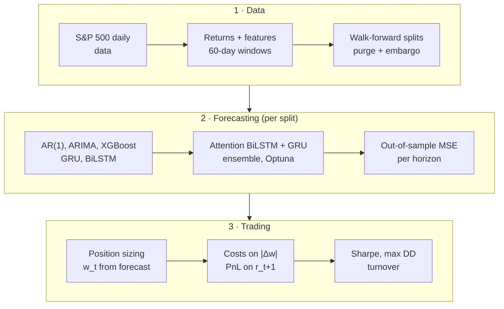
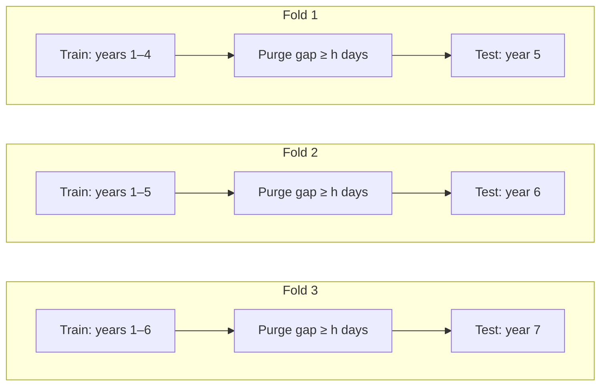

# Leakage-Safe Time-Series Forecasting & Quantitative Backtesting — Interview Playbook

*A forecasting and backtesting pipeline for the S&P 500 that is built to avoid the most common mistake in financial ML: letting the future leak into the past. It forecasts from 60-day windows with walk-forward validation, purging and embargoing; benchmarks AR(1), ARIMA, XGBoost, GRU and BiLSTM; builds an attention-based BiLSTM/GRU ensemble tuned with Optuna; and converts forecasts into a transaction-cost-aware trading backtest with position sizing. Python, PyTorch, XGBoost, ARIMA, Optuna. Everything you need for a 30–45 minute interview.*

**Resume bullets this booklet defends**

1. Built walk-forward S&P 500 forecasting pipeline with 60-day windows and purged CV; benchmarked AR(1), ARIMA, XGBoost, GRU and BiLSTM.
2. Developed attention-based BiLSTM/GRU ensemble with Optuna, reducing forecast MSE by 8.7% versus AR(1) across multiple forecast horizons.
3. Built transaction-cost-aware backtest with position sizing, achieved 0.78 Sharpe, 9.3% max drawdown at 110% annual turnover temporal splits.

# Part 1: Project Overview

## 1.1 What is this project?

**The one-line version.** Predict future S&P 500 returns from the previous 60 days, test the predictions only on data the models never saw, and check whether trading on them would have made money after costs.

**Start with an example.** Suppose you train a model on randomly shuffled days from 2010–2023 and test it on other random days. A test day in March 2020 may sit between two training days from the same crash week, so the model "knows" what the market was doing around it. It scores brilliantly in testing and fails in real use, where tomorrow is always unknown. This project's rule is simple: **every prediction is made only with information available before that day**, and validation always trains on the past and tests on the future, with a gap so that overlapping windows cannot leak.

**The problem it solves.** Financial time series are noisy, non-stationary and autocorrelated, so naive ML evaluation gives misleading results. Even a genuinely better forecast does not automatically make a profitable strategy, because trading adds sizing, costs and risk. The project provides an honest pipeline for both questions: *is the forecast better than simple baselines?* and *is the resulting strategy any good after costs?*

**Who would use it.** Quant researchers testing signals, data scientists building time-series models, and risk-aware portfolio managers who need realistic backtests.

**Inputs and outputs.** Input: daily S&P 500 data (price-derived features), arranged as 60-day windows **[confirm exact features and target: returns are the standard target]**. Output: forecasts at several horizons, error metrics per model (MSE), and a backtest report: equity curve, Sharpe ratio, maximum drawdown, turnover.

**What makes it technically interesting.** Leakage-safe validation (walk-forward, purging, embargo); a spectrum of models from AR(1) to attention-based recurrent networks; and the gap between forecasting accuracy and trading performance.

## 1.2 Explaining it when asked "Can you explain this project?"

> **Say it aloud:** "I built a forecasting and backtesting pipeline for the S&P 500 designed to avoid look-ahead bias. Each forecast uses the previous 60 days, and validation is walk-forward with purging and embargoing, so the model is always trained on the past and tested on a later period with a gap. I benchmarked AR(1), ARIMA, XGBoost, a GRU and a bidirectional LSTM, then built an ensemble of attention-based BiLSTM and GRU models tuned with Optuna, which reduced forecast MSE by 8.7% relative to AR(1) across several horizons. Then I turned forecasts into positions with position sizing and transaction costs, and backtested on out-of-sample periods: Sharpe 0.78, maximum drawdown 9.3%, at about 110% annual turnover."

## 1.3 Scope, evidence status and what to confirm

**Scope boundary.** One index (S&P 500), daily frequency, simulated trading. It is not live trading, not a multi-asset portfolio and not an execution system.

> **Evidence status:** No code, notebooks or backtest logs for this project are in the Resume Prep folder, so every resume number is marked **UNVERIFIED**: your reported result, with the evidence needed to defend it. Numbers in worked examples are **ILLUSTRATIVE**. Items marked **[confirm]** are standard choices assumed to explain the bullets.

> **Resume flag:** Confirm before interviewing. (1) The **target**: daily (log) returns, and the list of horizons ("multiple forecast horizons"). (2) Whether −8.7% MSE is the average across horizons or holds at every horizon. (3) Backtest: gross or **net** of costs, cost per unit traded (bps), long-only or long/short, the test period, and **buy-and-hold Sharpe and drawdown over the same period** (the essential comparison). (4) Wording: bullet 3 ends with "at 110% annual turnover temporal splits", which reads as truncated; say "on out-of-sample temporal splits, with 110% annual turnover". (5) The turnover definition (one-way, sum of absolute position changes per year).

# Part 2: Fundamentals Required for This Project

| Resume bullet | Concepts you must be able to explain |
|---|---|
| 1. Walk-forward, 60-day windows, purged CV; AR(1), ARIMA, XGBoost, GRU, BiLSTM | Returns and stationarity, autocorrelation, AR(1), ARIMA, lag features and windows, look-ahead bias, walk-forward, purging and embargo |
| 2. Attention BiLSTM/GRU ensemble, Optuna, −8.7% MSE vs AR(1), multiple horizons | LSTM, GRU, bidirectional networks, attention, ensembles, Optuna, horizons, MSE and forecast comparison |
| 3. Cost-aware backtest, position sizing, 0.78 Sharpe, 9.3% max drawdown, 110% turnover | Backtesting, position sizing, transaction costs, turnover, Sharpe ratio, maximum drawdown, forecast vs strategy quality, overfitting |

### Time-series data, returns and stationarity

- **Simple:** A time series is a sequence of values ordered in time, where order matters. Prices wander with no fixed level; daily returns (percentage changes) fluctuate around a roughly stable level, so they are easier to model.
- **Technical:** A series is (weakly) **stationary** if its mean, variance and autocorrelations do not change over time. Prices are non-stationary (close to a random walk); returns are approximately stationary in mean, though their volatility clusters (calm and turbulent periods). The Augmented Dickey-Fuller (ADF) test checks for a unit root (non-stationarity).
- **Math:** $$r_t = \ln\frac{P_t}{P_{t-1}} \approx \frac{P_t - P_{t-1}}{P_{t-1}}$$ $P_t$ is the index level on day $t$; $r_t$ the log return.
- **Why it matters:** Most models assume the patterns they learn persist. Training on prices invites spurious fits: a model that predicts "tomorrow ≈ today" scores a tiny price MSE while having no skill.
- **In this project:** Forecasts are of returns at several horizons **[confirm]**; features are scaled using training data only.
- **Interview angle:** "Why not predict prices?" Price MSE is dominated by the level; the naive forecast is nearly unbeatable and says nothing useful.

### Autocorrelation and the AR(1) model

- **Simple:** Autocorrelation asks whether today's value tells you something about tomorrow's. AR(1) predicts tomorrow as a fraction of today.
- **Technical:** Lag-$k$ autocorrelation is $\rho_k = \text{Corr}(r_t, r_{t-k})$. Daily equity-index returns have very small autocorrelation, while squared returns (volatility) are strongly autocorrelated.
- **Math:** $$r_t = c + \phi\, r_{t-1} + \varepsilon_t, \qquad |\phi| < 1$$ $c$ is a constant, $\phi$ the persistence, $\varepsilon_t$ white noise. The one-step forecast is $\hat r_{t+1} = c + \phi r_t$. With $\phi$ near 0, the forecast is close to the mean return.
- **Why it matters:** AR(1) is the honest baseline: cheap, hard to overfit, and close to "predict the average". If a deep model cannot beat it, it has no real skill.
- **In this project:** All model improvements are expressed relative to AR(1): −8.7% MSE.
- **Interview angle:** "Why AR(1) and not a random walk?" For returns, the random-walk forecast of the *price* corresponds to predicting zero return; AR(1) nests that ($c = \phi = 0$) and is slightly stronger.

### ARIMA

- **Simple:** A classical forecasting model that combines past values (AR), past forecast errors (MA) and differencing (I) to make a series stationary.
- **Technical:** ARIMA($p,d,q$): difference the series $d$ times, then model it with $p$ autoregressive lags and $q$ moving-average error terms. Orders are chosen with ACF/PACF plots or information criteria (AIC/BIC), refitted as the window rolls forward.
- **Math:** $$y'_t = c + \sum_{i=1}^{p}\phi_i\, y'_{t-i} + \sum_{j=1}^{q}\theta_j\, \varepsilon_{t-j} + \varepsilon_t$$ $y'_t$ is the series after $d$ differences; $\phi_i$ AR coefficients; $\theta_j$ MA coefficients; $\varepsilon_t$ the forecast error. For returns, $d = 0$ is usual (returns are already a differenced price).
- **Why it matters:** A strong linear benchmark with well-understood assumptions (linear, constant parameters, stationary residuals).
- **In this project:** One of the five benchmarked models **[confirm order selection]**.
- **Interview angle:** "When does ARIMA fail?" Non-linear effects, regime changes and volatility clustering (that needs GARCH-type models).

### Lag features, rolling windows and forecast horizons

- **Simple:** To predict tomorrow, show the model the last 60 days. The horizon is how far ahead you predict: 1 day, 5 days, 20 days.
- **Technical:** Each sample is a 60-day window $X_t = (x_{t-59}, \dots, x_t)$ with target $y_{t+h}$, for example the cumulative return over the next $h$ days. Recurrent models read the window as a sequence; XGBoost reads it as flattened lag features plus summaries (rolling mean, volatility, momentum). Multi-horizon forecasting is either **direct** (one model or output head per horizon) or **recursive** (feed one-step forecasts back in).
- **Why it matters:** The window defines what information is legal at time $t$; the horizon defines how far labels reach into the future, which determines how much purging is needed.
- **In this project:** 60-day windows; several horizons **[confirm which and whether direct or recursive]**. Normalisation statistics come from the training period only.
- **Interview angle:** "Why 60 days?" About three trading months: long enough for momentum and volatility context, short enough to adapt; it can be tuned like any hyperparameter.

### Look-ahead bias, leakage and why random splits fail

- **Simple:** Look-ahead bias means using information at time $t$ that you could only have known later. Random train/test splits create it automatically for time series.
- **Technical:** Consecutive days are correlated, and 60-day windows overlap heavily (day $t$'s window shares 59 days with day $t+1$'s). A random split puts near-identical windows in train and test, and lets the model learn from the future of a test day. Other sources: scaling with full-sample statistics, revised data, and features computed with centred (two-sided) windows.
- **Why it matters:** Leakage produces excellent test scores and useless real performance, which is the most common failure in financial ML.
- **In this project:** Temporal splits only, training-only normalisation, and purging plus embargo at split boundaries.
- **Interview angle:** "Name a subtle leak." Scaling features with the mean and standard deviation of the whole dataset.

### Walk-forward validation

- **Simple:** Train on the past, test on the next period, then move forward and repeat, just as you would in real time.
- **Technical:** Split time into consecutive blocks. Fold $k$ trains on everything before block $k$ (expanding window) or on a fixed-length recent window (rolling), validates on block $k$, then rolls forward. Results are aggregated over all test blocks, giving an out-of-sample record that spans different market regimes.
- **Why it matters:** It mimics deployment, measures stability across regimes, and supports periodic retraining.
- **In this project:** Walk-forward evaluation for all five models and the ensemble; Optuna tuning uses validation blocks inside each training period, never the test block **[confirm]**.
- **Interview angle:** "Expanding or rolling?" Expanding uses more data; rolling adapts faster to regime change. A trade-off of bias and variance.

### Purged cross-validation and embargoing

- **Simple:** Leave a gap between training and test data so that training labels, which look into the future, cannot overlap the test period.
- **Technical:** A training sample at time $t$ with horizon $h$ has a label built from returns in $(t, t+h]$. If $t+h$ falls inside the test period, the training label contains test-period information. **Purging** removes those training samples. **Embargo** also drops samples just *after* a test block (when training data come after it, as in purged K-fold) because serial correlation lets them carry test information.
- **Math:** Drop training sample $t$ if $[t, t+h] \cap [T_{\text{start}}, T_{\text{end}}] \ne \varnothing$; additionally drop $t \in (T_{\text{end}}, T_{\text{end}} + e]$ for embargo length $e$.
- **Why it matters:** Without a gap, multi-day horizons leak exactly at the boundaries, and the leak grows with the horizon.
- **In this project:** Purged CV with an embargo **[confirm gap lengths: at least the longest horizon]**.
- **Interview angle:** "Does pure walk-forward need an embargo?" It needs the purge gap of $h$ days before the test block; embargo matters mostly when training data also come after the test block.

### Recurrent networks: LSTM and GRU

- **Simple:** Neural networks that read a sequence one step at a time and carry a memory forward. Gates decide what to remember and what to forget.
- **Technical:** An **LSTM** keeps a cell state $c_t$ controlled by forget, input and output gates, which lets gradients flow over long sequences. A **GRU** merges these into update and reset gates and has no separate cell state: fewer parameters, often similar accuracy.
- **Math:** GRU: $$z_t = \sigma(W_z[h_{t-1}, x_t]), \quad \tilde h_t = \tanh(W[r_t \odot h_{t-1}, x_t]), \quad h_t = (1 - z_t)\odot h_{t-1} + z_t \odot \tilde h_t$$ $x_t$ is the input at step $t$, $h_t$ the hidden state, $z_t$ the update gate (how much to refresh), $r_t$ the reset gate, $\odot$ element-wise product.
- **Why it matters:** They can model non-linear, time-dependent patterns that AR models cannot, but with noisy financial data they overfit easily.
- **In this project:** GRU and BiLSTM were benchmarked and then combined, with attention, in the ensemble.
- **Interview angle:** "GRU or LSTM?" GRU is smaller and faster; LSTM can hold longer dependencies. With 60 steps and noisy data, the difference is usually small.

### Bidirectional LSTM and attention

- **Simple:** A BiLSTM reads the 60-day window both forwards and backwards. Attention lets the model decide which of the 60 days matter most for this forecast.
- **Technical:** A BiLSTM runs two LSTMs (past→present and present→past over the window) and concatenates their states. This is **not** leakage as long as the window ends at $t$: both directions read only days $t-59$ to $t$. Attention scores each time step's hidden state and forms a weighted summary.
- **Math:** $$\alpha_\tau = \frac{\exp(e_\tau)}{\sum_{s}\exp(e_s)}, \qquad e_\tau = v^\top \tanh(W h_\tau), \qquad c = \sum_{\tau} \alpha_\tau h_\tau$$ $h_\tau$ is the hidden state at window step $\tau$, $e_\tau$ its score, $\alpha_\tau$ the attention weight (weights sum to 1), and $c$ the context vector fed to the output layer.
- **Why it matters:** Attention replaces "use only the last hidden state" with a learned focus, for example on recent shocks, and the weights can be inspected.
- **In this project:** Attention layers on BiLSTM and GRU encoders **[confirm attention type]**.
- **Interview angle:** "Is a bidirectional model cheating?" Only if the window extends past $t$. Show that the window ends at the forecast origin.

### Ensembles and Optuna tuning

- **Simple:** Average the predictions of several different models; their errors partly cancel. Optuna searches the settings of each model automatically.
- **Technical:** If two forecasts have errors with variances $\sigma_1^2, \sigma_2^2$ and correlation $\rho < 1$, an average has lower error variance than the typical member. Weights can be equal or chosen on validation data. **Optuna** uses TPE sampling and pruning to search hidden size, layers, dropout, learning rate, attention size and window parameters, maximising validation performance inside each training period.
- **Math:** Equal-weight average of two forecasts: $\text{Var}(\bar e) = \tfrac14(\sigma_1^2 + \sigma_2^2 + 2\rho\sigma_1\sigma_2)$.
- **Why it matters:** Neural forecasts on noisy data have high variance (seed and hyperparameter sensitivity); ensembling is one of the most reliable ways to reduce it.
- **In this project:** BiLSTM + GRU (both with attention) ensemble; Optuna per model **[confirm weights and number of trials]**.
- **Interview angle:** "How do you stop Optuna overfitting?" Tune only on validation blocks inside the training period and keep trial counts modest.

### Forecast metrics: MSE and comparing forecasts

- **Simple:** MSE is the average squared forecast error. "8.7% lower MSE than AR(1)" means the ensemble's average squared error is 8.7% smaller.
- **Math:** $$\text{MSE} = \frac{1}{N}\sum_{t}(y_t - \hat y_t)^2, \qquad \text{reduction} = 1 - \frac{\text{MSE}_{\text{ens}}}{\text{MSE}_{\text{AR(1)}}} = 8.7\%$$ ILLUSTRATIVE: AR(1) MSE $1.000\times10^{-4}$, ensemble $0.913\times10^{-4}$. Out-of-sample $R^2$ against AR(1) is the same 8.7%.
- **Technical:** Also report RMSE, MAE (robust to outliers) and directional accuracy (share of correct signs). Whether a difference is significant is tested with the **Diebold-Mariano** test on the series of loss differences, which accounts for autocorrelated errors.
- **Why it matters:** For daily returns, even small MSE improvements are hard to achieve; a large one deserves scrutiny for leakage.
- **In this project:** −8.7% MSE versus AR(1) across multiple horizons **[confirm per-horizon values and DM test]**.
- **Interview angle:** "Is 8.7% big?" For daily index returns, yes, unusually so; that is why the leakage controls and a significance test matter.

### Backtesting, position sizing, transaction costs and turnover

- **Simple:** A backtest replays history: each day, turn the forecast into a position, earn the next day's return on it, and pay costs whenever the position changes.
- **Technical:** Position $w_t$ is decided at the close of day $t$ using information up to $t$ and earns $r_{t+1}$. **Position sizing** maps forecast strength to size, often scaled by predicted volatility and capped. **Costs** are charged on changes in position. **Turnover** measures how much trading occurs.
- **Math:** $$\text{PnL}_{t+1} = w_t\, r_{t+1} - c\,\lvert w_t - w_{t-1}\rvert, \qquad \text{Turnover}_{\text{annual}} = \frac{252}{N}\sum_t \lvert w_t - w_{t-1}\rvert$$ $c$ is the cost per unit traded (for example 5 bps). ILLUSTRATIVE sizing: $w_t = \text{clip}(k\,\hat r_{t+1}/\hat\sigma_t, -1, 1)$. At 110% annual turnover and 5 bps, cost drag ≈ $1.10 \times 0.0005 = 0.055\%$ per year.
- **Why it matters:** Strategies that trade a lot on weak signals lose their edge to costs; a one-day timing error (using $r_t$ instead of $r_{t+1}$) creates fake profits.
- **In this project:** Cost-aware backtest with sizing; 110% annual turnover **[confirm cost level, long-only or long/short, sizing rule]**.
- **Interview angle:** "At 110% turnover, do costs matter?" Little for an index at a few bps; the bigger risks are timing errors and overfitting.

### Sharpe ratio and maximum drawdown

- **Simple:** Sharpe is return per unit of risk. Maximum drawdown is the worst peak-to-trough loss you would have suffered.
- **Math:** $$\text{SR}_{\text{annual}} = \frac{\overline{r^{p} - r^{f}}}{\sigma(r^{p})}\sqrt{252}, \qquad \text{MDD} = \max_t \frac{\max_{s \le t} V_s - V_t}{\max_{s \le t} V_s}$$ $r^p$ daily strategy returns, $r^f$ the risk-free rate, $V_t$ portfolio value. Sharpe's standard error is roughly $\sqrt{(1 + \text{SR}^2/2)/Y}$ for $Y$ years: with 5 years, about 0.5.
- **Technical:** Sharpe ignores the shape of losses (skew, fat tails); drawdown captures the path. Both depend heavily on the test period, so compare them with **buy-and-hold over the same period**.
- **Why it matters:** A 0.78 Sharpe is useful only if it beats what holding the index delivered; a 9.3% drawdown is far smaller than index drawdowns in 2020 or 2022, which suggests the strategy was often reduced or out of the market.
- **In this project:** 0.78 Sharpe and 9.3% maximum drawdown on out-of-sample splits **[confirm net of costs, period and buy-and-hold figures]**.
- **Interview angle:** "Is 0.78 statistically different from zero?" Over 5 years, it is about 1.5 standard errors, suggestive but not conclusive.

### Forecast quality vs strategy quality, and overfitting in finance

- **Simple:** A better forecast (lower MSE) is not automatically a better strategy. Trading profit depends on getting the sign and the big moves right, on sizing and on costs.
- **Technical:** MSE rewards shrinking forecasts toward zero and treats all days equally; trading profit is dominated by a few large-move days and depends only on sign and relative size. A model can lower MSE by being more conservative while its sign accuracy is unchanged. Conversely, overfitting is easy: testing many models, windows and thresholds on one history inflates the best result (**data snooping**).
- **Why it matters:** Report both families of metrics, and treat the best of many backtests sceptically: the deflated Sharpe ratio or a held-out final period corrects for this.
- **In this project:** Forecast quality: MSE versus AR(1). Strategy quality: Sharpe, drawdown and turnover after costs. They are separate claims.
- **Interview angle:** "Your MSE improved; why might the strategy still lose money?" Better errors on small days, same mistakes on big days, plus costs.

# Part 3: Methodology and Workflow

## 3.1 End-to-end pipeline

**Figure 1 — From 60-day windows to out-of-sample forecasts and a cost-aware backtest** [scale=0.72]

**Step 1: Build the data set.** Compute returns from daily index data; build features (lagged returns, rolling volatility, momentum, possibly volume) **[confirm features]**; form 60-day windows ending at day $t$ with targets at each horizon. Reason: every input uses information up to $t$ only.

**Step 2: Create temporal splits.** Walk-forward blocks; for each, purge training samples whose label window overlaps the test block and apply an embargo; fit scalers on training data only. Reason: no boundary leakage, honest out-of-sample record across regimes.

**Step 3: Benchmark.** Fit AR(1) and ARIMA (rolling refits), XGBoost on lag features, and GRU and BiLSTM on sequences, all on identical splits. Reason: a fair ladder from simple to complex; AR(1) is the bar.

**Step 4: Build the ensemble.** Add attention to the BiLSTM and GRU encoders, tune each with Optuna on validation blocks inside the training period, train several seeds, and average **[confirm weights]**. Reason: attention helps focus; ensembling reduces variance.

**Step 5: Evaluate forecasts.** Out-of-sample MSE per horizon versus AR(1) (−8.7%), with a Diebold-Mariano test and directional accuracy. Reason: separates skill from noise.

**Step 6: Backtest.** Convert forecasts into sized positions, decided at day $t$ and earning $r_{t+1}$; charge costs on position changes; compute Sharpe, drawdown and turnover only on out-of-sample periods; compare with buy-and-hold. Reason: converts forecast quality into economic value under realistic frictions.

## 3.2 Walk-forward splits with purge and embargo

**Figure 2 — Walk-forward validation: each fold trains on the past, leaves a purge gap of at least the forecast horizon, then tests on the next block** [scale=0.72]

Block lengths are ILLUSTRATIVE. The out-of-sample backtest concatenates the test blocks, so every trade uses a model trained only on earlier data.

## 3.3 Numerical claims and how to defend them

| Claim | What it means and how it is computed | Baseline and what could mislead | Status |
|---|---|---|---|
| 60-day windows | Inputs are the last 60 trading days up to $t$ | Overlapping windows leak under random splits | UNVERIFIED |
| −8.7% MSE | $1 - \text{MSE}_{\text{ens}}/\text{MSE}_{\text{AR(1)}}$, out-of-sample | Average vs per horizon; DM test; leakage | UNVERIFIED |
| 0.78 Sharpe | Annualised mean / std of daily strategy returns | Gross vs net; vs buy-and-hold; SE ≈ 0.5 over 5 y | UNVERIFIED |
| 9.3% max DD | Worst peak-to-trough fall of the equity curve | Period-dependent; compare with index DD | UNVERIFIED |
| 110% turnover | $\tfrac{252}{N}\sum \lvert\Delta w\rvert$ per year | Definition (one-way vs two-way) | UNVERIFIED |

To defend these, bring: the split dates and gap lengths, per-horizon MSE for every model, the DM statistics, the sizing rule and cost assumption, the equity curve against buy-and-hold, and results for a few cost levels.

# Part 4: Important Design and Methodological Decisions

**1. Walk-forward with purge and embargo instead of random K-fold.** *Why:* random folds put overlapping windows and future information into training; walk-forward mimics deployment and purging removes label overlap. *Alternative:* shuffled K-fold. *Trade-off:* fewer, noisier evaluation folds, and early folds have less training data.

**2. AR(1) as the reference baseline.** *Why:* simple, hard to beat honestly on returns, and nests the "predict the mean" forecast. *Alternative:* comparing only against other neural networks. *Trade-off:* beating AR(1) shows forecast skill but not trading value.

**3. A ladder of models (ARIMA, XGBoost, GRU, BiLSTM) instead of one deep model.** *Why:* shows where the gain comes from: linear structure, non-linear lag interactions, or sequence modelling. *Alternative:* only the final model. *Trade-off:* more compute and more comparisons, which raises multiple-testing risk.

**4. Attention-based BiLSTM + GRU ensemble.** *Why:* attention lets the model weight informative days; two different recurrent architectures make partly uncorrelated errors, so averaging reduces variance. *Alternative:* a single LSTM or a transformer. *Trade-off:* complexity and lower interpretability than ARIMA.

**5. Optuna tuning inside training periods.** *Why:* efficient search over many coupled hyperparameters without touching test blocks. *Alternative:* manual or grid search. *Trade-off:* too many trials still overfit validation blocks.

**6. Evaluate trading separately, net of costs, with sizing.** *Why:* MSE does not equal profit; costs and sizing decide whether a forecast is usable. *Alternative:* reporting MSE or directional accuracy only. *Trade-off:* backtest results depend on cost and sizing assumptions, which must be stated.

# Part 5: Complete Interview Explanation

## 5.1 Two-minute explanation

> **Say it aloud:** "Financial forecasting is dominated by leakage: random splits and overlapping windows make models look far better than they are. I built an S&P 500 pipeline where every forecast uses only the previous 60 days, and validation is walk-forward, training on the past and testing on the next block, with a purge gap so multi-day labels cannot overlap the test period.
>
> I benchmarked AR(1), ARIMA, XGBoost, a GRU and a bidirectional LSTM on identical splits, then built an ensemble of attention-based BiLSTM and GRU models tuned with Optuna. It reduced out-of-sample MSE by 8.7% relative to AR(1) across several horizons.
>
> Because lower MSE doesn't automatically mean profit, I also built a backtest: forecasts become sized positions, decided today and earning tomorrow's return, with transaction costs on every change. Out of sample it delivered a 0.78 Sharpe with a 9.3% maximum drawdown at about 110% annual turnover."

## 5.2 Five-minute explanation

> **Say it aloud:** "**Problem.** I wanted to know two things honestly: can more complex models forecast index returns better than simple baselines, and would that translate into a usable strategy after costs?
>
> **Data and leakage control.** Daily S&P 500 data, converted to returns because prices are non-stationary. Each sample is a 60-day window ending at day t, with targets at several horizons. Random splits would put nearly identical overlapping windows in train and test, so I used walk-forward splits. A training sample's label looks h days ahead, so I purge training samples whose label window overlaps the test block and add an embargo. Scalers are fitted on training data only.
>
> **Models.** AR(1) is the baseline: tomorrow's return as a fraction of today's. ARIMA adds more lags and moving-average terms. XGBoost uses flattened lag features. GRU and BiLSTM read the window as a sequence. The final model adds attention, which learns which of the 60 days matter, to a BiLSTM and a GRU, tunes each with Optuna on validation blocks inside the training period, and averages them.
>
> **Forecast result.** Out-of-sample MSE fell 8.7% relative to AR(1) across horizons. For daily returns that is a large improvement, so significance testing with Diebold-Mariano matters.
>
> **Trading.** The position is decided at day t's close from the forecast, sized by forecast strength relative to volatility, and earns day t+1's return; costs are charged on position changes. On the out-of-sample periods: 0.78 Sharpe, 9.3% maximum drawdown, 110% annual turnover.
>
> **Key decisions.** Walk-forward with purging; AR(1) as the bar; a ladder of models to locate the gain; ensembling to reduce variance; and judging trading separately from forecasting."

## 5.3 Ten-minute explanation

> **Say it aloud:** "I'll go deeper on leakage, the models, forecast evaluation, the backtest and limitations.
>
> **Leakage control in detail.** Three mechanisms. First, windows end at t and use only past data; features like rolling volatility are trailing, never centred. Second, normalisation statistics come only from the training block. Third, purging: a sample at t has a label built from returns up to t+h, so if t+h is inside the test block the label contains test information; those samples are removed, and an embargo removes samples just after a test block in folds where training data follow it.
>
> **Models.** AR(1) and ARIMA are linear and refitted as the window rolls. XGBoost captures non-linear interactions among lags but has no notion of order beyond features. GRU and LSTM carry a gated memory through the sequence; a BiLSTM reads the window in both directions, which is legitimate because the window ends at t. Attention computes a softmax weight for each day's hidden state and forms a weighted context vector. The ensemble averages two architectures whose errors are imperfectly correlated, which reduces variance, the main problem with neural nets on noisy data.
>
> **Forecast evaluation.** I compare against AR(1) on identical out-of-sample points at each horizon. The 8.7% MSE reduction is equivalent to an out-of-sample R-squared of 8.7% relative to AR(1). That is high for daily returns, so the right follow-ups are a Diebold-Mariano test and a check that it holds across folds rather than in one period.
>
> **Backtest.** PnL is the position decided at t times the return from t to t+1, minus cost times the absolute change in position. Turnover is the sum of absolute position changes, annualised: 110% is modest, so at a few basis points per unit traded the cost drag is small. Sharpe is the annualised mean over standard deviation of daily returns: 0.78. Maximum drawdown is the worst peak-to-trough fall: 9.3%.
>
> **Interpretation and limitations.** First, the essential comparison is buy-and-hold over the same period; a 9.3% drawdown is much smaller than index drawdowns in 2020 or 2022, which suggests the strategy was de-risked at times, but its Sharpe must be compared with the index's. Second, the standard error of a Sharpe over five years is about 0.5, so 0.78 is suggestive, not proof. Third, I tested several models and settings, so the best result is somewhat inflated; a final untouched period or a deflated Sharpe ratio would correct for that. Fourth, one index is a single bet; a cross-section of assets would give far more independent evidence. Next steps: those corrections, cost sensitivity, and a loss function closer to trading objectives."

# Part 6: Interview Questions and Answers

## 6.1 Basic understanding

#### Q1. What does your project do? [Easy]

It forecasts S&P 500 returns and tests whether those forecasts are useful, while carefully preventing future information from leaking into training. Each forecast uses only the previous 60 trading days. Validation is walk-forward: train on the past, leave a purge gap, test on the next block, roll forward. I benchmarked five models on identical splits: AR(1), ARIMA, XGBoost, GRU and a bidirectional LSTM. The final model is an ensemble of attention-based BiLSTM and GRU networks tuned with Optuna, which reduced out-of-sample MSE by 8.7% relative to AR(1) across several horizons. Then a backtest converts forecasts into sized positions with transaction costs: 0.78 Sharpe, 9.3% maximum drawdown, 110% annual turnover on out-of-sample periods. It is a research pipeline with simulated trading, not a live strategy.

#### Q2. Why is a random train-test split inappropriate for time series? [Easy]

Because time-series observations are ordered and dependent. A random split breaks both properties. First, it lets the model learn from the future: a test day in March 2020 could have training days from the same week on both sides, so the model effectively knows the market regime around it. Second, consecutive samples are near-duplicates here: 60-day windows for days $t$ and $t+1$ share 59 days, so random splitting puts almost identical inputs in train and test, which inflates scores. Third, it hides non-stationarity: real performance changes across regimes, and a random split averages over them. In deployment you always predict the unknown future from the known past, so evaluation must do the same: train on earlier periods, test on later ones, with a gap at the boundary when labels look ahead.

#### Q3. What is stationarity, and why model returns instead of prices? [Easy]

A stationary series has constant statistical properties over time: mean, variance and autocorrelation do not drift. Prices are not stationary: they trend and wander with no fixed level, like a random walk. Returns, the percentage or log change from one day to the next, are approximately stationary in mean, although their volatility clusters. Models learn patterns from the past and assume they persist, so they work far better on stationary inputs. Modelling prices also produces a trap: predicting "tomorrow's price equals today's" gives a tiny MSE relative to the price level, so almost any model looks accurate while having no skill. On returns, the naive forecast is "about zero", and beating it requires genuine information. The ADF test can confirm non-stationarity of prices. In my pipeline, returns are the forecast target **[confirm]**.

#### Q4. What is AR(1), and why use it as the baseline? [Easy]

AR(1) is a first-order autoregressive model: $r_t = c + \phi r_{t-1} + \varepsilon_t$. Tomorrow's return is a constant plus a fraction $\phi$ of today's return plus noise. For daily index returns, $\phi$ is close to zero, so the forecast is close to the average return. It is the right baseline for three reasons. It is cheap and almost impossible to overfit. It nests the most naive forecasts ("predict zero" or "predict the mean"). And beating it honestly on returns is hard, so it is a meaningful bar: if a deep network cannot beat AR(1) out of sample, it has no real skill and is probably fitting noise. That is why my headline forecast result is stated relative to AR(1): 8.7% lower MSE.

#### Q5. What is ARIMA? Explain its parts. [Easy]

ARIMA($p,d,q$) has three parts. **AR($p$)**, autoregressive: the value depends on its own previous $p$ values. **I($d$)**, integrated: difference the series $d$ times to make it stationary; a price series becomes a return series with $d = 1$, so for returns $d = 0$ is usual. **MA($q$)**, moving average: the value also depends on the previous $q$ forecast errors, capturing short-lived shocks. Orders are chosen with ACF and PACF plots or by minimising AIC or BIC, and the model is refitted as the window moves forward. ARIMA assumes linear relationships, constant parameters and roughly constant variance. It fails with non-linear dynamics, regime changes and volatility clustering. It is a strong classical benchmark: if a neural network does not beat ARIMA, the extra complexity is not justified.

#### Q6. What is walk-forward validation? [Easy]

It evaluates a model the way it would be used in real time. Split history into consecutive blocks. For the first fold, train on the early years and test on the next block; for the next fold, extend (or roll) the training window forward and test on the following block; continue to the end. Every prediction is made by a model trained only on earlier data, and the concatenated test blocks form a continuous out-of-sample record covering different regimes, which also feeds the backtest. Expanding windows use all past data; rolling windows use a fixed recent length and adapt faster to regime change. Hyperparameter tuning happens on validation blocks inside each training period, never on the test block. The cost is fewer, noisier evaluation folds than random K-fold, which is a price worth paying for honesty.

#### Q7. What are purging and embargoing, and why are they needed? [Easy]

They prevent leakage at the boundary between training and test data. A sample at day $t$ with a 5-day horizon has a label built from returns on days $t+1$ to $t+5$. If the test block starts at day $t+3$, that training label contains returns from the test period: information the model should not have. **Purging** removes every training sample whose label window overlaps the test block, which in walk-forward means leaving a gap of at least the horizon $h$ before the test block. **Embargoing** additionally drops training samples immediately after a test block (relevant when training data come after it, as in purged K-fold), because autocorrelation lets those samples carry information about the test period. The leak grows with the horizon, so multi-horizon forecasting needs a gap at least as long as the longest horizon **[confirm your gap length]**.

#### Q8. How do LSTMs and GRUs work, and how do they differ? [Easy]

Both are recurrent neural networks: they read a sequence step by step, updating a hidden state that acts as memory. Plain RNNs struggle with long sequences because gradients vanish. **LSTMs** add a separate cell state and three gates: the forget gate decides what to erase, the input gate what to write, and the output gate what to expose; the additive cell update lets information and gradients persist. **GRUs** simplify this to two gates, update and reset, with no separate cell state; the update gate interpolates between the old hidden state and a new candidate. GRUs have fewer parameters, train faster and often match LSTMs on moderate sequence lengths like 60 days. In noisy financial data, both overfit easily, so regularisation (dropout, early stopping) and ensembling matter more than the choice between them.

#### Q9. Isn't a bidirectional LSTM cheating, since it reads backwards? [Easy]

Not if the window ends at the forecast origin. A BiLSTM runs one LSTM forward over the window (day $t-59$ to day $t$) and another backward over the *same* window (day $t$ to day $t-59$), then combines their states. Both directions see only days up to $t$, the information available when the forecast is made. Reading backwards simply gives each position in the window context from both sides, which can help the model summarise the window. It would be cheating only if the window extended beyond $t$, for example if the sequence included the days being forecast, or if features were computed with centred rolling windows. To defend this, I show how windows are constructed: input indices end at $t$, and the target starts at $t+1$. This is a common interview trap, so it is worth stating clearly.

#### Q10. What does the attention mechanism do in your model? [Easy]

It lets the model decide which days in the 60-day window matter most for the current forecast. Without attention, a recurrent model typically uses only its final hidden state, which must compress the whole window. With attention, every day's hidden state $h_\tau$ gets a score $e_\tau$ (from a small learned network), the scores go through a softmax to give weights $\alpha_\tau$ that sum to one, and the model uses the weighted average $c = \sum \alpha_\tau h_\tau$. If a volatility shock eight days ago is informative, its weight can be large. Benefits: better use of long windows, and interpretable weights showing where the model looks. Limitations: attention weights are not guaranteed explanations, and on noisy data extra flexibility adds variance, which is one reason I combined models in an ensemble.

## 6.2 Evaluation and backtesting

#### Q11. What does "MSE reduced by 8.7% versus AR(1)" mean? [Easy]

MSE is the average squared difference between forecast and actual value over out-of-sample points. The reduction is $1 - \text{MSE}_{\text{ensemble}}/\text{MSE}_{\text{AR(1)}}$: if AR(1)'s MSE is $1.000 \times 10^{-4}$, the ensemble's is $0.913 \times 10^{-4}$ (ILLUSTRATIVE). It is equivalent to an out-of-sample $R^2$ of 8.7% relative to AR(1). Conditions for it to mean anything: identical test points for both models, purely out-of-sample, at each horizon. "Across multiple forecast horizons" must be stated precisely: an average over horizons, or at every horizon **[confirm]**. For daily index returns, 8.7% is a large improvement, so I would support it with a Diebold-Mariano test, per-fold results showing consistency across regimes, and evidence that no leakage occurred. MSE also does not equal trading value, which is why there is a separate backtest.

#### Q12. Why doesn't a lower MSE automatically produce better trading returns? [Easy]

Because MSE and profit reward different things. MSE averages squared errors over all days equally and favours forecasts shrunk toward zero; a model can cut MSE by being more conservative on quiet days without improving its calls on the few large-move days that dominate profit. Trading profit depends on the **sign** and **relative size** of forecasts at the moments that matter, after **sizing** and **costs**. Two models with the same MSE can have different directional accuracy, and a lower-MSE model can trade more and pay more costs. That is why forecast quality and strategy quality are separate claims in my project: MSE versus AR(1) for the first, Sharpe, drawdown and turnover after costs for the second. Metrics closer to trading, like directional accuracy or correlation between forecast and return, help bridge the gap.

#### Q13. What does a Sharpe ratio of 0.78 mean? [Easy]

The Sharpe ratio is average excess return divided by the volatility of returns, annualised: for daily returns, mean over standard deviation times $\sqrt{252}$. A Sharpe of 0.78 means the strategy earned 0.78 units of annual excess return per unit of annual volatility; for example 7.8% excess return at 10% volatility (ILLUSTRATIVE). By itself, 0.78 is moderate. Its meaning depends on three comparisons. **Buy-and-hold** over the same period: the index has historically delivered a Sharpe somewhere around 0.4–0.8 depending on the period, so the strategy must be compared on identical dates. **Gross versus net**: it should be after costs **[confirm]**. **Statistical uncertainty**: the standard error is roughly $\sqrt{(1 + \text{SR}^2/2)/Y}$, about 0.5 over five years, so 0.78 is not decisively different from zero.

#### Q14. What does a 9.3% maximum drawdown mean? [Easy]

Maximum drawdown is the largest percentage fall from a running peak of the equity curve to a later trough, before a new peak. If the strategy grew from 100 to 120 and then fell to 108.8 before recovering, the drawdown is $(120 - 108.8)/120 = 9.3\%$. It measures the worst loss an investor would have lived through, which matters for risk limits and for whether anyone would keep running the strategy. Unlike Sharpe, it depends on the order of returns, not only their distribution. Interpretation needs context: the S&P 500 itself fell over 30% in early 2020 and about 25% in 2022. A 9.3% maximum drawdown in a period containing those events implies the strategy was often reduced or out of the market, which is good if Sharpe is comparable to the index. I need to know the exact test period **[confirm]**.

#### Q15. What is turnover, and how do transaction costs enter the backtest? [Easy]

Turnover measures how much the strategy trades: the sum of absolute position changes, annualised. With positions as a fraction of capital, 110% annual turnover means total position changes over a year equal 1.1 times capital, for example moving between fully invested and half invested about twice a year, or many small adjustments. Costs are charged on every change: PnL on day $t+1$ is $w_t r_{t+1} - c\lvert w_t - w_{t-1}\rvert$, where $c$ covers spread, commission and slippage per unit traded. The annual cost drag is roughly turnover times $c$: at 110% and 5 bps, about 0.055% per year, small for a liquid index. That is why at this turnover the main risks are timing errors and overfitting rather than costs. I should state the cost level I used and whether 110% is one-way **[confirm]**.

#### Q16. How does position sizing work in your backtest? [Easy]

Sizing turns a forecast into how much to hold. The simplest rule is the sign: fully long if the forecast is positive, flat or short if negative. That ignores confidence and trades a lot on tiny forecasts. A better rule scales the position with forecast strength relative to risk, for example $w_t = \text{clip}(k\,\hat r_{t+1}/\hat\sigma_t, -1, 1)$: larger positions when the forecast is strong relative to predicted volatility, smaller in turbulent periods, capped at full exposure. Volatility scaling also tends to reduce drawdowns, because exposure falls when volatility spikes. A threshold (no trade unless the forecast exceeds a band) reduces turnover. The position must be decided with information up to day $t$ and earn the return from $t$ to $t+1$ **[confirm your exact rule and whether shorting was allowed]**.

## 6.3 Methodology and scenarios

#### Q17. Is a 0.78 Sharpe actually good? How would you judge it? [Medium]

Four checks. **Benchmark:** compare with buy-and-hold over exactly the same out-of-sample dates; if the index delivered 0.75, the strategy's value lies mainly in lower drawdown, not better risk-adjusted return. Also check correlation with the index: a timing strategy with lower beta and similar Sharpe can still be useful. **Net of costs:** confirm costs were deducted, and show sensitivity at 2×, 5× costs. **Statistical significance:** the standard error of an annualised Sharpe is roughly $\sqrt{(1 + \text{SR}^2/2)/Y}$; over five years about 0.5, so 0.78 is about 1.5 standard errors, suggestive but not conclusive. **Selection bias:** I tried several models and settings; the deflated Sharpe ratio adjusts for the number of trials. Finally, stability: Sharpe per fold or per year shows whether it comes from one lucky period.

#### Q18. How would you show the 8.7% improvement is statistically significant? [Medium]

Use the **Diebold-Mariano test**. For each out-of-sample point, compute the loss difference $d_t = (y_t - \hat y^{\text{AR}}_t)^2 - (y_t - \hat y^{\text{ens}}_t)^2$. If the ensemble is better, the mean of $d_t$ is positive. The DM statistic is that mean divided by its standard error, where the standard error uses a heteroskedasticity- and autocorrelation-consistent (Newey-West) estimate, because loss differences are serially correlated, especially for multi-day horizons with overlapping targets. Under the null of equal accuracy it is approximately standard normal. I would run it at each horizon and also report the improvement per walk-forward fold: a genuine improvement should appear in most folds, not just one volatile period. Because financial errors are fat-tailed, a few extreme days can dominate MSE, so checking MAE or a trimmed comparison guards against one crash day driving the result.

#### Q19. How did you prevent overfitting, especially with Optuna? [Medium]

At several levels. **Data:** walk-forward splits with purging mean the test blocks are never seen during training or tuning. **Tuning:** Optuna optimised validation loss on blocks inside each training period, so hyperparameters were chosen without the test data; a modest number of trials limits how much the search can exploit noise. **Model:** dropout, weight decay, early stopping on validation loss, small networks relative to the data (a few thousand daily samples is small for deep learning), and gradient clipping for stability. **Variance reduction:** multiple random seeds and an ensemble of two architectures. **Comparison discipline:** every model sees identical splits, and AR(1) sets the bar. What remains is selection across many configurations on one history; a final, never-touched test period or a deflated Sharpe ratio addresses that **[confirm which you used]**.

#### Q20. Why might XGBoost or ARIMA do worse or better than the neural networks? [Medium]

Each captures different structure. **ARIMA** captures only linear dependence on recent returns and errors; for daily index returns that structure is weak, so it rarely beats AR(1) by much. **XGBoost** captures non-linear interactions between lag and volatility features and is robust with small data, but treats the window as an unordered feature set and can overfit noisy targets; with good features it is often a tough benchmark. **GRU/BiLSTM** model order and can learn temporal patterns, but need more data and are high-variance; with a few thousand daily samples they can easily underperform simpler models. Attention plus ensembling reduced that variance, which is plausibly why the final model won. The honest framing: the result is specific to this data and setup, and with so few independent observations, differences between the complex models may not be significant.

#### Q21. What could make your backtest misleading? [Medium]

The common traps. **Look-ahead in timing:** using the day-$t$ return with a position formed at day $t$'s close; the position must earn $r_{t+1}$. **Feature leakage:** centred windows or full-sample scaling. **Overlapping labels without purging. Data snooping:** trying many models, windows and thresholds and reporting the best. **Unrealistic costs or execution:** trading at the close price you used to compute the signal, ignoring slippage. **Period dependence:** a test period dominated by one regime. **Missing benchmark:** a Sharpe without buy-and-hold on the same dates. **Annualisation errors:** wrong scaling for overlapping multi-day returns. For an index, survivorship bias is not an issue, but it would be for individual stocks. Defences: code that structurally separates "decide at $t$" from "earn at $t+1$", explicit cost sensitivity, a final untouched period, and per-year results.

#### Q22. What happens to your models during a regime change like March 2020? [Medium]

Models trained on calmer periods see inputs outside their training distribution: volatility several times higher, extreme daily moves, and different autocorrelation. Forecast errors explode, and because MSE squares errors, a few such days can dominate a whole fold's MSE, so per-fold results matter. Recurrent models may produce unstable forecasts on out-of-range inputs; feature normalisation fitted on calm data amplifies this. In the backtest, volatility-scaled sizing helps: exposure falls automatically when volatility spikes, which limits drawdowns, and is probably part of why the maximum drawdown is 9.3%. Mitigations: include volatility features so models condition on regime, use rolling rather than expanding windows to adapt faster, retrain regularly in walk-forward fashion, cap positions, and evaluate separately in high- and low-volatility regimes to see where the edge actually lives.

#### Q23. Why does ensembling help, and how should ensemble weights be chosen? [Medium]

Neural forecasts on noisy data have high variance: different seeds and hyperparameters give noticeably different predictions. If two models' errors have similar variance and correlation $\rho < 1$, their average has error variance $\tfrac12\sigma^2(1 + \rho)$, lower than either model alone. A BiLSTM and a GRU differ in architecture, so their errors are only partly correlated, and averaging them, plus several seeds each, is an efficient variance reduction. Weights: equal weights are robust and hard to overfit, and are often the best choice when validation data are limited; optimised weights (minimising validation MSE, possibly constrained to be non-negative and sum to one) can help but risk fitting noise. In walk-forward fashion, any weights must be chosen using only data before each test block **[confirm what you used]**.

#### Q24. How do you forecast multiple horizons? [Medium]

Two main strategies. **Direct:** train a separate model, or a separate output head, for each horizon $h$, with the target being the return over the next $h$ days. Errors do not compound, and each horizon gets its own fit; this is natural for neural networks with a multi-output head. **Recursive:** train a one-step model and feed its predictions back as inputs to reach longer horizons; one model, but errors accumulate, and for near-unpredictable returns the recursive forecasts quickly collapse to the mean. For return forecasting, direct is usually preferred. Longer horizons have overlapping targets, which creates serially correlated errors (relevant for significance tests) and requires a longer purge gap. Comparisons against AR(1) must be made per horizon, because improvements typically differ by horizon **[confirm your horizons and approach]**.

#### Q25. How would you improve the project? [Medium]

Five directions. **Stronger evidence:** a final untouched test period, Diebold-Mariano tests per horizon, deflated Sharpe for the number of configurations tried, and per-year results. **Breadth:** one index gives few independent observations; applying the same pipeline to many assets (sector ETFs, other indices, or a cross-section of stocks) gives far more evidence and enables cross-sectional strategies. **Better targets and losses:** forecast volatility (much more predictable than returns) and use it for sizing, or train with a loss closer to trading objectives, such as maximising a differentiable Sharpe or weighting errors by move size. **Realism:** cost sensitivity, execution at the next open rather than the signal close, and borrowing costs if shorting. **Simpler competitors:** a volatility-targeted buy-and-hold is a demanding benchmark, because it captures much of the drawdown reduction with no forecasting at all.

#### Q26. You tried several models and settings. How would you correct the Sharpe ratio for that? [Hard]

Selecting the best of $N$ backtests inflates its Sharpe even if every strategy has zero true skill: the maximum of $N$ noisy estimates is biased upward. The **deflated Sharpe ratio** (Bailey and López de Prado) handles this. First estimate the Sharpe you would expect from the best of $N$ independent zero-skill trials, roughly $\sigma_{\text{SR}} \times \sqrt{2 \ln N}$ for large $N$, where $\sigma_{\text{SR}}$ is the spread of Sharpe ratios across trials. Then compute the probability that the observed Sharpe exceeds that threshold, adjusting for sample length, skewness and kurtosis of returns. Practical steps: count every configuration genuinely tried (models, windows, thresholds, sizing rules); estimate the effective number of independent trials, because many configurations are correlated; report the deflated value alongside 0.78. A simpler complement is holding back a final period, never used for any decision, and reporting the Sharpe there once.

# Part 7: Final Revision Sheet

### 1. Project in one paragraph

S&P 500 forecasting with strict leakage control: 60-day windows ending at $t$, walk-forward splits, purge gap ≥ horizon, embargo, training-only scaling. Benchmarks: AR(1), ARIMA, XGBoost, GRU, BiLSTM. Final: attention-based BiLSTM + GRU ensemble tuned with Optuna, −8.7% out-of-sample MSE vs AR(1) across horizons. Backtest: sized positions decided at $t$, earning $r_{t+1}$, costs on $\lvert\Delta w\rvert$: 0.78 Sharpe, 9.3% max drawdown, 110% annual turnover.

### 2. Workflow in one diagram

> **Note:** Daily data → returns + features → 60-day windows → walk-forward splits (purge, embargo) → 5 benchmarks + attention ensemble (Optuna) → out-of-sample MSE per horizon → sizing → costs → Sharpe, max DD, turnover vs buy-and-hold.

### 3. Technologies and roles

- **PyTorch:** GRU, BiLSTM, attention
- **statsmodels-style ARIMA:** AR(1), ARIMA
- **XGBoost:** lag-feature benchmark
- **Optuna:** TPE tuning inside training periods

### 4. Five most important concepts

1. Look-ahead bias; random splits leak
2. Purging and embargo
3. AR(1) as the honest bar
4. Attention: softmax-weighted states
5. MSE ≠ trading value

### 5. Five key decisions

1. Walk-forward, not K-fold
2. AR(1) baseline
3. Model ladder to locate gains
4. Two-architecture ensemble
5. Separate, net-of-cost backtest

### 6. Five likely questions

1. Why not random splits?
2. Purging vs embargo?
3. Is a BiLSTM leaking?
4. Is 0.78 Sharpe good vs buy-and-hold?
5. Why lower MSE ≠ more profit?

### 7. Key metrics

| Metric | Definition |
|---|---|
| MSE cut | $1 - \text{MSE}_{e}/\text{MSE}_{AR}$ |
| Sharpe | $\bar r / \sigma \times \sqrt{252}$ |
| Max DD | worst peak-to-trough fall |
| Turnover | $\tfrac{252}{N}\sum\lvert\Delta w\rvert$ |

### 8. Limitations

One index (few independent bets); Sharpe SE ≈ 0.5 over 5 years; selection across many configs; regime dependence; target, horizons, costs and buy-and-hold to confirm; numbers UNVERIFIED.

### 9. Ten things to remember

1. Returns, not prices.
2. Window ends at $t$; target starts at $t+1$.
3. Purge gap ≥ longest horizon.
4. Scalers fitted on training data only.
5. BiLSTM is fine inside the window.
6. −8.7% MSE = 8.7% OOS $R^2$ vs AR(1).
7. Diebold-Mariano with Newey-West.
8. Cost drag ≈ turnover × cost.
9. Compare with buy-and-hold, same dates.
10. Say "on out-of-sample temporal splits".

