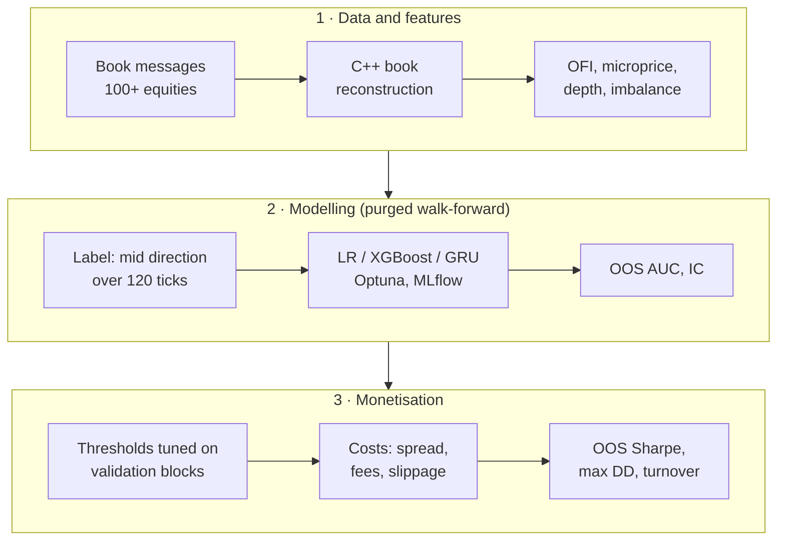

# Limit Order Book Alpha Research — Interview Playbook

*Short-horizon alpha research on limit-order-book data for 100+ equities. Microstructure features (order-flow imbalance, microprice, queue depth and book imbalance) feed Logistic Regression, XGBoost and GRU models that predict the direction of the price move over the next 120 ticks. Validation is purged walk-forward; the signal reaches 0.66 AUC and a 0.031 Information Coefficient, and after optimising trading thresholds for turnover, slippage and costs it delivers a 0.71 out-of-sample Sharpe with a 7.4% maximum drawdown in simulation. Python, C++, XGBoost, PyTorch, Optuna, MLflow. Everything you need for a 30–45 minute quant interview.*

**Resume bullets this booklet defends**

1. Engineered microstructure features from order-flow imbalance, microprice, queue depth across 100+ equities; predicted 120 tick moves.
2. Benchmarked Logistic Regression, XGBoost and GRU with purged walk-forward CV; achieved 0.66 AUC and 0.031 Information Coefficient.
3. Optimized signal thresholds for turnover, slippage and transaction costs; delivered 0.71 OOS Sharpe with 7.4% maximum drawdown.

# Part 1: Project Overview

## 1.1 What is this project?

**The one-line version.** Read the live queue of buy and sell orders for a stock, and predict whether the price is about to tick up or down; then trade only when the prediction is strong enough to beat trading costs.

**Start with an example.** A stock shows a best bid of 100.00 with 900 shares waiting to buy and a best ask of 100.02 with only 100 shares waiting to sell. The mid-price is 100.01. But it takes just 100 shares of buying to exhaust the ask queue and push the best ask up, while it would take 900 shares of selling to break the bid. The next price move is therefore more likely to be **up**. Two features formalise this: the **microprice** (here 100.018, closer to the ask) and **book imbalance** (90% of the visible top-of-book quantity is on the bid). If market sell orders keep being absorbed while new bids arrive, **order-flow imbalance** confirms the buying pressure.

**The problem it solves.** At horizons of seconds to minutes, prices are driven by the supply and demand visible in the order book. The research question is whether these microstructure signals predict short-term moves *reliably enough, across many stocks, to survive the spread, slippage and fees*. Prediction alone is not enough; most short-horizon signals are smaller than the cost of trading them.

**Who would use it.** Quant researchers building short-horizon alphas, market makers adjusting quotes, and execution desks timing child orders.

**Inputs and outputs.** Input: order-book snapshots or message data (prices and sizes at several levels, trades) for 100+ equities **[confirm data source, depth and period]**. Output: a per-event signal (probability that the mid-price moves up over the next 120 ticks), evaluation metrics (AUC, IC), and a simulated trading record (Sharpe, drawdown, turnover).

**What makes it technically interesting.** Market mechanics turned into features; very noisy labels where a small edge is normal; leakage-safe validation for overlapping labels; and the decisive step of converting a statistical edge into net profit after costs.

## 1.2 Explaining it when asked "Can you explain this project?"

> **Say it aloud:** "This was short-horizon alpha research on limit-order-book data for over 100 equities. I engineered microstructure features: order-flow imbalance, which measures net buying versus selling pressure from changes at the best bid and ask; the microprice, which adjusts the mid toward the side with less queue; and queue depth and imbalance across levels. The label was the direction of the mid-price move over the next 120 ticks. I benchmarked logistic regression, XGBoost and a GRU with purged walk-forward validation, and the best signal reached 0.66 AUC and a 0.031 information coefficient. The important part was monetisation: I optimised entry thresholds against turnover, slippage and transaction costs, and out of sample the simulated strategy had a 0.71 Sharpe with a 7.4% maximum drawdown."

## 1.3 Scope, evidence status and what to confirm

**Scope boundary.** Research and simulation: features, models, validation and a cost-aware backtest. Not live trading, not a market-making system, and not a latency-optimised production engine.

> **Evidence status:** No code, data or backtest logs for this project are in the Resume Prep folder, so every resume number is marked **UNVERIFIED**: your reported result, with the evidence needed to defend it. Numbers in worked examples are **ILLUSTRATIVE**. Items marked **[confirm]** are standard choices assumed to explain the bullets.

> **Resume flag:** Confirm before interviewing. (1) "Predicted 120 tick moves" reads ambiguously; the defensible reading is "predicted the direction of the mid-price over a 120-tick horizon". Know whether a tick is a book event, a trade or a price change, and how "no change" outcomes were handled. (2) How IC was computed: pooled time-series rank correlation, or the average of per-period cross-sectional ICs. (3) Sharpe: net of which costs, aggressive (crossing the spread) or passive fills, and how it was annualised. (4) What C++ did (book reconstruction, feature computation). (5) The data source and its depth (levels).

# Part 2: Fundamentals Required for This Project

| Resume bullet | Concepts you must be able to explain |
|---|---|
| 1. OFI, microprice, queue depth, 100+ equities, 120-tick moves | LOB, bid/ask/spread, market vs limit orders, depth and queue position, tick size, imbalance, microprice, OFI, short-horizon labels |
| 2. LR, XGBoost, GRU; purged walk-forward CV; 0.66 AUC, 0.031 IC | Logistic regression, XGBoost, GRU, AUC, IC and rank correlation, purged walk-forward, out-of-sample testing |
| 3. Thresholds vs turnover, slippage, costs; 0.71 OOS Sharpe; 7.4% max DD | Signal thresholds, turnover, slippage, transaction costs, Sharpe, maximum drawdown |

### Limit order book, bid, ask and depth

- **Simple:** The order book is the list of all waiting buy offers (bids) and sell offers (asks) for a stock, sorted by price. The highest bid and lowest ask are the "best" prices.
- **Technical:** Each price level holds a queue of limit orders with a total size. Level 1 is the best bid and best ask; levels 2, 3, … sit further away. **Depth** is the quantity available at each level or cumulatively. The book changes through three events: new limit orders, cancellations, and market orders that execute against resting orders.
- **Why it matters:** The visible book is the immediate supply and demand curve; short-term price changes happen when a best-price queue is exhausted or a new better price appears.
- **In this project:** Features are computed from the top levels of the book and its event stream for 100+ equities **[confirm number of levels]**. The table below shows the structure.
- **Interview angle:** "What is hidden from the book?" Iceberg and hidden orders, and intentions not yet posted, so visible depth is an incomplete signal.

**A limit order book snapshot (ILLUSTRATIVE).** Bids on the left, asks on the right; level 1 is the best price on each side.

| Level | Bid size | Bid price | Ask price | Ask size |
|---|---:|---:|---:|---:|
| 1 (best) | **900** | **100.00** | **100.02** | **100** |
| 2 | 700 | 99.99 | 100.03 | 400 |
| 3 | 500 | 99.98 | 100.04 | 600 |

Spread $= 0.02$ (2 ticks), mid $= 100.01$, level-1 imbalance $= 900/1000 = 0.9$, microprice $= 100.018$. The thin ask queue makes an up-move more likely.

### Market orders, limit orders and queue position

- **Simple:** A limit order says "buy at 100.00 or better" and waits in line. A market order says "buy now at the best available price" and executes immediately against waiting orders.
- **Technical:** Most exchanges use **price-time priority**: better prices fill first; at the same price, earlier orders fill first. A resting order's **queue position** is the quantity ahead of it. Market orders pay the spread (taker) and usually a fee; limit orders earn the spread if filled (maker) but risk not filling, or filling just before the price moves against them (**adverse selection**).
- **Why it matters:** It decides the cost of acting on a signal: crossing the spread costs about half the spread per trade; posting passively saves it but fills mostly when you are wrong.
- **In this project:** Queue depth enters as features; the backtest's fill assumption (aggressive vs passive) determines costs **[confirm]**.
- **Interview angle:** "Why is a passive fill not free?" You get filled when informed flow hits you, so passive fills are biased toward bad outcomes.

### Mid-price, spread and tick size

- **Simple:** The mid-price is halfway between the best bid and best ask. The spread is the gap between them. The tick size is the smallest allowed price step.
- **Math:** $$m_t = \frac{P^b_t + P^a_t}{2}, \qquad s_t = P^a_t - P^b_t$$ $P^b_t, P^a_t$ are the best bid and ask. ILLUSTRATIVE: 100.00 / 100.02 gives $m = 100.01$, $s = 0.02$ = 2 ticks of 0.01, about 2 bps.
- **Technical:** **Large-tick** stocks (spread usually one tick) have long queues and price moves are rare events driven by queue depletion, so imbalance is highly predictive. **Small-tick** stocks have spreads of many ticks and behave more continuously.
- **Why it matters:** The mid is the usual prediction target; the spread is the minimum round-trip cost of an aggressive strategy; tick size changes which features work.
- **In this project:** The label is the mid-price direction over 120 ticks; the spread is part of transaction costs and a feature.
- **Interview angle:** "Why predict the mid, not the last trade price?" Trade prices bounce between bid and ask (bid-ask bounce), which creates fake mean reversion.

### Order-book imbalance and queue depth

- **Simple:** If there is much more waiting to buy than to sell at the best prices, the price is more likely to rise next, because the thin side will be used up first.
- **Math:** Level-1 imbalance $$I_t = \frac{Q^b_t}{Q^b_t + Q^a_t} \in [0,1]$$ where $Q^b_t, Q^a_t$ are the sizes at the best bid and ask. ILLUSTRATIVE: $900/(900+100) = 0.9$. Multi-level versions weight deeper levels: $\sum_\ell w_\ell (Q^b_\ell - Q^a_\ell) / \sum_\ell w_\ell (Q^b_\ell + Q^a_\ell)$.
- **Technical:** Queue depth features include sizes at each level, cumulative depth within $k$ ticks, and depth relative to the stock's typical depth (to compare across 100+ stocks). Imbalance predicts the *next mid change* well for large-tick stocks; its predictive power decays quickly with horizon.
- **Why it matters:** It is the most direct measure of short-term supply and demand pressure, and the basis of the microprice.
- **In this project:** "Queue depth" features at several levels, normalised per stock **[confirm normalisation]**.
- **Interview angle:** "Can imbalance be gamed?" Yes; spoofing (placing and cancelling large orders) creates fake imbalance, which is one reason flow-based features (OFI) complement static ones.

### Microprice

- **Simple:** A better estimate of the "true" price than the mid: lean the mid toward the side with *less* quantity, because that side is more likely to give way.
- **Math:** Imbalance-weighted mid: $$\mu_t = I_t\, P^a_t + (1 - I_t)\, P^b_t = \frac{P^a_t Q^b_t + P^b_t Q^a_t}{Q^a_t + Q^b_t}$$ ILLUSTRATIVE: $0.9 \times 100.02 + 0.1 \times 100.00 = 100.018$, versus mid 100.01. The feature is usually $\mu_t - m_t$ in ticks or bps (here +0.8 ticks). Stoikov's refined microprice estimates the expected future mid conditional on imbalance and spread from data.
- **Technical:** The weighted mid is a martingale-style estimate only approximately; it can over-react when queues are tiny. Using it as a feature (rather than as a price) lets the model learn its actual predictive strength.
- **Why it matters:** It compresses spread and imbalance into one interpretable number: the expected direction and size of the next move.
- **In this project:** Microprice deviation from the mid is a core feature.
- **Interview angle:** "Why weight the ask by bid size?" Because a large bid queue makes an upward move likelier, so the fair price moves toward the ask.

### Order-flow imbalance (OFI)

- **Simple:** OFI measures net buying pressure from what *changes* in the book: bids added or asks removed push it up; asks added or bids removed push it down.
- **Math:** For each book update $n$ (Cont, Kukanov and Stoikov): $$e_n = \mathbb{1}[P^b_n \ge P^b_{n-1}]\,q^b_n - \mathbb{1}[P^b_n \le P^b_{n-1}]\,q^b_{n-1} - \mathbb{1}[P^a_n \le P^a_{n-1}]\,q^a_n + \mathbb{1}[P^a_n \ge P^a_{n-1}]\,q^a_{n-1}$$ $q^b, q^a$ are best-level sizes. OFI over a window is $\sum_n e_n$. Empirically, mid-price change ≈ $\beta \cdot \text{OFI} / \text{depth}$ over short intervals.
- **Technical:** If the bid price is unchanged, $e_n$ is simply the change in bid size; a bid price increase adds the whole new bid queue; a bid price drop removes the old queue. The ask side enters with opposite sign. Windows of several lengths (last 10, 50, 200 events) capture different horizons.
- **Why it matters:** It captures *dynamic* pressure (market orders, cancellations, new quotes) that static imbalance misses, and has a well-documented, roughly linear relation to short-term price changes.
- **In this project:** OFI over several trailing windows, normalised by depth or volatility per stock **[confirm windows]**.
- **Interview angle:** "OFI vs trade imbalance?" Trade imbalance counts only executions; OFI also counts quote placements and cancellations, which carry much of the information.

### Short-horizon labels: predicting the 120-tick move

- **Simple:** For each moment, look 120 ticks ahead and record whether the mid-price went up, down or stayed the same. The model learns to predict that label from current features.
- **Technical:** Label $y_t = \text{sign}(m_{t+120} - m_t)$ in event time; "no change" outcomes (common for large-tick stocks) are dropped, merged or modelled as a third class, or a dead band of $\pm\delta$ is used **[confirm]**. Event time (ticks) rather than clock time normalises for activity: busy stocks and quiet stocks get comparable horizons. Consecutive labels overlap heavily: labels at $t$ and $t+1$ share 119 ticks of future.
- **Why it matters:** The label definition decides what "accuracy" means, how much purging is needed, and whether the edge is tradable after costs.
- **In this project:** 120-tick horizon across 100+ equities. Overlap is why purging matters.
- **Interview angle:** "Why not predict the return magnitude?" You can; IC uses magnitudes. Direction labels are more robust to fat tails.

### Logistic regression, XGBoost and GRU

- **Simple:** Three models of increasing flexibility: a weighted sum of features (logistic regression), many small decision trees (XGBoost), and a recurrent neural network that reads the recent sequence of book states (GRU).
- **Technical:** **Logistic regression** $P(y=1 \mid x) = \sigma(w^\top x + b)$: fast, stable, interpretable, a strong baseline because microstructure relations are often close to monotone. **XGBoost**: gradient-boosted trees capture non-linearities and interactions (imbalance matters more when the spread is one tick). **GRU**: gated recurrent network over a sequence of recent events; can learn temporal patterns in flow but needs much data and is costly to run at low latency.
- **Why it matters:** The comparison shows whether extra complexity buys real out-of-sample edge; in microstructure, simple models often come close.
- **In this project:** All three benchmarked under identical purged walk-forward splits; Optuna tuned hyperparameters and MLflow logged runs **[confirm which model gave the reported numbers]**.
- **Interview angle:** "If XGBoost and LR are close, which would you deploy?" Often LR: faster, more stable, easier to monitor.

### AUC for direction prediction

- **Simple:** AUC is the probability that the model gives a higher "up" score to a randomly chosen up-move than to a randomly chosen down-move. 0.5 is a coin flip; 1.0 is perfect.
- **Math:** $\text{AUC} = P(\hat s_i > \hat s_j \mid y_i = \text{up},\, y_j = \text{down})$, the area under the ROC curve (true-positive rate vs false-positive rate across thresholds).
- **Technical:** AUC is threshold-free and ignores magnitudes: a correctly ranked one-tick move counts the same as a large move. Mechanically predictable moves (a one-lot ask queue about to deplete) can raise AUC without being profitable, because the move is smaller than the cost of crossing the spread.
- **Why it matters:** It is a clean measure of directional skill, but not of economic value.
- **In this project:** 0.66 AUC out of sample, a strong directional edge for this horizon **[confirm pooled vs averaged over stocks]**.
- **Interview angle:** "Why can 0.66 AUC coexist with a small IC?" See the IC card and Q11.

### Information Coefficient and rank correlation

- **Simple:** IC is the correlation between what the signal predicted and what actually happened, usually using ranks. It measures how well the signal orders outcomes, including their sizes.
- **Math:** $$\text{IC} = \rho_{\text{Spearman}}\big(\hat s_t,\; r_{t \to t+h}\big)$$ the Pearson correlation of the ranks of signal $\hat s_t$ and forward return $r_{t\to t+h}$. The **fundamental law of active management** approximates the information ratio as $\text{IR} \approx \text{IC} \times \sqrt{\text{BR}}$, where BR is the number of independent bets per year.
- **Technical:** Rank correlation is robust to fat-tailed returns. At short horizons forward returns are dominated by noise, so ICs of 0.01–0.05 are typical; what matters is breadth. ILLUSTRATIVE: IC 0.031 with 10,000 independent bets per year gives IR ≈ $0.031 \times 100 = 3.1$ *before costs*; costs and correlated bets reduce this sharply.
- **Why it matters:** IC measures the strength of a continuous signal and connects directly to portfolio performance through breadth.
- **In this project:** 0.031 IC out of sample **[confirm definition: pooled or per-period cross-sectional]**.
- **Interview angle:** "Is an IC of 0.031 useful?" Yes, if it is stable and the strategy has high breadth; it explains less than 0.1% of return variance, which is normal.

### Purged walk-forward cross-validation and out-of-sample testing

- **Simple:** Train on earlier days, test on later days, and leave a gap so that labels which look 120 ticks ahead cannot overlap the test period.
- **Technical:** Walk-forward splits by day (or week): train on days $1..k$, validate or test on day block $k+1$, roll forward. **Purging** removes training samples whose 120-tick label window crosses into the test block; an **embargo** removes samples just after test blocks where training data follow. All feature normalisation is fitted on training data. Out-of-sample (OOS) means results come only from test blocks never used for fitting, tuning or threshold choice.
- **Why it matters:** Overlapping labels and autocorrelated features make random splits hugely optimistic; microstructure data also drift across days and regimes.
- **In this project:** Purged walk-forward CV for all three models, thresholds chosen on validation blocks, Sharpe and drawdown reported on OOS blocks **[confirm block lengths]**.
- **Interview angle:** "Why split by day rather than by event?" Intraday events are strongly dependent; whole days are closer to independent units.

### Signal thresholds, turnover, slippage and transaction costs

- **Simple:** Trade only when the signal is strong enough that the expected move exceeds the cost of trading. A higher threshold means fewer, better trades.
- **Technical:** Cost per round trip ≈ spread paid (if aggressive) + fees + **slippage** (fill price worse than expected because of latency or impact). Expected net edge per trade ≈ $E[\lvert\Delta m\rvert \mid \text{signal}] \times (2p - 1) - \text{cost}$, where $p$ is the hit rate. Raising the threshold increases $p$ and edge per trade but reduces the number of trades. **Turnover** is how much is traded per period; at short horizons it is huge, so costs dominate.
- **Math:** ILLUSTRATIVE: spread 2 bps, fees 0.3 bps, slippage 0.5 bps per side → crossing in and out costs about $2 + 2\times(0.3+0.5) = 3.6$ bps per round trip. A signal whose average predicted move is 1.5 bps loses money at any hit rate; thresholds must select moments with predicted moves well above 3.6 bps.
- **Why it matters:** This step turns a statistically valid signal into an economically valid one, or proves it is not.
- **In this project:** Thresholds optimised on validation data for net performance after turnover, slippage and costs **[confirm cost model]**.
- **Interview angle:** "How do you avoid overfitting the threshold?" Choose it on validation blocks only, prefer a flat region of the net-PnL curve, and report OOS.

### Sharpe ratio and maximum drawdown (out of sample)

- **Simple:** Sharpe is return per unit of risk; maximum drawdown is the worst peak-to-trough loss. OOS means measured only on periods the model and thresholds never saw.
- **Math:** $$\text{SR} = \frac{\bar r_d}{\sigma_d}\sqrt{252}, \qquad \text{MDD} = \max_t \frac{\max_{s\le t} V_s - V_t}{\max_{s \le t} V_s}$$ $\bar r_d$, $\sigma_d$ are the mean and standard deviation of daily net PnL returns.
- **Technical:** For intraday strategies, aggregate PnL to daily before annualising; annualising per-trade Sharpe with $\sqrt{\text{trades}}$ overstates it when trades are correlated. Sharpe's standard error is about $\sqrt{(1 + \text{SR}^2/2)/Y}$.
- **Why it matters:** A short-horizon signal with high AUC can still have a low or negative Sharpe after costs; the backtest Sharpe is the economic verdict, but it is still simulated.
- **In this project:** 0.71 OOS Sharpe and 7.4% maximum drawdown **[confirm net of costs, annualisation and capital base]**.
- **Interview angle:** "Intraday strategies usually have high Sharpe; why is yours 0.71?" Costs absorb most of the gross edge, and a modest net Sharpe after realistic costs is more credible than a spectacular one.

# Part 3: Methodology and Workflow

## 3.1 End-to-end research pipeline

**Figure 1 — From raw order-book events to an out-of-sample, cost-aware Sharpe** [scale=0.72]

**Step 1: Reconstruct the book.** Replay message data (adds, cancels, executions) into book states per event, in C++ for speed **[confirm]**; clean crossed or locked books, auction periods and the first and last minutes. Reason: features need exact book states, and replaying millions of events per stock-day is too slow in pure Python.

**Step 2: Engineer features.** Level-1 imbalance, multi-level depth imbalance, microprice deviation, OFI over several windows, spread, recent mid returns and volatility; normalise per stock (by typical depth, spread or volatility) using training data only. Reason: comparable features across 100+ stocks with different prices and liquidity.

**Step 3: Label.** Direction of the mid over the next 120 ticks; handle "no change" consistently. Reason: a horizon long enough to exceed costs on strong signals, short enough for book information to matter.

**Step 4: Validate.** Purged walk-forward by day: train, validate (tuning, thresholds), test; purge samples whose labels cross a boundary; log runs in MLflow. Reason: realistic OOS estimates with overlapping labels.

**Step 5: Compare models.** LR, XGBoost and GRU on identical splits; report OOS AUC and IC per model. Reason: measure what complexity buys.

**Step 6: Monetise.** Map the signal to trades with entry thresholds (and exit rules) chosen on validation blocks to maximise net PnL after spread, fees and slippage; then simulate on test blocks. Reason: the decisive economic test.

**Step 7: Report.** OOS Sharpe 0.71, maximum drawdown 7.4%, turnover and cost breakdown, plus per-stock and per-period stability.

## 3.2 Numerical claims and how to defend them

| Claim | What it means and how it is computed | Baseline and what could mislead | Status |
|---|---|---|---|
| 100+ equities | Universe for features and evaluation | Liquidity mix; survivorship; period | UNVERIFIED |
| 120-tick horizon | Mid direction over next 120 events | Tick definition; "no change" handling | UNVERIFIED |
| 0.66 AUC | OOS ranking of up vs down moves | Baseline 0.5; can include untradable tiny moves | UNVERIFIED |
| 0.031 IC | OOS rank correlation, signal vs forward return | Baseline 0; pooled vs per-period | UNVERIFIED |
| 0.71 OOS Sharpe | Annualised daily net PnL Sharpe on test blocks | Fill assumptions; cost model; simulated, not live | UNVERIFIED |
| 7.4% max DD | Worst peak-to-trough fall of OOS equity | Depends on capital base and leverage | UNVERIFIED |

To defend these, bring: the data description, the label rule, per-model OOS AUC and IC with their spread across days and stocks, the cost model and fill assumption, gross versus net PnL, and the OOS equity curve.

# Part 4: Important Design and Methodological Decisions

**1. Event-time (tick) horizon instead of clock time.** *Why:* activity varies hugely across stocks and times of day; 120 events is comparable information flow for a busy and a quiet stock. *Alternative:* fixed seconds. *Trade-off:* harder to translate into holding time and to align across stocks.

**2. Flow (OFI) plus state (imbalance, microprice, depth) features.** *Why:* state shows current pressure; flow shows how it is changing, including cancellations and market orders, and is harder to fake. *Alternative:* raw book levels into a deep model. *Trade-off:* hand-built features encode assumptions but are robust, interpretable and cheap.

**3. Logistic regression and XGBoost as benchmarks for the GRU.** *Why:* microstructure relations are close to monotone, so simple models are strong; complexity must earn its place. *Alternative:* only deep sequence models. *Trade-off:* more runs; the GRU is slower to train and to serve.

**4. Purged walk-forward by day instead of random K-fold.** *Why:* 120-tick labels overlap and features are autocorrelated; random folds leak massively. *Alternative:* shuffled K-fold. *Trade-off:* fewer test blocks and more variance in estimates.

**5. Report both AUC and IC.** *Why:* AUC measures directional ranking; IC measures association with signed return magnitudes and links to portfolio IR via breadth. *Alternative:* accuracy only. *Trade-off:* two metrics to explain, and neither measures costs.

**6. Optimise thresholds for net PnL rather than for AUC.** *Why:* the strategy's value is net of spread, fees and slippage; most of the gross edge is in small moves that do not pay. *Alternative:* trade every signal by sign. *Trade-off:* fewer trades and threshold-overfitting risk, controlled by choosing on validation blocks.

# Part 5: Complete Interview Explanation

## 5.1 Two-minute explanation

> **Say it aloud:** "I worked on short-horizon alpha from limit-order-book data across more than 100 equities. The idea is that the visible queue of buy and sell orders, and how it changes, tells you which way the price is likely to move next. I engineered three families of features: order-flow imbalance, which nets bid-side and ask-side changes into a buying-pressure measure; the microprice, which shifts the mid toward the side with the thinner queue; and queue depth and imbalance across levels.
>
> I predicted the direction of the mid-price over the next 120 ticks, comparing logistic regression, XGBoost and a GRU under purged walk-forward validation, because overlapping labels make random splits leak. Out of sample the best signal had 0.66 AUC and a 0.031 information coefficient.
>
> Then the key question: is it tradable? Most of that edge sits in tiny moves smaller than the spread, so I optimised entry thresholds against turnover, slippage and fees on validation data. Out of sample the simulated strategy delivered a 0.71 Sharpe with a 7.4% maximum drawdown."

## 5.2 Five-minute explanation

> **Say it aloud:** "**Mechanics.** Under price-time priority, the price moves when a best-level queue is exhausted or a better price arrives. So if the ask queue is thin relative to the bid queue, an up-move is more likely. That is the intuition behind every feature.
>
> **Features.** Level-1 imbalance, bid size over total size. The microprice, the mid weighted toward the ask when the bid queue is larger; I used its deviation from the mid in ticks. Order-flow imbalance, from Cont, Kukanov and Stoikov: for each book update, add bid-side increases and ask-side decreases, subtract the opposite; summed over windows it has a roughly linear relation to short-term mid changes. Plus multi-level depth, spread and recent volatility, all normalised per stock so 100+ names are comparable. I reconstructed books from message data in C++ for speed.
>
> **Labels and validation.** The label is the mid direction 120 ticks ahead, in event time to normalise for activity. Labels at consecutive events share almost the whole future window, so I used walk-forward splits by day with purging of samples whose labels cross into the test block.
>
> **Models and metrics.** Logistic regression, XGBoost and a GRU. The best OOS signal had AUC 0.66: it ranks up-moves above down-moves 66% of the time. IC was 0.031, a rank correlation with forward returns including magnitude. These differ because AUC ignores size and IC is diluted by the noise in returns; an IC around 0.03 is normal at this horizon and valuable with high breadth.
>
> **Monetisation.** A round trip costs roughly the spread plus fees plus slippage, a few basis points. I traded only when the signal exceeded thresholds tuned on validation blocks to maximise net PnL, accepting fewer trades. OOS: Sharpe 0.71, drawdown 7.4%.
>
> **Decisions.** Event time; flow plus state features; simple-model benchmarks; purged walk-forward; thresholds optimised for net, not gross, performance."

## 5.3 Ten-minute explanation

> **Say it aloud:** "Let me go deeper on the features, the metrics, costs, and what I would be careful about.
>
> **Why these features work.** For large-tick stocks the spread is usually one tick and queues are long, so the price changes only when a queue empties. Imbalance is then close to a probability of the next move. The weighted microprice turns that into a price: with 900 on the bid and 100 on the ask at 100.00 and 100.02, it is 100.018. OFI adds dynamics: if bids keep getting replenished while asks are being lifted or cancelled, pressure is building even if the snapshot looks balanced. Empirically, mid changes over short windows scale roughly linearly with OFI divided by depth, which is why depth normalisation matters across stocks.
>
> **Labels.** Event time makes 120 ticks comparable across stocks. "No change" outcomes are frequent in large-tick names, so the label rule matters for AUC. Overlap means purging and splitting by day, and fitting normalisation only on training days.
>
> **Metrics.** AUC 0.66 is high, but some of it comes from mechanically predictable moves, for example a nearly empty queue about to flip the mid by half a tick. Those moves are real but smaller than the cost of crossing the spread. IC 0.031 measures association with signed forward returns; since short-horizon returns are mostly noise, ICs of a few percent are normal. The fundamental law says the information ratio scales with IC times the square root of breadth, so many small, independent bets across 100+ stocks are what make a small IC valuable, before costs.
>
> **Costs and thresholds.** Aggressive trading pays half the spread on entry and exit, plus fees and slippage, a few basis points per round trip. Expected profit per trade is edge times hit-rate advantage minus cost. Raising the threshold improves both edge and hit rate but reduces trades; the optimum is chosen on validation blocks, ideally from a flat region so it is not a lucky spike. Passive execution would save the spread but suffers adverse selection: you get filled when you are wrong.
>
> **Results and limits.** OOS Sharpe 0.71 and drawdown 7.4% are from simulation. The main gaps versus live trading: queue position and fill probability for passive orders, latency (the signal decays within milliseconds for the fastest participants), market impact of my own orders, and fees and rebates by venue. I would also check that results hold across stocks and days rather than a few names, and that the threshold was not overfitted. Next steps: a queue-aware fill simulator, latency sensitivity analysis, and combining signals across horizons."

# Part 6: Interview Questions and Answers

## 6.1 Basic understanding

#### Q1. What does your project do? [Easy]

It researches whether order-book information predicts very short-term price moves well enough to trade profitably after costs. For 100+ equities, I reconstructed limit-order books and engineered microstructure features: order-flow imbalance, the microprice, and queue depth and imbalance across levels. The target was the direction of the mid-price over the next 120 ticks. I compared logistic regression, XGBoost and a GRU using purged walk-forward validation, and the best out-of-sample signal reached 0.66 AUC and a 0.031 information coefficient. Then I turned the signal into a simulated strategy, choosing entry thresholds that balance turnover, slippage and transaction costs; out of sample it achieved a 0.71 Sharpe with a 7.4% maximum drawdown. It is research and simulation, not a live trading system, and I would describe the Sharpe as a backtest result.

#### Q2. What is a limit order book, and what are bid, ask and spread? [Easy]

A limit order book is the exchange's list of all resting orders for a stock. **Bids** are buy orders at specified prices; **asks** (offers) are sell orders. Orders at the same price form a queue, and the book shows total size per price level. The **best bid** is the highest buy price and the **best ask** the lowest sell price; together they are the "top of book". The **spread** is best ask minus best bid; the **mid-price** is their average. For example, bid 100.00 for 900 shares and ask 100.02 for 100 shares gives a 0.02 spread and a 100.01 mid. The book changes through three events: new limit orders, cancellations, and market orders that execute against the queue. Price moves happen when the best queue on one side is used up or a better price is posted.

#### Q3. What is the difference between market orders and limit orders? [Easy]

A **limit order** specifies a price and waits in the book until someone trades with it or it is cancelled; it provides liquidity. A **market order** executes immediately at the best available prices, consuming resting limit orders; it takes liquidity. The trade-off is cost versus certainty. A market buy pays the ask, roughly half the spread above the mid, plus usually a taker fee, but it fills for sure. A limit buy at the bid saves the spread and may earn a rebate, but it might never fill, and when it does fill it is often because informed sellers hit it just before the price falls: **adverse selection**. Under price-time priority, a limit order's chance of filling depends on its queue position. For a short-horizon signal, this choice decides the cost of acting on it, so the backtest's fill assumption matters a lot.

#### Q4. Explain the microprice with an example. [Easy]

The microprice is an estimate of the fair price that accounts for queue sizes. The simple imbalance-weighted version is $\mu = I \cdot P^a + (1-I)\cdot P^b$, where $I = Q^b/(Q^b+Q^a)$. With bid 100.00 for 900 shares and ask 100.02 for 100 shares, $I = 0.9$ and $\mu = 0.9 \times 100.02 + 0.1 \times 100.00 = 100.018$, compared with a mid of 100.01. The intuition: only 100 shares need to be bought to clear the ask and push it up, while 900 must be sold to break the bid, so the next move is more likely up and the fair price sits closer to the ask. As a feature, I used the deviation $\mu - m$ in ticks (here +0.8). Stoikov's refined microprice estimates the expected future mid from data, conditional on imbalance and spread, which corrects over-reaction when queues are tiny.

#### Q5. What is order-flow imbalance, and how is it different from book imbalance? [Easy]

Book imbalance is a **snapshot**: how much size sits on the bid versus the ask right now. Order-flow imbalance is a **flow**: the net change in buying versus selling pressure over recent events. For each book update, OFI adds bid-side strength (bid size increased, or bid price rose) and ask-side weakness (ask size decreased, or ask price rose), and subtracts the opposite. Summed over a window, it captures market orders, cancellations and new quotes. For example, if asks are repeatedly lifted and cancelled while bids are replenished, OFI is strongly positive even if the current snapshot looks balanced. Empirical work by Cont, Kukanov and Stoikov shows short-interval mid-price changes are roughly linear in OFI divided by depth. Flow is also harder to fake than a static queue that a spoofer can post and cancel.

#### Q6. Why would queue depth predict short-term price moves? [Easy]

Because of how prices move mechanically. Under price-time priority, the best ask only rises when every share at the best ask has been bought or cancelled, and similarly for the bid. If the ask queue is 100 shares and the bid queue is 900, a much smaller amount of buying is needed to move the price up than selling to move it down, so an up-move is more likely next. Deeper levels matter too: if level 2 on the ask is also thin, a move up would continue further. Depth relative to typical depth also measures liquidity: thin books move more on the same flow. The effect is strongest for large-tick stocks, where the spread is usually one tick and moves are rare queue-depletion events. It decays quickly with horizon, and visible depth omits hidden and iceberg orders, so it is a probabilistic signal, not a certainty.

#### Q7. What does "predicted 120 tick moves" mean? [Easy]

It means the model predicts the direction of the mid-price over a horizon of 120 ticks after the current moment: $y_t = \text{sign}(m_{t+120} - m_t)$. A tick here is an event in the stock's own clock, such as a book update or a trade **[confirm which]**, rather than a fixed number of seconds. Event time normalises for activity: 120 events might take two seconds in a very busy stock and a minute in a quiet one, but both represent similar amounts of information flow. The label needs a rule for "no change" outcomes, which are common in large-tick stocks: drop them, make a three-class problem, or use a small dead band. Consecutive labels overlap almost completely, which is why validation must purge. The resume wording is compressed; in an interview I would say "predicted mid-price direction over a 120-tick horizon".

#### Q8. Why benchmark logistic regression, XGBoost and a GRU? [Easy]

To learn what complexity buys. **Logistic regression** is a weighted sum of features passed through a sigmoid; microstructure relationships (more bid pressure, more likely up) are close to monotone, so it is a strong, fast, stable baseline that is easy to run at low latency. **XGBoost** captures non-linearities and interactions, for example imbalance mattering more when the spread is one tick or when depth is thin, and handles heterogeneous features without scaling. A **GRU** reads a sequence of recent book states and can learn temporal flow patterns beyond hand-built windows, but needs much more data, is noisier to train and slower to serve. Comparing them on identical purged splits shows whether the extra flexibility generalises out of sample. In microstructure, simple models often come surprisingly close, which itself is an important finding.

## 6.2 Metrics and validation

#### Q9. What does an AUC of 0.66 mean? [Easy]

AUC is the probability that the model assigns a higher "up" score to a randomly chosen up-move than to a randomly chosen down-move. 0.5 is a coin flip; 1.0 is perfect ranking. An out-of-sample AUC of 0.66 means the model ranks correctly 66% of the time, which is a strong directional edge for a 120-tick horizon. AUC is threshold-free and ignores the size of moves: correctly ranking a half-tick move counts the same as ranking a large move. That matters economically, because many highly predictable moves are tiny, mechanical queue depletions that are smaller than the cost of crossing the spread. So 0.66 AUC is evidence of genuine information in the features, but not evidence of profit. That gap is exactly why I also report IC and then a cost-aware backtest.

#### Q10. What is the Information Coefficient, and is 0.031 good? [Easy]

The IC is the correlation between the signal and the subsequent return, usually Spearman rank correlation so that fat-tailed returns do not dominate. It measures how well the signal orders outcomes including their sign and size. An IC of 0.031 explains under 0.1% of return variance, which sounds tiny, but at short horizons forward returns are mostly noise, so ICs of 0.01–0.05 are normal and useful. The fundamental law of active management approximates the information ratio as IC times the square root of breadth, the number of independent bets per year. Across 100+ stocks with many trades a day, breadth is large, so a stable 0.031 IC can support a strong gross information ratio. Costs and correlation between bets reduce that substantially. Stability matters as much as level: I would show the IC by day and by stock **[confirm IC definition]**.

#### Q11. Why do AUC 0.66 and IC 0.031 look so different? [Easy]

They measure different things. AUC is about **direction only**: does the model rank up-moves above down-moves? It treats every move equally and, depending on the label rule, may exclude "no change" outcomes. IC is about **association with signed magnitudes**: does a higher signal go with a larger forward return? Short-horizon returns contain lots of noise and occasional large jumps unrelated to book state, which dilute any correlation. A signal can therefore be good at calling direction on many small, predictable moves (high AUC) while explaining little of the total variation in returns (low IC). There is also a scale difference: AUC's baseline is 0.5, IC's is 0, and an AUC of 0.66 corresponds to a much more modest correlation once noise in magnitudes is included. Together they say: real directional information, small magnitude predictability, so costs are the binding constraint.

#### Q12. What is purged walk-forward cross-validation, and why did you need it? [Easy]

Walk-forward means training on earlier periods and testing on later ones, rolling forward, as in real deployment. Purging removes training samples whose labels overlap the test period. Here a label at time $t$ depends on the mid-price 120 ticks later, so a training sample just before the test block has a label that reaches into the test block; keeping it would leak test-period price information. Consecutive labels also overlap almost completely, and features are autocorrelated, so random K-fold would put nearly identical samples in train and test and make results look far better than reality. I split by day, purged boundary samples, applied an embargo where training data follow a test block, fitted normalisation on training days only, and chose thresholds on validation days. Everything reported as OOS comes from test days never used for any decision.

#### Q13. What does "out-of-sample" mean in your results? [Easy]

It means measured only on data that played no role in building the strategy: not in training the model, not in tuning hyperparameters with Optuna, not in choosing thresholds, and not in deciding features. In my setup, each walk-forward fold has training days, validation days for tuning and thresholds, and test days; OOS metrics (AUC, IC, Sharpe, drawdown) come from concatenating the test days. The distinction matters because in-sample performance always flatters: every choice made while looking at data adapts to its noise. Even OOS results can be optimistic if the researcher repeatedly looks at test results and revises the design; that is why a final untouched period is valuable. And OOS still means *simulated*: fills, latency and impact are modelled, not observed, so it is not the same as live performance.

#### Q14. What are slippage and transaction costs, and how did they enter the strategy? [Easy]

Transaction costs are everything you pay to trade: the spread (buying at the ask, selling at the bid), exchange fees or rebates, and **slippage**, the difference between the price you expected and the price you got because of latency or because your order moved the price. For a short-horizon signal these costs are comparable to the predicted move, so they decide profitability. ILLUSTRATIVE: with a 2 bps spread, 0.3 bps fees and 0.5 bps slippage per side, an aggressive round trip costs about 3.6 bps. If the average predicted move is 1.5 bps, trading every signal loses money regardless of hit rate. So the backtest deducts these costs from every trade, and the entry thresholds were optimised for **net** PnL: trade only when the predicted move is large enough to clear costs **[confirm your cost assumptions]**.

#### Q15. How did you choose the signal thresholds? [Easy]

On validation days only, to maximise net performance after costs. The signal gives a predicted probability of an up-move (or a predicted return). For a grid of thresholds, I simulated trades only when the signal exceeded the threshold (long above, short below the symmetric level), deducted spread, fees and slippage, and measured net PnL, Sharpe and turnover. A low threshold trades often, with a small edge per trade that costs overwhelm; a high threshold trades rarely with a large edge per trade but little total profit and noisy statistics. The best threshold is in between. To avoid overfitting, I prefer a threshold in a flat, stable region of the net-PnL curve rather than a sharp peak, keep the threshold grid coarse, and then apply the chosen value unchanged to the test days. Turnover falls as the threshold rises, which also reduces cost sensitivity.

#### Q16. What do 0.71 OOS Sharpe and 7.4% maximum drawdown mean? [Easy]

Sharpe is annualised mean return divided by return volatility. For an intraday strategy, aggregate net PnL to daily returns on the capital base, then compute mean over standard deviation times $\sqrt{252}$. A Sharpe of 0.71 means about 0.71 units of annual return per unit of annual volatility, net of the modelled costs, on test days only. Maximum drawdown is the largest peak-to-trough fall of the OOS equity curve: 7.4%. Both depend on the capital base and leverage assumption, so I need to state them **[confirm]**. Context: intraday strategies are often reported with high Sharpes, but most of that comes before costs or with optimistic fills; a modest net Sharpe after realistic costs is more credible. It is still a simulation: real fills, latency and impact could lower it.

## 6.3 Methodology and scenarios

#### Q17. Could your 0.66 AUC be inflated? How? [Medium]

Yes, in several ways to check. **Leakage:** random splits, missing purging, or normalisation fitted on all data would inflate it; purged walk-forward by day addresses this. **Mechanical predictability:** some moves are almost certain, for example when the ask queue has one lot left; including many such states raises AUC without tradable value. **Label rule:** dropping "no change" outcomes removes the hardest cases and raises AUC; how ties are handled must be stated. **Bid-ask bounce:** predicting trade-price changes instead of mid changes creates spurious predictability; I used the mid. **Pooling across stocks:** if some stocks are much more predictable, a pooled AUC can hide that most names are near 0.5; report the distribution per stock. **Selection:** the best of many model and feature variants is optimistic. The defence is per-stock and per-day AUC, a final untouched period, and the cost-aware backtest.

#### Q18. Why use event time (ticks) instead of clock time? [Medium]

Because market activity is wildly uneven. A liquid mega-cap may generate thousands of book events per minute, a small-cap a handful; even within one stock, activity spikes at the open and close. In clock time, a fixed 30-second horizon means very different amounts of information across stocks and times of day, so the same model and features behave inconsistently, and returns per interval are strongly heteroskedastic. In event time, each step represents one unit of activity, so returns per step are closer to identically distributed and a 120-tick horizon is comparable across the universe. Downsides: the holding period in seconds varies, which complicates latency and execution assumptions; cross-stock alignment is harder, which matters if you want to combine signals across names; and choosing what counts as a tick (book update, trade, price change) changes the results. Volume time is a third alternative.

#### Q19. How do you make features comparable across 100+ equities? [Medium]

Raw microstructure quantities are not comparable: a 1,000-share queue is huge for a thin small-cap and trivial for a mega-cap; a 0.01 spread is 1 bp on a price of 100 but 10 bps on a price of 10. So features are normalised. Imbalances are already scale-free ratios in $[0,1]$ or $[-1,1]$. OFI is divided by typical depth or by average event size for that stock, or standardised by its rolling volatility. Spreads and microprice deviations are expressed in ticks or basis points. Returns and volatility are measured in event time. Normalisation statistics come from trailing training data only, to avoid leakage. Stock-level characteristics (tick-to-price ratio, average depth) can be added as features so tree models learn different behaviour for large-tick and small-tick names. Then per-stock evaluation shows whether one pooled model really works across the universe.

#### Q20. What is the fundamental law of active management, and how does it apply here? [Medium]

It approximates a strategy's information ratio (risk-adjusted active return) as $\text{IR} \approx \text{IC} \times \sqrt{\text{BR}}$, where IC is the signal's correlation with outcomes and BR is breadth, the number of independent bets per year. A refined version multiplies by a transfer coefficient that captures how much of the signal survives portfolio constraints. Its lesson for this project: a small IC can be valuable when breadth is large. With 100+ stocks and many independent short-horizon bets per day, breadth can be in the tens of thousands per year, so an IC of 0.031 implies a large *gross* IR. In practice three things cut it down: bets are correlated (same market moves, overlapping horizons), so effective breadth is much smaller; costs subtract from every bet; and thresholds reduce the number of bets. The gap between that gross potential and a 0.71 net Sharpe is mostly costs.

#### Q21. How would results change with passive (limit-order) execution? [Medium]

Passive execution posts at the bid to buy or at the ask to sell instead of crossing the spread. On paper it saves the full spread and may earn rebates, turning a cost of a few basis points into a small gain per round trip, which could make many more signals profitable. In reality there are two problems. **Fill uncertainty:** you only fill when the queue ahead of you is consumed, which depends on queue position; many signals never fill. **Adverse selection:** you fill most often when the price is about to move against you (informed sellers hit your bid before a down-move), so filled trades are a biased sample. A naive backtest assuming passive fills at the quoted price whenever the price touches your level is badly optimistic. A realistic study needs a queue-aware simulator that tracks your position in the queue, cancellations ahead of you and partial fills **[confirm your fill assumption]**.

#### Q22. What happens when market conditions change, such as a volatility spike? [Medium]

Several relationships shift. Spreads widen, so costs rise and fewer signals clear the threshold; books thin out, so the same order flow moves prices more and depth-normalised features change scale; and the composition of participants changes, with more aggressive flow and cancellations, which can weaken or strengthen imbalance signals. Models trained on calm days see out-of-distribution features. Mitigations: include spread and volatility as features so the model conditions on regime; normalise features with trailing statistics that adapt; make thresholds cost-aware in real time (require predicted move > current spread-based cost, not a fixed number); retrain frequently in walk-forward fashion; and monitor live IC and hit rate per day to detect decay. In the backtest, I would report performance separately on high- and low-volatility days to see where the edge lives.

#### Q23. Why was C++ part of the stack? [Medium]

Because order-book research is data-heavy. Reconstructing the book means replaying every add, cancel and execution message per stock per day, maintaining price levels and queues, and computing features at every event; for 100+ stocks over many days that is billions of events. Pure Python loops are far too slow; C++ gives tight memory layouts (arrays of price levels, hash maps from order IDs to orders), predictable performance and easy parallelism across stock-days. The output, event-level features and labels, is then handed to Python for modelling (XGBoost, PyTorch), tuning (Optuna) and tracking (MLflow). A second reason is realism: production trading systems compute features in C++ at microsecond latency, so writing the feature logic in C++ is closer to what would actually run **[confirm what your C++ code did]**.

#### Q24. How do you know the signal is not just capturing bid-ask bounce or noise? [Medium]

**Bid-ask bounce** is the apparent mean reversion in *trade* prices when trades alternate between bid and ask without any change in value. Using the **mid-price** for labels removes it, because the mid only changes when quotes change. Beyond that: compare against simple baselines, such as "predict the sign of the last mid change", to show the features add information beyond trivial momentum or reversal; check that IC and AUC are positive in most stocks and most days, not driven by a few; check that predictive power decays with horizon in a sensible way, as microstructure effects should; and confirm that permuting the features or shifting them in time destroys the signal, which would expose a leak. Finally, the cost-aware OOS backtest is the economic test: noise does not survive costs out of sample.

#### Q25. What are the biggest gaps between your backtest and live trading? [Medium]

Five main ones. **Latency:** the backtest assumes I act on a book state almost instantly; in reality, by the time an order reaches the exchange, faster participants have already acted on the same imbalance, and the edge decays within microseconds to milliseconds. **Fills and queue position:** especially for passive orders, fills depend on queue position and adverse selection. **Market impact:** my own orders consume liquidity and change the book, which the historical data cannot reflect. **Costs:** fees, rebates and tiers vary by venue and volume; borrowing costs apply to shorts. **Operational constraints:** risk limits, position limits, short-sale rules and trading halts. So I present the 0.71 Sharpe as a simulated OOS result under stated cost and fill assumptions, and would test latency sensitivity (delay every action by $k$ microseconds or events and watch the Sharpe) before believing it.

#### Q26. How would you combine this signal with longer-horizon signals or improve it? [Hard]

Microstructure alpha decays within seconds to minutes, while other signals (momentum, mean reversion over minutes to hours, cross-asset lead-lag such as index futures leading stocks) live on longer horizons. A combined system would predict returns at several horizons and blend them by horizon-specific weights estimated on validation data, accounting for correlation between signals. Practically, the short-horizon signal is often most valuable not as a stand-alone strategy but as an **execution** input: when a longer-horizon strategy needs to buy, use the order-book signal to decide whether to cross now or wait, which saves spread and impact. Improvements to the signal itself: deeper book levels and cancellation-rate features, cross-sectional features (sector or index-futures OFI as a common factor), a three-class or regression target that keeps "no change", queue-aware simulation for passive execution, and online monitoring of IC decay with automatic recalibration.

# Part 7: Final Revision Sheet

### 1. Project in one paragraph

Short-horizon alpha from limit-order books, 100+ equities. Features: level-1 and multi-level imbalance, microprice deviation, OFI over several windows, depth, spread, volatility, normalised per stock; books rebuilt in C++. Label: mid direction over 120 ticks (event time). LR, XGBoost, GRU under purged walk-forward by day. OOS: 0.66 AUC, 0.031 IC. Thresholds tuned on validation for net PnL after spread, fees, slippage: 0.71 OOS Sharpe, 7.4% max drawdown (simulated).

### 2. Workflow in one diagram

> **Note:** Book messages → C++ reconstruction → OFI / microprice / depth features → 120-tick labels → purged walk-forward → LR / XGBoost / GRU → OOS AUC, IC → cost-aware thresholds → OOS Sharpe, DD.

### 3. Technologies and roles

- **C++:** book replay, features at scale
- **XGBoost / PyTorch GRU / LR:** models
- **Optuna:** hyperparameter search
- **MLflow:** experiment tracking

### 4. Five most important concepts

1. Price moves when a queue empties
2. Microprice $= I P^a + (1-I)P^b$
3. OFI = net flow at best quotes
4. AUC (direction) vs IC (magnitude)
5. Net edge = move × hit advantage − cost

### 5. Five key decisions

1. Event-time horizon
2. Flow + state features
3. Simple-model benchmarks
4. Purged walk-forward by day
5. Thresholds for net, not gross

### 6. Five likely questions

1. Explain microprice and OFI.
2. Why 0.66 AUC but 0.031 IC?
3. Why purge? Why split by day?
4. How do costs change the strategy?
5. Backtest vs live: what breaks?

### 7. Key metrics

| Metric | Definition |
|---|---|
| AUC | P(score up > score down) |
| IC | Spearman(signal, fwd return) |
| IR | ≈ IC × √breadth |
| Sharpe | daily mean / std × √252 |
| Max DD | worst peak-to-trough |

### 8. Limitations

Latency and queue position not observed; passive fills adversely selected; own impact missing; pooled metrics may hide weak stocks; threshold-overfitting risk; simulated, not live; numbers UNVERIFIED.

### 9. Ten things to remember

1. Bid 900 / ask 100 → microprice 100.018.
2. Imbalance $I = Q^b/(Q^b+Q^a)$.
3. OFI: bid up/added +, ask down/added −.
4. Label on the mid, not trade price.
5. 120 ticks = event time; handle "no change".
6. Purge ≥ 120 ticks at boundaries.
7. IC 0.031 is normal at short horizons.
8. Round trip ≈ spread + 2 × (fees + slippage).
9. Choose thresholds on validation only.
10. Say "simulated OOS Sharpe, net of modelled costs".

