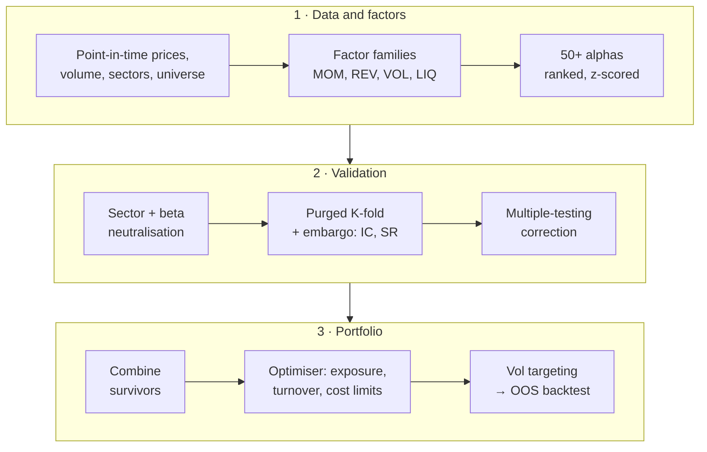

# Cross-Sectional Alpha Discovery & Portfolio Construction — Interview Playbook

*A research pipeline that turns daily data on 500+ equities into tradable portfolios without fooling itself. It builds point-in-time momentum, mean-reversion, volatility and liquidity factors, generates 50+ candidate alphas, validates them with purged K-fold cross-validation, embargoing, sector and beta neutralisation and multiple-testing correction (cutting in-sample-to-out-of-sample Sharpe decay by 18%), and combines the survivors into volatility-targeted portfolios under turnover, exposure and cost constraints: 0.82 out-of-sample Sharpe, 11.6% maximum drawdown in simulation. Python, Polars, SciPy, Statsmodels, PyTorch. Everything you need for a 30–45 minute quant interview.*

**Resume bullets this booklet defends**

1. Built point-in-time factor pipeline across 500+ equities using momentum, mean reversion, volatility, liquidity; generated over 50+ alphas.
2. Applied purged K-fold CV, embargoing, neutralization and multiple-testing correction; reduced in-sample to OOS Sharpe decay by 18%.
3. Implemented volatility-targeted portfolios with turnover, exposure and cost constraints; achieved 0.82 OOS Sharpe and 11.6% drawdown.

# Part 1: Project Overview

## 1.1 What is this project?

**The one-line version.** Every day, rank 500+ stocks by signals that historically predicted which would outperform the others, check that those signals are real rather than lucky, and build a risk-controlled portfolio that buys the top and avoids or shorts the bottom.

**Start with an example.** On a given day, compute each stock's return over the past twelve months, skipping the most recent month. Rank all 500 stocks. Historically, stocks in the top of this ranking (winners) have tended to outperform those at the bottom (losers) over the next month: the **momentum** effect. That ranking is a **factor**. Turning it into a daily score per stock is an **alpha signal**. But two traps follow. First, if the top-ranked stocks are mostly technology stocks, the "alpha" may just be a bet on the technology sector; **neutralisation** removes that. Second, if you test 50 variants of signals and keep the best, one will look good by chance; **multiple-testing correction** guards against that. Only signals that survive both become inputs to the **portfolio**, which is sized to a target volatility and constrained so that it does not trade too much or carry unintended exposures.

**The problem it solves.** Factor research has a notorious failure mode: signals that look excellent in-sample and disappoint out-of-sample. Causes include look-ahead bias, survivorship bias, overlapping labels, hidden sector or market exposure, and data snooping across many tries. This project builds the safeguards into the pipeline and measures their effect as a reduction in Sharpe decay.

**Who would use it.** Quant researchers and portfolio managers at systematic equity funds; risk teams evaluating factor exposures.

**Inputs and outputs.** Inputs: daily prices, returns, volumes, sector classifications and index membership for 500+ stocks, point-in-time **[confirm data source and period]**. Outputs: a library of 50+ candidate alphas with validation statistics, a selected subset, daily portfolio weights, and an out-of-sample backtest (Sharpe, drawdown, turnover, exposures).

**What makes it technically interesting.** Clean point-in-time data engineering; statistics of signal evaluation (IC, t-statistics, multiple testing); the economics of neutralisation; and constrained portfolio optimisation with costs.

## 1.2 Explaining it when asked "Can you explain this project?"

> **Say it aloud:** "I built a cross-sectional equity research pipeline over 500-plus stocks. It constructs point-in-time factors, so every value uses only information available on that date, across four families: momentum, mean reversion, volatility and liquidity, and from them generates more than 50 candidate alphas. Because testing that many signals invites false discoveries, I validated them with purged K-fold cross-validation and embargoing, neutralised them against sectors and market beta, and applied multiple-testing correction. That reduced the decay from in-sample to out-of-sample Sharpe by 18%. The surviving alphas feed a volatility-targeted portfolio with turnover, exposure and cost constraints, which delivered a 0.82 out-of-sample Sharpe with an 11.6% maximum drawdown in backtest."

## 1.3 Scope, evidence status and what to confirm

**Scope boundary.** Daily-frequency cross-sectional research and simulated portfolios. Not live trading, not intraday execution, and not fundamental (accounting) factors, since the listed families are price- and volume-based.

> **Evidence status:** No code, data or backtest logs for this project are in the Resume Prep folder, so every resume number is marked **UNVERIFIED**: your reported result, with the evidence needed to defend it. Numbers in worked examples are **ILLUSTRATIVE**. Items marked **[confirm]** are standard choices assumed to explain the bullets.

> **Resume flag:** Confirm before interviewing. (1) **"Reduced Sharpe decay by 18%"**: define decay ($1 - \text{SR}_{\text{OOS}}/\text{SR}_{\text{IS}}$) and say whether 18% is relative (for example 50% → 41%) or percentage points (50% → 32%), and versus which baseline pipeline. (2) Sharpe 0.82: net or gross of costs, and the cost model. (3) Long/short or long-only; whether the portfolio was dollar- and beta-neutral. Do not call it market-neutral unless the constraints enforced it. (4) Which multiple-testing method. (5) "Over 50+" is redundant wording; say "more than 50". (6) What PyTorch did (for example a non-linear alpha-combination model).

# Part 2: Fundamentals Required for This Project

| Resume bullet | Concepts you must be able to explain |
|---|---|
| 1. Point-in-time pipeline, 500+ equities, momentum, mean reversion, volatility, liquidity, 50+ alphas | Alpha, cross-sectional vs time-series, point-in-time data, look-ahead and survivorship bias, factor construction, ranking, IC |
| 2. Purged K-fold, embargo, neutralisation, multiple-testing correction, −18% Sharpe decay | Purged K-fold, embargo, sector/beta neutralisation, multiple hypothesis testing, data snooping, corrections, IS vs OOS Sharpe decay |
| 3. Volatility targeting, turnover/exposure/cost constraints, 0.82 OOS Sharpe, 11.6% drawdown | Portfolio construction, optimisation, volatility targeting, constraints, transaction costs, Sharpe, maximum drawdown |

### Alpha, and cross-sectional vs time-series strategies

- **Simple:** Alpha is return you earn beyond what simple market exposure explains. A cross-sectional strategy asks "which stocks will beat the others?"; a time-series strategy asks "will this asset go up or down?"
- **Technical:** In a factor model $r_i = \alpha_i + \beta_i r_m + \varepsilon_i$, alpha is the intercept: return not explained by market exposure $\beta_i$. In practice "an alpha" also means a **signal**: a daily score per stock expected to correlate with future relative returns. Cross-sectional strategies rank stocks on each date and go long the top, short (or underweight) the bottom, so much of the market's direction cancels.
- **Why it matters:** Cross-sectional bets have high breadth (hundreds of stocks each day) and hedge out the market, so modest per-stock predictability can produce good risk-adjusted returns.
- **In this project:** 50+ cross-sectional alpha signals over 500+ stocks.
- **Interview angle:** "Can a cross-sectional strategy lose in a rising market?" Yes; it wins or loses on relative performance, not market direction.

### Point-in-time data, look-ahead bias and survivorship bias

- **Simple:** Point-in-time means every number in the backtest is exactly what you could have known on that date. Look-ahead bias uses later information; survivorship bias tests only on companies that still exist today.
- **Technical:** Requirements: universe membership as of each date (including later-delisted and bankrupt stocks); prices adjusted for splits and dividends using only past corporate actions; sector labels as of each date; and signals computed after the close of day $t$ and traded no earlier than the next session. Survivorship bias inflates returns because failed companies, often prior losers, vanish from the sample.
- **Why it matters:** These biases can turn a worthless signal into an impressive backtest, and they are invisible in the results.
- **In this project:** A point-in-time factor pipeline: membership, adjustments and timestamps as of each date, built with Polars for speed **[confirm data vendor and how delistings were handled]**.
- **Interview angle:** "Give an example of look-ahead in price data." Using today's S&P 500 constituent list for a backtest starting ten years ago.

### Factor families: momentum, mean reversion, volatility and liquidity

- **Simple:** Four kinds of patterns: recent winners keep winning for a while (momentum); very short-term moves partly reverse (mean reversion); calmer stocks have historically delivered better risk-adjusted returns (low volatility); and less liquid stocks behave differently from liquid ones (liquidity).
- **Technical:** Each family is a per-stock characteristic computed from trailing prices and volumes only. Variants differ in lookback, skip period, volatility estimator and normalisation, which is how four families become 50+ candidate alphas.
- **Math:** ILLUSTRATIVE definitions for stock $i$ at date $t$: $$\text{MOM}_{i} = \frac{P_{i,t-21}}{P_{i,t-252}} - 1, \qquad \text{REV}_{i} = -\,r_{i,(t-5,t]}$$ $$\text{VOL}_{i} = -\,\sigma_{i,60\text{d}}, \qquad \text{ILLIQ}_{i} = \frac{1}{D}\sum_{d}\frac{\lvert r_{i,d}\rvert}{\text{DollarVol}_{i,d}}$$ 12-1 month momentum skips the last month (to avoid short-term reversal); reversal is minus the past-week return; low-volatility uses minus 60-day volatility; Amihud illiquidity is price impact per dollar traded.
- **Why it matters:** These families have long empirical histories and different economic explanations (behavioural underreaction, liquidity provision, leverage constraints, compensation for illiquidity), so they diversify each other.
- **In this project:** Variants (lookbacks, skips, normalisations, combinations) across the four families produced 50+ candidate alphas **[confirm exact definitions]**.
- **Interview angle:** "Why skip the most recent month in momentum?" One-month returns tend to reverse, which would contaminate the momentum signal.

### Factor construction: ranking, winsorising and z-scoring

- **Simple:** Raw factor values have outliers and different scales, so on each date they are converted to ranks or standardised scores that are comparable across stocks and over time.
- **Technical:** Per date: handle missing values; **winsorise** extreme values (for example clip at the 1st and 99th percentiles); then either **rank** to $[0,1]$ or **z-score**: $z_i = (x_i - \bar x)/s_x$ across stocks. Ranks are robust to outliers; z-scores keep relative distances. Optionally combine factors by averaging z-scores.
- **Math:** $$z_{i,t} = \frac{x_{i,t} - \text{mean}_j(x_{j,t})}{\text{std}_j(x_{j,t})}$$ computed across stocks $j$ on date $t$ only, so no future information enters.
- **Why it matters:** Without per-date normalisation, signals drift with market conditions and a few outliers dominate portfolio weights.
- **In this project:** Cross-sectional ranking or z-scoring of every alpha before evaluation and combination **[confirm]**.
- **Interview angle:** "Why normalise per date rather than over the whole history?" Whole-history statistics use future data and mix regimes.

### Alpha signals and the Information Coefficient

- **Simple:** The IC asks, on each day, whether stocks with higher signal values actually had higher next-period returns. Average it over days.
- **Math:** $$\text{IC}_t = \rho_{\text{Spearman}}\big(s_{\cdot,t},\; r_{\cdot,t+1 \to t+h}\big), \qquad \overline{\text{IC}} = \frac{1}{T}\sum_t \text{IC}_t, \qquad t\text{-stat} \approx \frac{\overline{\text{IC}}}{\text{sd}(\text{IC}_t)}\sqrt{T}$$ The ratio $\overline{\text{IC}}/\text{sd}(\text{IC}_t)$ is the **IC information ratio (ICIR)**, a measure of consistency.
- **Technical:** Daily cross-sectional ICs of 0.02–0.05 are typical for useful equity signals. With overlapping multi-day horizons, daily ICs are autocorrelated, so the naive $t$-statistic overstates significance; use Newey-West standard errors (Statsmodels) or non-overlapping samples.
- **Why it matters:** IC is the standard signal-quality metric, independent of portfolio construction choices, and feeds the fundamental law $\text{IR} \approx \text{IC}\sqrt{\text{BR}}$.
- **In this project:** IC, ICIR and $t$-statistics per alpha guided selection, alongside long/short portfolio Sharpe **[confirm horizons]**.
- **Interview angle:** "Mean IC 0.03, ICIR 0.3: good?" Consistent enough to matter at daily breadth, but check decay and turnover.

### Purged K-fold cross-validation and embargoing

- **Simple:** Split history into $K$ time blocks; test on each block using the others for training, but remove training data whose labels overlap the test block, and leave a gap after it.
- **Technical:** Unlike walk-forward, K-fold uses data both before and after the test block, which gives more test periods for evaluating many alphas. **Purging** removes training observations whose forward-return label window $(t, t+h]$ intersects the test block. **Embargo** removes observations immediately after the test block (for example $h$ days or a small percentage of the sample), because serial correlation lets them carry information about it.
- **Math:** Drop training date $t$ if $[t, t+h] \cap [T_a, T_b] \neq \varnothing$, or if $t \in (T_b, T_b + e]$.
- **Why it matters:** Overlapping forward returns and autocorrelated signals make ordinary K-fold leak, inflating in-sample estimates and the apparent stability of alphas.
- **In this project:** Purged K-fold with embargo for alpha evaluation and selection; the final reported performance is on out-of-sample periods **[confirm K, embargo length and final hold-out]**.
- **Interview angle:** "Why not plain walk-forward?" With many alphas to compare, K-fold uses all history for testing; purging and embargo make it safe.

### Neutralisation: sector and beta

- **Simple:** Remove the part of a signal that is just a bet on a sector or on the market, so what remains is the stock-specific view.
- **Technical:** On each date, regress the signal across stocks on sector dummies and beta (and possibly size), and keep the residual. The residual is uncorrelated with those exposures by construction.
- **Math:** $$s_t = X_t\,\gamma_t + \tilde s_t, \qquad \tilde s_t = \big(I - X_t(X_t^\top X_t)^{-1}X_t^\top\big)s_t$$ $s_t$ is the vector of signals across stocks, $X_t$ the exposure matrix (sector dummies, beta), $\gamma_t$ the fitted loadings, $\tilde s_t$ the neutralised signal.
- **Why it matters:** A raw alpha that loads on a sector or on beta earns those exposures' returns, which are cheap to get elsewhere and add unintended risk. A low-volatility signal, for example, is largely a short-beta bet; after beta neutralisation much of its raw performance may disappear. If it does, the "alpha" was a disguised exposure.
- **In this project:** Sector and beta neutralisation before evaluation and in portfolio constraints **[confirm sector scheme and beta estimation window]**.
- **Interview angle:** "Can neutralisation hurt?" Yes, if the sector tilt was genuine information; then you would model it explicitly as a sector-rotation signal.

### Multiple hypothesis testing, data snooping and corrections

- **Simple:** If you try 50 signals that are all useless, a few will still look significant by luck. Corrections raise the bar to account for how many you tried.
- **Technical:** At a 5% significance level, 50 independent null signals produce about 2.5 false positives on average, and the chance of at least one is $1 - 0.95^{50} \approx 92\%$. **Data snooping** is re-using one history for many decisions (signals, lookbacks, parameters), which inflates the best result. Corrections: **Bonferroni** (test each at $\alpha/m$), **Holm** (step-down, less conservative), **Benjamini-Hochberg** (controls the false discovery rate), a higher $t$-threshold (around 3, as argued by Harvey, Liu and Zhu), or the **deflated Sharpe ratio**. Statsmodels' `multipletests` implements the first three.
- **Math:** Bonferroni with $m = 50$, $\alpha = 0.05$: each alpha needs $p < 0.001$, roughly $\lvert t \rvert > 3.3$. BH: sort $p$-values $p_{(1)} \le \dots \le p_{(m)}$ and keep all up to the largest $k$ with $p_{(k)} \le \tfrac{k}{m}\alpha$.
- **Why it matters:** It is the main reason in-sample Sharpe ratios decay out of sample; correcting for it removes lucky signals before they reach the portfolio.
- **In this project:** Multiple-testing correction across the 50+ alphas **[confirm which method]**; correlated alphas mean the effective number of tests is smaller than 50.
- **Interview angle:** "Bonferroni or BH?" Bonferroni controls any false discovery and is conservative; BH tolerates a controlled share of false discoveries and keeps more power.

### In-sample vs out-of-sample Sharpe, and Sharpe decay

- **Simple:** In-sample performance is measured on data used to design the strategy; out-of-sample on data it never saw. The drop between them is the decay.
- **Math:** $$\text{SR} = \frac{\bar r}{\sigma_r}\sqrt{252}, \qquad \text{Decay} = 1 - \frac{\text{SR}_{\text{OOS}}}{\text{SR}_{\text{IS}}}$$ ILLUSTRATIVE: IS 1.6, OOS 0.8 gives 50% decay. An 18% *relative* reduction gives 41% decay; an 18-*point* reduction gives 32%.
- **Technical:** Decay comes from overfitting, data snooping, leakage, regime change and crowding. Studies of published anomalies find substantial post-publication decay, so some decay is normal; the goal is to make in-sample estimates honest predictors of OOS performance.
- **Why it matters:** Lower decay means the research process is more trustworthy, which is arguably more valuable than a high in-sample Sharpe.
- **In this project:** The safeguards reduced IS-to-OOS Sharpe decay by 18% compared with a pipeline without them **[confirm baseline, definition and relative vs points]**.
- **Interview angle:** "Why is lower decay a meaningful result?" It shows the validation process selects signals that generalise.

### Portfolio construction and optimisation

- **Simple:** Turn alpha scores into position sizes that maximise expected return for the risk taken, while respecting rules about exposures, trading and costs.
- **Technical:** Combine selected alphas into one expected-return estimate per stock (weighted average, or a learned model). Then solve a mean-variance problem with constraints, using a risk model (for example a factor model or shrunk covariance) for $\Sigma$.
- **Math:** $$\max_{w}\; \mu^\top w - \lambda\, w^\top \Sigma w - c^\top \lvert w - w_{\text{prev}}\rvert \quad \text{s.t.}\; \lvert B^\top w\rvert \le b,\; \lVert w - w_{\text{prev}}\rVert_1 \le \tau,\; \lvert w_i\rvert \le u$$ $\mu$: combined alpha forecasts; $\lambda$: risk aversion; $c$: per-stock cost rates; $B$: exposures (sectors, beta); $\tau$: turnover cap; $u$: position limit.
- **Why it matters:** Good signals can still make bad portfolios: concentrated, high-turnover, or dominated by hidden exposures. Optimisation translates forecasts into weights efficiently and enforces risk rules.
- **In this project:** SciPy optimisation with turnover, exposure and cost constraints; PyTorch possibly for alpha combination **[confirm both]**.
- **Interview angle:** "Why not simply equal-weight the top decile?" Simple and robust, but ignores risk, costs and exposure control; it is a good baseline.

### Volatility targeting

- **Simple:** Scale the whole portfolio up or down so that its expected volatility stays near a fixed target, for example 10% per year.
- **Math:** $$w_t^{\text{scaled}} = w_t \times \frac{\sigma_{\text{target}}}{\hat\sigma_{p,t}}, \qquad \hat\sigma_{p,t} = \sqrt{w_t^\top \hat\Sigma_t w_t}\,\sqrt{252}$$ usually with a leverage cap. ILLUSTRATIVE: predicted volatility 15%, target 10% → scale positions by 2/3.
- **Technical:** Predicted volatility comes from the risk model or recent realised volatility (EWMA). Because volatility clusters, scaling down in turbulent periods reduces drawdowns and stabilises risk; it can also improve Sharpe when high volatility is not compensated by higher return.
- **Why it matters:** Makes risk comparable over time and across strategies, and gives the drawdown figure meaning.
- **In this project:** Portfolios scaled to a volatility target **[confirm target level and estimator]**.
- **Interview angle:** "Downside?" Scaling lags volatility spikes; after a sudden shock you are de-risked late and may re-risk just before a second shock.

### Exposure, turnover and cost constraints; transaction costs

- **Simple:** Rules that stop the portfolio from becoming a hidden sector or market bet, from trading too much, and from ignoring trading costs.
- **Technical:** **Exposure constraints** bound net sector weights and portfolio beta (near zero for a neutral book). **Turnover constraints** cap $\lVert w_t - w_{t-1}\rVert_1$ per rebalance. **Cost terms** charge spread and impact on traded amounts, often larger for illiquid stocks. Turnover and costs interact with signal decay: fast signals (reversal) need high turnover; slow ones (momentum) need little.
- **Math:** Cost drag per year ≈ annual turnover × average cost per unit traded. ILLUSTRATIVE: 10× annual (one-way) turnover at 10 bps ≈ 1% per year, enough to erase a weak alpha.
- **Why it matters:** Many paper alphas, especially short-term reversal and liquidity signals, vanish after costs; constraints make the backtest closer to what could be traded.
- **In this project:** Turnover, exposure and cost constraints in the optimiser **[confirm cost model and turnover level]**.
- **Interview angle:** "How do you trade a fast signal cheaply?" Blend it with slow signals and trade toward the target gradually.

### Maximum drawdown

- **Simple:** The worst fall from a portfolio peak to a later low before recovering.
- **Math:** $$\text{MDD} = \max_t \frac{\max_{s \le t} V_s - V_t}{\max_{s \le t} V_s}$$
- **Technical:** Path-dependent; scales roughly with volatility and the length of the test period. At a 10% volatility target, an 11.6% drawdown is about 1.2 annual standard deviations, unremarkable for a multi-year test.
- **Why it matters:** Investors and risk managers set limits on drawdown; a strategy with a good Sharpe but a deep drawdown may be shut down before it recovers.
- **In this project:** 11.6% maximum drawdown out of sample **[confirm period and volatility target]**.
- **Interview angle:** "What drove the drawdown?" Know the period: factor crashes such as the 2009 momentum crash are classic sources.

# Part 3: Methodology and Workflow

## 3.1 From raw data to portfolio

**Figure 1 — From point-in-time data to factors, validated alphas and a constrained, volatility-targeted portfolio** [scale=0.72]

**Step 1: Point-in-time data.** Build the daily universe as of each date (including delisted names), apply corporate-action adjustments known at that time, attach point-in-time sectors, and timestamp everything so signals computed at the close of $t$ are traded at $t+1$. Polars handles the large panel efficiently. Reason: removes look-ahead and survivorship bias at the source.

**Step 2: Factors and alphas.** Compute momentum, reversal, volatility and liquidity families with several lookbacks and normalisations; winsorise and rank or z-score per date; result: 50+ candidate alphas. Reason: diverse, economically motivated signals.

**Step 3: Neutralise.** Regress each alpha cross-sectionally on sector dummies and beta per date and keep residuals. Reason: evaluate stock-specific information, not disguised exposures.

**Step 4: Validate.** Purged K-fold with embargo: compute mean IC, ICIR, Newey-West $t$-statistics and long/short Sharpe per alpha on test folds. Reason: honest, leakage-free estimates for many candidates.

**Step 5: Correct for multiple testing.** Adjust $p$-values across all candidates (and count every variant tried); keep only survivors; check correlation among survivors. Reason: discard lucky signals; this is the main lever on Sharpe decay.

**Step 6: Build the portfolio.** Combine survivors into expected returns; optimise weights with exposure, turnover and cost constraints; scale to the volatility target. Reason: turn forecasts into an investable, risk-controlled book.

**Step 7: Out-of-sample backtest.** Run on periods not used in Steps 2–5; report Sharpe (0.82), maximum drawdown (11.6%), turnover, cost drag and exposures; compare decay against a pipeline without the safeguards (−18%). Reason: the final, honest verdict.

## 3.2 Numerical claims and how to defend them

| Claim | What it means and how it is computed | Baseline and what could mislead | Status |
|---|---|---|---|
| 500+ equities | Point-in-time universe per date | Survivorship if today's list used | UNVERIFIED |
| 50+ alphas | Candidate signals across four families | Effective tests fewer (correlated) | UNVERIFIED |
| −18% Sharpe decay | Change in $1 - \text{SR}_{\text{OOS}}/\text{SR}_{\text{IS}}$ vs naive pipeline | Relative vs points; which baseline | UNVERIFIED; define |
| 0.82 OOS Sharpe | Annualised daily portfolio Sharpe on held-out periods | Gross vs net; period; SE ≈ 0.4–0.5 | UNVERIFIED |
| 11.6% max DD | Worst peak-to-trough of OOS equity | Depends on vol target and period | UNVERIFIED |

To defend these, bring: data and universe construction, the alpha list with IC statistics, the correction method and survivors, the decay comparison table (with and without safeguards), the optimiser formulation and cost model, and the OOS equity curve with exposures.

# Part 4: Important Design and Methodological Decisions

**1. Point-in-time universe and data instead of today's constituents.** *Why:* removes survivorship and look-ahead bias that silently inflate backtests. *Alternative:* current index members with adjusted history. *Trade-off:* harder data engineering (delistings, historical membership, corporate actions).

**2. Purged K-fold with embargo instead of a single train/test split.** *Why:* many alphas need many test periods for stable estimates; purging and embargo remove leakage from overlapping labels. *Alternative:* one split or plain walk-forward. *Trade-off:* folds after the test block use "future" training data, so a final walk-forward hold-out is still needed.

**3. Neutralise to sectors and beta before judging alphas.** *Why:* reveals whether an alpha has stock-specific information or is a disguised exposure. *Alternative:* evaluate raw signals. *Trade-off:* some genuine sector information is removed.

**4. Multiple-testing correction instead of picking the best backtests.** *Why:* with 50+ candidates, several will look significant by chance. *Alternative:* select on raw $t$-statistics. *Trade-off:* fewer survivors and some real but weak alphas discarded.

**5. Mean-variance optimisation with constraints instead of top-decile equal weights.** *Why:* uses risk and cost information and enforces exposure and turnover limits. *Alternative:* equal-weight long/short deciles. *Trade-off:* sensitive to errors in $\mu$ and $\Sigma$; needs shrinkage and constraints for stability.

**6. Volatility targeting instead of constant leverage.** *Why:* stable risk over time, smaller drawdowns in turbulent periods. *Alternative:* fixed gross exposure. *Trade-off:* lag after sudden shocks, and extra turnover from rescaling.

# Part 5: Complete Interview Explanation

## 5.1 Two-minute explanation

> **Say it aloud:** "This project is a cross-sectional equity pipeline over 500-plus stocks. Every day it ranks stocks by signals that historically predicted relative returns: momentum, short-term mean reversion, low volatility and liquidity, with variants giving more than 50 candidate alphas. All data are point-in-time: universe membership, adjustments and timestamps are as of each date, so there is no look-ahead or survivorship bias.
>
> The research problem is that factor backtests decay out of sample. So I validated the alphas with purged K-fold cross-validation and embargoing to handle overlapping labels, neutralised them to sectors and beta to remove disguised exposures, and corrected for multiple testing across all the candidates. Those safeguards reduced in-sample to out-of-sample Sharpe decay by 18%.
>
> The survivors are combined and fed to a constrained optimiser with exposure, turnover and cost limits, then scaled to a volatility target. Out of sample, the backtest delivered a 0.82 Sharpe with an 11.6% maximum drawdown."

## 5.2 Five-minute explanation

> **Say it aloud:** "**From data to factors.** I build a daily panel of 500-plus stocks with point-in-time universe membership, including names that were later delisted, and corporate actions applied only as they became known. Factors fall into four families: 12-minus-1-month momentum; short-term reversal, minus the past week's return; low volatility; and Amihud illiquidity. Each is winsorised and ranked or z-scored across stocks on each date, giving more than 50 alpha variants.
>
> **From factors to validated alphas.** For each alpha I compute the daily cross-sectional rank IC against forward returns, its mean and its information ratio, and a Newey-West t-statistic because overlapping horizons make daily ICs autocorrelated. Evaluation uses purged K-fold: training observations whose forward-return windows overlap the test fold are removed, with an embargo after it. Before evaluation I neutralise each alpha by regressing it cross-sectionally on sector dummies and beta and keeping the residual. A low-volatility alpha, for example, is largely short beta; after neutralisation much of its raw performance can disappear, which tells you it was an exposure, not alpha.
>
> **Multiple testing.** With 50 candidates at 5% significance, about two or three useless signals pass by luck. I corrected p-values across all candidates and kept only survivors. Compared with the naive pipeline, the decay from in-sample to out-of-sample Sharpe fell by 18%.
>
> **Portfolio.** Survivors are combined into expected returns, then a mean-variance optimiser with sector and beta exposure limits, a turnover cap and cost penalties produces weights, which are scaled to a volatility target. Out of sample: 0.82 Sharpe, 11.6% maximum drawdown."

## 5.3 Ten-minute explanation

> **Say it aloud:** "I'll go deeper into data integrity, the statistics of selection, neutralisation, the optimiser and the limitations.
>
> **Data integrity.** Three biases. Survivorship: using today's constituents removes failed companies, which were often prior losers, inflating momentum and other signals. Look-ahead: using information after the decision time, including restated data or adjustments not yet known. Timing: a signal computed at today's close cannot trade at today's close; I trade the next session. Polars lets me compute features over the whole panel quickly with lazy, columnar operations.
>
> **Evaluation statistics.** A daily cross-sectional IC around 0.02 to 0.05 is typical for useful signals. Consistency matters as much as level, so I look at ICIR and at IC by year. With multi-day forward returns, consecutive ICs share most of their return window, so the naive t-statistic is overstated; Newey-West corrects for that.
>
> **Purged K-fold.** It gives every period a turn as the test set, which is valuable when comparing many alphas, while purging removes overlapping labels at the boundaries and the embargo handles serial correlation. Because K-fold trains on data after the test fold, the final portfolio result is still reported on a forward hold-out.
>
> **Multiple testing.** The chance that at least one of 50 null signals passes at 5% is about 92%. Bonferroni requires p below 0.001; Benjamini-Hochberg controls the false discovery rate and keeps more power. Alphas are correlated, so the effective number of tests is smaller than the raw count, but every variant I tried should be counted.
>
> **Neutralisation.** Regressing on sectors and beta removes exposures that are cheap to obtain and that would dominate risk. If a raw alpha's IC collapses after neutralisation, it was a disguised sector or beta bet.
>
> **Portfolio.** Maximise expected alpha minus a risk penalty minus costs, subject to exposure, turnover and position limits; the risk model needs shrinkage to be stable. Volatility targeting rescales the book so that predicted volatility stays near target; that stabilises risk and limits drawdowns in turbulent periods.
>
> **Results and limits.** Out-of-sample Sharpe 0.82 with an 11.6% drawdown; the standard error of a Sharpe over five years is roughly 0.5, so I present it as encouraging rather than proven. Decay fell by 18% relative to the naive pipeline. Limitations: I should state whether the Sharpe is net of costs, and what the cost model assumed; factor crowding and regime shifts, like momentum crashes, are real risks; and price-based factors are well known, so their future premia may be smaller. Next steps: fundamental and alternative data, a proper factor risk model, and capacity analysis."

# Part 6: Interview Questions and Answers

## 6.1 Basic understanding

#### Q1. What does your project do? [Easy]

It is a research pipeline for cross-sectional equity strategies. For 500+ stocks, it builds point-in-time factors from four families (momentum, mean reversion, volatility and liquidity) and generates more than 50 candidate alpha signals. It then tests them carefully: purged K-fold cross-validation with embargoing to avoid leakage from overlapping returns, neutralisation against sectors and market beta to remove disguised exposures, and multiple-testing correction so lucky signals are discarded. Those safeguards reduced the gap between in-sample and out-of-sample Sharpe by 18% compared with a naive process. Finally, it combines the surviving alphas into volatility-targeted portfolios using an optimiser with turnover, exposure and cost constraints. The out-of-sample backtest showed a 0.82 Sharpe and an 11.6% maximum drawdown. These are simulated results, not live trading.

#### Q2. What is alpha, and how is a cross-sectional strategy different from a time-series strategy? [Easy]

Alpha is return beyond what market exposure explains: in $r_i = \alpha_i + \beta_i r_m + \varepsilon_i$, it is the intercept. In research language, "an alpha" is also a signal that predicts relative returns. A **time-series** strategy predicts whether one asset will go up or down and takes a directional position, for example trend-following on an index. A **cross-sectional** strategy compares many assets on the same date and bets on relative performance: long the stocks with the highest scores, short or underweight the lowest. Its advantages: high breadth (hundreds of bets every day), and much of the market's direction cancels between longs and shorts, so returns depend on ranking skill rather than market timing. My project is cross-sectional: every signal ranks 500+ stocks against each other on each date.

#### Q3. What does point-in-time mean, and why does it matter? [Easy]

Point-in-time means every value used in the backtest on date $t$ is exactly what was knowable on date $t$. Three things commonly break this. **Universe:** using today's index constituents for past dates removes companies that later failed or were delisted, which is **survivorship bias**; because failed firms were often recent losers, it inflates momentum and other strategies. **Adjustments and revisions:** using split or dividend adjustments, or corrected data, that were only known later. **Timing:** using the close price on day $t$ both to compute a signal and to trade on it. A point-in-time pipeline keeps historical membership including delisted names, applies corporate actions as they occurred, timestamps every field, and trades no earlier than the next session after a signal is computed. These biases are invisible in results, which is why they must be prevented by construction.

#### Q4. Explain your four factor families. [Easy]

**Momentum:** stocks that performed well over the past 6–12 months tend to keep outperforming for a few months; the standard version is 12-1 momentum, the return from 12 months ago to one month ago, skipping the last month because very recent returns tend to reverse. Explanations include investor underreaction. **Mean reversion (short-term reversal):** stocks with extreme returns over the past days or week tend to partly reverse, often explained as compensation for providing liquidity. **Volatility:** low-volatility stocks have historically delivered better risk-adjusted returns than high-volatility ones, often attributed to leverage constraints and lottery preferences. **Liquidity:** measures such as Amihud illiquidity (absolute return per dollar traded) capture how costly a stock is to trade; illiquid stocks may earn a premium. The families have different horizons and explanations, so they diversify each other.

#### Q5. How does raw data become a factor, a factor become an alpha signal, and a signal become a portfolio? [Easy]

**Data to factor:** from point-in-time prices and volumes, compute a characteristic per stock per date, for example 12-1 month return. **Factor to alpha signal:** clean it so it is comparable across stocks and dates: winsorise outliers, rank or z-score cross-sectionally each day, neutralise to sectors and beta, and verify it predicts forward returns out of sample (positive, stable IC; significant after multiple-testing correction). **Signal to portfolio:** combine surviving signals into one expected-return estimate per stock, then choose weights with an optimiser that trades off expected alpha against risk and costs under exposure, turnover and position limits, and finally scale the whole book to a volatility target. Each stage has its own failure mode: biased data, spurious signals, or portfolios that are concentrated, expensive to trade or full of unintended exposures.

#### Q6. What is the Information Coefficient, and how did you use it? [Easy]

The IC is the correlation, usually Spearman rank correlation, between a signal's values across stocks on date $t$ and those stocks' subsequent returns. Computing it each day gives a time series; its mean measures average predictive power, its standard deviation measures consistency, and their ratio is the ICIR. Daily cross-sectional ICs of 0.02–0.05 are typical for useful equity signals; even small ICs matter because breadth is high (the fundamental law: $\text{IR} \approx \text{IC}\sqrt{\text{breadth}}$). I used mean IC, ICIR and $t$-statistics to rank and select alphas, alongside each alpha's long/short portfolio Sharpe. Because forward returns over several days overlap from one day to the next, daily ICs are autocorrelated; I used Newey-West standard errors so significance was not overstated **[confirm horizons]**.

#### Q7. What is neutralisation, and why might a strong raw alpha disappear after it? [Easy]

Neutralisation removes the part of a signal explained by common exposures. On each date, regress the signal across stocks on sector dummies and beta, and keep the residual: the neutralised signal has zero correlation with those exposures. A raw alpha can look strong simply because it tilts toward something that happened to perform well. A low-volatility signal is largely a short-beta bet: it buys defensive stocks and avoids high-beta ones, so in a falling market it looks brilliant. A signal concentrated in one sector looks great when that sector rallies. After neutralisation, those contributions vanish; if the IC collapses, the "alpha" was a disguised exposure that you could get cheaply through sector or index trades, and that adds risk you did not intend. If the IC survives, the signal contains genuine stock-specific information.

#### Q8. What is the multiple-testing problem in alpha research? [Easy]

If you test many signals, some will look significant purely by chance. At a 5% significance level, each useless signal has a 5% chance of passing; with 50 independent useless signals, you expect about 2.5 false positives, and the probability that at least one passes is $1 - 0.95^{50} \approx 92\%$. Alpha research makes it worse because the same history is reused for every decision: which factors, which lookbacks, which normalisations, which parameters. This is **data snooping**, and it means the best backtest is biased upward. It is a major reason in-sample Sharpe ratios decay out of sample. The fix is to account for the number of trials: correct $p$-values (Bonferroni, Holm, Benjamini-Hochberg), demand higher $t$-statistics (around 3), or deflate the Sharpe ratio, and count every variant you actually tried.

## 6.2 Validation and statistics

#### Q9. What is purged K-fold cross-validation with embargoing? [Easy]

It is K-fold cross-validation adapted to financial time series. Split history into $K$ contiguous time blocks. Each block takes a turn as the test set, and the remaining blocks are used for training or estimation. Two adjustments prevent leakage. **Purging:** an observation at date $t$ has a label built from returns over $(t, t+h]$; if that window overlaps the test block, the training observation contains test information, so it is removed. **Embargo:** observations immediately after the test block are also removed, because autocorrelation in signals and returns lets them carry information about the test period. Compared with walk-forward, K-fold gives more test periods, which helps when comparing many alphas. Because some training data come after the test block, I would still report final portfolio results on a forward hold-out **[confirm K and embargo length]**.

#### Q10. Which multiple-testing corrections exist, and which would you choose? [Easy]

**Bonferroni:** test each of $m$ hypotheses at $\alpha/m$. With 50 alphas at 5%, each needs $p < 0.001$ (about $\lvert t \rvert > 3.3$). It controls the family-wise error rate (any false discovery) but is conservative. **Holm:** a step-down version that is uniformly more powerful with the same guarantee. **Benjamini-Hochberg:** controls the false discovery rate, the expected share of false positives among discoveries; sort $p$-values and keep all up to the largest $k$ with $p_{(k)} \le \tfrac{k}{m}\alpha$. It keeps more real but modest signals. In finance, a rule of thumb from Harvey, Liu and Zhu is to require $t > 3$ for new factors. The **deflated Sharpe ratio** adjusts a strategy's Sharpe for the number of trials. For building a diversified portfolio of many weak alphas, BH is often the practical choice **[confirm what you used]**.

#### Q11. What is Sharpe decay, and what does "reduced by 18%" mean? [Easy]

Sharpe decay is how much performance drops between in-sample (data used to design the strategy) and out-of-sample (data never used): $\text{Decay} = 1 - \text{SR}_{\text{OOS}}/\text{SR}_{\text{IS}}$. If the in-sample Sharpe is 1.6 and out-of-sample 0.8, decay is 50%. Decay comes from overfitting, data snooping, leakage, regime change and crowding; some decay is normal even for genuine effects. "Reduced decay by 18%" compares the safeguarded pipeline (purging, embargo, neutralisation, multiple-testing correction) with a naive pipeline. It must be stated precisely: an 18% **relative** reduction turns 50% decay into 41%; an 18-**point** reduction turns it into 32% **[confirm which, and the baseline]**. The meaning: in-sample estimates became more honest predictors of out-of-sample results, which is what makes research decisions trustworthy.

#### Q12. Why is in-sample performance usually better than out-of-sample? [Easy]

Because every choice made while looking at data adapts to that data's noise as well as its signal. Selecting the best of many alphas, tuning lookbacks, choosing normalisations and adjusting portfolio parameters all fit idiosyncrasies of the sample that will not repeat. Leakage, such as overlapping labels or look-ahead, inflates in-sample results further. Beyond statistics, markets change: an effect can weaken after it becomes widely known and traded (crowding), or behave differently in a new regime. So the expected out-of-sample Sharpe of a selected strategy is lower than its in-sample estimate. Good practice: minimise the number of decisions made on the test data, use purged validation, correct for multiple testing, prefer simple and economically motivated signals, and keep a final period untouched until the end.

#### Q13. What does volatility targeting do? [Easy]

It scales the portfolio so that its predicted volatility stays near a fixed target. Each day, estimate the portfolio's volatility from the risk model, $\hat\sigma_p = \sqrt{w^\top \hat\Sigma w}$ annualised, or from recent realised volatility, and multiply all weights by $\sigma_{\text{target}}/\hat\sigma_p$, usually with a leverage cap. If the target is 10% and predicted volatility is 15%, positions shrink by a third. Because volatility clusters, this reduces exposure in turbulent periods, which tends to limit drawdowns, and increases it in calm periods. It makes risk stable over time, makes strategies comparable, and gives metrics like drawdown a consistent meaning. Its weaknesses: it reacts after volatility has already risen, so a sudden shock still hurts; rescaling adds turnover; and it can re-risk just before a second shock **[confirm your target and estimator]**.

#### Q14. What constraints did the portfolio have, and why? [Easy]

Three kinds. **Exposure constraints** limit net exposure to sectors and to market beta, keeping the portfolio's returns driven by stock selection rather than by hidden directional or sector bets; tight bounds near zero make the book close to neutral on those dimensions. **Turnover constraints** cap how much the portfolio can change at each rebalance, measured as the sum of absolute weight changes; they keep trading costs and market impact manageable and stop the optimiser from chasing noise in daily signals. **Cost terms** penalise trading in the objective, with higher costs for less liquid stocks, so the optimiser only trades when the expected gain exceeds the cost. Position limits prevent concentration in single names. Together they turn theoretical alpha into a portfolio that could plausibly be traded **[confirm bounds and whether the book was dollar- or beta-neutral]**.

#### Q15. What do 0.82 OOS Sharpe and 11.6% maximum drawdown mean? [Easy]

The Sharpe ratio is annualised mean return over annualised volatility of daily portfolio returns, measured only on out-of-sample periods. 0.82 means about 0.82 units of return per unit of risk per year; at a 10% volatility target that would be roughly 8.2% annual excess return (ILLUSTRATIVE). Maximum drawdown is the worst peak-to-trough fall of the out-of-sample equity curve: 11.6%. At a 10% volatility target that is about 1.2 annual standard deviations, ordinary for a multi-year test. Context: the standard error of a Sharpe over five years is about 0.5, so 0.82 is promising but not conclusive. I need to state whether results are net of costs, the cost model, the period, and the volatility target, and stress that it is a simulated backtest, not live performance **[confirm]**.

#### Q16. What role did Polars, SciPy, Statsmodels and PyTorch play? [Easy]

**Polars** is a fast, columnar DataFrame library with lazy evaluation; it handles the daily panel of 500+ stocks over many years (millions of rows) and computes rolling factors, cross-sectional ranks and joins much faster than row-wise pandas code, and makes point-in-time joins explicit. **Statsmodels** provides regressions for neutralisation and beta estimation, Newey-West standard errors for IC $t$-statistics, and `multipletests` for Bonferroni, Holm and Benjamini-Hochberg corrections. **SciPy** provides the optimiser (`scipy.optimize`) for constrained portfolio construction, and statistical functions. **PyTorch** was most likely used to combine alphas non-linearly or learn combination weights **[confirm]**. Being able to say what each tool did, rather than listing them, is what interviewers look for.

## 6.3 Methodology and scenarios

#### Q17. Why use purged K-fold for alpha selection but report the final result on a forward hold-out? [Medium]

They answer different questions. Alpha selection compares many candidates, so it needs as many test periods as possible to get stable IC and Sharpe estimates; purged K-fold lets every period be a test period, while purging and embargo remove the leakage from overlapping labels and serial correlation. But K-fold still trains on data that come after the test fold. That is fine for estimating whether a signal is consistently predictive, but it is not how the strategy would be deployed, and it allows information about later regimes to influence earlier decisions. The final portfolio performance should therefore be measured walk-forward on a period that played no role in selection: alphas, corrections, combination weights and portfolio parameters all fixed beforehand. That is the number that should go on the resume as OOS **[confirm your final evaluation design]**.

#### Q18. How do you count the number of tests when alphas are correlated? [Medium]

The raw count overstates the number of independent tests: twelve momentum variants with different lookbacks are highly correlated and are closer to one or two independent hypotheses. Treating them as fully independent makes Bonferroni too conservative. Approaches: estimate the **effective number of tests** from the eigenvalues of the alphas' correlation matrix (more dispersed eigenvalues mean more independent tests), or cluster alphas and count clusters; use **Benjamini-Hochberg**, which remains valid under positive dependence; or use resampling methods (bootstrapping the whole family of strategies, as in White's Reality Check or Hansen's SPA test) that account for dependence directly. Equally important is honesty about the denominator: every variant that was tried, including those quietly discarded, belongs in the count, otherwise the correction is cosmetic.

#### Q19. How do you estimate beta for neutralisation, and what can go wrong? [Medium]

Typically by regressing each stock's daily returns on market returns over a trailing window, for example 252 days, using only past data, so beta at date $t$ is point-in-time. Problems: **estimation noise**, since daily betas are noisy, especially for illiquid stocks; shrinking toward 1 (Vasicek or Blume adjustment) reduces noise. **Non-synchronous trading**: illiquid stocks react to market moves with a lag, which biases beta downward; adding lagged market returns (Dimson beta) helps. **Instability**: betas change with regimes and corporate events; shorter windows adapt faster but are noisier. **Window choice as a hidden parameter**: another degree of freedom to account for. If beta is badly estimated, a "beta-neutral" portfolio still carries market exposure, which shows up as correlation of portfolio returns with the market out of sample; checking that correlation is the practical test.

#### Q20. Why combine alphas, and how? [Medium]

Individual alphas are weak and noisy; combining imperfectly correlated signals raises the combined IC and stabilises performance, the same diversification logic as for assets. Simple methods: equal-weight the z-scored survivors, which is robust and hard to overfit; or weight by historical ICIR. Better methods account for correlation: weights proportional to $\Sigma_{\text{IC}}^{-1}\,\overline{\text{IC}}$ (a mean-variance problem on signals), usually with shrinkage because the estimated correlation matrix is noisy. Non-linear combination with a model (for example a small neural network in PyTorch, or gradient boosting) can capture interactions, such as momentum working differently in high-volatility stocks, but it adds substantial overfitting risk and must be trained with the same purged validation. Combination weights must be chosen using only past data in the walk-forward evaluation **[confirm your method]**.

#### Q21. How would transaction costs change which alphas survive? [Medium]

Signals differ in how fast they decay and therefore in how much turnover they need. Short-term reversal changes daily, so portfolios trading it turn over heavily; at 10 bps per unit traded, 10× annual turnover costs about 1% a year and can erase its gross alpha. Momentum changes slowly, so it needs little trading and survives costs well. Liquidity signals are tricky: they often point toward illiquid stocks, which are exactly the most expensive to trade. So a cost-aware pipeline evaluates **net** IC or net long/short Sharpe, models costs as spread plus impact rising with trade size relative to volume, and blends fast and slow signals so the portfolio trades toward a combined target gradually. The optimiser's cost penalty and turnover cap do this automatically: they hold positions when the expected gain from trading is smaller than its cost.

#### Q22. What happens during a factor crash, such as the 2009 momentum crash? [Medium]

In sharp market reversals, momentum portfolios can lose heavily: they are short the beaten-down stocks, often high-beta, that rebound most when the market turns. In 2009 momentum suffered one of its worst drawdowns. Three parts of my design help. **Beta neutralisation** reduces the hidden short-beta exposure that momentum accumulates after a bear market, which drives much of the crash. **Volatility targeting** reduces exposure as volatility rises, limiting losses, although it reacts with a lag. **Diversification across families** helps because reversal and low-volatility signals often behave differently in rebounds. The maximum drawdown of 11.6% must be read in the context of the test period: if the period contains such a crash, explain what drove the drawdown and how fast it recovered. Further protection could come from crash-aware momentum scaling or stress testing the portfolio on historical episodes.

#### Q23. Is your portfolio market-neutral? [Medium]

I should only say so if the constraints enforced it, and I should be precise about which kind. **Dollar-neutral** means long and short dollar exposures are equal. **Beta-neutral** means the portfolio's weighted beta is near zero, so market moves have little effect. **Sector-neutral** means net exposure to each sector is near zero. My optimiser had exposure constraints on sectors and beta **[confirm bounds and whether shorts were allowed]**; if the bounds were tight, the book was approximately sector- and beta-neutral by construction. But "neutral by construction" uses estimated betas; realised market exposure can differ, so the empirical check is the out-of-sample correlation and regression beta of portfolio returns against the market. If the book was long-only, it is not market-neutral at all; it is an active tilt relative to a benchmark, and its Sharpe should be compared with the benchmark's.

#### Q24. Why does mean-variance optimisation need care, and how did you stabilise it? [Medium]

Unconstrained mean-variance optimisation is an "error maximiser": it puts the largest weights where estimated returns are highest and estimated risk lowest, which is often where estimation errors are largest. With 500+ stocks, the sample covariance matrix is very noisy (and singular if there are fewer observations than stocks), so the optimiser exploits spurious low-variance combinations. Stabilisers: a structured risk model (a factor model, or Ledoit-Wolf shrinkage of the sample covariance); shrinking expected returns toward zero or scaling alphas by their confidence; position limits, exposure bounds and turnover caps, which act as regularisation; and cost penalties, which stop chasing small changes. A useful sanity check is comparing against simple equal-weighted decile portfolios: if the optimised portfolio is not clearly better out of sample, the extra complexity is not justified.

#### Q25. How would you improve this research? [Medium]

First, broaden signals: fundamental factors (value, profitability, investment, earnings revisions) with careful point-in-time handling of reporting lags, and alternative data. Second, a proper factor risk model for both neutralisation and the optimiser, with style factors (size, value, momentum) as well as sectors, and attribution of returns to factors and residual alpha. Third, more rigorous inference: deflated Sharpe ratio, effective-number-of-tests estimates, and a final untouched hold-out. Fourth, realistic costs and **capacity**: impact models that scale with trade size relative to daily volume, to estimate how much capital the strategy could run before costs eat the alpha. Fifth, monitoring for alpha decay and crowding: rolling IC by signal and correlation with known factor returns. Finally, regime analysis: how each family behaves in high- and low-volatility markets.

#### Q26. How would you build expected returns from alphas so the optimiser uses them correctly? [Hard]

Alpha scores are ranks or z-scores, not returns; feeding them directly as $\mu$ mixes units and over-weights noisy signals. A standard conversion follows Grinold's rule: $\mu_i = \text{IC} \times \sigma_i \times z_i$, the forecast return equals the signal's information coefficient times the stock's residual volatility times its standardised score. That scales forecasts by how predictive the signal is (IC) and by how much the stock can move (volatility), so a strong score on a volatile stock implies a larger expected return than the same score on a quiet stock. With several alphas, combine z-scores first, then use the combined IC. Two refinements: use residual (factor-neutral) volatility so forecasts refer to stock-specific return; and shrink IC toward zero for uncertainty and decay with horizon. Correctly scaled $\mu$ makes the trade-off against risk and costs meaningful, which is what turns a ranking into a sensible portfolio.

# Part 7: Final Revision Sheet

### 1. Project in one paragraph

Point-in-time panel of 500+ stocks; four factor families (12-1 momentum, short-term reversal, low volatility, Amihud liquidity) → 50+ alphas, winsorised and ranked per date. Validation: sector/beta neutralisation, purged K-fold with embargo, IC/ICIR/Newey-West $t$-stats, multiple-testing correction → IS-to-OOS Sharpe decay −18%. Portfolio: combine survivors, optimise with exposure, turnover and cost constraints, volatility-target; OOS 0.82 Sharpe, 11.6% max drawdown (simulated).

### 2. Workflow in one diagram

> **Note:** PIT data → factors → 50+ alphas → neutralise → purged K-fold IC / SR → multiple-testing filter → combine → constrained optimiser → vol target → OOS backtest.

### 3. Technologies and roles

- **Polars:** fast panel and factor computation
- **Statsmodels:** neutralisation, Newey-West, multipletests
- **SciPy:** constrained optimisation
- **PyTorch:** alpha combination (confirm)

### 4. Five most important concepts

1. Point-in-time, survivorship, look-ahead
2. Cross-sectional IC and ICIR
3. Neutralisation = residual vs sectors, beta
4. Multiple testing: 92% chance of a fluke in 50
5. Decay $= 1 - \text{SR}_{OOS}/\text{SR}_{IS}$

### 5. Five key decisions

1. PIT universe incl. delisted
2. Purged K-fold + embargo
3. Neutralise before judging
4. Correct for multiple tests
5. Constrained, vol-targeted optimiser

### 6. Five likely questions

1. Factor → signal → portfolio?
2. Why does an alpha vanish after neutralising?
3. Bonferroni vs BH?
4. What exactly is −18% decay?
5. Is the book market-neutral? Net of costs?

### 7. Key metrics

| Metric | Definition |
|---|---|
| IC | Spearman(signal, fwd return) per date |
| ICIR | mean IC / sd IC |
| Sharpe | $\bar r/\sigma \times \sqrt{252}$ |
| Decay | $1 - \text{SR}_{OOS}/\text{SR}_{IS}$ |
| Max DD | worst peak-to-trough |

### 8. Limitations

Price-based factors are crowded; effective tests < 50; K-fold trains on later data; neutral by estimated beta only; Sharpe SE ≈ 0.5; cost model and net/gross to confirm; numbers UNVERIFIED.

### 9. Ten things to remember

1. 12-1 momentum skips the last month.
2. Signal at close $t$, trade at $t+1$.
3. Winsorise, then rank/z-score per date.
4. Neutralise: $\tilde s = (I - X(X^\top X)^{-1}X^\top)s$.
5. 50 tests at 5% → ≈ 2.5 flukes.
6. Bonferroni: $p < 0.001$ for $m = 50$.
7. Newey-West for overlapping ICs.
8. Vol target: scale by $\sigma^*/\hat\sigma_p$.
9. Cost drag ≈ turnover × cost.
10. $\mu_i = \text{IC}\cdot\sigma_i\cdot z_i$.

