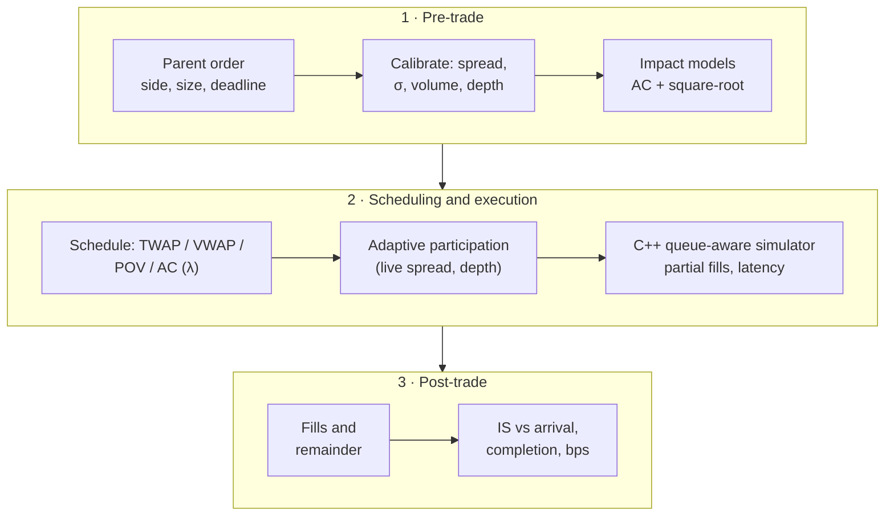

# Market Impact & Optimal Execution Engine — Interview Playbook

*An execution research engine that decides how to split a large order over time so that it costs as little as possible. It implements the Almgren-Chriss optimal-execution model and the square-root market-impact model for TWAP, VWAP and POV strategies under spread, volatility and liquidity constraints; tests them in a queue-aware simulator with partial fills and latency over 30K+ orders (18% lower implementation shortfall than TWAP); and adds adaptive participation driven by real-time spread and liquidity (11 bps better execution while completing 95%+ of orders). C++, Python, NumPy, SciPy, Redis. Everything you need for a 30–45 minute quant interview.*

**Resume bullets this booklet defends**

1. Implemented Almgren-Chriss and square-root impact models for VWAP, TWAP and POV under spread, volatility and liquidity constraints.
2. Built queue-aware execution simulator with partial fills, latency across 30K+ orders; reduced implementation shortfall by 18% versus TWAP.
3. Developed adaptive participation using real-time spread and liquidity; improved execution quality by 11 bps while 95%+ completion.

# Part 1: Project Overview

## 1.1 What is this project?

**The one-line version.** A portfolio manager decides to buy 200,000 shares; this engine decides *how* to buy them (how fast, in what slices, and when to be aggressive or patient) so the average price paid is as close as possible to the price when the decision was made.

**Start with an example.** The stock trades at 50.00 and typically trades 2 million shares a day, so the order is 10% of daily volume. Buy it all at once with a market order and you sweep through the order book, pushing the price up: perhaps an average fill of 50.30, a cost of 60 bps. Spread it evenly over the whole day (TWAP) and each slice barely moves the price, but now you are exposed to the price drifting for hours: if news pushes the stock to 51 by the afternoon, waiting was expensive. **Optimal execution** is the trade-off between these two costs: **market impact** from trading fast and **timing risk** from trading slowly. Almgren-Chriss solves it mathematically; the simulator tests the solutions against realistic order-book mechanics; adaptive participation adjusts in real time when the market is cheap or expensive to trade.

**The problem it solves.** For institutional investors, execution costs are often comparable to the alpha they are trying to capture. A few basis points saved on every trade compounds into significant performance. The engine quantifies and reduces implementation shortfall.

**Who would use it.** Execution desks and algorithmic-trading teams at asset managers and brokers; quant researchers estimating transaction costs for strategies; portfolio managers deciding how fast to trade.

**Inputs and outputs.** Input: a parent order (side, quantity, start and end time, urgency), market data (spread, volatility, volume profile, book depth), and model parameters. Output: a schedule of child orders (sizes and timing, limit or market), simulated fills, and execution metrics: implementation shortfall in bps, completion rate, participation and slippage versus benchmarks.

**What makes it technically interesting.** A clean stochastic-control model with a closed-form answer; an empirical impact law with a surprising square-root shape; realistic microstructure simulation (queues, partial fills, latency); and the tension between cost savings and the risk of not finishing.

## 1.2 Explaining it when asked "Can you explain this project?"

> **Say it aloud:** "I built an execution engine that decides how to trade a large order with minimal cost. Trading fast moves the price against you; trading slowly exposes you to price risk. I implemented the Almgren-Chriss model, which finds the schedule that minimises expected cost plus a penalty on its variance, and the square-root impact model, which says impact grows with the square root of order size relative to daily volume. These drive TWAP, VWAP and POV strategies under spread, volatility and liquidity constraints. To evaluate them I built a queue-aware simulator in C++ that models where my limit orders sit in the queue, partial fills and latency. Over more than 30,000 simulated orders, the optimised schedules cut implementation shortfall by 18% compared with TWAP. Then I added adaptive participation that trades more when spreads are tight and liquidity is deep, improving execution by 11 basis points while still completing over 95% of orders."

## 1.3 Scope, evidence status and what to confirm

**Scope boundary.** Research engine and simulator: models, schedules, simulated fills and metrics. It is not connected to an exchange and does not route live orders; all results are simulated.

> **Evidence status:** No code, data or simulation logs for this project are in the Resume Prep folder, so every resume number is marked **UNVERIFIED**: your reported result, with the evidence needed to defend it. Numbers in worked examples are **ILLUSTRATIVE**. Items marked **[confirm]** are standard choices assumed to explain the bullets.

> **Resume flag:** Confirm before interviewing. (1) "30K+ orders": parent orders or child orders, and on what market data (historical replay or synthetic). (2) The 18% IS reduction: which strategy achieved it (Almgren-Chriss schedule? adaptive?), relative to TWAP's mean IS, and over the same orders and market paths. (3) "11 bps": versus which baseline (TWAP, fixed-rate POV, or the non-adaptive schedule), and mean or median. (4) "95%+ completion": share of orders fully completed by the deadline, or share of total quantity filled. (5) What Redis did (caching live market state and parameters, or pub/sub) **[confirm]**. (6) Bullet 3 is missing a verb ("while 95%+ completion"); say "while maintaining 95%+ completion".

# Part 2: Fundamentals Required for This Project

| Resume bullet | Concepts you must be able to explain |
|---|---|
| 1. Almgren-Chriss, square-root impact, VWAP/TWAP/POV, spread/volatility/liquidity constraints | Execution algorithms, market impact (temporary vs permanent), square-root law, Almgren-Chriss, risk aversion, TWAP/VWAP/POV, participation rate |
| 2. Queue-aware simulator, partial fills, latency, 30K+ orders, −18% IS vs TWAP | Order splitting, queue position, partial fills, latency, implementation shortfall, execution risk |
| 3. Adaptive participation, real-time spread and liquidity, +11 bps, 95%+ completion | Adaptive participation, completion rate, basis points, measuring execution quality |

### Execution algorithms and implementation shortfall

- **Simple:** An execution algorithm breaks a large "parent" order into many small "child" orders over time. Implementation shortfall measures how much worse your average price was than the price when you decided to trade.
- **Technical:** Implementation shortfall (Perold) compares the actual execution with a paper portfolio traded instantly at the decision (arrival) price. It includes spread, fees, market impact, price drift during execution and opportunity cost on any unfilled shares.
- **Math:** For a buy of $X$ shares with arrival price $P_0$, fills $n_k$ at prices $p_k$, and unfilled remainder $X - \sum n_k$ valued at the final price $P_T$: $$\text{IS} = \sum_k n_k (p_k - P_0) + \Big(X - \sum_k n_k\Big)(P_T - P_0) + \text{fees}, \qquad \text{IS}_{\text{bps}} = \frac{\text{IS}}{X P_0}\times 10^4$$ ILLUSTRATIVE: buy 10,000 at arrival 50.00, average fill 50.08, all filled: $0.08/50 = 16$ bps.
- **Why it matters:** IS is the standard measure of execution quality because it captures the whole cost of turning a decision into a position.
- **In this project:** IS is the headline metric: optimised schedules were 18% lower than TWAP on the same simulated orders.
- **Interview angle:** "Why include opportunity cost?" Otherwise an algorithm that refuses to trade when prices move away looks cheap while failing the investor.

### Market impact: temporary vs permanent

- **Simple:** Your own buying pushes the price up. Part of that push fades soon after you stop (temporary); part stays (permanent).
- **Technical:** **Temporary impact** is the extra price paid for demanding liquidity right now (crossing the spread and walking the book); it depends on trading *rate* and decays as the book refills. **Permanent impact** is the lasting shift in the price because the market infers information from your trades; it depends on total quantity traded. Observed impact also includes a transient component that decays over minutes.
- **Math:** Almgren-Chriss linear forms, for trading rate $v$ (shares per unit time): temporary $h(v) = \epsilon\,\text{sgn}(v) + \eta v$; permanent $g(v) = \gamma v$. $\epsilon$ is roughly half the spread plus fees; $\eta$ and $\gamma$ are impact coefficients.
- **Why it matters:** Temporary impact punishes speed, so it pushes toward slow execution; permanent impact under the linear model is the same whatever the schedule, so it does not change the optimal trajectory.
- **In this project:** Impact coefficients calibrated to spread, volatility and liquidity per stock **[confirm calibration data]**.
- **Interview angle:** "Execution cost vs market impact?" Impact is the price move you cause; execution cost also includes spread, fees, drift and opportunity cost.

### The square-root impact law

- **Simple:** The price impact of an order grows with the square root of its size relative to daily volume: four times bigger costs about twice as much per share, not four times.
- **Math:** $$I \approx Y\,\sigma_{\text{daily}}\sqrt{\frac{Q}{V}}$$ $I$ is the expected impact as a fraction of price; $Y$ a constant of order 1 (often 0.5–1); $\sigma_{\text{daily}}$ the stock's daily volatility; $Q$ the order size; $V$ average daily volume. ILLUSTRATIVE: $\sigma = 2\%$, $Q/V = 1\%$, $Y = 1$: $I = 2\% \times 0.1 = 0.20\% = 20$ bps. At $Q/V = 4\%$: 40 bps.
- **Technical:** An empirical regularity observed across markets and periods, for metaorders (the full parent order). It is concave: the marginal cost of extra shares falls. Volatility scales impact because volatile stocks move more per unit of imbalance. It describes the *total* impact of a parent order; schedule-level models like Almgren-Chriss describe how cost depends on the trading path.
- **Why it matters:** It gives a quick, robust pre-trade cost estimate from two observable quantities (volatility and participation), used for sizing, scheduling and capacity.
- **In this project:** Used as an impact model for pre-trade cost estimation and in schedule evaluation alongside the linear Almgren-Chriss model **[confirm how the two were combined]**.
- **Interview angle:** "Why a square root?" Explanations involve latent liquidity: hidden supply appears as price moves, so each further move absorbs more volume.

### The Almgren-Chriss model

- **Simple:** A formula for the best way to sell (or buy) $X$ shares over a time horizon $T$, balancing expected impact cost against the risk of price movement while you wait.
- **Technical:** Divide $[0, T]$ into $N$ intervals of length $\tau$. Holdings $x_k$ go from $x_0 = X$ to $x_N = 0$; trade $n_k = x_{k-1} - x_k$. Price follows a random walk with volatility $\sigma$ plus permanent impact; each trade also pays temporary impact. Choose the trajectory that minimises $E[\text{cost}] + \lambda\,\text{Var}[\text{cost}]$.
- **Math:** $$E[C] = \tfrac12\gamma X^2 + \epsilon\sum_k \lvert n_k\rvert + \frac{\tilde\eta}{\tau}\sum_k n_k^2, \qquad \text{Var}[C] = \sigma^2 \tau \sum_k x_k^2$$ Solution (continuous approximation): $$x(t) = X\,\frac{\sinh\big(\kappa (T - t)\big)}{\sinh(\kappa T)}, \qquad \kappa \approx \sqrt{\frac{\lambda\sigma^2}{\tilde\eta}}$$ $\lambda$ is risk aversion; $\tilde\eta$ the temporary-impact coefficient (adjusted for $\gamma$); $\kappa$ the urgency. As $\lambda \to 0$, $\kappa \to 0$ and the trajectory becomes a straight line: TWAP. Larger $\lambda$ front-loads the schedule.
- **Why it matters:** It formalises the speed-versus-risk trade-off and yields an **efficient frontier** of schedules: for each risk level, the minimum expected cost.
- **In this project:** Implemented with NumPy/SciPy, calibrated per stock, producing schedules that the simulator then executed.
- **Interview angle:** "Assumptions?" Linear impact, arithmetic random walk, constant volatility and liquidity, no intraday volume pattern, static (precomputed) schedule.

**Worked schedule (ILLUSTRATIVE): selling 100,000 shares in 5 equal intervals.**

| Interval | TWAP ($\kappa T = 0$) | Almgren-Chriss ($\kappa T = 2$) |
|---|---:|---:|
| 1 | 20,000 | 34,500 |
| 2 | 20,000 | 23,900 |
| 3 | 20,000 | 17,100 |
| 4 | 20,000 | 13,200 |
| 5 | 20,000 | 11,300 |

Holdings under Almgren-Chriss fall faster early ($100 \to 65.5 \to 41.6 \to 24.5 \to 11.3 \to 0$ thousand), reducing exposure to price risk at the cost of more impact in early intervals.

### Risk aversion: execution risk vs market risk

- **Simple:** Risk aversion is how much you dislike uncertainty in your final execution cost. A risk-averse trader finishes faster.
- **Technical:** **Execution (timing) risk** is the variance of the execution cost caused by price movements while the order is still being worked: proportional to $\sigma^2$ and to how many shares remain over time. **Market risk** more broadly is exposure of the whole position to price moves after execution, which execution cannot remove. $\lambda$ converts variance into cost units; it reflects urgency, alpha decay (if the signal fades, waiting is costly) and the client's preferences.
- **Math:** Objective $E[C] + \lambda\,\text{Var}[C]$. Doubling $\lambda$ multiplies $\kappa$ by $\sqrt 2$, making the schedule more front-loaded.
- **Why it matters:** There is no single "optimal" schedule without a risk preference; the frontier shows the menu and $\lambda$ picks the point.
- **In this project:** $\lambda$ set per order or urgency class **[confirm how chosen]**; the comparison with TWAP is effectively a comparison with the $\lambda = 0$ schedule.
- **Interview angle:** "How would you choose λ in practice?" From urgency and alpha decay: a short-lived signal implies high λ.

### TWAP, VWAP and POV

- **Simple:** TWAP spreads the order evenly over time. VWAP follows the market's typical volume pattern. POV trades a fixed percentage of whatever the market is trading.
- **Technical:** **TWAP** (time-weighted average price): equal slices per interval; simple, predictable, but ignores that volume is U-shaped intraday (heavy at open and close). **VWAP** (volume-weighted average price): slices proportional to a historical intraday volume profile, so participation is roughly constant; benchmarked against the day's VWAP. **POV** (percentage of volume): trade a target fraction $\rho$ of realised market volume (for example 10%); adapts automatically to activity but the finish time is uncertain.
- **Math:** VWAP benchmark $= \sum_j p_j q_j / \sum_j q_j$ over market trades. POV child size in an interval ≈ $\frac{\rho}{1-\rho}\times$ market volume in that interval. Participation rate $= $ your volume / total market volume.
- **Why it matters:** They are the standard building blocks and benchmarks; they behave differently when volume surprises (POV speeds up, VWAP and TWAP do not) or prices trend.
- **In this project:** All three implemented under spread, volatility and liquidity constraints; TWAP is the comparison baseline for the 18% result.
- **Interview angle:** "Which is best?" None universally: POV controls impact but not completion time; TWAP and VWAP control time but not participation.

### Spread, volatility and liquidity as constraints

- **Simple:** The cost of trading depends on how wide the spread is, how much the price moves, and how much volume and depth are available. Good schedules respect all three.
- **Technical:** Spread sets the minimum cost of aggressive trading ($\epsilon \approx$ half-spread). Volatility sets timing risk and, via the square-root law, impact. Liquidity (average daily volume, intraday volume, book depth) sets how much can be traded without large impact; it implies caps such as maximum participation (for example 20% of volume) or maximum child size relative to visible depth.
- **Why it matters:** Unconstrained optimal schedules can demand impossible participation in thin periods; constraints keep them realistic and protect against outsized impact.
- **In this project:** Schedules computed "under spread, volatility and liquidity constraints": parameters estimated from these inputs, plus participation and size caps **[confirm caps]**.
- **Interview angle:** "What if the schedule asks for 40% of volume in a thin interval?" Cap it and push the remainder later, accepting more timing risk.

### Queue position and partial fills

- **Simple:** A limit order waits in line behind earlier orders at the same price. It fills only when enough trading happens at that price to reach it, and it may fill only partly.
- **Technical:** Under price-time priority, a new limit order joins the back of the queue. Its position decreases as orders ahead execute or cancel. A fill occurs when market orders hitting that price exceed the quantity ahead; if they exceed it only partly, the order is **partially filled**. If the price moves away, the order may never fill and must be repriced or replaced by a market order. Cancellations ahead are usually modelled probabilistically (for example proportionally).
- **Why it matters:** Naive simulators assume a limit order fills whenever the price touches it, which grossly overstates passive fills and understates costs. Queue-aware simulation reveals the real trade-off between saving the spread and not getting filled.
- **In this project:** A C++ queue-aware simulator tracks queue position, partial fills and cancellations ahead for every child order **[confirm cancellation model and data replayed]**.
- **Interview angle:** "Why are passive fills adversely selected?" You fill when the queue is consumed by aggressive sellers, often informed, just before the price falls.

### Latency

- **Simple:** The delay between deciding to send, change or cancel an order and the exchange acting on it. During that delay the market can move.
- **Technical:** Latency affects (1) **stale decisions**: the book you reacted to has changed; (2) **queue position**: arriving later puts you further back; (3) **cancellation risk**: a cancel that arrives too late can leave you filled at a bad price. Simulators add delays to order arrival, modification and market-data receipt, sometimes random.
- **Why it matters:** Strategies that look profitable with instant reactions can lose money with realistic latency, especially passive and opportunistic ones.
- **In this project:** Latency included in the simulator for order submission and cancellation **[confirm values]**.
- **Interview angle:** "How would you test sensitivity?" Rerun with latency doubled and tripled and check how IS and completion change.

### Adaptive participation

- **Simple:** Instead of trading at a fixed pace, trade more when trading is cheap (tight spread, deep book, high volume) and less when it is expensive, while keeping on track to finish.
- **Technical:** Start from a baseline participation rate or schedule. Adjust it using real-time signals: spread relative to its normal level, depth at the best levels, recent volume versus the expected profile, and short-term volatility. Bound the adjustments and add a catch-up rule as the deadline approaches so completion is not sacrificed. ILLUSTRATIVE rule: $\rho_t = \rho_0 \times f(\text{spread}_t/\overline{\text{spread}}, \text{depth}_t/\overline{\text{depth}})$, clipped to $[\rho_{\min}, \rho_{\max}]$, plus a schedule-deficit term.
- **Why it matters:** Liquidity varies minute by minute; a static schedule pays the same price in good and bad moments. Adapting captures cheap liquidity and avoids expensive moments.
- **In this project:** Real-time spread and liquidity drive participation; result: 11 bps better execution while maintaining 95%+ completion. Redis held fast-changing market state for the adaptive logic **[confirm rule and Redis role]**.
- **Interview angle:** "What is the risk?" Waiting for good conditions that never come, ending with a rushed, expensive finish or an incomplete order.

### Completion rate, basis points and measuring execution quality

- **Simple:** A basis point (bp) is 0.01%. Completion rate is how much of the intended order actually got done in time.
- **Technical:** Execution quality metrics: IS versus arrival price (the main one), slippage versus interval VWAP, spread capture, participation, and completion. Completion can be defined per order (share of orders fully filled by deadline) or per quantity (share of shares filled). Improvement in bps should be computed per order and averaged, with equal or notional weights stated, and compared on the **same** orders and market paths.
- **Math:** $1\text{ bp} = 10^{-4}$. On a 10 million trade, 11 bps = 11,000 in currency units. Standard error of mean IS difference $= \text{sd}(d_i)/\sqrt{n}$ for paired differences $d_i$.
- **Why it matters:** Cost savings achieved by not finishing are illusory; completion keeps the comparison honest.
- **In this project:** +11 bps execution quality at 95%+ completion; −18% IS versus TWAP over 30K+ simulated orders **[confirm definitions]**.
- **Interview angle:** "Is 11 bps big?" For liquid large-caps, total costs are often tens of bps, so 11 bps is substantial; relative and absolute versions should both be given.

# Part 3: Methodology and Workflow

## 3.1 Engine and simulator

**Figure 1 — From a parent order to a schedule, simulated child-order fills and execution metrics** [scale=0.72]

**Step 1: Calibrate inputs.** For each stock: average spread, daily and intraday volatility, average daily volume and intraday volume profile, typical depth; estimate impact coefficients ($\epsilon$, $\eta$, $\gamma$, square-root $Y$) from data **[confirm source]**. Reason: costs differ hugely across stocks; one-size parameters give bad schedules.

**Step 2: Pre-trade estimate.** Square-root law for expected total impact given size relative to volume and volatility; flags orders that are large relative to liquidity. Reason: sets expectations and constraints before trading.

**Step 3: Build the schedule.** TWAP (equal slices), VWAP (volume profile), POV (fixed participation) or Almgren-Chriss (sinh trajectory for chosen $\lambda$), each capped by participation and child-size limits. Reason: comparable strategies spanning the speed-risk trade-off.

**Step 4: Execute in simulation.** Each interval's target becomes child orders, passive limit orders that join the queue and aggressive orders that cross the spread when behind schedule; the C++ simulator replays market data, tracks queue position, partial fills, cancellations ahead and latency. Reason: realistic fills, not "filled whenever touched".

**Step 5: Adapt.** During execution, adaptive participation raises or lowers the rate based on live spread, depth and volume relative to normal, with catch-up near the deadline; Redis provides fast access to the latest market state **[confirm]**. Reason: buy liquidity when it is cheap.

**Step 6: Measure.** For each of 30K+ orders: IS versus arrival price, completion, participation, comparison to TWAP on the same order and market path; aggregate means, medians and paired differences. Reason: paired comparison removes most market noise.

## 3.2 Numerical claims and how to defend them

| Claim | What it means and how it is computed | Baseline and what could mislead | Status |
|---|---|---|---|
| 30K+ orders | Simulated parent orders across stocks and days | Parent vs child; synthetic vs replay | UNVERIFIED |
| −18% IS vs TWAP | $1 - \overline{\text{IS}}_{\text{strategy}}/\overline{\text{IS}}_{\text{TWAP}}$, same orders | Mean vs median; notional weighting; fill model | UNVERIFIED |
| +11 bps | Mean IS improvement of adaptive vs baseline | Which baseline; must hold at equal completion | UNVERIFIED |
| 95%+ completion | Share of orders (or quantity) done by deadline | Definition; unfilled opportunity cost | UNVERIFIED |

To defend these, bring: the simulator design (queue model, cancellations, latency values), calibration of impact parameters, the distribution of IS per strategy (not just the mean), paired differences with standard errors, completion by strategy, and results by order size relative to volume.

# Part 4: Important Design and Methodological Decisions

**1. Almgren-Chriss instead of a simple TWAP schedule.** *Why:* it optimises the trade-off between impact (favouring slow trading) and timing risk (favouring fast trading), producing front-loaded schedules when risk aversion or volatility is high; TWAP is the special case with zero risk aversion. *Alternative:* TWAP or VWAP only. *Trade-off:* requires calibrated impact parameters and a choice of $\lambda$; model assumptions (linear impact, constant parameters) are simplifications.

**2. Square-root impact for pre-trade cost estimation.** *Why:* robust empirical law needing only volatility and participation; concave, unlike linear models, which overstate costs of large orders. *Alternative:* linear impact everywhere. *Trade-off:* describes total metaorder impact, not the path; constant $Y$ must be calibrated.

**3. Queue-aware simulation instead of "fill when touched".** *Why:* naive fills overstate passive execution and make patient strategies look free. *Alternative:* fill at mid or at quoted price on touch. *Trade-off:* more complex, needs assumptions about cancellations ahead of you and hidden liquidity.

**4. Modelling latency and partial fills.** *Why:* realistic order life cycles change costs and completion, especially for opportunistic logic. *Alternative:* instantaneous, all-or-nothing fills. *Trade-off:* more parameters to justify; results depend on latency assumptions.

**5. Adaptive participation with completion safeguards.** *Why:* liquidity varies intraday; trading more when spreads are tight and depth is high cuts costs. *Alternative:* fixed participation or static schedules. *Trade-off:* risk of falling behind; solved with bounds and catch-up rules, measured by completion.

**6. C++ simulator core, Python for modelling, Redis for live state.** *Why:* millions of book events across 30K+ orders need speed; NumPy/SciPy are ideal for calibration and optimisation; Redis gives fast shared access to rapidly updated market state. *Alternative:* all-Python. *Trade-off:* two languages to maintain and an interface between them.

# Part 5: Complete Interview Explanation

## 5.1 Two-minute explanation

> **Say it aloud:** "When an investor needs to trade a large order, how it's executed can cost as much as the strategy earns. Trading fast creates market impact; trading slowly exposes you to price moves. I built an execution engine to manage that trade-off.
>
> I implemented the Almgren-Chriss model, which finds the schedule that minimises expected cost plus a penalty on its variance; with zero risk aversion it reduces to TWAP, and with more risk aversion it trades faster early. I also implemented the square-root impact model, where impact scales with volatility times the square root of order size over daily volume. These drive TWAP, VWAP and POV strategies under spread, volatility and liquidity constraints.
>
> To test them realistically, I built a queue-aware simulator in C++: limit orders wait in the queue, fill partially, and every action has latency. Over 30,000-plus simulated orders, the optimised schedules cut implementation shortfall by 18% versus TWAP. I then added adaptive participation that trades more when spreads are tight and depth is high, improving execution by 11 basis points while still completing over 95% of orders."

## 5.2 Five-minute explanation

> **Say it aloud:** "**The cost.** Implementation shortfall compares the average price I achieved with the arrival price when the decision was made, including the cost of anything left unfilled. It captures spread, impact, drift and opportunity cost.
>
> **The models.** Almgren-Chriss splits the horizon into intervals. Each trade pays temporary impact that grows with trading speed, plus permanent impact that shifts the price. Meanwhile unexecuted shares are exposed to volatility. Minimising expected cost plus lambda times variance gives a sinh-shaped trajectory. Lambda equal to zero gives TWAP; higher lambda front-loads. The square-root law, impact about volatility times the square root of order size over daily volume, gives a quick, robust cost estimate: four times the size costs about twice as much per share.
>
> **The strategies.** TWAP is equal slices in time; VWAP follows the intraday volume curve, which is U-shaped; POV trades a fixed share of live volume, so it adapts to activity but its finish time is uncertain. All operate under caps on participation and child size derived from liquidity.
>
> **The simulator.** Most backtests assume a limit order fills when the price touches it. In reality you are at the back of a queue and fill only after the volume ahead trades, often partially, and often just before the price moves against you. My C++ simulator replays book data, tracks queue position, partial fills and cancellations ahead, and adds latency to submissions and cancels.
>
> **Results.** On the same 30,000-plus orders and market paths, optimised schedules lowered mean implementation shortfall by 18% versus TWAP. Adaptive participation, which raises the rate when spread is tight and depth is high and lowers it otherwise, with catch-up near the deadline, added an 11 basis-point improvement while keeping completion above 95%."

## 5.3 Ten-minute explanation

> **Say it aloud:** "I'll go deeper on the model, the impact law, simulation realism, the adaptive logic and evaluation.
>
> **Almgren-Chriss in detail.** Holdings x_k go from X to zero over N intervals. Expected cost has three parts: half gamma X squared from permanent impact, which doesn't depend on the path under linear impact; epsilon times shares traded, the half-spread and fees; and eta over tau times the sum of squared trades, the temporary impact, which penalises speed. Variance is sigma squared tau times the sum of squared holdings, which penalises slowness. The optimum is x of t equals X sinh of kappa times T minus t, over sinh of kappa T, with kappa roughly the square root of lambda sigma squared over eta. High volatility or high risk aversion raises kappa and front-loads trading; high temporary impact lowers it. Tracing lambda gives an efficient frontier of expected cost against cost variance.
>
> **Square-root law.** It is empirical, concave, and scales with volatility. I use it pre-trade and for sizing, while Almgren-Chriss shapes the path. The linear model is a local approximation; using it for large orders overstates costs, which is one reason to cross-check with the square-root model.
>
> **Simulation realism.** The three biggest sources of optimism in naive execution backtests are passive fills on touch, ignoring queue position, and zero latency. My simulator puts each child limit order at the back of the queue, reduces the quantity ahead as trades and cancellations happen, fills partially when trades exceed the quantity ahead, and delays every action by a latency. Passive fills are therefore fewer and adversely selected, and aggressive orders pay the spread and walk the book.
>
> **Adaptive participation.** The static schedule sets a target path. In real time, if the spread is tighter than normal and depth is higher, the engine raises participation; if liquidity is poor, it slows down, within bounds. A schedule-deficit term increases urgency as the deadline nears, which is what keeps completion above 95%.
>
> **Evaluation.** I compare strategies on the same orders and the same replayed market paths, so most market noise cancels in paired differences. Means can be dominated by a few large-cost orders, so I also look at medians and at results by order size relative to volume. Minus 18% is relative to TWAP's mean IS; plus 11 bps is the adaptive engine's improvement at equal or near-equal completion.
>
> **Limitations.** The simulator cannot know how other participants would have reacted to my orders; permanent impact of my own trading on replayed data is modelled, not observed. Parameters drift intraday and across regimes. Real deployment would need venue selection, dark pools and anti-gaming logic. Next steps: transient impact models with decay, intraday-varying parameters, and calibrating against real fills."

# Part 6: Interview Questions and Answers

## 6.1 Basic understanding

#### Q1. What does your project do? [Easy]

It decides how to execute large orders cheaply and tests those decisions realistically. Given a parent order, for example buy 200,000 shares by the end of the day, the engine produces a schedule of child orders using one of several strategies: TWAP, VWAP, POV, or an Almgren-Chriss optimal schedule, with costs estimated by the square-root impact model and constrained by spread, volatility and liquidity. A C++ simulator then executes those child orders against replayed market data, modelling queue position, partial fills and latency. Over more than 30,000 simulated orders, optimised schedules reduced implementation shortfall by 18% relative to TWAP. An adaptive participation layer that reacts to real-time spread and liquidity improved execution by a further 11 basis points while completing over 95% of orders. Everything is simulation; it does not route live orders.

#### Q2. What is the basic trade-off in optimal execution? [Easy]

Speed versus risk. Trading quickly concentrates demand for liquidity: you cross the spread repeatedly, walk the order book and push the price against yourself, which is **market impact**, mostly temporary impact that grows with trading rate. Trading slowly spreads that demand out so each slice is cheap, but the unexecuted shares remain exposed to price movement for longer: **timing risk**, which grows with volatility and time. If the price drifts against you while you wait, you pay more. There is no free lunch: lower expected impact comes with higher uncertainty of the final cost. Almgren-Chriss makes this explicit by minimising expected cost plus risk aversion times variance. A trader with an urgent, fast-decaying alpha signal chooses higher risk aversion and trades faster; a trader with no information prefers slower, lower-impact execution.

#### Q3. What is implementation shortfall? [Easy]

Implementation shortfall is the difference between what you actually paid and what you would have paid if you could have traded the whole order instantly at the arrival price, the price when the decision was made. For a buy: sum over fills of quantity times (fill price minus arrival price), plus fees, plus opportunity cost on unfilled shares valued at the final price. It is usually expressed in basis points of the order's notional. Example: buy 10,000 shares with arrival price 50.00 and average fill 50.08: shortfall 0.08/50 = 16 bps. It captures every component of cost: spread, impact, price drift during execution and missed trades. That makes it the right objective for execution research, and it is why including unfilled quantity matters: otherwise a strategy that stops trading when prices run away would look artificially cheap.

#### Q4. What is market impact? Explain temporary and permanent impact. [Easy]

Market impact is the price movement caused by your own trading. **Temporary impact** is the extra cost of demanding liquidity immediately: crossing the spread and consuming book depth. It depends on how fast you trade and fades once you stop, as liquidity providers refill the book. **Permanent impact** is the lasting change in price because other participants infer information from your trading (persistent buying suggests someone knows something), so it depends on the total quantity traded. In Almgren-Chriss, temporary impact is $\epsilon + \eta v$ for trading rate $v$, and permanent impact shifts the price by $\gamma$ per share traded. Important consequence: with linear permanent impact, its total cost is the same for any schedule, so the optimal path is determined by temporary impact versus timing risk. Execution cost is broader than impact: it also includes spread, fees, drift and opportunity cost.

#### Q5. What is the square-root impact law? Give a numerical example. [Easy]

It is an empirical rule: the impact of a parent order is approximately $I = Y\sigma\sqrt{Q/V}$, where $\sigma$ is daily volatility, $Q$ the order size, $V$ average daily volume and $Y$ a constant around 0.5–1. For a stock with 2% daily volatility, an order of 1% of daily volume with $Y = 1$ costs about $2\% \times \sqrt{0.01} = 0.2\%$, or 20 bps. An order of 4% of daily volume costs 40 bps: four times the size, twice the impact per share. Practical meaning: impact is concave in size, volatile stocks are more expensive to trade, and participation relative to volume, not absolute size, is what matters. It is widely observed across markets and is used for pre-trade cost estimates, portfolio sizing and capacity analysis. It describes total impact, not how the cost depends on the trading path.

#### Q6. Explain the Almgren-Chriss model and its key variables. [Easy]

You must trade $X$ shares over horizon $T$, split into intervals of length $\tau$. The price follows a random walk with volatility $\sigma$. Each trade of $n_k$ shares pays temporary impact ($\epsilon$ for half-spread and fees, plus $\eta$ times trading rate) and creates permanent impact $\gamma$ per share. Expected cost grows with trading speed through $\eta\sum n_k^2/\tau$; cost variance grows with holdings left exposed, $\sigma^2\tau\sum x_k^2$. With risk aversion $\lambda$, minimise $E[C] + \lambda\text{Var}[C]$. The solution is $x(t) = X\sinh(\kappa(T-t))/\sinh(\kappa T)$ with urgency $\kappa \approx \sqrt{\lambda\sigma^2/\eta}$. If $\lambda = 0$, the optimal path is a straight line: TWAP. Higher $\lambda$ or $\sigma$, or lower impact $\eta$, makes the schedule front-loaded. Varying $\lambda$ traces an efficient frontier of cost versus risk.

#### Q7. How do TWAP, VWAP and POV differ? [Easy]

**TWAP** divides the order evenly across time intervals: 100,000 shares over 10 intervals means 10,000 per interval. It is simple and predictable but ignores that market volume varies, so it over-participates in quiet midday periods and under-participates at the busy open and close. **VWAP** sizes slices according to a historical intraday volume profile, which is typically U-shaped, so participation stays roughly constant; it aims to match the day's volume-weighted average price. **POV** trades a fixed percentage of actual market volume as it happens, say 10%; it adapts automatically to real activity, but you do not know in advance when it will finish, and in a quiet market it may not finish at all. So TWAP and VWAP control the finish time but not participation; POV controls participation but not finish time. Almgren-Chriss adds an explicit risk preference.

#### Q8. Why does your simulator need to be queue-aware? [Easy]

Because the simplest backtest assumption, that a limit order fills whenever the market price touches its level, is badly wrong. Under price-time priority, a new limit order joins the back of the queue at its price. It fills only after all the quantity ahead of it has traded or been cancelled. If the price touches your level and immediately moves away, you get nothing. If only part of the quantity ahead plus yours trades, you get a partial fill. And you tend to be filled precisely when aggressive sellers are hitting the bid, often just before the price drops: adverse selection. Ignoring this makes passive, patient strategies look almost free and overstates their completion. My simulator tracks each order's queue position, reduces it as trades and cancellations occur, gives partial fills, and adds latency to order actions, so costs and completion are realistic.

## 6.2 Mechanics and metrics

#### Q9. How do partial fills and latency affect execution results? [Easy]

**Partial fills** mean a child order might execute only part of its size. The unfilled remainder must be carried forward, repriced or sent aggressively, which can push the strategy behind schedule and force more expensive catch-up trades later. They also change measured completion. **Latency** is the delay between a decision and the exchange acting on it. It makes decisions stale (the book has changed when your order arrives), worsens queue position (you join behind orders that arrived during your delay), and makes cancellations risky (your cancel may arrive after you have already been filled at a now-bad price). Both effects increase costs relative to an idealised simulator and penalise opportunistic logic most. Including them is what makes the 18% and 11 bps numbers believable. I would test sensitivity by doubling latency and checking how IS and completion change **[confirm latency values]**.

#### Q10. What does "18% lower implementation shortfall versus TWAP" mean? [Easy]

For each simulated parent order, I computed implementation shortfall in basis points under TWAP and under the optimised strategy, on the same order and the same replayed market path. Averaged over 30,000-plus orders, the optimised strategy's mean IS was 18% lower: if TWAP averaged 20 bps, the optimised strategy averaged about 16.4 bps (ILLUSTRATIVE). It is a **relative** reduction. To be meaningful: the comparison must be paired on identical orders and paths; both strategies must achieve comparable completion, otherwise the cheaper one might simply be trading less; the averaging scheme (equal-weighted or notional-weighted) should be stated; and medians and the distribution should be shown, because IS is noisy and skewed. I should also say which strategy achieved it: Almgren-Chriss schedules, the adaptive layer, or both **[confirm]**.

#### Q11. What is a basis point, and what does "11 bps better execution" mean? [Easy]

A basis point is one hundredth of a percent: $0.0001$. Execution costs are quoted in bps of the traded notional. "11 bps better execution" means the adaptive strategy's implementation shortfall was on average 11 bps lower than its baseline: on a 10 million trade, that is 11,000 in currency units. Two things must be stated: the baseline (non-adaptive schedule, fixed POV, or TWAP) and whether the 11 bps is a mean or median **[confirm]**. It is also an **absolute** difference, while the 18% is **relative**; keeping the two kinds of numbers distinct avoids confusion. Context: for liquid large-cap stocks, total execution costs for meaningful orders are often in the tens of bps, so an 11 bps saving is substantial; for small orders in very liquid names, total costs may be only a few bps, so the improvement would be implausible there.

#### Q12. What is completion rate, and why report it alongside cost? [Easy]

Completion rate measures how much of the intended trading actually happened by the deadline. It can be defined per order (the share of parent orders fully executed) or per quantity (the share of total shares executed) **[confirm your definition]**. It matters because cost and completion trade off: an algorithm can look cheap by trading passively and simply not finishing when conditions are unfavourable, leaving the investor with an incomplete position, and the unfilled shares often become more expensive later because prices tend to move away. Reporting 95%+ completion alongside the 11 bps improvement shows that the savings came from trading smarter, not from trading less. Implementation shortfall also includes opportunity cost on unfilled shares, which penalises incompletion directly. Any claimed cost improvement should be checked at equal completion, or the remainder valued at a realistic cleanup cost.

#### Q13. How does adaptive participation work? [Easy]

It adjusts the trading rate in real time based on how cheap liquidity is at the moment. The baseline is a target participation rate or schedule. The engine monitors live signals: the bid-ask spread relative to its typical level, depth at the best prices, recent volume versus the expected profile, and short-term volatility. When the spread is tight and depth is high, trading is cheap, so it raises participation and may cross the spread more readily. When the spread is wide or the book is thin, it slows down and relies more on passive orders. Adjustments are bounded (minimum and maximum participation), and a schedule-deficit term raises urgency as the deadline approaches so the order still finishes; that is what keeps completion above 95%. Fast-changing market state is read from a low-latency store, Redis, so decisions use current conditions **[confirm rule details and Redis role]**.

#### Q14. Why can VWAP, TWAP and POV give very different results on the same order? [Easy]

Because they respond differently to volume and price paths. If volume is unusually high early in the day, POV trades a lot early and finishes sooner; VWAP sticks to the historical profile; TWAP keeps equal slices and may participate heavily in quiet periods, causing more impact there. If the price trends against you, faster-finishing strategies (POV in an active market, or a front-loaded schedule) pay less drift, while slow TWAP accumulates timing cost. If the day is quiet, POV may not complete, and its remainder must be valued at a cleanup cost. VWAP tracks the VWAP benchmark well by design, which is good for VWAP-benchmarked clients but not necessarily for implementation shortfall. So comparisons must be on identical orders and paths, and judged on the relevant benchmark: IS versus arrival price in this project.

#### Q15. What are execution risk and market risk, and how does risk aversion enter? [Easy]

**Execution risk** (timing risk) is uncertainty in the cost of completing the order caused by price moves while shares are still unexecuted. It grows with volatility and with how long and how much stays unexecuted: in Almgren-Chriss, $\text{Var}[C] = \sigma^2\tau\sum x_k^2$. **Market risk** is exposure of the position to price moves generally, including after the trade is complete, which execution choices cannot remove. Risk aversion $\lambda$ says how many units of expected cost you would give up to reduce variance by one unit. With $\lambda = 0$ you minimise expected cost only and trade evenly (TWAP). With higher $\lambda$, the optimal trajectory front-loads trading to shorten exposure. In practice $\lambda$ reflects urgency: if the trading signal decays quickly or the client is benchmarked to arrival price and dislikes variance, choose a higher $\lambda$ **[confirm how you set it]**.

#### Q16. What did C++, NumPy/SciPy and Redis each do? [Easy]

**C++** ran the simulator core: replaying order-book events, maintaining queues, tracking each child order's queue position, applying latency and producing fills. That loop runs over millions of events for 30,000-plus orders, so speed and memory layout matter, and C++ is also what production execution systems use. **NumPy and SciPy** did the modelling: estimating volatility, volume profiles and impact parameters from data; computing Almgren-Chriss trajectories (closed form, or numerical optimisation with constraints in SciPy when caps are added); vectorised analysis of results. **Redis** provided a fast in-memory store for rapidly changing state used by the adaptive participation logic, such as current spread, depth and volume statistics, and possibly configuration shared between components **[confirm]**. Explaining roles precisely shows the stack was chosen for reasons, not listed for keywords.

## 6.3 Methodology and scenarios

#### Q17. Why use Almgren-Chriss instead of just TWAP? [Medium]

TWAP is the optimal schedule only under a special assumption: zero risk aversion with linear temporary impact. It ignores timing risk entirely, which is unrealistic for investors benchmarked to arrival price or trading on decaying signals. Almgren-Chriss makes the trade-off explicit: given impact parameters, volatility and a risk preference, it computes the schedule that minimises expected cost plus a variance penalty. When volatility is high or urgency is high, it front-loads trading, reducing exposure; when impact is high, it slows down. It also provides an efficient frontier, so a desk can choose a point consciously. Its limitations are real: linear impact, constant parameters, no intraday volume pattern, and a static schedule that does not react to market conditions. That is why I paired it with the square-root model, liquidity constraints and adaptive participation, and evaluated everything in a realistic simulator.

#### Q18. How would you calibrate the impact parameters? [Medium]

From execution or market data. **Spread cost** $\epsilon$: half the average quoted or effective spread, plus fees. **Temporary impact** $\eta$ and the square-root constant $Y$: regress realised slippage of trades or metaorders against participation rate or size relative to volume, normalised by volatility; with proprietary fills this is direct, without them, use public trade data to reconstruct proxy metaorders, or literature values as priors. **Permanent impact** $\gamma$: measure the price change that persists some time (for example 30 minutes) after the metaorder ends. Calibration should be per stock or per liquidity bucket, because coefficients vary with volatility, spread and volume, and should be refreshed as conditions change. Pitfalls: selection bias (traders slow down when costs are high), noise from price drift (impact is small relative to volatility, so many orders are needed), and confusing alpha with impact **[confirm your calibration approach]**.

#### Q19. How do you know the 18% improvement is statistically meaningful? [Medium]

Execution costs are extremely noisy: the price drift during a single order often exceeds its impact. Three design choices make the estimate reliable. **Pairing:** every strategy runs on the same 30,000-plus orders and the same replayed market paths, so the common market noise cancels in the per-order difference $d_i = \text{IS}^{\text{TWAP}}_i - \text{IS}^{\text{strategy}}_i$. **Sample size:** the standard error of the mean difference is $\text{sd}(d_i)/\sqrt{n}$; with $n = 30{,}000$ it is about 0.6% of $\text{sd}(d_i)$, so even modest improvements are detectable. **Robustness:** check medians, trimmed means and breakdowns by order size, stock liquidity and volatility regime, to make sure the result is not driven by a few extreme orders. A remaining caveat is model risk rather than sampling noise: the improvement is conditional on the simulator's fill and impact assumptions, which is why sensitivity analysis matters.

#### Q20. What are the main limitations of a replay-based simulator? [Medium]

The biggest is that it cannot reproduce how the market would have reacted to my orders. Historical data contain other participants' behaviour in a world where my orders did not exist; if my child orders consume liquidity, real participants might have changed their quotes, and the price path would differ. Simulators approximate this with impact models layered on the replay, but the feedback is modelled, not observed. Other limitations: hidden and iceberg liquidity is unobservable; cancellation behaviour ahead of my order must be assumed; latency is modelled, not measured; and the data may not include all venues. As a result, absolute costs are uncertain, while relative comparisons between strategies under identical assumptions are more trustworthy. The gold standard is calibrating and validating against real fills, for example through small live tests or A/B comparisons of algorithms on real orders.

#### Q21. When would POV be better than VWAP, and vice versa? [Medium]

**POV** is better when volume is unpredictable or when controlling impact matters more than finishing at a fixed time. It automatically trades more on busy days and in busy periods and less in quiet ones, so participation, and therefore impact, stays near target. It is also natural when the order is large relative to volume and the trader wants to cap their footprint. Its weakness is uncertain completion: on a quiet day it may not finish, and it trades more aggressively into volume spikes, which can coincide with adverse news. **VWAP** is better when the client is benchmarked to the day's VWAP or must finish by a fixed time, and when volume follows its usual profile. It fails when the day's volume deviates from history: it over-participates on unexpectedly quiet days. Many real algorithms blend them: a VWAP-like schedule with POV-style participation caps.

#### Q22. What happens to your adaptive strategy if liquidity disappears, for example during news? [Medium]

The spread widens and depth collapses, so the adaptive logic reduces participation, which is correct in the short term because trading into a thin book is very expensive. But if the poor conditions persist, the order falls behind schedule. The schedule-deficit term then raises urgency as the deadline approaches, eventually forcing aggressive trading, possibly at bad prices. So the safeguards matter: maximum participation caps so the engine never becomes the whole market, a minimum participation floor to avoid falling hopelessly behind, and price limits (do not buy above a level) where the client allows. In extreme cases, the right outcome may be to pause and alert a trader rather than complete at any cost; in IS terms, that trades a higher opportunity-cost risk for avoiding a disastrous fill. Testing on volatile days separately shows how the strategy behaves in these regimes.

#### Q23. How do spread, volatility and liquidity enter your models? [Medium]

**Spread** sets the fixed cost of aggressive trading: half the spread per share crossed, which is $\epsilon$ in Almgren-Chriss; in the adaptive layer, a spread wider than normal signals expensive liquidity and reduces participation. **Volatility** enters twice: it drives timing risk ($\sigma^2$ in the variance term, so higher volatility front-loads the optimal schedule) and impact (the square-root law scales impact with $\sigma$). **Liquidity**, measured by daily and intraday volume and book depth, determines participation: the same order is a larger fraction of volume in a less liquid stock, so impact is higher, and it sets constraints such as maximum participation rate and maximum child size relative to visible depth. Intraday, the volume profile shapes VWAP slices. All three are estimated per stock and, for adaptive logic, measured live relative to their normal levels.

#### Q24. Why are passive limit orders not simply better than market orders? [Medium]

A passive limit order saves the spread and may earn a rebate, so on paper it is cheaper. But it has three costs. **Non-execution risk:** it may not fill at all if the price moves away, leaving you behind schedule and forced to trade later at worse prices. **Adverse selection:** it fills when aggressive traders hit it, and those traders are often better informed, so fills cluster just before prices move against you. **Queue time:** in large-tick stocks, queues are long and you may wait a long time. Market orders pay the spread but give certainty and speed. Good execution mixes both: post passively when ahead of schedule and conditions are calm, cross the spread when behind schedule or when the price is moving away. A queue-aware simulator is essential to quantify this trade-off, because naive fill assumptions make passive orders look far better than they are.

#### Q25. How would you extend this engine? [Medium]

Several directions. **Transient impact:** replace the temporary/permanent split with an impact kernel that decays over time (propagator models), so the schedule accounts for impact from earlier slices still affecting later prices. **Intraday parameters:** let volatility, spread and liquidity vary by time of day, and re-solve the schedule during execution as conditions change (dynamic rather than static optimisation). **Alpha-aware execution:** include short-term price forecasts, such as order-book signals, so the engine trades faster before predicted adverse moves. **Venue selection and dark pools:** route child orders across venues based on fill probability and cost. **Learning from fills:** calibrate impact and fill models on real execution data and run controlled comparisons of algorithms. **Risk controls:** price limits, anti-gaming logic (randomise slice sizes and timing so others cannot detect the pattern), and kill switches.

#### Q26. Derive the intuition for why the Almgren-Chriss trajectory is a sinh curve. [Hard]

In continuous time, choose holdings $x(t)$ from $X$ at $t=0$ to $0$ at $T$, with trading rate $v = -\dot x$. Temporary-impact cost per unit time is $\eta v^2$ (from rate times price concession $\eta v$), and the variance contribution per unit time is $\sigma^2 x^2$. Minimising $\int_0^T (\eta \dot x^2 + \lambda\sigma^2 x^2)\,dt$ is a calculus-of-variations problem; the Euler-Lagrange equation is $\eta\ddot x = \lambda\sigma^2 x$, i.e. $\ddot x = \kappa^2 x$ with $\kappa^2 = \lambda\sigma^2/\eta$. Solutions are combinations of $e^{\kappa t}$ and $e^{-\kappa t}$; imposing $x(0) = X$, $x(T) = 0$ gives $x(t) = X\sinh(\kappa(T-t))/\sinh(\kappa T)$. Intuition: holding shares costs risk proportional to $x^2$, so it pays to sell faster when holdings are large, and the rate falls as holdings shrink, an exponential-like decay. When $\kappa \to 0$, $\sinh$ becomes linear and the schedule is TWAP.

# Part 7: Final Revision Sheet

### 1. Project in one paragraph

Execution engine for large orders. Almgren-Chriss minimises E[cost] + λ·Var[cost]: sinh trajectory, TWAP when λ = 0. Square-root law $I \approx Y\sigma\sqrt{Q/V}$ for pre-trade cost. TWAP, VWAP, POV under spread, volatility and liquidity caps. C++ queue-aware simulator with partial fills and latency over 30K+ orders: −18% IS vs TWAP. Adaptive participation on live spread and depth: +11 bps at 95%+ completion. Simulated, not live.

### 2. Workflow in one diagram

> **Note:** Parent order → calibrate (spread, σ, volume, depth) → impact models → schedule (TWAP / VWAP / POV / AC) → adaptive participation → C++ simulator (queues, partial fills, latency) → IS, completion, bps.

### 3. Technologies and roles

- **C++:** simulator core, queues, latency
- **NumPy / SciPy:** calibration, AC schedules
- **Redis:** fast live market state (confirm)
- **Python:** orchestration and analysis

### 4. Five most important concepts

1. Impact vs timing risk trade-off
2. Temporary (rate) vs permanent (quantity) impact
3. $x(t) = X\sinh(\kappa(T-t))/\sinh(\kappa T)$
4. Square-root law: 4× size → 2× impact
5. Queue position, partial fills, adverse selection

### 5. Five key decisions

1. AC over plain TWAP
2. Square-root for pre-trade
3. Queue-aware fills, not "on touch"
4. Latency + partial fills modelled
5. Adaptive rate with catch-up

### 6. Five likely questions

1. Explain IS with an example.
2. Walk through Almgren-Chriss.
3. TWAP vs VWAP vs POV?
4. Why queue-aware simulation?
5. How is 11 bps not just trading less?

### 7. Key metrics

| Metric | Definition |
|---|---|
| IS (bps) | $\sum n_k(p_k - P_0)/(XP_0)\times10^4$ + unfilled |
| −18% | $1 - \overline{IS}_{s}/\overline{IS}_{TWAP}$ |
| Completion | filled / intended (by deadline) |
| 1 bp | 0.01% |

### 8. Limitations

Replay cannot show others' reactions; hidden liquidity and cancellations assumed; static AC parameters; latency modelled; definitions of 30K, 11 bps, 95% to confirm; numbers UNVERIFIED.

### 9. Ten things to remember

1. 10,000 at 50.00 → avg 50.08 = 16 bps.
2. $\kappa \approx \sqrt{\lambda\sigma^2/\eta}$.
3. λ = 0 → TWAP (straight line).
4. κT = 2 → first slice 34.5% vs 20%.
5. σ 2%, Q/V 1% → ≈ 20 bps.
6. Linear permanent impact: path-independent.
7. VWAP profile is U-shaped.
8. POV: finish time uncertain.
9. Compare on same orders and paths.
10. Say "simulated, paired, at 95%+ completion".

