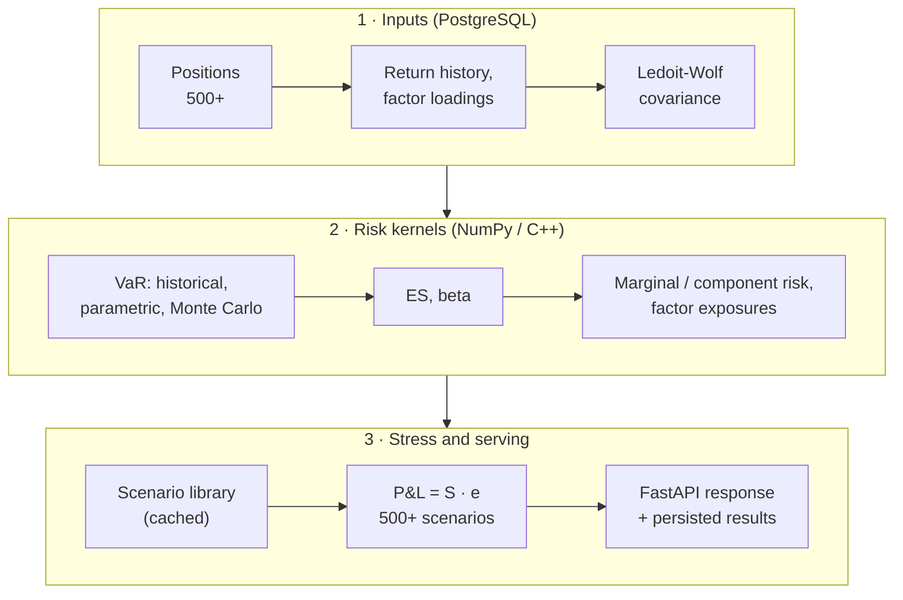

# Real-Time Portfolio Risk & Stress Testing Engine — Interview Playbook

*A risk engine for portfolios of 500+ positions. It computes Value at Risk by historical, parametric and Monte Carlo methods, Expected Shortfall, beta, marginal risk contributions and factor exposures; estimates covariance with Ledoit-Wolf shrinkage (18% lower estimation error than the sample covariance); and serves results through a FastAPI service with NumPy/C++ numerical kernels, scenario caching and PostgreSQL persistence, evaluating 500+ stress scenarios in about 1.5 seconds. C++, Python, NumPy, SciPy, FastAPI, PostgreSQL. Everything you need for a 30–45 minute quant interview.*

**Resume bullets this booklet defends**

1. Built portfolio risk engine for 500+ positions computing VaR, Expected Shortfall, beta, marginal risk and factor exposures across portfolios.
2. Implemented historical, parametric and Monte Carlo VaR with Ledoit-Wolf shrinkage; reduced covariance estimation error by 18%.
3. Developed FastAPI risk service with NumPy/C++ kernels, scenario caching and PostgreSQL persistence; evaluated over 500 stress test in 1.5s.

# Part 1: Project Overview

## 1.1 What is this project?

**The one-line version.** Given a portfolio of hundreds of positions, answer quickly and consistently: how much could we lose on a bad day, which positions drive that risk, what are we exposed to, and what happens in a crisis?

**Start with an example.** A portfolio worth 100 million has a daily volatility of 1%. Under a normal approximation, its one-day 99% **Value at Risk** is about $2.33 \times 1\% \times 100\text{M} = 2.33$ million: on 99 days out of 100 the loss should be smaller. **Expected Shortfall** asks the next question: *on the worst 1% of days, how much do we lose on average?* About 2.67 million under the same assumptions, and more if returns have fat tails. **Marginal risk** shows that, say, three technology positions contribute 30% of the risk while holding 12% of the capital. A **stress test** asks what happens if the 2008 crisis were replayed tomorrow, when correlations jumped and diversification disappeared. The engine computes all of this for 500+ positions, through an API, fast enough to rerun whenever positions or prices change.

**The problem it solves.** Risk managers and portfolio managers need risk numbers that are statistically sound (the covariance of 500 assets is hard to estimate), comparable across methods (each VaR method has blind spots), decomposed (which positions and factors drive risk) and available on demand rather than in an overnight batch.

**Who would use it.** Risk managers setting and monitoring limits, portfolio managers checking the risk impact of trades, and quant developers integrating risk into other systems.

**Inputs and outputs.** Inputs: positions (instrument, quantity, market value), price and return history, factor data and scenario definitions, stored in PostgreSQL. Outputs: VaR (three methods) and ES at chosen confidence levels and horizons, portfolio beta, marginal and component risk per position, factor exposures, and stress-test P&L per scenario, served by FastAPI and persisted for audit.

**What makes it technically interesting.** The mathematics of risk measures and their assumptions; covariance estimation when the number of assets is large relative to history; risk decomposition; and making it fast: vectorised NumPy and C++ kernels, caching and a clean service design.

## 1.2 Explaining it when asked "Can you explain this project?"

> **Say it aloud:** "I built a portfolio risk engine for portfolios of more than 500 positions. It computes Value at Risk three ways: historical simulation, parametric (variance-covariance) and Monte Carlo, plus Expected Shortfall, portfolio beta, each position's marginal and component contribution to risk, and factor exposures. With 500 assets the sample covariance matrix is very noisy, and singular if history is shorter than the number of assets, so I used Ledoit-Wolf shrinkage, which reduced covariance estimation error by 18% compared with the sample covariance. The engine runs as a FastAPI service: numerical work happens in vectorised NumPy and C++ kernels, scenario results are cached, and positions, scenarios and results are persisted in PostgreSQL. It evaluates more than 500 stress scenarios in about 1.5 seconds."

## 1.3 Scope, evidence status and what to confirm

**Scope boundary.** Market-risk measurement and stress testing for a portfolio of 500+ positions. Not credit or liquidity risk, not regulatory capital, and not claimed production-ready; "real-time" means on-demand recomputation fast enough for interactive use.

> **Evidence status:** No code, data or benchmark logs for this project are in the Resume Prep folder, so every resume number is marked **UNVERIFIED**: your reported result, with the evidence needed to defend it. Numbers in worked examples are **ILLUSTRATIVE**. Items marked **[confirm]** are standard choices assumed to explain the bullets.

> **Resume flag:** Confirm before interviewing. (1) How "covariance estimation error" was measured: Frobenius distance to a known true covariance in simulation, or out-of-sample accuracy against realised covariance or realised portfolio variance; and the shrinkage target. (2) The 1.5 s benchmark: hardware, warm or cold cache, linear (sensitivity-based) or full revaluation, and whether API and database time are included. (3) Instrument types: if all positions are linear (equities), stress P&L is a matrix product; options would need full repricing. (4) Wording: "500 stress test" should read "500 stress tests". (5) Confidence levels, horizons and history window used.

# Part 2: Fundamentals Required for This Project

| Resume bullet | Concepts you must be able to explain |
|---|---|
| 1. 500+ positions; VaR, ES, beta, marginal risk, factor exposures | Returns and volatility, covariance and correlation, portfolio variance, VaR, ES, beta, marginal and component risk, factor models, diversification |
| 2. Historical, parametric, Monte Carlo VaR; Ledoit-Wolf; −18% covariance error | Three VaR methods, confidence and horizon, sample covariance problems, Ledoit-Wolf shrinkage, measuring estimation error |
| 3. FastAPI, NumPy/C++ kernels, scenario caching, PostgreSQL; 500+ stress tests in 1.5 s | Stress testing, scenario analysis, correlation breakdown, vectorisation, C++ kernels, caching, persistence, performance measurement |

### Returns, volatility, covariance and correlation

- **Simple:** Volatility measures how much an asset's returns swing. Covariance and correlation measure whether two assets tend to move together.
- **Math:** $$\sigma_i = \sqrt{\text{Var}(r_i)}, \qquad \text{Cov}(r_i, r_j) = E[(r_i - \mu_i)(r_j - \mu_j)], \qquad \rho_{ij} = \frac{\text{Cov}(r_i,r_j)}{\sigma_i\sigma_j}$$ The covariance matrix $\Sigma$ has $\sigma_i^2$ on the diagonal and $\sigma_{ij}$ off it; for $N = 500$ assets it has $N(N+1)/2 = 125{,}250$ distinct entries.
- **Technical:** Estimated from historical returns (daily, often with exponential weighting to emphasise recent data). Daily volatility scales to annual by $\sqrt{252}$ under independence. Correlations are unstable over time and rise in crises.
- **Why it matters:** Portfolio risk depends far more on how positions co-move than on their individual volatilities.
- **In this project:** Return history for 500+ positions feeds covariance estimation, parametric and Monte Carlo VaR, beta and factor models **[confirm window and weighting]**.
- **Interview angle:** "Correlation 0 means independent?" No; it means no *linear* relationship.

### Portfolio variance and diversification

- **Simple:** A portfolio's risk is not the sum of its parts: positions that do not move together partly cancel each other out.
- **Math:** $$\sigma_p^2 = w^\top \Sigma w = \sum_i \sum_j w_i w_j \sigma_{ij}$$ $w$ is the vector of position weights (or currency exposures). ILLUSTRATIVE: two assets, each 50% weight and 20% volatility. With $\rho = 1$: $\sigma_p = 20\%$. With $\rho = 0$: $\sigma_p = \sqrt{0.25 \cdot 0.04 \cdot 2} = 14.1\%$. With $\rho = 0.5$: $17.3\%$.
- **Technical:** As $N$ grows, idiosyncratic variance diversifies away and portfolio variance approaches the average covariance: common (systematic) risk cannot be diversified.
- **Why it matters:** It is the foundation of parametric VaR, risk decomposition and factor risk.
- **In this project:** $w^\top\Sigma w$ computed with the shrunk covariance matrix, in vectorised kernels.
- **Interview angle:** "What happens to diversification in a crisis?" Correlations rise toward 1 and the benefit shrinks exactly when you need it.

### Value at Risk (VaR): confidence level and holding period

- **Simple:** VaR is a loss threshold: "With 99% confidence, we will not lose more than X over one day."
- **Math:** For portfolio loss $L$ over horizon $h$ and confidence $\alpha$: $$\text{VaR}_\alpha = \inf\{\ell : P(L > \ell) \le 1 - \alpha\}$$ the $\alpha$-quantile of the loss distribution. Square-root-of-time scaling: $\text{VaR}_{h\text{ days}} \approx \sqrt{h}\,\text{VaR}_{1\text{ day}}$, valid only for independent, identically distributed returns.
- **Technical:** Two parameters define every VaR number: the confidence level (95%, 99%) and the horizon (1 day, 10 days). VaR says nothing about how bad losses are beyond the threshold.
- **Why it matters:** A single, intuitive number for limits and reporting; the industry standard for decades.
- **In this project:** VaR at configurable confidence levels and horizons, computed three ways **[confirm defaults]**.
- **Interview angle:** "How do you check a VaR model?" Backtest: at 99%, expect about 2.5 exceptions per 250 days; test with Kupiec's proportion-of-failures test.

### Historical, parametric and Monte Carlo VaR

- **Simple:** Three ways to get the loss distribution: replay the past (historical), assume a normal distribution (parametric), or simulate many possible futures from a model (Monte Carlo).
- **Technical:** **Historical:** apply each of the last $T$ days' actual return vectors (for example 500) to today's positions, compute $T$ hypothetical P&Ls, take the empirical quantile. No distributional assumption; captures fat tails and real correlations present in the window; limited by what the window contains. **Parametric (variance-covariance):** assume normal returns: $\text{VaR}_\alpha = z_\alpha\,\sigma_p\,V - \mu_p V$. Fast and analytic; underestimates tail risk when returns are fat-tailed. **Monte Carlo:** simulate many return vectors from a model (for example multivariate normal or Student-$t$ using a Cholesky factor of $\Sigma$), revalue, take the quantile. Flexible, handles non-linear instruments; costly and model-dependent.
- **Math:** Parametric example: $V = 100$M, $\sigma_p = 1\%$ daily, $z_{0.99} = 2.326$: $\text{VaR} \approx 2.33$M. Monte Carlo draws: $r = \mu + L z$, $z \sim N(0, I)$, $\Sigma = LL^\top$.
- **Why it matters:** Each method fails differently; showing all three exposes model risk.
- **In this project:** All three implemented, using the Ledoit-Wolf covariance for parametric and Monte Carlo **[confirm number of simulations and window]**.
- **Interview angle:** "Which would you trust in a crisis?" Historical including a stressed window, plus ES and stress tests.

### Expected Shortfall and VaR vs ES

- **Simple:** ES is the average loss on the days that are worse than VaR: "if we do have a bad day, how bad on average?"
- **Math:** $$\text{ES}_\alpha = E[L \mid L \ge \text{VaR}_\alpha]$$ Normal case: $\text{ES}_\alpha = \sigma_p \frac{\phi(z_\alpha)}{1-\alpha}V$. ILLUSTRATIVE at 99%: $\phi(2.326)/0.01 = 2.665$, so ES ≈ 2.67M versus VaR 2.33M. Historical ES: average of the worst 1% of scenario P&Ls.
- **Technical:** VaR ignores the size of tail losses and is not **subadditive**: the VaR of a combined portfolio can exceed the sum of the parts' VaRs, which contradicts diversification. ES is a **coherent** risk measure (subadditive) and captures tail severity; regulators (FRTB) moved trading-book capital from VaR to ES. ES is harder to backtest and needs more tail data.
- **Why it matters:** Two portfolios with the same VaR can have very different tails; ES distinguishes them.
- **In this project:** ES computed alongside VaR for each method.
- **Interview angle:** "Give a case where VaR misleads." A strategy selling deep out-of-the-money options: small VaR, catastrophic but rare tail losses.

### Beta

- **Simple:** Beta measures how much the portfolio tends to move when the market moves 1%.
- **Math:** $$\beta_p = \frac{\text{Cov}(r_p, r_m)}{\text{Var}(r_m)} = \sum_i w_i \beta_i$$ ILLUSTRATIVE: $\beta_p = 1.2$ means about +1.2% when the market is +1%, on average.
- **Technical:** Estimated by regressing returns on market returns over a window; noisy for individual stocks and time-varying. Portfolio beta is the weighted sum of position betas, so it is cheap to update when positions change.
- **Why it matters:** The simplest measure of systematic exposure; the basis for hedging with index futures (hedge ratio ≈ $\beta_p V$ / futures notional).
- **In this project:** Position and portfolio beta against a market index **[confirm index and window]**.
- **Interview angle:** "Beta 0 means riskless?" No; it means no linear market exposure. Idiosyncratic and other factor risks remain.

### Marginal and component risk contributions

- **Simple:** Marginal risk says how much portfolio risk would change if you added a little more of a position. Component risk splits total risk into pieces that add up, one per position.
- **Math:** With $\sigma_p = \sqrt{w^\top\Sigma w}$: $$\text{MRC}_i = \frac{\partial \sigma_p}{\partial w_i} = \frac{(\Sigma w)_i}{\sigma_p}, \qquad \text{CRC}_i = w_i\,\text{MRC}_i, \qquad \sum_i \text{CRC}_i = \sigma_p$$ The sum works by Euler's theorem because $\sigma_p$ is homogeneous of degree 1 in $w$. For normal VaR, multiply by $z_\alpha V$.
- **Technical:** A position with a small weight can have a large contribution if it is volatile or highly correlated with the rest; a hedge has a negative contribution. Percentage contributions $\text{CRC}_i/\sigma_p$ are what risk reports show.
- **Why it matters:** Tells a portfolio manager which positions to trim to reduce risk most efficiently, and identifies concentration.
- **In this project:** Marginal and component risk per position and aggregated by sector or factor.
- **Interview angle:** "Can contributions be negative?" Yes, for hedges or negatively correlated positions.

### Factor exposures and factor risk models

- **Simple:** Explain each asset's returns by a few common drivers (market, sectors, size, value, momentum, rates). The portfolio's exposures are its sensitivities to those drivers.
- **Math:** $$r = B f + \varepsilon, \qquad \Sigma = B F B^\top + D, \qquad b_p = B^\top w, \qquad \sigma_p^2 = b_p^\top F b_p + w^\top D w$$ $B$ ($N \times K$) asset factor loadings, $f$ factor returns with covariance $F$, $D$ diagonal specific variances, $b_p$ portfolio exposures.
- **Technical:** With $K$ factors much smaller than $N$, the model needs far fewer parameters than a full covariance matrix and gives interpretable exposures and a split into factor and specific risk. Loadings come from fundamentals (sectors, characteristics) or regressions on factor returns.
- **Why it matters:** Answers "what am I really betting on?" and lets risk managers set limits on exposures.
- **In this project:** Portfolio factor exposures computed from position loadings **[confirm which factors and how loadings were estimated]**.
- **Interview angle:** "Factor model vs shrinkage?" Both impose structure; a factor model is itself a natural shrinkage target.

### Covariance estimation when assets are many and history is short

- **Simple:** Estimating 125,000 covariance numbers from a year or two of data is too much to ask: the estimates are full of noise, and the optimiser or risk model trusts the noise.
- **Technical:** The sample covariance $S = \frac{1}{T-1}\sum_t (r_t - \bar r)(r_t - \bar r)^\top$ has rank at most $T - 1$. With $N = 500$ and $T = 252$, $S$ is **singular**: some portfolios appear to have zero risk. Even when $T > N$, the ratio $N/T$ distorts eigenvalues: the largest are overestimated and the smallest underestimated (random-matrix theory, Marchenko-Pastur). Risk of carefully constructed or optimised portfolios is then underestimated.
- **Math:** Parameters to estimate: $N(N+1)/2$; observations: $N \times T$. For $N = 500$, $T = 252$: 125,250 parameters from 126,000 numbers, roughly one data point per parameter.
- **Why it matters:** Parametric VaR, Monte Carlo VaR, risk contributions and any optimisation inherit the estimation error.
- **In this project:** The motivation for Ledoit-Wolf shrinkage.
- **Interview angle:** "Why not just use more history?" Older data may not represent current correlations; there is a trade-off between noise and staleness.

### Ledoit-Wolf shrinkage

- **Simple:** Blend the noisy sample covariance with a simple, stable "target" matrix. The blend is less noisy than the sample and less biased than the target.
- **Math:** $$\hat\Sigma = \delta F + (1 - \delta) S, \qquad 0 \le \delta \le 1$$ $S$ is the sample covariance; $F$ the target (scaled identity, or constant-correlation matrix keeping each asset's own variance); $\delta$ the shrinkage intensity, chosen analytically to minimise the expected squared Frobenius distance $E\lVert\hat\Sigma - \Sigma\rVert_F^2$ to the true covariance.
- **Technical:** Shrinkage pulls extreme eigenvalues toward the middle and makes the matrix well conditioned and invertible. $\delta$ is larger when data are scarce relative to $N$ and smaller with long histories. It is a bias-variance trade-off with a closed-form optimum, so no cross-validation is needed. `sklearn.covariance.LedoitWolf` implements the identity-target version.
- **Why it matters:** More accurate risk forecasts, invertible matrices for optimisation and Monte Carlo (Cholesky), and less underestimation of portfolio risk.
- **In this project:** Ledoit-Wolf covariance for parametric and Monte Carlo VaR and risk decomposition; 18% lower estimation error than the sample covariance **[confirm target and error metric]**.
- **Interview angle:** "How would you measure the 18%?" In simulation, Frobenius error against the known true covariance; on real data, out-of-sample accuracy of predicted portfolio variance (Q19).

### Stress testing, scenario analysis and correlation breakdown

- **Simple:** VaR describes normal bad days. A stress test asks "what if a specific extreme event happened?" and reports the loss.
- **Technical:** **Historical scenarios** replay the returns of crisis periods (2008, March 2020) on today's positions. **Hypothetical scenarios** specify shocks: equities −20%, volatility doubling, a sector crash, rates +100 bps. Factor-based stress applies factor shocks through the factor model so every position gets a consistent move. **Correlation breakdown**: in crises correlations rise sharply, so VaR estimated in calm periods understates losses; stress tests impose crisis correlations explicitly. **Reverse stress testing** finds the scenarios that would cause a given loss.
- **Math:** For linear positions with exposures $e$ (currency per unit return) and scenario return vector $s_k$: $\text{P\&L}_k = s_k^\top e$. For $K$ scenarios at once: $\text{P\&L} = S e$, with $S$ a $K \times N$ matrix: one matrix-vector product.
- **Why it matters:** Covers tail events that a statistical model calibrated on recent data does not include; required by regulators and risk committees.
- **In this project:** 500+ scenarios evaluated in about 1.5 s with cached scenario data **[confirm scenario types and whether any positions need full repricing]**.
- **Interview angle:** "Difference between VaR and a stress test?" VaR is probabilistic and model-based; a stress test is a conditional "what-if" with no probability attached.

### Vectorisation and C++ numerical kernels

- **Simple:** Do the maths on whole arrays at once instead of looping in Python, and put the remaining heavy loops in compiled C++.
- **Technical:** NumPy operations call optimised C and BLAS routines: $w^\top\Sigma w$, $Se$ for all scenarios, Cholesky factorisation and Monte Carlo draws are single calls over contiguous memory. C++ kernels (exposed to Python, for example via pybind11) handle logic that does not vectorise well, such as path-dependent or per-instrument revaluation, sorting for quantiles at scale, or custom aggregations, with multithreading where useful.
- **Math:** Cost scales: stress P&L for $K$ scenarios and $N$ positions is $O(KN)$; $500 \times 500 = 250{,}000$ multiply-adds, microseconds of compute. Monte Carlo with $M$ draws is $O(MN^2)$ for correlated sampling unless a factor model reduces it to $O(MNK)$.
- **Why it matters:** "Real-time" risk depends on keeping computation in compiled code and avoiding Python loops.
- **In this project:** NumPy for linear algebra; C++ kernels for heavier routines **[confirm which ones]**.
- **Interview angle:** "If the maths is microseconds, where does 1.5 s go?" Data loading, scenario generation, full revaluation, serialisation and I/O: profile before optimising.

### FastAPI service, scenario caching and PostgreSQL persistence

- **Simple:** FastAPI exposes the engine as a web service; caching avoids recomputing things that have not changed; PostgreSQL stores positions, scenarios and results reliably.
- **Technical:** **FastAPI**: Python web framework with typed request and response models (Pydantic), automatic validation and documentation, async request handling; CPU-heavy work should run outside the event loop (worker threads or processes). **Scenario caching**: scenario shock matrices and expensive intermediate results (factor loadings, Cholesky factors, scenario P&L for unchanged positions) are cached and keyed by inputs, so only what changed is recomputed. **PostgreSQL**: transactional storage for positions, market data snapshots, scenario definitions and results with timestamps, enabling audit and reproduction of any reported number.
- **Why it matters:** Risk numbers must be on demand, consistent and reproducible: a limit breach needs to be traceable to the exact inputs.
- **In this project:** FastAPI endpoints for risk and stress runs; cached scenarios; persisted results **[confirm cache type and invalidation rule]**.
- **Interview angle:** "What invalidates the cache?" Changes in positions, market data or scenario definitions; keys should include versions or hashes of those inputs.

# Part 3: Methodology and Workflow

## 3.1 Risk computation pipeline

**Figure 1 — Risk engine: inputs from PostgreSQL, shrunk covariance, risk kernels and cached stress scenarios behind a FastAPI service** [scale=0.72]

**Step 1: Load inputs.** Positions and market values, return history (for example 1–2 years of daily returns), factor loadings and scenario definitions from PostgreSQL; align dates and handle missing data (new listings, holidays) **[confirm window]**. Reason: consistent, auditable inputs.

**Step 2: Estimate covariance.** Sample covariance, then Ledoit-Wolf shrinkage toward a structured target; cache the result and its Cholesky factor. Reason: a stable, invertible matrix for parametric and Monte Carlo VaR and risk decomposition.

**Step 3: Compute VaR and ES.** Historical: today's exposures times each historical return vector, then empirical quantile and tail mean. Parametric: $z_\alpha\sqrt{w^\top\hat\Sigma w}$. Monte Carlo: simulate correlated returns via Cholesky, revalue, quantile and tail mean. Reason: three views of the same risk; disagreement signals model risk.

**Step 4: Decompose risk.** Portfolio beta as weighted position betas; marginal and component risk from $\hat\Sigma w$; factor exposures $B^\top w$ and factor vs specific risk. Reason: tells the user where risk comes from and what to change.

**Step 5: Stress test.** Load cached scenario matrices (historical crisis replays and hypothetical shocks); compute $\text{P\&L} = S e$ for all scenarios in one vectorised product; full revaluation for any non-linear positions **[confirm]**; report worst scenarios and contributions. Reason: tail events outside the statistical window.

**Step 6: Serve and persist.** FastAPI validates requests and returns results; results with input versions and timestamps are written to PostgreSQL. Reason: interactive use, reproducibility and audit.

## 3.2 Numerical claims and how to defend them

| Claim | What it means and how it is computed | Baseline and what could mislead | Status |
|---|---|---|---|
| 500+ positions | Portfolio size the engine handles | Linear vs non-linear instruments | UNVERIFIED |
| −18% covariance error | Error of Ledoit-Wolf vs sample covariance | Metric (Frobenius vs out-of-sample); simulated vs real | UNVERIFIED; define metric |
| 500+ stress tests in 1.5 s | Wall-clock time for one request evaluating 500+ scenarios | Hardware; warm cache; linear P&L; API/DB included? | UNVERIFIED; show benchmark |

To defend these, bring: the error-measurement experiment (setup, metric, $N$, $T$, repetitions), the benchmark script with hardware and cache state, a timing breakdown (data load, compute, serialisation), and VaR backtest results (exception counts) if available.

# Part 4: Important Design and Methodological Decisions

**1. Three VaR methods instead of one.** *Why:* each has different blind spots (parametric assumes normality; historical is limited to its window; Monte Carlo depends on its model); comparing them exposes model risk. *Alternative:* a single parametric VaR. *Trade-off:* more computation and more numbers to explain.

**2. Report Expected Shortfall alongside VaR.** *Why:* VaR ignores tail severity and is not subadditive; ES is coherent and captures how bad the worst days are. *Alternative:* VaR only. *Trade-off:* ES needs more tail data and is harder to backtest.

**3. Ledoit-Wolf shrinkage instead of the sample covariance.** *Why:* with 500 assets and limited history the sample matrix is noisy or singular; shrinkage gives a well-conditioned, more accurate estimate with a closed-form intensity. *Alternative:* sample covariance, or a full factor risk model. *Trade-off:* introduces bias toward the target; a factor model would add interpretability.

**4. Euler risk decomposition.** *Why:* contributions sum exactly to total risk, so reports are consistent and actionable. *Alternative:* standalone position risk, which ignores correlation. *Trade-off:* contributions depend on the covariance estimate and are local (valid for small changes).

**5. Vectorised NumPy plus C++ kernels.** *Why:* risk maths is linear algebra; vectorisation keeps it in optimised compiled code, and C++ covers loops that NumPy cannot express efficiently. *Alternative:* pure Python loops. *Trade-off:* two languages and a binding layer.

**6. FastAPI service with caching and PostgreSQL.** *Why:* on-demand risk for other systems, consistent typed interfaces, cached expensive intermediates, auditable persisted results. *Alternative:* batch scripts writing files overnight. *Trade-off:* service complexity and cache-invalidation logic.

# Part 5: Complete Interview Explanation

## 5.1 Two-minute explanation

> **Say it aloud:** "I built a risk engine for portfolios of 500-plus positions. It answers four questions: how much could we lose on a bad day, how bad is the tail, where does the risk come from, and what happens in a crisis. For the first it computes Value at Risk three ways: historical simulation, parametric and Monte Carlo. For the tail it computes Expected Shortfall. For attribution it computes portfolio beta, each position's marginal and component risk, and factor exposures. For crises it runs stress scenarios.
>
> The key statistical issue is covariance. With 500 assets there are 125,000 covariance entries to estimate, and with a year or two of data the sample matrix is noisy or even singular. I used Ledoit-Wolf shrinkage, which blends the sample covariance with a structured target, and reduced estimation error by 18%.
>
> It runs as a FastAPI service with NumPy and C++ kernels, cached scenarios and PostgreSQL persistence, and it evaluates more than 500 stress scenarios in about 1.5 seconds."

## 5.2 Five-minute explanation

> **Say it aloud:** "**Risk measures.** Portfolio variance is w-transpose Sigma w. VaR at 99% is the loss exceeded on only 1% of days; Expected Shortfall is the average loss on those days. ES matters because VaR says nothing about how bad the tail is and isn't subadditive.
>
> **Three VaR methods.** Historical applies the last few hundred days of actual returns to today's positions and takes the empirical quantile: no distributional assumption, but only the history in the window. Parametric assumes normal returns: z times portfolio volatility. It's fast but understates fat tails. Monte Carlo simulates correlated returns from a model using a Cholesky factor of the covariance, which handles non-linear instruments but depends on the model.
>
> **Covariance.** With N assets and T days, the sample covariance has rank at most T minus 1. With 500 assets and one year of data, it's singular, so some portfolios appear riskless. Ledoit-Wolf shrinks it toward a structured target with an intensity chosen analytically to minimise expected error. That reduced estimation error by 18% compared with the sample covariance.
>
> **Decomposition.** Marginal risk is the derivative of portfolio volatility with respect to each weight, Sigma w over sigma p; component risk is weight times marginal risk, and the components sum to total risk. Factor exposures are B-transpose w, which separates factor and specific risk. Beta is the weighted sum of position betas.
>
> **Stress and performance.** Stress scenarios, historical crisis replays and hypothetical shocks, are stored as a scenario matrix. For linear positions all scenarios are one matrix-vector product. Scenario data and covariance factors are cached; FastAPI serves requests and PostgreSQL stores inputs and results for audit. More than 500 scenarios run in about 1.5 seconds."

## 5.3 Ten-minute explanation

> **Say it aloud:** "I'll go deeper on VaR assumptions, the covariance problem, decomposition, stress testing and the engineering.
>
> **VaR assumptions.** Each method has a failure mode. Parametric assumes normality and stable covariance, so it underestimates fat-tailed losses. Historical assumes the window is representative: a calm window misses crises, and the estimate jumps when a big day enters or leaves the window. Monte Carlo is only as good as its distribution; a multivariate t is a common improvement over the normal. Square-root-of-time scaling to ten days assumes independent returns. And any VaR model should be backtested: at 99%, about 2.5 exceptions per year, with Kupiec's test for whether the count is plausible.
>
> **Covariance estimation.** We estimate N times N plus 1 over 2 parameters from N times T observations, about 125,000 parameters for 500 assets. Random-matrix theory says that when N over T is not small, sample eigenvalues are spread out: the largest too large, the smallest too small. That makes the smallest-risk directions look safer than they are. Ledoit-Wolf computes delta times a target plus one minus delta times the sample, with delta minimising the expected Frobenius distance to the true matrix, available in closed form. Measuring the 18% properly needs either a simulation with a known true matrix or an out-of-sample test, such as comparing predicted and realised portfolio variance.
>
> **Decomposition.** Because volatility is homogeneous of degree one in the weights, Euler's theorem makes component contributions sum exactly to total risk. It identifies positions whose risk share exceeds their capital share, and hedges, which have negative contributions. A factor model gives a second decomposition: factor versus specific risk and exposure by factor.
>
> **Stress testing.** VaR is a probabilistic statement calibrated on recent data. Stress tests are conditional what-ifs, especially crisis correlations, when diversification breaks down. For linear positions, P&L under all scenarios is a single scenario-matrix times exposure-vector product; non-linear instruments would need full repricing.
>
> **Engineering and the benchmark.** The arithmetic for 500 scenarios on 500 positions is a quarter of a million multiply-adds, microseconds. So the 1.5 seconds is dominated by everything around it: loading data, building or fetching scenarios, revaluation, serialisation and the API. Caching helps by keying intermediate results on the versions of positions, market data and scenarios. CPU-heavy work runs outside FastAPI's event loop. I'd state the hardware and whether the cache was warm.
>
> **Limitations.** It covers market risk only, not liquidity or credit; it isn't production-hardened; and the risk numbers depend on the history window and covariance estimate. Next steps: a full factor risk model, EWMA or GARCH volatility, VaR backtesting reports, and incremental updates when single positions change."

# Part 6: Interview Questions and Answers

## 6.1 Basic understanding

#### Q1. What does your risk engine do? [Easy]

It measures and explains the market risk of portfolios with 500+ positions. It computes Value at Risk by historical simulation, the parametric variance-covariance method and Monte Carlo simulation; Expected Shortfall, the average loss beyond VaR; portfolio beta; each position's marginal and component contribution to risk; and the portfolio's exposures to risk factors. It estimates the covariance matrix with Ledoit-Wolf shrinkage, which reduced estimation error by 18% versus the sample covariance. It also runs stress tests, historical crisis replays and hypothetical shocks, and evaluates more than 500 of them in about 1.5 seconds. It is exposed as a FastAPI service, with heavy numerics in vectorised NumPy and C++ kernels, cached scenario data and PostgreSQL storing positions, scenarios and results. It is a market-risk engine for interactive use, not a production-certified risk system.

#### Q2. What is Value at Risk? Give a numerical example. [Easy]

VaR is a loss threshold that is exceeded only with a given small probability over a given horizon: "1-day 99% VaR of 2.33 million" means that on 99 days out of 100 the portfolio should lose less than 2.33 million. Formally, it is the $\alpha$-quantile of the loss distribution. Example with the parametric method: portfolio value 100 million, daily volatility 1%, 99% confidence ($z = 2.326$): $\text{VaR} = 2.326 \times 0.01 \times 100\text{M} \approx 2.33$M, ignoring the small expected daily return. Two parameters define every VaR figure, confidence level and horizon, and must always be stated. VaR is popular because it is one intuitive number for limits and reporting. Its key weakness is that it says nothing about how large losses are when the threshold is exceeded, which is why I also compute Expected Shortfall.

#### Q3. What is Expected Shortfall, and why report it with VaR? [Easy]

Expected Shortfall (also called Conditional VaR) is the average loss on the days when the loss exceeds VaR: $\text{ES}_\alpha = E[L \mid L \ge \text{VaR}_\alpha]$. With the same example (100 million, 1% daily volatility, normal returns), 99% ES is about 2.67 million versus VaR of 2.33 million; with fat-tailed returns the gap is larger. ES matters for two reasons. It measures **tail severity**: two portfolios with identical VaR can have very different worst-case losses, for example one that sells deep out-of-the-money options. And it is **coherent**, in particular subadditive: the ES of a combined portfolio never exceeds the sum of the parts, consistent with diversification, while VaR can violate this. That is why regulators moved trading-book capital to ES. Its drawbacks are that it needs more tail data and is harder to backtest.

#### Q4. Explain the difference between historical, parametric and Monte Carlo VaR. [Easy]

All three estimate the distribution of tomorrow's portfolio P&L and read off a quantile. **Historical simulation** applies each of the last $T$ days' actual asset returns to today's positions, giving $T$ hypothetical P&Ls, and takes the empirical 1% quantile; it makes no distributional assumption and keeps real fat tails and correlations, but it can only see what happened in the window. **Parametric** assumes returns are normal with covariance $\Sigma$, so $\text{VaR} = z_\alpha\sqrt{w^\top\Sigma w}$; it is instant and analytic but underestimates tail risk when returns are fat-tailed, and it suits linear portfolios. **Monte Carlo** draws thousands of correlated return scenarios from a model, typically via a Cholesky factor of $\Sigma$, revalues the portfolio and takes the quantile; it handles non-linear instruments and alternative distributions but is slower and only as good as its model.

#### Q5. How do you compute portfolio variance, and what does diversification mean mathematically? [Easy]

Portfolio variance is $\sigma_p^2 = w^\top \Sigma w = \sum_i\sum_j w_i w_j \sigma_{ij}$, where $w$ holds the weights and $\Sigma$ the covariance matrix. The diagonal terms are each position's own variance; the off-diagonal terms capture co-movement. Diversification is the effect of off-diagonal terms smaller than the product of volatilities: two assets with 20% volatility each, equally weighted, give a portfolio volatility of 20% if perfectly correlated, 17.3% at correlation 0.5 and 14.1% at zero correlation. As the number of assets grows, the idiosyncratic part averages out and portfolio variance approaches the average covariance: systematic risk remains. That is why covariance estimation is central to the engine, and why crisis periods, when correlations rise, reduce diversification exactly when it is most needed.

#### Q6. What is beta, and how is it computed for a portfolio? [Easy]

Beta measures the sensitivity of returns to the market: $\beta = \text{Cov}(r, r_m)/\text{Var}(r_m)$, the slope of a regression of the asset's returns on market returns. A beta of 1.2 means the asset moves about 1.2% for each 1% market move, on average. Portfolio beta is simply the weighted sum of position betas, $\beta_p = \sum_i w_i\beta_i$, which makes it cheap to update when positions change. It is used for hedging: shorting index futures with notional of about $\beta_p$ times portfolio value removes the linear market exposure. Caveats: betas estimated from a year of daily data are noisy, especially for illiquid stocks, and change over time; shrinking estimates toward 1 helps. A beta of zero does not mean no risk; idiosyncratic, sector and other factor risks remain, which the factor exposures and risk contributions capture **[confirm market index and window]**.

#### Q7. What are marginal and component risk contributions? [Easy]

The **marginal risk contribution** of position $i$ is how much portfolio volatility changes for a small increase in that position: $\text{MRC}_i = \partial\sigma_p/\partial w_i = (\Sigma w)_i/\sigma_p$. The **component risk contribution** is $\text{CRC}_i = w_i \times \text{MRC}_i$. Because volatility is homogeneous of degree one in the weights, Euler's theorem guarantees the components sum exactly to total portfolio volatility. In a report, each position's percentage contribution, $\text{CRC}_i/\sigma_p$, shows where risk comes from. A small position can contribute a lot if it is volatile or highly correlated with the rest; a hedge contributes negatively. Practical use: to cut risk most efficiently, trim positions with the largest marginal contribution per unit of expected return. The same decomposition applies to parametric VaR by scaling with $z_\alpha V$, and can be aggregated by sector or factor.

#### Q8. What are factor exposures, and why compute them? [Easy]

A factor model explains asset returns with a few common drivers: $r = Bf + \varepsilon$, where $B$ holds each asset's loadings on factors such as the market, sectors, size, value or momentum, $f$ the factor returns and $\varepsilon$ stock-specific returns. The portfolio's exposures are $b_p = B^\top w$: for example, 0.9 to the market, +15% net to technology, −0.3 to value. They answer "what am I really betting on?", which position-level views hide: twenty different stocks may all be the same growth bet. The model also splits risk into factor risk, $b_p^\top F b_p$, and specific risk, $w^\top D w$, and gives a structured covariance estimate with far fewer parameters than the full matrix. Risk managers set limits on factor exposures, and stress tests can be expressed as factor shocks so every position moves consistently **[confirm the factors you used]**.

## 6.2 Covariance and stress testing

#### Q9. Why is the sample covariance matrix unstable for 500 assets? [Easy]

Because there are too many parameters for the data. A 500-asset covariance matrix has $500 \times 501/2 = 125{,}250$ distinct entries. One year of daily returns gives 252 observations per asset. The sample covariance has rank at most $T - 1 = 251$, so it is **singular**: there exist portfolios that appear to have zero variance, and the matrix cannot be inverted for optimisation or used directly for a Cholesky factorisation. Even with more history than assets, when $N/T$ is not small the sample eigenvalues are distorted: the largest are too large and the smallest too small, so the risk of portfolios concentrated in the "smallest-eigenvalue" directions is underestimated. Optimisers seek out exactly those directions. Using more history reduces noise but brings in stale correlations from different regimes, which is the trade-off shrinkage resolves.

#### Q10. How does Ledoit-Wolf shrinkage work? [Easy]

It replaces the sample covariance $S$ with a weighted average of $S$ and a structured target $F$: $\hat\Sigma = \delta F + (1-\delta)S$. The target has few parameters and is stable: for example a scaled identity matrix (all variances equal to their average, zero correlations) or a constant-correlation matrix (each asset's own variance, one average correlation). The sample is unbiased but noisy; the target is biased but has almost no noise. The shrinkage intensity $\delta$ is chosen to minimise the expected squared Frobenius distance to the true covariance, and Ledoit and Wolf derived a closed-form estimate of the optimal $\delta$ from the data: more shrinkage when data are scarce relative to the number of assets. The result is well conditioned and invertible, with extreme eigenvalues pulled toward the centre, giving more accurate risk forecasts **[confirm the target you used]**.

#### Q11. What does "reduced covariance estimation error by 18%" mean? [Easy]

It means the Ledoit-Wolf estimate was 18% closer to the true covariance than the sample covariance, by some error metric. The metric must be stated **[confirm]**. In a **simulation**, you generate returns from a known covariance $\Sigma$, estimate both $S$ and $\hat\Sigma_{LW}$, and compare Frobenius errors $\lVert\hat\Sigma - \Sigma\rVert_F$; an 18% reduction means the shrunk estimate's error is 0.82 times the sample's, averaged over repetitions. On **real data** the true matrix is unknown, so you compare out-of-sample: estimate on one window, then measure how well each predicts the next period's realised covariance, or how accurately it forecasts the realised variance of test portfolios (for example minimum-variance portfolios, whose risk the sample covariance badly underestimates). The size of the gain depends on $N/T$: larger when history is short relative to the number of assets.

#### Q12. What is the difference between a normal VaR calculation and a stress test? [Easy]

VaR is **probabilistic and model-based**: it estimates a quantile of the loss distribution using recent history or a calibrated model, so it describes "normal bad days" under current conditions, with a probability attached (1% of days). A stress test is a **conditional what-if** with no probability: "if the 2008 crisis returns happened tomorrow" or "if equities fall 20% and volatility doubles", what would this portfolio lose? Stress tests exist because VaR misses what its data do not contain: a calm two-year window has no crash in it, and crisis correlations are much higher than normal ones. They also allow hypothetical events that have never happened, and reverse stress tests find which scenarios would cause an unacceptable loss. The two complement each other: VaR for daily limits, stress tests for tail resilience.

#### Q13. What is correlation breakdown, and why does it matter for risk? [Easy]

Correlation breakdown is the empirical tendency of correlations between assets to rise sharply in crises: during sell-offs, many assets fall together as investors deleverage and sell whatever is liquid. A portfolio that looked well diversified with average correlation 0.3 in calm periods may behave as if correlations were 0.7 or 0.8 in a crash, so its volatility and losses are much larger than the calm-period covariance implies. Consequences: parametric and Monte Carlo VaR calibrated on calm data understate crisis risk; historical VaR does too if the window has no stress period; hedges based on normal correlations may fail. Responses: stress tests with crisis correlations or historical crisis replays; stressed VaR using a crisis window; exponentially weighted estimates that react faster; and tracking how risk would change under higher correlation.

#### Q14. How did you evaluate 500+ stress tests in 1.5 seconds? [Easy]

By making most of the work a single vectorised operation and caching what does not change. For linear positions, the P&L of every scenario is exposures times scenario returns. Stacking $K$ scenarios as rows of a matrix $S$ gives all P&Ls at once: $\text{P\&L} = Se$, one matrix-vector product. For 500 scenarios and 500 positions that is 250,000 multiply-adds, microseconds in NumPy's compiled BLAS. Scenario matrices (historical crisis returns, hypothetical shocks mapped through factor loadings) are precomputed and cached, as are covariance factors. So the 1.5 seconds is mostly everything around the arithmetic: loading positions and data, fetching or building scenarios, any non-linear revaluation, serialising results and the API round trip. I should state the hardware, whether the cache was warm, and what the timing includes **[confirm]**.

#### Q15. What do FastAPI, PostgreSQL and the scenario cache each do? [Easy]

**FastAPI** exposes the engine as an HTTP service: endpoints for portfolio risk and stress runs, with typed request and response models that validate input automatically and generate documentation. Because risk calculations are CPU-heavy, they should run in worker threads or processes rather than blocking the async event loop. **PostgreSQL** is the system of record: positions, market data snapshots, scenario definitions and every computed result, with timestamps and input versions, so any number in a risk report can be reproduced and audited, and transactions keep results consistent with their inputs. The **scenario cache** holds expensive, reusable objects: scenario shock matrices, Cholesky factors, factor loadings and, where positions have not changed, previous scenario P&Ls. Cache keys include versions of the inputs so a change in positions, prices or scenario definitions invalidates the right entries **[confirm cache technology]**.

#### Q16. Why use NumPy plus C++ kernels instead of plain Python? [Easy]

Because risk computation is mostly linear algebra over large arrays, and Python loops are slow, roughly a hundred times slower than compiled code for element-wise work. NumPy pushes operations such as $w^\top\Sigma w$, matrix products for stress scenarios, Cholesky factorisation, random draws for Monte Carlo and quantiles into optimised C and BLAS routines over contiguous memory, often multithreaded. Some logic does not vectorise well: per-instrument revaluation with branching, path-dependent calculations, or custom aggregation and sorting at scale. Those go into C++ kernels exposed to Python, which give control over memory layout and threads. The combination keeps the service code readable in Python while the hot paths run at compiled speed. The engineering lesson is to profile first: in this engine the arithmetic is fast, and I/O and data preparation are usually the bottleneck **[confirm which routines are in C++]**.

## 6.3 Methodology and scenarios

#### Q17. When would each VaR method fail? [Medium]

**Parametric** fails when returns are fat-tailed or skewed (most financial returns), so it understates extreme losses; when the portfolio contains options, because P&L is non-linear in returns; and when the covariance estimate is poor. **Historical** fails when the window does not contain relevant stress (a calm window gives a low VaR right before a crisis), and it exhibits "ghost effects": the estimate jumps when a large loss enters or drops out of the window. It also cannot produce losses larger than history combined with today's positions. **Monte Carlo** fails when its distributional model is wrong (normal shocks miss fat tails; constant correlations miss breakdowns), and it has simulation noise in the tail unless the number of draws is large. Common to all: square-root-of-time scaling assumes independent returns, and liquidity is ignored. Using several methods and stress tests together reduces the chance of a single blind spot.

#### Q18. How would you backtest your VaR model? [Medium]

Compare each day's VaR forecast with the next day's actual P&L and count **exceptions**, days when the loss exceeded VaR. At 99% confidence over 250 days, the expected number is 2.5. **Kupiec's proportion-of-failures test** checks whether the observed count is consistent with the target rate using a likelihood ratio; too many exceptions means VaR is too low, too few means it is too conservative. **Christoffersen's test** also checks independence: exceptions clustered together suggest the model reacts too slowly to volatility changes. Regulators use a traffic-light system based on exception counts. For ES, backtesting is harder because it is an average beyond the quantile; approaches compare the average loss on exception days with predicted ES. Backtests should use hypothetical P&L (fixed positions) to test the model itself, separately from actual P&L, which includes trading **[confirm whether you backtested]**.

#### Q19. How would you measure covariance estimation error on real data? [Medium]

The true covariance is unknown on real data, so you test predictions out of sample. Approach one: estimate $S$ and $\hat\Sigma_{LW}$ on a training window, then compute the realised covariance over the following window and compare Frobenius distances; realised covariance is itself noisy, so average over many rolling windows. Approach two, often more relevant for risk: build portfolios (random, equally weighted, and especially minimum-variance portfolios), compare predicted variance $w^\top\hat\Sigma w$ with realised variance in the next period, and measure the bias and error of the forecasts; the sample covariance badly underestimates the risk of minimum-variance portfolios. Approach three, in simulation: generate returns from a known matrix (for example estimated from a long history) and compare estimators with exact error. The 18% claim should come with which approach, $N$, $T$, and the spread across repetitions **[confirm]**.

#### Q20. How do you scale VaR from 1 day to 10 days, and what can go wrong? [Medium]

The simple rule is square-root-of-time: $\text{VaR}_{10} = \sqrt{10} \times \text{VaR}_1 \approx 3.16\,\text{VaR}_1$. It holds if daily returns are independent and identically distributed with zero mean, because variance then grows linearly with time. Problems: **volatility clustering** means returns are not identically distributed: in a high-volatility period, ten-day risk can be larger than the rule implies, or smaller as volatility mean-reverts; **autocorrelation** (momentum or reversal) changes how variance accumulates; **fat tails** do not scale like the normal; and over ten days the portfolio itself would change, through trading or option decay, which a fixed-position scaling ignores. Alternatives are direct multi-day historical VaR using overlapping ten-day returns (fewer independent observations), or Monte Carlo with a volatility model such as GARCH simulated over ten days. Regulatory ten-day VaR historically allowed square-root scaling with caveats.

#### Q21. How would you handle options or other non-linear positions? [Medium]

For non-linear instruments, P&L is not a linear function of underlying returns, so the matrix-product stress engine and normal VaR are wrong, especially for large moves. Options: **delta approximation**, treating each option as delta times the underlying, which is fast but misses convexity; **delta-gamma** (second-order Taylor), which captures curvature and works for moderate moves; and **full revaluation**, repricing each option with its pricing model under each scenario, which is accurate but costly. Monte Carlo and historical VaR then use full revaluation per scenario. Performance strategies: reprice on a grid of underlying moves and interpolate, vectorise pricing across scenarios, cache per-instrument results when inputs have not changed, and move pricing into C++ kernels. Stress tests must also shock volatility, not just prices. My engine's 1.5 s figure likely assumes mostly linear positions **[confirm instrument types]**.

#### Q22. What happens to your risk numbers in a crisis, and how would the engine respond? [Medium]

In a crisis, volatility jumps, correlations rise, and liquidity falls. Risk numbers calibrated on equal-weighted history react slowly: historical VaR rises only as crisis days enter the window, and parametric VaR with a long-window covariance lags. That is why VaR exceptions cluster at the start of crises. Responses in the engine: **exponentially weighted** volatility and covariance so recent observations dominate; **stressed VaR** using a historical crisis window alongside current VaR; **stress tests** with crisis correlations and shocks run on demand, which the fast scenario engine makes practical; and **monitoring** of exceptions so model failures are visible quickly. Beyond measurement, risk is about action: marginal contributions show which positions to cut to reduce risk fastest, and the factor exposures show which hedges, such as index futures for market beta, would be most effective.

#### Q23. Why does the order of operations for caching and invalidation matter? [Medium]

Because stale cached results produce wrong risk numbers silently, which is worse than slow results. Each cached object depends on specific inputs: a covariance matrix depends on the return history window and estimator settings; a Cholesky factor depends on the covariance; a scenario P&L depends on positions, the scenario matrix and prices. If positions change but the cache key does not include them, the engine returns yesterday's risk. A robust design keys each cached object by a hash or version of all its inputs, computes dependencies in order (data → covariance → factor → risk), and invalidates downstream entries when an upstream input changes. Persisting results in PostgreSQL with the input versions used allows auditing: any reported VaR can be traced to the exact positions, prices and scenario set. Time-based expiry alone is not enough for correctness, only for memory management.

#### Q24. How would you decide between Ledoit-Wolf shrinkage and a factor risk model? [Medium]

They solve the same problem, too many parameters, in different ways. **Ledoit-Wolf** is generic and automatic: no factor data needed, a closed-form shrinkage intensity, guaranteed well-conditioned output. But it gives no interpretation and its targets are simple. A **factor model** imposes economic structure: $\Sigma = BFB^\top + D$ with a few factors, giving interpretable exposures, a factor-versus-specific risk split, natural stress testing via factor shocks, and good behaviour for large $N$. But it requires factor definitions and loadings, and errors in the factor structure become bias. In practice they combine well: use the factor model's covariance as the Ledoit-Wolf target, or shrink the factor covariance $F$ itself. For a 500-position engine whose users ask "what am I exposed to?", a factor model adds the most value; Ledoit-Wolf is the robust baseline I implemented and compared against the sample covariance.

#### Q25. How would you improve this engine? [Medium]

Statistical: **time-varying volatility** (EWMA or GARCH) so risk reacts faster; **Student-$t$ or filtered historical simulation** to capture fat tails while staying responsive; a **full factor risk model** with style factors; and **VaR and ES backtesting** reports with Kupiec and Christoffersen tests. Coverage: **liquidity-adjusted VaR**, accounting for the time and cost to exit large positions; non-linear instruments with delta-gamma or full revaluation; and **reverse stress testing** to find scenarios that breach a loss limit. Engineering: **incremental updates** (when one position changes, update $\Sigma w$ and contributions without recomputing everything), streaming market data for genuinely real-time recomputation, horizontal scaling of workers, and monitoring of latency and cache hit rates. Process: documentation of model assumptions and limitations, which is essential for model-risk governance.

#### Q26. Show that component risk contributions sum to total portfolio volatility. [Hard]

Portfolio volatility is $\sigma_p(w) = \sqrt{w^\top\Sigma w}$. It is **homogeneous of degree one**: scaling all weights by $c$ scales volatility by $c$, since $\sqrt{(cw)^\top\Sigma(cw)} = c\sqrt{w^\top\Sigma w}$. Euler's theorem for homogeneous functions of degree one states $f(w) = \sum_i w_i\,\partial f/\partial w_i$. The gradient is $\nabla\sigma_p = \Sigma w/\sigma_p$, because $\partial(w^\top\Sigma w)/\partial w = 2\Sigma w$ and the chain rule divides by $2\sigma_p$. Therefore $\sum_i w_i(\Sigma w)_i/\sigma_p = w^\top\Sigma w/\sigma_p = \sigma_p^2/\sigma_p = \sigma_p$. So component contributions $w_i(\Sigma w)_i/\sigma_p$ add up exactly to total volatility. The same holds for parametric VaR, which is $z_\alpha\sigma_p V$, and in general for any risk measure that is homogeneous of degree one, including ES, where contributions can be estimated from scenarios as the expected loss of each position on tail days.

# Part 7: Final Revision Sheet

### 1. Project in one paragraph

Risk engine for 500+ positions: VaR (historical, parametric, Monte Carlo), ES, beta, marginal and component risk, factor exposures. Ledoit-Wolf shrinkage $\delta F + (1-\delta)S$ cut covariance estimation error 18% vs sample covariance. Stress tests (historical replays, hypothetical shocks) as $\text{P\&L} = Se$; 500+ scenarios in ≈ 1.5 s. FastAPI service, NumPy/C++ kernels, cached scenarios, PostgreSQL persistence for audit.

### 2. Workflow in one diagram

> **Note:** PostgreSQL inputs → returns → Ledoit-Wolf Σ (cached, Cholesky) → VaR ×3 + ES → beta, MRC/CRC, factor exposures → cached scenarios → $Se$ stress P&L → FastAPI response → persisted results.

### 3. Technologies and roles

- **NumPy / SciPy:** linear algebra, quantiles, Cholesky
- **C++ kernels:** heavy non-vectorisable loops
- **FastAPI:** typed risk endpoints
- **PostgreSQL:** positions, scenarios, results, audit

### 4. Five most important concepts

1. $\sigma_p^2 = w^\top\Sigma w$
2. VaR = quantile; ES = tail mean
3. Three VaR methods and their blind spots
4. $N/T$ problem: singular sample Σ
5. Euler: $\sum w_i(\Sigma w)_i/\sigma_p = \sigma_p$

### 5. Five key decisions

1. Three VaR methods, not one
2. ES alongside VaR
3. Ledoit-Wolf over sample covariance
4. Euler risk decomposition
5. Vectorised kernels + caching service

### 6. Five likely questions

1. VaR vs ES; which is coherent?
2. Historical vs parametric vs MC?
3. Why shrink? How was 18% measured?
4. VaR vs stress test?
5. What is inside the 1.5 s?

### 7. Key metrics

| Metric | Definition |
|---|---|
| VaR 99% (normal) | $2.326\,\sigma_p V$ |
| ES 99% (normal) | $2.665\,\sigma_p V$ |
| Beta | $\text{Cov}(r_p,r_m)/\text{Var}(r_m)$ |
| MRC | $(\Sigma w)_i/\sigma_p$ |
| Error | $\lVert\hat\Sigma - \Sigma\rVert_F$ (confirm) |

### 8. Limitations

Market risk only; normal/linear assumptions in parts; window dependence; correlation breakdown; non-linear instruments need repricing; benchmark conditions and error metric to confirm; not production-certified; numbers UNVERIFIED.

### 9. Ten things to remember

1. 100M, 1% vol → VaR99 ≈ 2.33M, ES ≈ 2.67M.
2. 500 assets → 125,250 covariance entries.
3. $T < N$ → sample Σ singular.
4. LW δ chosen in closed form (Frobenius loss).
5. 99% VaR → ≈ 2.5 exceptions per 250 days.
6. Kupiec (count), Christoffersen (clustering).
7. $\sqrt{10}$ scaling assumes i.i.d.
8. VaR not subadditive; ES is.
9. Stress P&L $= Se$: microseconds of maths.
10. Cache keys include input versions.

