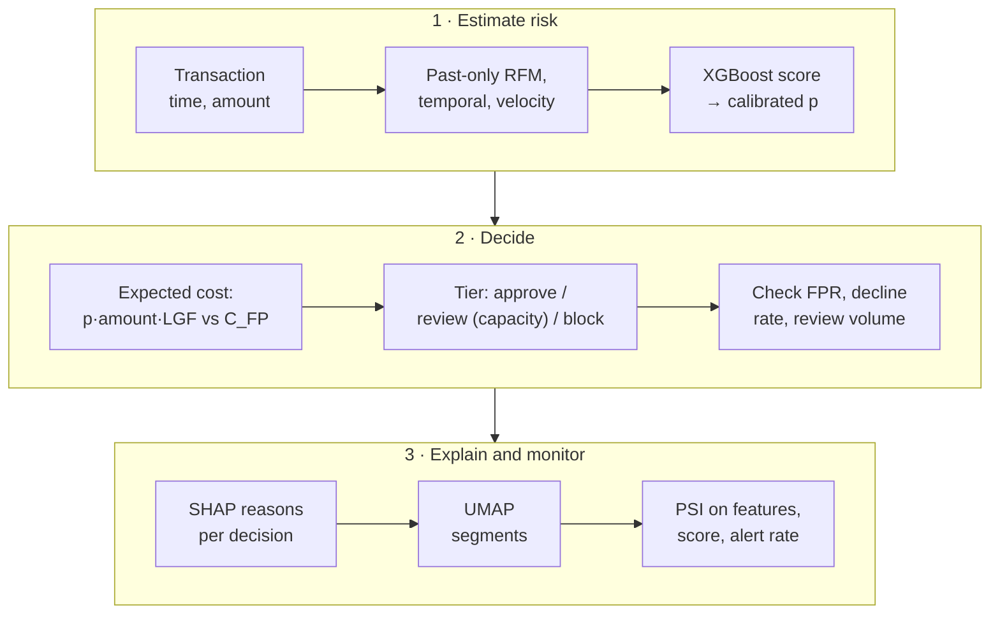

# Fraud Detection & Risk Analysis Platform — Interview Playbook

*Fraud treated as a financial-risk problem: estimate the probability that each card transaction is fraudulent when only 0.17% are, and turn that probability into decisions (approve, review, block) that balance fraud losses against the cost of rejecting good customers. XGBoost on RFM, temporal and velocity features with fold-local SMOTE and stratified 5-fold validation reaches 0.914 PR-AUC and 0.82 recall at a 1% false-positive rate; SHAP explains decisions, UMAP segments risk, and the Population Stability Index monitors drift, with 87% test coverage and GitHub Actions CI. This is the quant and risk edition. Everything you need for a 30–45 minute interview.*

**Resume bullets this booklet defends**

1. Designed fraud detection pipeline on 284K transactions with 0.17% fraud prevalence; XGBoost achieved 0.914 PR-AUC, 0.82 Recall at 1% FPR.
2. Engineered RFM, temporal and velocity features with fold-local SMOTE; optimized XGBoost via Optuna and stratified 5-fold cross-validation.
3. Built SHAP-based explainability, UMAP analytics and PSI drift monitoring; achieved 87% test coverage with automated GitHub Actions CI/CD.

# Part 1: Project Overview

## 1.1 What is this project?

**The one-line version.** A risk model that prices each transaction's fraud probability and a decision policy that converts it into the action with the lowest expected cost, monitored so the risk estimate stays trustworthy as conditions change.

**Start with an example.** Two transactions both score a 5% fraud probability. One is a 20,000 purchase, the other a 300 purchase. If approved, the expected fraud loss is $0.05 \times 20{,}000 = 1{,}000$ for the first and $0.05 \times 300 = 15$ for the second. If blocked, each costs roughly the same: an annoyed customer, a support call, perhaps a lost sale, say 150 (ILLUSTRATIVE). The rational decisions differ: block (or review) the large one, approve the small one. The **same score** leads to **different actions** because the stakes differ. That is the core of this edition: a fraud score is an input to a financial decision, and a model with an excellent PR-AUC can still produce bad decisions if the threshold ignores costs, capacity or calibration.

**The problem it solves.** Fraud is a direct financial loss (chargebacks, written-off amounts), an operational cost (analyst reviews, disputes) and a customer-experience risk (false declines push good customers away). The modelling problem is rare-event estimation under extreme imbalance; the decision problem is choosing thresholds that minimise total expected cost under operational constraints; the governance problem is keeping the model valid, explainable and stable over time.

**Who would use it.** Fraud-risk managers setting decline and review policies, operations teams sizing analyst capacity, model-risk and validation teams, and quants building the scoring model.

**Inputs and outputs.** Inputs: transactions (time, amount, other attributes) with fraud labels for training. Outputs: a fraud probability per transaction, a decision tier at chosen thresholds, SHAP reasons per decision, UMAP risk segments, PSI stability reports.

**What makes it technically interesting.** Base-rate effects on precision; cost-sensitive decision theory; calibration (probabilities, not just rankings, matter for expected loss); temporal leakage and validation design; and monitoring under drift and adversarial adaptation.

## 1.2 Explaining it when asked "Can you explain this project?"

> **Say it aloud:** "I framed fraud detection as a risk-decision problem. On 284K card transactions with only 0.17% fraud, I built an XGBoost model on behavioural features: recency, frequency and monetary value, time of day, and transaction velocity. I applied SMOTE only within training folds of a stratified 5-fold cross-validation to avoid leakage, and tuned with Optuna. The model reached 0.914 PR-AUC and 82% recall at a 1% false-positive rate. But a score isn't a decision, so the important part was the threshold: choosing it from the cost of a missed fraud versus the cost of declining a good customer, within analyst capacity. Around that I built SHAP explanations for each decision, UMAP risk segmentation and PSI drift monitoring, with 87% test coverage and GitHub Actions CI, so the model can be validated and monitored like any other risk model."

## 1.3 Scope, evidence status and what to confirm

**Scope boundary.** Offline risk model, decision-threshold analysis and monitoring tooling. Not a live authorisation system, and it does not set real business costs, which must come from the fraud operation.

> **Evidence status:** No code, notebooks or MLflow runs for this project are in the Resume Prep folder, so every resume number is marked **UNVERIFIED**: your reported result, with the evidence needed to defend it. Numbers in worked examples, including all costs, are **ILLUSTRATIVE**. Items marked **[confirm]** are standard choices assumed to explain the bullets.

> **Resume flag:** Confirm before interviewing. (1) **Dataset:** 284K transactions at 0.17% matches the public ULB / Kaggle credit-card dataset (284,807 transactions, 492 frauds, two days, anonymised PCA features plus Time and Amount). It has **no card ID** (so per-card RFM and velocity need explaining) and covers **two days** (so drift and out-of-time validation are limited). (2) **Consistency of the headline numbers:** if recall were 0.82 at exactly 1% FPR on a 0.17%-prevalence test set, PR-AUC could not exceed about 0.85 (proof in 3.3). Know whether 82% is reached at a lower FPR, comes from a different split, or whether PR-AUC was computed on rebalanced data (invalid). (3) Whether cost-based thresholds used real or assumed costs. (4) What "CD" deploys, if anything.

# Part 2: Fundamentals Required for This Project

| Resume bullet | Concepts you must be able to explain |
|---|---|
| 1. 284K transactions, 0.17% prevalence, XGBoost, 0.914 PR-AUC, 0.82 recall at 1% FPR | Fraud as financial risk, rare events and base rates, precision/recall/FPR, PR-AUC, cost-sensitive decisions, thresholds, calibration |
| 2. RFM, temporal, velocity features; fold-local SMOTE; Optuna; stratified 5-fold CV | Behavioural risk features, temporal leakage, SMOTE and its effect on probabilities, XGBoost, validation design |
| 3. SHAP, UMAP, PSI drift monitoring, 87% coverage, GitHub Actions CI/CD | Explainability for decisions, risk segmentation, PSI and drift, model monitoring, model validation and controls |

### Fraud as a financial and operational risk problem

- **Simple:** Fraud costs money in three ways: the stolen amount, the cost of investigating, and the cost of wrongly blocking honest customers. A good system minimises the total, not just the fraud.
- **Technical:** Expected loss of approving transaction $i$: $p_i \cdot A_i \cdot \text{LGF}$, where $p_i$ is the fraud probability, $A_i$ the amount and LGF the loss given fraud (share not recovered). Costs of blocking or reviewing: customer friction, lost margin and attrition risk for false positives, and analyst time per review. Losses are **heavy-tailed**: a few large frauds can dominate the total, so amount matters as much as probability.
- **Math:** Portfolio expected fraud loss $= \sum_i p_i A_i\,\text{LGF}$ over approved transactions; the decision policy changes which transactions are in that sum.
- **Why it matters:** Optimising a statistical metric does not minimise financial loss; the decision layer translates model output into money.
- **In this project:** The model estimates $p_i$; threshold optimisation chooses actions; monitoring protects the estimate's validity.
- **Interview angle:** "What is the cost of a false positive?" Not zero: declined good customers spend less, call support and sometimes leave.

### Rare events, class imbalance and base rates

- **Simple:** When fraud is only 17 in every 10,000 transactions, even a very accurate model produces many false alarms, because there are so many legitimate transactions to be wrong about.
- **Technical:** By Bayes' rule, precision depends on prevalence $\pi$: $$\text{Precision} = \frac{\text{TPR}\cdot\pi}{\text{TPR}\cdot\pi + \text{FPR}\cdot(1-\pi)}$$ ILLUSTRATIVE: TPR 0.82, FPR 0.01, $\pi = 0.0017$: precision $= 0.0014/(0.0014 + 0.00998) \approx 12\%$. Nine out of ten alerts are false despite a 1% FPR.
- **Why it matters:** Accuracy is meaningless (always-legitimate scores 99.83%); precision and alert volume are dominated by the base rate; and the few positives make every estimate noisy (about 98 frauds per CV fold).
- **In this project:** 0.17% prevalence; imbalance handled with fold-local SMOTE and evaluated with PR-AUC and recall at fixed FPR.
- **Interview angle:** "If fraud doubles to 0.34%, what happens to precision at the same threshold?" It roughly doubles (about 22%), because precision scales with prevalence.

### Confusion matrix through a risk lens: recall, precision, FPR

- **Simple:** Recall is the share of fraud losses you stop; FPR is the share of good customers you disturb; precision is the share of alerts worth an analyst's time.
- **Math:** $$\text{Recall} = \frac{TP}{TP+FN}, \qquad \text{FPR} = \frac{FP}{FP+TN}, \qquad \text{Precision} = \frac{TP}{TP+FP}$$
- **Technical:** Each maps to a business quantity: recall to fraud loss prevented (amount-weighted recall is often more relevant than count recall), FPR to customer friction, precision to analyst workload and alert fatigue. Full-dataset scale at 1% FPR: about 2,843 legitimate transactions flagged against about 403 frauds caught.
- **Why it matters:** Choosing a threshold is choosing a point on these trade-offs; it is a business decision informed by the model.
- **In this project:** Reported operating point: 82% recall at 1% FPR **[confirm consistency with PR-AUC; see 3.3]**.
- **Interview angle:** "Count recall or amount recall?" Amount-weighted recall is closer to dollars saved; report both.

### PR-AUC, and why a high PR-AUC is not a decision

- **Simple:** PR-AUC summarises how well the model ranks fraud above legitimate transactions across all thresholds. It does not tell you which threshold to use.
- **Technical:** Average precision $\sum_n (R_n - R_{n-1})P_n$; random baseline equals prevalence (0.0017). ROC-AUC is flattering under imbalance because FPR's denominator is huge. A model with high PR-AUC can still be deployed badly: a threshold too low floods analysts and declines many good customers; too high misses costly fraud; and a threshold tuned on SMOTE-inflated scores (for example the default 0.5) sits in an arbitrary place.
- **Why it matters:** PR-AUC is for model comparison; the threshold, costs and calibration determine financial outcomes.
- **In this project:** 0.914 PR-AUC, about 540 times the random baseline **[confirm CV mean vs hold-out]**.
- **Interview angle:** "Two models with the same PR-AUC: are they equally good?" Not necessarily; their curves can cross, so one may be better at your operating region.

### Cost-sensitive classification and the expected-cost threshold

- **Simple:** Flag a transaction when the expected loss of approving it is bigger than the expected cost of stopping it.
- **Math:** With calibrated fraud probability $p$, cost of a missed fraud $C_{FN}$ (≈ amount × LGF) and cost of a false alarm $C_{FP}$: flag if $$p\,C_{FN} > (1-p)\,C_{FP} \iff p > t^\ast = \frac{C_{FP}}{C_{FP} + C_{FN}}$$ ILLUSTRATIVE with $C_{FP} = 150$: for a 20,000 transaction, $t^\ast = 150/20{,}150 \approx 0.74\%$; for a 500 transaction, $t^\ast = 150/650 \approx 23\%$.
- **Technical:** The optimal threshold therefore depends on the amount: one global threshold is suboptimal when amounts vary. Analyst review adds a middle tier with its own cost and capacity. Cost-sensitive *training* (class weights proportional to costs) is an alternative, but separating probability estimation from decision costs keeps the model reusable when costs change.
- **Why it matters:** It connects the model directly to money and explains why the "right" threshold is a business parameter.
- **In this project:** Threshold optimisation on out-of-fold scores, by FPR constraint and expected cost **[confirm which costs were used]**.
- **Interview angle:** "Why does this need calibrated probabilities?" $t^\ast$ is a probability; if scores are inflated, every decision shifts.

### Calibration: probabilities you can price with

- **Simple:** A model is calibrated if, among transactions it scores at 10%, about 10% really are fraud.
- **Technical:** Boosted trees are often reasonably calibrated on the training distribution, but **SMOTE changes the training prevalence**, inflating scores. Fix with **Platt scaling** (logistic fit of label on score) or **isotonic regression** on held-out data with the true prevalence, or the prior-correction formula. Check with a **reliability diagram** and the **Brier score** $\frac{1}{n}\sum (p_i - y_i)^2$.
- **Math:** Prior correction when training prevalence $\pi_s$ differs from true $\pi$: $$p = \frac{p_s\,\pi/\pi_s}{p_s\,\pi/\pi_s + (1-p_s)(1-\pi)/(1-\pi_s)}$$
- **Why it matters:** Expected-loss decisions, amount-dependent thresholds, loss forecasting and capital planning all use the probability itself, not just the ranking.
- **In this project:** SMOTE was used, so calibration on untouched out-of-fold data is necessary before cost-based thresholds **[confirm whether you calibrated]**.
- **Interview angle:** "Does calibration change PR-AUC?" A monotone calibration does not change rankings, so PR-AUC stays the same; decisions change.

### Behavioural risk features: RFM, temporal and velocity

- **Simple:** Fraud shows up as a change in behaviour: unusual timing, unusual amounts and bursts of activity.
- **Technical:** **Recency** (time since previous transaction), **frequency** (count in trailing windows), **monetary** (amount relative to recent average), **temporal** (hour of day, cyclical encoding, night flag) and **velocity** (transactions or spend per minute or hour, versus normal). In risk terms, velocity captures the *rate of loss accumulation*: a compromised card is typically drained quickly. All windows must end strictly before the transaction.
- **Why it matters:** Behaviour-based features generalise better than static attributes and align with how analysts reason about fraud.
- **In this project:** RFM, temporal and velocity features **[confirm the grouping key: per card, or global windows if the dataset has no card ID]**.
- **Interview angle:** "Which feature would a fraudster find hardest to fake?" Velocity relative to the card's own history; fraudsters want to cash out fast.

### Temporal leakage, fold-local SMOTE and validation design

- **Simple:** The model must never learn from information that would not exist at decision time, and synthetic training examples must not leak into evaluation.
- **Technical:** **Temporal leakage:** features using future transactions, statistics computed on the full dataset, or random splits that let the model train on later data than it is tested on. **SMOTE** interpolates new minority points $x_i + \lambda(x_{nn} - x_i)$; done before splitting, synthetic copies of validation frauds enter training. **Fold-local SMOTE** oversamples only the training part of each fold. **Stratified 5-fold** keeps about 98 frauds per fold. For a risk model, **out-of-time validation** (train on earlier, test on later periods) is the standard final test.
- **Why it matters:** Leakage overstates performance and understates risk; a risk model validated on leaked data gives false comfort.
- **In this project:** Fold-local SMOTE inside stratified 5-fold CV, past-only feature windows **[confirm whether an out-of-time hold-out was used]**.
- **Interview angle:** "Why is random CV weaker for fraud?" Fraud patterns drift; random folds mix future patterns into training.

### XGBoost and Optuna

- **Simple:** XGBoost builds many small decision trees in sequence, each fixing the previous ones' errors. Optuna searches its settings automatically.
- **Technical:** Gradient boosting $F_m = F_{m-1} + \eta h_m$ on log-loss with regularisation on leaves and leaf weights; captures non-linear interactions such as "large amount *and* night *and* burst of transactions". Optuna's TPE sampler proposes hyperparameters (depth, learning rate, subsampling, regularisation, SMOTE ratio) and maximises mean CV PR-AUC, with pruning of weak trials. Logistic regression is the natural benchmark model.
- **Why it matters:** Strong on tabular data, robust to scaling and outliers; tuning on PR-AUC aligns the search with the rare-event objective.
- **In this project:** XGBoost tuned with Optuna on stratified 5-fold CV; LightGBM in the stack as a comparison **[confirm]**. Tuning and reporting on the same folds is mildly optimistic.
- **Interview angle:** "Why keep a logistic-regression benchmark?" Validators expect a simpler challenger; it also bounds what complexity buys.

### SHAP explanations for risk decisions

- **Simple:** SHAP lists the reasons behind each score: which features pushed the risk up and which pushed it down, and by how much.
- **Technical:** Shapley-value attributions, additive in log-odds: $\text{logit}(p) = \phi_0 + \sum_j \phi_j$. TreeSHAP computes them exactly for XGBoost. **Local** reasons support analyst review, customer communication and dispute handling; **global** summaries support model validation (do the drivers make economic sense?) and leakage detection.
- **Why it matters:** Risk decisions must be explainable to analysts, customers, auditors and regulators; an unexplainable decline is an operational and conduct risk.
- **In this project:** SHAP for per-decision reasons and global driver analysis.
- **Interview angle:** "Is a SHAP reason a cause?" No; it explains the model. Correlated features share credit in ways that can mislead.

### UMAP for risk segmentation

- **Simple:** UMAP draws the transactions on a 2D map where similar ones sit together, so you can see clusters of risk.
- **Technical:** Builds a nearest-neighbour graph in feature (or SHAP) space and finds a 2D layout preserving local neighbourhoods; parameters `n_neighbors` and `min_dist`. Coloured by score or label, it reveals distinct fraud segments (possibly different attack types), high-risk legitimate segments (false-positive sources) and new regions appearing over time.
- **Why it matters:** Segments guide policy (segment-specific thresholds or rules), analyst training and monitoring. **SHAP vs UMAP:** SHAP explains individual model decisions; UMAP shows the structure of the population.
- **In this project:** UMAP analytics on transactions **[confirm whether on raw features or SHAP values]**.
- **Interview angle:** "Can you trust distances on a UMAP plot?" Local neighbourhoods yes; distances between clusters no.

### PSI, data drift and model monitoring

- **Simple:** PSI measures how much the population the model sees today differs from the one it was built on.
- **Math:** $$\text{PSI} = \sum_i (a_i - e_i)\ln\frac{a_i}{e_i}$$ over bins of a feature or of the score, with $e_i$ reference and $a_i$ current shares. Rules of thumb: < 0.1 stable, 0.1–0.25 investigate, > 0.25 significant shift.
- **Technical:** **Data drift** ($P(x)$ changes) is detectable immediately with PSI; **concept drift** ($P(y \mid x)$ changes, for example fraudsters adapting) appears only when labels arrive weeks later. Score-distribution PSI matters operationally because, at a fixed threshold, a shifted score distribution changes alert volume and decline rates. A monitoring plan pairs PSI with alert-rate tracking and lagged performance (recall, precision) on matured labels.
- **Why it matters:** Risk models decay; monitoring is a control that tells you when estimates stop being trustworthy.
- **In this project:** PSI on features and scores with thresholds **[confirm reference window and alerting]**.
- **Interview angle:** "PSI 0.3 on the score: what do you do?" Check the pipeline, then alert volume, then lagged performance; recalibrate or retrain as justified.

### Model validation and engineering controls

- **Simple:** Before a risk model is trusted, someone independent checks that it is conceptually sound, correctly built, performs out of sample and is monitored.
- **Technical:** Elements (in the spirit of supervisory model-risk guidance such as SR 11-7): conceptual soundness (features and drivers make sense), data quality and leakage review, out-of-time and out-of-sample performance, benchmark (challenger) models, sensitivity and stability analysis, documentation of assumptions and limitations, and ongoing monitoring. Engineering controls support this: **pytest** tests on leakage-prone logic (feature windows, fold-local resampling, metric and PSI functions), **87% line coverage**, **GitHub Actions** running tests on every change, **MLflow** for reproducible runs.
- **Why it matters:** In financial institutions, an unvalidated model is a risk in itself (model risk).
- **In this project:** Tests, CI and experiment tracking as controls; validation evidence from CV, SHAP and PSI **[confirm what CD deploys]**.
- **Interview angle:** "Does 87% coverage mean the model is correct?" No; it means most code paths ran in tests. Correctness depends on what the tests assert.

# Part 3: Methodology and Workflow

## 3.1 From transaction to decision

**Figure 1 — Risk scoring workflow: past-only features, a calibrated probability, a cost-based decision tier, and monitoring** [scale=0.72]

**Step 1: Data and features.** Order by time; build past-only RFM, temporal and velocity features; log-transform amounts. Reason: behavioural signals without leakage.

**Step 2: Validation design.** Stratified 5-fold CV with SMOTE inside each training fold (validation keeps 0.17% prevalence); ideally a final out-of-time hold-out. Reason: honest estimates under extreme imbalance.

**Step 3: Model and tuning.** XGBoost with Optuna maximising mean CV PR-AUC; logistic regression as challenger. Reason: strong ranking performance with a simpler benchmark for validation.

**Step 4: Calibrate.** Map out-of-fold scores to probabilities with Platt scaling, isotonic regression or prior correction; check reliability and Brier score. Reason: SMOTE inflates scores; decisions need true probabilities.

**Step 5: Choose the decision policy.** Using out-of-fold probabilities and amounts: block if expected loss exceeds friction cost by a margin; send a middle band to review up to analyst capacity; approve the rest; check the resulting FPR (target ≤ 1%), alert volume and expected cost. Reason: decisions that minimise total cost within operational limits.

**Step 6: Explain.** TreeSHAP reasons per flagged transaction; global SHAP for validation of drivers. Reason: analyst efficiency, auditability, customer communication.

**Step 7: Monitor and control.** Reference distributions stored; PSI on key features and the score; alert-rate tracking; lagged recall and precision on matured labels; pytest suite and GitHub Actions protect the pipeline. Reason: detect drift and keep the model valid.

## 3.2 Converting a score into an operational decision

The model output is a probability; the action depends on costs and constraints. A three-tier policy is common:

| Tier | Rule (ILLUSTRATIVE) | Cost if wrong | Constraint |
|---|---|---|---|
| Block | $p \cdot A \cdot \text{LGF} > k \cdot C_{FP}$ and $p$ high | Good customer declined | Decline-rate limit |
| Review | Middle band, ranked by expected loss | Analyst time; delay | Reviews per day |
| Approve | Expected loss below friction cost | Fraud loss | Loss budget |

Ranking the review queue by **expected loss** ($p \times A$) rather than by $p$ alone uses limited analyst capacity on the transactions where a correct decision saves the most money.

## 3.3 Numerical claims and how to defend them

| Claim | What it means and how it is computed | Baseline and what could mislead | Status |
|---|---|---|---|
| 284K, 0.17% | ≈ 284,807 transactions, ≈ 492 frauds | Two days, no card ID if ULB | UNVERIFIED; confirm source |
| 0.914 PR-AUC | Average precision of out-of-fold scores | Random 0.0017; tuned on same folds | UNVERIFIED |
| 0.82 recall at 1% FPR | Share of frauds caught when 1% of legitimate are flagged | Precision there ≈ 12%; see check | UNVERIFIED |
| 87% coverage | Lines executed in pytest | Coverage ≠ correctness | UNVERIFIED |

> **Confirm:** Consistency of the two headline numbers. If recall is 0.82 at exactly 1% FPR, every threshold catching more than 82% of frauds flags at least about 2,843 legitimate transactions, so precision beyond that recall is at most $492/(492 + 2{,}843) \approx 0.15$. Average precision is then at most $0.82 + 0.18 \times 0.15 \approx 0.85 < 0.914$. Either 82% recall is reached at a much lower FPR (state "at ≤ 1% FPR"), the numbers come from different evaluations, or PR-AUC was computed on oversampled data, which would be invalid. Check before the interview.

# Part 4: Important Design and Methodological Decisions

**1. Separate probability estimation from the decision rule.** *Why:* costs, capacity and policy change more often than fraud patterns; a calibrated probability can be re-thresholded without retraining. *Alternative:* cost-weighted training with a fixed 0.5 cut. *Trade-off:* requires calibration and an explicit cost model.

**2. Cost-based (and amount-aware) thresholds instead of a single fixed cut.** *Why:* the same probability means very different expected loss for different amounts. *Alternative:* one global threshold set by FPR. *Trade-off:* needs credible cost estimates; more complex policy to explain and govern.

**3. PR-AUC and recall at fixed FPR instead of accuracy or ROC-AUC.** *Why:* base-rate effects make accuracy useless and ROC-AUC flattering; the operating point reflects customer friction. *Alternative:* accuracy, ROC-AUC. *Trade-off:* PR-AUC depends on prevalence and is not comparable across portfolios.

**4. Fold-local SMOTE plus recalibration instead of global SMOTE.** *Why:* prevents leakage and keeps evaluation at true prevalence; recalibration undoes SMOTE's probability inflation. *Alternative:* class weights or no resampling. *Trade-off:* extra calibration step; class weights may perform as well and are simpler.

**5. SHAP explanations as part of the decision output.** *Why:* explainable declines are required for analysts, disputes and audit; global SHAP supports validation. *Alternative:* feature-importance plots only. *Trade-off:* compute cost; explanations are about the model, not causes.

**6. PSI monitoring plus lagged performance instead of waiting for labels.** *Why:* labels arrive weeks later; PSI and alert-rate tracking give early warning. *Alternative:* periodic retraining on a schedule only. *Trade-off:* PSI catches data drift, not concept drift.

# Part 5: Complete Interview Explanation

## 5.1 Two-minute explanation

> **Say it aloud:** "I treated fraud detection as a risk-decision problem. The data were 284K card transactions with 0.17% fraud. At that base rate, even a 1% false-positive rate means most alerts are false, so the question isn't only how well the model ranks, but how to act on its scores.
>
> The model is XGBoost on behavioural features: recency, frequency and amount relative to recent behaviour, time of day, and transaction velocity, all computed from past data only. I used stratified 5-fold cross-validation with SMOTE applied inside each training fold, and Optuna for tuning. It reached 0.914 PR-AUC and 82% recall at a 1% false-positive rate.
>
> Then the decision layer: flag a transaction when the expected fraud loss, probability times amount, exceeds the cost of disturbing a good customer, with a review tier sized to analyst capacity. That requires calibrated probabilities, because SMOTE inflates scores. Finally, SHAP explains each decision, UMAP segments risk, and PSI monitors drift, with tests and CI as controls."

## 5.2 Five-minute explanation

> **Say it aloud:** "**The risk.** Fraud loss is the stolen amount net of recoveries; false declines cost friction and customers; reviews cost analyst time. The aim is to minimise the total.
>
> **Base rates.** With 0.17% prevalence, precision equals recall times prevalence over that plus FPR times one minus prevalence. At 82% recall and 1% FPR, precision is only about 12%. That's why accuracy is meaningless and why I report PR-AUC, whose random baseline is 0.0017, and recall at a fixed FPR, which corresponds to a customer-friction budget.
>
> **Model and validation.** Features describe behaviour: velocity, amount relative to recent spending, timing. Windows end strictly before each transaction. SMOTE is applied only inside training folds so validation keeps true prevalence and no synthetic copies of validation frauds leak into training. XGBoost was tuned with Optuna on mean CV PR-AUC.
>
> **From score to decision.** Flag when p times the loss if fraud exceeds one minus p times the false-positive cost. The threshold is C_FP over C_FP plus C_FN, so for a 20,000 transaction with a 150 false-positive cost it's under 1%, but for a 500 transaction it's 23%. One global threshold is therefore suboptimal. These thresholds are probabilities, so the model must be calibrated; SMOTE distorts probabilities, so I recalibrate on out-of-fold data.
>
> **Why PR-AUC isn't enough.** A model with 0.914 PR-AUC can still be deployed badly: a threshold that's too low floods analysts and declines good customers; too high lets large frauds through.
>
> **Explain and monitor.** SHAP gives reasons for each alert and lets validators check the drivers make sense; UMAP shows risk segments; PSI on features and scores warns of drift before labels arrive. Tests at 87% coverage and GitHub Actions protect the leakage-sensitive code."

## 5.3 Ten-minute explanation

> **Say it aloud:** "I'll cover the decision theory, calibration, validation, monitoring and limitations.
>
> **Decision theory.** For each transaction there are actions with costs. Approving a fraud loses the amount times loss-given-fraud; blocking a good customer costs friction; reviewing costs analyst time and is capacity-limited. The expected-cost rule gives an amount-dependent threshold. A practical policy has three tiers: block when expected loss is very high, review a middle band ranked by expected loss up to capacity, approve the rest. The result is checked against constraints: decline rate, FPR around 1%, review volume.
>
> **Calibration.** Rankings drive PR-AUC; probabilities drive money. SMOTE changes the training prevalence, so raw scores are inflated. Platt scaling, isotonic regression, or a prior-correction formula fix this on held-out data with true prevalence. Calibration is monotone, so PR-AUC is unchanged, but decisions, loss forecasts and capacity planning become correct. I'd show a reliability diagram and Brier score.
>
> **Consistency of metrics.** At 0.17% prevalence, 1% FPR is about 2,800 false alarms against about 400 frauds caught. If 82% recall really needed a full 1% FPR, average precision couldn't exceed about 0.85, so with 0.914 PR-AUC the 82% recall must be reached at a much lower FPR. Checking claims like that is part of validating a risk model.
>
> **Validation.** Random stratified CV gives stable estimates with only about 98 frauds per fold, but fraud drifts, so the standard risk-model test is out-of-time: train on earlier, test on later. A logistic-regression challenger shows what complexity buys. Sensitivity analysis checks threshold stability and SHAP driver stability across folds. Tuning on the same folds as reporting is slightly optimistic; a hold-out fixes that.
>
> **Monitoring.** PSI on the score matters operationally: if the score distribution shifts, a fixed threshold changes alert volume and decline rates even if the model is fine. Feature PSI localises the cause. Concept drift, fraudsters adapting, needs matured labels, so lagged recall and precision complete the picture. There's also a feedback loop: blocked transactions never get a true label, so a small random approval or review sample keeps estimates unbiased.
>
> **Limitations.** If the data are the public ULB dataset: two days, anonymised PCA features, no card ID, which limits behavioural features and drift analysis. Costs were assumed, not observed. Next steps: out-of-time validation on longer data, amount-weighted metrics, real cost estimates, and a champion-challenger monitoring process."

# Part 6: Interview Questions and Answers

## 6.1 Risk framing and metrics

#### Q1. What does your project do, framed as a risk problem? [Easy]

It estimates the probability that each card transaction is fraudulent and turns that probability into the action with the lowest expected cost: approve, send to review, or block. The data are 284K transactions with 0.17% fraud. The model is XGBoost on behavioural features (recency, frequency and monetary value, time of day, velocity), trained with fold-local SMOTE and stratified 5-fold cross-validation and tuned with Optuna, reaching 0.914 PR-AUC and 82% recall at a 1% false-positive rate. The decision layer chooses thresholds by comparing expected fraud loss (probability times amount) with the cost of disturbing a good customer, within analyst capacity. SHAP explains each decision, UMAP segments risk, and PSI monitors drift. Tests at 87% coverage and GitHub Actions CI act as engineering controls. It is offline analysis and tooling, not a live authorisation system.

#### Q2. Why is fraud detection a risk-management problem and not just classification? [Easy]

Because errors have unequal, money-denominated costs and the output drives decisions. A missed fraud costs roughly the transaction amount (minus recoveries); a false decline costs customer friction, lost margin and possibly the customer; a review costs analyst time, which is limited. Losses are heavy-tailed, so one large missed fraud can matter more than many small ones. A classifier that maximises a statistical metric does not automatically minimise this total cost. Risk management adds three layers: **decision theory** (thresholds from costs and capacity), **calibration** (probabilities you can price with), and **governance** (validation, explainability, monitoring, controls). It is the same structure as credit risk: a probability-of-default model is only useful together with exposure, loss given default and a policy for acting on it.

#### Q3. Why does a 0.17% fraud rate make the problem hard? [Easy]

Three reasons. **Base rates:** precision equals TPR × prevalence divided by (TPR × prevalence + FPR × (1 − prevalence)). With 82% recall, 1% FPR and 0.17% prevalence, precision is about 12%: nine in ten alerts are false even though the false-positive rate sounds low. **Training:** the loss is dominated by legitimate transactions, so a model can minimise it by ignoring fraud; resampling or weighting is needed. **Evaluation noise:** with about 492 frauds in total, each CV fold has about 98, so metrics vary noticeably across folds and small differences between models may not be significant. Accuracy is useless: predicting "legitimate" always gives 99.83%. So the right metrics focus on the rare class (PR-AUC, recall at fixed FPR, precision), and results should be reported with their variability.

#### Q4. What do recall, precision and false-positive rate mean operationally? [Easy]

**Recall** is the share of frauds caught; weighted by amount, it is the share of fraud losses prevented, which is what finance cares about. **False-positive rate** is the share of legitimate transactions flagged: customer friction, declines and complaints. **Precision** is the share of alerts that are real fraud: analyst efficiency and alert fatigue. At full-dataset scale, 1% FPR means about 2,843 legitimate transactions flagged; with 82% recall about 403 frauds are caught, so analysts would see about eight false alerts for every real one. These three numbers move together as the threshold changes: lowering it raises recall but also FPR and alert volume. A risk manager typically fixes a friction budget (FPR or decline rate) and an analyst capacity, then maximises amount-weighted recall within them.

#### Q5. What is PR-AUC, and why can a model with high PR-AUC still be unsuitable? [Easy]

PR-AUC (average precision) summarises how well a model ranks frauds above legitimate transactions across all thresholds; its random baseline equals prevalence, 0.0017, so 0.914 is excellent ranking. But deployment uses one threshold, and outcomes depend on it. If the threshold is too low, the system flags thousands of good customers and floods analysts; if too high, it misses fraud, including large-value fraud. If scores are inflated by SMOTE and the default 0.5 cut is used, the operating point is essentially arbitrary. A single global threshold also ignores amounts: a 5% probability is negligible for a small purchase and serious for a large one. And PR-AUC says nothing about stability over time. So PR-AUC is a model-comparison metric; suitability requires a well-chosen, calibrated, cost-aware threshold and monitoring.

#### Q6. How do you convert a fraud score into an operational decision? [Easy]

In three steps. First, convert the score into a **calibrated probability** $p$, because SMOTE inflates raw scores. Second, compute the **expected cost** of each action: approving costs $p \times A \times \text{LGF}$ (amount times loss given fraud); blocking costs $(1-p) \times C_{FP}$ (friction and lost business on a good customer); reviewing costs analyst time and delay. Third, apply a **tiered policy**: block when expected fraud loss far exceeds the friction cost, review a middle band ranked by expected loss up to analyst capacity, approve the rest. Finally, check aggregate constraints: overall FPR (for example ≤ 1%), decline rate, review volume and expected loss. Thresholds are chosen on out-of-fold data with true prevalence and revisited when costs, capacity or score distributions change (PSI on the score helps here).

#### Q7. Derive the cost-optimal threshold. [Easy]

Suppose the model gives a calibrated probability $p$ that a transaction is fraud. If we approve it, the expected cost is $p \cdot C_{FN}$, where $C_{FN}$ is the loss from a missed fraud (about amount × loss given fraud). If we block it, the expected cost is $(1-p)\cdot C_{FP}$, the cost of declining a legitimate customer. Block when $p\,C_{FN} > (1-p)\,C_{FP}$, which rearranges to $p > C_{FP}/(C_{FP} + C_{FN})$. With $C_{FP} = 150$ (ILLUSTRATIVE): a 20,000 transaction has a threshold of about 0.74%; a 500 transaction about 23%. Two lessons: the optimal threshold falls as the amount rises, so one global threshold is suboptimal; and the rule uses $p$ directly, so it only works with calibrated probabilities. Adding a review option creates a middle band, limited by capacity.

#### Q8. What is the business trade-off between blocking fraud and rejecting legitimate customers? [Easy]

Every threshold trades fraud losses against customer friction. Blocking more aggressively prevents more fraud loss but declines more good transactions. Declines are expensive in ways that are easy to underestimate: lost sale margin, support calls, customers switching to another card, and reputational damage; for valuable customers a false decline can cost more than a small fraud. Blocking less aggressively improves experience but raises chargebacks and write-offs. Reviews sit in between, but analysts are limited, and slow reviews also frustrate customers. The optimum depends on costs that the fraud operation must provide (fraud amounts and recovery rates, friction costs, review costs) and on constraints (decline-rate targets, review capacity, regulatory expectations). My job as the modeller is to provide calibrated probabilities and the cost curves showing expected loss at each threshold, so the business can choose knowingly.

## 6.2 Modelling and validation

#### Q9. What do RFM and velocity features capture in risk terms? [Easy]

They measure deviation from normal behaviour, which is how most fraud reveals itself. **Recency** (time since the last transaction) and **frequency** (transactions in the last hour or day) capture unusual activity patterns. **Monetary** features compare the current amount with recent spending, flagging sudden large purchases. **Temporal** features (hour of day, night flag) capture unusual timing. **Velocity** measures how fast transactions or spend accumulate; in risk terms, it is the rate of loss accumulation: a compromised card is typically used many times quickly before it is blocked. These features generalise better than static attributes because they describe behaviour rather than specific merchants or amounts. All windows must end strictly before the current transaction. If the dataset has no card ID, I must explain exactly how these were computed **[confirm]**.

#### Q10. What is temporal leakage, and how did you avoid it? [Easy]

Temporal leakage means using information at prediction time that would only be available later. In fraud it appears in three ways. **Features** that include the current or future transactions in a rolling window, so the model "sees" the burst it should predict; I used windows ending strictly before each transaction. **Global statistics** computed on the whole dataset (normalisation means, target encodings), which embed future information; these must be fitted on training data only. **Validation design**: random folds let the model train on transactions that occurred after the ones it is tested on, which overstates performance when patterns drift. Stratified random CV was used for stable model comparison; the stronger test for a risk model is out-of-time validation, training on earlier periods and testing on later ones **[confirm whether you ran one]**. Leakage understates risk, which is the worst failure for a risk model.

#### Q11. Why fold-local SMOTE, and what does SMOTE do to probabilities? [Easy]

SMOTE creates synthetic fraud examples by interpolating between real frauds and their nearest fraud neighbours. If it is applied before cross-validation, synthetic points derived from validation frauds end up in training, so the model is tested on near-copies of what it learned, and validation folds may contain synthetic points, distorting prevalence. Fold-local SMOTE oversamples only the training part of each fold, so validation stays real data at 0.17% prevalence. The second effect matters for risk: SMOTE changes the training class balance, so the model's raw scores are inflated relative to true fraud probabilities. Rankings (and PR-AUC) are fine, but any decision that uses the probability itself, such as cost-based thresholds or expected-loss forecasts, needs **recalibration** on untouched data, using Platt scaling, isotonic regression or a prior-correction formula.

#### Q12. Why XGBoost, and how was it tuned and validated? [Easy]

XGBoost is gradient-boosted decision trees: each tree corrects the errors of the ensemble so far, with shrinkage and regularisation. It captures non-linear interactions among amount, timing and velocity without manual feature crosses, handles skewed amounts and missing values, and is among the strongest methods for tabular risk data. Tuning used Optuna: each trial proposed hyperparameters (depth, learning rate, subsampling, regularisation, SMOTE ratio), ran stratified 5-fold CV with fold-local SMOTE and returned mean PR-AUC; the TPE sampler concentrated later trials in promising regions. Stratification guarantees about 98 frauds per fold. For validation quality, I would add a logistic-regression challenger, report fold-to-fold variability, and use nested CV or a hold-out, because reporting the best score from the same folds used for tuning is slightly optimistic **[confirm]**.

#### Q13. How does SHAP support risk decisions? [Easy]

SHAP attributes each prediction to features: the model's log-odds equals a base value plus one contribution per feature, computed exactly and quickly for XGBoost with TreeSHAP. For **operations**, each alert comes with reasons ("velocity in the last hour +2.1, amount 6× usual +1.4"), so analysts review faster and more consistently. For **customers and disputes**, it supports explaining why a transaction was declined. For **model validation**, global SHAP shows whether the drivers make economic sense; a suspicious dominant feature can reveal leakage. For **monitoring**, changes in SHAP importance over time can signal shifting fraud patterns. Caveats: SHAP explains the model, not the world; correlated features share credit in ways that depend on assumptions; and values are in log-odds, so they do not map linearly to probability.

#### Q14. What does UMAP add to the analysis? [Easy]

UMAP projects high-dimensional transactions onto a 2D map that preserves local neighbourhoods, so similar transactions appear close together. Coloured by fraud label or predicted risk, it reveals **segments**: distinct clusters of fraud (possibly different attack types needing different rules), legitimate segments that score high (sources of false positives, where a segment-specific threshold or feature might help), and regions where fraud mixes with legitimate activity (inherently hard cases). Over time, new clusters appearing in recent data are a visual drift signal. It differs from SHAP: SHAP explains why the model scored one transaction; UMAP shows how the population is structured. Interpretation needs care: neighbourhoods are meaningful, but distances between clusters and cluster sizes are not, and layouts depend on parameters. It is an exploratory and communication tool, not evidence for performance claims.

#### Q15. What is PSI, and how is it used for model monitoring? [Easy]

The Population Stability Index compares the distribution of a variable now with a reference distribution, usually the development sample. Bin the reference into deciles, compute reference and current shares $e_i$ and $a_i$, and sum $(a_i - e_i)\ln(a_i/e_i)$. Below 0.1 is stable, 0.1–0.25 worth investigating, above 0.25 a significant shift. I computed it for key features and for the model score. Score PSI is operationally important: at a fixed threshold, a shifted score distribution changes alert volume and decline rates, affecting customers and analyst workload even before fraud performance visibly changes. Feature PSI localises the cause. PSI needs no labels, which matters because fraud labels arrive weeks later. Its limitation is that it detects data drift only; concept drift needs lagged performance on matured labels.

#### Q16. What is model validation, and what controls does your project include? [Easy]

Model validation is independent assessment that a model is fit for purpose: conceptually sound, built on clean data without leakage, performing out of sample and over time, benchmarked against simpler alternatives, stable under sensitivity tests, documented with its assumptions and limitations, and monitored after deployment. Banking supervisors formalise this as model-risk management. My project provides evidence for several elements: stratified CV with fold-local SMOTE, metrics suited to rare events, SHAP for conceptual soundness, PSI for monitoring. Engineering controls support reliability: pytest tests on the leakage-prone logic (feature windows, resampling inside folds, metric and PSI functions) with 87% line coverage, GitHub Actions running them on every change, and MLflow for reproducibility. Gaps a validator would raise: out-of-time testing, calibration evidence, real cost inputs and the dataset's limitations **[confirm]**.

## 6.3 Decisions, stability and scenarios

#### Q17. Why does calibration matter, and how would you calibrate the model? [Medium]

Calibration means predicted probabilities match observed frequencies: among transactions scored at 5%, about 5% are fraud. Ranking metrics like PR-AUC ignore calibration, but risk decisions use the probability itself: the cost threshold $C_{FP}/(C_{FP}+C_{FN})$, expected-loss ranking of the review queue, fraud-loss forecasts and capacity planning. SMOTE inflates scores because the training prevalence is artificial, so an uncalibrated model would block far too much. Methods, fitted on out-of-fold predictions with true prevalence: **Platt scaling** (a logistic regression of label on score, two parameters, robust with few positives); **isotonic regression** (non-parametric and monotone, flexible but can overfit with about 490 positives); or the **prior-correction** formula, which adjusts odds by the ratio of true to training prevalence. Evaluate with reliability diagrams and the Brier score. Calibration must be rechecked under drift.

#### Q18. Are your two headline numbers consistent? [Medium]

This check belongs in validating any risk model. Use full-dataset counts: about 492 frauds and 284,315 legitimate transactions. If recall is 0.82 at exactly 1% FPR, any threshold catching more than 82% of frauds flags at least about 2,843 legitimate transactions, so precision at those recall levels is at most $492/(492 + 2{,}843) \approx 15\%$. Average precision is then at most about $0.82 \times 1 + 0.18 \times 0.15 \approx 0.85$, below the claimed 0.914. So the two claims cannot both be exact on the same evaluation. Plausible explanations: 82% recall is reached at a much lower FPR (an AP of 0.914 suggests precision near 0.9 there, an FPR of roughly 0.02%), making "1% FPR" a loose bound; the numbers come from different splits; or PR-AUC was computed on rebalanced data, which would be invalid. I would check and state the precise version.

#### Q19. How would you set thresholds when analysts can review only a fixed number of transactions per day? [Medium]

Capacity turns threshold selection into a ranking-and-cutoff problem. Suppose analysts can review $K$ transactions per day. First, the block tier: transactions whose expected fraud loss is so high relative to friction cost that blocking without review is justified. Second, the review tier: rank remaining transactions by **expected loss saved by review**, roughly $p \times A \times \text{LGF}$ minus review cost, and send the top $K$ to analysts. Ranking by expected loss rather than by probability alone focuses limited capacity on transactions where a correct decision saves the most money; a 3% probability on a large transaction can outrank a 30% probability on a tiny one. Third, approve the rest. Then check the implied FPR, decline rate and expected residual loss. When volume or score distributions shift (score PSI), the cutoff that fills capacity changes and must be recomputed.

#### Q20. Should you use one global threshold or amount-dependent thresholds? [Medium]

Amount-dependent decisions are better in expected-cost terms. The cost-optimal rule flags when $p > C_{FP}/(C_{FP} + C_{FN})$ with $C_{FN} \approx A \times \text{LGF}$, so the threshold falls as the amount rises: under 1% for a 20,000 transaction and over 20% for a 500 one with a friction cost of 150 (ILLUSTRATIVE). A global threshold over-blocks small transactions (high friction, little loss prevented) and under-blocks large ones. Practical considerations: costs should be estimated per segment (high-value customers may have higher friction costs); very small transactions might be approved outright; and policies must stay explainable and consistent for customers and regulators. Equivalent formulations rank by expected loss $p \times A$ and cut at a level set by capacity or a loss budget. All of this requires calibrated probabilities and should be evaluated with amount-weighted recall alongside count recall.

#### Q21. How would you assess model stability over time? [Medium]

With **out-of-time** evidence and monitoring. Validation: train on an earlier period and test on successive later periods, tracking PR-AUC, recall at the chosen operating point, calibration and amount-weighted recall per period; a stable model degrades slowly and smoothly. Check stability of inputs and drivers too: feature PSI and score PSI between periods, and whether SHAP importance rankings stay similar. Threshold stability matters operationally: if the threshold that achieves 1% FPR moves a lot from week to week, alert volumes will swing. In production: monthly PSI reports, alert-rate dashboards, lagged performance on matured labels, and a champion-challenger setup where a retrained model runs in shadow before replacing the current one. A limitation in my project is that the public dataset, if used, covers only two days, so genuine over-time stability could not be measured **[confirm]**.

#### Q22. Fraudsters adapt. How does that affect the model, and how would you respond? [Medium]

Adaptation creates **concept drift**: the relationship between features and fraud changes because adversaries change tactics in response to the model. Patterns that were caught become rarer and new ones appear, so performance decays even if input distributions look stable. Responses: **monitoring** of lagged recall and precision on matured labels (concept drift is invisible to PSI alone), analyst feedback on missed fraud, and UMAP or anomaly scores to spot new clusters; **faster retraining** on recent data with time-weighting; **robust features** that are costly for fraudsters to change, such as velocity relative to the card's own history; **layered defences**: rules for newly discovered patterns until retraining, plus unsupervised anomaly detection for things the supervised model has never seen; and **less transparency to attackers**, since publishing exact thresholds or reasons invites probing.

#### Q23. Blocked transactions never get a fraud label. Why is that a problem? [Medium]

It creates **selection bias** in the training data, a feedback loop. Once a model is deployed, transactions it blocks are never completed, so we never learn whether they were really fraud. Future training data contain labels mainly for approved transactions, which under-represent the high-risk region. Retraining on that data can make the model forget patterns it currently blocks, or misjudge how many blocked transactions were actually legitimate (true false-positive cost). Mitigations: label reviewed transactions through analyst outcomes; approve a small random sample of would-be-blocked low-amount transactions, or route them to review, as **exploration** to obtain unbiased labels; use reject-inference techniques similar to those in credit scoring; and track a holdout population scored but not acted on, where regulation and risk appetite allow. It is a standard issue in credit risk and applies equally to fraud.

#### Q24. Is the dataset suitable for the claims you make? [Medium]

It depends on the source, and I should be explicit **[confirm]**. If it is the public ULB dataset: it has 284,807 transactions from two days, 28 anonymised PCA components plus Time and Amount, and no card or customer identifier. Consequences: per-card RFM and velocity features cannot be computed directly, so I must explain whether features were global time-window statistics or derived differently; two days are too short to measure drift, seasonality or out-of-time stability, so PSI monitoring is demonstrated rather than validated; anonymised features limit conceptual-soundness review, because SHAP reasons like "V14" cannot be interpreted by analysts; and real costs are unavailable, so cost-based thresholds use assumptions. The project is still a valid demonstration of methodology, imbalance handling, leakage control and decision design, but claims about production stability or business value need a richer dataset.

#### Q25. How would you present this model to a risk committee? [Medium]

As a decision tool with quantified benefits, risks and controls. **Purpose and scope:** which transactions, which decisions. **Performance in business terms:** expected fraud loss prevented, decline rate, review volume and precision at the proposed thresholds, with confidence intervals and comparison to the current process or a simple challenger. **Cost assumptions** behind the thresholds, with sensitivity: how the optimal threshold and expected loss move if friction cost doubles. **Explainability:** global drivers that make economic sense and example reason codes. **Limitations:** data period, imbalance-driven uncertainty, calibration, label delay and selection bias. **Monitoring plan:** PSI thresholds on features and score, alert-rate limits, lagged performance reviews, retraining triggers and an owner for each. **Controls:** tests, CI, reproducibility and change management. A committee wants to know what could go wrong and how quickly it would be noticed.

#### Q26. Formulate the decision policy as an optimisation with a review budget. [Hard]

For each transaction $i$ choose an action: approve, review or block, with calibrated probability $p_i$, amount $A_i$, loss given fraud $L$, false-decline cost $C_{FP}$ and review cost $c_r$. Expected costs: approve $= p_i A_i L$; block $= (1-p_i)C_{FP}$; review $= c_r + \epsilon_i$, where $\epsilon_i$ is the residual error cost after an analyst decides (small if analysts are accurate). Minimise $\sum_i$ expected cost subject to $\sum_i \mathbb{1}[\text{review}_i] \le K$ (daily capacity) and an optional decline-rate constraint $\sum_i \mathbb{1}[\text{block}_i] \le D$. Without constraints, each transaction takes its cheapest action. With the review budget, compute each transaction's **saving from review** relative to its best non-review action, and review the $K$ largest savings: a greedy solution that is optimal for this single linear constraint (a knapsack with unit weights). A decline-rate constraint adds a Lagrange multiplier on blocking, which effectively raises the block threshold. All of it hinges on calibration and credible cost inputs.

# Part 7: Final Revision Sheet

### 1. Project in one paragraph

Fraud as a financial-risk decision. 284K transactions, 0.17% fraud. Past-only RFM, temporal, velocity features; XGBoost with fold-local SMOTE, stratified 5-fold CV, Optuna; 0.914 PR-AUC, 0.82 recall at 1% FPR. Calibrate (SMOTE inflates scores), then decide by expected cost: flag if $p > C_{FP}/(C_{FP}+C_{FN})$, review tier ranked by expected loss within capacity. SHAP reasons, UMAP segments, PSI monitoring; 87% test coverage, GitHub Actions CI.

### 2. Workflow in one diagram

> **Note:** Transaction → past-only features → XGBoost score → calibrated p → expected cost (p·A·LGF vs C_FP) → approve / review / block → SHAP reasons → PSI and lagged performance monitoring.

### 3. Technologies and roles

- **XGBoost / LightGBM:** risk scoring
- **imblearn + scikit-learn:** fold-local SMOTE, CV, calibration
- **Optuna:** PR-AUC-driven tuning
- **SHAP / UMAP:** reasons / segments
- **pytest, Actions, MLflow:** controls

### 4. Five most important concepts

1. Base rate: precision ≈ 12% at 1% FPR
2. Score ≠ decision; threshold from costs
3. $t^\ast = C_{FP}/(C_{FP}+C_{FN})$, amount-aware
4. Calibration after SMOTE
5. PSI = data drift; labels for concept drift

### 5. Five key decisions

1. Separate probability from policy
2. Cost- and amount-based thresholds
3. PR-AUC + recall@FPR metrics
4. Fold-local SMOTE + recalibration
5. SHAP + PSI as governance tools

### 6. Five likely questions

1. How does a score become a decision?
2. Why can high PR-AUC still fail?
3. Derive the cost threshold.
4. Are 0.914 and 0.82@1% consistent?
5. How do you monitor and validate it?

### 7. Key metrics

| Metric | Definition |
|---|---|
| Precision | $\frac{\text{TPR}\,\pi}{\text{TPR}\,\pi + \text{FPR}(1-\pi)}$ |
| PR-AUC | $\sum (R_n - R_{n-1})P_n$; random 0.0017 |
| Brier | $\frac1n\sum(p_i - y_i)^2$ |
| PSI | $\sum (a-e)\ln(a/e)$; 0.1 / 0.25 |

### 8. Limitations

Two-day, anonymised data with no card ID (if ULB); assumed costs; random CV (no out-of-time test); selection bias after deployment; adversarial drift; metric consistency to confirm; numbers UNVERIFIED.

### 9. Ten things to remember

1. ≈ 492 frauds; ≈ 98 per fold.
2. 1% FPR ≈ 2,843 false alarms.
3. Precision there ≈ 12%.
4. AP bound: 0.82 + 0.18 × 0.15 ≈ 0.85.
5. 20,000 txn → $t^\ast$ ≈ 0.74%; 500 → 23%.
6. Rank reviews by $p \times A$.
7. SMOTE inflates p: recalibrate.
8. Calibration keeps PR-AUC unchanged.
9. Score PSI moves alert volume.
10. Blocked transactions lack labels: explore.

