# High-Concurrency Payment & Transaction Processing System

A secure, fault-tolerant payment backend for **internal account-to-account transfers**. The system keeps financial state in PostgreSQL with ACID transactions, protects concurrent transfers with optimistic locking, makes client retries safe with idempotency keys, and publishes payment events to Kafka through a transactional outbox.

This is a two-service Spring Boot system, not a banking platform. PostgreSQL is the source of truth for money. Kafka is an asynchronous delivery mechanism for downstream effects. Redis is a performance aid, not a ledger.

**Project window:** May 2026 – Jun 2026  
**Stack:** Java 21, Spring Boot, PostgreSQL, Kafka, Redis, Docker, Kubernetes

---

## Objectives and Features

**Objective:** Build a payment backend that supports concurrent transfers with strong consistency, duplicate-safe retries, authenticated APIs, and low tail latency.

**What this project demonstrates**

- Concurrent transfers that cannot overspend an account
- Idempotent payment creation so client timeouts do not double-post
- OAuth2 resource-server security with JWT validation **and account-ownership authorization**
- Atomic account, ledger, payment, and outbox writes in one PostgreSQL transaction
- Kafka consumers with retries, consumer groups, and a dead-letter topic
- PostgreSQL indexing, HikariCP pooling, and Redis read caching
- Containerized local development and Kubernetes deployment

**Resume claims this README is designed to support**

1. Spring Boot services with ACID transactions, OAuth2/JWT, idempotency keys, and optimistic locking
2. Kafka event processing with retries, consumer groups, and DLQs, targeting **10K+ POST /payments per minute** at **< 200 ms p95** on that endpoint (Kafka then sees 10K+ `PAYMENT_COMPLETED` events/min)
3. PostgreSQL indexing, connection pooling, and Redis caching, targeting **~40% p95 reduction** on `POST /payments` and **~30% PostgreSQL CPU reduction**, deployed on Kubernetes

Throughput and latency figures are **benchmark targets**, not recorded measurements. See [Performance optimization and benchmark methodology](#performance-optimization-and-benchmark-methodology).

### How to read this document

This document is a **reference architecture and intended implementation**. No source repository, test run, deployment, or benchmark described here has been independently verified. Every number carries one of these labels:

| Label | Meaning |
| --- | --- |
| **BENCHMARK TARGET** | A goal the design is sized for; a recorded load test must confirm it |
| **ILLUSTRATIVE** | Arithmetic used to explain a formula or a mechanism; not a measurement |
| **UNVERIFIED** | A resume figure for which no recorded evidence exists yet |
| **MEASURED** | Only for numbers backed by a recorded run with environment details. **Nothing in this document is currently MEASURED** |

The four resume figures (10K+ requests/min, < 200 ms p95, ~40% p95 reduction, ~30% database CPU reduction) are **BENCHMARK TARGET / UNVERIFIED**. Each one is defended individually in [Numerical Claims Defence](#numerical-claims-defence).

### Section map

| Topic | Where in this document |
| --- | --- |
| Project overview, requirements, scope, challenges, boundaries | Objectives and Features; Technology Stack; Scope and Assumptions; Functional and Non-Functional Requirements |
| High-level design and diagrams | HLD and Architecture; Component Responsibilities |
| Low-level design, classes, threading | LLD and Package Structure (incl. class diagram, threading model, design patterns) |
| API design | API Documentation |
| Database design, ER diagram, query patterns | Database Schema and Invariants |
| Algorithms and techniques | Concurrency and Idempotency; Kafka and Transactional Outbox; Core Algorithms and Engineering Techniques |
| End-to-end and alternative flows | End-to-End Payment Flow |
| Concurrency guarantees | Concurrency and Idempotency |
| Failure handling | Error Handling and Failure Recovery (incl. failure matrix) |
| Performance engineering and benchmarking | Performance Optimization and Benchmark Methodology |
| Every resume number | Numerical Claims Defence |
| Testing | Testing Strategy |
| Deployment | Docker and Kubernetes Deployment |
| Observability | Observability |
| Technology selection and trade-offs | Architecture Decisions and Trade-offs |
| Limitations | Known Limitations and Future Improvements |
| Interview preparation | Two-Minute Interview Walkthrough; Frequently Asked Technical Questions; Interview Preparation |
| Graded interview questions (15 easy, 15 medium, 15 hard) | [Interview Question Bank](#interview-question-bank) |
| 30-minute speaking script for the whole project | [30-Minute Complete Project Walkthrough](#30-minute-complete-project-walkthrough) |

---

## Technology Stack

| Layer | Choice | Version target |
| --- | --- | --- |
| Language | Java | 21 LTS |
| Framework | Spring Boot (Web, Validation, Data JPA, Actuator) | 3.4.x |
| Security | Spring Security OAuth2 Resource Server (JWT) | 6.4.x |
| Database | PostgreSQL | 16 |
| Messaging | Apache Kafka + Spring Kafka | 3.8.x |
| Cache / rate limit | Redis | 7.4 |
| Connection pool | HikariCP | bundled with Spring Boot |
| Build | Maven | 3.9.x |
| Tests | JUnit 5, Spring Boot Test, Testcontainers | 5.x / 1.20.x |
| Load test | k6 | latest stable |
| Containers | Docker, Docker Compose | — |
| Orchestration | Kubernetes | 1.31 |

No service mesh, no saga orchestrator, no distributed transaction coordinator, and no payment-gateway SDK.

---

## Scope and Assumptions

**In scope**

- Create and retrieve internal accounts
- Transfer funds between two internal accounts in the same currency
- Retrieve payment status
- Authenticate API calls with bearer JWTs issued by an external identity provider
- Authorize reads and transfers by **OAuth scope and account ownership**
- Publish `PAYMENT_COMPLETED` events after a successful financial commit
- Consume those events for audit persistence and supplemental cache eviction

**Out of scope**

- Card networks, external banks, PSP/gateway integrations
- FX conversion, overdrafts, holds/authorizations, or multi-currency transfers
- Distributed two-phase commit or cross-service database transactions
- Multi-region active-active deployment
- A full OAuth authorization server implemented in this repo
- Regulatory, PCI, or AML product claims
- Client-facing minting of arbitrary opening balances

**Assumptions**

- Amounts are integers in **minor units** (cents). No floating-point money.
- Overdrafts are prohibited. `balance_minor >= 0` is a row-level database constraint.
- A transfer is financially committed when the PostgreSQL transaction commits. Kafka acknowledgment is not part of that commit.
- The identity provider (Keycloak in local/dev) issues JWTs. This system only **validates** them.
- JWT `sub` is the account owner id. Scopes grant a capability; they do not grant access to every row.
- Idempotency keys are scoped per subject: uniqueness is `(subject, idempotency_key)`, not the header value alone.
- One PostgreSQL database is shared by `payment-service` and `payment-consumer`. That is a known microservices anti-pattern; see [Architecture decisions](#architecture-decisions-and-trade-offs).
- GET balance may be briefly stale when served from Redis. Debits never read Redis.

### Main engineering challenges

| Challenge | Why it is hard | Where it is solved |
| --- | --- | --- |
| Concurrent debits on one account | Two requests can both read an affordable balance before either writes | Conditional `UPDATE` with version + balance predicate |
| Client retries after timeouts | The client cannot tell "not executed" from "executed, response lost" | `(subject, idempotency_key)` unique insert in the money transaction |
| Same retry arriving twice at once | Two in-flight copies of one request race each other | Unique-index blocking: the loser waits, then replays |
| Reliable events without 2PC | PostgreSQL commit and Kafka produce are two separate systems | Transactional outbox + lease-based publisher |
| Duplicate event delivery | Outbox and Kafka are at-least-once | Consumer dedup on `eventId` |
| Fast reads without unsafe money decisions | Caches are stale by definition | Redis only on GET paths; debits read PostgreSQL |
| Tail latency at 10K+ writes/min | Connection waits and bad plans dominate p95 | Indexes, HikariCP sizing, short transactions |

### System boundaries

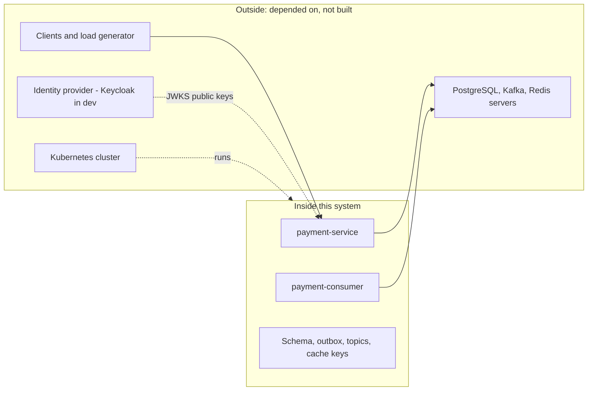

The system starts at the HTTP boundary of `payment-service` and ends at the rows it writes, the events it produces, and the audit rows the consumer writes. Token issuance, external money movement, reconciliation with banks, and fraud scoring are outside the boundary.

---

## Functional and Non-Functional Requirements

### Functional requirements

| ID | Requirement |
| --- | --- |
| F1 | Create an account owned by the authenticated subject, with currency and a zero opening balance |
| F2 | Retrieve account details and current balance **only for accounts the caller owns** |
| F3 | Transfer funds from an account the caller owns to another internal account |
| F4 | Retrieve payment status **only if the caller owns the source or destination account** |
| F5 | Authenticate with JWT; authorize with scopes **and** resource ownership |
| F6 | Create payments idempotently using `Idempotency-Key`, unique per authenticated subject |
| F7 | Persist a double-entry ledger for every successful transfer |
| F8 | Publish a payment event after the financial commit, without losing it on crash |
| F9 | Retry failed event processing and route exhausted failures to a DLQ |

### Non-functional requirements

Architectural goals and measured results are not the same thing.

| Area | Goal | How it is treated |
| --- | --- | --- |
| Financial correctness | No negative balances; balanced ledger on commit; no partial transfers | Row-level constraints, one transfer transaction, and tests. See [Ledger invariants](#ledger-invariants) |
| ACID | Each transfer attempt is one PostgreSQL transaction | Design requirement |
| Concurrency safety | Two competing debits cannot both succeed if funds are insufficient | Optimistic locking + conditional `UPDATE` |
| Idempotency | The same `(subject, idempotency_key)` cannot execute the financial effect twice | Unique insert serializes winners; losers replay in a new transaction |
| API security | Unauthenticated callers cannot move money; authenticated callers cannot use other people’s accounts | JWT resource server + ownership checks |
| Availability | Pod restart or Kafka outage must not corrupt money | Outbox leases + Kubernetes probes |
| Throughput / latency | 10K+ `POST /payments` per minute, **p95 < 200 ms on `POST /payments`**. GET traffic is extra and is not that 10K figure | **Target**, validated by k6 |
| Efficiency | ~40% p95 reduction on `POST /payments`, ~30% DB CPU reduction vs an unoptimized baseline | **Target**, A/B benchmark. Write-path indexes and HikariCP carry the POST p95/CPU targets; Redis absorbs additional GET load |
| Observability | Health, metrics, structured logs, correlation ids | Actuator + Prometheus |

---

## HLD and Architecture

### Problem statement

A payment API receives concurrent transfer requests, including retries after timeouts. The backend must:

1. Debit one account and credit another **exactly once per accepted payment**
2. Refuse transfers that would overspend an account, even when two requests race
3. Return a stable result when the client retries with the same idempotency key, including when two retries arrive at the same time
4. Emit a payment event for audit/downstream work **without coupling money movement to Kafka availability**

If the application published to Kafka after `COMMIT`, a crash in that window would silently drop the event. If it treated Kafka as the financial commit point, a broker outage would block transfers that PostgreSQL could have completed correctly. This design separates those concerns.

### Architecture diagram

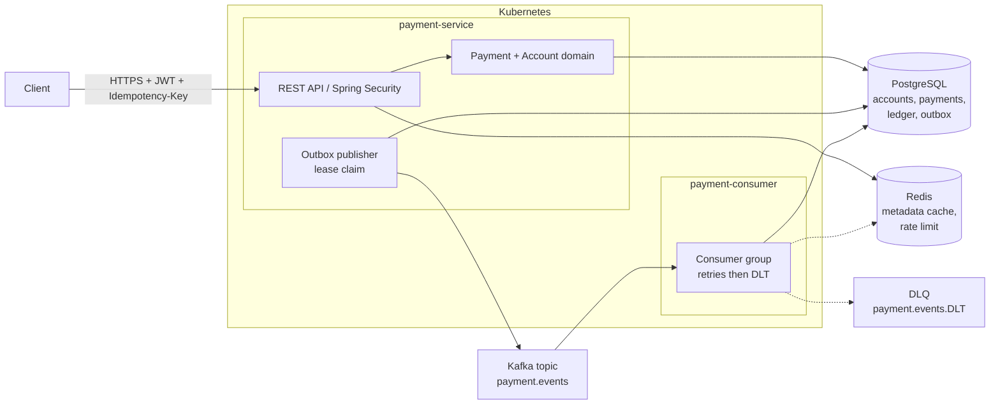

The solid `API → Redis` edge is post-commit cache invalidation and cache-aside reads. The dashed `Consumer -.-> Redis` edge is **supplemental** eviction after audit processing. It is not the consistency mechanism for GET responses.

### Why these components exist

| Component | Role |
| --- | --- |
| `payment-service` | Synchronous API, JWT validation, ownership checks, transfer transaction, idempotency, outbox writes, outbox publisher, primary Redis invalidation |
| PostgreSQL | Authoritative balances, payments, ledger, idempotency, outbox. Enforces row-level constraints and unique keys |
| Redis | Account-metadata / GET-balance cache and optional rate limiting. Not used to authorize debits |
| Kafka `payment.events` | Durable async fan-out after money has already moved |
| `payment-consumer` | Consumer group that writes an audit row and may evict Redis keys again |
| `payment.events.DLT` | Isolation for poison messages after retries are exhausted |
| Kubernetes | Process isolation, rolling restarts, and horizontal scale for API and consumer |

Account data lives **inside `payment-service`**, not in a third service. A separate account service with its own database would require a distributed transaction for every transfer. That is a correctness risk this project refuses.

### Component interaction (inside `payment-service`)

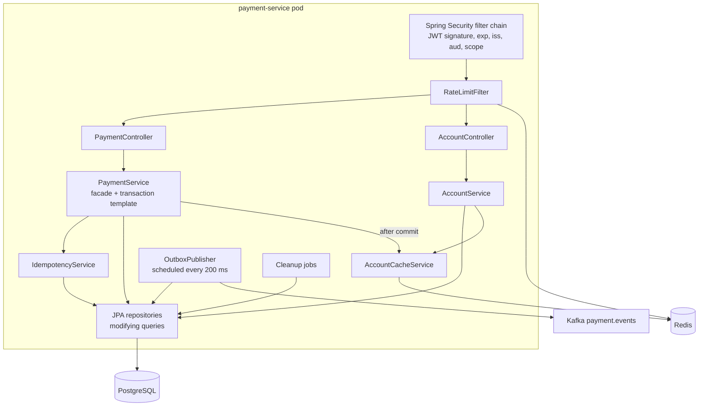

Controllers never open transactions. `PaymentService` is the only class that defines the money transaction boundary. `AccountCacheService` is called after commit for invalidation and by `AccountService` for cache-aside reads. `OutboxPublisher` and the cleanup jobs run on the Spring scheduler thread pool, not on request threads.

### Data-flow architecture

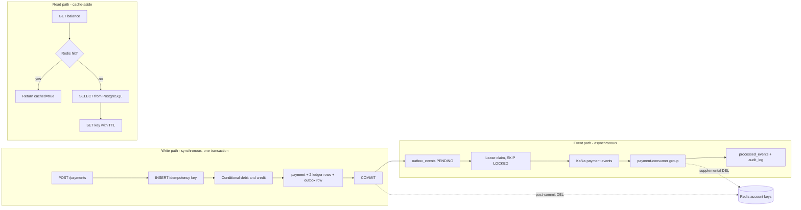

Money only flows through the write path. The event path reads committed facts and never changes balances. The read path never feeds back into the write path. That one-way flow is why Redis and Kafka failures cannot corrupt balances.

### Deployment architecture

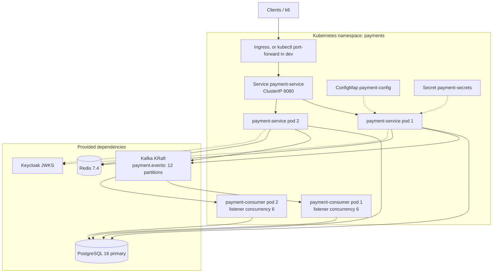

Both Deployments read the same ConfigMap and Secret; only one edge of each is drawn to keep the diagram readable. PostgreSQL, Kafka, and Redis are dependencies the cluster provides. The project does not ship operators for them.

---

## Component Responsibilities

### `payment-service`

- Validate JWT signatures, expiry, issuer, and audience
- Enforce scopes **and** account ownership
- Enforce rate limits (best-effort via Redis)
- Create accounts for `jwt.sub` with a zero opening balance
- Serve account and payment reads the caller is allowed to see
- Coordinate a transfer: unique `(subject, idempotency_key)` insert, ordered account updates, ledger insert, payment insert, outbox insert
- After a successful commit, best-effort `DEL` of the two accounts’ Redis keys
- Claim unpublished outbox rows with a lease and send them to Kafka
- Delete completed idempotency keys older than 24 hours
- Delete `PUBLISHED` outbox rows older than 7 days

### `payment-consumer`

- Belong to consumer group `payment-audit-consumers`
- Deduplicate on `eventId`
- Insert `audit_log` for each completed payment
- Best-effort Redis `DEL` for the two account keys (**supplemental**; not required for correctness)
- Retry transient failures; publish to the DLT after the retry budget
- Delete `processed_events` rows older than 14 days (`ProcessedEventCleanupJob`). That retention must stay longer than the 7-day `payment.events` topic retention so a redelivered or replayed event is still recognized as a duplicate

### PostgreSQL

Single source of truth for money. Row-level `CHECK`/`UNIQUE`/`FK` constraints live here. Cross-row ledger equality is **not** a `CHECK` constraint; it is guaranteed by the transfer transaction and verified by tests.

### Kafka

At-least-once delivery of already-committed payment facts. It does not create, confirm, or roll back money.

### Redis

Read acceleration and abuse control. The API remains financially correct if Redis is down. Cached balances may be stale for up to the 5-second TTL.

---

## End-to-End Payment Flow

### Successful transfer

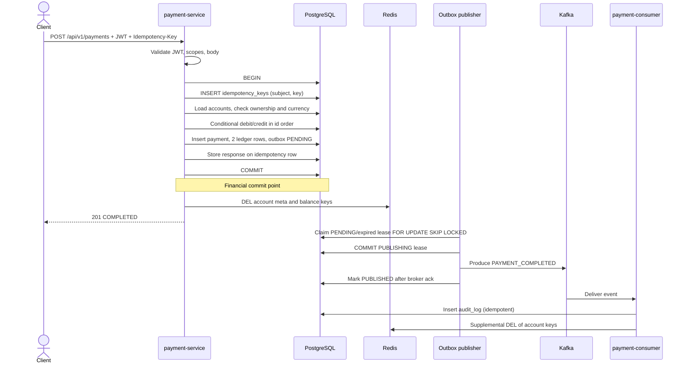

Two callers with the same subject and the same new idempotency key are not shown here. PostgreSQL unique-index locking on `(subject, idempotency_key)` allows only one of those inserts to proceed; the loser never debits. Details are in [Idempotency concurrency](#idempotency-concurrency).

### Synchronous vs asynchronous

| Step | Mode | Failure meaning |
| --- | --- | --- |
| Auth, scope, validation | Sync | Request fails; no money moved |
| Idempotency insert, ownership checks, account updates, ledger, payment, outbox insert | Sync, one DB transaction | Rollback; no money moved |
| HTTP response `201` / replay `200` | Sync, after commit | Client may retry; idempotency absorbs it |
| Redis `DEL` after commit | Sync, best-effort | Money already moved; GET may be stale until TTL |
| Outbox lease → Kafka | Async | Money already moved; event will be published later |
| Consumer audit / supplemental Redis `DEL` | Async | Money already moved; side effects catch up |

**Commit point:** the PostgreSQL `COMMIT` of the transfer transaction. Kafka is not in that path. Redis is not in that path.

### Alternative flows

#### A1. Two concurrent requests with the same subject and idempotency key

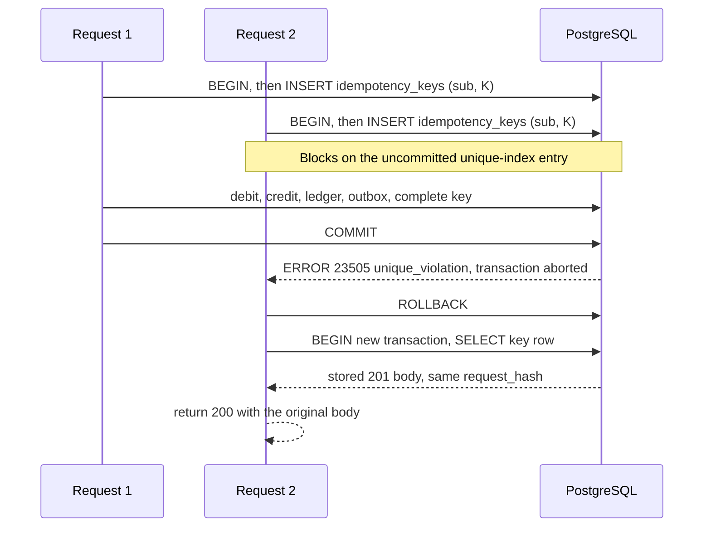

If Request 1 had rolled back instead, Request 2's blocked `INSERT` would succeed and Request 2 would perform the transfer. In both outcomes exactly one session runs the debit.

#### A2. Two different payments race for the same balance

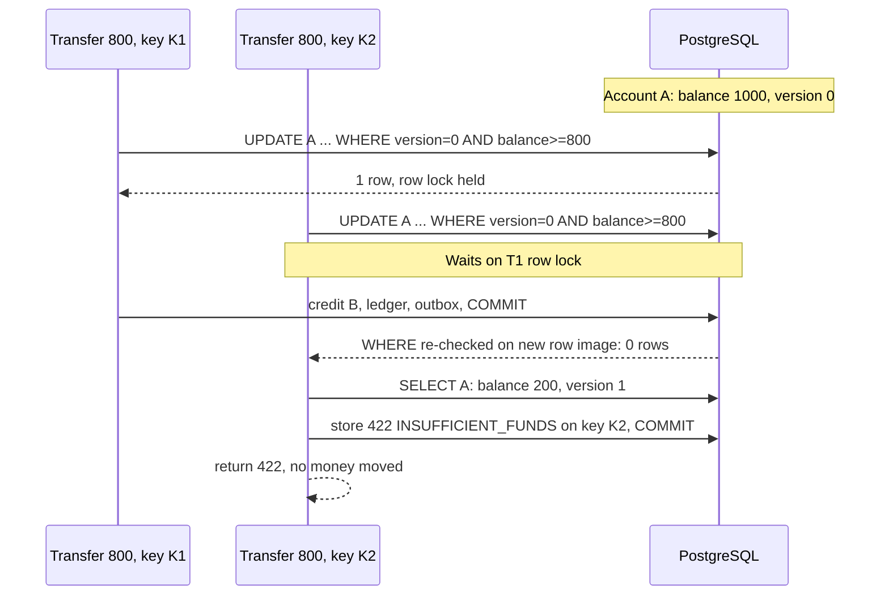

#### A3. Crash after commit, before the HTTP response

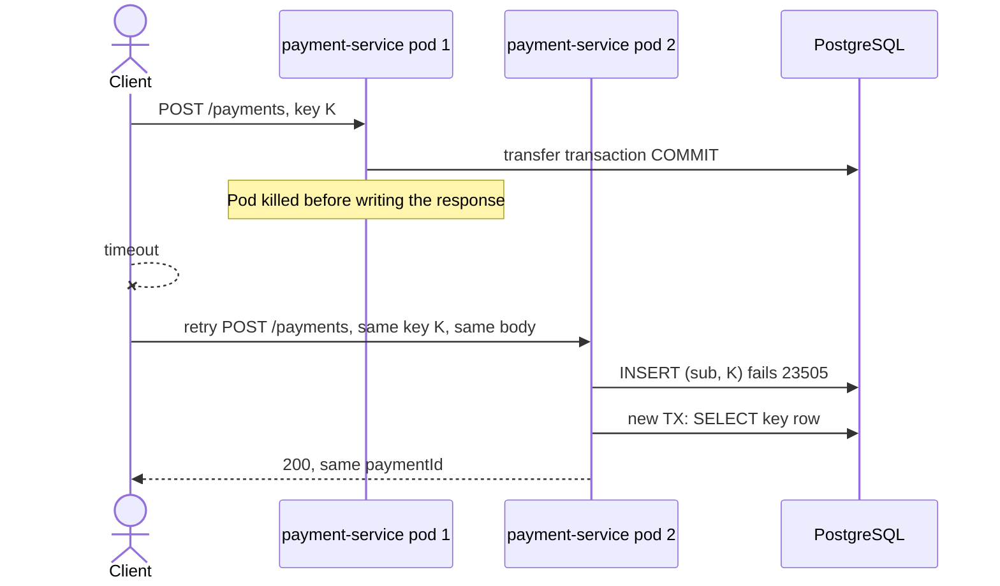

The outbox row was committed with the money, so the event is still published by whichever pod's publisher claims it next.

#### A4. Kafka unavailable after commit

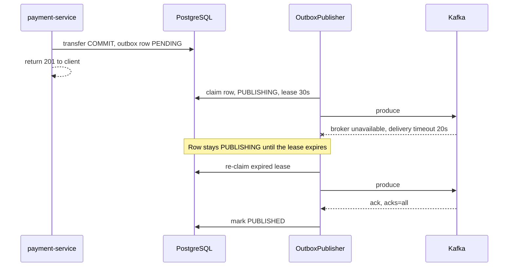

#### A5. Consumer failure, retries, and DLT

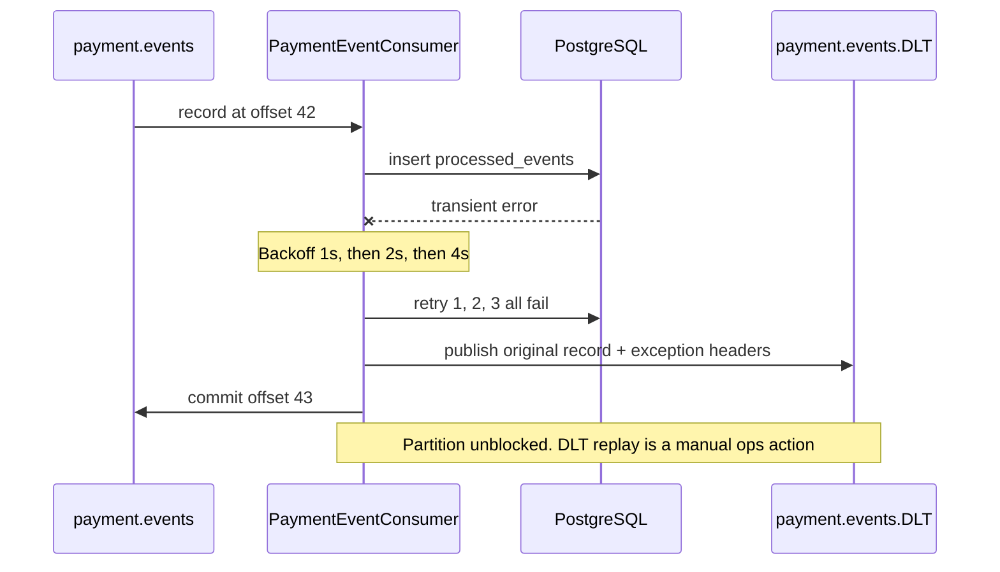

#### A6. Deadlock or version conflict, bounded retry

1. Attempt 1 hits `40P01` (deadlock) or a `0`-row update whose reload shows the funds are still sufficient but `version` changed.
2. The whole transaction rolls back, **including the idempotency insert**.
3. The facade sleeps a short jittered backoff (10–50 ms) and starts attempt 2 in a new transaction with freshly loaded versions.
4. After 3 failed attempts the API returns `409 CONCURRENT_UPDATE` with `retriable: true`. The idempotency key was never committed, so a client retry with the same key is a new attempt, not a replay.

---

## Architecture Decisions and Trade-offs

| Decision | Selected approach | Alternative | Reason | Trade-off |
| --- | --- | --- | --- | --- |
| Language and framework | Java 21 + Spring Boot | A from-scratch Netty service | Mature JDBC/JPA transactions, Spring Kafka, resource-server security, and a stack interviewers can inspect quickly. Netty would spend the project on plumbing instead of payment correctness | JVM memory footprint and warm-up; `@Transactional` is proxy-based and must be understood (self-invocation pitfall, see LLD) |
| Source of truth | PostgreSQL | Redis as a ledger | ACID, constraints, `BIGINT` money, row-level concurrency. Redis cannot provide durable multi-row atomic transfers without reinventing a database | One primary is the write-scaling ceiling; no horizontal write scale-out |
| Async events | Kafka | Processing audit inside the request | Decouples audit/cache work from the transfer hot path and survives consumer downtime. Inline audit lengthens p95 and couples API availability to side effects | Audit is eventually consistent; a broker must be operated |
| Cache | Redis as optional cache, fail-open | Balances in Redis for debit authorization | Low-latency account metadata and GET-balance reads. Redis-authorized debits would make Redis a financial system of record | GET balance may be stale for up to the 5-second TTL |
| Duplicate and race protection | Idempotency keys **and** optimistic locking | Only one of them | Idempotency stops duplicate *retries of one payment*; locking stops *two different payments* from overspending. Using only one leaves either double-posts or lost-update races | Two mechanisms to implement and test |
| Idempotency lock | Unique insert as the lock, in the money transaction | Redis `SETNX` lock, or a separately committed "reserve" row | Only the transaction that inserted `(subject, key)` may debit. Redis locks or a committed reserve row leave an in-flight window where two workers could both process | A blocked duplicate holds a DB connection while it waits |
| Service split | Two Spring Boot services, **one shared PostgreSQL** | A separate Account Service with its own DB | The consumer writes only `audit_log` / `processed_events`. Financial rows stay in `payment-service`, which avoids 2PC. A separate account database would need 2PC or dual writes of money. If `payment-consumer` later needs its own database, it stops using this JDBC URL and persists audit rows from Kafka into its own store; `payment-service` remains the only writer of accounts, payments, ledger, and outbox | Sharing a database is a known microservices anti-pattern; accepted because the consumer is not a second owner of balances and the project is sized for one engineer |
| Deployment | Kubernetes Deployments | Docker Compose only; a service mesh | Rolling updates, probes, and independent replica counts for API vs consumer. Compose alone cannot show the resume's deployment claim; a mesh would be theater | Kubernetes YAML and probe tuning to maintain |
| Isolation level | `READ COMMITTED` + conditional `UPDATE` | `SERIALIZABLE` | The conditional `UPDATE` re-checks its predicate after a lock wait, which is exactly the protection needed. `SERIALIZABLE` would add SSI tracking overhead and `40001` failures across all transactions | The application must classify `0`-row results (insufficient funds vs version conflict) |
| Outbox relay | Polling publisher with lease claim | Debezium CDC; `@TransactionalEventListener(AFTER_COMMIT)` | No extra infrastructure; `AFTER_COMMIT` loses events on crash | ~200 ms extra event latency; poll queries cost some DB CPU |
| Kafka partition key | `sourceAccountId` | `paymentId` or no key | Events for one source account stay ordered on one partition | A very hot account creates a hot partition |
| Consumer retries | In-process `DefaultErrorHandler` with backoff, then DLT | Non-blocking retry topics | One topic plus one DLT; simple to reason about | A failing record blocks its partition for up to ~7 s of backoff |

---

## LLD and Package Structure

```text
payment-platform/
├── pom.xml
├── payment-service/
│   ├── pom.xml
│   └── src/
│       ├── main/java/com/payments/platform/payment/
│       │   ├── PaymentServiceApplication.java
│       │   ├── api/
│       │   │   ├── AccountController.java
│       │   │   ├── PaymentController.java
│       │   │   └── dto/
│       │   │       ├── CreateAccountRequest.java
│       │   │       ├── AccountResponse.java
│       │   │       ├── CreatePaymentRequest.java
│       │   │       ├── PaymentResponse.java
│       │   │       └── ErrorResponse.java
│       │   ├── domain/
│       │   │   ├── AccountService.java
│       │   │   ├── PaymentService.java
│       │   │   ├── IdempotencyService.java
│       │   │   └── model/
│       │   │       ├── Account.java
│       │   │       ├── Payment.java
│       │   │       ├── LedgerEntry.java
│       │   │       ├── IdempotencyRecord.java
│       │   │       └── OutboxEvent.java
│       │   ├── persistence/
│       │   │   ├── AccountRepository.java
│       │   │   ├── PaymentRepository.java
│       │   │   ├── LedgerEntryRepository.java
│       │   │   ├── IdempotencyRepository.java
│       │   │   └── OutboxEventRepository.java
│       │   ├── kafka/
│       │   │   ├── PaymentEvent.java
│       │   │   └── OutboxPublisher.java
│       │   ├── jobs/
│       │   │   ├── IdempotencyCleanupJob.java
│       │   │   └── OutboxCleanupJob.java
│       │   ├── security/
│       │   │   └── SecurityConfig.java
│       │   ├── redis/
│       │   │   ├── AccountCacheService.java
│       │   │   └── RateLimitFilter.java
│       │   ├── config/
│       │   │   ├── KafkaProducerConfig.java
│       │   │   ├── RedisConfig.java
│       │   │   └── JacksonConfig.java
│       │   └── exception/
│       │       ├── ApiException.java
│       │       └── GlobalExceptionHandler.java
│       └── test/java/com/payments/platform/payment/
│           ├── api/PaymentControllerIT.java
│           ├── domain/PaymentServiceConcurrencyTest.java
│           ├── domain/IdempotencyServiceTest.java
│           └── kafka/OutboxPublisherIT.java
├── payment-consumer/
│   ├── pom.xml
│   └── src/
│       ├── main/java/com/payments/platform/consumer/
│       │   ├── PaymentConsumerApplication.java
│       │   ├── kafka/
│       │   │   ├── PaymentEventConsumer.java
│       │   │   └── ConsumerKafkaConfig.java
│       │   ├── domain/
│       │   │   ├── AuditService.java
│       │   │   └── ProcessedEvent.java
│       │   ├── persistence/
│       │   │   ├── AuditLogRepository.java
│       │   │   └── ProcessedEventRepository.java
│       │   ├── jobs/
│       │   │   └── ProcessedEventCleanupJob.java
│       │   └── config/
│       └── test/java/...
├── docker/
│   ├── docker-compose.yml
│   ├── payment-service.Dockerfile
│   └── payment-consumer.Dockerfile
├── k8s/
│   ├── namespace.yaml
│   ├── payment-service-deployment.yaml
│   ├── payment-consumer-deployment.yaml
│   ├── services.yaml
│   └── config.yaml
├── load-tests/
│   └── payments.js
└── README.md
```

Parent POM manages Java 21, Spring Boot 3.4.x, Spring Kafka, Testcontainers, and plugin versions. Each service is a bootable module. This tree is the intended layout of the project; this repository currently documents the design in this README.

### Primary classes

**`PaymentController`**  
Thin HTTP adapter. Reads `Idempotency-Key`, passes `jwt.getSubject()`, maps DTOs, does not open transactions.

```java
@PostMapping("/api/v1/payments")
ResponseEntity<PaymentResponse> createPayment(
    @RequestHeader("Idempotency-Key") String idempotencyKey,
    @Valid @RequestBody CreatePaymentRequest request,
    JwtAuthenticationToken principal);

@GetMapping("/api/v1/payments/{paymentId}")
PaymentResponse getPayment(@PathVariable UUID paymentId, JwtAuthenticationToken principal);
```

**`AccountController`**  
Account create and read. `ownerId` is taken from `jwt.sub`, not from the client body. Balance reads may use Redis as a short-TTL cache and always fall back to PostgreSQL. Ownership is enforced before a cached or database value is returned.

**`PaymentService`**  
Owns the transfer use case. A non-transactional facade catches unique-constraint failures; the financial work runs in a separate transaction method.

```java
public PaymentResponse transfer(String idempotencyKey, CreatePaymentRequest request, String subject);

@Transactional
PaymentResponse executeNew(String idempotencyKey, String requestHash,
                           CreatePaymentRequest request, String subject);

@Transactional
PaymentResponse replay(String idempotencyKey, String requestHash, String subject);
```

**Implementation note (Spring proxy pitfall).** `@Transactional` is applied by a Spring AOP proxy. If `transfer` calls `executeNew` on `this`, the call bypasses the proxy and **no transaction is started**. The signatures above show the logical transaction boundaries; the implementation runs `executeNew` and `replay` through a `TransactionTemplate` inside the facade (or, equivalently, moves them to a separate bean). `TransactionTemplate` also exposes `TransactionStatus.createSavepoint()` / `rollbackToSavepoint()`, which the terminal-failure path below needs. Because Hibernate does not roll back managed-entity state on a savepoint rollback, all account mutations use the explicit modifying queries shown below, not dirty-checked entities.

`executeNew` behavior:

1. Reject same-account, non-positive amount, missing or malformed key, and an unsupported currency code **before** any database work. These are `400`s and are not stored
2. `INSERT` `(subject, idempotency_key, request_hash)` in this transaction. That insert is the mutex. Do not debit unless this insert succeeded here
3. Load both accounts. Require the caller to own the source. Require both accounts `ACTIVE` and the same currency as the request. An unknown account (`404`) or a source the caller does not own (`403`) **rolls back the whole transaction**, so no idempotency row is stored for requests that were never authorized. Inactive accounts and currency mismatch are terminal business failures and are stored on the idempotency row (see below)
4. Sort the two account ids and apply the [concurrency algorithm](#concurrency-algorithm)
5. Insert `payments`, two `ledger_entries` with equal `amount_minor` and `currency`, and one `outbox_events` row
6. Write `http_status`, `response_body`, and `completed_at` on the idempotency row
7. Commit, then best-effort Redis `DEL`, then return `201 COMPLETED`

If `executeNew` fails with PostgreSQL `23505` / `DataIntegrityViolationException`, the current transaction is aborted. The facade **must not** continue that session. It opens `replay` in a **new** transaction.

**`AccountService`**  
Account lifecycle and cache-aside reads. It does **not** expose a public “set balance” API. Balance changes only happen inside `PaymentService.executeNew`. Create-account sets `owner_id = subject` and `balance_minor = 0`.

**`IdempotencyService`**  
Database-backed, not Redis-backed. Keys are scoped to `jwt.sub`.

```java
void insertKey(String subject, String key, String requestHash);           // INSERT; unique violation aborts the TX
Optional<IdempotencyRecord> find(String subject, String key);             // SELECT in a fresh TX
void complete(String subject, String key, int httpStatus, Object body);   // same TX as the financial outcome
```

There is no separately committed “reserve” step. An uncommitted insert is the in-flight lock. A committed row always has a stored HTTP outcome. Two different subjects may reuse the same `Idempotency-Key` header value; they are different rows.

**`IdempotencyCleanupJob`**  
`@Scheduled` job on `payment-service`. Deletes rows with `completed_at` older than 24 hours. After expiry, the same subject may reuse the same key for a new payment.

**`AccountRepository` / `PaymentRepository`**  
Spring Data JPA plus explicit modifying queries:

```java
@Modifying
@Query("""
    update Account a
       set a.balanceMinor = a.balanceMinor - :amount,
           a.version = a.version + 1,
           a.updatedAt = CURRENT_TIMESTAMP
     where a.id = :id
       and a.version = :version
       and a.status = 'ACTIVE'
       and a.balanceMinor >= :amount
    """)
int debitIfSufficient(UUID id, long version, long amount);

@Modifying
@Query("""
    update Account a
       set a.balanceMinor = a.balanceMinor + :amount,
           a.version = a.version + 1,
           a.updatedAt = CURRENT_TIMESTAMP
     where a.id = :id
       and a.version = :version
       and a.status = 'ACTIVE'
    """)
int creditIfActive(UUID id, long version, long amount);
```

**`OutboxPublisher`**  
`@Scheduled` poller on each `payment-service` replica. It **claims** a batch with a lease (`PENDING` or expired `PUBLISHING`) using `FOR UPDATE SKIP LOCKED`, commits the claim, produces to Kafka, and marks `PUBLISHED` only after broker acknowledgement. See [Outbox publisher concurrency](#outbox-publisher-concurrency).

**`OutboxCleanupJob`**  
`@Scheduled` job on `payment-service`. Deletes `PUBLISHED` outbox rows with `published_at` older than 7 days. Does not delete `PENDING` or `PUBLISHING` rows.

**`PaymentEventConsumer`**  
Spring Kafka `@KafkaListener` on `payment.events`. Inserts `processed_events(event_id)` and `audit_log(payment_id)`. Duplicate `event_id` is treated as success so the offset can advance. Redis `DEL` after that insert is best-effort.

**`GlobalExceptionHandler`**  
Maps domain exceptions to the error model in [Error handling](#error-handling-and-failure-recovery).

### Class diagram

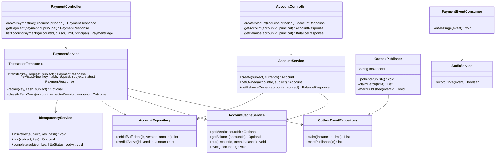

### Facade and transaction pseudocode

```java
public PaymentResponse transfer(String key, CreatePaymentRequest req, String subject) {
    validateShape(key, req);                                  // 400s; no DB work
    String hash = RequestHasher.sha256(canonical(req));       // source, dest, amount, currency, description
    boolean replayMissRetried = false;

    for (int attempt = 1; attempt <= 3; attempt++) {
        try {
            return tx.execute(status -> executeNew(key, hash, req, subject, status));
        } catch (DataIntegrityViolationException e) {
            if (!isIdempotencyPkViolation(e)) throw e;        // 23505 on (subject, idempotency_key)
            // The aborted session is gone; read in a NEW transaction.
            Optional<StoredOutcome> stored = readOnlyTx.execute(s -> idempotency.find(subject, key));
            if (stored.isPresent()) {
                if (!stored.get().requestHash().equals(hash)) throw ApiException.conflict(IDEMPOTENCY_KEY_REUSED);
                return stored.get().replayAs200();            // 201 body replayed as 200, or stored 422
            }
            if (replayMissRetried) throw ApiException.conflict(CONCURRENT_UPDATE);
            replayMissRetried = true;                         // winner rolled back; try executeNew once more
            attempt--;
        } catch (VersionConflictException | PessimisticLockingFailureException e) {
            // version conflict, 40P01 deadlock, 40001 serialization: whole TX already rolled back
            sleepJitter(10, 50);
        }
    }
    throw ApiException.conflict(CONCURRENT_UPDATE);           // 409, retriable=true
}

private PaymentResponse executeNew(String key, String hash, CreatePaymentRequest req,
                                   String subject, TransactionStatus status) {
    idempotency.insertKey(subject, key, hash);                // blocks on a concurrent same-key insert
    Object sp = status.createSavepoint();

    Account src = accounts.findById(req.sourceAccountId()).orElseThrow(ApiException::notFound);
    Account dst = accounts.findById(req.destinationAccountId()).orElseThrow(ApiException::notFound);
    if (!src.ownerId().equals(subject)) throw ApiException.accessDenied();   // full rollback

    Optional<ApiError> terminal = precheck(src, dst, req);    // inactive, currency mismatch, snapshot balance < amount
    if (terminal.isEmpty()) terminal = applyInIdOrder(src, dst, req.amountMinor(), status, sp);
    if (terminal.isPresent()) {
        idempotency.complete(subject, key, terminal.get().httpStatus(), terminal.get().body());
        return terminal.get().asResponse();                   // COMMIT: key + stored error, no money moved
    }

    Payment p = payments.insertCompleted(req, subject);
    ledger.insert(p.id(), src.id(), DEBIT,  req.amountMinor(), req.currency());
    ledger.insert(p.id(), dst.id(), CREDIT, req.amountMinor(), req.currency());
    outbox.insertPending(UUID.randomUUID(), p.id(), "PAYMENT_COMPLETED", PaymentEvent.from(p));
    PaymentResponse body = PaymentResponse.from(p);
    idempotency.complete(subject, key, 201, body);
    TransactionSynchronizationManager.registerSynchronization(
        afterCommit(() -> cache.evict(List.of(src.id(), dst.id()))));
    return body;
}
```

`applyInIdOrder` runs `debitIfSufficient` / `creditIfActive` in ascending account-id order and applies the 0-row classification from [Concurrency algorithm](#concurrency-algorithm). It throws `VersionConflictException` for retryable outcomes and returns a terminal `ApiError` after `rollbackToSavepoint(sp)` for business failures.

### Threading model

| Thread pool | Owner | Size (starting point) | Work | Blocking? |
| --- | --- | --- | --- | --- |
| Tomcat request threads | `payment-service` | default 200 max | Filter chain, controller, transfer transaction | Yes: JDBC and Redis calls |
| HikariCP connections | `payment-service` | `maximum-pool-size: 20` per pod | Bounds concurrent transactions | A request waits up to `connection-timeout: 2s`, then `503` |
| Scheduler | `payment-service` | `spring.task.scheduling.pool.size: 2` | `OutboxPublisher` every 200 ms, cleanup jobs | Uses a pooled connection briefly |
| Kafka producer I/O thread | `payment-service` | 1 per producer | Batches and sends records asynchronously | No; the publisher waits on send futures per batch |
| Kafka listener threads | `payment-consumer` | `concurrency: 6` per pod | One `KafkaConsumer` per thread; each owns its partitions | Yes: JDBC insert per record |

Key consequences:

- **The Hikari pool, not Tomcat, is the real concurrency limit for writes.** Two pods × 20 connections = at most 40 transfer transactions in flight. Extra requests queue on the pool.
- **Little's law sizes the pool (ILLUSTRATIVE).** At 167 transfers/s and ~15–40 ms of connection hold time per transfer, the average number of busy connections is `167 × 0.015…0.040 ≈ 2.5…6.7` cluster-wide. A pool of 5 per pod handles the average, but Poisson bursts plus uncached GET traffic on the same pool push utilization high enough for queueing delay to dominate p95. That is the mechanism behind the HikariCP lever in the benchmark.
- **`KafkaConsumer` is not thread-safe.** Spring's `ConcurrentMessageListenerContainer` gives each thread its own consumer, which is why listener concurrency must not exceed the partition count.
- **Virtual threads (Java 21) are optional.** `spring.threads.virtual.enabled=true` removes the Tomcat thread ceiling but does not change the database limit; the pool still caps concurrent transactions.

### Design patterns used

| Pattern | Where | Why |
| --- | --- | --- |
| Facade | `PaymentService.transfer` | Hides retry, replay, and transaction plumbing from the controller |
| Template method | `TransactionTemplate` | Programmatic transaction and savepoint control without the self-invocation trap |
| Repository | Spring Data repositories | Persistence isolated from domain logic |
| Transactional outbox | `outbox_events` + `OutboxPublisher` | Atomic "state change + event intent" without 2PC |
| Idempotent receiver | `PaymentEventConsumer` | Safe under at-least-once delivery |
| Cache-aside | `AccountCacheService` | Cache filled on read miss; DB remains the authority |
| Chain of responsibility | Security filter chain + `RateLimitFilter` | Cross-cutting checks before controllers |
| DTO | `api/dto` | API contract decoupled from JPA entities |

---

## API Documentation

Base path: `/api/v1`  
Auth: `Authorization: Bearer <jwt>` on every endpoint  
Content type: `application/json`

Scopes grant a **capability**. They do not mean “this caller may touch every account.”

| Scope | Capability |
| --- | --- |
| `payments.write` | Create an account for `sub`; create a transfer **from an account owned by `sub`** |
| `payments.read` | Read accounts and payments **the caller is a party to** |

`sub` is mapped to `accounts.owner_id` and `payments.created_by`.

### Create account

`POST /api/v1/accounts`

```json
{
  "currency": "USD"
}
```

```json
{
  "accountId": "2f1c0a3e-6b1a-4d2e-9c41-1c8f7a0b9d11",
  "ownerId": "user-123",
  "currency": "USD",
  "balanceMinor": 0,
  "status": "ACTIVE",
  "version": 0,
  "createdAt": "2026-05-12T10:15:30Z"
}
```

| Item | Rule |
| --- | --- |
| Auth | `payments.write` |
| Owner | `owner_id` is `jwt.sub`. The body does not accept `ownerId` |
| Opening balance | Always `0`. The public API cannot mint funds |
| Success | `201 Created` |
| Validation | `currency` is ISO-4217 |
| Errors | `400`, `401`, `403` (missing scope) |

Non-zero balances used in examples and load tests are **seeded with SQL** (or a test fixture), not by this endpoint.

### Get account / balance

`GET /api/v1/accounts/{accountId}`  
`GET /api/v1/accounts/{accountId}/balance`

Balance response:

```json
{
  "accountId": "2f1c0a3e-6b1a-4d2e-9c41-1c8f7a0b9d11",
  "currency": "USD",
  "balanceMinor": 20000,
  "asOf": "2026-05-12T10:16:01Z",
  "cached": false
}
```

| Item | Rule |
| --- | --- |
| Auth | `payments.read` **and** `accounts.owner_id = jwt.sub` |
| Success | `200 OK` |
| Errors | `401`; `403` missing scope; `403 ACCOUNT_ACCESS_DENIED` if the account exists but is not owned by `sub`; `404` if the account does not exist |
| Caching | Metadata TTL 60s; balance TTL 5s. `cached: true` if served from Redis. Ownership is checked against PostgreSQL (or against cached metadata that itself was loaded under that owner). Never used to authorize a debit |

A caller with `payments.read` cannot read arbitrary accounts.

### Create transfer

`POST /api/v1/payments`  
Required header: `Idempotency-Key: <client-generated-string, 16–128 chars>`

```json
{
  "sourceAccountId": "2f1c0a3e-6b1a-4d2e-9c41-1c8f7a0b9d11",
  "destinationAccountId": "9a44b2c1-0d77-4e18-b8aa-55c1d2e3f4a5",
  "amountMinor": 80000,
  "currency": "USD",
  "description": "invoice-4412"
}
```

```json
{
  "paymentId": "c7e2d1a0-1111-4b2c-8d3e-777777777777",
  "status": "COMPLETED",
  "sourceAccountId": "2f1c0a3e-6b1a-4d2e-9c41-1c8f7a0b9d11",
  "destinationAccountId": "9a44b2c1-0d77-4e18-b8aa-55c1d2e3f4a5",
  "amountMinor": 80000,
  "currency": "USD",
  "description": "invoice-4412",
  "createdAt": "2026-05-12T10:16:05Z"
}
```

| Status | When |
| --- | --- |
| `201 Created` | First successful processing of this `(subject, key)` |
| `200 OK` | Same subject, same key, **and** same canonical request hash; original body is replayed |
| `400` | Validation failure (missing fields, amount ≤ 0, bad UUID, missing idempotency key, source equals destination) |
| `401` / `403` | Missing/invalid JWT, missing scope, or `ACCOUNT_ACCESS_DENIED` (caller does not own the source) |
| `404` | Unknown source or destination account |
| `409 IDEMPOTENCY_KEY_REUSED` | Same subject and key with a **different** request hash |
| `422 Unprocessable Entity` | Insufficient funds, frozen/closed account, currency mismatch |
| `409 CONCURRENT_UPDATE` | Optimistic-lock / deadlock retries exhausted |
| `429` | Rate limited |
| `503` | Database unavailable |

Authorization: the caller must own the **source** account. The destination may belong to another user (that is the point of a transfer). Owning the destination does not allow debiting it.

Failed first attempts that are **terminal** (insufficient funds, inactive account, currency mismatch after the key was inserted) commit the idempotency row with the error body and **do not** write `payments`, ledger rows, or outbox rows. A retry with the same subject and key returns that stored error and does not attempt a second debit.

Version conflicts and deadlocks **roll back**, including the idempotency insert, so a client retry with the same subject and key is a new attempt.

### Get payment status

`GET /api/v1/payments/{paymentId}`

| Item | Rule |
| --- | --- |
| Auth | `payments.read` **and** the caller owns the source account or the destination account |
| Success | `200` with the payment body above |
| Errors | `401`; `403` missing scope; `403 ACCOUNT_ACCESS_DENIED` if the payment exists but the caller is not a party; `404` if the payment does not exist |

There is no `PENDING` financial state for a successful API transfer. If the HTTP call returned `201`, PostgreSQL has committed. Downstream Kafka processing is not reflected as payment status.

### List payments for an account (keyset pagination)

`GET /api/v1/accounts/{accountId}/payments?direction=ALL&limit=20&cursor=<opaque>`

This endpoint is the reader for the `idx_payments_source_created` and `idx_payments_dest_created` indexes.

| Item | Rule |
| --- | --- |
| Auth | `payments.read` **and** `accounts.owner_id = jwt.sub` |
| `direction` | `OUTGOING`, `INCOMING`, or `ALL` (default) |
| `limit` | 1–100, default 20 |
| `cursor` | Opaque base64url of `(created_at, id)` of the last item on the previous page; omitted for the first page |
| Success | `200` with `items` (newest first) and `nextCursor` (`null` on the last page) |
| Errors | `400` bad cursor or limit; `401`; `403`; `404` unknown account |
| Caching | Not cached; history is read from PostgreSQL |

```json
{
  "items": [
    {
      "paymentId": "c7e2d1a0-1111-4b2c-8d3e-777777777777",
      "status": "COMPLETED",
      "sourceAccountId": "2f1c0a3e-6b1a-4d2e-9c41-1c8f7a0b9d11",
      "destinationAccountId": "9a44b2c1-0d77-4e18-b8aa-55c1d2e3f4a5",
      "amountMinor": 80000,
      "currency": "USD",
      "createdAt": "2026-05-12T10:16:05Z"
    }
  ],
  "nextCursor": "MjAyNi0wNS0xMlQxMDoxNjowNVp8YzdlMmQxYTA"
}
```

Keyset pagination (`WHERE (created_at, id) < (:cursorTs, :cursorId) ORDER BY created_at DESC, id DESC LIMIT :limit + 1`) costs `O(log n + limit)` per page regardless of depth. `OFFSET` pagination would scan and discard every skipped row and returns duplicates or gaps when new payments are inserted between page requests. The query is in [Query patterns and indexes](#query-patterns-and-indexes).

### Common headers, rate limits, and timeouts

| Header | Direction | Rule |
| --- | --- | --- |
| `Authorization: Bearer <jwt>` | Request | Required on every endpoint |
| `Idempotency-Key` | Request | Required on `POST /payments`; 16–128 chars, client-generated (UUIDv4 recommended) |
| `Content-Type: application/json` | Request | Required on POST |
| `X-Correlation-Id` | Both | Optional on request; generated if absent; always echoed on the response and written to logs |
| `Retry-After` | Response | Sent with `429` and `503` |
| `X-RateLimit-Limit` / `X-RateLimit-Remaining` | Response | Sent when the Redis limiter is active |

**Rate limits.** The limiter is per `jwt.sub`, default 600 requests/min across all endpoints (configurable; raised for load tests). It is best-effort and fails open when Redis is down. It protects PostgreSQL from one abusive subject; it is not a security boundary.

**Timeouts.**

| Timeout | Value (starting point) | Effect when exceeded |
| --- | --- | --- |
| HikariCP `connection-timeout` | 2 s | `503 DATABASE_UNAVAILABLE`, `retriable: true` |
| PostgreSQL `lock_timeout` (set per transfer transaction) | 1 s | SQLSTATE `55P03`; treated like a version conflict: rollback and bounded retry, then `409 CONCURRENT_UPDATE` |
| PostgreSQL `statement_timeout` | 2 s | Rollback; `503` |
| Redis command timeout | 50 ms | Fail open: cache miss, limiter skipped, `DEL` skipped |
| Kafka producer `delivery.timeout.ms` | 20 s | Outbox row stays `PUBLISHING`; lease (30 s) is deliberately longer so a slow send finishes before another publisher can reclaim |
| Recommended client timeout | ≥ 3 s, retry with the **same** `Idempotency-Key` and exponential backoff | Safe because of idempotency |

### What happens internally per endpoint

| Endpoint | Internal steps |
| --- | --- |
| `POST /accounts` | JWT + scope → insert `accounts` with `owner_id = sub`, balance 0, version 0 → `201` |
| `GET /accounts/{id}` | JWT + scope → Redis `account:meta:{id}` → on miss `SELECT` by PK and `SET` 60 s → ownership check → `200` |
| `GET /accounts/{id}/balance` | Same as above with `account:balance:{id}` (5 s TTL); `cached` flag reflects the source |
| `POST /payments` | Rate limit → JWT + scope → validation → hash → transfer transaction (see LLD) → post-commit `DEL` → `201`/`200`/error |
| `GET /payments/{id}` | JWT + scope → `SELECT` payment by PK → party check against both accounts' `owner_id` → `200` |
| `GET /accounts/{id}/payments` | JWT + scope → ownership check → keyset query on the history indexes → `200` |

---

## Database Schema and Invariants

Monetary columns are `BIGINT` minor units. Never `FLOAT`, `REAL`, or `DOUBLE PRECISION`.

```sql
CREATE TABLE accounts (
    id              UUID PRIMARY KEY,
    owner_id        VARCHAR(64)  NOT NULL,
    currency        CHAR(3)      NOT NULL,
    balance_minor   BIGINT       NOT NULL,
    version         BIGINT       NOT NULL DEFAULT 0,
    status          VARCHAR(16)  NOT NULL,
    created_at      TIMESTAMPTZ  NOT NULL,
    updated_at      TIMESTAMPTZ  NOT NULL,
    CONSTRAINT chk_accounts_balance_non_negative CHECK (balance_minor >= 0),
    CONSTRAINT chk_accounts_status CHECK (status IN ('ACTIVE', 'FROZEN', 'CLOSED'))
);

CREATE INDEX idx_accounts_owner_id ON accounts (owner_id);

CREATE TABLE payments (
    id                      UUID PRIMARY KEY,
    source_account_id       UUID         NOT NULL REFERENCES accounts (id),
    destination_account_id  UUID         NOT NULL REFERENCES accounts (id),
    amount_minor            BIGINT       NOT NULL,
    currency                CHAR(3)      NOT NULL,
    status                  VARCHAR(16)  NOT NULL,
    description             VARCHAR(255),
    created_by              VARCHAR(64)  NOT NULL,
    created_at              TIMESTAMPTZ  NOT NULL,
    CONSTRAINT chk_payments_positive_amount CHECK (amount_minor > 0),
    CONSTRAINT chk_payments_status CHECK (status IN ('COMPLETED')),
    CONSTRAINT chk_payments_distinct_accounts
        CHECK (source_account_id <> destination_account_id)
);

-- id is the keyset tie-breaker for payments created in the same microsecond
CREATE INDEX idx_payments_source_created
    ON payments (source_account_id, created_at DESC, id DESC);
CREATE INDEX idx_payments_dest_created
    ON payments (destination_account_id, created_at DESC, id DESC);

CREATE TABLE ledger_entries (
    id            UUID PRIMARY KEY,
    payment_id    UUID        NOT NULL REFERENCES payments (id),
    account_id    UUID        NOT NULL REFERENCES accounts (id),
    entry_type    VARCHAR(8)  NOT NULL,
    amount_minor  BIGINT      NOT NULL,
    currency      CHAR(3)     NOT NULL,
    created_at    TIMESTAMPTZ NOT NULL,
    CONSTRAINT chk_ledger_type CHECK (entry_type IN ('DEBIT', 'CREDIT')),
    CONSTRAINT chk_ledger_positive CHECK (amount_minor > 0)
);

CREATE UNIQUE INDEX uq_ledger_payment_entry_type
    ON ledger_entries (payment_id, entry_type);
CREATE INDEX idx_ledger_account_created
    ON ledger_entries (account_id, created_at DESC);

CREATE TABLE idempotency_keys (
    subject          VARCHAR(64)  NOT NULL,
    idempotency_key  VARCHAR(128) NOT NULL,
    request_hash     CHAR(64)     NOT NULL,
    payment_id       UUID         REFERENCES payments (id),
    http_status      INT,
    response_body    JSONB,
    created_at       TIMESTAMPTZ  NOT NULL,
    completed_at     TIMESTAMPTZ,
    PRIMARY KEY (subject, idempotency_key)
);

CREATE INDEX idx_idempotency_completed_at
    ON idempotency_keys (completed_at)
    WHERE completed_at IS NOT NULL;

CREATE TABLE outbox_events (
    id            UUID PRIMARY KEY,
    aggregate_id  UUID         NOT NULL,
    event_type    VARCHAR(64)  NOT NULL,
    payload       JSONB        NOT NULL,
    status        VARCHAR(16)  NOT NULL,
    created_at    TIMESTAMPTZ  NOT NULL,
    published_at  TIMESTAMPTZ,
    claimed_by    VARCHAR(64),
    lease_until   TIMESTAMPTZ,
    publish_tries INT          NOT NULL DEFAULT 0,
    CONSTRAINT chk_outbox_status
        CHECK (status IN ('PENDING', 'PUBLISHING', 'PUBLISHED'))
);

CREATE INDEX idx_outbox_claimable
    ON outbox_events (created_at)
    WHERE status IN ('PENDING', 'PUBLISHING');

CREATE INDEX idx_outbox_published_at
    ON outbox_events (published_at)
    WHERE status = 'PUBLISHED';

CREATE TABLE processed_events (
    event_id      UUID PRIMARY KEY,
    payment_id    UUID        NOT NULL,
    processed_at  TIMESTAMPTZ NOT NULL
);

CREATE TABLE audit_log (
    id            UUID PRIMARY KEY,
    payment_id    UUID        NOT NULL UNIQUE,
    event_id      UUID        NOT NULL UNIQUE,
    payload       JSONB       NOT NULL,
    created_at    TIMESTAMPTZ NOT NULL
);
```

### ER diagram

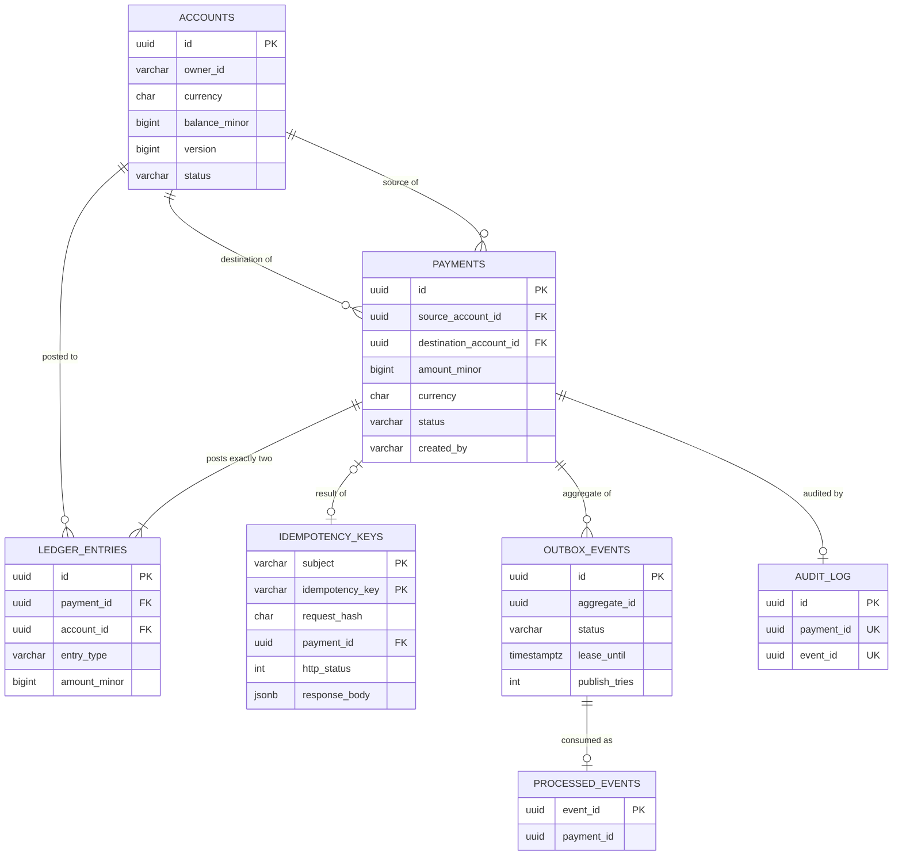

`OUTBOX_EVENTS.aggregate_id`, `PROCESSED_EVENTS`, and `AUDIT_LOG` reference payments **logically**, not with foreign keys. The consumer-owned tables must keep working if they later move to a separate database, and outbox rows are deleted on their own schedule.

### Transaction boundaries

| Operation | Transaction scope | Isolation | Statements | Commit means |
| --- | --- | --- | --- | --- |
| Create account | One short TX | `READ COMMITTED` | 1 `INSERT` | Account exists with balance 0 |
| Transfer (`executeNew`) | One TX with a savepoint after the key insert | `READ COMMITTED` | Key insert, 2 PK selects, 2 conditional updates, payment insert, 2 ledger inserts, outbox insert, key completion | Money moved **and** the event intent recorded, atomically |
| Replay after `23505` | New read-only TX | `READ COMMITTED` | 1 PK select | Nothing written |
| Outbox claim | Short TX | `READ COMMITTED` | 1 `UPDATE ... WHERE id IN (SELECT ... FOR UPDATE SKIP LOCKED)` | Lease recorded; no Kafka I/O inside the TX |
| Outbox mark published | Short TX per batch | `READ COMMITTED` | `UPDATE ... WHERE id = ANY(:ids) AND status = 'PUBLISHING'` | Row will not be republished |
| Consumer processing | One TX per record | `READ COMMITTED` | `processed_events` insert + `audit_log` insert | Kafka offset is committed **after** this commit; the two are not atomic, which is why dedup exists |
| Cleanup jobs | Batched short TXs | `READ COMMITTED` | `DELETE ... WHERE ctid IN (SELECT ctid ... LIMIT 1000)` repeated | Avoids one giant delete holding locks and bloating WAL |

### Query patterns and indexes

| Query | Frequency | SQL shape | Index used | Cost |
| --- | --- | --- | --- | --- |
| Idempotency insert / lookup | Every POST | `INSERT` / `SELECT ... WHERE subject = ? AND idempotency_key = ?` | PK `(subject, idempotency_key)` | `O(log n)` |
| Load accounts | Every POST, GET miss | `SELECT ... WHERE id = ?` | PK | `O(log n)` |
| Conditional debit / credit | Every POST | `UPDATE ... WHERE id = ? AND version = ? ...` | PK | `O(log n)`, row lock |
| Outbox claim | 5×/s per pod | `WHERE status = 'PENDING' OR (status='PUBLISHING' AND lease_until < now()) ORDER BY created_at LIMIT 50` | Partial `idx_outbox_claimable` | Proportional to the small unpublished set, not table size |
| Outbox cleanup | Periodic | `WHERE status = 'PUBLISHED' AND published_at < ?` | Partial `idx_outbox_published_at` | Range scan |
| Idempotency cleanup | Periodic | `WHERE completed_at < now() - interval '24 hours'` | Partial `idx_idempotency_completed_at` | Range scan |
| Payment history | Per history page | Keyset query below | `idx_payments_source_created`, `idx_payments_dest_created` | `O(log n + limit)` per branch |
| Account statement / reconciliation | Tests, ops | `SELECT entry_type, sum(amount_minor) FROM ledger_entries WHERE account_id = ? GROUP BY entry_type` | `idx_ledger_account_created` | Range scan on one account |
| Accounts by owner | Account list (ops / future UI) | `WHERE owner_id = ?` | `idx_accounts_owner_id` | `O(log n + k)` |

Keyset history query for `direction=ALL`:

```sql
SELECT * FROM (
    (SELECT id, source_account_id, destination_account_id, amount_minor, currency, status, created_at
       FROM payments
      WHERE source_account_id = :acct
        AND (created_at, id) < (:cursor_ts, :cursor_id)
      ORDER BY created_at DESC, id DESC
      LIMIT :limit_plus_one)
    UNION ALL
    (SELECT id, source_account_id, destination_account_id, amount_minor, currency, status, created_at
       FROM payments
      WHERE destination_account_id = :acct
        AND (created_at, id) < (:cursor_ts, :cursor_id)
      ORDER BY created_at DESC, id DESC
      LIMIT :limit_plus_one)
) page
ORDER BY created_at DESC, id DESC
LIMIT :limit_plus_one;
```

Each branch is an index range scan that stops after `limit + 1` rows; fetching one extra row tells the API whether a `nextCursor` exists. Use `EXPLAIN (ANALYZE, BUFFERS)` to confirm both branches show `Index Scan` and no `Sort` over the full account history.

### Normalization decisions

| Decision | Normal form impact | Why it is acceptable |
| --- | --- | --- |
| `accounts.balance_minor` stored, although derivable from the ledger | Denormalized (derived value) | `O(1)` balance checks inside the conditional `UPDATE`; the ledger remains the audit trail and tests assert `balance = opening + credits − debits` |
| `currency` repeated on `payments` and `ledger_entries` | Redundant with account currency | Ledger rows are immutable facts; they must stay correct even if account metadata changes |
| `response_body` JSONB on `idempotency_keys` | Duplicates payment data | Replay must return the **exact** original body, including stored errors that have no payment row |
| `outbox_events.payload` JSONB | Snapshot of payment data | The event is an immutable message; it must not change if the payment row is later read differently |
| Everything else | 3NF | Each non-key column depends only on its table's key |

### How one transfer updates state

Inside a single PostgreSQL transaction (default isolation: `READ COMMITTED`):

1. `INSERT` into `idempotency_keys` (`subject`, `idempotency_key`, …). If this statement does not succeed in **this** transaction, this transaction must not update accounts
2. Load accounts; enforce ownership, `ACTIVE`, and currency
3. `UPDATE` accounts in **ascending id order** using the conditional debit/credit statements
4. Insert `payments` with `status = COMPLETED`
5. Insert ledger `DEBIT` on source and `CREDIT` on destination: same `payment_id`, same `amount_minor`, same `currency`
6. Insert `outbox_events` with `status = PENDING`
7. Store the HTTP body on the idempotency row (`http_status = 201`, `completed_at = now()`)
8. Commit

If any step fails in a way that should retry (version conflict, deadlock), the **entire** transaction rolls back, including the idempotency insert.

Terminal business failures (insufficient funds, inactive account) never keep a partial account update. After the idempotency `INSERT`, the service sets a `SAVEPOINT`. Account updates, payment, ledger, and outbox writes happen after that savepoint.

- If the source debit returns 0 rows and classifies as terminal, no account row was mutated: write the error onto the idempotency row and `COMMIT`.
- If the source debit succeeded and the destination credit then classifies as terminal, `ROLLBACK TO SAVEPOINT` undoes the debit. Then write the error onto the idempotency row and `COMMIT`.
- PostgreSQL does not let one transaction “keep the key and drop the debit” without that savepoint or an equivalent second transaction. This design uses the savepoint so the stored client error and the absence of money movement commit together.

There is no durable “debit succeeded, credit pending” state.

### Ledger invariants

A normal row-level `CHECK` constraint can see columns of **that row only**. It cannot assert that another ledger row exists, that debit equals credit, or that currencies match across tables.

| Kind | What | Where it is enforced |
| --- | --- | --- |
| Database constraint | `accounts.balance_minor >= 0` | `CHECK` |
| Database constraint | `amount_minor > 0` on payments and ledger rows | `CHECK` |
| Database constraint | `entry_type` is `DEBIT` or `CREDIT` | `CHECK` |
| Database constraint | At most one `DEBIT` and one `CREDIT` per `payment_id` | `UNIQUE (payment_id, entry_type)` — uniqueness, not equality of amounts |
| Database constraint | Payment source ≠ destination; FKs to accounts | `CHECK` / `REFERENCES` |
| Database constraint | One committed outcome per subject and idempotency key | `PRIMARY KEY (subject, idempotency_key)` |
| Database constraint | Outbox status is one of the three allowed values | `CHECK` |
| Transactional application guarantee | Both ledger rows are inserted in the **same** transaction as the payment and the two account updates | `PaymentService.executeNew` |
| Transactional application guarantee | Debit `amount_minor` equals credit `amount_minor` and both equal `payments.amount_minor` | Application copies one `amount` variable into both inserts |
| Transactional application guarantee | Ledger `currency` equals `payments.currency` and both account currencies | Application checks accounts and copies `request.currency` |
| Transactional application guarantee | A failed attempt leaves no partial account update | Single transaction rollback |
| Test-verified invariant | Every `COMPLETED` payment has exactly two ledger rows, balanced amounts, matching currencies | Integration tests |
| Test-verified invariant | Account `balance_minor` equals opening balance (seeded, else 0) plus credits minus debits | Integration tests |
| Test-verified invariant | Failed transfers insert no payment, no ledger, no outbox | Integration tests |

Successful transfers receive equal debit and credit entries because the application inserts both rows with the same `amountMinor` and `currency` before commit. Partial financial writes are prevented because those inserts and both `UPDATE accounts` share one transaction: PostgreSQL either persists all of them or none of them.

---

## Concurrency and Idempotency

### ACID applied to a transfer

| Property | Meaning here |
| --- | --- |
| Atomicity | Accounts, payment, ledger, idempotency completion, and outbox row commit together or not at all |
| Consistency | Row-level constraints plus the transfer transaction preserve non-negative balances and a balanced ledger |
| Isolation | `READ COMMITTED` plus a conditional `UPDATE ... WHERE version = :v`. That `UPDATE` takes a row lock until commit; it is not lock-free |
| Durability | After `COMMIT`, PostgreSQL has the money movement even if the JVM dies |

### Concurrency algorithm

One algorithm is used. Not `SELECT FOR UPDATE` on the hot path, and not Redis locks. The conditional `UPDATE` is still a locking statement: PostgreSQL takes a **row-level exclusive lock** on each matched account until this transaction commits. A concurrent `UPDATE` of the same row waits. Under `READ COMMITTED`, after the waiting session is granted the lock, PostgreSQL **re-evaluates the `WHERE` clause** against the new row image. If `version` or `balance_minor` no longer match, the waiting statement updates 0 rows. This is a version check plus a short row lock, not lock-free optimistic concurrency.

**Per attempt** (at most 3 attempts; only version conflicts and deadlocks retry):

1. `BEGIN`.
2. Insert `(subject, idempotency_key)` (new attempts only). Unique-violation handling is outside this algorithm; see below. Then `SAVEPOINT sp_after_key`.
3. Load source and destination by primary key. Apply authorization and `ACTIVE` / currency checks. Snapshot each row’s `id`, `version`, and `balance_minor`.
4. Order the two accounts by `id` ascending. Every transaction updates rows in that order so `A→B` and `B→A` cannot deadlock on lock order.
5. For each account in that order:
   - If it is the source, run `debitIfSufficient(id, expectedVersion, amount)`.
   - If it is the destination, run `creditIfActive(id, expectedVersion, amount)`.
6. Classify a `0`-row result **after a fresh `SELECT` of that account**, in this order:
   1. Account missing → `404 NOT_FOUND` (should not happen under FK). Terminal.
   2. `status != 'ACTIVE'` → `422 ACCOUNT_NOT_ACTIVE`. Terminal.
   3. Source debit and `balance_minor < amount` → `422 INSUFFICIENT_FUNDS`. Terminal. **Do not retry**, even if `version` also changed.
   4. `version != expectedVersion` → version conflict. Rollback and retry the whole attempt.
   5. Otherwise → unexpected `0` rows. Treat as version conflict (rollback and retry).
7. On terminal classification: `ROLLBACK TO SAVEPOINT` if any account `UPDATE` in this attempt already matched a row; write the error body on the idempotency row; `COMMIT`. Never leave one account updated.
8. On success of both updates: insert payment, both ledger rows, outbox; complete the idempotency row; `COMMIT`.
9. After commit: best-effort Redis `DEL` for both account ids.

**Retry bounds:** maximum 3 attempts for version conflict, PostgreSQL deadlock (`40P01` deadlock_detected), or serialization failure (`40001` serialization_failure). `40001` is rare under `READ COMMITTED` but is retried the same way. Each retry is a **new** transaction after rollback, with freshly loaded versions. Insufficient funds, inactive accounts, hash conflicts, and authorization failures are never retried by the server.

**Failure classification**

| Condition | HTTP | Server retry? |
| --- | --- | --- |
| `balance_minor < amount` on the reloaded source | `422 INSUFFICIENT_FUNDS` | No |
| `status != ACTIVE` | `422 ACCOUNT_NOT_ACTIVE` | No |
| Version mismatch and funds still sufficient | internal retry, then `409 CONCURRENT_UPDATE` | Yes, bounded |
| Deadlock (`40P01`) or serialization failure (`40001`) | internal retry, then `409 CONCURRENT_UPDATE` | Yes, bounded |

A failed transfer cannot partially update either account: both `UPDATE`s live in the transaction that rolls back.

**Trade-off:** under extreme contention on one account, some requests retry and a few return `409 CONCURRENT_UPDATE`. That is preferable to holding long pessimistic locks that serialize all transfers through a hot account.

### Why both requests must not succeed: 1,000 units, two 800 debits

Two **different** `(subject, idempotency_key)` pairs. Account `A` has `balance_minor = 1000`, `version = 0`.

1. T1 and T2 both read `version = 0`, `balance = 1000`. Both look affordable in memory.
2. T1’s `UPDATE ... version = 0 AND balance_minor >= 800` matches 1 row, takes the row lock, sets balance `200` / version `1`. T1 has not committed yet.
3. T2’s `UPDATE` on the same row **waits on T1’s row lock**.
4. T1 commits and releases the lock. Under `READ COMMITTED`, T2 re-checks `version = 0 AND balance_minor >= 800` against the new row and matches **0 rows**.
5. T2 reloads. `balance_minor = 200`, which is `< 800`, so T2 returns `422 INSUFFICIENT_FUNDS` even if it also observes `version = 1`. It does not treat this as a retryable version conflict.

If T2 started after T1 had already committed, T2 would snapshot `version = 1` itself and still update 0 rows. Same classification.

If both updates used `SET balance = balance - 800` with no predicate, the account would go to `-600`.

### Idempotency concurrency

Idempotency and optimistic locking solve different races. For **one** `(subject, idempotency_key)`, the composite primary key is the mutex. Only the transaction whose `INSERT` succeeded may run `debitIfSufficient` / `creditIfActive` for that pair.

**Same subject, same key, two simultaneous requests**

```text
T_win: BEGIN
T_win: INSERT idempotency_keys (subject, key, hash, created_at)
T_lose: BEGIN
T_lose: INSERT idempotency_keys (same subject, same key, ...)  -- waits on T_win's unique-index row
        -- T_lose has not updated any account
```

PostgreSQL unique-index behaviour:

- While `T_win` is open, `T_lose`’s `INSERT` **blocks**. It does not fall through to the debit.
- If `T_win` **commits** (success or stored terminal error), `T_lose`’s `INSERT` fails with `unique_violation` (`23505`). PostgreSQL **aborts `T_lose`**. Further statements in that transaction are illegal. The application rolls it back and starts a **fresh** transaction to `SELECT` the key.
- If `T_win` **rolls back** (crash, version conflict, deadlock, JVM kill), the uncommitted insert disappears. `T_lose`’s blocked `INSERT` succeeds. `T_lose` becomes the winner and is the only session that may perform the financial effect.

**Fresh-transaction replay after `23505`**

1. Discard the aborted session.
2. `BEGIN` a new transaction.
3. `SELECT` the idempotency row by `(subject, idempotency_key)`.
4. If the row is **missing**, the apparent winner rolled back after this session failed the insert (rare under the blocking insert, possible if another crash interleaves). Retry `executeNew` once; do not debit in the aborted transaction.
5. If the row exists and `request_hash` **differs** → `409 IDEMPOTENCY_KEY_REUSED`. No financial effect.
6. If the row exists and `request_hash` **matches** → return the stored `http_status` and `response_body` (`200` replay of `201`, or the stored `422`). Do not debit again.

A different subject presenting the same `Idempotency-Key` header is a **different row** and may execute its own transfer. Replay is always looked up as `(jwt.sub, header)`.

Because the debit runs only after a successful insert in the **same** transaction, two requests cannot both execute the financial effect for the same `(subject, key)`.

Completed keys are deleted after 24 hours by `IdempotencyCleanupJob`. After that, the same subject may reuse the header for a new payment.

Request hash is SHA-256 over a canonical serialization of `sourceAccountId`, `destinationAccountId`, `amountMinor`, `currency`, and `description`.

| Mechanism | Problem it solves | Problem it does not solve |
| --- | --- | --- |
| Idempotency key | Client retries, timeouts, and concurrent replays of **the same** `(subject, key)` | Two **different** keys (or two subjects) competing for one balance |
| Optimistic locking | Lost updates and overspend races between different payments | A client that retries without a key still creates two payments |

### What the system guarantees and what it does not

| Property | Guaranteed? | Mechanism / reason |
| --- | --- | --- |
| No negative balance | **Yes** | Conditional `UPDATE` predicate + `CHECK (balance_minor >= 0)` |
| No partial transfer (debit without credit) | **Yes** | One transaction; savepoint for terminal failures |
| At most one financial effect per `(subject, idempotency_key)` within 24 h | **Yes** | Composite PK insert is the mutex |
| Balanced ledger per payment | **Yes, by transaction + tests** | Not expressible as a row-level `CHECK` |
| Event eventually published for every committed payment | **Yes, while PostgreSQL is intact** | Outbox row committed with the money; leases reclaim stuck rows |
| Event published exactly once | **No** | At-least-once; duplicates on ack-then-crash and lease reclaim |
| Audit side effect exactly once | **Yes, effectively** | Dedup on `event_id` and unique `audit_log.payment_id` |
| Global ordering of events | **No** | Ordering only per partition, i.e. per `sourceAccountId`; even that is weakened by the multi-publisher outbox (two publishers may send events for one account out of creation order) |
| GET balance is fresh | **No** | Up to 5 s stale from Redis; authoritative value is in PostgreSQL |
| Duplicate protection without a key | **No** | The key is required on POST; a client that generates a new key per retry creates new payments |
| Distributed coordination (leader election, consensus) | **Not needed** | PostgreSQL row locks and unique indexes are the only coordination; publishers coordinate through leases in the same database |

---

## Kafka and Transactional Outbox

### Why not “commit DB, then produce”

```text
COMMIT payment  -->  crash  -->  Kafka produce never happens
```

The money is correct, but audit never runs. The inverse (produce then commit) can emit an event for a rolled-back transfer. Both are unacceptable.

### Transactional outbox (polling publisher)

1. The transfer transaction inserts `outbox_events` with `status = PENDING` in the **same** PostgreSQL transaction as the ledger.
2. `OutboxPublisher` claims a batch (see below), produces to `payment.events` with key = `sourceAccountId` and value = JSON payload.
3. On broker ack (`acks=all`), it sets `status = PUBLISHED`, `published_at = now()`.
4. Produce failures leave the row `PUBLISHING` until the lease expires, then another publisher may reclaim it.
5. `OutboxCleanupJob` periodically `DELETE`s rows with `status = 'PUBLISHED'` and `published_at < now() - interval '7 days'`. `PENDING` and `PUBLISHING` rows are never deleted. After cleanup, those events cannot be republished from PostgreSQL; Kafka and `audit_log` remain the history.

### Outbox publisher concurrency

Several `payment-service` replicas run the publisher. A row lock held only for a `SELECT` is not a durable claim: after that transaction commits, a second publisher could read the same `PENDING` row. Sending Kafka from inside a long transaction that holds `FOR UPDATE` is also a poor idea (database locks span network I/O).

**Claim lease**

Every 200 ms, a publisher opens a short transaction and runs:

```sql
UPDATE outbox_events o
   SET status        = 'PUBLISHING',
       claimed_by    = :instanceId,
       lease_until   = now() + interval '30 seconds',
       publish_tries = o.publish_tries + 1
 WHERE o.id IN (
           SELECT e.id
             FROM outbox_events e
            WHERE e.status = 'PENDING'
               OR (e.status = 'PUBLISHING' AND e.lease_until < now())
            ORDER BY e.created_at
            LIMIT 50
            FOR UPDATE SKIP LOCKED
       )
 RETURNING o.id, o.payload;
```

Then it **commits the claim**. `SKIP LOCKED` prevents two publishers from updating the same row in this statement. The committed `PUBLISHING` + `lease_until` prevents a second publisher from unnecessarily claiming that event until the lease expires.

After commit:

1. Produce each claimed event to Kafka.
2. On broker acknowledgement, `UPDATE ... SET status = 'PUBLISHED', published_at = now() WHERE id = :id AND status = 'PUBLISHING'`.
3. If produce fails, do not mark `PUBLISHED`. The lease expires; a later poll may reclaim it.

**Crash recovery**

| Crash point | Result |
| --- | --- |
| After transfer commit, before any claim | Row stays `PENDING`; another poll claims it |
| After claim commit, before Kafka send | Lease expires; another publisher reclaims |
| After Kafka ack, before `PUBLISHED` | Lease expires; event is produced **again** |
| Publisher holds an unexpired lease | Other publishers skip the row (`SKIP LOCKED` / status filter) |

**Unavoidable duplicate-publication window:** Kafka ack then crash before `PUBLISHED`. That is at-least-once delivery. This design does **not** claim exactly-once publication. Consumers deduplicate on `eventId` (`outbox_events.id`) and `audit_log.payment_id`.

### Topics and events

| Topic | Purpose |
| --- | --- |
| `payment.events` | Completed-payment facts |
| `payment.events.DLT` | Exhausted consumer failures |

Keep the set small. No per-retry topic; retries are in-process via Spring Kafka’s `DefaultErrorHandler`. `payment.events` topic retention is 7 days.

Payload:

```json
{
  "eventId": "3e0c1f77-aaaa-4b21-9c00-0123456789ab",
  "eventType": "PAYMENT_COMPLETED",
  "paymentId": "c7e2d1a0-1111-4b2c-8d3e-777777777777",
  "sourceAccountId": "2f1c0a3e-6b1a-4d2e-9c41-1c8f7a0b9d11",
  "destinationAccountId": "9a44b2c1-0d77-4e18-b8aa-55c1d2e3f4a5",
  "amountMinor": 80000,
  "currency": "USD",
  "occurredAt": "2026-05-12T10:16:05Z"
}
```

`eventId` equals `outbox_events.id` so publication and dedup share an identity.

### Sizing for the 10K+ events/min target

The benchmark target is ≥ 167 successful `POST /payments` per second (10K+/min). Each successful transfer inserts one outbox row, so Kafka should receive **10K+ `PAYMENT_COMPLETED` events/min** in steady state (plus a small at-least-once duplicate tail). GET traffic is not part of that event rate.

| Knob | Value | Why |
| --- | --- | --- |
| Topic partitions | 12 on `payment.events` | ~14 events/s per partition at 167/s; extra partitions so a replica restart does not serialize the topic onto one thread |
| Consumer replicas | 2 | Matches the Kubernetes Deployment; fail over without collapsing parallelism |
| `spring.kafka.listener.concurrency` | 6 per replica | 2 × 6 = 12 threads, one per partition |
| Outbox poll | batch 50 every 200 ms | ~250 claims/s capacity, above 167/s |

Do not run more consumer threads than partitions. Scale replicas or partitions together.

### Producer, consumer, groups, retries, DLQ

| Concern | Choice |
| --- | --- |
| Producer | `payment-service` outbox publisher; `acks=all`, idempotent producer enabled per JVM |
| Partition key | `sourceAccountId` |
| Consumer group | `payment-audit-consumers` |
| Parallelism | 12 partitions; 2 replicas × concurrency 6; sized for 10K+ events/min |
| Ack timing | Offset committed **after** the listener returns successfully |
| Retry | 1 initial attempt + 3 retries with exponential backoff 1s / 2s / 4s, retry only on transient exceptions (`ExponentialBackOff` with `maxRetries = 3`; deserialization and validation errors are marked not-retryable and go straight to the DLT) |
| DLQ | `DeadLetterPublishingRecoverer` → `payment.events.DLT` after retries |
| Duplicate delivery | Unique `processed_events.event_id` and `audit_log.payment_id` |
| Recovery | Restart consumer; Kafka redelivers uncommitted offsets. Replay from DLT is a manual ops action |

An idempotent Kafka producer does not remove duplicates across two publisher instances. Consumer idempotency is mandatory.

`ProcessedEventCleanupJob` on `payment-consumer` deletes `processed_events` rows older than 14 days. That retention must stay longer than the 7-day `payment.events` topic retention so a redelivered or replayed event is still recognized as a duplicate.

Poison messages (unexpected JSON, unknown event type after a bug) go to the DLT rather than blocking the partition forever.

---

## Redis and Caching

Redis is **not** in the debit path. `debitIfSufficient` and `creditIfActive` read PostgreSQL rows only.

| Key | Value | TTL | Use |
| --- | --- | --- | --- |
| `account:meta:{accountId}` | owner, currency, status | 60s | GET account |
| `account:balance:{accountId}` | `balanceMinor` | 5s | GET balance only |
| `ratelimit:{subject}:{minuteEpoch}` | sliding-window counter (current + previous minute) | 120s | API rate limit |

### Invalidation sequence

1. Transfer transaction **commits** in PostgreSQL. Balances are already correct.
2. `payment-service` issues `DEL account:meta:{source}`, `DEL account:balance:{source}`, and the same two keys for the destination. This is best-effort and **after** commit, so a Redis failure cannot roll back money.
3. If `DEL` throws or Redis is down, log a warning and still return `201`. GET may keep serving the previous cache entry until TTL.
4. `payment-consumer` may `DEL` the same keys after a successful audit insert. That is **supplemental**. It runs asynchronously, can lag, can fail, and is not an immediate-consistency guarantee.

### Five-second balance TTL and stale reads

`account:balance:{id}` expires after 5 seconds. That is the backstop when invalidation is skipped or delayed.

Consequences:

- `GET /balance` may return a value up to ~5 seconds behind PostgreSQL (`cached: true`)
- A client must not treat that GET as a reservation of funds
- The next `POST /payments` ignores Redis and uses the conditional SQL update

Kafka-based eviction cannot make GET immediately consistent: the consumer is behind the commit by design, and a lagging or crashed consumer leaves keys in place until TTL. Primary invalidation is the post-commit `DEL` on `payment-service`. TTL covers remaining races (crash between commit and `DEL`, Redis timeout, consumer delay, and the cache-aside fill race below).

**Read path (cache-aside):** get key; on miss, query PostgreSQL and `SET` with TTL.  
**Cache miss / Redis outage:** serve from PostgreSQL; skip rate limiting; payments continue.

### Cache-aside fill race

`DEL` after commit does not close every Redis race. Named here as the **cache-aside fill race**:

1. A `GET /balance` misses in Redis.
2. That GET reads PostgreSQL and sees the **pre-transfer** balance.
3. A transfer commits and `DEL`s the key (the key is already absent).
4. The GET then `SET`s Redis to the old balance.

GET callers can then see a stale value even though invalidation ran. The **5-second TTL** is the bound on how long that stale fill can live. Debit authorization never reads this key.

---

## Core Algorithms and Engineering Techniques

The mechanisms are described in detail in earlier sections. This section puts each one in the same analytical frame (problem, idea, steps, complexity, alternatives, failure modes, interview phrasing) so they can be compared and defended quickly.

### T1. Double-entry ledger posting

| Aspect | Detail |
| --- | --- |
| Problem | A balance column alone cannot explain *why* it changed or prove money was not created or destroyed |
| Why required | Auditability and the invariant "sum of all postings for a payment is zero" |
| Core idea | Every payment writes one `DEBIT` row on the source and one `CREDIT` row on the destination with the same amount and currency, in the same transaction as the balance updates |
| Steps | Conditional debit → conditional credit → insert payment → insert DEBIT → insert CREDIT → commit |
| Time / space | `O(1)` per transfer (2 extra inserts, 2 index entries each); ledger grows `O(payments)` |
| Alternatives | Balance-only table; event-sourced balance computed from the ledger on every read |
| Advantages | Reconciliation (`balance = opening + credits − debits`) is a SQL query; history is immutable |
| Disadvantages | Extra writes per transfer; equality across rows is not a database constraint |
| Failure scenario | A bug that writes different amounts to the two rows commits silently; caught only by the integration-test invariant and a reconciliation query |
| Interview explanation | "The balance column is a cached materialization for fast checks; the ledger is the proof. Both are written in one transaction, so they cannot diverge on crash." |

### T2. Conditional `UPDATE` with version and balance predicate (optimistic locking)

| Aspect | Detail |
| --- | --- |
| Problem | Lost updates and overspend when two payments debit one account concurrently |
| Core idea | `UPDATE ... SET balance = balance - :amt, version = version + 1 WHERE id = :id AND version = :v AND balance_minor >= :amt AND status = 'ACTIVE'`; a `0`-row result means "the world changed or the rule failed" |
| Steps | Snapshot version → conditional update → if 0 rows, reload and classify: insufficient funds (terminal) vs version conflict (retry) |
| Pseudocode | See [Concurrency algorithm](#concurrency-algorithm) and the facade pseudocode in LLD |
| Time | `O(log n)` index lookup per update; retries bounded at 3 attempts |
| Space | `O(1)`; one `BIGINT` version column per account |
| Alternatives | `SELECT ... FOR UPDATE` then update (pessimistic); `SERIALIZABLE` isolation; Redis distributed lock |
| Advantages | No lock held across application think time; the predicate is re-checked atomically after any lock wait |
| Disadvantages | Hot accounts cause retries and some `409`s; still takes a row lock for the rest of the transaction |
| Failure scenario | Classifying a `0`-row result as a version conflict when funds are actually insufficient would cause pointless retries; the reload order (funds before version) prevents that |
| Interview explanation | "It is optimistic in that we don't lock on read; the conditional update is the atomic compare-and-set. Under READ COMMITTED, a waiter re-evaluates the WHERE clause on the new row version, so the second debit sees the reduced balance." |

### T3. Unique-insert idempotency mutex with request hash

| Aspect | Detail |
| --- | --- |
| Problem | Client retries and concurrent duplicates of the same request must not execute twice |
| Core idea | The first statement of the money transaction inserts `(subject, idempotency_key, request_hash)`. The PK makes concurrent duplicates block, then fail with `23505` if the winner commits |
| Steps | Insert key → do the transfer → store response on the key row → commit. On `23505`: new transaction, read row, compare hash, replay |
| Time / space | `O(log n)` per request; `O(keys in 24 h)` rows, about 14.4M at 10K/min (ILLUSTRATIVE: `10,000 × 60 × 24`) |
| Alternatives | Redis `SET NX` lock; a committed "IN_PROGRESS" row followed by a second transaction; client-side dedup only |
| Advantages | The lock and the financial effect commit or roll back together; no in-flight window |
| Disadvantages | A blocked duplicate holds a connection while it waits; the table needs cleanup |
| Failure scenario | Winner crashes mid-transaction → its insert disappears → the blocked loser becomes the winner. Correct by construction |
| Interview explanation | "The unique index is the mutex, and it lives inside the same transaction as the money. That's why there is no window where the key is reserved but the money state is unknown." |

### T4. Ordered locking for deadlock avoidance

| Aspect | Detail |
| --- | --- |
| Problem | `A→B` and `B→A` transfers locking rows in opposite orders deadlock |
| Core idea | Always update the two accounts in ascending UUID order, regardless of which is the source |
| Time / space | `O(1)` comparison |
| Alternatives | Rely on PostgreSQL deadlock detection alone (`deadlock_timeout`, default 1 s, then abort) |
| Advantages | Removes the most common deadlock cycle; avoids a 1 s detection stall in p99 |
| Disadvantages | Other lock interactions (FK checks, unique-index waits) can still deadlock rarely, so the `40P01` retry stays |
| Interview explanation | "Lock ordering breaks the circular-wait condition. We still retry 40P01 because ordering two account rows doesn't cover every lock the transaction takes." |

### T5. Transactional outbox with lease-based claim

| Aspect | Detail |
| --- | --- |
| Problem | Dual write: the DB commit and the Kafka produce cannot be made atomic without 2PC |
| Core idea | Write the event as a row in the money transaction; a separate publisher relays rows to Kafka |
| Steps | Claim (`UPDATE ... FOR UPDATE SKIP LOCKED`, set lease, commit) → produce → mark `PUBLISHED`; expired leases are reclaimable |
| Time | Claim is `O(batch × log n)` via the partial index; publish is `O(batch)` network sends |
| Space | Unpublished rows only, plus 7 days of `PUBLISHED` rows |
| Alternatives | Debezium CDC from WAL; `AFTER_COMMIT` listener; Kafka transactions (do not cover the PostgreSQL write) |
| Advantages | No event loss once the money commits; Kafka outages do not block payments |
| Disadvantages | At-least-once; ~200 ms relay latency; polling load on PostgreSQL |
| Failure scenario | Ack received, crash before `PUBLISHED` → republished after lease expiry → consumer dedups |
| Interview explanation | "The outbox turns a distributed transaction into a local one plus an idempotent retry loop." |

### T6. Idempotent consumer with bounded retry and DLT

| Aspect | Detail |
| --- | --- |
| Problem | At-least-once delivery and transient failures in the consumer |
| Core idea | Insert `processed_events(event_id)` and `audit_log` in one transaction; a duplicate key means "already done, acknowledge" |
| Steps | Receive → insert in TX → commit → offset commit. Transient error → backoff 1/2/4 s → DLT |
| Time / space | `O(log n)` per event; `processed_events` holds 14 days |
| Alternatives | Kafka transactions read-process-write (only helps Kafka-to-Kafka); non-blocking retry topics |
| Failure scenario | Crash after DB commit, before offset commit → redelivery → PK violation → treated as success |
| Interview explanation | "Dedup state must outlive the topic retention, which is why processed_events is kept 14 days against a 7-day topic." |

### T7. Cache-aside with post-commit invalidation and TTL backstop

| Aspect | Detail |
| --- | --- |
| Problem | GET traffic competing with writes for PostgreSQL connections and CPU |
| Core idea | Read Redis; on miss read PostgreSQL and `SET` with TTL; after a transfer commits, `DEL` both accounts' keys |
| Time / space | `O(1)` Redis ops; memory `O(hot accounts)` |
| Alternatives | Write-through cache; CDC-driven invalidation; no cache plus a read replica |
| Advantages | Simple; fail-open; DB remains the authority |
| Disadvantages | Fill race can store a stale value for up to the TTL |
| Interview explanation | "Invalidate-after-commit handles the common case; the short TTL bounds the races invalidation cannot close." |

### T8. Sliding-window rate limiter

| Aspect | Detail |
| --- | --- |
| Problem | One subject flooding the API |
| Core idea | Two fixed one-minute counters; estimated count = `current + previous × (1 − elapsed_fraction_of_current_minute)` |
| Steps | Lua script: `INCR` current key, `EXPIRE 120`, `GET` previous key, compute estimate, return allow/deny atomically |
| Time / space | `O(1)` per request; 2 keys per active subject |
| Alternatives | Fixed window (bursty at boundaries); sliding log in a sorted set (`O(log n)` and memory per request); token bucket |
| Disadvantages | Approximate; fail-open when Redis is down |
| Interview explanation | "It smooths the fixed-window boundary burst with constant memory. It's abuse control, not a correctness mechanism." |

### T9. Keyset pagination

| Aspect | Detail |
| --- | --- |
| Problem | Deep `OFFSET` pages scan and discard rows and drift when new rows arrive |
| Core idea | The cursor is the last `(created_at, id)`; the next page is `WHERE (created_at, id) < cursor` on a matching index |
| Time / space | `O(log n + limit)` per page; cursor is constant size |
| Disadvantages | No random page jumps; cursor must be opaque and validated |

---

## Security

`payment-service` is an **OAuth2 resource server**. It does not issue tokens and does not implement an authorization server.

Local/dev tokens come from **Keycloak**. Production is expected to use the same protocol against whichever IdP the environment provides. The application validates:

1. JWT signature against the IdP JWKS endpoint
2. `exp` / `nbf`
3. `iss` matches `spring.security.oauth2.resourceserver.jwt.issuer-uri`
4. `aud` matches this API
5. Scopes: `payments.read` / `payments.write` as a **capability filter**
6. Resource ownership using `jwt.sub`:
   - Create account → `owner_id = sub`, opening balance `0`
   - Get account / balance → `owner_id = sub`
   - Create transfer → source `owner_id = sub`; destination may be any existing `ACTIVE` account
   - Get payment → caller owns source or destination

A token with `payments.read` and `payments.write` still cannot debit or inspect another user’s account. Missing scope is `403 FORBIDDEN`. Wrong owner is `403 ACCOUNT_ACCESS_DENIED`.

Secrets (DB password, Kafka credentials if any, Redis password) come from Kubernetes `Secret` objects or Compose environment files. They are not checked into git.

HTTP is stateless. There is no server session store. CORS is disabled except for an explicit local origin if a test UI is added later.

---

## Error Handling and Failure Recovery

### Error model

```json
{
  "code": "INSUFFICIENT_FUNDS",
  "message": "Source account does not have enough balance",
  "correlationId": "7c2e0b1a-…",
  "retriable": false
}
```

| HTTP | Code | Retriable | Cause |
| --- | --- | --- | --- |
| 400 | `VALIDATION_ERROR` | No | Bad payload |
| 401 | `UNAUTHENTICATED` | No | Missing/invalid JWT |
| 403 | `FORBIDDEN` | No | Missing scope |
| 403 | `ACCOUNT_ACCESS_DENIED` | No | Authenticated, but not the owner / not a payment party |
| 404 | `NOT_FOUND` | No | Unknown account or payment |
| 409 | `IDEMPOTENCY_KEY_REUSED` | No | Same key, different body |
| 409 | `CONCURRENT_UPDATE` | Yes | Version or deadlock retries exhausted |
| 422 | `INSUFFICIENT_FUNDS` | No | Reloaded source `balance_minor < amount` |
| 422 | `ACCOUNT_NOT_ACTIVE` | No | Frozen/closed |
| 429 | `RATE_LIMITED` | Yes | Redis limiter |
| 503 | `DATABASE_UNAVAILABLE` | Yes | Pool exhaustion / DB down |
| 503 | `DEPENDENCY_UNAVAILABLE` | Yes | Unexpected infrastructure failure |

Kafka being down does **not** fail the HTTP transfer. It delays outbox publication. Redis being down does **not** fail the HTTP transfer.

### Failure cases

| Case | Behavior | Money correctness |
| --- | --- | --- |
| 1. Client retries after timeout | Same `Idempotency-Key`: unique insert or fresh-TX replay of the stored body | No double debit |
| 2. Two transfers compete for the same balance | Conditional `UPDATE` + version; reload classifies funds vs conflict | No overspend |
| 3. Crash before DB commit | Transaction rolls back, including an uncommitted idempotency insert; a waiting same-key INSERT may then become the winner | No partial write |
| 4. Crash after DB commit, before HTTP response | Client retries; replay returns the committed payment | Money already moved once |
| 5. Kafka unavailable after commit | Row stays `PENDING` or `PUBLISHING` until a lease can complete | Money correct; audit delayed |
| 6. Event delivered more than once | `processed_events` PK / `audit_log` unique `payment_id` | No duplicate side effect |
| 7. Consumer crashes mid-processing | Offset not committed; redelivery; insert is idempotent | No duplicate audit |
| 8. Redis unavailable | Cache, rate-limit, and `DEL` skipped | Debits still use PostgreSQL; GET may be stale up to TTL once Redis returns |
| 9. Deadlock (`40P01`) or serialization failure (`40001`, rare under `READ COMMITTED`) | Rollback; bounded retry of a **new** transaction; else `409` | Rollback, no partial write |
| 10. Pod restart during a request | In-flight request is lost unless committed; probes + graceful shutdown drain connections | Commit is the only success signal |
| 11. Two publishers claim work | Lease + `SKIP LOCKED`; expired leases reclaim | Duplicate Kafka messages possible; consumers dedup |
| 12. Same `(subject, idempotency_key)` in two requests | One INSERT wins; loser never debits | At most one financial effect per subject+key |

Graceful shutdown: Spring Boot waits (`server.shutdown=graceful`) so in-flight requests can finish; the outbox publisher stops claiming new rows; Kafka listener container stops after the current record. Claimed rows whose lease expires are picked up by another replica.

### Failure matrix

| Failure | Detection | System response | Recovery | Consistency impact |
| --- | --- | --- | --- | --- |
| PostgreSQL unavailable | Hikari connection timeout; readiness probe fails | `503 DATABASE_UNAVAILABLE`; pods leave Service endpoints | Automatic once DB returns; clients retry with same key | None: no commit, no money moved |
| PostgreSQL slow / lock contention | `lock_timeout` 55P03, p95 alerts, `pg_stat_activity` waits | Bounded retry then `409 CONCURRENT_UPDATE` | Client retry with same key | None |
| Network failure client ↔ API | Client timeout | Unknown outcome on client side | Retry with same key → replay or first execution | None: idempotency absorbs it |
| `payment-service` crash mid-transaction | Pod restart; TCP reset | In-flight TX rolled back by PostgreSQL | Kubernetes restarts pod; other replica serves traffic | None: atomic rollback |
| `payment-service` crash after commit | — | Client gets no response | Client retry → `200` replay; outbox row published by any replica | None |
| Kafka unavailable | Producer send failures; `outbox_pending` gauge rises | Transfers continue; outbox rows accumulate | Leases expire and rows are re-claimed after Kafka returns | None for money; audit delayed |
| Duplicate events | `processed_events` PK conflict | Treated as success | — | None |
| Consumer crash | Group rebalance; consumer lag rises | Partitions reassigned to surviving consumers | Redelivery from last committed offset | None (dedup) |
| Poison message | Non-retryable exception or retries exhausted | Record to `payment.events.DLT`; partition continues | Fix bug, replay DLT manually | Audit row missing until replay |
| Redis unavailable | Command timeout (50 ms) | Cache bypassed; rate limit skipped; `DEL` skipped | Automatic; stale keys expire by TTL | GET may be stale ≤ 5 s after Redis returns; money unaffected |
| Partial write | Impossible for money (single TX); possible for outbox publication (ack then crash) | Republish | Lease expiry | Duplicate event, deduplicated |
| Timeout inside transfer | `statement_timeout` / `lock_timeout` | Rollback; retry or `503` / `409` | Client retry with same key | None |
| Deadlock | `40P01` | Rollback; bounded retry | Automatic | None |
| Outbox publisher stuck (pod frozen) | Lease expiry; `outbox_oldest_pending_age_seconds` alert | Another replica reclaims after 30 s | Automatic | Duplicate publication possible |

### Recovery procedures

**After a PostgreSQL outage**

1. Readiness turns green when Hikari can acquire a connection; pods rejoin the Service.
2. Clients that received `503` retry with the same `Idempotency-Key`. Nothing was committed, so the retry is a first execution.
3. Watch `hikaricp_connections_pending` and p95 for a thundering-herd spike; the rate limiter and client backoff spread the load.

**After a Kafka outage**

1. Check `outbox_pending` and `outbox_oldest_pending_age_seconds`.
2. No manual action is needed: publishers reclaim expired `PUBLISHING` leases and drain `PENDING` rows at up to ~250 events/s per pod.
3. Confirm consumer lag returns to near zero and `audit_log` count matches `payments` count for the outage window.

**After a consumer bug sends records to the DLT**

1. Deploy the fix.
2. Replay the DLT records to `payment.events` (manual ops tool or `kafka-console-consumer | kafka-console-producer` with headers preserved).
3. Consumer dedup makes replay safe even if some records had already succeeded.

**After a pod crash during a request**

1. PostgreSQL rolls back any uncommitted transaction when the connection drops.
2. Any outbox rows the crashed pod had leased become reclaimable after 30 s.
3. Clients retry; idempotency makes the retry safe.

---

## Performance Optimization and Benchmark Methodology

Resume figures are **targets to validate**, not completed experiments. Do not treat the percentages below as measured results until the table is filled from a real run. This README does not contain benchmark output.

### What was optimized (implementation levers)

1. **Indexes (write path):** composite `idempotency_keys` PK, partial outbox claimable index, payment history indexes, ledger-by-account index. These are the main lever for `POST /payments` p95 and for PostgreSQL CPU under the transfer workload.
2. **HikariCP (write path):** size the pool so `replicas × maximum-pool-size < postgres.max_connections`, with headroom for admin and Testcontainers. Start from `maximum-pool-size: 20` per API replica and adjust from wait-count metrics, not guesswork. Connection wait is a common source of POST tail latency.
3. **Query shape:** one transfer = a handful of indexed primary-key updates/inserts. No N+1. No `SELECT *` over payment history on the write path.
4. **Redis (GET path):** cache `GET /accounts/{id}` and `GET /balance` so the additional read traffic does not sit on PostgreSQL next to 10K+ writes/min. Redis is not how the `POST /payments` p95 target is primarily met.
5. **Kafka consumers:** 12 partitions and `concurrency` aligned as above; batch poll; cheap idempotent writes.

The resume’s **~40% p95** target is on `POST /payments`. That reduction is expected mainly from indexes and HikariCP on the write path. The **~30% DB CPU** target is the same A/B: fewer sequential scans and less pool wait on writes, plus Redis taking GET load off PostgreSQL so reads compete less with transfers. Redis alone cannot explain a POST p95 drop of that size.

### Where time goes in one `POST /payments` (ILLUSTRATIVE budget)

| Step | Typical cost | Grows under load because |
| --- | --- | --- |
| TLS / HTTP parse / JWT verify (cached JWKS) | 1–3 ms | CPU saturation on the pod |
| Redis rate-limit Lua script | 0.3–1 ms | Redis latency; skipped if Redis is down |
| **Wait for a Hikari connection** | 0 ms when idle | **Pool exhaustion: the dominant tail-latency term in the baseline** |
| ~10 SQL round trips in one TX (key insert, 2 selects, 2 updates, 4 inserts, key update) | 5–15 ms | Row-lock waits on hot accounts; plan regressions; WAL fsync at commit |
| `COMMIT` (WAL flush) | 1–5 ms | Disk fsync latency; checkpoint I/O |
| Post-commit Redis `DEL` | 0.3–1 ms | Redis latency (bounded by 50 ms timeout) |
| Response serialization | < 1 ms | — |

Without contention this sums to roughly 10–25 ms. A < 200 ms p95 target therefore leaves most of the budget for **queueing**. Queueing for connections and for row locks is what the optimizations attack.

### Optimization deep dive

#### O1. Indexes on the write path

| Aspect | Detail |
| --- | --- |
| Original bottleneck | Without `idx_outbox_claimable`, every publisher poll (5×/s per pod) runs a sequential scan over all outbox rows, including 7 days of `PUBLISHED` ones. Without the cleanup indexes, cleanup jobs also scan. Without history indexes, history reads scan `payments` |
| Optimization | Partial index on claimable outbox rows; partial index on completed idempotency rows; composite history indexes; PKs on hot lookups |
| How it works | A partial index contains only rows matching its `WHERE`, so it stays tiny (only the unpublished backlog) and the planner can satisfy `ORDER BY created_at LIMIT 50` directly from it |
| Why it helps | Removes repeated full scans that burn CPU and evict useful pages from `shared_buffers`; shorter claim transactions hold fewer locks |
| Expected impact | Lower PostgreSQL CPU (main lever for the ~30% target) and fewer buffer misses for the transfer transaction (contributes to POST p95). BENCHMARK TARGET |
| Trade-offs | Every index adds write cost on insert/update; partial indexes only help queries whose predicate matches exactly |
| How to measure | `pg_stat_statements` (`total_exec_time`, `calls`, `shared_blks_read`) before/after; `EXPLAIN (ANALYZE, BUFFERS)` per query; `pg_stat_user_tables.seq_scan` counter deltas over the steady-state window |

#### O2. HikariCP sizing

| Aspect | Detail |
| --- | --- |
| Original bottleneck | Baseline pool of 5 per pod. At ~167 transfers/s plus uncached GETs, demand bursts above 10 connections cluster-wide and requests queue inside Hikari |
| Optimization | `maximum-pool-size: 20`, `minimum-idle` = max (fixed pool, no churn), `connection-timeout: 2s`, `max-lifetime` below any proxy/DB idle cut-off |
| How it works | More connections let PostgreSQL work on more transactions concurrently up to its core count; a fixed-size pool avoids connection-open latency during bursts |
| Why it helps | Queueing delay grows sharply as utilization approaches 1 (M/M/c behaviour). Dropping utilization from ~90% to ~40% removes most of the wait |
| Expected impact | Main lever for the ~40% POST p95 target. BENCHMARK TARGET |
| Trade-offs | Too many connections cause PostgreSQL context switching and lock contention; the total must stay under `max_connections` minus headroom (`2 pods × 20 + 2 consumers × 10 + admin < 100`) |
| How to measure | `hikaricp_connections_pending`, `hikaricp_connections_acquire_seconds` (p95), `hikaricp_connections_usage_seconds`; PostgreSQL `pg_stat_activity` state counts |

#### O3. Short, fixed-shape transactions

| Aspect | Detail |
| --- | --- |
| Original bottleneck | Long transactions hold row locks and connections longer; network I/O inside a transaction multiplies lock hold time |
| Optimization | No Kafka or Redis I/O inside the money transaction; only PK-based statements; outbox claim committed before any Kafka send |
| Why it helps | Lock hold time ≈ connection hold time ≈ DB work only, which keeps both pool utilization and row-lock waits low |
| How to measure | `transfer` Micrometer timer vs `hikaricp_connections_usage_seconds`; `pg_locks` wait counts |

#### O4. Redis cache-aside for GET

| Aspect | Detail |
| --- | --- |
| Original bottleneck | Every GET is a PostgreSQL query and a pool checkout competing with transfers |
| Optimization | Cache account metadata (60 s) and balance (5 s) |
| Why it helps | At an ILLUSTRATIVE 80% hit rate on 500 GET/s, ~400 queries/s and their pool checkouts leave PostgreSQL |
| Expected impact | Lower DB CPU and less pool contention for POST; GET p95 drops. Not the main POST p95 lever |
| Trade-offs | Stale GET up to TTL; one more dependency to monitor |
| How to measure | `cache_gets_total{result="hit|miss"}`; DB `calls` for the account `SELECT` in `pg_stat_statements` |

#### O5. Kafka batching and consumer parallelism

| Aspect | Detail |
| --- | --- |
| Original bottleneck | One outbox send at a time and a single consumer thread would cap event throughput |
| Optimization | Claim batches of 50, send asynchronously and await the batch; `linger.ms=5`, `compression.type=lz4`; 12 partitions × 12 consumer threads |
| Why it helps | Amortizes round trips; parallel partitions scale consumption linearly until the DB insert becomes the limit |
| How to measure | `kafka_producer_record_send_rate`, `records-lag-max`, `outbox_pending` |

#### Optimizations considered and rejected

| Idea | Why rejected |
| --- | --- |
| Batch multiple transfers into one transaction | Couples unrelated payments' fate; complicates idempotency |
| Read replica for balance checks | Replica lag makes balance decisions unsafe; reads that matter must hit the primary |
| `synchronous_commit = off` | Trades durability of acknowledged payments for latency; unacceptable for money |
| Pessimistic `SELECT FOR UPDATE` | Longer lock hold for no correctness gain over the conditional update |

### Workload definition

k6 script `load-tests/payments.js`:

- **`POST /payments`:** ≥ **167 requests/second** (10K+/min) for 10 minutes after a 2-minute ramp. This is the resume throughput target. In steady state Kafka should receive **10K+ `PAYMENT_COMPLETED` events/min** (one per successful transfer, plus rare at-least-once duplicates). The **< 200 ms p95** target applies to **`POST /payments`**, not to a blended HTTP mix.
- **GET traffic:** additional `GET /accounts/{id}`, `GET /accounts/{id}/balance`, and a smaller `GET /payments/{id}` stream **on top of** the POST rate (example additional ~500 GET/s). Report POST and GET separately. GET is what Redis is for; it is not counted in the 10K+/min figure.
- **Concurrency:** virtual users sized to hold those arrival rates; report VU count with the results
- **Data:** many accounts so contention is realistic but not a single hot row; unique `(subject, idempotency_key)` values except a dedicated same-subject retry scenario; each VU uses tokens whose `sub` owns the source accounts it debits
- **Auth:** pre-issued test JWTs from Keycloak
- **Balances:** seeded by SQL, not by `POST /accounts`
- **Rate limit:** the load test uses many test subjects (at least 200), and the per-subject Redis rate limit is set high enough that k6 traffic is not throttled; 429s during the run are counted as errors and reported.

Run the same script twice:

1. **Baseline:** Redis disabled, extra indexes dropped (keep PKs/uniques required for correctness), HikariCP left at a small pool (`maximum-pool-size: 5`)
2. **Optimized:** indexes, pool tuning, Redis enabled

Do not change business logic between runs.

### Metrics to capture

| Metric | Source | Notes |
| --- | --- | --- |
| `POST /payments` p50 / p95 / p99 | k6 | **p95 < 200 ms is this column**, a target not a measurement |
| `POST /payments` rate | k6 | Target ≥ 167/s (10K+/min) |
| Successful transfer rate | k6 counters on `201`/`200` for `POST /payments` | Should match POST rate aside from 4xx |
| GET rate and GET p95 | k6 | Additional traffic; not the 10K+/min claim |
| Total HTTP request rate | k6 | POST + GET; expect well above 10K/min |
| Error rate | k6 | 4xx vs 5xx separated |
| Kafka `PAYMENT_COMPLETED` produce/consume rate | JMX / Micrometer | Target ≥ 10K events/min, aside from at-least-once duplicates |
| PostgreSQL CPU | `pg_stat` / container metrics | Average over the steady-state window; ~30% reduction is vs baseline, a target |
| Cache hit rate | Micrometer cache metrics | Optimized run only; explains GET offload, not POST p95 |
| Outbox lag | `count(*) WHERE status IN ('PENDING','PUBLISHING')` | Should stay near zero in steady state |

### Percentage change

Lower is better for latency and CPU:

```text
reduction_% = (baseline - optimized) / baseline × 100
```

Example (illustrative arithmetic only): if baseline `POST /payments` p95 is 300 ms and optimized p95 is 180 ms, reduction is `(300 - 180) / 300 = 40%`. That example is not a measured result.

### Results template

Fill after a run. Leave blank until then.

| Metric | Baseline | Optimized | Change | Target |
| --- | --- | --- | --- | --- |
| POST /payments (req/min) | | | | ≥ 10,000 |
| POST /payments p95 (ms) | | | ~40% reduction | < 200 |
| Successful transfers / min | | | | ≥ 10,000 |
| Kafka `PAYMENT_COMPLETED` consumed / min | | | | ≥ 10,000 |
| GET req/min (additional) | | | | record |
| GET p95 (ms) | | | | record |
| Total HTTP req/min | | | | POST + GET, above 10,000 |
| Error rate (%) | | | | near 0 for 5xx |
| PostgreSQL CPU (%) | | | ~30% reduction | reduction vs baseline |
| Redis hit rate (%) | n/a | | | record |

Hardware, Kubernetes node size, PostgreSQL `shared_buffers`, and whether the test hits a local Docker stack or a cluster **must** be written next to any filled numbers. Without that, the percentages are not comparable.

### Benchmark objectives

1. Confirm that `POST /payments` sustains ≥ 10,000 requests/min with p95 < 200 ms (BENCHMARK TARGET).
2. Quantify the p95 and PostgreSQL CPU change between baseline and optimized configurations at the **same offered load**.
3. Confirm correctness under load: no negative balances, balanced ledger, no duplicate payments for repeated keys.
4. Find the saturation point and identify the first bottleneck.
5. Confirm that Kafka consumption keeps up (lag bounded) and that outbox lag stays near zero.

### Environment (fill before publishing any number)

| Item | Value |
| --- | --- |
| Load generator host | TBD: CPU model, cores, RAM; **separate machine or node from the system under test** |
| Kubernetes | TBD: kind / minikube / managed; node count and size |
| `payment-service` | 2 pods, requests 250m / limits 1 CPU, 1 GiB, JVM `-XX:MaxRAMPercentage=75`, Java 21, G1 |
| `payment-consumer` | 2 pods, concurrency 6 |
| PostgreSQL | 16, TBD vCPU / RAM; `shared_buffers` 25% of RAM; `max_connections` 100; data volume type TBD; `pg_stat_statements` enabled |
| Kafka | KRaft, TBD brokers (1 in local dev, 3 for RF=3), `payment.events` 12 partitions |
| Redis | 7.4, single instance, no persistence needed for the cache |
| OS | TBD |
| Network | Same cluster / same host network; record RTT between app and DB (`ping`, or `pgbench` latency for `SELECT 1`) |
| Data set | 10,000 accounts across ≥ 200 subjects, seeded balances, 1M pre-existing payments for realistic index sizes |

### Benchmark tools and why

| Tool | Used for | Why this one |
| --- | --- | --- |
| **k6** | HTTP load, `constant-arrival-rate` executor, per-endpoint latency percentiles | Open-loop arrival rate avoids coordinated omission; scriptable JWT and idempotency-key generation; tags separate POST from GET |
| **Prometheus + Grafana** | Server-side metrics: Hikari, JVM, Kafka lag, outbox lag, cache hit rate | Same metrics the service exposes in production |
| **`pg_stat_statements` + `EXPLAIN (ANALYZE, BUFFERS)`** | Query-level CPU and plan evidence | Explains *why* DB CPU changed, not just *that* it changed |
| **Container CPU metrics (cAdvisor / `kubectl top` / `docker stats`)** | PostgreSQL CPU % | Directly measures the ~30% claim |
| **`kafka-consumer-groups.sh`** | Consumer lag snapshots | Independent check on the Micrometer lag metric |

Not used: JMeter (k6 covers the need with less setup), wrk (no scripting for unique idempotency keys and JWTs per request), JMH (no hot pure-CPU code path worth micro-benchmarking).

### Benchmark scenarios

| # | Scenario | Load | Purpose | Pass criteria (BENCHMARK TARGET) |
| --- | --- | --- | --- | --- |
| B1 | Steady-state claim run | 167 POST/s + 500 GET/s, 2 min ramp, 10 min steady | Validates 10K+/min and p95 < 200 ms | POST p95 < 200 ms; 5xx < 0.1%; outbox lag near 0 |
| B2 | Baseline vs optimized A/B | B1 load on both configurations, 3 runs each | Validates ~40% p95 and ~30% DB CPU | Median-of-3 reduction near targets |
| B3 | Saturation ramp | POST from 50/s to 500/s in 50/s steps, 3 min each | Finds the knee and first bottleneck | Record max rate with p95 < 200 ms |
| B4 | Hot-account contention | 20% of transfers debit 10 hot accounts | Measures retry and `409` rate under contention | No negative balances; `409` rate reported |
| B5 | Same-key retry storm | 5% of requests resend an earlier key concurrently | Validates idempotency under load | Zero duplicate payments; replays return `200` |
| B6 | Kafka outage | Stop Kafka for 2 min during B1 | Transfers unaffected; outbox drains after recovery | POST p95 unchanged; outbox drains within a few minutes |
| B7 | Redis outage | Stop Redis for 2 min during B1 | Fail-open behaviour | No POST errors; GET p95 rises; DB CPU rises |
| B8 | Pod kill | Delete one `payment-service` pod during B1 | Graceful failover | Error burst < 1 s of traffic; no money inconsistency |
| B9 | Soak | 120 POST/s for 2 h | Leaks, bloat, cleanup-job impact | Flat heap after GC; stable p95; idempotency table size bounded |

### Controlled comparison rules

1. Same image, same business logic, same data set restored from one snapshot before each run.
2. Change **one group of levers at a time** for attribution: baseline → +indexes → +Hikari → +Redis. The full A/B is baseline vs all three.
3. Same offered load (open-loop arrival rate), not same VU count; otherwise faster configurations get more load.
4. Warm-up 2 minutes discarded (JIT, connection pools, buffer cache).
5. Run each configuration 3 times; report the median and the spread. If the spread exceeds the measured difference, the difference is not significant.
6. Run `VACUUM ANALYZE` before every run so planner statistics are identical.
7. Load generator CPU must stay below ~70%; otherwise the generator is the bottleneck.

### Per-scenario result tables (blank until a run is recorded)

**B1 / B2: steady state and A/B**

| Run | Config | POST req/min | POST p50 | POST p95 | POST p99 | GET p95 | 5xx % | PG CPU % (avg) | Hikari pending p95 | Cache hit % | Outbox lag max |
| --- | --- | --- | --- | --- | --- | --- | --- | --- | --- | --- | --- |
| 1 | Baseline | | | | | | | | | n/a | |
| 2 | Baseline | | | | | | | | | n/a | |
| 3 | Baseline | | | | | | | | | n/a | |
| 1 | Optimized | | | | | | | | | | |
| 2 | Optimized | | | | | | | | | | |
| 3 | Optimized | | | | | | | | | | |

**Ablation (attribution of the improvement)**

| Config | POST p95 | PG CPU % | Δ p95 vs baseline | Δ CPU vs baseline |
| --- | --- | --- | --- | --- |
| Baseline | | | — | — |
| + indexes | | | | |
| + indexes + Hikari | | | | |
| + indexes + Hikari + Redis (optimized) | | | | |

**B3: saturation ramp**

| Offered POST/s | Achieved POST/s | p95 | p99 | 5xx % | PG CPU % | Hikari pending | First saturated resource |
| --- | --- | --- | --- | --- | --- | --- | --- |
| 50 | | | | | | | |
| 100 | | | | | | | |
| 167 | | | | | | | |
| 250 | | | | | | | |
| 350 | | | | | | | |
| 500 | | | | | | | |

**B4–B9: correctness and resilience**

| Scenario | Errors by code | Max p95 during event | Recovery time | Invariant check (balances ≥ 0, ledger balanced, no duplicate payments) |
| --- | --- | --- | --- | --- |
| B4 hot accounts | | | n/a | |
| B5 same-key storm | | | n/a | |
| B6 Kafka outage | | | | |
| B7 Redis outage | | | | |
| B8 pod kill | | | | |
| B9 soak | | | n/a | |

### Interpreting results

| Symptom | Likely bottleneck | Confirm with |
| --- | --- | --- |
| p95 rises while PG CPU is moderate and `hikaricp_connections_pending > 0` | Connection pool | Hikari acquire-time histogram |
| PG CPU near 100% | Query plans or too much concurrency | `pg_stat_statements` top queries by `total_exec_time` |
| p95 rises only on hot-account traffic | Row-lock contention | `pg_locks` waits; `409` count |
| App CPU near limit, DB idle | JSON / JWT / GC on the pod | JVM CPU and GC pause metrics; add replicas |
| Outbox lag grows | Publisher throughput or Kafka | Producer send rate; `outbox_pending` |
| Consumer lag grows | Consumer DB inserts or too few threads | Listener processing time; partitions vs threads |
| Latency good but achieved rate < offered | Load generator saturated or k6 `dropped_iterations` | k6 summary; generator CPU |

A latency percentile is only meaningful together with the throughput at which it was measured. "p95 = 120 ms" at 50 req/s says nothing about 167 req/s.

### Proposed reproduction procedure

These commands are **proposed**; no scripts exist in this repository yet.

```bash
# 0. Restore the same data snapshot and refresh statistics
psql "$PG_URL" -c "SELECT pg_stat_statements_reset();"
psql "$PG_URL" -c "VACUUM ANALYZE;"

# 1. Baseline configuration
kubectl -n payments set env deploy/payment-service \
  SPRING_DATASOURCE_HIKARI_MAXIMUM_POOL_SIZE=5 CACHE_ENABLED=false
psql "$PG_URL" -f perf/drop_optional_indexes.sql     # keeps PKs and uniques
kubectl -n payments rollout status deploy/payment-service

# 2. Run the claim scenario (open-loop arrival rate)
k6 run -e POST_RATE=167 -e GET_RATE=500 -e RAMP=2m -e STEADY=10m \
  --summary-export=results/baseline-run1.json load-tests/payments.js

# 3. Capture DB evidence for the same window
psql "$PG_URL" -c "SELECT query, calls, total_exec_time, shared_blks_read
                   FROM pg_stat_statements ORDER BY total_exec_time DESC LIMIT 15;"

# 4. Optimized configuration, then repeat steps 0, 2, 3
psql "$PG_URL" -f perf/create_optional_indexes.sql
kubectl -n payments set env deploy/payment-service \
  SPRING_DATASOURCE_HIKARI_MAXIMUM_POOL_SIZE=20 CACHE_ENABLED=true

# 5. Post-run invariant checks
psql "$PG_URL" -c "SELECT count(*) FROM accounts WHERE balance_minor < 0;"            -- expect 0
psql "$PG_URL" -c "SELECT payment_id FROM ledger_entries GROUP BY payment_id
                   HAVING count(*) <> 2 OR sum(CASE entry_type WHEN 'DEBIT' THEN amount_minor
                                                     ELSE -amount_minor END) <> 0;"   -- expect 0 rows
```

Representative k6 options for the claim scenario:

```javascript
export const options = {
  scenarios: {
    payments: {
      executor: 'ramping-arrival-rate', startRate: 20, timeUnit: '1s',
      preAllocatedVUs: 100, maxVUs: 400,
      stages: [{ target: 167, duration: '2m' }, { target: 167, duration: '10m' }],
      exec: 'postPayment',
    },
    reads: {
      executor: 'constant-arrival-rate', rate: 500, timeUnit: '1s', duration: '12m',
      preAllocatedVUs: 100, maxVUs: 400, exec: 'getReads',
    },
  },
  thresholds: {
    'http_req_duration{endpoint:post_payments}': ['p(95)<200'],
    'http_req_failed{endpoint:post_payments}': ['rate<0.001'],
  },
};
```

k6 includes the first two minutes in its summary, so the steady-state percentiles must come from tagging the ramp stage (or from Prometheus over the steady window), not from the default end-of-test summary.

---

## Numerical Claims Defence

Every number below is **UNVERIFIED** and is presented as a **BENCHMARK TARGET**. The goal is to state exactly what each number means, how it would be measured, and how to talk about it honestly.

### Claim P1: "10K+ requests/min"

| # | Item | Detail |
| --- | --- | --- |
| 1 | Exact resume claim | "Designed Kafka event processing with retries, consumer groups and DLQs, sustaining 10K+ requests/min at less than 200 ms p95 latency." |
| 2 | Technical meaning | The system sustains at least 10,000 `POST /payments` requests per minute in steady state, each one a full ACID transfer, and Kafka keeps up with the resulting 10K+ `PAYMENT_COMPLETED` events/min |
| 3 | Metric definition | Completed `POST /payments` responses (`201` or replay `200`) per minute over the steady-state window |
| 4 | Unit | requests/min (≈ 166.7 requests/s) |
| 5 | Measurement boundary | k6 client to `payment-service` HTTP response; GETs excluded; Kafka throughput measured separately at the consumer |
| 6 | Formula | `throughput = successful_POST_count_in_steady_window / steady_window_minutes` |
| 7 | Workload | B1: 167 POST/s open-loop arrival + 500 GET/s background; 10,000 accounts; unique keys |
| 8 | Concurrency model | Open loop: arrivals do not wait for earlier responses. In-flight requests ≈ `167 × 0.05 s ≈ 8` at 50 ms mean latency (ILLUSTRATIVE, by Little's law); VUs pre-allocated up to 400 so the generator never throttles |
| 9 | Tool | k6 `ramping-arrival-rate`; Kafka rate from Micrometer / `kafka-consumer-groups.sh` |
| 10 | Environment | See environment table (TBD) |
| 11 | Warm-up | 2 min ramp, discarded |
| 12 | Duration | 10 min steady state |
| 13 | Baseline config | Pool 5, optional indexes dropped, Redis off |
| 14 | Optimized config | Pool 20, indexes, Redis on |
| 15 | Responsible change | The throughput itself comes from the architecture (short PK-based transactions, async side effects via outbox). The optimizations protect latency at this rate |
| 16 | Potential bottleneck | Hikari pool; PostgreSQL WAL fsync; hot-account row locks |
| 17 | Confounding factors | Load generator on the same host; GET mix hitting the DB when Redis is off; single-row hot spots; local Docker vs cluster networking |
| 18 | Limitations | 167 req/s is modest for PostgreSQL; the claim is about doing it with full ACID transfers, idempotency, and an outbox, not about raw TPS |
| 19 | Reproduction | Run B1 three times; report median POST/min and achieved vs offered rate |
| 20 | Likely questions | "Requests or payments?" "Including GETs?" "Per pod or total?" "Is 10K/min a lot?" |
| 21 | Interview answer | See below |

**Distinguishing the throughputs**

| Quantity | Relationship to 10K/min |
| --- | --- |
| HTTP requests (all) | Higher: POST + GET (≈ 10K + 30K/min in B1) |
| `POST /payments` requests | The claim: ≥ 10K/min |
| Successful payments | Slightly lower than POST if some return `422` / `409`; reported separately |
| Database transactions | ≈ 1 per POST attempt (+ retries) + outbox claims (5/s/pod) + consumer inserts |
| Kafka events | ≈ 1 per successful payment, plus rare duplicates |

**20-second answer.** "That's 10,000 payment-creation requests per minute, about 167 per second, measured with k6 at an open-loop arrival rate over a 10-minute steady window. GETs are on top of that and not counted. It's a benchmark target I designed for, not a recorded production number."

**60-second answer.** "The 10K/min is POST /payments only, about 167 transfers per second, each one a full ACID transaction: idempotency insert, two conditional updates, two ledger rows, a payment row, and an outbox row. Kafka then has to absorb the same number of events, which is why the topic has 12 partitions and two consumer pods with six threads each. I'd measure it with k6's arrival-rate executor so the generator doesn't slow down when the server does, discard a two-minute warm-up, and report achieved versus offered rate. Honestly, 167 TPS isn't high for PostgreSQL; the interesting part is holding it with correctness guarantees and a p95 budget. It's a target, and the doc includes the procedure to verify it."

**Detailed follow-up.** If asked "what limits it?": by Little's law the system needs only a handful of concurrent DB transactions at 167/s, so the limit is not raw capacity; it is tail latency from pool waits and row locks. The saturation ramp (B3) is how to find the real ceiling.

### Claim P2: "< 200 ms p95 latency"

| # | Item | Detail |
| --- | --- | --- |
| 1 | Exact claim | "...at less than 200 ms p95 latency" |
| 2 | Technical meaning | 95% of `POST /payments` requests complete in under 200 ms at the 10K+/min load |
| 3 | Metric definition | 95th percentile of client-observed request duration (send start to last response byte) |
| 4 | Unit | milliseconds |
| 5 | Boundary | k6 client to API and back; includes network, auth, DB transaction, post-commit `DEL`. Excludes Kafka consumption (async) |
| 6 | Formula | Sort the N steady-state POST durations; p95 is the value at rank `ceil(0.95 × N)` (k6 interpolates between neighbours) |
| 7 | Workload | B1 |
| 8 | Concurrency | Open loop at 167 POST/s |
| 9 | Tool | k6 `http_req_duration{endpoint:post_payments}`; cross-check with `http_server_requests_seconds` histogram in Prometheus |
| 10–12 | Environment, warm-up, duration | As P1 |
| 13–14 | Baseline / optimized | As P1 |
| 15 | Responsible change | Hikari sizing and indexes, which remove queueing |
| 16 | Bottleneck | Pool wait; lock waits on hot accounts; GC pauses |
| 17 | Confounders | Coordinated omission in closed-loop tools; client and server on one host; including the warm-up in the percentile; averaging percentiles across runs |
| 18 | Limitations | p95 hides the worst 5%; p99 must be reported too. Server-side histograms have bucket-resolution error |
| 19 | Reproduction | B1 three times; report median p95 and the p99 |
| 20 | Likely questions | "Why p95 not average?" "Client or server side?" "How do you compute p95 across pods?" |

**Worked example (ILLUSTRATIVE).** 100,000 POSTs in the steady window: p95 is the 95,000th fastest. If 4,000 requests exceed 200 ms, p95 < 200 ms holds; if 6,000 do, it fails. Percentiles cannot be averaged across pods or runs; merge the raw histograms (Prometheus `histogram_quantile` over `sum by (le)`) instead.

**20-second answer.** "p95 under 200 ms means 95% of payment POSTs finish within 200 ms at the 10K/min load, measured client-side by k6 over the steady window. It's a target; the doc has the method to verify it."

**60-second answer.** "A transfer without contention is roughly 10–25 ms of real work: about ten indexed statements and a commit. So a 200 ms budget is mostly about queueing: waiting for a pooled connection or a row lock. That's why the optimizations target pool sizing and indexes rather than code speed. I measure client-side with an open-loop generator to avoid coordinated omission, exclude warm-up, and report p99 next to p95, because p95 alone can hide a bad tail. If I aggregate across pods, I merge histograms, never average percentiles."

### Claim P3: "~40% p95 latency reduction"

| # | Item | Detail |
| --- | --- | --- |
| 1 | Exact claim | "Optimized PostgreSQL indexing, connection pooling and Redis caching, reducing p95 latency approximately 40%..." |
| 2 | Meaning | At the same offered load, optimized `POST /payments` p95 is ~40% lower than baseline |
| 3 | Definition | `reduction = (p95_baseline − p95_optimized) / p95_baseline` |
| 4 | Unit | percent |
| 5 | Boundary | Same as P2; same endpoint in both runs |
| 6 | Formula / example | ILLUSTRATIVE: 300 ms → 180 ms gives `(300 − 180) / 300 = 40%` |
| 7 | Workload | B2 (B1 load on both configs) |
| 8 | Concurrency | Same open-loop arrival rate for both |
| 9 | Tool | k6 + Prometheus Hikari metrics |
| 11–12 | Warm-up / duration | 2 min / 10 min, 3 runs each |
| 13 | Baseline | Pool 5; optional indexes dropped (PKs and uniques kept); Redis off |
| 14 | Optimized | Pool 20; indexes; Redis on |
| 15 | Responsible change | Mainly HikariCP sizing (pool wait removed) and write-path indexes (shorter, cheaper claim and cleanup queries competing with transfers). Redis contributes indirectly by removing GET checkouts from the pool |
| 16 | Bottleneck | Baseline: pool wait |
| 17 | Confounders | A baseline that is unrealistically bad (an artificially tiny pool) inflates the percentage. The baseline must be a plausible default configuration, and that has to be disclosed |
| 18 | Limitations | A percentage depends entirely on the baseline; absolute values must be reported with it |
| 19 | Reproduction | B2 plus the ablation table |
| 20 | Likely questions | "Isn't a pool of 5 a strawman?" "Which change gave how much?" "Why didn't Redis help POST directly?" |

**20-second answer.** "Comparing an unoptimized configuration with the tuned one at the same load, the target was about 40% lower p95 on payment POSTs, mostly from removing connection-pool waits and adding the right indexes. It's an A/B target, not a recorded result."

**60-second answer.** "The baseline is the same code with a small Hikari pool, only the correctness-required indexes, and no Redis. The optimized run adds a sized pool, partial indexes for the outbox claim and cleanup, and history indexes, and turns on Redis for GETs. I'd run both at the same arrival rate, three times each, and do an ablation (indexes only, then plus pool, then plus Redis) so each lever gets its own share. I'd expect the pool to matter most, because queueing delay explodes near full utilization. A percentage is only as honest as its baseline, so I'd show absolute p95s and the baseline config next to it."

### Claim P4: "~30% database CPU reduction"

| # | Item | Detail |
| --- | --- | --- |
| 1 | Exact claim | "...and database CPU approximately 30%" |
| 2 | Meaning | At the same offered load, PostgreSQL container CPU usage is ~30% lower in the optimized configuration |
| 3 | Definition | Average PostgreSQL CPU utilization over the steady window; `reduction = (cpu_baseline − cpu_optimized) / cpu_baseline` |
| 4 | Unit | percent of allocated cores (or CPU-seconds per minute) |
| 5 | Boundary | PostgreSQL process/container only; not app pods |
| 6 | Example | ILLUSTRATIVE: 2.0 cores → 1.4 cores = 30% |
| 7 | Workload | B2 at identical arrival rates; **the same GET rate in both runs** |
| 9 | Tool | cAdvisor `container_cpu_usage_seconds_total` rate, or `docker stats`; `pg_stat_statements` for attribution |
| 13–14 | Baseline / optimized | As P3 |
| 15 | Responsible change | Partial indexes remove repeated sequential scans (outbox poll 5×/s per pod, cleanup jobs, history reads); Redis removes ~80% (ILLUSTRATIVE hit rate) of GET queries. Larger pools can *increase* CPU slightly, which works against the total |
| 16 | Bottleneck | Sequential scans; uncached GET queries |
| 17 | Confounders | Autovacuum or a checkpoint running in one run only; different table sizes; buffer cache cold in one run |
| 18 | Limitations | CPU reduction at a fixed load is not a capacity increase of the same percentage |
| 19 | Reproduction | B2; record `pg_stat_statements` deltas so the CPU change can be attributed to specific queries |

**20-second answer.** "At the same load, the target was about 30% less PostgreSQL CPU, from replacing repeated sequential scans with partial indexes and serving GET reads from Redis. It's an A/B target measured on the database container."

**60-second answer.** "In the baseline, every outbox poll and cleanup job scans tables that keep growing, and every GET hits PostgreSQL. In the optimized run, partial indexes make the poll touch only the unpublished backlog, and Redis absorbs most reads. I'd measure container CPU averaged over the same steady window, with identical arrival rates for POST and GET, and use pg_stat_statements to show which queries' total execution time fell. I'd also check that autovacuum didn't run in only one of the runs, because that alone can swing CPU by a lot."

### Kafka, pool saturation, contention, and Redis: how they relate to the numbers

| Factor | Effect on throughput claim | Effect on p95 claim | Effect on CPU claim |
| --- | --- | --- | --- |
| Kafka | None on POST (outbox decouples); must keep up to avoid outbox growth | None directly | Outbox polling adds small DB load |
| Connection pool saturation | Caps throughput when all connections are busy | Dominant tail term | Too large a pool raises DB CPU via contention |
| DB row contention | Hot accounts produce retries and `409`s | Adds lock-wait time | Retries add work |
| Redis | Frees pool capacity for POST | Indirect | Removes GET queries: direct reduction |

---

## Testing Strategy

The following is the intended test matrix and acceptance criteria. This README is not evidence that the tests have been executed.

| Layer | What | Tools | Acceptance |
| --- | --- | --- | --- |
| Unit | Hashing, validation, error mapping, 0-row classification | JUnit 5 | Deterministic, no Spring context |
| API integration | Create account (balance 0), transfer, get status, ownership 403 | Spring MockMvc / Testcontainers PostgreSQL | Status codes and JSON contracts |
| PostgreSQL integration | Constraints, unique keys, debit query row counts | Testcontainers | `CHECK` and unique violations behave as designed; aborted TX cannot continue |
| Concurrent payments | 1,000 balance, two 800 transfers with **different** keys | `ExecutorService` + Testcontainers | Final balance ≥ 0; at most one of the two 800s succeeds; no partial account update |
| Concurrent same key | Two threads, same `sub`, same `Idempotency-Key` and body | Testcontainers | One financial effect; one `201` and one replay `200`, or one stored terminal error |
| Idempotency per subject | Two subjects, same header value | Testcontainers | Two independent payments allowed |
| Idempotency rollback | Winner killed after insert, before commit | Testcontainers | Loser’s insert proceeds; at most one debit |
| Idempotency hash | Same subject and key, different body | API tests | `409`; no second ledger pair |
| Idempotency cleanup | Completed row older than 24 hours | Testcontainers | Row deleted; reuse creates a new payment |
| Outbox cleanup | `PUBLISHED` older than 7 days vs `PENDING` | Testcontainers | Old published rows deleted; pending rows remain |
| Kafka retry / DLT | Stub consumer throws twice then succeeds; throw 4 times | Embedded/Testcontainers Kafka | Success on retry; DLT after budget |
| Duplicate delivery | Publish the same `eventId` twice | Consumer IT | One `audit_log` row |
| processed_events cleanup | Rows older than 14 days; topic retention 7 days | Testcontainers | Old `processed_events` deleted; a replayed `eventId` still recognized as a duplicate while the row remains |
| Outbox lease | Two publisher threads; Kafka down then up | Testcontainers | A live lease is not claimed twice; expired lease is reclaimed; pending events publish after Kafka recovers |
| Security | No token, expired token, wrong audience, missing scope, other user’s account | Spring Security test | 401 / 403 |
| Load | k6 mix above | k6 | Targets evaluated, not assumed |

**Acceptance criteria**

1. No negative `balance_minor` when overdrafts are prohibited
2. Repeated or concurrent use of one `(subject, idempotency_key)` does not create a second debit/credit pair
3. Every `COMPLETED` payment has two ledger rows with equal `amount_minor` and matching `currency`
4. Failed transfers leave accounts unchanged and insert no payment, ledger, or outbox row
5. A `0`-row debit with `balance < amount` is `INSUFFICIENT_FUNDS`, not `CONCURRENT_UPDATE`
6. Pending or expired-lease outbox rows publish after Kafka recovers
7. Duplicate events do not duplicate `audit_log`
8. `payments.read` / `payments.write` cannot read or debit another subject’s account

### Detailed test specifications (proposed)

| Test type | Objective | Setup | Input | Execution | Expected output / assertions | Failure criteria |
| --- | --- | --- | --- | --- | --- | --- |
| Unit: 0-row classifier | Insufficient funds is never classified as a version conflict | Plain JUnit, no Spring | Reloaded account `(balance=200, version=1)`, expected version 0, amount 800 | Call `classifyZeroRows` | Returns `INSUFFICIENT_FUNDS`, not `RETRY` | Any `RETRY` outcome |
| Unit: request hash | Canonical hash is stable and field-sensitive | JUnit | Same request with reordered JSON fields; one with different `amountMinor` | Hash both | Equal for reordered; different for changed amount | Hash depends on field order |
| Integration: transfer happy path | ACID write set is complete | Testcontainers PostgreSQL, Flyway schema | Seeded A=1000, B=0; transfer 300 | POST via MockMvc | `201`; A=700, B=300; 1 payment, 2 ledger rows, 1 outbox `PENDING`, key row with `http_status=201` | Any missing row or wrong balance |
| API: validation and auth | Contracts and status codes | MockMvc + JWT test support | Missing key; amount 0; no token; wrong audience; other user's source | POST each | `400`, `400`, `401`, `401`, `403 ACCOUNT_ACCESS_DENIED` | Any other status, or any DB write |
| Database: constraints | Constraints reject invalid rows | Testcontainers | Direct SQL setting `balance_minor = -1`; duplicate `(payment_id, 'DEBIT')` | Execute | `23514` check violation; `23505` unique violation | Statement succeeds |
| Concurrency: competing debits | No overspend | Testcontainers; `ExecutorService` with 2–50 threads and a `CountDownLatch` start gate | A=1000; N transfers of 800 with distinct keys | Release all threads at once | Exactly one `201`; others `422`; A ≥ 0; ledger rows = 2 | More than one success or negative balance |
| Concurrency: same key | One financial effect | As above | 10 threads, same subject, key, and body | Release at once | One `201`, nine `200` with the same `paymentId`; exactly one payment row | Two payments for one key |
| Concurrency: A→B vs B→A | No deadlock-induced failure | As above | 100 alternating transfers between A and B | Concurrent | All complete or return retriable `409`; balances conserved (`A+B` constant) | Lost money, or unhandled `40P01` |
| Failure injection: crash before commit | Rollback leaves nothing | Testcontainers; kill the JDBC connection (`pg_terminate_backend`) after the debit statement | One transfer | Terminate backend mid-TX | No payment, ledger, or key row; balances unchanged | Any partial row |
| Failure injection: Kafka down | Payments independent of Kafka | Testcontainers Kafka paused | 100 transfers | Pause broker, transfer, unpause | All `201`; outbox drains to `PUBLISHED`; consumer writes 100 audit rows | Any POST failure, or missing audit after recovery |
| Recovery: lease reclaim | Expired leases are reclaimed | Two publisher instances; instance 1 claims then is stopped | 50 outbox rows | Stop instance 1 after claim | Instance 2 publishes all 50 after 30 s lease | Rows stuck in `PUBLISHING` |
| Recovery: consumer redelivery | Duplicates are absorbed | Consumer IT; commit-offset disabled for one record | Same `eventId` delivered twice | Deliver | One `audit_log` row | Two rows |
| Load | Targets at 10K+/min | See B1 | k6 script | 12 min run | POST p95 < 200 ms; 5xx < 0.1% | Threshold breach |
| Stress | Find the knee and failure mode | See B3 | Ramp to 500 POST/s | Step ramp | Graceful degradation (`503` / `429`), not crashes; invariants hold | OOM, pod crash loop, invariant violation |
| Soak | No leaks or unbounded growth | See B9 | 120 POST/s for 2 h | Continuous | Heap flat after GC; idempotency and outbox tables bounded by cleanup; p95 flat | Monotonic heap or latency growth |

The test that matters most in an interview is the **competing-debits concurrency test**: it proves the core claim. Use a latch so threads really start together, repeat it many times (e.g., 200 iterations), and assert invariants from the database, not from HTTP responses alone.

---

## Docker and Kubernetes Deployment

### Local Compose

`docker/docker-compose.yml` runs PostgreSQL 16, Kafka (KRaft, no ZooKeeper), Redis 7.4, and Keycloak. Application modules can run in Compose or from the IDE against those ports.

Representative application image:

```dockerfile
# docker/payment-service.Dockerfile
FROM eclipse-temurin:21-jre
WORKDIR /app
COPY payment-service/target/payment-service.jar app.jar
ENV JAVA_OPTS="-XX:+UseG1GC -XX:MaxRAMPercentage=75"
EXPOSE 8080
ENTRYPOINT ["sh", "-c", "java $JAVA_OPTS -jar app.jar"]
```

The consumer image is the same pattern on port `8081` (Actuator only).

### Kubernetes (proportional, not a platform)

Two Deployments, two Services, one ConfigMap, one Secret. PostgreSQL, Kafka, and Redis are treated as provided dependencies (Compose locally; managed services or existing cluster add-ons in an environment). This repo does not vendor an operator stack.

```yaml
apiVersion: apps/v1
kind: Deployment
metadata:
  name: payment-service
spec:
  replicas: 2
  selector:
    matchLabels:
      app: payment-service
  template:
    metadata:
      labels:
        app: payment-service
    spec:
      terminationGracePeriodSeconds: 30
      containers:
        - name: payment-service
          image: payment-service:local
          ports:
            - containerPort: 8080
          envFrom:
            - configMapRef: { name: payment-config }
            - secretRef: { name: payment-secrets }
          readinessProbe:
            httpGet: { path: /actuator/health/readiness, port: 8080 }
            periodSeconds: 5
          livenessProbe:
            httpGet: { path: /actuator/health/liveness, port: 8080 }
            periodSeconds: 15
          lifecycle:
            preStop:
              exec:
                command: ["sh", "-c", "sleep 5"]
          resources:
            requests: { cpu: "250m", memory: "512Mi" }
            limits: { cpu: "1", memory: "1Gi" }
```

`payment-consumer` is identical in shape with `replicas: 2` and listener `concurrency: 6` (12 threads for 12 partitions).

**ConfigMap:** JDBC URL, Kafka bootstrap, Redis host, JWT issuer URI, Hikari pool size.  
**Secret:** `SPRING_DATASOURCE_PASSWORD`, Redis password.  
**Service:** ClusterIP `payment-service:8080`.

**Horizontal scaling**

- Scale `payment-service` for HTTP throughput; watch Hikari wait time and PostgreSQL CPU. Each replica runs an outbox publisher; leases prevent duplicate in-flight claims.
- Scale `payment-consumer` so `replicas × concurrency` does not exceed the 12 partitions.
- Do not scale past database connection budget: `replicas × hikari.maximum-pool-size`.

**Graceful shutdown:** `server.shutdown=graceful`, `spring.lifecycle.timeout-per-shutdown-phase=20s`, Kafka listener `shutdownTimeout`. Kubernetes `terminationGracePeriodSeconds` must exceed that drain. Publisher leases expire so a replacement pod can reclaim `PUBLISHING` rows.

### Representative ConfigMap and Secret (documentation only)

```yaml
apiVersion: v1
kind: ConfigMap
metadata:
  name: payment-config
data:
  SPRING_DATASOURCE_URL: jdbc:postgresql://postgres:5432/payments
  SPRING_DATASOURCE_HIKARI_MAXIMUM_POOL_SIZE: "20"
  SPRING_DATASOURCE_HIKARI_CONNECTION_TIMEOUT: "2000"
  SPRING_KAFKA_BOOTSTRAP_SERVERS: kafka:9092
  SPRING_DATA_REDIS_HOST: redis
  SPRING_SECURITY_OAUTH2_RESOURCESERVER_JWT_ISSUER_URI: http://keycloak:8082/realms/payments
  OUTBOX_POLL_INTERVAL_MS: "200"
  OUTBOX_BATCH_SIZE: "50"
  OUTBOX_LEASE_SECONDS: "30"
---
apiVersion: v1
kind: Secret
metadata:
  name: payment-secrets
type: Opaque
stringData:
  SPRING_DATASOURCE_PASSWORD: "<set at deploy time>"
  SPRING_DATA_REDIS_PASSWORD: "<set at deploy time>"
```

### Probes, resources, and autoscaling rationale

| Setting | Value | Reason |
| --- | --- | --- |
| Readiness | `/actuator/health/readiness` includes the DB health indicator | A pod that cannot reach PostgreSQL should not receive traffic |
| Liveness | `/actuator/health/liveness` excludes dependencies | A DB outage must not cause restart loops of every pod |
| Startup | Optional `startupProbe` with ~60 s budget | JVM warm-up and Flyway migration must not trip liveness |
| CPU request / limit | 250m / 1 | Request for scheduling; limit prevents one pod starving the node. CPU throttling at the limit shows up as p99 spikes, so watch `container_cpu_cfs_throttled_seconds_total` |
| Memory | 512 Mi / 1 Gi with `MaxRAMPercentage=75` | Heap sized from the container limit, leaving room for metaspace, threads, and direct buffers |
| HPA | Optional: CPU 70%, min 2, max 4 for `payment-service` | Max replicas bounded by the DB connection budget (`replicas × 20 < max_connections − headroom`) |
| Consumer scaling | Manual; `replicas × concurrency ≤ 12` partitions | More threads than partitions sit idle |
| PodDisruptionBudget | `minAvailable: 1` per Deployment | Node drains cannot remove all API or consumer pods at once |

---

## Observability

- **Actuator:** `/actuator/health`, `/actuator/health/liveness`, `/actuator/health/readiness`, `/actuator/prometheus`, `/actuator/metrics`
- **Readiness:** PostgreSQL connection up. Kafka is **not** a readiness blocker for `payment-service` (outbox absorbs broker loss). Consumer readiness requires Kafka. Redis is not required for readiness.
- **Metrics:** Micrometer timers on `transfer`, Hikari pool, outbox pending/publishing gauges, Kafka listener success/failure, Redis hit/miss, HTTP server requests
- **Logs:** JSON logs with `correlationId` (incoming `X-Correlation-Id` or generated UUID), `paymentId`, `idempotencyKey` (not the JWT)
- **Grafana:** a small dashboard with `POST /payments` p95, transfer rate, Kafka consume rate, 5xx rate, outbox lag, consumer lag, PostgreSQL CPU, Redis hit ratio

No tracing backbone is required for the resume claims. If added later, Micrometer Tracing + a local collector is enough.

### Key Prometheus metrics

| Metric | Type | Question it answers |
| --- | --- | --- |
| `http_server_requests_seconds_bucket{uri="/api/v1/payments",method="POST"}` | Histogram | POST p50/p95/p99 |
| `http_server_requests_seconds_count{status=~"5.."}` | Counter | 5xx rate |
| `payment_transfer_seconds` | Timer | Time inside the transfer transaction |
| `payment_transfer_outcome_total{outcome}` | Counter | `completed`, `replayed`, `insufficient_funds`, `concurrent_update`, ... |
| `payment_transfer_retries_total` | Counter | Version-conflict / deadlock retries (contention signal) |
| `hikaricp_connections_pending`, `hikaricp_connections_acquire_seconds` | Gauge / Timer | Pool saturation |
| `outbox_pending`, `outbox_oldest_pending_age_seconds` | Gauge | Publication lag |
| `kafka_consumer_fetch_manager_records_lag_max` | Gauge | Consumer lag |
| `payment_consumer_dlt_total` | Counter | Poison messages |
| `cache_gets_total{result}` | Counter | Redis hit ratio |
| `jvm_gc_pause_seconds` | Timer | GC contribution to the tail |
| `container_cpu_usage_seconds_total{container="postgres"}` | Counter | DB CPU (claim P4) |

Representative PromQL:

```promql
# POST /payments p95 over 5 minutes, all pods merged
histogram_quantile(0.95,
  sum by (le) (rate(http_server_requests_seconds_bucket{uri="/api/v1/payments",method="POST"}[5m])))

# Successful transfers per minute
sum(rate(payment_transfer_outcome_total{outcome=~"completed|replayed"}[1m])) * 60

# Redis hit ratio
sum(rate(cache_gets_total{result="hit"}[5m])) / sum(rate(cache_gets_total[5m]))
```

### Alerts

| Alert | Condition | Why |
| --- | --- | --- |
| PaymentP95High | POST p95 > 200 ms for 10 min | SLO breach |
| Payment5xxRate | 5xx > 1% for 5 min | Dependency or bug |
| HikariSaturated | `hikaricp_connections_pending > 0` for 5 min | Pool is the bottleneck |
| OutboxStuck | `outbox_oldest_pending_age_seconds > 120` | Kafka or publisher problem |
| ConsumerLagHigh | lag > 10,000 for 10 min | Consumers falling behind |
| DLTNonEmpty | `increase(payment_consumer_dlt_total[15m]) > 0` | Manual action needed |

Histogram buckets for HTTP latency should include boundaries at 50, 100, 150, 200, 300, 500 ms (`management.metrics.distribution.slo.http.server.requests=50ms,100ms,150ms,200ms,300ms,500ms`) so the 200 ms threshold is a bucket edge and the p95 estimate is accurate around it.

---

## Local Setup and Execution

Prerequisites: JDK 21, Maven 3.9+, Docker.

```bash
# 1. Infrastructure
docker compose -f docker/docker-compose.yml up -d postgres kafka redis keycloak

# 2. Build
mvn -q -DskipTests package

# 3. Schema (Flyway runs on application start)
#    spring.flyway.enabled=true

# 4. Run services (example)
java -jar payment-service/target/payment-service.jar
java -jar payment-consumer/target/payment-consumer.jar

# 5. Tests
mvn test

# 6. Load test (after a JWT is available and accounts are seeded)
k6 run load-tests/payments.js
```

Typical local ports: API `8080`, consumer Actuator `8081`, PostgreSQL `5432`, Kafka `9092`, Redis `6379`, Keycloak `8082`.

Create an account (opening balance is 0), then seed funds with SQL for local demos:

```sql
UPDATE accounts
   SET balance_minor = 100000,
       updated_at = now()
 WHERE id = '2f1c0a3e-6b1a-4d2e-9c41-1c8f7a0b9d11'
   AND owner_id = 'user-123';
```

Transfer (token `sub` must own the source account):

```bash
TOKEN='…'
KEY="$(uuidgen)"

curl -sS -X POST http://localhost:8080/api/v1/payments \
  -H "Authorization: Bearer $TOKEN" \
  -H "Idempotency-Key: $KEY" \
  -H "Content-Type: application/json" \
  -d '{
    "sourceAccountId": "…",
    "destinationAccountId": "…",
    "amountMinor": 80000,
    "currency": "USD"
  }'
```

Repeat the same `curl` with the same `$KEY` to observe replay (`200` and the same `paymentId`).

---

## Known Limitations and Future Improvements

**Limitations (intentional)**

- Internal transfers only; no external rails
- Single-region, single PostgreSQL primary
- Polling outbox adds a few hundred milliseconds of event delay; it does not use Debezium
- `PUBLISHED` outbox rows older than 7 days are deleted and cannot be republished from PostgreSQL
- Kafka is at-least-once; duplicate events are possible, including after lease reclaim
- Redis rate limiting is best-effort and fail-open
- GET balance may be stale for up to five seconds when cached, including after a cache-aside fill race; Kafka eviction does not close that window immediately
- Completed idempotency keys expire after 24 hours; the same subject may then reuse the header
- `processed_events` rows older than 14 days are deleted; `payment.events` topic retention is 7 days so a redelivered event is still recognized as a duplicate
- Optimistic locking can return `CONCURRENT_UPDATE` on hot accounts; the `UPDATE` still holds a row lock until commit
- Two services share one PostgreSQL database (accepted anti-pattern; see architecture decisions)
- Public account creation cannot mint money; demos seed balances with SQL
- Benchmark numbers in the resume are targets until the results table is filled
- Keycloak is a dependency, not a product feature of this repo

**Reasonable next steps, not current scope**

- Pessimistic locking for a small set of hot accounts
- CDC outbox (Debezium) if poll lag becomes material
- Separate read replica for history queries
- OpenTelemetry traces
- Multi-currency with an explicit FX service — only if the product needs it

### Limitations by category

| Category | Limitation | Possible improvement |
| --- | --- | --- |
| Functional | No refunds, reversals, holds, scheduled payments, or multi-currency | Reversal = a new payment with opposite postings referencing the original |
| Scalability | One PostgreSQL primary bounds write throughput; hot accounts serialize on one row | Shard accounts by id range; sub-account bucketing for very hot accounts |
| Scalability | `idempotency_keys` grows ~14M rows/day at 10K/min (ILLUSTRATIVE) | Time-partitioned table and partition drop instead of `DELETE` |
| Reliability | Single region; DB failover (if a managed replica exists) loses in-flight transactions | Synchronous standby; multi-AZ managed PostgreSQL |
| Reliability | Event order per account is not strictly preserved across publisher replicas | Single publisher per partition key range, or CDC |
| Security | No mTLS between services; Redis and Kafka auth rely on network policy and passwords | mTLS, NetworkPolicies, Kafka SASL/SCRAM |
| Security | JWT revocation is not checked before expiry | Short token lifetimes; introspection for high-value operations |
| Performance | Polling outbox costs DB queries even when idle | Adaptive poll interval, or `LISTEN/NOTIFY` wake-ups |
| Performance | Blocking in-process consumer retries stall a partition | Non-blocking retry topics |

---

## Two-Minute Interview Walkthrough

> This is an internal transfer system, not a card processor. The client calls `payment-service` with a JWT and an idempotency key. We validate the token, then check scopes **and** that `sub` owns the source account. In one PostgreSQL transaction we insert `(sub, idempotency_key)` — that unique insert is the mutex, so a concurrent retry from the same user blocks and never debits. We update both accounts in id order. The conditional `UPDATE` takes a short row lock until commit; under READ COMMITTED the waiter re-checks the WHERE clause. We classify insufficient funds separately from version conflicts, write two equal ledger rows, and insert an outbox row. That commit is the financial source of truth. After commit we best-effort delete Redis keys; a cache-aside fill race can still leave a stale GET for up to five seconds. Publishers claim outbox rows with a lease, then a 7-day cleanup deletes `PUBLISHED` rows. Kafka is sized for the **10K+ POST /payments per minute** target (12 partitions), which is **< 200 ms p95 on POST**, not on blended HTTP. GET load sits on top of that. We share one database between the two services — a known anti-pattern we accept so the consumer is not a second owner of money. The 10K/min, p95, ~40%, and ~30% figures are load-test **targets**, not measurements.

---

## Frequently Asked Technical Questions

**Why two services instead of a monolith or six microservices?**  
One service owns the ACID boundary. A second service owns async consumption so it can scale and fail independently. More services would split the ledger from the accounts and invite 2PC.

**Isn’t a shared database a microservices anti-pattern?**  
Yes. `payment-service` and `payment-consumer` share one PostgreSQL. That is accepted here because the consumer only writes `audit_log` and `processed_events`; it never updates balances. The alternative that would be wrong is a second service that owns accounts and requires 2PC. If the consumer later needs its own database, it would stop using this JDBC URL and insert audit rows from Kafka into its own store. `payment-service` would remain the only writer of accounts, payments, ledger, and outbox. No financial dual-write.

**Why not Redis for balances?**  
A cache cannot atomically debit A and credit B with a durable ledger. PostgreSQL can. Redis outages must not freeze or corrupt money. GET may be stale; debit never reads the cache.

**Does Kafka give exactly-once payments?**  
No. Payments are exactly-once at the database (unique idempotency insert + one transaction). Kafka is at-least-once, including after an outbox lease is reclaimed. Consumers are idempotent.

**Why optimistic locking rather than `SELECT FOR UPDATE`?**  
The resume requires optimistic locking, and it fits a workload spread across many accounts. The `balance >= amount` predicate, version column, and `CHECK (balance_minor >= 0)` work together. `CHECK` does not compare two accounts; it only rejects a negative row. This is **not lock-free**: the conditional `UPDATE` still takes a row lock until commit. Under `READ COMMITTED`, a waiter re-evaluates the `WHERE` clause after that lock is released. We avoid a long `SELECT FOR UPDATE` at the start of the request; we do not avoid row locks on the `UPDATE` itself.

**What happens if the API returns 201 but the consumer has not run?**  
The payment is complete. GET payment status shows `COMPLETED`. Audit catches up. Redis GET may still show an old balance until post-commit `DEL` or the 5-second TTL.

**How do you prevent deadlock on A→B vs B→A?**  
Always update accounts in `id` order inside the transaction, then retry the rare deadlock PostgreSQL still raises. That retry is a new transaction after rollback.

**How do you tell insufficient funds from a version conflict?**  
After a `0`-row debit, reload the account. If `balance_minor < amount`, return `422` and do not retry. Only if funds are still sufficient and `version` changed do we retry.

**Why is the outbox in PostgreSQL instead of publishing in `@TransactionalEventListener(AFTER_COMMIT)`?**  
`AFTER_COMMIT` still loses the event if the process dies before the send. The outbox row is durable in the same commit as the money. A lease, not a held row lock, is the multi-publisher claim.

**How can p95 drop ~40% without changing the transfer algorithm?**  
The ~40% figure is a **target** on `POST /payments` p95, not on GET. It is expected mainly from indexes and HikariCP on the write path (better plans, less connection wait). Redis helps the **additional GET** traffic so those reads do not add PostgreSQL CPU next to 10K+ transfers/min; that is the main Redis contribution to the ~30% DB CPU target. Redis is not the primary story for POST p95. Measure it; do not assume it.

**What happens when two requests share a new idempotency key?**  
If they share the same `jwt.sub` and the same header, one `INSERT` into `(subject, idempotency_key)` wins. The other waits on the unique index, then either (a) fails with `23505` after the winner commits, aborts, and replays in a new transaction, or (b) succeeds if the winner rolled back, and only then is allowed to debit. They cannot both run `debitIfSufficient` for that pair. A different subject with the same header value inserts a different row and may pay independently. Completed rows are deleted after 24 hours.

**Do `payments.read` and `payments.write` open every account?**  
No. They are capabilities. Every read and every debit also requires `accounts.owner_id = jwt.sub` (source for transfers; source or destination for payment GET). Account creation always uses `sub` and a zero balance.

**Can a CHECK constraint guarantee debit equals credit?**  
No. That would require looking at another row. Equality is an application insert in one transaction, verified by tests. `UNIQUE (payment_id, entry_type)` only prevents two DEBITs, it does not compare amounts.

**Where does Spring Security sit?**  
A resource-server filter chain before controllers. Controllers never parse raw JWT strings. Ownership checks use `jwt.getSubject()` in the service layer.

---

## Interview Preparation

Everything below describes the design and its intended verification. Do not describe benchmark results as measured.

### 30-second explanation

> "I designed a payment backend for internal account-to-account transfers in Spring Boot and PostgreSQL. Each transfer is one ACID transaction that inserts an idempotency key, debits and credits with conditional updates so concurrent payments can't overspend, writes a double-entry ledger, and records an outbox event. A publisher relays those events to Kafka, where a consumer group does audit work with retries and a DLQ. Redis caches reads but never decides balances. It's sized for 10K+ payments a minute at sub-200 ms p95, which are benchmark targets I documented how to verify."

### 5-minute HLD walkthrough (outline)

1. **Scope (30 s):** internal transfers, same currency, no external rails. PostgreSQL is the money authority.
2. **Components (60 s):** `payment-service` (API, security, transfer transaction, outbox publisher), `payment-consumer` (audit consumer group), PostgreSQL, Kafka `payment.events` + DLT, Redis, Kubernetes. Draw the architecture diagram.
3. **Write path (90 s):** JWT + ownership → one transaction: key insert, ordered conditional updates, ledger, payment, outbox → commit → Redis `DEL` → `201`.
4. **Async path (60 s):** lease-based outbox claim with `SKIP LOCKED` → Kafka (`acks=all`, key `sourceAccountId`) → consumer group, 12 partitions, dedup, retries 1/2/4 s, DLT.
5. **Reads and scaling (60 s):** cache-aside with 5 s balance TTL; scale API by pods within the connection budget; scale consumers up to partitions.

### 10-minute deep technical walkthrough (outline)

1. Requirements and the four races: overspend, duplicate retry, concurrent duplicate, dual write (1 min).
2. Schema: accounts with version and `CHECK`, payments, ledger with `UNIQUE (payment_id, entry_type)`, composite-PK idempotency keys, outbox with lease columns (1.5 min).
3. Transfer algorithm: unique insert as mutex; savepoint; id-ordered conditional updates; reload-and-classify; bounded retry on version conflict, `40P01`, `40001`; the 1000-balance / two-800 example (3 min).
4. Idempotency concurrency: blocking unique index, `23505` aborts the transaction, replay in a fresh one, hash mismatch `409` (1.5 min).
5. Outbox: why not commit-then-produce; lease claim; the unavoidable duplicate window; consumer dedup retention longer than topic retention (1.5 min).
6. Performance: latency budget, Little's law for the pool, indexes, Redis for GETs; benchmark method and honest status of the numbers (1.5 min).

### Focused explanations

**LLD.** "Controllers are thin. `PaymentService.transfer` is a facade that runs `executeNew` through a `TransactionTemplate`, because `@Transactional` on a self-invoked method is skipped by the proxy. Inside, the idempotency insert comes first, then a savepoint, then the id-ordered conditional updates via explicit `@Modifying` queries, then the inserts. Retries happen in the facade, each in a new transaction."

**API.** "REST under `/api/v1`, bearer JWT on everything. `POST /payments` requires an `Idempotency-Key`. `201` on first execution, `200` on replay with the original body, `409` on a reused key with a different body, `422` for business failures, `409 CONCURRENT_UPDATE` with `retriable: true` when contention retries run out. Scopes are capabilities; ownership is checked per row."

**Database.** "Money is `BIGINT` minor units. Row-level invariants are `CHECK` constraints; cross-row invariants like debit-equals-credit are guaranteed by the transaction and verified by tests. The balance column is a deliberate denormalization of the ledger for O(1) checks. Partial indexes keep outbox polling proportional to the backlog, not the table."

**Algorithm.** "The core is a compare-and-set in SQL: `UPDATE ... WHERE version = :v AND balance >= :amount`. Zero rows means reload and classify: insufficient funds is terminal, a changed version with sufficient funds is retried. Lock ordering by id prevents the A→B / B→A deadlock."

**Performance.** "An uncontended transfer is 10–25 ms of real work, so the 200 ms p95 budget is mostly about queueing. The levers are pool sizing (Little's law), indexes that remove scans, short transactions with no network I/O inside, and Redis taking GET load off the database."

**Benchmark methodology.** "k6 with an open-loop arrival rate at 167 POST/s plus background GETs, two-minute warm-up excluded, ten-minute steady window, three runs per configuration, same data snapshot, one lever changed at a time for attribution, and invariant checks in SQL after every run."

### Resume bullet defences

**Bullet 1: "Built Spring Boot microservices with ACID transactions, OAuth2/JWT authentication, idempotency keys and optimistic locking for concurrent payments."**

- *Direct answer:* Two Spring Boot services; the money path is a single PostgreSQL transaction; JWTs are validated as an OAuth2 resource server; idempotency and optimistic locking solve two different races.
- *How it works here:* Unique `(subject, key)` insert → savepoint → conditional updates → ledger/payment/outbox → commit.
- *Why:* Avoid 2PC; keep the money in one ACID boundary.
- *Alternatives:* Pessimistic locks, `SERIALIZABLE`, Redis locks, saga across services.
- *Trade-off:* Hot accounts see retries and occasional `409`s.
- *Failure example:* Two 800 debits on a 1000 balance: one succeeds, the other gets `422`.
- *Likely follow-up:* "Why call two services microservices when they share a DB?" Answer honestly: it is a pragmatic split with a known anti-pattern, and here is the migration path.

**Bullet 2: "Designed Kafka event processing with retries, consumer groups and DLQs, sustaining 10K+ requests/min at less than 200 ms p95 latency."**

- *Direct answer:* Payment events go through a transactional outbox to Kafka; a consumer group processes them idempotently with bounded retries and a DLT. The throughput and latency numbers are targets for `POST /payments`.
- *How:* 12 partitions, 2 pods × 6 threads, offsets committed after the DB write, `DefaultErrorHandler` with 1/2/4 s backoff, `DeadLetterPublishingRecoverer`.
- *Why:* Keep side effects out of the request path, so p95 is not tied to consumers.
- *Trade-off:* At-least-once; audit is eventually consistent.
- *Follow-up:* "How do 10K requests/min relate to Kafka?" One event per successful payment, so Kafka must sustain the same rate plus duplicates.

**Bullet 3: "Optimized PostgreSQL indexing, connection pooling and Redis caching, reducing p95 latency approximately 40% and database CPU approximately 30%; deployed on Kubernetes."**

- *Direct answer:* An A/B design: baseline vs optimized at the same load; pool sizing and indexes target POST p95; indexes and Redis target DB CPU.
- *Honesty line:* "These are targets from the design; the doc has the procedure and blank result tables. I wouldn't claim them as production measurements."
- *Follow-up:* "Which lever mattered most?" Expected: the pool, because queueing dominates near saturation. Verify with the ablation table.

### Additional interview questions and answers

The FAQ above covers 13 questions. These continue the numbering.

**Q14. (HLD) Why is the outbox publisher inside `payment-service` instead of a separate service?**  
It needs only the outbox table and a Kafka producer, and running it in every API pod gives redundancy for free; leases prevent double claims. A separate relay service adds a deployment without changing the guarantees. If poll load became significant, CDC (Debezium) would be the next step, not a hand-written relay service.

**Q15. (HLD) What happens to throughput if Kafka is down for an hour?**  
Payments continue at full rate; about 600K outbox rows accumulate (ILLUSTRATIVE: 10K/min × 60). The partial index keeps claim queries efficient. After recovery, publishers drain at ~250 events/s per pod, so the backlog clears in roughly 20 minutes with two pods (ILLUSTRATIVE), while new events keep arriving at ~167/s. Watch disk and `outbox_oldest_pending_age_seconds`.

**Q16. (LLD) Why must the replay run in a new transaction?**  
After a `23505`, PostgreSQL marks the transaction aborted; every subsequent statement fails with `25P02 in_failed_sql_transaction` until rollback. A savepoint before the insert would also work, but a fresh transaction is simpler and makes the read see the winner's committed row.

**Q17. (LLD) Why the savepoint after the idempotency insert?**  
For terminal failures discovered after a debit already matched (e.g., the destination is frozen), we must undo the debit but **keep** the key with the stored error, so retries replay the error instead of re-executing. `ROLLBACK TO SAVEPOINT` undoes only the account updates.

**Q18. (LLD) How do you avoid the `@Transactional` self-invocation bug?**  
Use `TransactionTemplate` in the facade, or put the transactional methods on a separate bean. With self-invocation, the proxy is bypassed and the code runs without a transaction (auto-commit per statement), which would break atomicity silently.

**Q19. (API) Why `422` for insufficient funds rather than `400` or `409`?**  
The request is syntactically valid (not `400`) and is not a concurrency conflict that a retry could fix (not `409`). `422` means "understood but cannot be processed under current business rules". The `retriable: false` field makes this explicit for clients.

**Q20. (API) Why does a replay return `200` instead of `201`?**  
`201` signals that this request created the resource. A replay creates nothing; it returns the stored representation. Some APIs return the identical status; the important property is the identical body and `paymentId`. The choice is documented and stable.

**Q21. (API) Why scope idempotency keys by subject?**  
Keys are client-generated. Without scoping, one user could collide with, or probe, another user's key and receive their stored response, which is both a correctness bug and an information leak.

**Q22. (Database) Why `BIGINT` minor units instead of `NUMERIC`?**  
Integer arithmetic is exact and fast, and the currencies in scope have fixed minor units. `NUMERIC` is also exact but slower and invites fractional-cent values; floats are never acceptable for money.

**Q23. (Database) How would you prove the ledger is balanced across the whole database?**  
`SELECT sum(CASE entry_type WHEN 'DEBIT' THEN -amount_minor ELSE amount_minor END) FROM ledger_entries` must be 0, and per account `opening + credits − debits = balance_minor`. Run it as a reconciliation job and in integration tests.

**Q24. (Database) What would you change at 100× scale?**  
Partition `idempotency_keys`, `outbox_events`, and `payments` by time; move history reads to a replica (never balance decisions); shard accounts by id range across PostgreSQL instances, keeping both legs of a transfer on one shard where possible and using a saga with explicit compensation for cross-shard transfers.

**Q25. (Algorithms) What is the complexity of one transfer?**  
A constant number of B-tree operations: `O(log n)` each for the key insert, two PK reads, two PK updates, and four inserts, so `O(log n)` overall with a small constant. Retries multiply this by at most 3.

**Q26. (Data structures) Why a partial index for the outbox?**  
The query only ever looks at `PENDING` or `PUBLISHING` rows, a tiny fraction of the table. A partial B-tree holds only those rows, so it stays small, cache-resident, and cheap to maintain when rows become `PUBLISHED` (they drop out of the index).

**Q27. (Concurrency) Is READ COMMITTED enough? What about write skew?**  
Write skew needs two transactions that read overlapping data and write *disjoint* rows based on what they read. Here, every invariant that matters (balance ≥ 0) is checked in the same `UPDATE` that writes the row, and conflicting transfers write the same row. So the row lock plus predicate re-check prevents the anomaly without `SERIALIZABLE`.

**Q28. (Concurrency) What exactly happens at the row level when two updates collide?**  
The first `UPDATE` takes a row-level lock (`FOR NO KEY UPDATE` strength) on the tuple. The second blocks. When the first commits, PostgreSQL follows the update chain to the newest tuple version and re-evaluates the `WHERE` clause (EvalPlanQual). If it no longer matches, the second updates 0 rows.

**Q29. (Distributed systems) Why not exactly-once with Kafka transactions?**  
Kafka transactions make Kafka reads and writes atomic with each other, not with PostgreSQL. The money commit happens in PostgreSQL, so the boundary is crossed either way. The outbox plus idempotent consumers gives effectively-once side effects with simpler failure modes.

**Q30. (Distributed systems) What if the consumer's DB write succeeds but the offset commit fails?**  
The record is redelivered; the `processed_events` PK conflict tells the consumer it was already handled; it acknowledges and moves on. That is the reason for dedup.

**Q31. (Fault tolerance) Can a Redis failure cause a wrong payment?**  
No. Debits read only PostgreSQL. Redis failure means slower GETs, no rate limiting, and possibly stale cached balances for up to 5 s after Redis returns.

**Q32. (Fault tolerance) What happens during a rolling deployment?**  
The new pod becomes ready (DB reachable) before the old one is terminated; the old one stops receiving traffic, finishes in-flight requests within the graceful-shutdown window, stops claiming outbox rows, and exits. Any outbox lease it held expires and is reclaimed.

**Q33. (Performance) Why not just add more pods to cut latency?**  
More pods add connections, not database capacity. Past PostgreSQL's useful concurrency (roughly its core count times a small factor), extra connections increase lock and context-switch overhead and raise latency. The connection budget bounds the replica count.

**Q34. (Benchmarking) Why open-loop instead of a fixed number of VUs?**  
With closed-loop VUs, a slow server makes clients send less, which hides the slowness (coordinated omission). An arrival-rate executor keeps sending at the target rate, so queueing shows up in the latency numbers.

**Q35. (Trade-offs) If you could change one decision, what would it be?**  
Probably the polling outbox → CDC at higher scale, to cut relay latency and DB polling load. At this scale, polling is the simpler and more debuggable choice.

### Difficult follow-up questions

**F1. "Your conditional update is still a lock. Why call it optimistic?"**  
Because no lock is taken when reading the version; the conflict is detected at write time by the predicate. The write itself must lock the row like any update. The point is that we never hold a lock across application logic or the time between the read and the write.

**F2. "Two transfers debit A and B in opposite order; you sort by id. Can they still deadlock?"**  
Rarely, yes: idempotency-index waits and FK share locks on `payments` inserts introduce other lock edges. That's why `40P01` is retried. Sorting removes the common cycle; retry handles the residue.

**F3. "What if the client reuses a key after 24 hours?"**  
The key row has been deleted, so the request executes as a new payment. The contract states a 24-hour idempotency window; clients must not reuse keys for different intents, and should generate UUIDs.

**F4. "Your hash includes `description`. A client retries with a different description. What happens?"**  
`409 IDEMPOTENCY_KEY_REUSED`. That is intentional: a different body under the same key indicates a client bug, and silently returning the old result would hide it.

**F5. "The idempotency row stores the response. What if the response format changes in a new release?"**  
Stored bodies are replayed as-is; the response DTO must stay backward compatible within the 24-hour window, or the replay path must map old stored versions. Add a `schema_version` to the stored body if the API evolves.

**F6. "A publisher sends an event, Kafka acks, then the DB update to PUBLISHED fails. Walk me through it."**  
The row stays `PUBLISHING` until the 30 s lease expires; another publisher reclaims and sends again. Kafka now has two copies with the same `eventId`. The consumer inserts `processed_events` for the first and hits a PK conflict on the second, acknowledging it. Net effect: one audit row.

**F7. "Why is `delivery.timeout.ms` less than the lease?"**  
If the lease could expire while the first publisher is still retrying the send, two publishers would actively send the same event concurrently. Keeping the producer's total delivery time below the lease bounds that overlap to the crash case only.

**F8. "Can consumer retries reorder events for one account?"**  
With blocking retries, no: the partition waits. But records sent to the DLT and replayed later arrive out of order. The audit consumer does not depend on order, so this is acceptable; an order-dependent consumer would need version checks.

**F9. "What's your p95 if one account receives 30% of all debits?"**  
It degrades: all those transactions serialize on one row, each holding the lock for its transaction duration. Throughput on that account is bounded by ~1 / lock-hold-time. Retries and `409`s rise. Mitigations: keep the transaction minimal, sub-account bucketing, or pessimistic locking with a queue for that account.

**F10. "Where exactly does p95 come from in k6 vs Prometheus, and would they agree?"**  
k6 computes percentiles from raw samples client-side, including network time. Prometheus estimates from server-side histogram buckets, with interpolation error and no client network. They should be close if buckets bracket the region of interest; disagreement points to network or client-side queueing.

**F11. "If p95 dropped 40%, how do you know it wasn't noise?"**  
Three runs per configuration, identical data snapshot and statistics, same arrival rate; compare the medians and the spread. If the run-to-run spread is ±10% and the difference is 40%, the effect is real. Also check that the mechanism moved: Hikari pending time should drop in step with p95.

**F12. "A pool of 5 sounds like a strawman baseline."**  
It is a deliberately under-provisioned configuration, and that must be disclosed. A fairer framing compares against Hikari's default (10) as well. The honest claim is "pool sizing derived from Little's law and measured wait time", not "we beat a bad config by 40%".

**F13. "How do you guarantee the outbox doesn't grow forever?"**  
`PUBLISHED` rows are deleted after 7 days in batches; `PENDING` rows are never deleted and alerted on by age. If Kafka is down long enough to fill the disk, that is an operational incident; the alert fires long before.

**F14. "Why not put the idempotency check in Redis to save a DB round trip?"**  
Because the check must be atomic with the money. A Redis check-then-DB-write has a window where Redis says "new" but the DB transaction later fails, or where Redis is lost after a successful DB commit. Either way you get duplicates or false conflicts.

**F15. "What breaks first if you deploy this on three nodes with 10× the load?"**  
PostgreSQL: WAL fsync and CPU on the single primary, then connection budget. Kafka and the API tier scale horizontally. The first fix is query and transaction efficiency, then vertical scaling of the primary, then sharding.

---

## Interview Question Bank

A graded set of 45 questions (15 easy, 15 medium, 15 hard), ordered by how likely they are to come up in a project discussion. It brings together and extends the FAQ, Q14–Q35, and F1–F15 above. Where a topic appears at more than one level, the later question tests a deeper aspect.

**Ground rules for answering:** every throughput, latency, and percentage figure in this project is a **BENCHMARK TARGET / UNVERIFIED**. Configuration values (pool sizes, TTLs, timeouts, partition counts) are the **design's starting points**, not tuned production values. Arithmetic marked ILLUSTRATIVE explains a mechanism and is not a measurement. Say so out loud when you quote a number.

- [Easy Questions (Top 15)](#easy-questions-top-15)
- [Medium Questions (Top 15)](#medium-questions-top-15)
- [Hard Questions (Top 15)](#hard-questions-top-15)

### Easy Questions (Top 15)

#### Q1. Give me a quick overview of this project. What does it do, and what is deliberately out of scope?

**Answer:**
- **What it is:** a backend for **internal account-to-account transfers** in a single currency. It has two Spring Boot services (Java 21), `payment-service` and `payment-consumer`, plus PostgreSQL, Kafka, and Redis, all running on Kubernetes.
- **The four problems it solves:**
  1. Two concurrent transfers must never overspend one account.
  2. A client retry after a timeout must never double-post.
  3. Every committed payment must produce an event, without making payments depend on Kafka being up.
  4. Reads should be fast, but a cache must never be used to make a money decision.
- **Out of scope, on purpose:** card networks, external banks, FX, overdrafts, holds, 2PC, multi-region, and building an OAuth authorization server. Keeping the scope small lets the project go deep on correctness.
- **Honesty line:** "This is a reference design. The 10K/min and p95 figures are benchmark targets, and the doc includes the method to verify them."

#### Q2. What is the role of PostgreSQL, Kafka, and Redis? Why not let one of them do everything?

**Answer:**

| System | Role | What it is *not* |
| --- | --- | --- |
| PostgreSQL | Source of truth: balances, payments, ledger, idempotency keys, outbox | Not optional. If it is down, no money moves (`503`) |
| Kafka | At-least-once delivery of **already-committed** payment facts to the audit consumer | Not part of the commit. It never creates or rolls back money |
| Redis | Cache for GET account and balance, plus a best-effort rate limiter | Never read by a debit. Fails open |

- **Why this split:** money needs multi-row atomicity, constraints, and durability. Only PostgreSQL provides all three here.
- The data flow is one-way: **write path → event path**, with a **read path** that never feeds back into writes. That is why a Kafka or Redis outage cannot corrupt a balance.
- **Trade-off:** a single PostgreSQL primary is the ceiling for write throughput.

#### Q3. Why two services? And why are accounts not their own microservice?

**Answer:**
- `payment-service` owns everything synchronous and financial: the API, JWT checks, the transfer transaction, outbox writes, and the outbox publisher.
- `payment-consumer` owns asynchronous audit work. It can scale, lag, or crash on its own without touching the payment p95.
- **Why accounts are not separate:** a transfer debits and credits accounts *and* writes the ledger. If accounts had their own database, every transfer would need 2PC or a saga with compensation. Keeping them inside one ACID boundary is the central design decision.
- **Weakness to admit up front:** both services share one PostgreSQL database, which is a known microservices anti-pattern (see Hard Q8).

#### Q4. What is an idempotency key, and why does a payment API need one?

**Answer:**
- **The problem:** a client sends `POST /payments` and times out. It cannot tell "never executed" from "executed, but the response was lost." Retrying blindly could pay twice.
- **The fix:** the client generates a unique `Idempotency-Key` header (16–128 characters, UUIDv4 recommended) and sends **the same key on every retry** of that payment.
- **In this project:**
  - The key is stored in `idempotency_keys` with primary key `(subject, idempotency_key)`, where `subject` is the JWT `sub`.
  - The first execution stores the HTTP status and response body on that row.
  - A retry finds the row and replays the stored body as `200`, so no second debit happens.
  - Keys are scoped per user, so two users can use the same header value without colliding.
  - Completed keys are deleted after **24 hours**, which is the idempotency window.
- **Key line:** "It turns an at-least-once client into an exactly-once financial effect."

#### Q5. Why store money as `BIGINT` minor units?

**Answer:**
- `amount_minor = 80000` means $800.00. Integer arithmetic is exact and fast.
- **Floats are never acceptable:** `0.1 + 0.2 != 0.3` in binary floating point, and rounding errors add up across millions of postings.
- **`NUMERIC` alternative:** also exact, but slower, and it invites fractional-cent values the business does not allow.
- The `CHECK (balance_minor >= 0)` and `CHECK (amount_minor > 0)` constraints work naturally on integers.
- **Caveat:** different currencies have different minor-unit exponents (for example, 0 or 3 decimals). That is safe here because transfers are same-currency only and `currency` is stored on every row. Multi-currency support would need per-currency scaling rules.

#### Q6. What is a double-entry ledger, and why keep both a ledger and a `balance_minor` column?

**Answer:**
- Every successful payment writes **two immutable rows** to `ledger_entries`: a `DEBIT` on the source and a `CREDIT` on the destination, with the same amount and currency and the same `payment_id`.
- **Why the ledger:** a balance column alone cannot explain *why* it changed. The ledger is the audit trail and makes reconciliation a SQL query: `balance = opening + credits − debits`.
- **Why also a balance column:** a deliberate denormalization so the debit check is `O(1)` inside one conditional `UPDATE`. Summing the ledger on every transfer would be slow and racy.
- **They cannot drift on a crash** because both are written in the same transaction.
- **Limitation:** "debit amount equals credit amount" is **not** a database constraint. A `CHECK` only sees one row. `UNIQUE (payment_id, entry_type)` stops two DEBITs but does not compare amounts. Equality is guaranteed by the application and checked by tests and a reconciliation query.

#### Q7. What is optimistic locking, and how does the `version` column work here?

**Answer:**
- **Concept:** you don't lock when you read. At write time you check that nothing changed since your read. If something did, the write affects 0 rows and you react.
- **In this project:** every account has a `version BIGINT`. The debit is a single SQL statement:
  ```sql
  UPDATE accounts SET balance_minor = balance_minor - :amt, version = version + 1
   WHERE id = :id AND version = :v AND status = 'ACTIVE' AND balance_minor >= :amt;
  ```
  - 1 row updated: success.
  - 0 rows updated: reload the account and decide whether funds are insufficient or someone else changed the version.
- **Important nuance:** this is not lock-free. The `UPDATE` still takes a row lock until commit. "Optimistic" only means no lock is held between the read and the write.
- **Why it fits:** load is spread across many accounts, so conflicts are rare and you avoid long `SELECT ... FOR UPDATE` locks.

#### Q8. How do authentication and authorization work?

**Answer:**
- **Authentication:** `payment-service` is an **OAuth2 resource server**. It only validates JWTs issued by an external IdP (Keycloak in dev). It checks the signature against JWKS, `exp`/`nbf`, `iss`, and `aud`.
- **Authorization has two layers:**
  1. **Scopes are capabilities:** `payments.read` and `payments.write`.
  2. **Ownership is per row:** `jwt.sub` must own the account.
     - Create account: `owner_id = sub`, opening balance always 0, so the API cannot mint money.
     - Transfer: you must own the **source**. The destination can be anyone's active account.
     - Get payment: you must own the source or the destination.
- A missing scope returns `403 FORBIDDEN`. Wrong ownership returns `403 ACCOUNT_ACCESS_DENIED`.
- **Why both layers:** scopes alone would let any token holding `payments.write` debit any account. That is the classic broken-object-level-authorization (BOLA/IDOR) bug.

#### Q9. Why use Kafka at all, and what does the consumer do?

**Answer:**
- After a payment commits, a `PAYMENT_COMPLETED` event goes to topic `payment.events`. Consumer group `payment-audit-consumers` reads it, writes an `audit_log` row, and does a supplemental Redis eviction.
- **Why asynchronous:**
  - Audit work stays out of the request path, so POST p95 does not include it.
  - The consumer can be down for hours and catch up later from the retained topic (7-day retention).
  - It is durable fan-out: new downstream consumers can be added without touching the payment code.
- **Trade-off:** audit is **eventually consistent**, and you have to operate a broker.
- **Key point:** Kafka carries facts that already happened. It is not where a payment gets decided.

#### Q10. What is the transactional outbox, in simple terms?

**Answer:**
- **The problem (dual write):**
  - Commit to the DB, then publish to Kafka: a crash between the two loses the event.
  - Publish first, then commit: you may announce a payment that later rolled back.
- **The fix:** inside the **same** transaction as the money, insert a row into `outbox_events` with status `PENDING`. Either the payment and its event intent both commit, or neither does.
- A separate `OutboxPublisher` (runs every 200 ms in each API pod) reads pending rows, sends them to Kafka, and marks them `PUBLISHED` after the broker acks.
- **Result:** no event is lost once money is committed, and a Kafka outage does not block payments.
- **Cost:** at-least-once delivery (duplicates are possible), roughly 200 ms of extra event latency, and some polling load on PostgreSQL.

#### Q11. What does Redis cache, and why is it never used to approve a debit?

**Answer:**

| Key | TTL | Purpose |
| --- | --- | --- |
| `account:meta:{id}` | 60 s | Owner, currency, status for GET account |
| `account:balance:{id}` | 5 s | GET balance only |
| `ratelimit:{subject}:{minute}` | 120 s | Sliding-window rate limit |

- **Cache-aside:** read Redis; on a miss, read PostgreSQL and `SET` with the TTL. After a transfer commits, `DEL` both accounts' keys.
- **Never for debits:** a cache is stale by definition. Approving a debit from a 5-second-old balance could overspend. The debit only trusts the conditional `UPDATE` in PostgreSQL.
- **Fail-open:** Redis has a 50 ms command timeout. If Redis is down, GETs go to PostgreSQL, rate limiting is skipped, and payments continue.
- Responses carry `cached: true/false` so clients know a balance might be up to about 5 s stale.

#### Q12. What status codes can `POST /payments` return, and what does each mean?

**Answer:**

| Code | Meaning | Client should |
| --- | --- | --- |
| `201` | First successful execution for this `(sub, key)` | Done |
| `200` | Replay: same key and same body; original response returned | Done (same `paymentId`) |
| `400` | Validation (amount ≤ 0, same account, missing key) | Fix the request |
| `401` / `403` | Bad token, missing scope, or you don't own the source | Fix auth |
| `404` | Unknown account | Fix the IDs |
| `409 IDEMPOTENCY_KEY_REUSED` | Same key, **different** body | Client bug; use a new key |
| `409 CONCURRENT_UPDATE` | Contention retries exhausted (`retriable: true`) | Retry with the **same** key |
| `422` | Insufficient funds, frozen/closed account, currency mismatch | Don't retry blindly |
| `429` / `503` | Rate limited, or DB unavailable (`Retry-After`) | Back off and retry with the same key |

- **Why `422` for insufficient funds:** the request is valid (so not `400`), and retrying won't fix it (so not `409`).

#### Q13. How do consumer retries and the dead-letter topic work?

**Answer:**
- Spring Kafka's `DefaultErrorHandler` makes **1 attempt plus 3 retries**, with exponential backoff of 1 s, 2 s, then 4 s, and only for transient exceptions.
- Deserialization and validation errors are marked **not retryable** and go straight to `payment.events.DLT` through the `DeadLetterPublishingRecoverer`, along with exception headers.
- Once a record is in the DLT, its offset is committed and the partition moves on, so one poison message cannot block the partition forever.
- **Replay:** after fixing the bug, an operator republishes DLT records to `payment.events`. This is safe because the consumer deduplicates on `eventId`.
- **Trade-off:** retries are **blocking**. A failing record stalls its partition for about 7 s of backoff. Non-blocking retry topics would avoid that, at the cost of more topics and weaker ordering.

#### Q14. When exactly is a payment "done"? What if the client got `201` but the consumer hasn't run yet?

**Answer:**
- **The commit point is the PostgreSQL `COMMIT`** of the transfer transaction. Kafka and Redis are both outside that path.
- With `201`, the payment, both ledger rows, both balance updates, and the outbox row are durable. `GET /payments/{id}` shows `COMPLETED`.
- There is **no `PENDING` financial state**. The only possible status value is `COMPLETED` (`CHECK (status IN ('COMPLETED'))`).
- Still catching up after `201`: Kafka publication, the audit row, and possibly a stale cached balance for up to 5 s.
- If the pod crashes **after** commit but before responding, the client times out and retries with the same key. It gets a `200` replay with the same `paymentId`, and the outbox row is still published by any pod.

#### Q15. Your resume says 10K+ requests/min at < 200 ms p95. Are those measured?

**Answer:**
- **No. They are benchmark targets the design is sized for**, labeled UNVERIFIED in the doc. No result table has been filled in.
- **What they mean precisely:**
  - 10K+ means at least 10,000 `POST /payments` per minute (about 167/s), each a full ACID transfer. GETs are extra and not counted.
  - < 200 ms p95 means that, at that load, 95% of POSTs finish in under 200 ms, measured client-side by k6.
- **How I'd verify it:** k6 open-loop arrival rate at 167 POST/s, plus about 500 GET/s of background load, a 2-minute warm-up that is discarded, a 10-minute steady window, three runs, and SQL invariant checks afterwards.
- **Perspective:** 167 TPS is modest for PostgreSQL. The interesting part is holding it with idempotency, a ledger, and an outbox inside every transaction.

> **Likely follow-up:** *"Then why put it on your resume?"* Say it describes the design target and how it is validated, and never present it as a production metric.

### Medium Questions (Top 15)

#### Q1. Walk me through exactly what happens inside the transfer transaction.

**Answer:**
`PaymentService.transfer` (the facade) validates the request shape (bad requests are `400`s with no DB work), then computes a SHA-256 request hash. It then runs `executeNew` in one `READ COMMITTED` transaction:

```text
BEGIN
 1. INSERT idempotency_keys(subject, key, hash)  -- the mutex; blocks a concurrent same-key insert
 2. SAVEPOINT sp_after_key
 3. SELECT source, destination by PK; check caller owns source (else 403 → full rollback)
    check ACTIVE + same currency
 4. Sort the two ids; run debitIfSufficient / creditIfActive in ascending-id order
 5. INSERT payments (COMPLETED), 2 ledger rows, 1 outbox row (PENDING)
 6. UPDATE idempotency row: http_status=201, response_body, completed_at
COMMIT
 7. afterCommit: best-effort Redis DEL for both accounts → return 201
```

- That is roughly 10 SQL round trips. Everything uses a primary key or a unique index, so the complexity is `O(log n)` with a small constant.
- **No network I/O inside the transaction:** no Kafka and no Redis, so lock-hold time equals DB work time.
- **Failure branches:**
  - `23505` on the key insert: replay in a new transaction (Medium Q3).
  - Version conflict or deadlock: full rollback, then retry (Medium Q6).
  - Terminal business failure: roll back to the savepoint and store the error (Medium Q5).

#### Q2. The conditional `UPDATE` returns 0 rows. How do you decide what happened?

**Answer:**
Zero rows can mean several things, so the code **re-`SELECT`s the account** and classifies the result in a fixed order:

1. Account missing → `404` (shouldn't happen because of the FK).
2. `status != 'ACTIVE'` → `422 ACCOUNT_NOT_ACTIVE` (terminal).
3. Source and `balance_minor < amount` → `422 INSUFFICIENT_FUNDS` (terminal, **even if the version also changed**).
4. `version != expected` → version conflict, roll back and retry.
5. Anything else → treat as a conflict and retry.

- **Why funds are checked before version:** in the "1,000 balance, two 800 debits" race, the loser sees `version = 1` **and** `balance = 200`. Calling that a version conflict would waste three retries and then return a misleading `409`. Checking funds first returns the correct `422` right away.
- **Example:** T1 debits 800 and commits. T2 was waiting on the row lock. It re-evaluates `version = 0 AND balance >= 800` against the new row, matches 0 rows, reloads, sees 200 < 800, and returns `422`.
- A unit test pins this down: a reloaded `(balance=200, version=1)` with expected version 0 and amount 800 must return `INSUFFICIENT_FUNDS`, never `RETRY`.

#### Q3. Two requests arrive at the same moment with the same user and the same new idempotency key. What happens inside PostgreSQL?

**Answer:**
- Both open a transaction and `INSERT (subject, key)`. The composite primary key's unique index allows only one in-flight inserter.
- **The loser's `INSERT` blocks** on the winner's uncommitted index entry. It has not touched any account.
- **If the winner commits**, whether it succeeded or stored a terminal error:
  - The loser gets `23505 unique_violation`, and its transaction is aborted.
  - The facade starts a **fresh** read-only transaction and `SELECT`s the key row.
  - Same hash: return the stored status and body (`201` becomes a `200` replay, or the stored `422`).
  - Different hash: `409 IDEMPOTENCY_KEY_REUSED`.
- **If the winner rolls back** (crash, deadlock, version conflict), its uncommitted insert disappears. The loser's blocked `INSERT` then **succeeds**, and the loser becomes the only session allowed to debit.
- **Edge case:** the row is missing on replay because the winner rolled back after the loser had already failed. The facade retries `executeNew` once (`replayMissRetried`), and after that returns `409 CONCURRENT_UPDATE`.
- **Invariant:** the debit only runs in the transaction whose insert succeeded, so two financial effects for one `(subject, key)` are impossible.

> **Likely follow-up:** *"Why not a Redis `SETNX` lock?"* A Redis lock is not atomic with the DB commit. If it is lost or expires, or the DB transaction fails, you end up with a double execution or a stuck key. The unique insert commits or rolls back **together with the money**.

#### Q4. Why does the facade use `TransactionTemplate` instead of `@Transactional`, and why must the replay run in a new transaction?

**Answer:**
- **The proxy pitfall:** `@Transactional` works through a Spring AOP proxy. If `transfer()` calls `this.executeNew()`, the call skips the proxy and **no transaction starts**. Each statement auto-commits, which would silently break atomicity: a debit could commit without its credit.
- **The fix:** run `executeNew` and `replay` through `TransactionTemplate.execute(...)` inside the facade. It also exposes `createSavepoint()` and `rollbackToSavepoint()`, which the terminal-failure path needs.
- **Why a new transaction for replay:** after `23505`, PostgreSQL puts the transaction in an aborted state. Every further statement fails with `25P02 in_failed_sql_transaction` until rollback. A fresh transaction is clean and sees the winner's committed row.
- **Hibernate detail:** a savepoint rollback does **not** revert Hibernate's managed-entity state. That is why account changes use explicit `@Modifying` queries (`debitIfSufficient`) instead of dirty-checked entities.

#### Q5. Why is there a savepoint right after the idempotency insert? Which failures are stored and which are rolled back?

**Answer:**
- **The problem:** suppose the source debit succeeds, then the destination turns out to be `FROZEN`. You must undo the debit, but **keep** the key row with a stored `422`, so retries replay the error instead of trying again.
- `ROLLBACK TO SAVEPOINT sp_after_key` undoes only the account updates. The code then writes the error onto the key row and `COMMIT`s. The stored error and the "no money moved" state commit together.
- **Storage policy:**

| Failure | Key row committed? | Why |
| --- | --- | --- |
| Insufficient funds, inactive account, currency mismatch | **Yes**, with the `422` body | Deterministic business outcome; a replay must return the same answer |
| Version conflict, deadlock, lock timeout | **No**, full rollback | Transient; the client's same-key retry should be a **new attempt** |
| `404` unknown account, `403` not owner | **No**, full rollback | The request was never authorized, so don't record anything for it |
| `400` validation | Never reaches the DB | Rejected before any DB work |

#### Q6. How do you prevent deadlocks, and what is the retry policy?

**Answer:**
- **The deadlock:** transfer A→B locks A then B, while B→A locks B then A. That is a circular wait.
- **Lock ordering:** always update the two accounts in **ascending UUID order**, whichever one is the source. This removes the circular-wait condition (one of the four Coffman conditions) for the account rows.
- **Why still retry:** other locks, such as unique-index waits and FK share locks taken by inserts, can still form rare cycles. PostgreSQL detects these after `deadlock_timeout` (default 1 s) and aborts one victim with `40P01`.
- **Retry policy (in the facade, each attempt is a new transaction):**
  - Retryable: version conflict, `40P01` deadlock, `40001` serialization failure (rare under READ COMMITTED), and `55P03` lock timeout (`lock_timeout` is 1 s per transfer).
  - Up to **3 attempts**, with a jittered backoff of 10–50 ms so colliding transactions don't stay in lock-step.
  - When attempts run out: `409 CONCURRENT_UPDATE` with `retriable: true`. The key was never committed, so the client's same-key retry is a fresh attempt.
- **Never retried by the server:** insufficient funds, inactive account, hash mismatch, and auth failures.

#### Q7. Explain the outbox publisher's claim query. Why `SKIP LOCKED`, and why a lease?

**Answer:**
```sql
UPDATE outbox_events o SET status='PUBLISHING', claimed_by=:me,
       lease_until = now() + interval '30 seconds', publish_tries = publish_tries + 1
 WHERE o.id IN (SELECT id FROM outbox_events
                 WHERE status='PENDING' OR (status='PUBLISHING' AND lease_until < now())
                 ORDER BY created_at LIMIT 50
                 FOR UPDATE SKIP LOCKED)
RETURNING o.id, o.payload;
```
- **`FOR UPDATE SKIP LOCKED`:** several API pods poll at the same time. Without it, they would queue behind each other's row locks. With it, each one skips rows another publisher is currently claiming and takes the next ones.
- **Why a lease, not just a lock:** a row lock lasts only as long as the transaction. Holding it while calling Kafka would put network I/O inside a DB transaction. So the claim is **committed** as `PUBLISHING` with `lease_until`. Other publishers ignore the row until the lease expires.
- **Then:** produce to Kafka (`acks=all`, key `sourceAccountId`). Only after the broker acks, `UPDATE ... SET status='PUBLISHED' WHERE id=:id AND status='PUBLISHING'`.
- **Crash recovery:** if the claimer dies, the lease expires after 30 s and any pod reclaims the row.
- **Capacity:** a batch of 50 every 200 ms is about 250 claims/s per pod, which is above the 167/s target.

#### Q8. How does the consumer stay correct when Kafka delivers the same event twice?

**Answer:**
- **Duplicates come from two places:**
  - The outbox: Kafka acks, then the publisher crashes before marking `PUBLISHED`, so the event is sent again.
  - Kafka itself: the consumer commits to the DB but crashes before the offset commit, so the record is redelivered.
- **Idempotent receiver:** in **one DB transaction**, insert `processed_events(event_id)` (PK) and `audit_log` (unique `payment_id` and `event_id`). A duplicate-key error means "already done": treat it as success so the offset can advance.
- **Ordering of commits:** DB commit first, offset commit second. If the process dies between them, the record is redelivered and the dedup absorbs it.
- `eventId` **equals `outbox_events.id`**, so publication and dedup share one identity even when two publishers send the same row.
- **Retention rule:** `processed_events` keeps **14 days**, longer than the topic's **7-day** retention. If dedup state expired before the topic did, a replayed old event would look new.
- An idempotent Kafka producer does **not** help here. It deduplicates retries within one producer session, not resends from two different publisher pods.

#### Q9. What goes into the request hash, and why compare it on replay?

**Answer:**
- SHA-256 over a **canonical** serialization of `sourceAccountId`, `destinationAccountId`, `amountMinor`, `currency`, and `description`. Canonical means field order and whitespace don't change the hash (there is a unit test for that).
- It is stored on the key row as `request_hash CHAR(64)`.
- **On replay:**
  - Same `(sub, key)` and same hash: replay the stored response.
  - Same `(sub, key)` and a **different** hash: `409 IDEMPOTENCY_KEY_REUSED`, with no financial effect.
- **Why:** reusing a key with a different body is a client bug (for example, a reused UUID). Silently returning the *old* payment's result would hide it and could make the client believe a different payment went through.
- **Trade-off:** `description` is part of the hash, so a retry that only changes the memo text also gets `409`. That strictness is intentional.

#### Q10. How and when is the Redis cache invalidated after a transfer? Why not before the commit?

**Answer:**
- `executeNew` registers a `TransactionSynchronization` with `afterCommit(() -> cache.evict(src, dst))`. The `DEL` runs **only after PostgreSQL commits** and deletes both the `meta` and `balance` keys for both accounts.
- **Why not before or inside the transaction:**
  - Delete before commit: a concurrent GET can miss, read the *old* committed balance, and refill the cache before your commit lands. You get stale data with nothing to fix it except the TTL.
  - Redis I/O inside the transaction would lengthen row-lock hold time, and a Redis error could roll back a valid payment.
- **If the `DEL` fails:** log a warning and still return `201`. The 5-second TTL is the backstop.
- The consumer's later `DEL` is **supplemental**. It is asynchronous and can lag, so it cannot provide immediate consistency.

#### Q11. Walk me through the index design. Which ones are partial, and why?

**Answer:**

| Index | Type | Serves |
| --- | --- | --- |
| PK `(subject, idempotency_key)` | Composite unique | Idempotency insert, mutex, and replay lookup on every POST |
| `idx_outbox_claimable ON (created_at) WHERE status IN ('PENDING','PUBLISHING')` | **Partial** | Publisher poll (5×/s per pod) |
| `idx_outbox_published_at WHERE status='PUBLISHED'` | **Partial** | 7-day outbox cleanup |
| `idx_idempotency_completed_at WHERE completed_at IS NOT NULL` | **Partial** | 24-hour key cleanup |
| `(source_account_id, created_at DESC, id DESC)` and the same on destination | Composite | Keyset payment history |
| `uq_ledger_payment_entry_type` | Unique | At most one DEBIT and one CREDIT per payment |
| `(account_id, created_at DESC)` on the ledger | Composite | Statements and reconciliation |

- **Why partial indexes:** the outbox poll only needs the small unpublished backlog, not 7 days of `PUBLISHED` rows. A partial index contains only matching rows, so it stays tiny and cache-resident, and it can answer `ORDER BY created_at LIMIT 50` directly. Rows drop out of the index once they are `PUBLISHED`.
- **Without it:** every poll does a sequential scan over a growing table, five times a second per pod. This is the main expected lever for the **~30% DB CPU target**.
- **Trade-off:** every index adds write cost, and a partial index only helps queries whose predicate matches it.

#### Q12. How does payment-history pagination work, and why not `OFFSET`?

**Answer:**
- **Keyset (cursor) pagination:** the cursor is an opaque base64url of `(created_at, id)` from the last row on the previous page.
  ```sql
  WHERE source_account_id = :acct AND (created_at, id) < (:ts, :id)
  ORDER BY created_at DESC, id DESC LIMIT :limit + 1
  ```
- For `direction=ALL`, there are two branches (source and destination), each an **index range scan** limited to `limit + 1` rows, combined with `UNION ALL` and re-sorted. Fetching one extra row tells you whether `nextCursor` exists.
- `id` is the **tie-breaker** for two payments with the same timestamp.
- **Complexity:** `O(log n + limit)` per page, at any depth.
- **Why not `OFFSET`:** page 1000 scans and discards 20,000 rows. New inserts between requests also shift rows, causing duplicates or gaps.
- **Trade-off:** you can't jump straight to page N, and the cursor must be validated (`400` on a bad cursor).

#### Q13. How did you size the HikariCP pool? Why is it, and not Tomcat, the real concurrency limit?

**Answer:**
- **Little's law (ILLUSTRATIVE):** busy connections = arrival rate × hold time. At 167 transfers/s × 15–40 ms, that is about **2.5–6.7 busy connections** cluster-wide on average.
- **Why the average isn't enough:** bursts plus uncached GETs push utilization up, and in an M/M/c queue the wait time grows sharply as utilization approaches 1. The baseline pool of **5 per pod** is where queueing dominates p95.
- **Design choice:** `maximum-pool-size: 20` per pod, fixed size (`minimum-idle = max`, so no connection churn during bursts), and `connection-timeout: 2s`, after which the API returns `503`.
- **Connection budget:** `2 API pods × 20 + 2 consumers × 10 + admin < max_connections (100)`. This also caps HPA replicas.
- **Why not Tomcat:** Tomcat allows 200 threads, but only 40 transactions can be in flight (2 × 20). Extra requests just wait for a connection. Enabling Java 21 virtual threads removes the thread ceiling but **not** the DB limit.
- **Too large is bad too:** more connections than PostgreSQL can usefully run (roughly its core count times a small factor) adds context switching and lock contention.

#### Q14. How is Kafka sized, and why is `sourceAccountId` the partition key?

**Answer:**
- **The target:** one event per successful payment, so about **167 events/s** (10K+/min), plus rare duplicates.
- **Layout:** 12 partitions on `payment.events` and 2 consumer pods × `concurrency: 6` = **12 listener threads, one per partition**. That is about 14 events/s per partition (ILLUSTRATIVE), with headroom so one pod restart doesn't collapse the topic onto a few threads.
- **Why consumers ≤ partitions:** a partition is consumed by at most one consumer in the group. Extra threads sit idle. `KafkaConsumer` is not thread-safe, so Spring gives each thread its own consumer.
- **Key = `sourceAccountId`:** all events for one source account land on one partition, which keeps them in order.
- **Trade-offs:**
  - A very hot account creates a hot partition.
  - The ordering guarantee is weaker than it looks, because several publishers can send one account's events out of order (Hard Q5).
- **Producer:** `acks=all`, idempotent producer, `linger.ms=5`, `lz4` compression.

#### Q15. How does the sliding-window rate limiter work?

**Answer:**
- **Per `jwt.sub`**, a default of 600 requests/min, implemented as two fixed one-minute counters in Redis.
- **The estimate:** `count ≈ current + previous × (1 − elapsed_fraction_of_current_minute)`.
- **Example (ILLUSTRATIVE):** 20 s into the minute, with previous = 500 and current = 200, the estimate is `200 + 500 × (40/60) ≈ 533`, which is under 600, so the request is allowed.
- **Atomicity:** a Lua script does `INCR` current, `EXPIRE 120`, `GET` previous, computes the estimate, and returns allow or deny in one round trip, with no race between check and increment.
- **Complexity:** `O(1)` time and 2 keys per active subject.
- **Alternatives:**
  - Fixed window: allows 2× bursts at window boundaries.
  - Sliding log in a sorted set: exact, but `O(log n)` per request and memory per request.
  - Token bucket: good for bursts, but needs more state.
- **Limitations:** it is approximate and **fails open** when Redis is down. It protects PostgreSQL from one noisy subject; it is not a security boundary.

### Hard Questions (Top 15)

#### Q1. Is `READ COMMITTED` really enough? When would this design produce an anomaly?

**Answer:**
- **Why it works today:** under READ COMMITTED, a blocked `UPDATE` waits for the row lock, then PostgreSQL follows the update chain to the newest row version and **re-evaluates the `WHERE` clause** (EvalPlanQual). The invariant `balance ≥ amount` is checked in the **same statement that writes the row**, and conflicting transfers write the **same row**. So there is no lost update and no overspend.
- **Write skew** needs two transactions that read overlapping data but write **different** rows based on what they read. Today no invariant is enforced that way.
- **Where it would break:** suppose you add "total debits per customer per day ≤ 5,000," computed with `SELECT SUM(...) FROM payments`. Two concurrent transfers from *different* accounts of the same customer would each read 4,000, each pass, and each insert separate rows. That is write skew, and READ COMMITTED won't stop it.
- **Fixes:**
  1. Materialize the limit as a row (`daily_limits`) and update it with the same conditional-`UPDATE` pattern. This reuses the existing technique and is my preference.
  2. `SELECT ... FOR UPDATE` on a per-customer row.
  3. `SERIALIZABLE` for that path, which brings SSI overhead and `40001` retries.
- **Takeaway:** "READ COMMITTED is enough *because* every invariant is attached to the row being written. That property has to be kept deliberately as features are added."

#### Q2. Walk me through every crash point from request to audit row. What does the system look like after each one?

**Answer:**

| Crash point | State afterwards | How it heals |
| --- | --- | --- |
| Before `COMMIT` | PostgreSQL rolls back everything, including the key insert | A blocked same-key request may become the winner; the client retries |
| After `COMMIT`, before HTTP response | Money moved, key row has the stored `201`, outbox `PENDING` | Client retries with the same key and gets `200` replay; any pod publishes the event |
| After commit, before Redis `DEL` | Stale GET possible | 5 s TTL |
| Publisher: after claim commit, before Kafka send | Row stuck `PUBLISHING` | Lease expires after 30 s; another pod reclaims |
| Publisher: after Kafka ack, before `PUBLISHED` | Event in Kafka, row still `PUBLISHING` | Reclaimed and **sent again**, so a duplicate (unavoidable) |
| Consumer: after DB commit, before offset commit | Audit row written | Redelivery hits the PK conflict and is treated as success |
| Consumer: mid-processing | Nothing committed | Rebalance and redelivery |

- **What makes the system crash-safe:** exactly one durable commit point for money, and everything after it is **idempotent and retryable**.
- **The one window that cannot be closed** is "ack, then crash before marking." That is why the design claims at-least-once publication plus effectively-once side effects, not exactly-once.

#### Q3. Why can't you get exactly-once publication? Wouldn't Kafka transactions or the idempotent producer fix it?

**Answer:**
- **Exactly-once needs one atomic boundary.** Here there are two systems: the PostgreSQL commit, and the Kafka produce plus the `PUBLISHED` mark.
- **The idempotent producer** deduplicates broker-side retries **within one producer session**. A different pod reclaiming the row after a lease expiry is a different producer, so the broker sees two legitimate sends.
- **Kafka transactions** make Kafka reads and writes atomic **with each other** (read-process-write within Kafka). They cannot include the PostgreSQL row update in the same commit.
- **CDC (Debezium)** reads the WAL and tracks its own offsets. It cuts latency and polling load, but on connector restart it is still at-least-once.
- **The honest guarantee:** money is exactly-once (in the DB), events are at-least-once, and side effects are **effectively once** through dedup on `eventId` plus a unique `audit_log.payment_id`.
- **Design principle:** "Push exactly-once to the edge where state changes, by making the receiver idempotent. Don't try to get it from the transport."

#### Q4. Is the outbox lease safe? What if a publisher pauses longer than 30 seconds?

**Answer:**
- **The intended timing:** `delivery.timeout.ms = 20 s` < lease of 30 s. A healthy publisher either finishes or gives up on its send before anyone else may reclaim the row.
- **The failure mode:** a long GC pause, a frozen container, or a network partition stops publisher P1 for more than 30 s. P2 reclaims and sends. P1 wakes up and finishes its own send. **Both sends land**, giving a duplicate.
- **There is no fencing token.** `markPublished` checks `status = 'PUBLISHING'` but not `claimed_by`. A stale P1 can mark a row `PUBLISHED` that P2 has re-claimed.
- **Why that is acceptable here:** the worst outcome is a **duplicate event**, which the consumer already absorbs. It can't lose an event: a row only becomes `PUBLISHED` after *some* successful ack.
- **If it mattered** (non-idempotent downstream): add a fencing check (`WHERE claimed_by = :me AND publish_tries = :token`), or move to CDC or a single publisher per key range.
- **General lesson:** leases are a liveness tool, not a safety guarantee, because clocks and pauses break them. Safety has to come from idempotent receivers or fencing tokens.

#### Q5. You partition by `sourceAccountId` for ordering. Is ordering actually guaranteed per account?

**Answer:**
- **No, and the doc says so.** Kafka orders records within a partition **in the order they were produced**, but several publishers produce:
  - P1 claims event E1 (account A), P2 claims E2 (account A, created later). If P2 sends first, the partition holds E2 before E1.
  - A lease reclaim re-sends E1 **after** E2.
  - DLT replay puts old events back much later.
- **Why it is fine today:** the audit consumer is **order-independent**. It inserts one row per payment.
- **If a consumer needed order** (for example, a running per-account balance projection):
  1. Put a per-account sequence or version in the event, and have the consumer ignore anything older than what it has applied (version-gated upsert).
  2. Use a single publisher per key range.
  3. Use CDC, which follows WAL commit order (commit order, which still differs from `created_at` order).
- **Interview line:** "Partitioning gives *at most* per-key order. End-to-end order needs a single ordered writer or versioned events, and I chose versioned-if-needed because the current consumer doesn't care."

#### Q6. One account receives 30% of all debits. What happens to throughput and p95, and how would you fix it?

**Answer:**
- **Mechanism:** every debit on that account takes the **same row lock** until its transaction commits, so those transactions run strictly one at a time.
- **Throughput ceiling (ILLUSTRATIVE):** about `1 / lock-hold-time`. If the lock is held for about 10 ms from the `UPDATE` to `COMMIT`, that account caps at roughly 100 debits/s. 30% of 167/s is about 50/s, which is already at 50% utilization of one row, so queueing delay climbs quickly.
- **Symptoms:** `lock_timeout` (1 s) errors, rising `payment_transfer_retries_total`, more `409 CONCURRENT_UPDATE`, and a hot Kafka partition.
- **Mitigations, in order:**
  1. **Shorter lock hold:** today the payment, ledger, outbox, and key-completion writes run *after* the account `UPDATE`s, so the row lock covers them too. Reordering so the account updates are the last statements before `COMMIT`, and keeping the commit fast (WAL fsync), shortens the time each debit holds the lock.
  2. **Sub-account bucketing:** split the hot account into N buckets and debit one with enough funds. The cost is a more complex balance read and a possible false `422` when funds are spread across buckets.
  3. **Pessimistic lock plus an in-app queue** for that one account: serialize deliberately instead of failing through retries.
  4. For a hot *destination* (a merchant), credit asynchronously through a pending-credits table and settle in batches. This changes the semantics.
- **Admit the weakness:** optimistic locking is the wrong tool for a hot spot. It is chosen for a workload spread across many accounts.

#### Q7. Explain the cache-aside fill race. How would you close it, and is it worth doing?

**Answer:**
- **The race:**
  1. A GET misses and reads the **pre-transfer** balance from PostgreSQL.
  2. A transfer commits and `DEL`s the key, which is already absent.
  3. The GET `SET`s the **old** balance.
  4. Stale data now lives until the TTL. Post-commit `DEL` cannot prevent this, and neither can Kafka eviction, because the consumer runs later and can lag.
- **Current bound:** a **5 s TTL**. Debits never read Redis, so the impact is a stale *display*, never wrong money.
- **Ways to close it:**

| Technique | How | Cost |
| --- | --- | --- |
| Versioned SET | Cache `{balance, version}`; a Lua script only writes if the incoming version > the cached one | Every reader carries the version; a little more code |
| Delayed double delete | `DEL` again about 500 ms after commit | Narrows the window, doesn't close it |
| Lease/token (Facebook memcache style) | On a miss, get a token; a `DEL` invalidates the token so the late SET is rejected | More Redis round trips |
| No balance cache | Always read PostgreSQL | Costs DB CPU, which the cache was there to save |

- **My call:** the versioned SET is cheap because the version column already exists. But for a 5 s display staleness that is clearly labeled (`cached: true`), the TTL is an acceptable engineering trade-off.

#### Q8. You admit the two services share one database. What actually goes wrong because of that?

**Answer:**
- **Real coupling risks:**
  - **Resource contention:** a consumer catching up on a backlog (after a Kafka outage) hammers the same PostgreSQL CPU, WAL, and `max_connections`, which raises POST p95.
  - **Schema coupling:** a migration on consumer tables runs against the money database, so a bad lock-taking migration can stall transfers.
  - **Connection budget:** consumers take 2 × 10 of the 100 connections, which limits how far the API can scale.
  - **Blast radius:** one database outage takes down both services.
- **Why it was accepted:** the consumer **never writes money tables**. It only writes `audit_log` and `processed_events`, which reference payments **logically, without FKs**, so the split is ready to happen. The real anti-pattern to avoid is two services both writing balances.
- **Mitigations before splitting:** a separate DB role with privileges only on consumer tables, a smaller consumer pool, and rate-limiting backlog consumption (lower concurrency during catch-up).
- **Migration path:** point the consumer at its own database. Kafka is already the only interface, so `payment-service` stays the single writer of accounts, payments, ledger, and outbox, with no dual writes.

#### Q9. What are the weaknesses of using a database unique index as the idempotency lock?

**Answer:**
- **A blocked duplicate holds a connection.** While it waits on the winner's index entry it occupies one of only 40 pool slots. A buggy client firing many same-key requests can eat pool capacity. The bounds are `lock_timeout` (1 s), the per-subject rate limit, and the short winner transaction.
- **Table growth:** about **14.4M rows/day** at 10K/min (ILLUSTRATIVE). A batched `DELETE` creates bloat and vacuum work. Better: **time-partition** the table and drop old partitions.
- **A 24-hour window, not forever:** after cleanup, the same key creates a **new** payment. That is a documented client contract, not a server guarantee.
- **Response schema evolution:** stored bodies are replayed as-is. A release that changes `PaymentResponse` within the window must stay backward compatible or version the stored body.
- **Scoped per subject:** if the IdP ever changes a user's `sub`, their keys stop matching. That is unlikely, but it is an assumption.
- **Single-DB assumption:** the mutex only works because key and money live in **one** database. Sharding accounts across databases breaks this unless the key row is placed on the same shard as the source account.
- **Why it is still the right choice:** it is the only option with **no in-flight window**. The lock and the financial effect commit or vanish together.

#### Q10. The PostgreSQL primary fails over to an async replica. What can go wrong for money and events?

**Answer:**
- **The core risk:** with **asynchronous** replication, the primary can ack `COMMIT` (so the client gets `201`) before the replica has the WAL. If it fails over at that moment, the **transaction is gone** on the new primary.
- **Consequences:**
  - The client holds a `201` for a payment that no longer exists, so the API broke its durability promise.
  - The idempotency row is also gone, so a retry would execute the payment **again**. Arguably correct, but surprising.
  - **Worse:** if the outbox publisher had already sent that event to Kafka, the audit log now records a payment that doesn't exist in the ledger. That is a reconciliation break.
- **What the doc says:** single primary; failover loses in-flight transactions; the suggested improvement is a synchronous standby or multi-AZ managed PostgreSQL. `synchronous_commit = off` is explicitly rejected.
- **The fix:** synchronous replication to at least one standby (`synchronous_standby_names` with `synchronous_commit = on` or `remote_apply`). This gives RPO = 0 for acked commits, at the cost of a replica round trip added to every commit's latency.
- **Detection:** a reconciliation job comparing `audit_log` against `payments` and ledger sums. Mismatches after a failover window get flagged.
- **Interview line:** "Durability is only as strong as the replication mode. A 201 on async replication means durable on one node."

#### Q11. How would this design change at 10× or 100× the load?

**Answer:**
- **What breaks first:** the single PostgreSQL primary (WAL fsync, CPU), then the connection budget. The API and Kafka tiers already scale horizontally.
- **Steps, roughly in order:**
  1. **Efficiency:** check plans, keep transactions short, add PgBouncer in transaction mode to get past the connection ceiling (be careful with session-level settings like `lock_timeout`; use `SET LOCAL`).
  2. **Vertical scaling** of the primary, and faster disks for fsync.
  3. **Time-partition** `idempotency_keys`, `outbox_events`, and `payments`; drop partitions instead of `DELETE`.
  4. **Read replicas for history only.** Never for balance decisions, because replica lag makes them unsafe (the doc explicitly rejects replica balance reads).
  5. Move to a **CDC outbox** to remove polling load.
  6. **Shard accounts** by id range across PostgreSQL clusters.
- **What sharding costs:** a cross-shard transfer is no longer one ACID transaction. You need a **saga**: debit with a hold on shard 1, credit on shard 2, and an explicit compensation on failure. Idempotency keys must live on the source account's shard. Guarantees weaken from atomic to **eventually consistent, with compensations**, so place related accounts on the same shard whenever possible.
- **Honest framing:** at 167 TPS none of this is needed. Building it now would be speculative complexity.

#### Q12. Compare `SERIALIZABLE`, `SELECT ... FOR UPDATE`, a Redis distributed lock, and the conditional `UPDATE`. When would you switch?

**Answer:**

| Approach | Correct? | Cost | When it wins |
| --- | --- | --- | --- |
| Conditional `UPDATE` (chosen) | Yes, the predicate is re-checked after the lock wait | Retries/`409` on hot rows; the app must classify 0 rows | Many accounts, low contention |
| `SELECT ... FOR UPDATE` then `UPDATE` | Yes | Lock held from the read through app logic to commit, which is longer | **Hot accounts**: serializing is better than retry storms |
| `SERIALIZABLE` (SSI) | Yes, and also catches write skew | Predicate-lock tracking on **all** transactions; `40001` aborts needing retries | Many cross-row invariants that are hard to attach to one row |
| Redis lock (Redlock/SETNX) | **No**, not atomic with the DB commit; the lease can expire mid-transaction | An extra dependency on the money path | Never for money in this design |

- **When to switch:**
  - If `payment_transfer_retries_total` and `409` rates show sustained contention on a small set of accounts, use `FOR UPDATE` **for those accounts only**. The doc lists this as a future step.
  - If the business adds cross-row rules (like the daily limit in Hard Q1) that can't be materialized as a row, consider `SERIALIZABLE` for that path.
- **Rejected because it adds nothing:** `FOR UPDATE` everywhere. It means longer locks with no correctness gain over the predicate.

#### Q13. PostgreSQL is unreachable from the consumer for 5 minutes. What happens to the event pipeline?

**Answer:**
- **This is a real weakness of bounded in-process retries.** A DB connection error counts as "transient," so each record gets 1 + 3 attempts (about 7 s of backoff) and then goes to the **DLT**.
- **What actually happens:**
  - Retries are blocking, so each partition advances about **one record per ~7 s** into the DLT.
  - Over 5 minutes that is roughly 40 records per partition, about 500 across 12 partitions (ILLUSTRATIVE).
  - The rest stay unconsumed, so consumer lag grows.
- **Impact:** no data is lost. Records in the DLT and records still in the backlog are both recoverable. But healthy events are now in the DLT, `DLTNonEmpty` pages someone, and audit rows are missing until a **manual replay** (safe because of dedup).
- **A better design:**
  1. Classify infrastructure errors (connection refused, timeouts) differently from data errors. For infra errors, **pause the listener container** or retry indefinitely with capped backoff; send only data errors to the DLT.
  2. Gate consumption on a DB health check (a circuit breaker around the repository).
  3. Use **non-blocking retry topics** for slow, per-record transient failures.
- **Interview point:** "A DLT is for poison messages, not for dependency outages. Mixing the two turns an outage into a manual cleanup job."

#### Q14. A skeptical interviewer attacks the "~40% p95 reduction" claim. How do you defend it?

**Answer:**
- **First, the status:** it is a **target**. The A/B procedure and blank result tables are documented, and nothing is measured.
- **Likely attacks, and honest responses:**
  - *"A pool of 5 is a strawman."* It is deliberately under-provisioned, which has to be disclosed. A fairer comparison also includes Hikari's default (10). The honest claim is "pool sizing derived from Little's law and measured wait time."
  - *"Which lever did what?"* Run an **ablation**: indexes only, then add the pool, then add Redis, at the same arrival rate. My expectation is that the pool matters most for POST p95, indexes and Redis matter most for CPU, and Redis does **not** directly reduce POST p95.
  - *"Coordinated omission?"* Use k6's open-loop `ramping-arrival-rate`. A closed-loop generator slows down when the server does, which hides queueing.
  - *"Noise?"* Three runs per configuration, the same data snapshot and refreshed statistics, and compare the medians to the run-to-run spread. Then check that the **mechanism moved**: `hikaricp_connections_pending` and acquire time should fall along with p95.
  - *"Percentiles across pods?"* Never average them. Merge histograms with `histogram_quantile(0.95, sum by (le)(rate(...)))`.
  - *"Confounders?"* Autovacuum or a checkpoint running in only one run, a load generator on the same host, or a cold buffer cache.
- **Closing line:** "A percentage is only as honest as its baseline, so I'd always show the absolute p95s and the baseline configuration next to it."

#### Q15. If you were attacking this API, where would you look? What are its security limitations?

**Answer:**
- **JWT revocation:** tokens are validated locally against JWKS, and **revocation is not checked before expiry**. A stolen token works until `exp`. Mitigations: short lifetimes, and token introspection for high-value transfers.
- **Rate limiter fails open:** during a Redis outage there is no per-subject throttling, so PostgreSQL is protected only by pool size, `connection-timeout`, and `statement_timeout`. That is acceptable for availability, but worth stating.
- **Account enumeration:** `POST /payments` returns `404` for an unknown destination, which reveals whether an account exists. UUIDv4 IDs make guessing impractical, but a stricter design returns the same error for both cases.
- **Connection holding:** a flood of same-key requests can tie up pool connections (Hard Q9). This is bounded by `lock_timeout` and the rate limit.
- **Network trust:** there is no mTLS between services. Redis and Kafka rely on passwords and network policy. The fixes are NetworkPolicies, Kafka SASL/SCRAM, and mTLS.
- **What is solid:** ownership checks on every row (no BOLA/IDOR), idempotency keys scoped by `sub` (no probing other users' stored responses), no client-supplied `ownerId`, the API cannot mint balances, no JWT in logs, and secrets in Kubernetes `Secret` objects.
- **Out of scope:** PCI, AML, and fraud scoring. Say so plainly.

---

## 30-Minute Complete Project Walkthrough

This is a speaking script for explaining the whole project continuously in about 30 minutes. Each segment has what to say (written to be spoken aloud), the technical details you need to understand behind the words, the diagram to draw, the points you must not forget, the interruption an interviewer is most likely to make, and a transition into the next segment.

**Honesty rule for the whole talk:** every throughput, latency, and percentage figure in this project (10K+ `POST /payments` per minute, < 200 ms p95, ~40% p95 reduction, ~30% database CPU reduction) is a **benchmark target**, not a measured result. Say so the first time you mention a number.

| Time | Segment |
| --- | --- |
| 0–2 min | 1. Problem statement and motivation |
| 2–5 min | 2. Requirements, scope, and technology stack |
| 5–10 min | 3. High-level design and architecture |
| 10–15 min | 4. Low-level design and component implementation |
| 15–19 min | 5. Core algorithms and data structures |
| 19–23 min | 6. APIs, database, concurrency, and consistency |
| 23–26 min | 7. Failure handling and recovery |
| 26–28 min | 8. Performance engineering and benchmarking |
| 28–30 min | 9. Trade-offs, limitations, and future improvements |

### Segment 1 (0–2 min): Problem statement and motivation

**What to say:**

> "This project is a payment backend for internal account-to-account transfers. Think of a wallet app where user A sends money to user B, both of whom hold accounts inside the same system, in the same currency. It is not a card processor and it does not talk to external banks.
>
> The interesting part is not moving a number from one row to another. It is doing that correctly when many things go wrong at once. I designed it around four problems.
>
> First, **two transfers racing for the same balance**. If an account has 1,000 and two requests each try to send 800 at the same moment, both can read 'balance is 1,000, that's enough' before either writes. Without protection the account ends at minus 600.
>
> Second, **client retries**. A mobile client sends a payment and times out. It cannot tell whether the payment never ran or ran and only the response was lost. If it retries blindly, the user pays twice.
>
> Third, **events without coupling to Kafka**. After a payment, other systems like audit need to know. If I publish to Kafka after the database commit and the process crashes in between, the event is lost forever. If I make Kafka part of the commit, a broker outage blocks payments that the database could have done perfectly well.
>
> Fourth, **fast reads without unsafe money decisions**. Balance reads should be fast, which suggests a cache, but a cache is stale by definition, so it must never be used to approve a debit.
>
> The rest of the design is the answer to those four problems."

**Technical details to understand:**
- A *transfer* is a debit on one account plus a credit on another, which must happen together or not at all.
- The race is a classic *lost update / overspend* problem. The retry problem is the *ambiguous outcome* of any network call. The Kafka problem is the *dual-write* problem (two systems cannot be committed atomically without a coordinator).
- Money is stored as integer **minor units** (cents) in `BIGINT` columns; overdrafts are prohibited.

**Diagram to draw:** nothing yet, or two boxes "Account A: 1,000" with two arrows "debit 800" racing toward it, to make the race concrete.

**Key points to remember:**
- Internal transfers only, same currency, PostgreSQL is the source of truth for money.
- Four problems: overspend race, retry duplicates, dual write, safe caching.

**Likely interruption:** *"Is this a real banking system?"* No. It is a two-service Spring Boot reference design, sized for one engineer, documented with an intended implementation and verification plan. Regulatory, PCI, and AML claims are explicitly out of scope.

**Transition:** "So given those four problems, let me say exactly what the system has to do and what I chose to build it with."

### Segment 2 (2–5 min): Requirements, scope, and technology stack

**What to say:**

> "Functionally, a user can create an account they own, which always starts with a zero balance, so the public API can never mint money. They can read the balance of accounts they own, transfer from an account they own to any other active account, and read a payment if they're on either side of it. Every successful transfer writes a double-entry ledger, publishes a payment event after the commit without ever losing it, and the event consumer retries failures and parks poison messages in a dead-letter topic.
>
> Non-functionally, the hard requirements are correctness ones: no negative balances, no partial transfers, a balanced ledger, at most one financial effect per idempotency key, and money must stay correct if Redis or Kafka is down. The performance requirements are benchmark targets: 10,000 or more `POST /payments` per minute, which is about 167 per second, at under 200 milliseconds p95 on that endpoint. I want to be clear that these are targets the design is sized for; nothing in the document is a recorded measurement.
>
> The stack is Java 21 and Spring Boot 3.4 for the two services, PostgreSQL 16 as the source of truth, Kafka for asynchronous events, Redis for read caching and rate limiting, HikariCP as the connection pool, Spring Security as an OAuth2 resource server that validates JWTs issued by Keycloak, and Docker plus Kubernetes for deployment, with k6 for load tests and Testcontainers for integration tests.
>
> Just as important is what I deliberately left out: card networks, external banks, FX, overdrafts, holds, two-phase commit, multi-region, and building my own authorization server. Leaving those out let me go deep on correctness."

**Technical details to understand:**
- *p95 latency* = the value 95% of requests are faster than. It describes the slow tail better than an average.
- *OAuth2 resource server* = the service only **validates** tokens (signature against the identity provider's JWKS keys, expiry, issuer, audience). It never issues them.
- PostgreSQL was chosen because only it offers multi-row ACID transactions, constraints, and row-level concurrency control. Redis as a ledger was rejected because it cannot do durable multi-row atomic transfers.

**Diagram to draw:** a small table on the whiteboard: "In scope / Out of scope", or skip and go straight to the architecture.

**Key points to remember:**
- Account creation always uses `owner_id = jwt.sub` and balance 0.
- Scopes (`payments.read`, `payments.write`) are capabilities; ownership is checked per row.
- 10K/min = about 167/s, POST only, GETs are extra and not counted. Target, not measurement.

**Likely interruption:** *"Is 167 per second a lot?"* Not for PostgreSQL. The interesting part is holding it with a full ACID transfer, an idempotency key, a ledger, and an outbox row in every transaction, at a tight p95.

**Transition:** "With that scope, here is the shape of the system."

### Segment 3 (5–10 min): High-level design and architecture

**What to say:**

> "There are two Spring Boot services and three data systems. I'll draw them.
>
> The client calls `payment-service` over HTTPS with a bearer JWT and an `Idempotency-Key` header. `payment-service` owns everything synchronous and financial: the REST API, JWT validation, ownership checks, the transfer transaction, writing outbox rows, and also running the outbox publisher in the background.
>
> PostgreSQL holds accounts, payments, ledger entries, idempotency keys, and the outbox table. It is the only place money lives.
>
> Kafka has one topic, `payment.events`, with 12 partitions, plus a dead-letter topic `payment.events.DLT`. The outbox publisher inside `payment-service` relays committed events into Kafka.
>
> `payment-consumer` is the second service. It is a Kafka consumer group that writes an audit row for each completed payment, and as a supplement it deletes cached Redis keys again.
>
> Redis caches account metadata and balances for GET requests and stores rate-limit counters. It is never on the debit path.
>
> The key property is that data flows one way. Money only moves on the **write path**: one PostgreSQL transaction. The **event path** reads committed facts and never changes balances. The **read path** uses the cache and never feeds back into writes. That is why a Kafka or Redis outage cannot corrupt a balance.
>
> One decision I want to call out: accounts are not a separate microservice. A transfer debits, credits, and writes the ledger. If accounts lived in another service with its own database, every transfer would need a distributed transaction or a saga. Keeping them in one ACID boundary is the central design decision. The cost is that both services share one PostgreSQL database, which is a known microservices anti-pattern. I accept it because the consumer only writes audit and dedup tables and never touches balances, and I have a migration path: the consumer could move to its own database because it only talks to the payment side through Kafka."

**Technical details to understand:**
- *Commit point* = the PostgreSQL `COMMIT` of the transfer transaction. A `201` response means the money moved. There is no `PENDING` financial state.
- Kubernetes runs 2 `payment-service` pods and 2 `payment-consumer` pods (listener concurrency 6 each, so 12 threads for 12 partitions).
- The solid API → Redis edge is post-commit invalidation plus cache-aside reads; the consumer → Redis edge is supplemental only.

**Diagram to draw:** Client → `payment-service` (API, domain, outbox publisher) → PostgreSQL; `payment-service` → Redis; outbox publisher → Kafka `payment.events` → `payment-consumer` → PostgreSQL (audit) and Redis (supplemental delete), and → DLT. Then label three paths: write (solid), event (async), read (cache-aside).

**Key points to remember:**
- Two services, three data systems, one-way data flow.
- Accounts stay inside `payment-service` to avoid 2PC; shared database accepted and defended.

**Likely interruption:** *"Isn't a shared database a microservices anti-pattern?"* Yes, and I say so first. The consumer is not a second owner of balances; it writes only `audit_log` and `processed_events`, which reference payments logically without foreign keys, so the split is ready. The risks are resource contention, schema coupling, and shared blast radius.

**Transition:** "Let me zoom into `payment-service` and show how a transfer is actually implemented."

### Segment 4 (10–15 min): Low-level design and component implementation

**What to say:**

> "Inside `payment-service`, requests pass through the Spring Security filter chain, which validates the JWT, then a rate-limit filter, then a thin controller. Controllers never open transactions. The only class that defines the money transaction boundary is `PaymentService`.
>
> `PaymentService.transfer` is a facade. It first validates the request shape, things like amount must be positive and source must differ from destination, without touching the database. Then it computes a SHA-256 hash of the canonical request body. Then it runs `executeNew` inside a transaction.
>
> One subtle implementation point: Spring's `@Transactional` works through a proxy. If the facade called `this.executeNew()`, the call would bypass the proxy and no transaction would start, so each statement would auto-commit and a debit could commit without its credit. So the facade runs `executeNew` through a `TransactionTemplate`, which also gives me savepoints.
>
> Inside `executeNew`, in order: insert the idempotency key row; create a savepoint; load both accounts by primary key and check that the caller owns the source, both are active, and currencies match; update the two accounts in ascending id order with conditional updates; insert the payment row, two ledger rows, and one outbox row; write the HTTP status and response body onto the idempotency row; commit. After commit, a registered callback deletes the two accounts' Redis keys, best effort, and the API returns `201`.
>
> All account changes use explicit modifying queries like `debitIfSufficient`, not Hibernate dirty checking, because rolling back to a savepoint does not undo Hibernate's in-memory entity state.
>
> The other background components are the `OutboxPublisher`, which runs every 200 milliseconds on each pod, and two cleanup jobs: idempotency keys older than 24 hours and published outbox rows older than 7 days.
>
> On threading: Tomcat has up to 200 request threads, but the real concurrency limit for writes is the HikariCP pool, 20 connections per pod, so at most 40 transfer transactions are in flight across two pods. Extra requests wait for a connection for up to 2 seconds and then get `503`."

**Technical details to understand:**
- Patterns: Facade (`PaymentService.transfer`), Template method (`TransactionTemplate`), Repository, Transactional outbox, Idempotent receiver, Cache-aside, Chain of responsibility (filter chain), DTO.
- Retries live in the facade; each retry is a new transaction with freshly loaded versions.
- `KafkaConsumer` is not thread-safe; Spring gives each listener thread its own consumer, so listener threads must not exceed partitions.

**Diagram to draw:** the component box diagram inside the pod: filter chain → RateLimitFilter → controllers → `PaymentService` → `IdempotencyService` and repositories → PostgreSQL; `AccountCacheService` → Redis; `OutboxPublisher` → Kafka.

**Key points to remember:**
- One transaction, about 10 SQL round trips, all by primary key or unique index.
- `TransactionTemplate` avoids the `@Transactional` self-invocation trap.
- Pool size, not Tomcat threads, bounds concurrent writes.

**Likely interruption:** *"Why not just put `@Transactional` on `transfer`?"* Because the facade must catch a unique-violation error and then start a **new** transaction to read the winner's row. After a unique violation PostgreSQL marks the current transaction aborted, so the retry and replay logic has to sit outside the transaction.

**Transition:** "That ordering of steps hides the two algorithms that make the system correct, so let me explain them properly."

### Segment 5 (15–19 min): Core algorithms and data structures

**What to say:**

> "The first algorithm is the **conditional update**, my optimistic-locking compare-and-set. Every account has a `version` column. The debit is one SQL statement:
> `UPDATE accounts SET balance = balance − amount, version = version + 1 WHERE id = ? AND version = ? AND status = 'ACTIVE' AND balance >= amount`.
> If it updates one row, the debit happened. If it updates zero rows, I reload the account and classify why: missing account is 404; inactive is a 422; if the balance is now below the amount, that's `422 INSUFFICIENT_FUNDS` and I don't retry; only if funds are still sufficient but the version changed do I treat it as a conflict and retry the whole transaction, at most three attempts with 10 to 50 milliseconds of jittered backoff.
>
> Walk through the race: balance 1,000, two 800 debits with different keys. T1's update matches and takes a row lock. T2's update on the same row waits for that lock. When T1 commits, PostgreSQL re-evaluates T2's WHERE clause against the new row, sees balance 200 and version 1, and matches zero rows. T2 reloads, sees 200 is less than 800, and returns 422. Checking funds before version matters: otherwise T2 would retry pointlessly and finally return a misleading 409.
>
> I want to be precise: this is not lock-free. The update takes a row lock until commit. 'Optimistic' means I never hold a lock between reading and writing.
>
> To avoid deadlocks when A pays B while B pays A, every transaction updates the two accounts in ascending id order, which breaks the circular-wait condition. Deadlocks are still possible through other locks, so I still retry PostgreSQL's deadlock error `40P01`.
>
> The second algorithm is the **unique-insert idempotency mutex**. The first statement of the transaction inserts `(subject, idempotency_key)`, which is the primary key. If two identical requests arrive at once, the second insert **blocks** on the first one's uncommitted index entry. If the first commits, the second gets unique-violation `23505`, rolls back, opens a fresh transaction, reads the stored response and returns it as a `200` replay, or `409` if the request hash differs. If the first rolls back, the second's insert succeeds and it becomes the only one allowed to debit. The lock and the money commit or vanish together, so there is no window where a key is reserved but the outcome is unknown.
>
> Other techniques: a double-entry ledger, two equal rows per payment; keyset pagination for payment history, which is `O(log n + limit)` per page; and a sliding-window rate limiter in Redis using two minute counters in a Lua script."

**Technical details to understand:**
- Under `READ COMMITTED`, a blocked `UPDATE` re-checks its predicate on the newest row version (PostgreSQL's EvalPlanQual). That is why the predicate approach is correct without `SERIALIZABLE`.
- Complexity of one transfer: a constant number of B-tree operations, `O(log n)` each, multiplied by at most 3 attempts.
- Rate-limit estimate: `current + previous × (1 − elapsed fraction of the current minute)`.
- Request hash: SHA-256 over canonical `sourceAccountId`, `destinationAccountId`, `amountMinor`, `currency`, `description`.

**Diagram to draw:** a two-column timeline T1 / T2 for the 1,000 / 800 / 800 race, and a second timeline for two same-key requests showing "blocks → 23505 → new transaction → replay".

**Key points to remember:**
- Idempotency key solves *duplicate retries of one payment*; optimistic locking solves *two different payments overspending*. You need both.
- Insufficient funds is terminal (422, stored); version conflict is retryable (rolled back).

**Likely interruption:** *"Why not `SELECT ... FOR UPDATE`?"* It would hold a lock from read through application logic to commit, with no correctness gain over the predicate. I'd switch to it only for a small set of very hot accounts, where serializing beats a retry storm.

**Transition:** "Those algorithms lean heavily on the schema and on the API contract, so let me show those, and then talk about consistency."

### Segment 6 (19–23 min): APIs, database, concurrency, and consistency

**What to say:**

> "The API is REST under `/api/v1`, bearer JWT on every endpoint. `POST /accounts` creates an account for the caller with zero balance. `GET /accounts/{id}` and `/balance` read owned accounts, possibly from cache, with a `cached` flag in the response. `POST /payments` requires an `Idempotency-Key` of 16 to 128 characters. It returns `201` on first execution, `200` on a replay with the original body, `409 IDEMPOTENCY_KEY_REUSED` for the same key with a different body, `422` for insufficient funds or inactive accounts, `409 CONCURRENT_UPDATE` with `retriable: true` when contention retries run out, `429` when rate limited, and `503` if the database is unavailable. `GET /payments/{id}` requires being a party to the payment, and payment history uses an opaque keyset cursor.
>
> The schema: `accounts` with a `version` column and `CHECK (balance_minor >= 0)`; `payments`; `ledger_entries` with a unique index on payment and entry type, so at most one debit and one credit per payment; `idempotency_keys` with primary key subject plus key, storing the request hash and the response body as JSONB; `outbox_events` with status `PENDING`, `PUBLISHING`, or `PUBLISHED` plus lease columns; and on the consumer side `processed_events` and `audit_log`.
>
> One honest point: a row-level CHECK can only see one row, so 'debit equals credit' is not a database constraint. It is guaranteed because the application writes both rows with the same amount variable in one transaction, and verified by integration tests and a reconciliation query.
>
> I also denormalized deliberately: the balance column is derivable from the ledger, but storing it makes the debit check `O(1)` inside the conditional update.
>
> Indexes: partial indexes on unpublished outbox rows and on completed idempotency keys keep polling and cleanup proportional to the small backlog, not the whole table; composite history indexes serve keyset pagination.
>
> For consistency guarantees: no negative balance, no partial transfer, at most one financial effect per subject and key within 24 hours, and every committed payment's event is eventually published. What I do **not** guarantee: exactly-once event publication, global ordering, or fresh cached balances, which can be up to five seconds stale."

**Technical details to understand:**
- Terminal business failures commit the key row with the stored error; version conflicts, deadlocks, `404`, and `403` roll back the whole transaction including the key insert.
- Idempotency keys are scoped per subject, so two users can reuse the same header value, and one user cannot probe another's stored responses.
- Replay returns `200` rather than `201` because nothing new was created; the important property is the identical body and `paymentId`.

**Diagram to draw:** the ER diagram: ACCOUNTS → PAYMENTS (source, destination); PAYMENTS → LEDGER_ENTRIES (exactly two); PAYMENTS ↔ IDEMPOTENCY_KEYS; PAYMENTS → OUTBOX_EVENTS → PROCESSED_EVENTS; PAYMENTS → AUDIT_LOG.

**Key points to remember:**
- Status codes: 201 / 200 replay / 409 reused key / 422 business / 409 retriable contention.
- Row-level invariants are constraints; cross-row invariants are transactional guarantees plus tests.

**Likely interruption:** *"Is READ COMMITTED enough? What about write skew?"* Write skew needs two transactions that write *different* rows based on overlapping reads. Here every invariant is checked in the statement that writes the row, and conflicting transfers write the same row. If I later added a rule like a per-customer daily limit computed by summing rows, I'd materialize it as a row updated conditionally, because that rule would be vulnerable to write skew.

**Transition:** "So far I've described the happy path. Most of the design effort went into what happens when things fail."

### Segment 7 (23–26 min): Failure handling and recovery

**What to say:**

> "Let me walk failure points in order.
>
> Crash before commit: PostgreSQL rolls everything back, including the idempotency insert, so nothing happened and a waiting duplicate may become the winner.
>
> Crash after commit but before the response: the client times out and retries with the same key; the insert fails with a unique violation; the replay returns `200` with the same `paymentId`. The outbox row was committed with the money, so any pod's publisher will still publish the event.
>
> Kafka down: transfers keep succeeding because Kafka isn't in the commit. That is the whole point of the **transactional outbox**. The transfer transaction inserts an outbox row with status `PENDING`. Every 200 milliseconds a publisher claims up to 50 rows with an `UPDATE ... WHERE id IN (SELECT ... FOR UPDATE SKIP LOCKED)` that sets status `PUBLISHING` with a 30-second lease, commits that claim, sends to Kafka with `acks=all`, and only after the broker acknowledges marks them `PUBLISHED`. If a publisher dies, its lease expires and another pod reclaims the rows. The producer's delivery timeout is 20 seconds, deliberately shorter than the 30-second lease.
>
> There is one window I cannot close: Kafka acknowledges, then the publisher crashes before marking the row published. The row is reclaimed and sent again. So publication is at-least-once, and the consumer must be idempotent. It inserts the event id into `processed_events` and the audit row in one transaction, treats a duplicate key as success, and commits the Kafka offset only after the database commit. Dedup rows live 14 days, longer than the 7-day topic retention, so a replayed event is still recognized.
>
> Consumer failures: one attempt plus three retries with 1, 2, and 4 second backoff, then the record goes to the dead-letter topic with exception headers and the partition moves on. Replay from the DLT is a manual operation and is safe because of dedup.
>
> Redis down: commands time out after 50 milliseconds and the system fails open. Reads go to PostgreSQL, rate limiting is skipped, deletes are skipped, and payments continue.
>
> Health checks are split: readiness includes the database so a pod that can't reach PostgreSQL stops getting traffic; liveness has no dependencies so a database outage doesn't restart every pod."

**Technical details to understand:**
- Why not `@TransactionalEventListener(AFTER_COMMIT)`? It still loses the event if the process dies before the send.
- Why not Kafka transactions? They make Kafka writes atomic with each other, not with PostgreSQL.
- Graceful shutdown: drain requests, stop claiming outbox rows, stop the listener after the current record; leases expire for anything left.

**Diagram to draw:** the outbox state machine `PENDING → PUBLISHING (lease 30 s) → PUBLISHED`, with an arrow "lease expired → reclaim", and a crash-point table next to it.

**Key points to remember:**
- Money is exactly-once (in the database); events are at-least-once; side effects are effectively once through dedup.
- Lease 30 s > delivery timeout 20 s.

**Likely interruption:** *"Then why not exactly-once with Kafka?"* Because exactly-once needs one atomic boundary, and here there are two systems. The honest guarantee is to make the receiver idempotent and claim effectively-once side effects.

**Transition:** "Correctness is the first priority; the second is meeting the latency target, so here is how I'd engineer and prove the performance."

### Segment 8 (26–28 min): Performance engineering and benchmarking

**What to say:**

> "An uncontended transfer is roughly 10 to 25 milliseconds of real work: about ten indexed statements plus the commit's WAL flush. That's an illustrative budget, not a measurement. So a 200 millisecond p95 budget is mostly about **queueing**: waiting for a pooled connection or a row lock.
>
> The levers therefore target queueing. First, HikariCP sizing. By Little's law, busy connections equal arrival rate times hold time: 167 per second times 15 to 40 milliseconds is only about 2.5 to 7 connections on average, but bursts plus GET traffic push utilization up, and queueing delay explodes near full utilization. The baseline uses a pool of 5 per pod; the optimized configuration uses 20, within the connection budget of PostgreSQL's 100 connections. Second, partial indexes so the outbox poll and cleanup jobs stop scanning ever-growing tables. Third, short transactions with no network I/O inside. Fourth, Redis cache-aside for GETs, which mainly reduces database CPU, not POST latency.
>
> The resume figures, about 40% lower p95 and about 30% lower database CPU, are targets for an A/B benchmark: same code, baseline versus optimized, same open-loop arrival rate of 167 POST per second plus background GETs, a 2-minute warm-up discarded, 10 minutes steady, three runs each, and an ablation adding one lever at a time. I'd use k6's arrival-rate executor to avoid coordinated omission, and merge histograms rather than average percentiles across pods."

**Technical details to understand:**
- `reduction = (baseline − optimized) / baseline`; ILLUSTRATIVE: 300 ms → 180 ms = 40%.
- A pool of 5 is deliberately under-provisioned and must be disclosed; a fairer comparison includes Hikari's default of 10.
- Rejected optimizations: batching transfers in one transaction, replica reads for balance checks, `synchronous_commit = off`, pessimistic locking.

**Diagram to draw:** a latency bar: JWT 1–3 ms | rate limit < 1 ms | **pool wait (variable)** | SQL 5–15 ms | commit 1–5 ms | Redis delete < 1 ms, with "queueing" highlighted.

**Key points to remember:**
- The p95 budget is mostly queueing; the pool is the main lever for POST p95, indexes and Redis for CPU.
- All four numbers are targets; the benchmark method is the defence.

**Likely interruption:** *"Isn't a pool of 5 a strawman baseline?"* It is under-provisioned and I disclose it; that is why I'd also compare against the default and show absolute p95 values next to the percentage.

**Transition:** "Let me finish with what I'd change and what I deliberately accepted."

### Segment 9 (28–30 min): Trade-offs, limitations, and future improvements

**What to say:**

> "The main trade-offs: a single PostgreSQL primary is the write-scaling ceiling, which I accept for ACID transfers. Optimistic locking is great when load is spread, but a very hot account serializes on one row and produces retries and `409`s; the mitigation there is pessimistic locking or sub-account bucketing for those accounts. The polling outbox adds about 200 milliseconds of event delay and some database load; at higher scale I'd move to change-data-capture with Debezium. Event order per account isn't strictly preserved because several publishers can send one account's events out of order. Cached balances can be up to five seconds stale, including through a cache-fill race that post-commit deletes cannot close. Idempotency keys expire after 24 hours. The services share a database. And there is no mTLS and no JWT revocation check before expiry.
>
> Future improvements, none of which are implemented: time-partitioned tables for idempotency keys and the outbox, a read replica for history only, never for balances, CDC for the outbox, OpenTelemetry tracing, and sharding accounts with a saga for cross-shard transfers if the load ever demanded it.
>
> To summarize the whole system in one sentence: one ACID transaction is the single source of truth for money, and everything after it, events, audit, cache invalidation, is asynchronous, idempotent, and retryable."

**Technical details to understand:**
- Async replication failover could lose an acknowledged commit; the fix is a synchronous standby. The README lists "single region, DB failover loses in-flight transactions" as a limitation.
- Sharding would break the single-database idempotency mutex unless the key row lives on the source account's shard.

**Diagram to draw:** none; point back at the architecture and the three paths.

**Key points to remember:**
- Limitations are deliberate and documented; improvements are future work, not implemented.
- The one-sentence summary above.

**Likely interruption:** *"If you could change one decision, what would it be?"* At higher scale, polling outbox to CDC, to cut relay latency and polling load. At this scale, polling is simpler and easier to debug.

**Closing:** "That's the end-to-end picture. I'm happy to go deeper on any part: the concurrency algorithm, the outbox, or how I'd run the benchmark."

---

## License

For interview and portfolio use. Not a production banking system.
