# Distributed Object Storage System

A distributed object-storage engine written in **C++20**. Storage nodes talk **gRPC**, place objects with **consistent hashing and virtual nodes**, replicate each object to a **configurable number of replicas (N) with tunable write and read quorums (W, R)**, verify every chunk with **CRC32C checksums**, make each node crash-safe with a **write-ahead log (WAL)**, keep per-node metadata in **RocksDB**, and repair missing or corrupt replicas **asynchronously** in the background.

It is a Dynamo-style, leaderless design sized for a single engineer over three months. It is not S3, not a file system, and not a consensus-replicated database.

**Project window:** Feb 2026 – Apr 2026  
**Stack:** C++, gRPC, RocksDB, Docker, Kubernetes

---

## How to read this document

This is a **reference architecture and intended implementation**. No source repository, test, deployment, or benchmark described here has been independently verified.

| Label | Meaning |
| --- | --- |
| **BENCHMARK TARGET** | A goal the design is sized for; a recorded run must confirm it |
| **ILLUSTRATIVE** | Arithmetic or an example used to explain a mechanism; not a measurement |
| **UNVERIFIED** | A resume figure with no recorded evidence yet |
| **MEASURED** | Only for numbers backed by a recorded run with environment details. **Nothing in this document is currently MEASURED** |

The resume figures (1,000 concurrent requests, 10K operations/min, < 200 ms p95, ~25% CPU reduction) are **BENCHMARK TARGET / UNVERIFIED** and are defended one by one in [Numerical Claims Defence](#numerical-claims-defence).

**Resume bullets this document supports**

1. Built storage nodes using gRPC, consistent hashing and configurable replication, with checksum-based integrity validation and concurrent I/O.
2. Implemented write-ahead logging, asynchronous replica repair and concurrent I/O, enabling recovery from node failures while maintaining availability.
3. Benchmarked 1,000 concurrent requests, achieving 10K operations/min with less than 200 ms p95 latency; optimized I/O to reduce CPU overhead approximately 25%.

---

## Table of Contents

1. [Project Overview](#1-project-overview)
2. [High-Level Design](#2-high-level-design)
3. [Low-Level Design](#3-low-level-design)
4. [API Design](#4-api-design)
5. [Storage and Metadata Design](#5-storage-and-metadata-design)
6. [Core Algorithms and Engineering Techniques](#6-core-algorithms-and-engineering-techniques)
7. [End-to-End Execution Flows](#7-end-to-end-execution-flows)
8. [Concurrency and Distributed Systems](#8-concurrency-and-distributed-systems)
9. [Failure Handling and Recovery](#9-failure-handling-and-recovery)
10. [Performance Engineering](#10-performance-engineering)
11. [Benchmarking and Load Testing](#11-benchmarking-and-load-testing) (includes [Numerical Claims Defence](#numerical-claims-defence))
12. [Testing Strategy](#12-testing-strategy)
13. [Deployment and Infrastructure](#13-deployment-and-infrastructure)
14. [Observability](#14-observability)
15. [Architecture Decisions and Trade-offs](#15-architecture-decisions-and-trade-offs)
16. [Limitations and Future Improvements](#16-limitations-and-future-improvements)
17. [Interview Preparation](#17-interview-preparation)
18. [Interview Question Bank](#18-interview-question-bank) (15 easy, 15 medium, 15 hard)
19. [30-Minute Complete Project Walkthrough](#19-30-minute-complete-project-walkthrough)

---

## 1. Project Overview

### 1.1 Problem statement

Applications need to store opaque binary objects (images, model files, logs, backups) from a few KB to tens of MB, retrieve them by key, and keep them available when a machine dies. A single disk is a single point of failure; copying files around by hand gives no integrity guarantee and no automatic recovery.

The system must:

1. Spread objects across several storage nodes without a central lookup table.
2. Keep N copies of each object and keep serving reads and writes when one node is down.
3. Detect silent corruption (bit rot, torn writes, bad network buffers) with checksums.
4. Survive a node crash without losing acknowledged writes or corrupting local metadata.
5. Bring lagging or replaced replicas back to N copies automatically.
6. Handle many concurrent clients safely: concurrent reads and writes, including concurrent writes to the same key.

### 1.2 Motivation

Building it teaches, in one project, the core ideas behind Dynamo, Cassandra, Riak, and the data plane of object stores: consistent hashing, quorum replication, hinted repair, anti-entropy, WALs, crash recovery, checksumming, and high-concurrency C++ I/O. C++ is chosen so that I/O, memory copies, and threading are explicit and measurable.

### 1.3 Objective

Build a distributed object-storage engine with tunable replication, fault tolerance, and safe concurrent read and write access.

### 1.4 Functional requirements

| ID | Requirement |
| --- | --- |
| F1 | `PutObject(bucket, key, bytes)` stores an object up to 64 MiB, streamed in 1 MiB chunks |
| F2 | `GetObject(bucket, key)` streams the latest version back, verifying checksums |
| F3 | `HeadObject` returns size, version, checksum, and content type without data |
| F4 | `DeleteObject` removes an object (tombstone + delayed garbage collection) |
| F5 | `ListObjects(bucket, prefix, page_token)` lists keys (best-effort, scatter-gather) |
| F6 | Cluster-wide replication factor N (default 3) and per-request consistency level (`ONE`, `QUORUM`, `ALL`) for reads and writes |
| F7 | Every chunk carries a CRC32C; mismatches are detected on write, on read, and by a background scrubber |
| F8 | Each node recovers its metadata after a crash by replaying its WAL |
| F9 | Replicas that missed writes, or lost data, are repaired asynchronously (hints, read repair, anti-entropy) |
| F10 | Any node can coordinate any request; there is no master |

### 1.5 Non-functional requirements

| Area | Goal | Status |
| --- | --- | --- |
| Durability | An acknowledged write survives the crash of any single node, and survives the loss of any `W − 1` disks among its replicas | Design requirement |
| Availability | With N=3, W=2, R=2, reads and writes continue when any one replica of a key is down | Design requirement |
| Integrity | No corrupt chunk is ever returned to a client without an error | Design requirement |
| Concurrency | 1,000 concurrent client sessions without unbounded thread growth | BENCHMARK TARGET |
| Throughput | 10K operations/min (≈ 167 ops/s) on the benchmark workload | BENCHMARK TARGET |
| Latency | p95 < 200 ms end-to-end at that load | BENCHMARK TARGET |
| Efficiency | ~25% lower CPU per operation after I/O optimization | BENCHMARK TARGET |
| Recovery | A restarted node replays its WAL and rejoins without manual steps | Design requirement |

### 1.6 Scope

**In scope:** storage-node binary, client-facing and node-to-node gRPC services, ring and membership, quorum replication, WAL, segment-file data store, RocksDB metadata, hints, read repair, anti-entropy, scrubber, segment compaction, Docker image, Kubernetes StatefulSet, a C++ load generator.

**Out of scope:** S3 HTTP compatibility, multipart upload, object versioning exposed to users, bucket policies and IAM, encryption at rest, erasure coding, cross-region replication, automatic elastic rebalancing at scale, strong (linearizable) consistency, transactions across keys.

### 1.7 Assumptions

- Cluster size 3–8 nodes; default benchmark cluster is **5 nodes, N=3, W=2, R=2**.
- Nodes run on Linux with local or network block storage that honors `fdatasync`.
- Clocks are NTP-synchronized to within tens of milliseconds; versions use a hybrid logical clock (HLC) so causally ordered writes are ordered correctly even with small skew.
- Topology (the list of nodes) changes rarely and by operator action; it is not autoscaled.
- Buckets are namespaces only; there is no bucket lifecycle API.
- Objects are immutable per version; an overwrite creates a new version.

### 1.8 Technology stack and justification

| Layer | Choice | Version target | Why this, not something else |
| --- | --- | --- | --- |
| Language | C++20 | GCC 13 / Clang 17 | Explicit control of threads, buffers, syscalls; `std::atomic<std::shared_ptr>`, `std::span`, `std::jthread`. Go or Java would hide allocation and copying behind a runtime, which is the very thing the CPU optimization measures |
| RPC | gRPC (C++ callback API) + Protocol Buffers | gRPC 1.6x | HTTP/2 multiplexing, streaming RPCs for chunked transfer, deadlines and status codes built in, code generation for both services. Raw TCP would need framing, flow control, and deadline propagation built by hand |
| Metadata store | RocksDB | 9.x | Embedded LSM-tree KV store: fast point lookups, atomic `WriteBatch`, ordered iteration (needed for listing and range digests), column families, bloom filters. SQLite would serialize writers; a remote DB would add a network hop and a new failure domain |
| Checksums | CRC32C via Abseil (`absl::ComputeCrc32c`) | Abseil LTS | Hardware-accelerated (SSE4.2 / ARMv8 CRC), ~10+ GB/s per core, the industry standard for storage integrity (GCS, iSCSI, ext4 metadata) |
| Ring hash | xxHash64 | 0.8 | Fast, well-distributed non-cryptographic hash; ring placement needs uniformity, not collision resistance against attackers |
| Build | CMake + vcpkg or Conan | — | Reproducible dependency versions |
| Tests | GoogleTest, Google Benchmark | — | Unit and micro-benchmarks in the same ecosystem as gRPC/Abseil |
| Metrics (auxiliary) | prometheus-cpp | — | Exposes `/metrics`; not a resume technology, used only for observability |
| Containers | Docker (multi-stage build) | — | Small runtime image with the binary only |
| Orchestration | Kubernetes StatefulSet + PVCs | 1.31 | Stable network identities (`storage-node-0..4`) and per-pod persistent volumes are exactly what storage nodes need |

### 1.9 Main engineering challenges

| Challenge | Why it is hard | Solution in this design |
| --- | --- | --- |
| Placement without a directory | Clients must find replicas without a central metadata service | Consistent hashing with virtual nodes; every node holds the same ring |
| Availability during failure | Strict "all replicas" writes stop when one node dies | Quorum writes (W of N) plus hints for the missed replica |
| Divergent replicas | Failures leave some replicas behind | Hinted repair, read repair, periodic anti-entropy over key ranges |
| Concurrent writes to one key | Leaderless replicas may apply versions in different orders | Versions ordered by HLC timestamp + node id; last-writer-wins is deterministic on every replica |
| Crash consistency | A crash can interrupt a write between data and metadata | Data fsync → WAL commit record fsync → RocksDB apply; replay on restart |
| Silent corruption | Disks and memory can flip bits without errors | CRC32C per chunk end-to-end, verified at every hop and by a scrubber |
| 1,000 concurrent clients | Thread-per-request explodes threads and context switches | gRPC callback API, bounded I/O thread pool, admission control |
| CPU efficiency | Many small files and fsyncs burn kernel CPU | Append-only segment files with lock-free offset reservation and group commit |

### 1.10 System boundaries

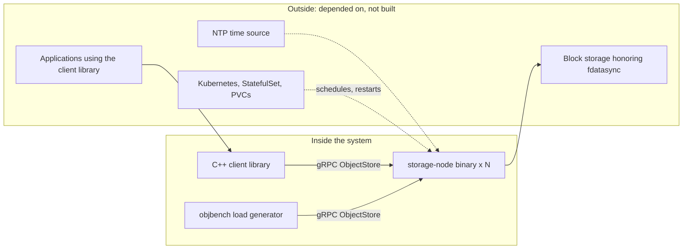

The system **does**: place, replicate, store, verify, recover, and repair objects. It **does not**: authenticate end users with an identity provider, encrypt data at rest, guarantee linearizable reads, provide cross-key transactions, or rebalance automatically when nodes are added at scale.

---

## 2. High-Level Design

### 2.1 Architecture overview

Every storage node runs the **same binary** and plays two roles:

- **Coordinator** for client requests it receives: compute the preference list for the key, fan the request out to replicas, wait for the quorum, respond.
- **Replica** for keys whose preference list includes it: persist chunks and metadata locally, serve local reads, take part in repair.

There is no master, no metadata server, and no ZooKeeper. The ring is derived from a static node list (from Kubernetes StatefulSet DNS names) and a ring epoch number. Liveness comes from node-to-node heartbeats.

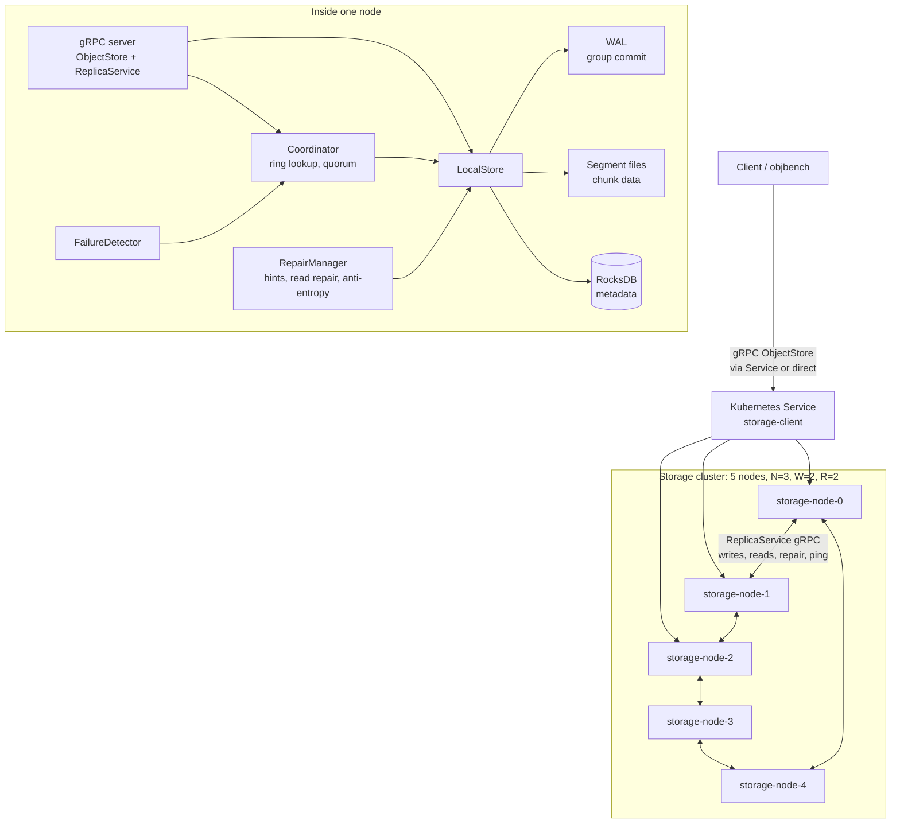

The ring of peer edges is drawn as a cycle for readability; in reality every node can call every other node (full mesh, which is fine for ≤ 8 nodes).

### 2.2 Component responsibilities

| Component | Responsibility | Owns |
| --- | --- | --- |
| `GrpcServer` | Hosts `ObjectStore` (client-facing) and `ReplicaService` (internal) on one port; callback API reactors | Network endpoints |
| `Coordinator` | Version assignment (HLC), preference list, quorum fan-out, read resolution, hint creation, read-repair scheduling | Nothing persistent |
| `RingManager` | Builds and publishes an immutable `Ring` snapshot from the node list, vnode count, and epoch | Ring snapshot |
| `FailureDetector` | Pings peers every 1 s; marks `SUSPECT` after 3 s and `DOWN` after 5 s without a reply | Liveness table |
| `PeerClientPool` | One gRPC channel per peer with keepalive; stubs for `ReplicaService` | Channels |
| `LocalStore` | Facade for local persistence: chunk writes, commit, reads, tombstones | Local data + metadata |
| `SegmentStore` | Append-only data segment files, sharded; offset reservation; sealing | `segments/` |
| `Wal` + `GroupCommitter` | Durable commit log; batches records and `fdatasync`s once per batch | `wal/` |
| `MetadataStore` | RocksDB wrapper with column families; atomic batches | `rocksdb/` |
| `RepairManager` | Replays hints, executes read repairs, runs anti-entropy per vnode range, rate-limited | `hints` CF |
| `Scrubber` | Re-reads sealed segments, verifies CRC32C, reports corrupt chunks to repair | — |
| `Compactor` | Rewrites live chunks out of mostly-dead segments; deletes reclaimed segments | — |
| `IoExecutor` | Bounded thread pool for blocking `pread`/`pwrite` calls | Task queue |
| `AdmissionController` | Caps in-flight client requests per node (default 512) | Counters |

### 2.3 Service boundaries and communication

| From → To | Mechanism | Sync / async | Notes |
| --- | --- | --- | --- |
| Client → any node | gRPC `ObjectStore` over HTTP/2 | Sync (client waits for quorum) | Client streams chunks for Put; server streams chunks for Get |
| Coordinator → replica | gRPC `ReplicaService` | Sync for the quorum, async for the remainder | Coordinator responds after W acks; late acks and failures are handled in the background |
| Node → peer (heartbeat) | gRPC `Ping`, unary, 1 s period, 500 ms deadline | Async | Drives `FailureDetector` |
| Node → peer (repair) | gRPC `ReplicaReadChunks`, `ReplicaWrite`, `RangeDigest`, `RangeKeys` | Async background | Rate-limited to protect foreground latency |
| Node → local disk | `pwrite`/`pread`/`fdatasync` on segments and WAL; RocksDB API | Sync on I/O threads | Never on gRPC callback threads |

### 2.4 Data ownership

- **Object data** (chunk bytes) is owned by the N replicas in the key's preference list. Each replica stores its own full copy.
- **Object metadata** (latest version, size, chunk list, checksums) is also stored by each replica in its local RocksDB. There is **no global metadata store**; metadata is replicated with the data, by the same quorum write.
- **Repair metadata** (hints) is owned by the coordinator that observed the missed write.
- **Ring and membership** are derived state; every node computes the same ring from the same configuration.

### 2.5 Storage architecture (per node)

```text
/data
├── wal/                    # write-ahead log segments (64 MiB each)
│   ├── wal-0000000000000001.log
│   └── wal-0000000000081234.log
├── segments/               # append-only chunk data (1 GiB each)
│   ├── seg-00000001.dat    # sealed
│   ├── seg-00000007.dat    # active, I/O shard 0
│   ├── seg-00000008.dat    # active, I/O shard 1
│   └── ...
└── rocksdb/                # metadata column families
```

**Why separate data and metadata?** Metadata is small, read on every request, needs atomic multi-key updates, and needs ordered iteration (listing, range digests). Chunk data is large, immutable, and read sequentially. Putting multi-MB values into an LSM tree would rewrite them repeatedly during compaction (write amplification of 10× or more). So metadata lives in RocksDB, and data lives in append-only segment files referenced by `(segment_id, offset, length)`.

### 2.6 Synchronous and asynchronous operations

| Operation | Synchronous part | Asynchronous part |
| --- | --- | --- |
| Put | Stream to N replicas; wait for W durable acks | Remaining replica acks; hints for failures |
| Get | Metadata from R replicas; stream chunks from one | Read repair of stale replicas |
| Delete | Tombstone to W replicas | Chunk GC after 24 h grace |
| Repair | — | Hint replay (10 s), anti-entropy (every 10 min per range), scrubber, compaction |

### 2.7 Component interaction diagram

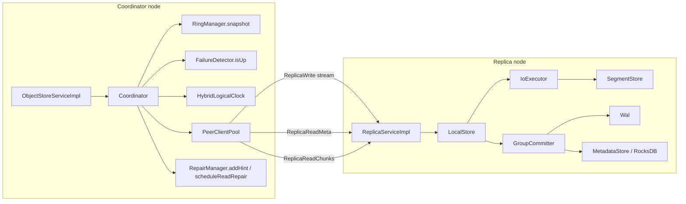

When the coordinator is itself one of the replicas, it calls `LocalStore` directly through the same interface (`ReplicaEndpoint`), with no network hop.

### 2.8 Data-flow architecture

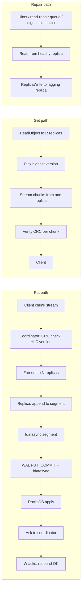

### 2.9 Important sequence: quorum Put (N=3, W=2)

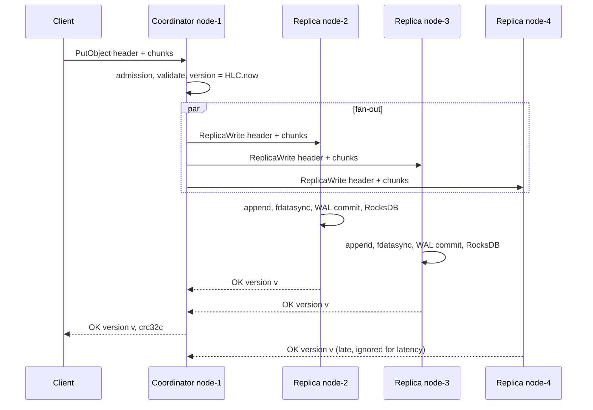

### 2.10 Important sequence: quorum Get (R=2)

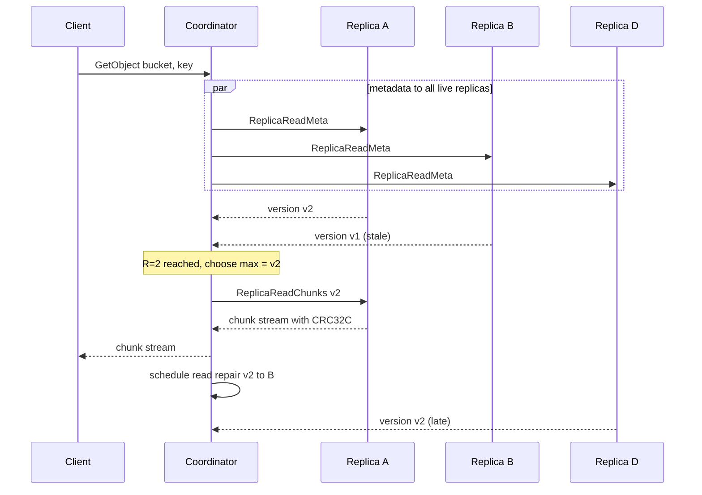

Asking all live replicas and proceeding at the first R responses reduces tail latency at the cost of extra metadata reads.

### 2.11 External dependencies

| Dependency | Used for | If it fails |
| --- | --- | --- |
| Local disk | All persistence | Node marks itself not-ready; peers treat it as down; repair restores its data elsewhere when it returns or is replaced |
| Kubernetes DNS | Peer addresses | Existing channels keep working; new connections fail until DNS recovers |
| NTP | HLC physical component | HLC still orders causally related writes; LWW between concurrent writers may favor the faster clock |

### 2.12 Scaling strategy

- **Capacity:** add nodes; each node owns ~`N / nodes` of the keyspace (with 5 nodes and N=3, ~60% of keys per node). Adding a node bumps the ring epoch; anti-entropy streams keys to the new owner, then old owners drop keys they no longer own after confirming N copies (see limitations).
- **Throughput:** client requests spread over all nodes through the Kubernetes Service; each node's concurrency is bounded by the I/O pool and admission control.
- **Hot keys:** a hot key is served by its N replicas only; reads can use `consistency=ONE` to spread load across all replicas.

### 2.13 Fault tolerance summary

| Failure | Effect with N=3, W=2, R=2 |
| --- | --- |
| 1 replica of a key down | Reads and writes succeed; hints queue for the down node |
| 2 replicas of a key down | Quorum operations fail with `UNAVAILABLE`; `consistency=ONE` reads still work |
| Node crash and restart | WAL replay restores metadata; hints and anti-entropy fill gaps |
| Disk corruption of a chunk | CRC mismatch → read served from another replica → repair rewrites the bad copy |
| Permanent node loss | Replace pod + PVC; anti-entropy rebuilds its ranges from peers |

### 2.14 Deployment architecture

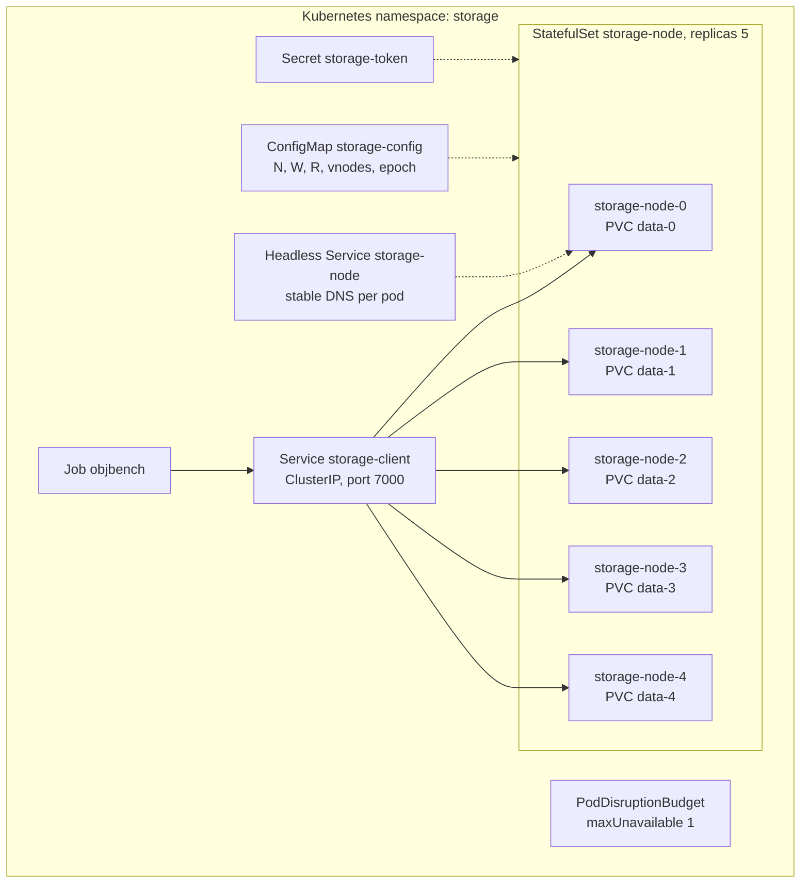

Each pod has its own PersistentVolumeClaim from `volumeClaimTemplates`, so a rescheduled `storage-node-2` gets its old disk back. Pod anti-affinity spreads pods across Kubernetes nodes so one machine failure takes out at most one replica.

---

## 3. Low-Level Design

### 3.1 Module structure

```text
objstore/
├── CMakeLists.txt
├── proto/
│   ├── object_store.proto          # client-facing service
│   └── replica.proto               # node-to-node service
├── src/
│   ├── main.cc                     # flags, config, wiring, signal handling
│   ├── config/NodeConfig.{h,cc}
│   ├── server/
│   │   ├── GrpcServer.{h,cc}
│   │   ├── ObjectStoreServiceImpl.{h,cc}   # callback reactors for client RPCs
│   │   ├── ReplicaServiceImpl.{h,cc}       # callback reactors for internal RPCs
│   │   └── AdmissionController.{h,cc}
│   ├── cluster/
│   │   ├── Ring.{h,cc}                     # immutable ring snapshot
│   │   ├── RingManager.{h,cc}
│   │   ├── FailureDetector.{h,cc}
│   │   ├── PeerClientPool.{h,cc}
│   │   └── HybridLogicalClock.{h,cc}
│   ├── coord/
│   │   ├── Coordinator.{h,cc}
│   │   ├── QuorumTracker.{h,cc}
│   │   ├── ReplicaEndpoint.h               # interface: local or remote replica
│   │   ├── LocalReplicaEndpoint.{h,cc}
│   │   └── RemoteReplicaEndpoint.{h,cc}
│   ├── storage/
│   │   ├── LocalStore.{h,cc}
│   │   ├── SegmentStore.{h,cc}
│   │   ├── Segment.{h,cc}
│   │   ├── Wal.{h,cc}
│   │   ├── WalRecord.{h,cc}
│   │   ├── GroupCommitter.{h,cc}
│   │   ├── MetadataStore.{h,cc}            # RocksDB wrapper
│   │   ├── Recovery.{h,cc}
│   │   └── StripedMutex.h
│   ├── repair/
│   │   ├── RepairManager.{h,cc}
│   │   ├── AntiEntropy.{h,cc}
│   │   ├── Scrubber.{h,cc}
│   │   └── Compactor.{h,cc}
│   ├── util/
│   │   ├── IoExecutor.{h,cc}
│   │   ├── BufferPool.{h,cc}
│   │   ├── Crc32c.h                        # wraps absl::ComputeCrc32c
│   │   ├── TokenBucket.h
│   │   └── Status.h                        # absl::Status helpers
│   └── metrics/Metrics.{h,cc}
├── client/ObjectStoreClient.{h,cc}         # retries, endpoint rotation, CRC verification
├── bench/objbench.cc                       # load generator
├── bench/micro/*.cc                        # Google Benchmark
├── test/                                   # GoogleTest unit + integration
├── docker/Dockerfile
└── k8s/                                    # manifests (documented below, not created here)
```

This tree is the intended layout; no code exists yet.

### 3.2 Class diagram

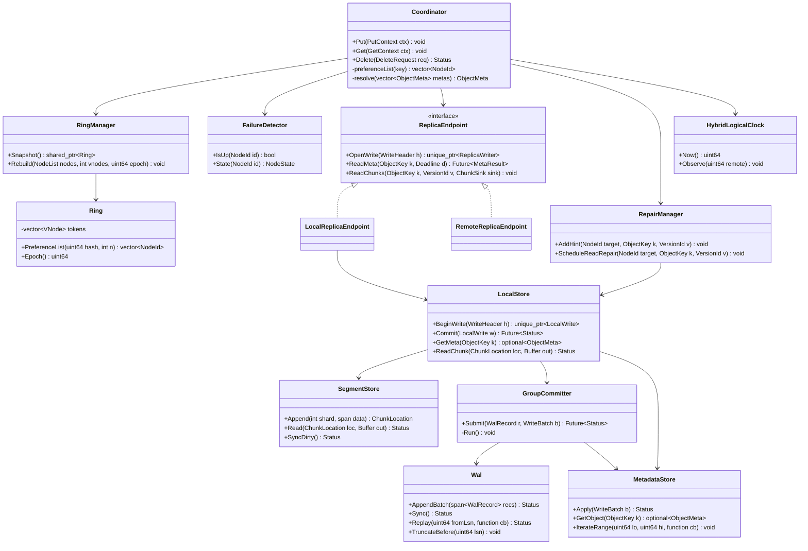

### 3.3 Key interfaces and method signatures

```cpp
// Identifies an object. The ring hashes "bucket/key".
struct ObjectKey {
  std::string bucket;
  std::string key;
  std::string Encoded() const;          // bucket + '\0' + key, used as RocksDB key suffix
  uint64_t RingHash() const;            // XXH64(bucket + "/" + key, seed=0)
};

// Totally ordered version: HLC timestamp first, coordinator node id as tie-breaker.
struct VersionId {
  uint64_t hlc;       // (physical_ms << 16) | logical_counter
  uint32_t node_id;
  auto operator<=>(const VersionId&) const = default;
};

struct ChunkLocation {
  uint32_t segment_id;
  uint64_t offset;    // offset of the record header in the segment file
  uint32_t length;    // payload length
  uint32_t crc32c;    // checksum of the payload
};

struct ObjectMeta {
  VersionId version;
  uint64_t size_bytes;
  uint32_t chunk_count;
  uint32_t object_crc32c;               // CRC32C of the whole object (combined)
  std::string content_type;
  bool tombstone;
  int64_t created_at_ms;
  std::vector<ChunkLocation> chunks;    // local to this replica; not sent to peers
};

class ReplicaEndpoint {                  // implemented locally and remotely
 public:
  virtual ~ReplicaEndpoint() = default;
  virtual std::unique_ptr<ReplicaWriter> OpenWrite(const WriteHeader& h, Deadline d) = 0;
  virtual Future<MetaResult> ReadMeta(const ObjectKey& k, Deadline d) = 0;
  virtual void ReadChunks(const ObjectKey& k, VersionId v, uint32_t from_chunk,
                          ChunkSink* sink, Deadline d) = 0;
};

class ReplicaWriter {                    // one in-flight replicated write
 public:
  virtual bool SendChunk(const ChunkMsg& c) = 0;      // false when the stream failed
  virtual Future<Status> Finish() = 0;                 // resolves after durable commit on the replica
  virtual void Cancel() = 0;
};

class LocalStore {
 public:
  std::unique_ptr<LocalWrite> BeginWrite(const WriteHeader& h);
  absl::Status AppendChunk(LocalWrite& w, std::span<const std::byte> data, uint32_t crc);
  Future<absl::Status> Commit(std::unique_ptr<LocalWrite> w);   // WAL + RocksDB, group-committed
  std::optional<ObjectMeta> GetMeta(const ObjectKey& k) const;
  absl::Status ReadChunk(const ChunkLocation& loc, Buffer& out) const;   // verifies CRC32C
  Future<absl::Status> ApplyTombstone(const ObjectKey& k, VersionId v);
};
```

`Future<T>` is a small promise/future type with continuation callbacks (or `std::future` plus a completion queue). Continuations resume gRPC reactors without blocking callback threads.

### 3.4 Important data structures

| Structure | Type | Purpose | Complexity |
| --- | --- | --- | --- |
| Ring tokens | `std::vector<VNode{uint64 token; uint16 node_idx;}>`, sorted | Consistent hash ring | Lookup `O(log V)`, V = nodes × vnodes = 640 |
| Ring snapshot | `std::atomic<std::shared_ptr<const Ring>>` | Lock-free reads, copy-on-write updates (RCU style) | Read `O(1)` |
| Liveness table | `std::array<std::atomic<NodeState>, kMaxNodes>` + last-seen timestamps | Failure detection | `O(1)` |
| Striped mutex | `std::array<std::mutex, 1024>` indexed by `hash(key) & 1023` | Serializes metadata compare-and-apply per key | `O(1)`; false sharing avoided with `alignas(64)` |
| Segment tail | `std::atomic<uint64_t>` per active segment | Lock-free offset reservation with `fetch_add` | `O(1)` |
| Group-commit queue | `std::deque<PendingCommit>` + mutex + condvar | Batches commits for one `fdatasync` | Amortized `O(1)` |
| Quorum tracker | Counters + `std::atomic<int>` + one-shot promise | Completes when W (or R) responses arrive | `O(1)` per response |
| Buffer pool | Free list of 1 MiB aligned buffers | Avoids malloc/free per chunk | `O(1)` |
| Hint queue | RocksDB `hints` CF keyed `target_node / due_time / key` | Durable repair work | `O(log n)` |
| Read-repair queue | Bounded MPSC queue in memory | Best-effort repairs | `O(1)`; dropped when full (anti-entropy covers it) |

### 3.5 Design patterns

| Pattern | Where | Why |
| --- | --- | --- |
| Strategy / interface | `ReplicaEndpoint` (local vs remote) | Coordinator logic is identical whether a replica is local or remote |
| Reactor | gRPC callback API (`ServerBidiReactor`, `ServerReadReactor`, `ServerWriteReactor`) | Non-blocking streaming without a thread per stream |
| Facade | `LocalStore` | Hides segment / WAL / RocksDB coordination |
| Producer–consumer | `GroupCommitter`, `IoExecutor`, repair queues | Decouple request threads from slow I/O |
| Copy-on-write snapshot | `Ring` | Readers never lock; updates are rare |
| Object pool | `BufferPool` | Reuses 1 MiB buffers |
| RAII | `SegmentRef` (refcount pin), `InflightGuard` (admission), lock guards | Exception-safe and early-return-safe resource release |

### 3.6 Threading model

| Threads | Count (starting point) | Work | May block? |
| --- | --- | --- | --- |
| gRPC callback threads | gRPC-managed (~cores) | Parse messages, CRC verification, quorum bookkeeping, schedule I/O | **No.** Blocking here stalls every stream on the node |
| `IoExecutor` | 8 per node (tune to disk queue depth) | `pwrite` / `pread` on segment files | Yes (disk) |
| `GroupCommitter` | 1 | Batch: `fdatasync` dirty segments → append WAL batch → `fdatasync` WAL → RocksDB `Write` → complete futures | Yes (fsync) |
| `FailureDetector` | 1 timer thread | Sends `Ping`s, updates the liveness table | No (async RPCs) |
| `RepairManager` | 2 | Hint replay, read repair, anti-entropy | Yes; rate-limited by a token bucket (default 50 MiB/s) |
| `Scrubber`, `Compactor` | 1 each, low priority | Background verification and space reclamation | Yes; rate-limited |
| RocksDB background | `max_background_jobs = 4` | Flush and compaction | Internal |

**Rules that keep it correct:**

1. Callback threads never call `pread`, `pwrite`, `fdatasync`, or RocksDB writes; they enqueue to `IoExecutor` / `GroupCommitter` and resume the reactor from the completion callback.
2. The only cross-thread shared mutable state on the write path is the segment tail (atomic), the group-commit queue (mutex), and per-key metadata application (striped mutex).
3. Every queue is bounded. A full `IoExecutor` queue makes new client requests fail fast with `RESOURCE_EXHAUSTED` instead of growing memory.

### 3.7 Synchronization details

| Shared state | Mechanism | Why this one |
| --- | --- | --- |
| Ring snapshot | `std::atomic<std::shared_ptr<const Ring>>` load/store | Read-mostly; readers must never block |
| Segment append offset | `tail.fetch_add(record_size, std::memory_order_relaxed)` | Writers to the same segment reserve disjoint ranges and `pwrite` in parallel; ordering is provided later by `fdatasync` + WAL commit |
| Segment sealing | Writer that crosses the 1 GiB boundary seals under a per-shard mutex and opens the next segment | Rare event; mutex is fine |
| Per-key latest version | `StripedMutex` held during "read current meta → compare versions → write batch" inside `GroupCommitter` apply | Prevents two versions of one key racing in RocksDB |
| Segment lifetime | `std::shared_ptr<Segment>`; readers hold a ref while reading; compactor deletes the file when the last ref drops | No use-after-free; Linux keeps an unlinked file readable while an fd is open |
| Group-commit queue | `std::mutex` + `std::condition_variable` | Simple and contention is low (one consumer) |
| Metrics counters | `std::atomic` / prometheus-cpp | Lock-free increments |

### 3.8 Error handling

- Internally every function returns `absl::Status` / `absl::StatusOr<T>`; exceptions are not used across thread or RPC boundaries.
- Status codes map 1:1 to gRPC codes (`absl::StatusCode` and `grpc::StatusCode` share numbering).
- Disk errors (`EIO`, `ENOSPC`) on the write path fail the replica write with `INTERNAL` / `RESOURCE_EXHAUSTED`; repeated `EIO` flips the node to read-only and not-ready.
- CRC mismatch on read returns `DATA_LOSS` from the replica and enqueues that chunk for repair; the coordinator retries the read on another replica.
- A WAL record with a bad CRC at the tail during replay is treated as a torn write and truncated; a bad CRC in the middle of the log is a fatal corruption that stops startup (requires operator action, and the node is rebuilt from peers).

### 3.9 Critical algorithm: preference list lookup

**Input:** 64-bit key hash `h`, replication factor `N`, ring snapshot.  
**Output:** ordered list of `N` distinct physical nodes.

```cpp
std::vector<NodeId> Ring::PreferenceList(uint64_t h, int n) const {
  std::vector<NodeId> out;
  out.reserve(n);
  auto it = std::upper_bound(tokens_.begin(), tokens_.end(), h,
                             [](uint64_t v, const VNode& t) { return v < t.token; });
  for (size_t step = 0; step < tokens_.size() && (int)out.size() < n; ++step, ++it) {
    if (it == tokens_.end()) it = tokens_.begin();              // wrap around the ring
    NodeId node = nodes_[it->node_idx];
    if (std::find(out.begin(), out.end(), node) == out.end())   // skip duplicate physical nodes
      out.push_back(node);
  }
  return out;
}
```

| Aspect | Detail |
| --- | --- |
| Time | `O(log V)` binary search + `O(k)` walk, where k is the number of vnodes visited to find N distinct nodes (small, typically < 2N) |
| Space | `O(V)` for the ring; `O(N)` per lookup |
| Concurrency | Reads an immutable snapshot; no locks |
| Failure behavior | The list is computed independent of liveness; the coordinator then skips `DOWN` nodes when sending and records hints for them (strict quorum, no sloppy substitutes) |

### 3.10 Critical algorithm: replica write and commit

**Input:** write header (key, version, size, chunk count, object CRC), chunk stream.  
**Output:** durable local version, or an error.

State machine of one replica write:

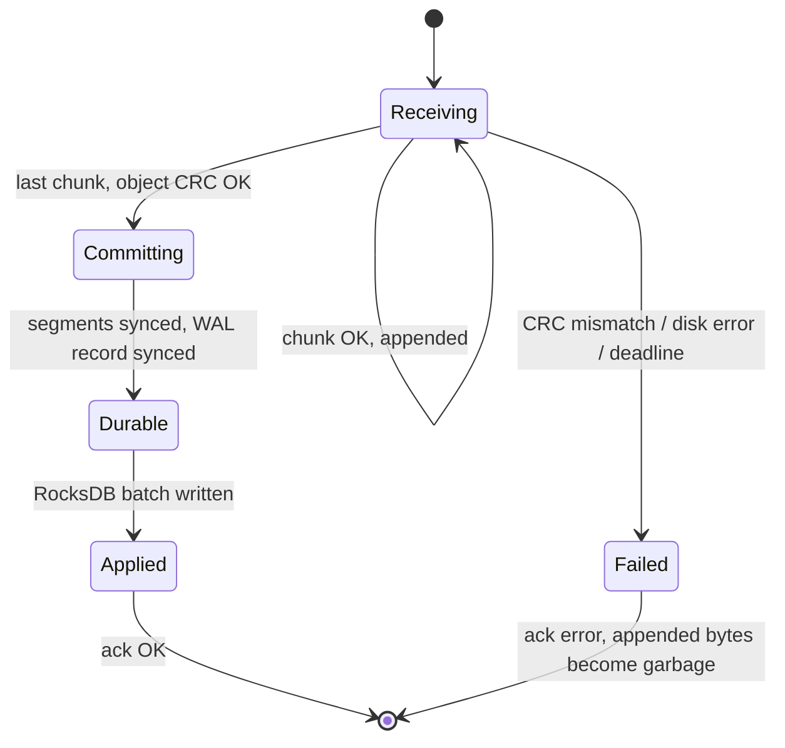

```cpp
// On an IoExecutor thread, per chunk:
absl::Status LocalStore::AppendChunk(LocalWrite& w, std::span<const std::byte> data, uint32_t crc) {
  if (Crc32c(data) != crc) return absl::DataLossError("chunk crc mismatch");
  ChunkLocation loc = segments_.Append(w.shard, data, crc);    // fetch_add + pwrite
  w.locations.push_back(loc);
  w.running_crc = Crc32cExtend(w.running_crc, data);
  return absl::OkStatus();
}

// After the last chunk:
Future<absl::Status> LocalStore::Commit(std::unique_ptr<LocalWrite> w) {
  if (w->running_crc != w->header.object_crc32c) return MakeReady(absl::DataLossError("object crc"));
  WalRecord rec = WalRecord::PutCommit(w->header, w->locations);
  return committer_.Submit(std::move(rec), w->segments_touched);   // resolves after RocksDB apply
}

// GroupCommitter thread loop:
void GroupCommitter::Run() {
  while (running_) {
    auto batch = queue_.PopBatch(/*max_records=*/256, /*max_wait=*/std::chrono::milliseconds(2));
    Status s = segments_.SyncDirty(batch.segments_touched());        // 1) data durable first
    if (s.ok()) s = wal_.AppendBatch(batch.records());               // 2) commit records
    if (s.ok()) s = wal_.Sync();                                     // 3) fdatasync WAL: commit point
    if (s.ok()) s = ApplyToRocksDb(batch);                           // 4) apply with striped locks
    batch.CompleteAll(s);                                            // 5) resolve futures
  }
}

Status GroupCommitter::ApplyToRocksDb(Batch& batch) {
  rocksdb::WriteBatch wb;
  for (auto& rec : batch.records()) {
    auto lock = stripes_.Lock(rec.key());
    auto current = meta_.GetObject(rec.key());
    if (!current || current->version < rec.version())              // last-writer-wins, idempotent
      meta_.PutObject(wb, rec.key(), rec.meta());
    else
      meta_.MarkChunksGarbage(wb, rec);                            // older version lost the race
  }
  meta_.PutAppliedLsn(wb, batch.max_lsn());
  return meta_.Write(wb);   // RocksDB WAL disabled; our WAL is authoritative (see Section 5.6)
}
```

| Aspect | Detail |
| --- | --- |
| Time | `O(S)` for CRC over S bytes; `O(log n)` RocksDB ops per commit; one `fdatasync` pair per **batch**, not per write |
| Space | One 1 MiB buffer per in-flight chunk; batch of ≤ 256 records |
| Concurrency | Chunk appends from many writes proceed in parallel; commits serialize only through the single committer thread, which amortizes fsync |
| Failure behavior | Crash before step 3 → no WAL commit → the write never happened on this replica (appended bytes are garbage). Crash after step 3 but before step 4 → replay re-applies the record on restart |

**Why the order matters:** data must be durable **before** the WAL commit record that references it. If the WAL commit were durable first and the segment data were lost, recovery would apply metadata pointing at garbage. With this order, any committed record's data is guaranteed to be on disk.

### 3.11 Critical algorithm: coordinator quorum write

```cpp
void Coordinator::Put(PutContext& ctx) {
  auto ring = ring_mgr_.Snapshot();
  auto replicas = ring->PreferenceList(ctx.key.RingHash(), cfg_.n);
  VersionId v{hlc_.Now(), cfg_.node_id};
  int w = RequiredAcks(ctx.consistency, cfg_.n);                    // ONE=1, QUORUM=n/2+1, ALL=n

  auto tracker = std::make_shared<QuorumTracker>(w, replicas.size());
  for (NodeId r : replicas) {
    if (!fd_.IsUp(r)) { tracker->Fail(r); repair_.AddHint(r, ctx.key, v); continue; }
    ctx.writers.push_back(Endpoint(r)->OpenWrite(WriteHeader{ctx.key, v, ctx.header}, ctx.deadline));
  }
  if (tracker->Impossible()) return ctx.Finish(absl::UnavailableError("not enough live replicas"));

  // As each client chunk arrives (reactor callback): verify CRC, forward to every writer.
  // gRPC flow control throttles the client when the slowest needed replica falls behind.

  for (auto& wr : ctx.writers) {
    wr->Finish().Then([=](absl::Status s) {
      if (s.ok()) tracker->Ack(wr->node());
      else { tracker->Fail(wr->node()); repair_.AddHint(wr->node(), ctx.key, v); }
    });
  }
  tracker->OnQuorum([&ctx, v] { ctx.Finish(OkWithVersion(v)); });
  tracker->OnImpossible([&ctx] { ctx.Finish(absl::UnavailableError("quorum not reached")); });
  // Deadline expiry before quorum → DEADLINE_EXCEEDED; outstanding replica writes continue
  // in the background and either commit or produce hints.
}
```

| Aspect | Detail |
| --- | --- |
| Time | Latency ≈ max over the W fastest replicas of (transfer + fsync batch), not the slowest of N |
| Space | One `ReplicaWriter` per replica; chunks are forwarded, not buffered for the whole object (bounded by flow-control windows) |
| Failure behavior | Fewer than W successes → client gets an error, **but some replicas may have committed** (see Section 8.6, "unknown outcome") |

---

## 4. API Design

The system exposes **gRPC only**. There is no REST API. Two services share one port (7000) on every node:

- `objstore.v1.ObjectStore`: client-facing.
- `objstore.v1.ReplicaService`: node-to-node; clients must not call it (it is rejected without the internal token).

### 4.1 Client-facing service definition

```protobuf
syntax = "proto3";
package objstore.v1;

enum Consistency {
  CONSISTENCY_UNSPECIFIED = 0;   // server default: QUORUM
  ONE = 1;
  QUORUM = 2;
  ALL = 3;
}

service ObjectStore {
  // Client streaming: first message is the header, then data chunks in order.
  rpc PutObject(stream PutObjectRequest) returns (PutObjectResponse);
  // Server streaming: first message carries metadata, then data chunks in order.
  rpc GetObject(GetObjectRequest) returns (stream GetObjectResponse);
  rpc HeadObject(HeadObjectRequest) returns (ObjectMetadata);
  rpc DeleteObject(DeleteObjectRequest) returns (DeleteObjectResponse);
  rpc ListObjects(ListObjectsRequest) returns (ListObjectsResponse);
}

message PutObjectRequest {
  oneof part {
    PutHeader header = 1;
    Chunk chunk = 2;
  }
}

message PutHeader {
  string bucket = 1;              // [a-z0-9-], 3..63 chars
  string key = 2;                 // UTF-8, 1..1024 bytes
  uint64 size_bytes = 3;          // total object size, <= 64 MiB
  uint32 object_crc32c = 4;       // CRC32C of the whole object
  string content_type = 5;
  Consistency consistency = 6;    // write quorum level
  string request_id = 7;          // client-generated UUID, for logs and dedup of retries
}

message Chunk {
  uint32 index = 1;               // 0-based, contiguous
  bytes data = 2;                 // exactly 1 MiB except the last chunk
  uint32 crc32c = 3;              // CRC32C of data
}

message PutObjectResponse {
  string version = 1;             // opaque, e.g. "0000018f3a2b4c5d0001-3"
  uint32 object_crc32c = 2;
  uint32 replicas_acked = 3;      // >= W at response time
}

message GetObjectRequest {
  string bucket = 1;
  string key = 2;
  Consistency consistency = 3;    // read quorum level
  uint32 from_chunk = 4;          // resume a broken download
}

message GetObjectResponse {
  oneof part {
    ObjectMetadata metadata = 1;  // always the first message
    Chunk chunk = 2;
  }
}

message ObjectMetadata {
  string bucket = 1;
  string key = 2;
  string version = 3;
  uint64 size_bytes = 4;
  uint32 chunk_count = 5;
  uint32 object_crc32c = 6;
  string content_type = 7;
  int64 created_at_ms = 8;
}

message HeadObjectRequest   { string bucket = 1; string key = 2; Consistency consistency = 3; }
message DeleteObjectRequest { string bucket = 1; string key = 2; Consistency consistency = 3; string request_id = 4; }
message DeleteObjectResponse { string version = 1; }   // version of the tombstone

message ListObjectsRequest {
  string bucket = 1;
  string prefix = 2;
  uint32 page_size = 3;           // 1..1000, default 100
  string page_token = 4;          // opaque: last key returned
}
message ListObjectsResponse {
  repeated ObjectMetadata objects = 1;
  string next_page_token = 2;     // empty when done
}
```

### 4.2 Internal service definition

```protobuf
service ReplicaService {
  rpc ReplicaWrite(stream ReplicaWriteRequest) returns (ReplicaWriteResponse);
  rpc ReplicaReadMeta(ReplicaReadMetaRequest) returns (ReplicaReadMetaResponse);
  rpc ReplicaReadChunks(ReplicaReadChunksRequest) returns (stream Chunk);
  rpc RangeDigest(RangeDigestRequest) returns (RangeDigestResponse);
  rpc RangeKeys(RangeKeysRequest) returns (stream KeyVersion);
  rpc Ping(PingRequest) returns (PingResponse);
}

message VersionId { uint64 hlc = 1; uint32 node_id = 2; }

message ReplicaWriteHeader {
  string bucket = 1;
  string key = 2;
  VersionId version = 3;
  uint64 size_bytes = 4;
  uint32 chunk_count = 5;
  uint32 object_crc32c = 6;
  string content_type = 7;
  bool tombstone = 8;             // deletes travel as tombstone writes with no chunks
  uint64 ring_epoch = 9;          // replica rejects writes from a different epoch
  bool is_repair = 10;            // repair writes are lower priority and rate-limited
}
message ReplicaWriteRequest { oneof part { ReplicaWriteHeader header = 1; Chunk chunk = 2; } }
message ReplicaWriteResponse { VersionId applied = 1; bool superseded = 2; }   // superseded: a newer version already existed

message ReplicaReadMetaRequest  { string bucket = 1; string key = 2; }
message ReplicaReadMetaResponse { bool found = 1; ObjectMetadata meta = 2; VersionId version = 3; bool tombstone = 4; }

message ReplicaReadChunksRequest { string bucket = 1; string key = 2; VersionId version = 3; uint32 from_chunk = 4; }

message RangeDigestRequest  { uint64 range_start = 1; uint64 range_end = 2; uint32 buckets = 3; }
message RangeDigestResponse { repeated fixed64 bucket_digests = 1; uint64 key_count = 2; }
message RangeKeysRequest    { uint64 range_start = 1; uint64 range_end = 2; }
message KeyVersion          { string bucket = 1; string key = 2; VersionId version = 3; bool tombstone = 4; }

message PingRequest  { uint32 from_node = 1; uint64 ring_epoch = 2; uint64 hlc = 3; }
message PingResponse { uint32 node_id = 1; uint64 ring_epoch = 2; uint64 hlc = 3; bool ready = 4; }
```

### 4.3 RPC reference

| RPC | Type | Purpose | Default deadline | Idempotent? |
| --- | --- | --- | --- | --- |
| `PutObject` | Client stream | Store a new version | `2 s + 0.5 s per MiB` (client-set) | Retry-safe: a retry creates a newer version with the same content |
| `GetObject` | Server stream | Read latest version | `2 s + 0.5 s per MiB` | Yes |
| `HeadObject` | Unary | Metadata only | 500 ms | Yes |
| `DeleteObject` | Unary | Write a tombstone | 1 s | Yes (newer tombstone wins) |
| `ListObjects` | Unary | Scatter-gather listing | 2 s | Yes |
| `ReplicaWrite` | Client stream | Persist one version locally | Coordinator's remaining deadline − 50 ms | Yes (LWW apply) |
| `ReplicaReadMeta` | Unary | Local metadata | Remaining deadline | Yes |
| `ReplicaReadChunks` | Server stream | Local chunk data | Remaining deadline | Yes |
| `RangeDigest` / `RangeKeys` | Unary / stream | Anti-entropy | 10 s / 60 s | Yes |
| `Ping` | Unary | Heartbeat + HLC/epoch gossip | 500 ms | Yes |

### 4.4 Serialization

- Protocol Buffers (proto3) over HTTP/2 frames. A 1 MiB chunk message is ~1 MiB + a few bytes of field tags.
- `grpc.max_receive_message_length` is raised to 2 MiB (the default 4 MiB would also fit; keeping it tight bounds memory per stream).
- Chunk bytes are parsed into a protobuf `bytes` field (one copy from the gRPC slice). The optimized path forwards the received serialized message to replicas through a generic `grpc::ByteBuffer` stub, which avoids re-serializing each chunk once per replica (see Section 10).

### 4.5 Authentication and authorization

- **Client → node:** a static bearer token in gRPC metadata (`authorization: Bearer <token>`), stored in a Kubernetes Secret and compared in constant time. Per-bucket authorization is out of scope.
- **Node → node:** a separate internal token in metadata (`x-objstore-internal`). TLS (and mTLS) is supported by gRPC credentials and recommended outside a trusted network; it is off in the default benchmark to keep CPU comparisons simple, and that fact must be reported with results.

### 4.6 Validation

| Field | Rule | Error |
| --- | --- | --- |
| `bucket` | `^[a-z0-9-]{3,63}$` | `INVALID_ARGUMENT` |
| `key` | 1–1024 bytes UTF-8, no `\0` | `INVALID_ARGUMENT` |
| `size_bytes` | ≤ 64 MiB; equals the sum of chunk lengths | `INVALID_ARGUMENT` / `OUT_OF_RANGE` |
| Chunks | Contiguous indexes from 0; every chunk 1 MiB except the last | `INVALID_ARGUMENT` |
| `crc32c` | Matches the data | `DATA_LOSS` |
| `object_crc32c` | Matches the combined CRC after the last chunk | `DATA_LOSS` |
| First stream message | Must be a header | `INVALID_ARGUMENT` |

### 4.7 Status codes

| Code | When | Client action |
| --- | --- | --- |
| `OK` | Success | — |
| `INVALID_ARGUMENT` | Validation failure | Fix the request |
| `UNAUTHENTICATED` | Missing or bad token | Fix credentials |
| `NOT_FOUND` | No version, or latest version is a tombstone | — |
| `DATA_LOSS` | Checksum mismatch in the request; or every replica's copy failed verification | Retry upload; for reads, alert (should not happen with ≥ 1 healthy replica) |
| `UNAVAILABLE` | Fewer than W (or R) live replicas; node draining | Retry with backoff, preferably on another node |
| `DEADLINE_EXCEEDED` | Quorum not reached in time | Retry (Put outcome is unknown; see 8.6) |
| `RESOURCE_EXHAUSTED` | Admission limit, I/O queue full, or disk full | Back off and retry |
| `ABORTED` | Ring epoch mismatch between coordinator and replica | Retry; the client library refreshes its endpoint |
| `INTERNAL` | Unexpected server error | Retry with backoff |

### 4.8 Deadlines and timeouts

- Clients **must** set a deadline. The coordinator reads `context->deadline()` and passes `remaining − 50 ms` to replica RPCs, so replicas give up before the client does and the coordinator can still respond with a precise status.
- If the deadline expires after the quorum was reached, the response is already sent; late replicas keep going in the background.
- Heartbeats use a 500 ms deadline; a missed heartbeat is not itself an error.
- gRPC keepalive: `GRPC_ARG_KEEPALIVE_TIME_MS = 10000`, `GRPC_ARG_KEEPALIVE_TIMEOUT_MS = 3000` on peer channels, so a dead peer TCP connection is detected without waiting for an OS timeout.

### 4.9 Client library behavior

The C++ client (`ObjectStoreClient`) is part of the project:

- Splits uploads into 1 MiB chunks and computes CRC32C per chunk plus the combined object CRC.
- Rotates across node endpoints (or uses the Service VIP); retries `UNAVAILABLE`, `RESOURCE_EXHAUSTED`, `ABORTED`, and `DEADLINE_EXCEEDED` with exponential backoff and jitter (50 ms base, ×2, max 1 s, 3 attempts), each attempt on a different node when possible.
- Verifies chunk CRC32C on download and the object CRC at the end; on mismatch it retries from the failed chunk using `from_chunk`.

### 4.10 What happens internally per RPC

| RPC | Internal steps |
| --- | --- |
| `PutObject` | Admission → auth → header validation → HLC version → preference list → open N `ReplicaWriter`s (skip `DOWN` nodes, hint them) → per chunk: verify CRC, forward to writers → after last chunk: `Finish()` all → respond at W acks → background: remaining acks, hints |
| `GetObject` | Admission → auth → preference list → `ReplicaReadMeta` to all live replicas → at R responses choose max version (tombstone → `NOT_FOUND`) → stream chunks from the best replica holding that version (local first) → on `DATA_LOSS` or stream failure, resume from the failed chunk on another replica → schedule read repair for stale replicas |
| `HeadObject` | Same as Get without chunks |
| `DeleteObject` | Same as Put with `tombstone=true` and no chunks |
| `ListObjects` | Fan out to all live nodes: each returns up to `page_size` local keys `> page_token` with the prefix, from a RocksDB iterator, latest version only → coordinator merges sorted lists, de-duplicates keys, drops tombstones, returns the first `page_size` with `next_page_token` = last key. Best-effort: a key whose replicas are all temporarily down is missing from that page |

---

## 5. Storage and Metadata Design

### 5.1 Object and chunk representation

```text
Object "photos/cat.jpg", 2.5 MiB, version v = (hlc=0x18f3a2b4c5d0001, node=3)
├── chunk 0: 1 MiB    crc32c=0x8a1f...   chunk_id = v:0
├── chunk 1: 1 MiB    crc32c=0x11c4...   chunk_id = v:1
└── chunk 2: 0.5 MiB  crc32c=0x93de...   chunk_id = v:2
object_crc32c = crc32c_combine(c0, c1, c2)
```

- A **chunk** is the unit of transfer, checksum, and storage: 1 MiB except the last.
- A **version** is immutable. Overwrites create a new version with new chunks; the old version's chunks become garbage when the new version is applied.
- Chunk ids are derived from `(version, index)`, so they are unique and never overwritten. That removes any need for in-place updates or rename-based atomicity.

### 5.2 Segment file layout

Chunk data is appended to large **segment files** (1 GiB, preallocated with `fallocate`). Each node has 4 I/O shards; each shard has one active segment. A write picks a shard by `hash(key) % 4`.

```text
Segment file seg-00000007.dat
┌───────────────────────── record ─────────────────────────┐
│ magic u32 = 0x4F424A43 ("OBJC")                          │
│ header_crc u32   (CRC32C of the next 5 fields)           │
│ chunk_index u32                                          │
│ version_hlc u64 | version_node u32                       │
│ key_hash u64                                             │
│ payload_len u32                                          │
│ payload_crc u32  (CRC32C of payload)                     │
│ payload bytes [payload_len]                              │
│ padding to 4 KiB alignment                               │
└──────────────────────────────────────────────────────────┘
... next record ...
```

- The header is self-describing so the scrubber and compactor can walk a segment without RocksDB, and recovery can verify that a location really holds the expected chunk (key hash + version + index).
- Padding to 4 KiB keeps records page-aligned, which makes `pread` of a whole record one aligned I/O and allows `O_DIRECT` later if desired. The cost is internal fragmentation for small objects (a 4 KiB object uses 8 KiB with header and padding). The alignment is configurable; for a small-object workload, 512-byte alignment is a reasonable choice.
- Segments are **sealed** when full. Sealed segments are read-only and eligible for scrubbing and compaction.

**Why segments instead of one file per chunk?** File-per-chunk costs `open` + `write` + `fsync` + `close` + directory `fsync` per chunk, inode pressure, and many small random writes. Segments turn writes into appends to a handful of open files and let one `fdatasync` cover many chunks. This is the main I/O optimization measured in the CPU claim (Section 10).

### 5.3 RocksDB metadata model

Column families:

| CF | Key | Value | Purpose |
| --- | --- | --- | --- |
| `objects` | `bucket \0 key` | `ObjectMeta` (protobuf): version, size, chunk count, object CRC, content type, tombstone flag, created_at, chunk locations | Latest version per key on this replica |
| `ring_index` | `ring_hash(8B big-endian) bucket \0 key` | `VersionId` + tombstone flag | Ordered by ring position for range digests and range scans |
| `chunks_gc` | `segment_id(4B) offset(8B)` | `length` | Dead chunk records (superseded or deleted versions); drives compaction |
| `segments` | `segment_id` | `{state: ACTIVE/SEALED/COMPACTING, size, live_bytes, dead_bytes}` | Segment accounting |
| `hints` | `target_node(4B) due_ms(8B) bucket \0 key` | `VersionId`, attempts | Durable repair work queue |
| `meta` | fixed keys | `applied_lsn`, `node_id`, `ring_epoch`, `format_version` | Node state |

Example values (shown as JSON for readability; stored as protobuf):

```json
{
  "objects/photos\u0000cat.jpg": {
    "version": { "hlc": "0x018f3a2b4c5d0001", "node": 3 },
    "size": 2621440, "chunkCount": 3, "objectCrc32c": "0x5e2b91c0",
    "contentType": "image/jpeg", "tombstone": false, "createdAtMs": 1739001234567,
    "chunks": [
      { "segment": 7, "offset": 104857600, "len": 1048576, "crc32c": "0x8a1f03b2" },
      { "segment": 7, "offset": 105910272, "len": 1048576, "crc32c": "0x11c4aa09" },
      { "segment": 7, "offset": 106962944, "len": 524288,  "crc32c": "0x93de7711" }
    ]
  }
}
```

RocksDB options of note:

| Option | Value | Reason |
| --- | --- | --- |
| `disableWAL` (per write) | `true` | Our WAL is the commit log; avoids double logging (Section 5.6) |
| `atomic_flush` | `true` | All column families flush together so `applied_lsn` is consistent with every CF after a crash |
| Bloom filter | 10 bits/key on `objects` | Point lookups for absent keys skip SST reads |
| Block cache | 256 MiB (shared) | Metadata working set stays in memory |
| `max_background_jobs` | 4 | Flush/compaction parallelism |
| Compression | LZ4 on upper levels, ZSTD bottommost | Metadata is small; compression is cheap |

### 5.4 Key distribution

- Ring hash: `XXH64("bucket/key")`, a 64-bit position on the ring.
- 128 virtual nodes per physical node by default. Each vnode token is `XXH64(node_name + "#" + i)`.
- With V = 640 tokens on 5 nodes, the standard deviation of per-node load is a few percent (it shrinks roughly with `1/sqrt(vnodes)`); without vnodes (1 token per node), one node could own far more than its share.
- Preference list = first N distinct physical nodes clockwise from the key's position.

### 5.5 Replication metadata

Per object, every replica stores the full `ObjectMeta`, including the `VersionId`. There is no separate "which replicas have it" table: placement is computed from the ring. Repair state that does need storing:

- **Hints** at the coordinator: "node X should have key K at version ≥ v".
- **Ring epoch** in every write header and ping: a replica rejects writes stamped with a different epoch (`ABORTED`), which prevents a stale coordinator from writing under an old placement during a topology change.

### 5.6 WAL structure

```text
wal/wal-<first_lsn, 16 hex>.log      64 MiB segments, preallocated

Record:
┌────────────────────────────────────────────┐
│ magic u32 = 0x57414C31 ("WAL1")            │
│ lsn u64          (monotonic per node)      │
│ type u8          PUT_COMMIT | TOMBSTONE |  │
│                  GC_CHUNKS | CHUNK_MOVE    │
│ payload_len u32                            │
│ payload bytes    (protobuf)                │
│ crc32c u32       (over lsn..payload)       │
└────────────────────────────────────────────┘
```

| Record type | Payload | Replay action |
| --- | --- | --- |
| `PUT_COMMIT` | key, version, size, object CRC, content type, chunk locations | Apply LWW: write `objects` + `ring_index` if newer; else mark chunks garbage |
| `TOMBSTONE` | key, version | Apply LWW tombstone |
| `GC_CHUNKS` | list of `(segment, offset, len)` freed | Remove from `chunks_gc`; update segment accounting |
| `CHUNK_MOVE` | key, version, old location → new location | Compaction moved a live chunk; update `objects` |

**Why our own WAL when RocksDB has one?** A put touches two stores: segment files (data) and RocksDB (metadata). RocksDB's WAL only covers RocksDB. Our WAL is the single commit point for the whole operation, and it records chunk locations so recovery can validate them. With our WAL authoritative, RocksDB's WAL is redundant, so writes use `disableWAL=true` and RocksDB is made consistent by `atomic_flush` plus `applied_lsn`:

1. Each RocksDB batch includes `meta/applied_lsn = max LSN in the batch`.
2. After a crash, RocksDB recovers to its last flushed state; `applied_lsn` tells us how far that state goes.
3. We replay our WAL from `applied_lsn + 1`.

**WAL truncation.** Every 5 minutes (or when the WAL exceeds 512 MiB), the node calls `Flush()` on RocksDB (atomic across CFs), reads back `applied_lsn`, and deletes WAL segments whose last LSN ≤ `applied_lsn`. Recovery time is therefore bounded by the WAL tail since the last flush.

### 5.7 Checksums

| Checksum | Computed by | Verified by | Detects |
| --- | --- | --- | --- |
| Chunk CRC32C | Client | Coordinator on receive; replica on receive; replica on every read; client on download; scrubber | Network/memory corruption, disk bit rot, misdirected reads |
| Object CRC32C | Client | Coordinator and replicas after the last chunk; client after download | Missing, duplicated, or reordered chunks |
| Segment record header CRC | Replica | Reader, scrubber, compactor | Torn or misdirected record headers |
| WAL record CRC32C | Replica | Recovery | Torn writes at the WAL tail; corruption |

CRC32C detects all single-bit and burst errors up to 32 bits and random corruption with probability `1 − 2^-32`. It is not a cryptographic hash and does not protect against deliberate tampering; that is acceptable for an integrity (not security) mechanism.

### 5.8 Recovery metadata

| Item | Where | Used for |
| --- | --- | --- |
| `applied_lsn` | RocksDB `meta` | Where WAL replay starts |
| WAL segments | `wal/` | Re-applying committed records |
| Segment states and sizes | RocksDB `segments` + file sizes | Detecting the active segment's valid tail |
| Hints | RocksDB `hints` | Resuming repair after restart |
| `ring_epoch` | RocksDB `meta` | Rejecting stale-epoch writes after restart |

### 5.9 Garbage collection and compaction

1. When a newer version (or tombstone) is applied, the old version's chunk locations go to `chunks_gc`, and the segment's `dead_bytes` increases.
2. Tombstones are kept for a **grace period of 24 hours**, longer than the maximum time a replica can be down and still be repaired by hints. Afterwards the tombstone itself is removed. Removing it sooner could let a replica that missed the delete resurrect the object through anti-entropy.
3. The compactor picks sealed segments with `live_ratio < 50%`, copies live records to an active segment, writes `CHUNK_MOVE` WAL records, waits for them to commit, then deletes the old segment file once no reader holds a reference.

---

## 6. Core Algorithms and Engineering Techniques

### 6.1 Consistent hashing with virtual nodes

1. **Problem:** map keys to nodes so that adding or removing a node moves only a small fraction of keys.
2. **Why required:** `hash(key) % nodes` remaps almost every key when `nodes` changes, which would mean copying nearly all data.
3. **Core idea:** place nodes and keys on the same 64-bit ring; a key belongs to the next nodes clockwise. Virtual nodes (128 tokens per node) smooth the distribution and spread a failed node's load over all survivors.
4. **Steps:** hash the key → binary-search the sorted token vector → walk clockwise collecting N distinct physical nodes.
5. **Pseudocode:** Section 3.9.
6. **Time:** `O(log V)` per lookup; building the ring `O(V log V)`.
7. **Space:** `O(V)`, about 640 × 10 bytes.
8. **Alternatives:** modulo hashing; rendezvous (HRW) hashing (`O(nodes)` per lookup, no vnodes needed); jump consistent hash (no arbitrary node removal); a central placement directory.
9. **Advantages:** no directory; minimal movement (~`1/nodes` of keys) on membership change; every node computes placement locally.
10. **Disadvantages:** ring metadata must be identical everywhere (epoch); load is only statistically balanced; hot keys are not addressed.
11. **Failure scenarios:** two nodes with different ring configs compute different preference lists → writes land on wrong replicas. Mitigation: the epoch in every write header and ping; mismatches are rejected with `ABORTED` and logged.
12. **Interview explanation:** "Each node owns 128 points on a 64-bit ring. A key goes to the first three distinct nodes clockwise. When a node joins, it only takes over the arcs right before its points, about one fifth of the data in a five-node cluster, instead of reshuffling everything."

### 6.2 Quorum replication with tunable N, W, R

1. **Problem:** keep N copies and stay available when some replicas are down, while still letting reads see recent writes.
2. **Why:** writing to all N blocks on the slowest or a dead replica; writing to one risks loss.
3. **Core idea:** a write succeeds after W replicas durably store it; a read consults R replicas and takes the highest version. If `R + W > N`, every read quorum overlaps every write quorum in at least one replica.
4. **Steps:** fan out to all N preference-list replicas; respond at W acks; read metadata from replicas and respond at R; pick the max `VersionId`.
5. **Pseudocode:** Section 3.11 (write); Section 7.2 (read).
6. **Time:** latency is the W-th fastest replica for writes and the R-th fastest for reads; messages `O(N)` per operation.
7. **Space:** N × object size cluster-wide.
8. **Alternatives:** primary-backup (one leader orders writes, requires failover); Raft/Paxos per shard (linearizable, needs a leader and log); chain replication.
9. **Advantages:** no leader election; availability with one replica down; per-request trade-off (`ONE` for speed, `ALL` for safety).
10. **Disadvantages:** not linearizable; concurrent writes resolved by LWW (one is silently lost); a failed write may be partially applied.
11. **Failure scenarios:** a write reaches only one replica before timing out. The client sees an error, but a later read may return that version if the read quorum includes that replica (or after repair spreads it). This is the classic "unknown outcome" of quorum systems (Section 8.6).
12. **Interview explanation:** "N=3, W=2, R=2 means any two replicas you write to and any two you read from share at least one node, so a read after a successful write sees it, as long as no newer concurrent write intervenes. If one node dies, two-of-three still works for both reads and writes."

| Setting | Guarantees | Use when |
| --- | --- | --- |
| N=3, W=2, R=2 (default) | Read-your-write after a successful write; tolerates 1 replica down | General purpose |
| N=3, W=3, R=1 | Fast reads; any replica failure blocks writes | Read-heavy, rare writes |
| N=3, W=1, R=3 | Fast writes; reads block on failure; risk of loss if the one replica dies before repair | Rarely sensible |
| N=3, W=1, R=1 | Highest availability, eventual consistency only | Caches, regenerable data |

### 6.3 Hybrid logical clock versions and last-writer-wins

1. **Problem:** replicas must agree which version is newest without coordination.
2. **Why:** leaderless replicas receive concurrent writes in different orders.
3. **Core idea:** each coordinator stamps a version `(hlc, node_id)`. The HLC is `max(physical_ms, last_seen) << 16 | counter`, so it stays close to wall time but never goes backward and respects causality when nodes exchange timestamps (pings and write headers carry HLCs).
4. **Steps:**
   - `Now()`: `pt = wall_ms(); if (pt > l) { l = pt; c = 0; } else { c++; } return (l << 16) | c;`
   - `Observe(remote)`: `l = max(l, remote.l, pt)`; adjust `c` accordingly.
   - Every replica applies a version only if it is greater than the stored one.
5. **Pseudocode:** above; apply logic in Section 3.10.
6. **Time / space:** `O(1)`; 12 bytes per version.
7. **Alternatives:** vector clocks with sibling versions returned to the client (Dynamo/Riak); a central timestamp oracle; per-key leader ordering.
8. **Advantages:** deterministic convergence; tiny metadata; no siblings to resolve.
9. **Disadvantages:** concurrent writes lose data silently (one write wins); with clock skew, the write that happened later in real time can lose to one from a node whose clock is ahead.
10. **Failure scenario:** node A's clock is 300 ms ahead. Client 1 writes via A at t=0; client 2 writes via B at t=100 ms. A's version is larger, so client 1's (earlier) write wins. Documented behavior; mitigated by NTP and by clients avoiding concurrent writers per key.
11. **Interview explanation:** "Versions are HLC timestamps with the node id as tie-breaker, so every replica picks the same winner without talking to the others. It's last-writer-wins, which is fine for immutable blobs where concurrent writes to one key are rare, but I'd say clearly that it can drop one of two concurrent writes."

### 6.4 Write-ahead logging with group commit

1. **Problem:** a crash in the middle of a put must not leave metadata pointing to missing data or lose acknowledged writes.
2. **Why:** a put touches data segments and RocksDB; neither alone is atomic across both.
3. **Core idea:** persist data, then persist a small commit record in an append-only log; acknowledge only after the log record is durable; rebuild any derived state by replaying the log.
4. **Steps:** append chunks → enqueue commit → committer batches up to 256 commits or 2 ms → `fdatasync` touched segments → append WAL batch → `fdatasync` WAL → apply to RocksDB → resolve futures.
5. **Pseudocode:** Section 3.10.
6. **Time:** `O(batch)` per commit cycle; amortized fsync cost per write = fsync latency / batch size.
7. **Space:** WAL bounded by the truncation policy (≤ 512 MiB).
8. **Alternatives:** fsync per write (simple, slow); RocksDB's WAL only (does not cover segment data); no WAL with idempotent re-replication from peers (slower recovery, relies on peers).
9. **Advantages:** one durable commit point; fast sequential appends; group commit amortizes fsync across concurrent writers.
10. **Disadvantages:** up to 2 ms batching delay at low load; the single committer thread is a serialization point (fine at hundreds of commits/s; at very high rates, shard the WAL).
11. **Failure scenarios:** torn final WAL record → CRC fails → truncate the tail. Since that record was never acknowledged, nothing acknowledged is lost.
12. **Interview explanation:** "A put is durable once its WAL record is fsynced, and the data it points to was fsynced before that. Group commit means a hundred concurrent puts share one fsync, which is why the WAL makes us faster, not slower, under concurrency."

### 6.5 Lock-free append with offset reservation

1. **Problem:** many concurrent writers appending to the same segment file.
2. **Why:** a mutex around `write()` serializes all disk writes on that segment.
3. **Core idea:** `offset = tail.fetch_add(record_size)` reserves a unique byte range atomically; each writer then calls `pwrite(fd, buf, len, offset)` independently. Positional writes don't share the file offset, so they are safe in parallel.
4. **Steps:** compute aligned record size → `fetch_add` → if the reservation crosses the segment end, seal and retry on a new segment under the shard mutex → `pwrite` → record location.
5. **Time / space:** `O(1)` reservation; no extra memory.
6. **Alternatives:** mutex + `write`; a single writer thread per segment with a queue.
7. **Advantages:** parallel I/O submission; no lock on the hot path.
8. **Disadvantages:** a failed writer leaves a hole of garbage; holes are harmless because no committed metadata references them, and compaction reclaims them.
9. **Failure scenario:** a crash after `pwrite` but before commit → bytes on disk, nothing references them → garbage.
10. **Interview explanation:** "Reservation is an atomic add; after that, each thread owns its byte range and uses pwrite, so there's nothing to lock. Durability ordering comes later from the group commit."

### 6.6 Checksum validation pipeline

1. **Problem:** silent corruption anywhere between the client's memory and the disk and back.
2. **Core idea:** end-to-end CRC32C computed once by the client, verified at every hop and at rest; never recomputed and trusted without comparison.
3. **Steps:** client computes → coordinator verifies → replica verifies before writing → replica verifies on every read → client verifies → scrubber re-verifies sealed segments at a low rate.
4. **Time:** `O(bytes)` at ~10+ GB/s per core with hardware CRC32C.
5. **Alternatives:** SHA-256 (cryptographic, ~10–20× slower without SHA extensions); xxHash64 (fast, not hardware-standard for storage); no checksum (rely on TCP and disk ECC, which miss real-world corruption).
6. **Failure scenario:** a replica's disk flips a bit in a sealed segment. The next read or scrub detects it; the replica returns `DATA_LOSS` for that chunk; the coordinator reads from another replica; repair rewrites a fresh copy and the bad record is marked dead.
7. **Interview explanation:** "The checksum is born at the client and checked everywhere the bytes move or rest, so corruption is caught at the boundary where it happens, not discovered months later."

### 6.7 Hinted repair, read repair, and anti-entropy

| Mechanism | Trigger | Finds | Latency to repair | Cost |
| --- | --- | --- | --- | --- |
| Hinted repair | A replica missed a write (down, timeout, error) | Exactly the missed versions | Seconds after the node returns | One hint per missed write |
| Read repair | A read sees a stale or missing replica | Stale keys that are being read | Immediately after the read | Extra write per stale read |
| Anti-entropy | Every 10 minutes per vnode range | Anything: lost hints, replaced disks, missed deletes | Up to one cycle | Digest exchange + key lists for mismatched buckets |

**Hint replay algorithm**

```cpp
void RepairManager::ReplayHints() {                        // every 10 s
  for (NodeId target : fd_.UpNodes()) {
    for (auto& h : meta_.HintsFor(target, now_ms(), /*limit=*/100)) {
      if (!rate_.TryAcquire(h.size_bytes)) return;         // 50 MiB/s budget
      auto src = FindHealthyReplicaWithVersion(h.key, h.version);   // may be local
      Status s = CopyVersion(src, target, h.key, h.version, /*is_repair=*/true);
      if (s.ok() || IsSuperseded(s)) meta_.DeleteHint(h);
      else meta_.RescheduleHint(h, Backoff(h.attempts));
    }
  }
}
```

**Anti-entropy algorithm (bucketed range digests)**

1. For each vnode range a node is responsible for, pick one other replica of that range.
2. Both sides iterate `ring_index` over the range in ring order and split it into B = 64 sub-buckets by hash prefix. For each sub-bucket compute `digest = XOR over keys of XXH64(key || version || tombstone)`. XOR is order-independent and incremental.
3. Exchange the 64 digests (`RangeDigest`). Equal digests → those buckets are in sync.
4. For each mismatched bucket, stream `(key, version)` lists (`RangeKeys`) and diff them. For each key where the peer has a newer version, pull it; where we have a newer one, push it.

| Aspect | Detail |
| --- | --- |
| Time | `O(k)` local scan per range (k = keys in range) + `O(B)` digest exchange + `O(k_b)` per mismatched bucket |
| Space | `O(B)` digests; streaming key lists |
| Alternative | Merkle trees (Dynamo, Cassandra): `O(log k)` exchanges to find differences, but trees must be built and maintained. With ≤ millions of keys per node, a full range scan every 10 minutes is affordable and much simpler |
| Failure scenario | A node is replaced with an empty disk: every bucket mismatches; the full range is streamed, rate-limited, until digests match |

**Interview explanation:** "Hints fix what we know we missed, read repair fixes what readers notice, and anti-entropy fixes everything else by comparing per-range digests. Each one is a safety net for the one before it."

### 6.8 Failure detection

1. **Problem:** decide quickly and safely that a peer is unavailable.
2. **Core idea:** heartbeat every 1 s via `Ping`; state `UP → SUSPECT` after 3 s without a reply, `SUSPECT → DOWN` after 5 s; any successful RPC or ping marks it `UP` again.
3. **Time / space:** `O(nodes)` pings per second per node, `O(nodes²)` cluster-wide, fine for ≤ 8 nodes.
4. **Alternatives:** phi-accrual detector (adapts to latency variance); SWIM gossip (`O(nodes)` messages cluster-wide, scales to hundreds); relying on Kubernetes readiness alone (too slow and indirect).
5. **Failure scenario:** a GC-like pause or network blip > 5 s marks a healthy node `DOWN`. Effect: writes skip it and create hints; once it answers, it is `UP` and hints replay. A false positive costs only extra repair work, never correctness, because placement does not change on `DOWN`.
6. **Interview explanation:** "Failure detection only decides who to send to right now. It doesn't move data ownership, so a wrong guess just produces hints, not split-brain."

### 6.9 Segment compaction

1. **Problem:** overwrites and deletes leave dead records in append-only segments.
2. **Core idea:** copy live records from mostly-dead sealed segments into the active segment, update metadata via WAL, delete the old file.
3. **Time:** `O(live bytes)` per compacted segment.
4. **Trade-off:** write amplification (live data rewritten) vs space; threshold 50% live bounds amplification to ≤ 2×.
5. **Failure scenario:** a crash mid-compaction → some `CHUNK_MOVE` records committed, some not → replay applies the committed moves; uncommitted copies are garbage; the old segment is deleted only after all moves commit.

---

## 7. End-to-End Execution Flows

### 7.1 Primary flow: PutObject lifecycle

1. **Arrival:** the client opens a `PutObject` stream to a node chosen by the Service VIP or its endpoint list.
2. **Admission:** `AdmissionController` increments in-flight; over 512 → `RESOURCE_EXHAUSTED`.
3. **Authentication:** bearer token checked from metadata.
4. **Validation:** first message must be a valid header (bucket, key, size, object CRC).
5. **Routing:** coordinator computes the preference list (3 nodes) from the ring snapshot; assigns `VersionId` from HLC.
6. **Replica selection:** `DOWN` replicas get hints immediately; if fewer than W live → `UNAVAILABLE`.
7. **Streaming:** for each chunk: verify CRC → forward to each open `ReplicaWriter` (local writes go to `IoExecutor`). gRPC flow control applies backpressure to the client if the replicas are slow.
8. **Replica processing:** each replica verifies CRC, reserves segment space, `pwrite`s, then after the last chunk verifies the object CRC and submits a commit.
9. **Durability:** group commit: `fdatasync` segments → WAL append → `fdatasync` WAL → RocksDB apply under the per-key stripe lock (LWW).
10. **Quorum:** coordinator responds `OK(version)` after W acks.
11. **Async completion:** the remaining replica's ack arrives later; on failure, a hint is stored.
12. **Completion:** in-flight counter decremented; metrics recorded (latency histogram, bytes, replicas acked).

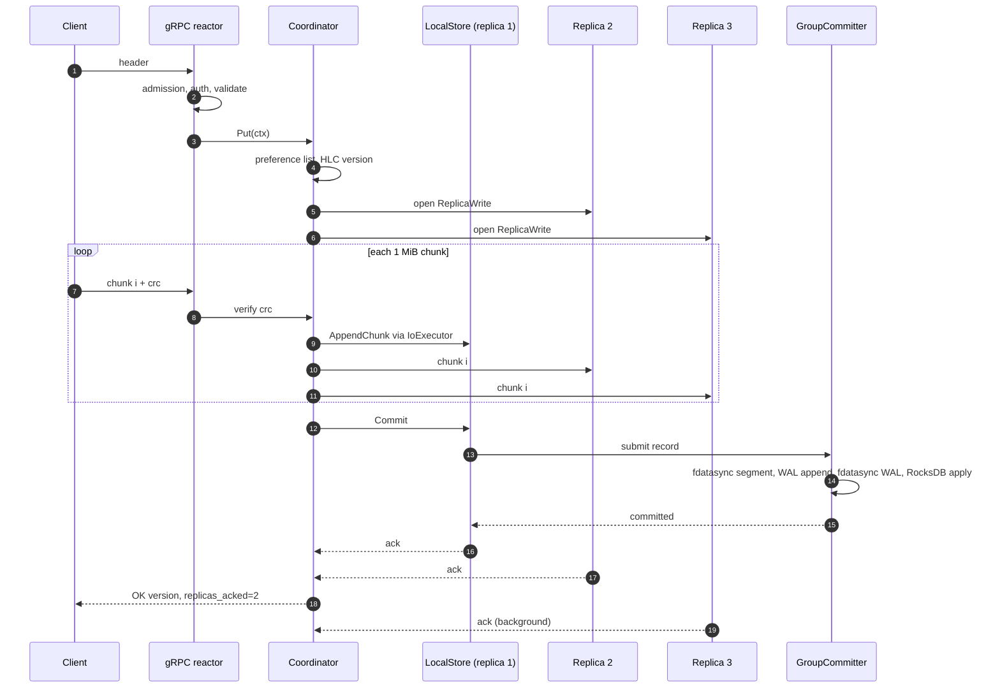

### 7.2 GetObject lifecycle

1. Admission, auth, validation.
2. Preference list; `ReplicaReadMeta` to all live replicas in parallel.
3. At R responses, resolve: highest `VersionId`; tombstone → `NOT_FOUND`; no replica has it → `NOT_FOUND`.
4. Send the metadata message to the client first.
5. Stream chunks from the preferred replica holding the winning version (local if possible). Each chunk is read with `pread` on an I/O thread, its CRC verified, and sent.
6. On `DATA_LOSS` or stream error from that replica: continue from the failed chunk index on another replica with the same version; enqueue repair for the bad replica.
7. Stale replicas observed in step 3 are added to the read-repair queue.
8. Client verifies each chunk and the object CRC.

### 7.3 Alternative flow A1: one replica down during Put

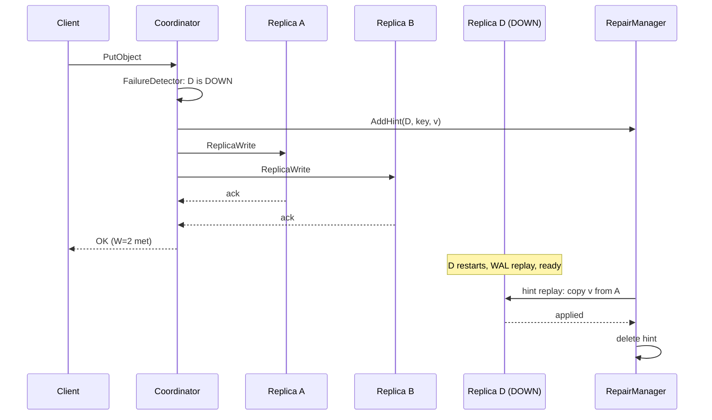

### 7.4 Alternative flow A2: quorum not reached (two replicas unavailable)

1. Coordinator finds only one live replica in the preference list.
2. With `consistency=QUORUM`, `tracker->Impossible()` is true before any data is sent → `UNAVAILABLE` immediately (fail fast, no partial write).
3. If replicas fail **during** the stream (after data was sent), the tracker becomes impossible mid-flight → `UNAVAILABLE`; any replica that committed keeps version v (unknown outcome; see 8.6). Hints are recorded for the failed ones.
4. The client retries with backoff, possibly on another node, which creates a newer version (same content) that supersedes v once written.

### 7.5 Alternative flow A3: duplicate / retried Put after timeout

1. Client sends Put; the coordinator reaches W=2 but the response is lost (network), so the client sees `DEADLINE_EXCEEDED`.
2. Client retries the same bytes; a new coordinator assigns version v' > v.
3. Replicas apply v' (LWW); v's chunks become garbage.
4. Net effect: the stored content is identical; one extra version was written and later compacted. Puts are **effectively idempotent for identical content**, which is why no server-side dedup table is needed. `request_id` is logged to correlate the attempts.

### 7.6 Alternative flow A4: corrupt chunk on read

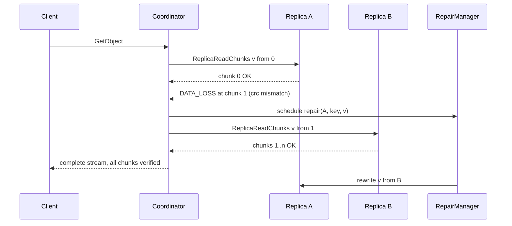

### 7.7 Alternative flow A5: node crash and WAL recovery

1. `storage-node-2` is killed (OOM or node failure). Peers mark it `DOWN` within ~5 s; writes create hints for it.
2. Kubernetes restarts the pod with the same PVC.
3. `Recovery::Run()`:
   1. Open RocksDB → `applied_lsn = A` (state as of last flush).
   2. Scan WAL segments in LSN order; for each record with `lsn > A`: verify CRC; verify that referenced segment records exist and their header CRC, key hash, and version match; apply with LWW.
   3. Stop at the first record with a bad CRC at the tail: truncate the WAL there (torn write; never acknowledged).
   4. For each active segment, find the valid tail (the highest committed location end) and set the append offset past it. Anything beyond is garbage.
   5. `Flush()` RocksDB; truncate replayed WAL segments.
4. The node reports ready (gRPC health `SERVING`); peers see pings again and mark it `UP`.
5. Peers replay hints to it; anti-entropy catches anything else on its next cycle.

Recovery time ≈ RocksDB open + replay of the WAL tail since the last flush (≤ 512 MiB of small metadata records) + segment tail scan. ILLUSTRATIVE estimate: a few seconds for a tail of ~100K records.

### 7.8 Alternative flow A6: request timeout while waiting for quorum

1. Client deadline 2 s; one replica is slow (disk stall), another fails.
2. At deadline − 50 ms, the replica RPCs are cancelled by their own deadline.
3. Coordinator returns `DEADLINE_EXCEEDED` if W was not reached.
4. Background: replicas that did commit keep the version; failed ones get hints.
5. Client retry produces a newer version, as in A3.

### 7.9 Alternative flow A7: Delete

1. Coordinator assigns tombstone version vt from HLC.
2. `ReplicaWrite(header.tombstone=true, no chunks)` to the preference list; W acks → `OK`.
3. Replicas apply LWW: if vt > stored version, store the tombstone and mark the old chunks garbage.
4. Reads return `NOT_FOUND`. After the 24 h grace period, the tombstone is purged.

---

## 8. Concurrency and Distributed Systems

### 8.1 Race conditions inside one node

| Race | Scenario | Prevention |
| --- | --- | --- |
| Two writers append to one segment | Both compute the same offset | `fetch_add` on the segment tail gives disjoint ranges |
| Two versions of one key applied concurrently | v1 and v2 arrive at a replica from different coordinators; both read "no current version" and both write | `ApplyToRocksDb` holds the key's stripe lock across read-compare-write; the larger version wins regardless of arrival order |
| Read during compaction | Compactor deletes a segment while a reader is mid-`pread` | Reader holds `shared_ptr<Segment>`; the file is unlinked only when the last ref drops |
| Ring update during lookup | Reader sees a half-built ring | Readers load an immutable snapshot; the writer publishes a fully built new one atomically |
| Read sees uncommitted data | A reader finds chunks written but not committed | Metadata (the only way to find chunks) is written after commit; uncommitted chunks are unreachable |

### 8.2 Lost updates

At the object level, a "lost update" means one of two concurrent writes to the same key disappears. **This system allows it by design** (last-writer-wins). It does not provide compare-and-swap or conditional puts. What it does guarantee is that all replicas converge on the **same** winner, so there is no permanent divergence. Applications that need read-modify-write on an object must serialize writes themselves or use a system with conditional writes.

### 8.3 Locking summary

| Lock | Scope | Held during | Contention |
| --- | --- | --- | --- |
| Stripe mutex (1024 stripes) | Keys hashing to that stripe | Read-compare-write of `objects` in one apply | Very low; only same-stripe keys in the same batch |
| Shard mutex | One I/O shard | Sealing a full segment and opening the next | Once per 1 GiB written |
| Group-commit queue mutex | Node | Push / pop of pending commits | Low |
| None | Chunk `pwrite` / `pread` | — | Lock-free |

No lock is ever held across a network call or an `fdatasync`.

### 8.4 Atomicity

- **Per replica:** a version becomes visible atomically: its RocksDB batch (objects + ring_index + gc + applied_lsn) is one `WriteBatch`, and the WAL record is the commit point. A reader sees either the old version or the new one, never a partial object.
- **Across replicas:** **no atomicity.** A write can succeed on some replicas and fail on others. Repair converges them.

### 8.5 Ordering

- Versions are totally ordered by `(hlc, node_id)`.
- HLC preserves causality: if write B was issued after the client saw write A's response, B's coordinator has observed A's timestamp only if timestamps flowed between the nodes (pings and replica writes carry HLCs). Within a single client session that alternates nodes, causal order is preserved only to the extent the HLC has propagated. The guarantee is stated precisely: **concurrent writes are ordered deterministically; causally related writes through the same coordinator are ordered correctly; causally related writes through different coordinators are ordered correctly when clock skew is smaller than the time between the writes.**

### 8.6 Consistency guarantees

| Guarantee | Holds? | Condition |
| --- | --- | --- |
| Read-your-writes | Yes | Same key, `R + W > N`, no concurrent writer, the write returned `OK` |
| Monotonic reads | No (in general) | Two reads through different coordinators can hit different quorums; read repair makes regressions short-lived |
| Linearizability | No | Leaderless quorums with LWW are not linearizable (concurrent read/write can see old then new then old) |
| Eventual consistency | Yes | All replicas converge after repair, given no new writes |
| Durability of acknowledged writes | Yes | Up to `W − 1` replica disk losses before repair; any number of process crashes |
| Failed write has no effect | **No** | "Unknown outcome": a write that returned an error may still have committed on fewer than W replicas and may later become visible |

**The unknown-outcome rule, stated for interviews.** If a Put returns `UNAVAILABLE` or `DEADLINE_EXCEEDED`, the client must treat the outcome as unknown and retry (which is safe because a retry writes a newer version with the same content). A Put that returned `OK` is durable on ≥ W replicas.

### 8.7 Replication

- Synchronous to W replicas, asynchronous to the remaining `N − W`.
- **Strict quorum:** only the N preference-list nodes count. There is no sloppy quorum (writing to a substitute node when a preference node is down). Consequence: with two of three replicas of a key down, quorum writes to that key fail, but no data is ever written to a node that isn't supposed to own it, which keeps repair simple.

### 8.8 Duplicate delivery and retry semantics

| Duplicate source | Effect | Handling |
| --- | --- | --- |
| Client retries a Put | New version, same content | LWW supersedes; old chunks garbage-collected |
| Coordinator retries a replica write (repair) | Same version applied twice | Apply is idempotent: `if (stored >= v) skip` and the response says `superseded` |
| Hint replay after a write already arrived | Same version | Same idempotent apply |
| WAL replay of an already-applied record | Same version | Same idempotent apply |

Every write path converges on one rule: **apply version v only if it is greater than the stored version**. That rule is what makes retries, repairs, and replays safe without dedup tables.

### 8.9 Concurrency control across the cluster

There is no distributed lock and no consensus. Coordination is replaced by:

1. Deterministic placement (same ring everywhere, guarded by epoch).
2. Deterministic conflict resolution (total order on versions).
3. Idempotent, commutative apply (max of versions).

These three properties make the replica state a **CRDT-like last-writer-wins register per key**: replicas can apply updates in any order, any number of times, and still converge.

### 8.10 What happens when one storage node becomes unavailable (interview walkthrough)

Assume 5 nodes, N=3, W=2, R=2, and `storage-node-2` dies.

1. **Detection (0–5 s):** peers stop receiving `Ping` replies; `SUSPECT` at 3 s, `DOWN` at 5 s. gRPC keepalive or a failed RPC may detect it sooner for nodes actively talking to it. Kubernetes readiness also removes it from the client Service.
2. **In-flight requests where node-2 was the coordinator:** the client's stream breaks (`UNAVAILABLE`); the client library retries on another node. Puts that were mid-flight have unknown outcome and are retried as newer versions.
3. **In-flight requests where node-2 was a replica:** its `ReplicaWriter` fails; if the other two replicas ack, the client still gets `OK`; a hint is stored for node-2.
4. **New writes to keys owned by node-2 (~60% of keys):** sent to the other two replicas; W=2 is met; hints accumulate.
5. **New reads:** R=2 from the two live replicas; still correct and available.
6. **Durability during the outage:** affected keys have 2 copies instead of 3. A second failure among the same keys' replicas would make them unwritable (W=2 unmet) until a node returns, and readable only with `consistency=ONE`.
7. **Node returns (same disk):** WAL recovery → ready → hints replay (rate-limited) → anti-entropy confirms convergence.
8. **Node never returns (disk lost):** operator deletes the PVC and pod; a fresh `storage-node-2` starts empty; anti-entropy finds every bucket mismatched and streams its ranges from peers at ≤ 50 MiB/s. ILLUSTRATIVE: 200 GiB of replica data → ~68 minutes at full repair rate.

---

## 9. Failure Handling and Recovery

### 9.1 Failure matrix

| Failure | Detection | System response | Recovery | Consistency impact |
| --- | --- | --- | --- | --- |
| Storage node crash | Missed pings (3–5 s); failed RPCs; readiness | Writes go to remaining replicas + hints; reads use remaining replicas | Pod restart → WAL replay → hints → anti-entropy | None for acknowledged writes; reduced redundancy until repaired |
| Two replicas of a key down | Same | `UNAVAILABLE` for `QUORUM` ops on those keys | Restore a node | Availability loss, no consistency loss |
| Network partition (node isolated) | Missed pings | Isolated node cannot reach W; its coordinated requests fail; others treat it as down | Partition heals; hints replay | None; strict quorum prevents divergent acknowledged writes on the minority side |
| Slow replica (disk stall) | Replica write latency; deadline | Quorum met by faster replicas; slow one finishes or times out → hint | Hint replay | None |
| Partial write across replicas | Fewer than W acks | Error to client (unknown outcome) | Client retry (newer version); repair spreads whatever committed | A failed write may become visible later |
| Partial write on one replica (crash mid-put) | No WAL commit record on restart | Version never applied there; chunk bytes are garbage | Hint replay from another replica | None |
| Torn WAL tail | CRC mismatch on the last record during replay | Truncate tail | Normal startup | None (record was never acknowledged) |
| WAL corruption mid-log | CRC mismatch followed by valid records | Refuse to start; alert | Wipe node; rebuild from peers via anti-entropy | None if peers are healthy |
| Chunk corruption at rest | CRC mismatch on read or scrub | Read served from another replica; chunk marked bad | Repair rewrites from a healthy replica | None, as long as one replica is healthy |
| Disk full | `ENOSPC` | Writes fail with `RESOURCE_EXHAUSTED`; node marks itself read-only (still serves reads) | Compaction, add capacity | Writes to keys with this replica rely on the other two |
| Timeout (client deadline) | Deadline passed | `DEADLINE_EXCEEDED`; background work continues | Client retry | Unknown outcome for Puts |
| gRPC channel failure | Keepalive timeout / transport error | Reconnect with backoff; requests fail over to other replicas | Automatic | None |
| Ring epoch mismatch | `ABORTED` from replica | Coordinator refreshes config / client retries | Rolling config update completes | Prevents misplaced writes |
| Repair overloads foreground | Foreground p95 rises during repair | Token bucket caps repair bandwidth | Tune rate | None |

Scenarios from the template that do not apply here: there is no database server, Kafka, Redis, consumer, or external provider in this system. Checkpoint recovery is covered by WAL replay and RocksDB flush points.

### 9.2 Crash recovery procedure (step by step)

1. **Open RocksDB** with `atomic_flush`; read `meta/applied_lsn = A`, `ring_epoch`, `node_id`. Refuse to start if `node_id` differs from the pod's identity (wrong disk attached).
2. **List WAL segments** by first LSN; skip segments entirely ≤ A.
3. **Replay** records with `lsn > A`:
   - Verify the record CRC. If invalid and it is the last record in the last segment → truncate and stop. If invalid elsewhere → fatal.
   - For `PUT_COMMIT`, verify every referenced segment record (magic, header CRC, key hash, version, index). Because data is synced before the commit record, a mismatch here indicates media corruption; mark the version as needing repair instead of applying it.
   - Apply with the same idempotent LWW logic as live traffic.
4. **Find segment tails:** for each active segment, set the append offset to the end of the highest committed record; bytes beyond are unreferenced garbage.
5. **Persist:** `Flush()` RocksDB (new `applied_lsn`), delete replayed WAL segments.
6. **Rejoin:** start gRPC, report `SERVING`, resume hint replay and anti-entropy.
7. **Catch up:** peers replay their hints for this node; read repair and anti-entropy handle the rest.

### 9.3 Replica repair procedure (node replaced with an empty disk)

1. Start the new pod; it has no metadata, `applied_lsn = 0`, empty segments.
2. For each vnode range it owns, anti-entropy compares digests with another replica: every bucket mismatches.
3. It pulls `(key, version)` lists for each bucket and copies each version via `ReplicaReadChunks` + local write with `is_repair=true`.
4. Repair bandwidth is capped (default 50 MiB/s) so foreground p95 is protected; the cap is an operator knob.
5. Completion criterion: all range digests match on two consecutive cycles.

### 9.4 Graceful shutdown

On `SIGTERM` (Kubernetes preStop + termination):

1. Report `NOT_SERVING` on the health endpoint so the Service stops routing new client requests.
2. Wait up to 20 s for in-flight requests to finish; new requests get `UNAVAILABLE`.
3. Drain the group-commit queue (final `fdatasync`s).
4. `Flush()` RocksDB, close the WAL, close RocksDB.
5. Exit. `terminationGracePeriodSeconds` = 30.

---

## 10. Performance Engineering

### 10.1 Where time and CPU go (ILLUSTRATIVE)

**64 KiB Put, N=3, W=2, same availability zone:**

| Step | Latency | CPU | Notes |
| --- | --- | --- | --- |
| Client → coordinator transfer | ~0.5 ms | gRPC framing, protobuf parse | One copy into the protobuf `bytes` field |
| CRC32C verify at coordinator | ~6 µs | 64 KiB at ~10 GB/s | Negligible with hardware CRC |
| Forward to 2–3 replicas | ~0.5–1 ms | Serialization per replica (baseline) | ByteBuffer forwarding removes re-serialization |
| Replica `pwrite` | ~0.1 ms (page cache) | Syscall + memcpy into page cache | |
| Group commit `fdatasync` (segment + WAL) | **1–10 ms** | Mostly waiting; some kernel CPU | Dominant latency term; depends on the disk |
| RocksDB apply | ~50 µs | Memtable insert | |
| Total (typical) | ~5–20 ms | | |

**64 KiB Get, R=2:** metadata fan-out ~1 ms + `pread` (page cache hit ~50 µs, SSD miss ~0.1–0.3 ms) + CRC + stream ~1 ms → ~2–5 ms typical.

**1 MiB objects** move ~16× the bytes: transfer time and CRC/copy CPU scale linearly, fsync cost does not.

A 200 ms p95 budget is therefore generous for this workload. The latency risk is **queueing**: I/O pool saturation, fsync stalls on cloud volumes (which can spike to 50–100 ms), and repair traffic competing with foreground I/O.

### 10.2 Bottlenecks and complexity

| Path | Algorithmic cost | Practical bottleneck |
| --- | --- | --- |
| Ring lookup | `O(log V)` | Never (microseconds) |
| Checksums | `O(bytes)` | Negligible with hardware CRC32C |
| Data copies | `O(bytes × copies)` | memcpy CPU on large objects; the main user-space CPU term |
| Small-file I/O (baseline) | `O(chunks)` syscalls + FS metadata | Kernel CPU (ext4/xfs metadata, journal) and IOPS |
| fsync | `O(commits)` baseline vs `O(batches)` optimized | Disk flush latency |
| RocksDB | `O(log n)` per op | Compaction CPU at high write rates (not at this load) |
| Threads | baseline: one thread per active RPC | Context switches at 1,000 concurrent clients |

### 10.3 Optimizations

Each optimization below is part of the baseline-vs-optimized comparison for the ~25% CPU claim, except where noted.

#### OPT-1: Append-only segment files instead of one file per chunk

| Aspect | Detail |
| --- | --- |
| Original bottleneck | Baseline writes each chunk to its own file: `open(O_CREAT)`, `write`, `fsync`, `close`, plus a parent-directory `fsync` so the new entry survives a crash. That is ≥ 5 syscalls and filesystem metadata journaling per chunk |
| Optimization | Append records to 4 preallocated 1 GiB segment files per node; locations stored in RocksDB |
| How it works | `fetch_add` reserves an offset; one `pwrite` per chunk; segment files stay open; `fallocate` avoids extent allocation on the write path |
| Why it improves performance | Removes per-chunk inode creation, directory updates, and journal commits, which are kernel CPU; turns random small-file writes into near-sequential appends |
| Expected impact | Largest share of the kernel (sys) CPU reduction; fewer IOPS per Put |
| Trade-offs | Needs compaction to reclaim space; recovery must find valid segment tails; one corrupt segment affects many chunks (mitigated by per-record CRCs) |
| How to measure | `perf stat -e syscalls:sys_enter_*` or `strace -c` syscall counts per Put; `pidstat -u` user vs sys split; `perf record` flame graph share of ext4/xfs functions |

#### OPT-2: Group commit, and a single authoritative WAL

| Aspect | Detail |
| --- | --- |
| Original bottleneck | Baseline: `fsync` per Put on the data and a synchronous RocksDB write with its own WAL `fsync`: 2–3 flushes per replica write and two logs |
| Optimization | One committer thread batches up to 256 commits or 2 ms; one `fdatasync` for touched segments and one for the WAL per batch; RocksDB writes with `disableWAL=true` + `atomic_flush` |
| How it works | Concurrent writers enqueue and wait on a future; the committer amortizes flushes across everyone in the batch |
| Why it improves performance | Flush count drops from `O(writes)` to `O(batches)`; each flush has fixed kernel and device overhead; avoiding RocksDB's WAL removes a second log write per op |
| Expected impact | Lower sys CPU and much higher write throughput under concurrency; latency may rise slightly at very low load (≤ 2 ms wait) |
| Trade-offs | Batching delay; single committer thread; correctness now depends on our replay logic, not RocksDB's |
| How to measure | `objstore_group_commit_batch_size` histogram; `fdatasync` count per second (`perf trace` / eBPF `syscount`); CPU per op |

#### OPT-3: Pooled, zero-copy buffers on the read path

| Aspect | Detail |
| --- | --- |
| Original bottleneck | Baseline allocates a `std::vector<char>` per chunk read, `pread`s into it, then copies it into a protobuf `bytes` field, which gRPC then copies into its send buffers: 2 user-space copies and a malloc/free per MiB |
| Optimization | `pread` into a 1 MiB buffer from `BufferPool`; wrap it in a `grpc::Slice` with a custom destroy callback that returns the buffer to the pool; send via `grpc::ByteBuffer` |
| Why it improves performance | Removes one memcpy per chunk and allocator churn; memcpy at ~5–10 GB/s is real CPU on 1 MiB chunks |
| Trade-offs | More complex lifetime management; pool sizing; generic (ByteBuffer) APIs instead of typed messages on that path |
| How to measure | Flame graph share of `memcpy` and `malloc`/`free`; CPU per GiB served |

#### OPT-4: Forward serialized chunks to replicas without re-serializing

| Aspect | Detail |
| --- | --- |
| Original bottleneck | The coordinator parses each chunk message, then serializes a new `ReplicaWriteRequest` for each of the 2–3 replicas |
| Optimization | Replica forwarding uses a generic stub and forwards the received chunk bytes as a `ByteBuffer` (chunk wire format is identical in both services) |
| Why it improves performance | Serialization cost is paid once per chunk instead of once per replica |
| Trade-offs | Both services must keep the chunk message wire-compatible |
| How to measure | CPU per Put on coordinator nodes; flame graph share of protobuf serialization |

#### OPT-5: Callback-based gRPC server with a bounded I/O pool

| Aspect | Detail |
| --- | --- |
| Original bottleneck | The synchronous gRPC server dedicates a thread to each active RPC and the handler blocks on disk I/O; at 1,000 concurrent client sessions, bursts create hundreds of threads → context switches, scheduler overhead, stack memory |
| Optimization | Callback API reactors (non-blocking) + fixed `IoExecutor` (8 threads) + admission control (512 in-flight per node) |
| Why it improves performance | Thread count no longer scales with clients; fewer voluntary/involuntary context switches; better cache locality |
| Trade-offs | More complex code (reactor state machines); a too-small I/O pool limits throughput; admission control rejects excess load |
| How to measure | `/proc/<pid>/status` thread count; `pidstat -w` context switches/s; `perf sched` |

This one changes the concurrency model, not the I/O path itself. In the ablation it is measured separately so that the "I/O optimization" claim is not inflated by it.

#### OPT-6: RocksDB tuning for metadata

| Aspect | Detail |
| --- | --- |
| Change | Bloom filters on `objects`, 256 MiB block cache, LZ4 compression |
| Why | Get/Head/Put all do point lookups; bloom filters avoid reading SSTs for absent keys; the cache keeps the metadata working set in RAM |
| Impact | Small at this load; matters as metadata grows beyond the cache |
| Measure | RocksDB statistics: `rocksdb.block.cache.hit`, `rocksdb.bloom.filter.useful` |

### 10.4 Concurrency, parallelism, and backpressure

- **Parallelism:** 4 I/O shards × 8 I/O threads per node; chunk appends from different objects proceed concurrently; replicas work in parallel.
- **Backpressure, end to end:**
  1. A slow replica's gRPC flow-control window fills.
  2. `ReplicaWriter::SendChunk` stops being able to send; the coordinator stops reading the client stream (it reads the next chunk only after forwarding the previous one).
  3. The client's flow-control window fills; the client's `Write()` blocks or its async write completes later.
  
  Memory per Put is therefore bounded by flow-control windows, not object size.
- **Admission control:** per-node in-flight cap (512) and bounded I/O queue; overload becomes fast `RESOURCE_EXHAUSTED` errors that the client retries with backoff, instead of unbounded queueing and timeouts.
- **Repair isolation:** repair traffic is rate-limited and flagged `is_repair` so replicas can deprioritize it in their I/O queue.

### 10.5 Memory utilization

| Consumer | Bound |
| --- | --- |
| In-flight chunk buffers | ≤ in-flight requests × chunks in flight per stream × 1 MiB, bounded by the pool size (e.g., 256 buffers = 256 MiB) |
| RocksDB block cache + memtables | 256 MiB + 3 × 64 MiB |
| gRPC per-connection buffers | Flow-control window per stream (default ~64 KiB–4 MiB with BDP probing) |
| Page cache | Whatever the container memory limit allows; serves hot Gets |

### 10.6 Network overhead

| Operation | Bytes on the network (object size S, N=3) |
| --- | --- |
| Put, coordinator is a replica (probability 3/5 with 5 nodes) | S (client→coord) + 2S (coord→replicas) |
| Put, coordinator is not a replica | S + 3S |
| Get | R small metadata responses + S (replica→coord, if remote) + S (coord→client) |

Average Put network amplification ≈ `1 + (0.6 × 2 + 0.4 × 3) = 3.4×` the object size (ILLUSTRATIVE). A replica-aware client (sending to a preference-list node directly) would remove the extra hop; it is listed as a future improvement.

### 10.7 Horizontal scaling

Throughput scales with nodes as long as keys are uniformly distributed: each node handles ~`N / nodes` of the replica work. Coordinator work spreads evenly through the Service. Limits: full-mesh heartbeats (`O(nodes²)`), anti-entropy cost per node, and manual topology changes.

---

## 11. Benchmarking and Load Testing

### 11.1 Objectives

1. Validate 10K operations/min (≈ 167 ops/s) at p95 < 200 ms with 1,000 concurrent client sessions (BENCHMARK TARGET).
2. Measure CPU per operation for the baseline and optimized I/O paths at the same load (~25% target).
3. Characterize behavior during a node failure: availability, error rate, latency, repair time.
4. Find the saturation point and the first bottleneck.
5. Verify integrity under load: zero corrupt reads; every acknowledged write readable.

### 11.2 Environment

| Item | Value |
| --- | --- |
| Storage nodes | 5 pods, each `requests: 2 CPU / 4 GiB`, `limits: 2 CPU / 4 GiB` (Guaranteed QoS so CPU numbers are not affected by bursting) |
| Kubernetes nodes | TBD: count, instance type or laptop model, CPU model (must support SSE4.2) |
| Disk | TBD: local NVMe / cloud SSD volume type, size; record `fio` fsync latency (below) |
| OS / kernel | TBD (Linux, cgroup v2) |
| Filesystem | ext4 or xfs, TBD; record mount options |
| Compiler / flags | GCC 13 or Clang 17, `-O2 -DNDEBUG`, LTO on/off recorded |
| gRPC / RocksDB / Abseil | Exact versions recorded from the build |
| TLS | Off (report this) |
| Load generator | `objbench`, on a separate machine or a dedicated Kubernetes node; CPU < 70% during runs |
| Network | Same cluster network; record pod-to-pod RTT (`grpc_cli` ping or `ping`) |
| Data set | 100,000 objects preloaded with the same size distribution as the workload |

Disk baseline with `fio` (run once per environment, recorded next to results):

```bash
# fsync latency of the data volume: the floor for Put latency
fio --name=fsync-lat --filename=/data/fio.test --size=1G --rw=write --bs=64k \
    --ioengine=sync --fdatasync=1 --runtime=60 --time_based --group_reporting
```

### 11.3 Workload

| Parameter | Primary workload (W-MIX) |
| --- | --- |
| Operation mix | 70% `GetObject`, 30% `PutObject` |
| Object sizes | 4 KiB (40%), 64 KiB (50%), 1 MiB (10%); mean ≈ 136 KiB |
| Key selection | Uniform over the 100,000 preloaded keys for Gets; Puts overwrite uniformly chosen keys (keeps the data set size stable) |
| Concurrency | 1,000 logical client sessions over 64 gRPC channels (HTTP/2 connections) |
| Arrival process | Aggregate open-loop Poisson at 167 ops/s; each session has at most one request in flight |
| Consistency | `QUORUM` (N=3, W=2, R=2) |
| Warm-up | 3 min at target rate (page cache, RocksDB cache, connection setup), discarded |
| Ramp-up | Linear 0 → 167 ops/s over 1 min inside the warm-up |
| Steady-state measurement | 10 min |
| Repetitions | 3 runs per configuration |

### 11.4 Tools and why

| Tool | Use | Why |
| --- | --- | --- |
| **Custom C++ gRPC load generator (`objbench`)** | Primary load: streaming Put/Get, open-loop arrivals, HdrHistogram latency per op type, per-session concurrency control | Off-the-shelf HTTP tools cannot drive client- and server-streaming gRPC with real chunking and CRCs; open-loop scheduling avoids coordinated omission |
| **ghz** | Sanity check for unary `HeadObject` latency and throughput | Quick independent cross-check of the server with a standard tool |
| **fio** | Disk fsync latency and IOPS ceiling | Separates "our code is slow" from "the disk is slow" |
| **Google Benchmark** | Micro-benchmarks: CRC32C throughput, ring lookup, WAL record encode/decode, buffer pool | Validates the cost model of individual components |
| **cgroup `cpu.stat`, `pidstat`, `perf`** | CPU per op, user/sys split, context switches, flame graphs | CPU claim evidence and attribution |
| **Prometheus + Grafana** | Server-side histograms, queue depths, repair progress | Time series during failure scenarios |

Not used: k6, JMeter, wrk (no first-class streaming-gRPC workload support), Kafka/Flink tools (not part of this system).

**Latency measurement in `objbench`:** each request has an intended send time from the Poisson schedule; latency = completion time − intended send time. If the generator falls behind, that delay is counted, not hidden. Put latency ends when the response arrives; Get latency ends at the last chunk (time to last byte), and time to first byte is recorded separately.

### 11.5 Scenarios

| # | Scenario | Load / change | Purpose | Pass criteria |
| --- | --- | --- | --- | --- |
| S1 | **Claim run** | W-MIX, 1,000 sessions, 167 ops/s, 10 min steady | Validate 10K ops/min and p95 < 200 ms | ≥ 10,000 successful ops/min; p95 < 200 ms; error rate < 0.1%; zero CRC failures |
| S2 | **CPU A/B** | S1 on baseline vs optimized builds | Validate ~25% CPU per op reduction | Median-of-3 CPU per op reduction reported with spread |
| S3 | **Ablation** | Optimized minus one OPT at a time | Attribute the CPU change | Per-OPT deltas sum approximately to the total |
| S4 | **Node failure** | Kill `storage-node-2` at minute 4 of S1; restart at minute 7 | Availability and repair | Error rate < 1% overall; p95 < 200 ms outside a ~10 s detection window; hints drained after restart; anti-entropy clean |
| S5 | **Saturation ramp** | 100 → 2,000 ops/s in steps of 100, 2 min each | Find the knee and first bottleneck | Record max ops/s with p95 < 200 ms and errors < 1% |
| S6 | **Write-heavy** | 100% Put, 64 KiB | Group commit effectiveness | Batch size distribution; fsyncs/s; p95 |
| S7 | **Large objects** | 50/50 Get/Put, 16 MiB | Streaming and backpressure | Bounded memory; throughput in MiB/s |
| S8 | **Replication sweep** | S1 with (N,W,R) = (1,1,1), (3,1,1), (3,2,2), (3,3,1) | Cost of replication and quorum size | Latency and CPU per op vs replication settings |
| S9 | **Hot keys** | Zipf(0.99) key selection | Stripe-lock and replica hotspots | p99 vs uniform |
| S10 | **Burst** | 1,000 requests issued simultaneously | Concurrency spike handling | All complete or fail with retryable codes; no crash; time to drain |
| S11 | **Corruption injection** | Flip bytes in sealed segments on one node during S1 | Integrity pipeline | Zero corrupt bytes returned; repairs logged |

### 11.6 Metrics

| Metric | Source | Definition |
| --- | --- | --- |
| Throughput (ops/min, ops/s) | `objbench` | Successful client operations / steady-state time |
| p50 / p95 / p99 latency | `objbench` HdrHistogram | Per op type and overall; Get = time to last byte |
| Error rate | `objbench` | Non-OK responses / total, by status code |
| CPU per op | cgroup `cpu.stat usage_usec` summed over 5 storage pods | Δ CPU-µs / Δ successful ops |
| CPU utilization | Same | Δ CPU-µs / (Δ wall-µs × allocated cores) |
| User vs sys CPU | `cpu.stat user_usec`, `system_usec` | Attribution to kernel I/O vs user-space work |
| Memory | cgroup `memory.current` | Peak and steady |
| Disk IOPS / throughput | `iostat -x`, node exporter | Per data volume |
| fsyncs/s, group commit batch size | `objstore_*` metrics | Effectiveness of OPT-2 |
| Network throughput | Node exporter / `sar -n DEV` | Bytes in/out per pod |
| Hints pending, repair bytes/s | `objstore_hints_pending`, `objstore_repair_bytes_total` | Repair progress |
| Recovery time | Logs + metrics | Pod start → `SERVING`; `SERVING` → hints drained |

### 11.7 Baseline vs optimized: controlled comparison

| Aspect | Baseline build | Optimized build |
| --- | --- | --- |
| Data layout | One file per chunk + directory fsync | Append-only segments (OPT-1) |
| Commit | fsync per write; RocksDB WAL on with `sync=true` | Group commit; single WAL; RocksDB `disableWAL` + `atomic_flush` (OPT-2) |
| Read buffers | New vector per chunk + copy into protobuf | Pooled buffers + `grpc::Slice` zero-copy (OPT-3) |
| Replica forwarding | Re-serialize per replica | Forward serialized bytes (OPT-4) |
| Server model | Sync gRPC server | Callback API + `IoExecutor` + admission (OPT-5, measured separately) |
| Checksums | **Same** (hardware CRC32C) in both | Same |
| Replication settings, workload, data set, hardware | Identical | Identical |

Rules:

1. Same offered load (167 ops/s open-loop) in both, so CPU per op is compared at equal work.
2. Fresh data volume and identical preload per run; drop the page cache (`echo 3 > /proc/sys/vm/drop_caches` on the hosts, if permitted) or warm both identically.
3. Three runs each; report the median and min–max.
4. CPU limits identical and Guaranteed QoS; check `cpu.stat nr_throttled` stays near zero (throttling distorts both latency and CPU readings).
5. The headline "I/O optimization" figure uses OPT-1 to OPT-4 with the server model held constant; OPT-5 is reported as its own row.

### 11.8 Result tables (blank until recorded)

**S1 claim run**

| Run | Ops/min (success) | Get p50 | Get p95 | Get p99 | Put p50 | Put p95 | Put p99 | Overall p95 | Error % | CRC failures |
| --- | --- | --- | --- | --- | --- | --- | --- | --- | --- | --- |
| 1 | | | | | | | | | | |
| 2 | | | | | | | | | | |
| 3 | | | | | | | | | | |

**S2 / S3 CPU A/B and ablation**

| Configuration | CPU-µs per op | User % | Sys % | Ctx switches/s | fsyncs/s | Overall p95 | Δ CPU vs baseline |
| --- | --- | --- | --- | --- | --- | --- | --- |
| Baseline | | | | | | | — |
| + OPT-1 segments | | | | | | | |
| + OPT-2 group commit | | | | | | | |
| + OPT-3 zero-copy reads | | | | | | | |
| + OPT-4 forward bytes (= optimized I/O) | | | | | | | |
| + OPT-5 callback server (reported separately) | | | | | | | |

**S4 node failure**

| Metric | Value |
| --- | --- |
| Time to `DOWN` on peers (s) | |
| Error count during detection window (by code) | |
| p95 during outage (ms) | |
| Hints created | |
| Pod restart → `SERVING` (s) | |
| `SERVING` → hints drained (s) | |
| Anti-entropy mismatched buckets after drain | |

**S5 saturation**

| Offered ops/s | Achieved ops/s | p95 | p99 | Error % | CPU util % | Disk util % | First saturated resource |
| --- | --- | --- | --- | --- | --- | --- | --- |
| 167 | | | | | | | |
| 500 | | | | | | | |
| 1,000 | | | | | | | |
| 1,500 | | | | | | | |
| 2,000 | | | | | | | |

**S8 replication sweep**

| N, W, R | Put p95 | Get p95 | CPU-µs per op | Network bytes per Put |
| --- | --- | --- | --- | --- |
| 1, 1, 1 | | | | |
| 3, 1, 1 | | | | |
| 3, 2, 2 | | | | |
| 3, 3, 1 | | | | |

### 11.9 Interpretation guide

| Observation | Likely cause | Check |
| --- | --- | --- |
| Put p95 tracks `fio` fsync p95 | Disk flush latency dominates | Expected; compare group commit batch size |
| High sys CPU in baseline, ext4/xfs functions in flame graph | Small-file metadata overhead | OPT-1 should remove most of it |
| `memcpy` / `malloc` prominent in user CPU | Buffer copies | OPT-3 / OPT-4 |
| p95 rises while CPU is low and the I/O queue is long | I/O pool too small or disk saturated | `objstore_io_queue_depth`, `iostat await` |
| Many `RESOURCE_EXHAUSTED` | Admission limit reached | Raise the limit only if CPU and disk have headroom |
| p99 spikes every few minutes | RocksDB flush/compaction or WAL truncation | Correlate with RocksDB events |
| Errors cluster on one node | Hot node (imbalanced ring or a slow disk) | Per-node request and latency metrics |
| Achieved < offered | Generator saturated or server overloaded | Generator CPU; error codes |

### 11.10 Proposed reproduction commands

These are **proposed**; no scripts exist yet.

```bash
# Build both variants from the same commit
cmake -B build-opt -DCMAKE_BUILD_TYPE=Release -DOBJSTORE_IO_MODE=optimized && cmake --build build-opt -j
cmake -B build-base -DCMAKE_BUILD_TYPE=Release -DOBJSTORE_IO_MODE=baseline  && cmake --build build-base -j

# Deploy a variant (image tag differs only by build flag)
kubectl -n storage set image statefulset/storage-node node=objstore:opt
kubectl -n storage rollout status statefulset/storage-node

# Preload 100k objects with the workload size distribution
objbench preload --endpoints=storage-client:7000 --objects=100000 \
  --sizes=4KiB:40,64KiB:50,1MiB:10 --consistency=QUORUM

# Claim run
objbench run --endpoints=storage-client:7000 --sessions=1000 --channels=64 \
  --rate=167 --mix=get:70,put:30 --sizes=4KiB:40,64KiB:50,1MiB:10 \
  --warmup=3m --duration=10m --consistency=QUORUM --out=results/opt-run1.json

# CPU per op: sample cgroup usage before and after the steady window on each storage pod
for p in 0 1 2 3 4; do
  kubectl -n storage exec storage-node-$p -- cat /sys/fs/cgroup/cpu.stat
done
```

`objbench` prints achieved rate, per-op HdrHistogram percentiles, error counts by code, and writes raw histograms so runs can be merged correctly (never average percentiles across runs).

---

<a id="11-numerical-claims-defence"></a>

## Numerical Claims Defence

All four figures are **UNVERIFIED** and are **BENCHMARK TARGETS**. Arithmetic examples are **ILLUSTRATIVE**.

### Claim D1: "Benchmarked 1,000 concurrent requests"

| # | Item | Detail |
| --- | --- | --- |
| 1 | Exact claim | "Benchmarked 1,000 concurrent requests, achieving 10K operations/min with less than 200 ms p95 latency" |
| 2 | Technical meaning | The load generator maintains **1,000 concurrent client sessions** (each able to have one request in flight) against the cluster during the 10K ops/min run |
| 3 | Metric definition | Number of logical client sessions active during the steady window; separately, measured in-flight requests (time-averaged) |
| 4 | Unit | sessions; requests in flight |
| 5 | Measurement boundary | Client side (`objbench`) |
| 6 | Formula | Little's law: `in_flight_avg = throughput × mean_latency` |
| 7 | Workload | W-MIX |
| 8 | Concurrency model | 1,000 sessions over 64 HTTP/2 channels; aggregate open-loop Poisson arrivals at 167 ops/s; ≤ 1 outstanding request per session |
| 9 | Tool | `objbench` (reports sessions, channels, time-averaged in-flight) |
| 10 | Environment | Section 11.2 |
| 11–12 | Warm-up / duration | 3 min / 10 min |
| 13–14 | Baseline / optimized | Same concurrency in both |
| 15 | Responsible engineering | Callback API + bounded I/O pool + admission control keep thread count and memory independent of client count |
| 16 | Potential bottleneck | Thread-per-RPC servers; per-connection stream limits; file descriptors |
| 17 | Confounders | Treating sessions as in-flight requests; one HTTP/2 connection serializing all sessions |
| 18 | Limitations | 1,000 sessions at 167 ops/s means only a handful of requests are actually in flight on average |
| 19 | Reproduction | S1 with `--sessions=1000`; report time-averaged and peak in-flight; also run S10 (burst) for literal simultaneity |
| 20 | Likely questions | "1,000 at the same time?" "How many threads?" "Is that open or closed loop?" |

**Concurrent clients vs in-flight requests (the key subtlety).** By Little's law, if the system completes 167 ops/s at a mean latency of 30 ms (ILLUSTRATIVE), the average number of requests actually in flight is `167 × 0.03 ≈ 5`. If 1,000 requests were truly in flight **continuously** at 167 ops/s, mean latency would have to be `1000 / 167 ≈ 6 s`, which contradicts p95 < 200 ms. So the claim is only coherent as **1,000 concurrent client sessions (connections/users)**, not 1,000 simultaneously executing RPCs. The burst scenario S10 is where 1,000 requests are literally in flight at once, and that is a stress test, not the p95 claim.

**20-second answer.** "It means 1,000 concurrent client sessions hitting the cluster while it sustains about 167 operations per second. By Little's law only a handful are actually in flight at any instant at that latency, which I'd state openly. A separate burst test sends 1,000 simultaneously."

**60-second answer.** "The load generator runs 1,000 logical client sessions over 64 HTTP/2 connections, each allowed one outstanding request, with Poisson arrivals totalling 167 ops/s. The point of that number is the server's concurrency model: with a thread-per-RPC server, 1,000 sessions can mean hundreds of threads during bursts; with the callback API and a fixed I/O pool, the thread count stays constant and overload turns into fast RESOURCE_EXHAUSTED errors. I'd be careful to distinguish sessions from in-flight requests: 167 per second at tens of milliseconds is about five in flight on average. For literal simultaneity there's a burst scenario that fires 1,000 at once and checks nothing crashes and everything drains."

**Detailed follow-up.** If asked "then why mention 1,000?": the number matters for connection handling, memory per session, fairness, and burst absorption, not for steady-state in-flight count. Report both numbers.

### Claim D2: "10K operations/min"

| # | Item | Detail |
| --- | --- | --- |
| 1 | Exact claim | "...achieving 10K operations/min..." |
| 2 | Meaning | ≥ 10,000 successful client-visible object operations per minute (≈ 167/s) on W-MIX |
| 3 | Definition | Successful `GetObject` + `PutObject` RPCs (status `OK`) per minute over the steady window |
| 4 | Unit | ops/min |
| 5 | Boundary | Client-visible RPCs only. **Internal replica RPCs are not counted** (one Put generates 2–3 `ReplicaWrite` streams; one Get generates up to 3 metadata RPCs + 1 chunk stream) |
| 6 | Formula | `ops_per_min = successful_ops_in_window / window_seconds × 60` |
| 7 | Workload | 70/30 Get/Put; sizes 4 KiB / 64 KiB / 1 MiB at 40/50/10 |
| 8 | Concurrency | As D1 |
| 9 | Tool | `objbench` |
| 13–14 | Baseline / optimized | The throughput target applies to the optimized build; the baseline is run at the same offered rate for CPU comparison |
| 15 | Responsible engineering | Quorum writes (latency = W-th fastest), group commit, parallel I/O |
| 16 | Bottleneck | fsync latency for Puts; copies and network for 1 MiB objects |
| 17 | Confounders | Counting replica RPCs as operations; counting failed operations; a size mix with mostly tiny objects |
| 18 | Limitations | 167 ops/s is modest; the claim is about doing it with N=3 durable quorum writes, fsync before ack, and checksums at every hop on a small cluster |
| 19 | Reproduction | S1, three runs; S5 shows the actual ceiling |
| 20 | Likely questions | "Ops of what size?" "Reads or writes?" "Is that per node?" "Why so low?" |

**What 10K ops/min means in bytes (ILLUSTRATIVE).**

```text
Put rate   = 167 × 0.30 ≈ 50 ops/s,  Get rate ≈ 117 ops/s
Mean size  = 0.4×4 KiB + 0.5×64 KiB + 0.1×1024 KiB ≈ 136 KiB
Client ingress (Put)     ≈ 50 × 136 KiB ≈ 6.6 MiB/s
Replica writes (N=3)     ≈ 20 MiB/s cluster-wide ≈ 4 MiB/s per node (5 nodes)
Client egress (Get)      ≈ 117 × 136 KiB ≈ 15.5 MiB/s
Replica writes per node  ≈ 50 × 3 / 5 = 30 durable writes/s per node
```

These numbers show the claim is far below hardware limits, so the measured bottleneck in S1 should be latency (fsync), not bandwidth. The interesting number for capacity is S5.

**20-second answer.** "About 167 client operations per second, 70% reads and 30% writes with a realistic size mix, where every write is fsynced on two of three replicas before acknowledging. Internal replica traffic isn't counted. It's a benchmark target."

**60-second answer.** "Ten thousand per minute is 167 per second of client-visible Get and Put calls with a mean object size around 136 KiB. Each Put fans out to three replicas and needs two fsynced acknowledgements, so internally the cluster does roughly three durable writes per Put; I don't count those as operations. In bytes that's single-digit MiB/s per node, so the system isn't bandwidth-bound at this rate; the point of the claim is latency and correctness under concurrency with full durability. The saturation ramp is where I'd look for real capacity, and I'd present that number separately."

### Claim D3: "< 200 ms p95 latency"

| # | Item | Detail |
| --- | --- | --- |
| 1 | Exact claim | "...with less than 200 ms p95 latency" |
| 2 | Meaning | 95% of client operations in the S1 steady window complete in < 200 ms |
| 3 | Definition | Client-measured latency from **intended** send time to completion: Put = response received; Get = last chunk received (time to last byte) |
| 4 | Unit | ms |
| 5 | Boundary | `objbench` ↔ cluster; includes coordinator hop, replica fan-out, fsync, and streaming |
| 6 | Formula | p95 = value at rank `ceil(0.95 × N)` in the sorted latency samples (HdrHistogram, 3 significant digits) |
| 7 | Workload | W-MIX; report overall and per op type and per size class |
| 8 | Concurrency | As D1 |
| 9 | Tool | `objbench`; cross-check with server `objstore_request_duration_seconds` |
| 15 | Responsible engineering | Quorum (not all-replica) acks, group commit, bounded queues, metadata fan-out to all replicas with first-R completion |
| 16 | Bottleneck | fsync tail on cloud volumes; 1 MiB transfers; repair contention |
| 17 | Confounders | Measuring from actual send time (coordinated omission); excluding 1 MiB objects; mixing time-to-first-byte with time-to-last-byte |
| 18 | Limitations | Overall p95 on a mixed workload can hide a much worse p95 for 1 MiB objects; report per size class |
| 19 | Reproduction | S1 three runs; report median overall p95 and per-class p95/p99 |
| 20 | Likely questions | "TTFB or TTLB?" "p95 for 1 MiB objects?" "During a node failure?" |

**p95 calculation example (ILLUSTRATIVE).** 10-minute window at 167 ops/s ≈ 100,200 samples. p95 is the 95,190th smallest value. If 1 MiB objects are 10% of operations and all of them took longer than everything else, the overall p95 would fall in the 1 MiB class's lower half. That is why per-class percentiles are mandatory.

**20-second answer.** "95% of operations finish within 200 ms measured at the client, from the scheduled send time to the last byte, so queueing is included. Typical operations should be single-digit to low-tens of milliseconds; the budget is mostly for fsync tails and 1 MiB transfers."

**60-second answer.** "The dominant cost of a Put is the group-commit fsync on the second-fastest replica, typically a few milliseconds on SSD but with tails on cloud volumes. Gets are a metadata quorum plus a streamed read. I measure from the intended send time so a backed-up generator can't hide latency, report Get and Put separately and per size class, and cross-check with server histograms. During a node failure there's a short detection window where requests to the dead coordinator fail and are retried, which I'd report separately from steady state."

### Claim D4: "Optimized I/O to reduce CPU overhead ~25%"

| # | Item | Detail |
| --- | --- | --- |
| 1 | Exact claim | "...optimized I/O to reduce CPU overhead approximately 25%" |
| 2 | Meaning | At the same workload and offered load, total storage-node CPU time per operation is ~25% lower with the optimized I/O path |
| 3 | Definition | `cpu_per_op = Σ_nodes Δcpu.stat.usage_usec / Δsuccessful_ops` over the steady window |
| 4 | Unit | CPU-µs per operation (equivalently CPU % at equal throughput) |
| 5 | Boundary | The 5 storage-node containers (user + system time). Excludes the load generator |
| 6 | Formula | `reduction = (cpu_per_op_baseline − cpu_per_op_optimized) / cpu_per_op_baseline`. ILLUSTRATIVE: 1,600 µs → 1,200 µs = 25% |
| 7 | Workload | S1 at 167 ops/s for both builds |
| 8 | Concurrency | Identical |
| 9 | Tool | cgroup v2 `cpu.stat`; `perf` flame graphs; `pidstat -u -w` |
| 13 | Baseline | File-per-chunk + fsync per write + RocksDB WAL on + per-chunk allocations + re-serialization when forwarding; sync server held constant for the headline figure |
| 14 | Optimized | OPT-1 to OPT-4 |
| 15 | Responsible change | Fewer syscalls and filesystem metadata operations (segments), fewer flushes (group commit, single WAL), fewer copies and allocations (pooled zero-copy buffers, byte forwarding) |
| 16 | Bottleneck addressed | Kernel CPU for small-file I/O; user CPU for memcpy and malloc |
| 17 | Confounders | Different throughput between runs; CPU throttling; page cache warm in one run only; mixing in the server-model change (OPT-5); TLS on in one run |
| 18 | Limitations | The percentage depends on the size mix: large objects are copy-dominated, tiny objects syscall-dominated; report the mix |
| 19 | Reproduction | S2 + S3 ablation |
| 20 | Likely questions | "CPU of what?" "At the same throughput?" "Which change mattered most?" "Did latency change?" |

**20-second answer.** "At the same load, the storage nodes would spend about a quarter less CPU per operation after replacing file-per-chunk writes with append-only segments, batching fsyncs through group commit, and removing buffer copies. It's measured as CPU microseconds per operation from cgroup counters, and it's a target."

**60-second answer.** "The baseline writes each chunk to its own file with an fsync and a directory fsync, uses RocksDB's own WAL alongside ours, allocates and copies buffers per chunk, and re-serializes each chunk per replica. The optimized path appends to preallocated segments with an atomic offset reservation, commits in batches with one fdatasync per batch and only one WAL, reads into pooled buffers handed to gRPC without a copy, and forwards serialized bytes. I compare CPU per operation at the same offered load with Guaranteed-QoS pods and no throttling, three runs each, and run an ablation so each change gets its own share. I keep the server threading change as a separate row so the I/O number isn't inflated. Flame graphs should show filesystem and memcpy frames shrinking, which is the evidence the mechanism actually worked."

### Read/write mix, payload size, replication, gRPC, and disk: how they move the numbers

| Factor | Effect on throughput | Effect on p95 | Effect on CPU per op |
| --- | --- | --- | --- |
| More writes in the mix | Lower (fsync-bound) | Higher | Higher (N× work per write) |
| Larger objects | Lower ops/s, higher MiB/s | Higher (transfer time) | Higher (copies, CRC) but lower per byte |
| N=3 vs N=1 | ~3× replica work | Put waits for the W-th replica | ~2–3× for Puts |
| W=2 vs W=3 | — | Lower (ignores the slowest replica) | Same (all N still write) |
| gRPC overhead | Framing and protobuf per message | ~0.1–0.5 ms per hop | Noticeable for small objects |
| Disk fsync latency | Caps Puts per committer batch | Direct floor on Put latency | Small |
| CPU measurement method | — | — | Must be at equal throughput, user + sys, all nodes |

---

## 12. Testing Strategy

This is the intended test plan. None of these tests has been run.

| Test | Objective | Setup | Input | Execution | Expected output / assertions | Failure criteria |
| --- | --- | --- | --- | --- | --- | --- |
| **Unit: ring placement** | Preference lists are correct and balanced | GoogleTest, in-memory ring, 5 nodes × 128 vnodes | 1M random keys | Compute preference lists | Every list has 3 distinct nodes; per-node share within ±10% of 60%; adding a 6th node moves ≈ 1/6 of primary ownership | Duplicates in a list, or skew beyond tolerance |
| **Unit: HLC** | Monotonic, causal | Fake wall clock that can go backward | Sequence of `Now()` and `Observe()` calls | Run sequence | Strictly increasing results; `Observe(x)` then `Now()` > x | Any non-increasing value |
| **Unit: WAL codec** | Encode/decode and torn-tail detection | Temp directory | 10,000 records; then truncate the file at a random byte | Replay | All complete records returned; replay stops cleanly at the torn record | Replay of a corrupt record, or loss of complete records |
| **Unit: LWW apply** | Idempotent, order-independent | In-memory `MetadataStore` | Versions v1 < v2 < v3 applied in all 6 orders, each twice | Apply | Final version always v3; superseded chunks marked garbage | Any other final state |
| **Integration: single node** | Put/Get/Delete with real RocksDB and segments | One node, temp disk | Objects of 0 B, 1 B, 1 MiB, 1 MiB + 1 B, 64 MiB | Round-trip | Bytes and CRCs identical; `NOT_FOUND` after delete | Mismatch |
| **API: validation** | Contract enforcement | One node | Bad bucket; chunk out of order; wrong chunk CRC; wrong object CRC; missing header | Call RPCs | `INVALID_ARGUMENT` or `DATA_LOSS` as specified; nothing committed | Commit of invalid data |
| **Storage: crash consistency** | No acknowledged write lost; no corrupt metadata | One node; a fault-injection hook that calls `_exit(1)` at named points (after `pwrite`, after segment sync, after WAL append, after WAL sync, after RocksDB apply) | 1,000 Puts | Crash at each point (repeat 50× per point); restart | Every acknowledged Put readable with the correct CRC; unacknowledged Puts either absent or complete, never partial | Lost acknowledged write or partial object |
| **Concurrency: same-key writers** | Convergence | 3-node cluster | 50 threads overwrite one key with distinct contents | Concurrent Puts, then wait for repair | All 3 replicas hold the same version; that version's content matches one of the writers byte-for-byte | Divergent replicas or mixed content |
| **Concurrency: read during write** | No torn reads | 3-node cluster | Writer overwrites a 16 MiB object in a loop; readers read in a loop | 5 min | Every read's object CRC matches one of the written versions | Any CRC mismatch |
| **Concurrency: sanitizers** | No data races or memory errors | ThreadSanitizer and AddressSanitizer builds | Concurrency tests above | Run under TSan/ASan | Zero reports | Any report |
| **Failure injection: node kill** | Availability with one node down | 5-node cluster in kind | S1 workload | `kubectl delete pod storage-node-2 --grace-period=0` | Quorum ops keep succeeding; error burst limited to the detection window | Sustained errors for keys with 2 live replicas |
| **Failure injection: partition** | No acknowledged divergence | 5 nodes; NetworkPolicy isolates one node | Writes through both sides | 2 min partition, then heal | Isolated node's coordinated writes fail (cannot reach W); after heal, all replicas converge | Acknowledged write that later disappears |
| **Failure injection: corruption** | Integrity pipeline | 3 nodes | Flip a byte in a sealed segment | Read the affected object | Correct bytes returned from another replica; repair rewrites the bad copy; scrubber reports it | Corrupt bytes returned |
| **Recovery: hints** | Hinted repair works | 3 nodes | Stop node C; write 1,000 objects; start C | Wait for hint replay | C holds all 1,000 at the right versions; hints CF empty | Missing objects after 2 replay cycles |
| **Recovery: empty-disk rebuild** | Anti-entropy rebuild | 3 nodes with 10,000 objects | Replace node C's PVC with an empty one | Start C | All range digests match within the expected time at the repair rate | Mismatches persisting after 2 cycles |
| **Stress** | Graceful overload | 5 nodes | S5 ramp to 2,000 ops/s | Ramp | Errors are retryable (`RESOURCE_EXHAUSTED`, `UNAVAILABLE`); no crash; memory bounded | OOM, crash, or non-retryable errors |
| **Load** | Claim validation | Section 11 | S1 | 10 min steady | Thresholds met | Thresholds missed |
| **Soak** | No leaks, bounded growth | 5 nodes | 100 ops/s overwrite-heavy for 8 h | Continuous | RSS flat; disk usage stable thanks to compaction; WAL size bounded; p99 flat | Monotonic growth |

The test that best demonstrates the WAL claim is the **crash-consistency test with named crash points**: it proves that the ordering (data sync → WAL sync → apply) holds at every interleaving that matters.

---

## 13. Deployment and Infrastructure

### 13.1 Docker

Multi-stage build: compile in a full toolchain image, copy only the binary and required shared libraries into a slim runtime image.

```dockerfile
# Representative only; not created in this repository.
FROM ubuntu:24.04 AS build
RUN apt-get update && apt-get install -y build-essential cmake ninja-build git pkg-config
WORKDIR /src
COPY . .
RUN cmake -B build -G Ninja -DCMAKE_BUILD_TYPE=Release -DOBJSTORE_IO_MODE=optimized \
 && cmake --build build --target storage-node

FROM ubuntu:24.04
RUN useradd -u 10001 objstore && mkdir /data && chown objstore /data
COPY --from=build /src/build/storage-node /usr/local/bin/storage-node
USER objstore
EXPOSE 7000 9100
ENTRYPOINT ["/usr/local/bin/storage-node"]
```

Port 7000 serves gRPC (both services); 9100 serves `/metrics`.

### 13.2 Kubernetes objects

| Object | Purpose |
| --- | --- |
| `StatefulSet storage-node` (replicas 5) | Stable pod names → stable node ids and ring tokens; ordered rolling updates |
| `volumeClaimTemplates: data` | One PVC per pod, reattached on reschedule |
| Headless `Service storage-node` | DNS per pod: `storage-node-<i>.storage-node.storage.svc.cluster.local` for peer channels |
| `Service storage-client` (ClusterIP) | Client entry point; load-balances connections across ready pods |
| `ConfigMap storage-config` | N, W/R defaults, vnodes, ring epoch, node list, rate limits |
| `Secret storage-token` | Client and internal tokens |
| `PodDisruptionBudget` | `maxUnavailable: 1`: voluntary disruptions never take two replicas of a key down at once |
| Pod anti-affinity | Prefer one storage pod per Kubernetes node |

Representative StatefulSet (documentation only):

```yaml
apiVersion: apps/v1
kind: StatefulSet
metadata:
  name: storage-node
  namespace: storage
spec:
  serviceName: storage-node
  replicas: 5
  podManagementPolicy: Parallel
  selector:
    matchLabels: { app: storage-node }
  template:
    metadata:
      labels: { app: storage-node }
    spec:
      terminationGracePeriodSeconds: 30
      affinity:
        podAntiAffinity:
          preferredDuringSchedulingIgnoredDuringExecution:
            - weight: 100
              podAffinityTerm:
                topologyKey: kubernetes.io/hostname
                labelSelector: { matchLabels: { app: storage-node } }
      containers:
        - name: node
          image: objstore:opt
          args: ["--config=/etc/objstore/config.yaml", "--data=/data"]
          env:
            - name: POD_NAME
              valueFrom: { fieldRef: { fieldPath: metadata.name } }
            - name: CLIENT_TOKEN
              valueFrom: { secretKeyRef: { name: storage-token, key: client } }
          ports:
            - { name: grpc, containerPort: 7000 }
            - { name: metrics, containerPort: 9100 }
          readinessProbe:
            grpc: { port: 7000 }
            periodSeconds: 5
          livenessProbe:
            grpc: { port: 7000, service: liveness }
            periodSeconds: 10
            failureThreshold: 6
          startupProbe:
            grpc: { port: 7000, service: liveness }
            periodSeconds: 5
            failureThreshold: 60
          resources:
            requests: { cpu: "2", memory: 4Gi }
            limits:   { cpu: "2", memory: 4Gi }
          volumeMounts:
            - { name: data, mountPath: /data }
            - { name: config, mountPath: /etc/objstore }
      volumes:
        - name: config
          configMap: { name: storage-config }
  volumeClaimTemplates:
    - metadata: { name: data }
      spec:
        accessModes: ["ReadWriteOnce"]
        resources: { requests: { storage: 50Gi } }
```

Representative ConfigMap content:

```yaml
replication_factor: 3
default_write_consistency: QUORUM
default_read_consistency: QUORUM
vnodes_per_node: 128
ring_epoch: 1
nodes: [storage-node-0, storage-node-1, storage-node-2, storage-node-3, storage-node-4]
io_threads: 8
io_shards: 4
max_inflight_requests: 512
group_commit_max_records: 256
group_commit_max_wait_ms: 2
repair_rate_mib_per_s: 50
tombstone_grace_hours: 24
heartbeat_interval_ms: 1000
suspect_after_ms: 3000
down_after_ms: 5000
```

### 13.3 Health checks

| Probe | Implementation | Meaning |
| --- | --- | --- |
| Startup | gRPC health service `liveness` | Gives WAL recovery up to 5 minutes before liveness applies |
| Readiness | gRPC health service default (`""`) | `SERVING` only after recovery completes, disk is writable, and the node is not draining |
| Liveness | gRPC health service `liveness` | Process event loop responsive; **does not** depend on peers (a cluster-wide problem must not restart every pod) |

Kubernetes has supported native gRPC probes since 1.27 (GA).

### 13.4 Resource limits

- CPU request = limit (Guaranteed QoS) for predictable benchmarks and to avoid CFS throttling surprises.
- Memory: 4 GiB = RocksDB (~450 MiB) + buffer pool (256 MiB) + gRPC buffers + headroom; the rest is page cache, which the kernel charges to the cgroup but reclaims under pressure.

### 13.5 Scaling

Storage nodes are **not** autoscaled with an HPA: adding a node changes data placement and triggers data movement, which is an operator decision. Scaling procedure: bump `replicas`, add the node to the ConfigMap node list, bump `ring_epoch`, roll the StatefulSet, and let anti-entropy move data. The load generator Job can be scaled freely.

### 13.6 Graceful shutdown

`preStop` hook sleeps 5 s (lets endpoints update), then the process handles `SIGTERM` as in Section 9.4. `terminationGracePeriodSeconds: 30` covers the 20 s drain plus flush.

### 13.7 Environment variables

| Variable | Purpose |
| --- | --- |
| `POD_NAME` | Derives node id and ring tokens (`storage-node-3` → node id 3) |
| `CLIENT_TOKEN`, `INTERNAL_TOKEN` | From the Secret |
| `OBJSTORE_LOG_LEVEL` | `info` default |

AWS is not part of this project's stack; the cluster can be kind/minikube locally or any managed Kubernetes with SSD-backed volumes.

---

## 14. Observability

### 14.1 Structured logging

JSON lines to stdout, one per request at `info` (sampled for Gets under load) and one per repair action:

```json
{"ts":"2026-03-18T10:21:07.412Z","level":"info","node":3,"rpc":"PutObject","request_id":"9b1f...","bucket":"photos","key_hash":"0x5d1c...","version":"0000018f3a2b4c5d0001-3","size":65536,"replicas":[2,3,4],"acked":2,"status":"OK","latency_ms":11.8}
```

Keys are logged as hashes by default (object names can be sensitive). `request_id` is the correlation id: the client generates it, the coordinator propagates it in replica RPC metadata, and every node logs it.

### 14.2 Metrics (prometheus-cpp, port 9100)

| Metric | Type | Labels | Use |
| --- | --- | --- | --- |
| `objstore_requests_total` | Counter | `rpc`, `code` | Throughput and error rate |
| `objstore_request_duration_seconds` | Histogram | `rpc`, `size_class` | p50/p95/p99 server-side |
| `objstore_replica_write_duration_seconds` | Histogram | `peer` | Slow replica detection |
| `objstore_quorum_failures_total` | Counter | `rpc`, `reason` | Availability problems |
| `objstore_inflight_requests` | Gauge | — | Admission headroom |
| `objstore_admission_rejected_total` | Counter | — | Overload |
| `objstore_io_queue_depth` | Gauge | — | I/O pool saturation |
| `objstore_group_commit_batch_size` | Histogram | — | Group commit effectiveness |
| `objstore_fsync_duration_seconds` | Histogram | `target=segment|wal` | Disk health |
| `objstore_crc_failures_total` | Counter | `where=ingest|read|scrub` | Integrity |
| `objstore_hints_pending` | Gauge | `target` | Repair backlog |
| `objstore_repair_bytes_total` | Counter | `kind=hint|read|antientropy` | Repair activity |
| `objstore_antientropy_mismatched_buckets` | Gauge | — | Replica divergence |
| `objstore_peer_state` | Gauge | `peer` (0=down, 1=suspect, 2=up) | Membership view |
| `objstore_wal_bytes`, `objstore_segment_live_ratio` | Gauge | — | Space and recovery-time health |
| `process_cpu_seconds_total`, `process_resident_memory_bytes` | Counter / Gauge | — | CPU claim cross-check |

Representative PromQL:

```promql
# Overall p95 by RPC
histogram_quantile(0.95, sum by (le, rpc) (rate(objstore_request_duration_seconds_bucket[5m])))

# Operations per minute (client-visible, successful)
sum(rate(objstore_requests_total{rpc=~"PutObject|GetObject",code="OK"}[1m])) * 60

# CPU seconds per operation across the cluster
sum(rate(process_cpu_seconds_total{job="storage-node"}[5m]))
  / sum(rate(objstore_requests_total{rpc=~"PutObject|GetObject",code="OK"}[5m]))
```

### 14.3 Dashboards

1. **Overview:** ops/min by RPC, error rate by code, p95/p99 by RPC and size class, in-flight and admission rejections.
2. **Storage:** fsync latency, group commit batch size, I/O queue depth, disk utilization, WAL size, segment live ratio.
3. **Cluster health:** peer state matrix, quorum failures, hints pending per target, repair bytes/s, anti-entropy mismatches.
4. **Integrity:** CRC failures by location, scrubber progress.

### 14.4 Alerts

| Alert | Condition | Why |
| --- | --- | --- |
| NodeDown | `objstore_peer_state == 0` from ≥ 2 peers for 1 min | Reduced redundancy |
| QuorumFailures | `rate(objstore_quorum_failures_total[5m]) > 0.01/s` | Availability impact |
| CRCFailure | any increase in `objstore_crc_failures_total{where!="ingest"}` | Corruption at rest or in memory |
| HintsBacklog | `objstore_hints_pending > 10000` for 15 min | Repair not keeping up |
| FsyncSlow | fsync p99 > 100 ms for 10 min | Disk degradation |
| LatencySLO | p95 > 200 ms for 10 min | SLO breach |
| DiskFull | free space < 15% | Writes will fail |

---

## 15. Architecture Decisions and Trade-offs

| Decision | Selected approach | Alternative | Reason | Trade-off |
| --- | --- | --- | --- | --- |
| Replication model | Leaderless quorum (N, W, R) | Primary-backup; Raft per shard | No leader election or failover logic; availability with a replica down; tunable per request | Not linearizable; unknown outcome on failed writes |
| Conflict resolution | LWW with HLC versions | Vector clocks with siblings | Tiny metadata; deterministic convergence; immutable blobs rarely have concurrent writers | Concurrent writes silently drop one; skew can favor a fast clock |
| Placement | Consistent hashing, 128 vnodes | Modulo hashing; rendezvous hashing; central directory | Minimal data movement; no metadata service | Statistical balance only; ring config must match everywhere (epoch) |
| Quorum type | Strict quorum | Sloppy quorum with hinted handoff to substitutes | Data only ever lives on its owners; simpler repair | Two-replica outage blocks quorum writes for those keys |
| Metadata store | RocksDB per node | Central SQL metadata DB; files | Embedded, atomic batches, ordered iteration, fast point lookups | Must be kept consistent with segment data by our WAL |
| Data layout | Append-only segments | File per chunk; blobs in RocksDB | Fewer syscalls and fsyncs; sequential writes; avoids LSM write amplification for large values | Needs compaction; recovery must find segment tails |
| Durability point | Our WAL with group commit; RocksDB WAL disabled | fsync per write; RocksDB WAL as the commit point | One commit point spanning data and metadata; amortized fsync | Custom replay code must be correct (heavily tested with crash points) |
| Checksum | CRC32C per chunk, end-to-end | SHA-256; no checksum | Hardware-fast; standard for storage integrity | Not tamper-proof |
| RPC framework | gRPC callback API, streaming | Sync gRPC; raw TCP | Streaming chunked transfer, flow control, deadlines; non-blocking threads | Reactor code is harder to write than sync handlers |
| Repair strategy | Hints + read repair + bucketed digest anti-entropy | Merkle trees | Simple, sufficient at millions of keys per node | Full range scan each cycle; slower to localize differences at very large scale |
| Failure detector | Fixed-timeout heartbeats, full mesh | Phi-accrual; SWIM gossip | Simple and adequate for ≤ 8 nodes | `O(n²)` messages; false positives under long pauses (cost: extra hints only) |
| Deployment | StatefulSet + PVC, no autoscaling | Deployment + emptyDir; HPA | Stable identity and disks are required for storage | Manual capacity changes |

---

## 16. Limitations and Future Improvements

| Category | Limitation | Future improvement |
| --- | --- | --- |
| Functional | No multipart upload; 64 MiB object limit | Multipart: upload parts as independent versions, commit a manifest |
| Functional | No conditional writes (CAS / if-match) | `if_version_match` on Put, checked under the stripe lock on a quorum of replicas (still not linearizable without consensus) |
| Functional | Listing is best-effort scatter-gather | Per-bucket key index with its own replication |
| Consistency | Not linearizable; LWW loses concurrent writes | Raft-replicated metadata per shard for keys that need it |
| Scalability | Full-mesh heartbeats and anti-entropy range scans | SWIM gossip; Merkle trees; incremental digests maintained on write |
| Scalability | Manual topology changes; no automatic rebalancing | Ring-change planner that streams only moved ranges and verifies before releasing old copies |
| Reliability | Strict quorum: two replicas down blocks writes for affected keys | Optional sloppy quorum with handoff |
| Reliability | No rack/zone-aware placement | Skip vnodes in the same zone while building preference lists |
| Security | Static tokens; TLS off by default; no encryption at rest | mTLS between nodes; per-bucket tokens; envelope encryption of segments |
| Performance | Extra coordinator hop for non-replica coordinators | Replica-aware client routing to a preference-list node |
| Performance | 4 KiB alignment wastes space for tiny objects | Size-class segments with smaller alignment; inline tiny objects in RocksDB |
| Performance | Erasure coding absent (3× storage overhead) | Reed-Solomon (e.g., 4+2) for cold data |

---

## 17. Interview Preparation

Everything here describes the design. Do not present benchmark numbers as measured.

### 17.1 30-second explanation

> "I designed a Dynamo-style distributed object store in C++. Every node runs the same gRPC server, places objects on a consistent-hash ring with virtual nodes, and replicates each object to three nodes with configurable write and read quorums. Chunks carry CRC32C checksums end to end. Each node has a write-ahead log with group commit so a crash never loses an acknowledged write, RocksDB holds metadata, and data lives in append-only segment files. Missed writes are repaired asynchronously with hints, read repair, and anti-entropy. The benchmark target is 10K ops/min at sub-200 ms p95 with 1,000 client sessions."

### 17.2 2-minute explanation

> "The problem is storing blobs across machines so that losing one machine loses nothing and doesn't stop service. There's no master: any node coordinates any request. It hashes the key onto a ring with 128 virtual nodes per server and takes the first three distinct servers clockwise as replicas. A Put streams 1 MiB chunks; the coordinator verifies each chunk's CRC32C and forwards it to all three replicas in parallel. Each replica appends to a segment file, and a group-commit thread fsyncs the segment, then appends a commit record to the WAL and fsyncs that, then applies the metadata to RocksDB. The coordinator replies after two durable acks. Versions are hybrid-logical-clock timestamps, so every replica resolves conflicts the same way, last writer wins. If a replica is down, the coordinator stores a hint and replays it when the node returns; reads that see a stale replica fix it, and a periodic digest comparison catches everything else. On restart, a node replays its WAL from the last RocksDB flush point. For performance, the big wins are append-only segments instead of a file per chunk, group commit instead of an fsync per write, and avoiding buffer copies; that's the ~25% CPU target, measured as CPU per operation at fixed load."

### 17.3 5-minute HLD walkthrough (outline)

1. Requirements: durability, availability with one node down, integrity, concurrency (30 s).
2. Draw the cluster: 5 nodes, every node coordinator + replica, client Service, peer mesh (45 s).
3. Placement: ring, vnodes, preference list, epoch (45 s).
4. Write path: streaming, fan-out, W=2 acks, hints (60 s).
5. Read path: metadata to all replicas, first R, highest version, stream from one, read repair (45 s).
6. Node internals: segments, WAL, RocksDB, why data and metadata are separate (45 s).
7. Failure handling: detection, hints, anti-entropy, crash recovery (30 s).

### 17.4 10-minute deep technical walkthrough (outline)

1. Quorum math: `R + W > N`, what it does and does not guarantee, unknown outcome (1.5 min).
2. HLC and LWW: algorithm, causality, skew failure case (1.5 min).
3. Replica write internals: `fetch_add` offset reservation, `pwrite`, group commit ordering, why data before commit record (2 min).
4. Crash recovery: `applied_lsn`, `atomic_flush`, replay, torn tail, segment tail discovery (1.5 min).
5. Repair: hints vs read repair vs anti-entropy; bucketed XOR digests vs Merkle trees; tombstone grace (1.5 min).
6. Threading: callback reactors, I/O pool, committer, stripes, RCU ring; backpressure via flow control (1 min).
7. Performance and benchmark: latency budget, CPU optimizations, measurement method, Little's law on "1,000 concurrent" (1 min).

### 17.5 Focused explanations

**LLD.** "`Coordinator` talks to replicas through a `ReplicaEndpoint` interface with local and remote implementations, so the logic is the same whether a replica is this node or another. `LocalStore` is a facade over `SegmentStore`, `GroupCommitter`, `Wal`, and `MetadataStore`. Callback threads never block: disk work goes to an eight-thread I/O pool, durability to a single committer thread, and metadata application takes a per-key stripe lock for the version compare."

**API.** "Two gRPC services on one port. Client-facing `PutObject` is client-streaming with a header then chunks, `GetObject` is server-streaming with metadata then chunks. Every chunk carries a CRC32C. Consistency is a per-request enum. Status codes are precise: `DATA_LOSS` for checksum failures, `UNAVAILABLE` when a quorum is impossible, `DEADLINE_EXCEEDED` with an explicit unknown-outcome rule for Puts."

**Storage design.** "RocksDB per node holds latest-version metadata, a ring-ordered index for range digests, hints, and segment accounting. Data is in 1 GiB append-only segment files with self-describing record headers. The WAL is the single commit point; RocksDB's own WAL is disabled, and consistency after a crash comes from `atomic_flush` plus an `applied_lsn` stored in each batch."

**Algorithms.** "Consistent hashing with binary search over 640 tokens; HLC versions; quorum tracking; group commit; lock-free append via fetch_add; XOR-bucketed range digests for anti-entropy."

**Performance optimization.** "The baseline paid per-chunk file creation, an fsync per write plus a second WAL in RocksDB, buffer copies on every read, and re-serialization per replica. The optimized path removes each of those. I'd attribute the gain with an ablation and confirm it in flame graphs."

**Benchmark methodology.** "A custom C++ gRPC load generator with open-loop Poisson arrivals across 1,000 sessions and 64 connections, latency from intended send time, three-minute warm-up, ten-minute steady window, three runs, CPU per op from cgroup counters at identical load, fio to establish the disk floor."

### 17.6 Resume bullet defences

**Bullet 1: gRPC, consistent hashing, configurable replication, checksums, concurrent I/O.**

- *Direct answer:* Every node is a gRPC server; keys are placed with consistent hashing with virtual nodes; N is configurable and W/R are per request; CRC32C per chunk is verified at every hop; I/O runs on a bounded pool with lock-free appends.
- *Why:* no central directory, minimal movement on membership change, end-to-end integrity.
- *Alternative:* rendezvous hashing; SHA-256; sync servers.
- *Trade-off:* statistical balance only; CRC is not tamper-proof.
- *Failure example:* a bit flip on disk is caught on read and the chunk is served from another replica, then repaired.
- *Follow-up:* "How many keys move when a node joins?" About `1/(nodes+1)` of primary ownership.

**Bullet 2: WAL, asynchronous replica repair, concurrent I/O, recovery while available.**

- *Direct answer:* acknowledged writes are durable once the WAL record is fsynced (after the data); restarts replay the WAL; replicas that missed writes are repaired by hints, read repair, and anti-entropy without blocking foreground traffic.
- *Why:* durability without per-write fsync costs; availability with a node down.
- *Trade-off:* repair consumes bandwidth (rate-limited); custom replay logic must be correct.
- *Failure example:* node killed mid-write; on restart, the torn WAL tail is truncated, committed records re-applied, peers replay hints.
- *Follow-up:* "Why both a WAL and RocksDB?" One commit point across data and metadata.

**Bullet 3: 1,000 concurrent requests, 10K ops/min, < 200 ms p95, ~25% CPU.**

- *Direct answer:* benchmark targets with a defined methodology; 1,000 is client sessions, not 1,000 simultaneously executing RPCs.
- *Honesty line:* "These are targets I designed and documented how to verify; I wouldn't call them production measurements."
- *Follow-up:* see the Numerical Claims Defence.

### 17.7 Interview questions and answers

**Q1. (HLD) Why no master node?**  
A master holding placement or metadata is a single point of failure and a bottleneck, and needs its own replication and failover. Consistent hashing lets every node compute placement locally, and metadata travels with the data to the same replicas.

**Q2. (HLD) What does the coordinator do if it is not one of the replicas?**  
It forwards the stream to all three replicas over the network, which costs an extra hop and extra bandwidth (about 3.4× object size per Put on average with 5 nodes). A replica-aware client would avoid it.

**Q3. (HLD) What is the difference between metadata storage and object data storage here?**  
Metadata (latest version, size, checksums, chunk locations) is small, read on every request, updated atomically, and iterated in order, so it lives in RocksDB. Object data is large and immutable, so it lives in append-only segment files. Storing large blobs in an LSM tree would rewrite them during compaction.

**Q4. (HLD) How does a client find the right node?**  
It doesn't need to: any node can coordinate. The client connects through the Kubernetes Service or rotates over endpoints; the receiving node computes the preference list.

**Q5. (LLD) Why the `ReplicaEndpoint` interface?**  
The coordinator handles local and remote replicas identically. The local implementation calls `LocalStore` directly with no serialization; tests can inject fake endpoints to simulate slow or failing replicas.

**Q6. (LLD) Why must gRPC callback threads never block?**  
gRPC multiplexes many streams onto a small pool of callback threads. A blocking `pread` or `fsync` on one of them stalls unrelated streams and can deadlock the server under load. Blocking work goes to the I/O pool and resumes the reactor on completion.

**Q7. (LLD) What does the stripe lock protect, and why stripes rather than one lock per key?**  
It protects the read-compare-write of a key's latest version during apply. A per-key lock map needs allocation and cleanup; 1024 fixed stripes give near-per-key concurrency with constant memory, at the cost of occasional false sharing between unrelated keys on the same stripe.

**Q8. (API) Why streaming RPCs rather than one message per object?**  
gRPC messages are held in memory whole and default to a 4 MiB limit. Streaming 1 MiB chunks bounds memory, enables per-chunk checksums and resumption (`from_chunk`), and gives backpressure through flow control.

**Q9. (API) Why `DATA_LOSS` instead of `INTERNAL` for checksum mismatches?**  
`DATA_LOSS` is the gRPC code for unrecoverable data corruption. It tells the client and monitoring exactly what happened and is never confused with transient errors.

**Q10. (API) How are deadlines propagated?**  
The coordinator reads the client's deadline and gives replica calls `remaining − 50 ms`, so replicas time out first and the coordinator can still return a precise status before the client gives up.

**Q11. (Storage) Why disable RocksDB's WAL?**  
Our WAL already records every metadata change and is fsynced before acknowledgement. Keeping RocksDB's WAL would log every change twice. After a crash, RocksDB recovers to its last flush (consistent across column families thanks to `atomic_flush`), and we replay our WAL from the stored `applied_lsn`.

**Q12. (Storage) Why must data be fsynced before the WAL commit record?**  
If the commit record were durable but the data were not, recovery would install metadata pointing to garbage. With data first, every committed record references bytes that are on disk.

**Q13. (Storage) How is space reclaimed?**  
Superseded and deleted chunks are recorded as dead. The compactor rewrites live records from segments under 50% live into the active segment, logs `CHUNK_MOVE` records, and deletes the old segment when no reader holds it.

**Q14. (Storage) Why keep tombstones for 24 hours?**  
If a replica missed the delete and the tombstone were purged immediately, anti-entropy would see that replica's old version as "newer than nothing" and resurrect the object. The grace period must exceed the longest time a replica can be out of date before repair.

**Q15. (Algorithms) What's the complexity of finding the replicas for a key?**  
`O(log V)` binary search over V = nodes × vnodes sorted tokens, plus a short walk to collect N distinct nodes. With 640 tokens that is about 10 comparisons.

**Q16. (Algorithms) How does an HLC differ from a Lamport clock?**  
A Lamport clock is a pure counter, unrelated to wall time. An HLC keeps the physical millisecond in its high bits and a logical counter in the low bits, so versions are close to real time (useful for LWW and debugging) while still never going backward and respecting causality when timestamps are exchanged.

**Q17. (Algorithms) Why XOR digests for anti-entropy?**  
XOR is order-independent and can be computed in one pass over unordered or ordered keys; equal digests strongly suggest equal contents. Two different sets can collide in theory, but with 64-bit item hashes the probability is negligible for this purpose, and a periodic full comparison could be added.

**Q18. (Data structures) Why `std::atomic<std::shared_ptr<const Ring>>`?**  
Ring reads happen on every request; updates happen almost never. Readers atomically load a snapshot and use it without locks; an update builds a new ring and atomically swaps it. Old snapshots die when their last reader releases them, which is RCU in standard C++.

**Q19. (Concurrency) How do concurrent writers append to one segment without a lock?**  
`fetch_add` on the segment's tail reserves a unique byte range; each writer then uses `pwrite` at its own offset. Positional writes don't share a file offset, so they don't interfere. Ordering and durability come later from group commit.

**Q20. (Concurrency) Can a reader see a half-written object?**  
No. Readers find chunks only through metadata, and metadata is applied after the whole object's chunks are synced and the commit record is durable. The RocksDB batch makes the new version visible atomically.

**Q21. (Distributed systems) Is `R + W > N` enough for strong consistency?**  
No. It gives read-your-writes for a completed write when there are no concurrent writers and no sloppy quorums. It does not give linearizability: concurrent reads during a write can see new then old values, and failed writes can partially apply.

**Q22. (Distributed systems) What happens during a network partition?**  
Nodes on the minority side can't gather W acks for most keys, so their writes fail; the majority side continues. Because quorums are strict, no write is acknowledged on both sides with conflicting versions that both "succeed" without overlap. After healing, hints and anti-entropy converge replicas.

**Q23. (Distributed systems) Why not Raft?**  
Raft gives linearizable per-shard logs but needs a leader per shard, leader election, log replication, membership changes, and snapshotting, which is a project in itself. For immutable blobs, leaderless quorums with LWW give the needed durability and availability with much less machinery. I'd use Raft for the metadata of a system that needs conditional writes.

**Q24. (Fault tolerance) A node's disk dies permanently. What exactly happens?**  
Peers mark it down and hint writes for it; reads and writes continue on two replicas. The operator replaces the pod's volume; the new empty node runs anti-entropy against peers for every range it owns, streaming data at the repair rate cap until all digests match.

**Q25. (Fault tolerance) How do you detect silent corruption in data nobody reads?**  
The scrubber walks sealed segments at a low rate, verifying each record's CRC32C, and reports bad chunks to repair. Without scrubbing, corruption in cold data could go unnoticed until the other replicas also fail.

**Q26. (Performance) Where does Put latency come from?**  
Mostly from the group-commit fsyncs on the second-fastest replica. Network transfer and CPU work are small for 64 KiB objects. That's why W=2 helps the tail: the slowest replica's fsync doesn't count.

**Q27. (Performance) Why does group commit increase throughput?**  
fsync has a mostly fixed cost per call. If 50 writers share one fsync, each pays 1/50 of it. Throughput scales with batch size until the disk's bandwidth limit, while latency per write stays about one fsync plus the batching wait.

**Q28. (Performance) What limits throughput if you keep raising load?**  
Depending on the size mix: fsync rate and disk IOPS for small writes, memcpy and network for large objects, and eventually the committer thread. The saturation ramp identifies which one comes first.

**Q29. (Benchmarking) How do you avoid coordinated omission?**  
The generator schedules sends on an open-loop Poisson timeline and measures latency from the scheduled time, so if the system stalls, the stall shows up in the latencies instead of silently reducing the offered load.

**Q30. (Benchmarking) How would you prove the CPU reduction came from I/O changes and not from something else?**  
Same commit with a build flag, same workload and offered load, Guaranteed QoS without throttling, three runs each, an ablation adding one optimization at a time, and flame graphs showing the expected frames (filesystem metadata, memcpy, malloc) shrinking.

**Q31. (Trade-offs) When would you choose W=3?**  
When losing an acknowledged write before repair is unacceptable even with one disk failure, and write availability can be sacrificed. Writes then block whenever any replica is down.

**Q32. (Trade-offs) Why not erasure coding?**  
Reed-Solomon cuts storage overhead from 3× to ~1.5× but makes writes and especially repairs more complex and CPU-heavy (reconstructing from k fragments). For a three-month project focused on replication and recovery, plain replication is the right first step.

### 17.8 Difficult follow-up questions

**F1. "Your write returned `DEADLINE_EXCEEDED`. Is the object stored or not?"**  
Unknown. It may be committed on zero, one, or more replicas. The client should retry; the retry writes a newer version with the same content, so the end state is correct either way. This is inherent to quorum systems without a commit protocol.

**F2. "Two clients write the same key at the same time through different nodes. Which wins?"**  
The one with the larger `(hlc, node_id)`. All replicas pick the same winner. The other write is lost. If both coordinators' clocks are close, the winner is effectively arbitrary; that's documented LWW behavior.

**F3. "Can a successful write be lost?"**  
Not by crashes: it's fsynced on W replicas. It can be lost if all W replicas that acknowledged it permanently lose their disks before repair copies it to the third replica. With W=2 that's two disk failures in a short window.

**F4. "Your read returned version v2, and a later read returned v1. How?"**  
Two reads through different coordinators can hit different quorums if a write of v2 is in progress or only partially applied (e.g., reached one replica, then failed). The first read's quorum included the v2 replica; the second's didn't. Read repair narrows the window, but monotonic reads aren't guaranteed.

**F5. "What if the failure detector says a live node is down?"**  
Coordinators skip it and create hints. When it answers pings again, it's marked up and hints replay. Placement doesn't change, so there's no split-brain or data moving away; the cost is temporary reduced redundancy for new writes and some repair traffic.

**F6. "How do you know WAL replay is idempotent?"**  
Every apply uses "write only if newer than stored", and `CHUNK_MOVE` / `GC_CHUNKS` records check current state before changing it. The crash-point tests replay the same WAL multiple times and compare state.

**F7. "What if a segment is corrupted in the middle and the WAL refers to it?"**  
During replay the record header check fails for that location; the version is not installed on this replica and is marked for repair from peers. At runtime, reads detect it via CRC and fall back to another replica.

**F8. "Group commit holds writes for up to 2 ms. Doesn't that hurt latency?"**  
At low load, yes, slightly; it can be made adaptive (commit immediately when the queue is empty). Under concurrency, it lowers latency overall because writers no longer queue behind each other's individual fsyncs.

**F9. "How much data moves when you add a sixth node?"**  
The new node takes over the ring arcs just before its 128 tokens, about 1/6 of primary ownership. With N=3, the preference lists of roughly half the keys change in one position, so a comparable fraction of replica copies move. It's far less than modulo hashing, which moves almost everything.

**F10. "Your anti-entropy scans every key every 10 minutes. How does that scale?"**  
Linearly with keys per node. At a few million keys it's a few seconds of sequential RocksDB iteration per cycle, which is fine. At hundreds of millions, I'd switch to Merkle trees or digests maintained incrementally on write, so only changed ranges are rescanned.

**F11. "Your benchmark says 1,000 concurrent requests, but Little's law says ~5 are in flight. Isn't the claim misleading?"**  
The precise statement is 1,000 concurrent client sessions. That number stresses connection handling, memory per session, and burst absorption, but not steady in-flight concurrency. I'd say that explicitly and point to the burst test for literal simultaneity.

**F12. "10K ops/min is low for a storage system. Why should I be impressed?"**  
I wouldn't ask you to be impressed by the rate. It's a durability-first configuration on a small cluster: every write fsynced on two of three replicas, end-to-end checksums, and correctness under concurrency. The saturation ramp would show the real ceiling, and I'd report it separately.

**F13. "How do you measure CPU per operation correctly in Kubernetes?"**  
Read cgroup v2 `cpu.stat` usage (user + system) for each storage pod at the start and end of the steady window, sum across pods, and divide by successful operations in the same window, with Guaranteed QoS so the pods aren't throttled or bursting differently between runs.

**F14. "What happens if two nodes have different ring configs during a rollout?"**  
Writes carry the coordinator's ring epoch; replicas with a different epoch reject them with `ABORTED`, and the client retries. That trades brief unavailability during the rollout for never writing to the wrong replica set. Rolling the config is done with the epoch bump last.

**F15. "Why should anyone believe the crash-consistency claim?"**  
Because it's tested at named crash points (after pwrite, after segment sync, after WAL append, after WAL sync, after apply), repeated many times, and the assertion is precise: every acknowledged write is readable with the right checksum, and nothing partial is visible. Without those tests, it's just a design claim, and I'd say so.

---

## 18. Interview Question Bank

A graded set of 45 questions (15 easy, 15 medium, 15 hard), ordered by how likely they are to come up in a project discussion. It brings together and extends Sections 17.7 and 17.8. Where a topic appears at more than one level, the later question tests a deeper aspect.

**Ground rules for answering:** the four resume figures (1,000 concurrent requests, 10K ops/min, < 200 ms p95, ~25% CPU reduction) are **BENCHMARK TARGET / UNVERIFIED**. Configuration values (128 vnodes, W=2, 2 ms group-commit window, 50 MiB/s repair cap, and so on) are the **design's starting points**. Arithmetic marked ILLUSTRATIVE explains a mechanism and is not a measurement. No code, test, or benchmark in this document has been run yet, so say so when asked.

- [Easy Questions (Top 15)](#easy-questions-top-15)
- [Medium Questions (Top 15)](#medium-questions-top-15)
- [Hard Questions (Top 15)](#hard-questions-top-15)

### Easy Questions (Top 15)

#### Q1. Give me a quick overview of this project.

**Answer:**
- **What it is:** a **Dynamo-style, leaderless distributed object store** written in C++20. Every node runs the same gRPC binary and acts as both **coordinator** (for requests it receives) and **replica** (for keys it owns).
- **The main ideas:**
  - Placement uses **consistent hashing** with 128 virtual nodes per server. There is no metadata server.
  - Each object gets **N=3 replicas**, with per-request write and read quorums (default W=2, R=2).
  - **CRC32C** checksums go end-to-end on every 1 MiB chunk.
  - Each node has a **WAL with group commit**, metadata in **RocksDB**, and data in **append-only segment files**.
  - Missed writes are repaired by **hints, read repair, and anti-entropy**.
- **Default cluster:** 5 nodes on a Kubernetes StatefulSet.
- **Out of scope:** S3 compatibility, multipart upload, erasure coding, linearizability, cross-region replication, and automatic rebalancing.
- **Honesty line:** "It's a reference design. The 10K ops/min and p95 numbers are targets with a documented method to verify them."

#### Q2. What is consistent hashing, and why not just `hash(key) % nodes`?

**Answer:**
- **The modulo problem:** when the node count changes from 5 to 6, `hash % nodes` changes for about 5/6 of all keys. That means copying almost all the data.
- **Consistent hashing:** nodes and keys are hashed onto the same 64-bit ring (xxHash64). A key belongs to the **first N distinct nodes clockwise** from its position.
- **On a join:** the new node takes over only the arcs just before its tokens, which is about **1/(nodes+1)** of primary ownership. Everything else stays put.
- **Lookup:** binary search over a sorted token vector, `O(log V)`. With V = 640 tokens, that is about 10 comparisons.
- **Alternatives:**
  - Rendezvous (HRW) hashing: `O(nodes)` per lookup, no vnodes needed.
  - Jump consistent hash: can't remove arbitrary nodes.
  - A central directory: a single point of failure, and it needs its own replication.
- **Why xxHash64 and not SHA:** placement needs a uniform spread, not protection against an attacker, so a fast hash is the right tool.

#### Q3. What are virtual nodes, and why 128 per server?

**Answer:**
- Each physical node owns **128 tokens** on the ring (`XXH64(node_name + "#" + i)`), giving 640 tokens for 5 nodes.
- **Why:**
  1. **Balance:** with one token per node, arc lengths are random and one node could own a large share. Load deviation shrinks roughly with `1/sqrt(vnodes)`, so with 128 it is a few percent.
  2. **Spreading failure load:** when a node dies, its 128 arcs are spread around the ring, so **all** survivors share the extra work instead of a single neighbor.
  3. **Smoother joins:** a new node takes small slices from everyone.
- **Cost:** a slightly larger ring (about 640 × 10 bytes, which is trivial). The preference-list walk must skip vnodes that belong to the same physical node.
- **Test (proposed):** 1M random keys, every list has 3 distinct nodes, and each node's share is within ±10% of the expected 60%.

#### Q4. What do N, W, and R mean? Why N=3, W=2, R=2?

**Answer:**
- **N** is the number of replicas. **W** is how many durable acks before a write succeeds. **R** is how many replicas answer before a read resolves.
- **The overlap rule:** `R + W > N` means every read quorum shares at least one node with every write quorum. A read after a **successful** write sees it, as long as no concurrent writer interferes.
- **Why 3/2/2:** it tolerates **one replica down for both reads and writes**. Latency is the **2nd-fastest** replica, so one slow disk doesn't hurt the tail.
- **Per-request levels:** `ONE`, `QUORUM`, `ALL`.
  - `W=3` (ALL) gives the strongest durability, but any single failure blocks writes.
  - `R=1/W=1` (ONE) gives the most availability, but only eventual consistency.
- **Caveat:** `R + W > N` is **not** linearizability (Hard Q1).

#### Q5. Why is there no master node? What does a coordinator do?

**Answer:**
- A master that holds placement or metadata would be a **single point of failure and a bottleneck**, and would need its own replication, leader election, and failover.
- **This design instead:** every node computes the same ring from the same configuration (guarded by a **ring epoch**). Metadata is stored **alongside the data** on the same N replicas.
- **The coordinator role** (whichever node received the request):
  1. Admission and auth.
  2. Compute the preference list and assign an HLC version.
  3. Fan out to the N replicas and wait for W (or R).
  4. Respond, then handle hints or read repair in the background.
- **Cost:** if the coordinator isn't a replica of the key, there is an extra network hop. Average Put network amplification is about **3.4× the object size** (ILLUSTRATIVE, 5 nodes). A replica-aware client is listed as a future improvement.

#### Q6. Why keep metadata in RocksDB but object data in segment files?

**Answer:**

| | Metadata | Chunk data |
| --- | --- | --- |
| Size | Small (version, size, CRCs, chunk locations) | Large (up to 64 MiB per object) |
| Access | Read on every request; atomic multi-key updates; ordered iteration (listing, range digests) | Written once, read sequentially, immutable |
| Best store | **RocksDB** (LSM: point lookups, `WriteBatch`, iterators, bloom filters) | **Append-only 1 GiB segment files** |

- **Why not blobs in RocksDB:** LSM compaction rewrites values again and again, which is **10× or more write amplification** for multi-MB values.
- **Why not a file per chunk:** `open` + `write` + `fsync` + `close` + directory `fsync` per chunk burns kernel CPU and inodes.
- **The link between them:** the metadata stores `(segment_id, offset, length, crc32c)` for each chunk.
- **Cost:** two stores have to be kept consistent, which is exactly the WAL's job (Easy Q7).

#### Q7. What is a write-ahead log, and why does this system need its own?

**Answer:**
- **The concept:** before you call a change done, durably record it in an append-only log. After a crash, replay the log to rebuild state.
- **Why its own WAL:** a Put touches **two** stores, the segment files and RocksDB. RocksDB's WAL only covers RocksDB. This system needs **one commit point** that spans both.
- **The rule:** a Put is acknowledged only after its `PUT_COMMIT` record is fsynced, and the chunk data it points to was fsynced **before** that.
- **On restart:** open RocksDB, read `applied_lsn`, and replay WAL records after it.
- **Bonus:** RocksDB's own WAL can be turned off (`disableWAL=true`) because this WAL is authoritative, so nothing is logged twice.

#### Q8. What is CRC32C, where is it checked, and why not SHA-256?

**Answer:**
- **CRC32C** is a 32-bit checksum. It detects all single-bit errors and all bursts up to 32 bits, and catches random corruption with probability `1 − 2^-32`.
- **End-to-end pipeline:** the **client** computes it per chunk (plus a combined object CRC). It is verified at the **coordinator**, at the **replica before writing**, on **every replica read**, by the **client on download**, and by a background **scrubber** on sealed segments.
- **Object CRC** catches missing, duplicated, or reordered chunks. **Segment header and WAL record CRCs** catch torn writes.
- **Why not SHA-256:** CRC32C has hardware support (SSE4.2 / ARMv8) and runs at about 10+ GB/s per core. SHA-256 is roughly 10–20× slower without SHA extensions. The goal here is **integrity, not security**.
- **Limitation:** CRC is **not tamper-proof**. Someone who can rewrite the data can rewrite the CRC too.

#### Q9. Why gRPC, and why stream objects in 1 MiB chunks?

**Answer:**
- **gRPC gives you:** HTTP/2 multiplexing, **streaming RPCs**, built-in **deadlines** and status codes, flow control, and code generation for both services. Raw TCP would mean building framing, flow control, and deadline propagation by hand.
- **Why chunks:** a gRPC message is held in memory whole (default limit 4 MiB). Streaming 1 MiB chunks gives you:
  - Memory bounded by flow-control windows, not object size.
  - A checksum per chunk, so corruption is pinned to one chunk.
  - **Resumable downloads** via `from_chunk`.
  - Natural **backpressure**.
- **Shapes:** `PutObject` is client-streaming (header, then chunks). `GetObject` is server-streaming (metadata, then chunks).
- Two services share port 7000: `ObjectStore` for clients, and `ReplicaService` for internal traffic, guarded by an internal token.

#### Q10. Walk me through a Put at a high level.

**Answer:**
1. The client opens a `PutObject` stream to any node (through the Service VIP).
2. **Admission** (at most 512 in flight per node), auth, and header validation.
3. The coordinator computes the **preference list** (3 nodes) and stamps a version `(HLC, node_id)`.
4. Replicas already marked `DOWN` get a **hint**. If fewer than W are live, it fails fast with `UNAVAILABLE`.
5. For each chunk: verify the CRC and forward it to all replica writers in parallel.
6. Each replica appends to a segment file, then **group commit** runs: fsync the segment, append to the WAL, fsync the WAL, apply to RocksDB.
7. After **W=2 durable acks**, the coordinator responds `OK(version)`. The third ack finishes in the background, or becomes a hint if it fails.
- **Typical latency (ILLUSTRATIVE):** about 5–20 ms for 64 KiB, dominated by the **group-commit fsync on the 2nd-fastest replica**.

#### Q11. Walk me through a Get at a high level.

**Answer:**
1. Admission, auth, and preference list.
2. Send `ReplicaReadMeta` to **all live replicas** in parallel, and resolve on the **first R=2** responses.
3. Pick the **highest `VersionId`**. If it is a tombstone, return `NOT_FOUND`.
4. Stream chunks from **one** replica holding that version (the local one if possible), verifying each CRC.
5. On `DATA_LOSS` or a broken stream, **resume from the failed chunk** on another replica.
6. Any stale replica seen in step 2 goes into the **read-repair** queue.
- **Why ask all replicas but wait for R:** it cuts tail latency, because one slow replica doesn't block the read. The cost is extra metadata RPCs.
- **Typical latency (ILLUSTRATIVE):** about 2–5 ms for 64 KiB on a page-cache hit.

#### Q12. What happens when one storage node goes down?

**Answer:**
- **Detection:** heartbeats every 1 s. A peer is marked `SUSPECT` after 3 s and `DOWN` after 5 s. Kubernetes readiness also removes it from the client Service.
- **Writes** to keys it owns (about 60% of keys with 5 nodes and N=3) go to the other two replicas. W=2 is still met, and **hints** pile up for the dead node.
- **Reads:** R=2 from the two live replicas, still correct.
- **In-flight requests** it was coordinating break. The client library retries on another node (Puts become newer versions).
- **During the outage:** affected keys have **2 copies instead of 3**. A second failure among the same keys' replicas makes them unwritable (only `consistency=ONE` reads still work).
- **Recovery:**
  - Same disk: WAL replay, then ready, then hint replay, then anti-entropy confirms.
  - Empty disk: anti-entropy rebuilds the node's ranges from peers at up to 50 MiB/s.

#### Q13. What are the three repair mechanisms, and why do you need all three?

**Answer:**

| Mechanism | Trigger | Fixes | Speed |
| --- | --- | --- | --- |
| **Hinted repair** | The coordinator saw a replica miss a write | Exactly the versions it knows were missed | Seconds after the node returns (replay every 10 s) |
| **Read repair** | A read sees a stale replica | Keys that are actually being read | Right after the read |
| **Anti-entropy** | Every 10 min per vnode range | Anything: lost hints, replaced disks, missed deletes | Up to one cycle |

- **Each one is a safety net for the one before it:**
  - Hints can be lost (the coordinator dies).
  - Read repair only covers hot keys, and its queue drops entries when full.
  - Anti-entropy is the exhaustive backstop.
- All repair traffic is **rate-limited** (50 MiB/s token bucket) and flagged `is_repair` so it doesn't hurt foreground p95.

#### Q14. Why C++ and a Kubernetes StatefulSet?

**Answer:**
- **C++20:** the CPU optimization is about syscalls, memory copies, and allocations. C++ makes those **explicit and measurable** (`pwrite`, pooled buffers, `std::atomic`, `std::span`). Go or Java would hide allocation and copying behind a runtime, which is exactly what is being measured.
- **StatefulSet + PVCs**, not a Deployment:
  - **Stable identity:** `storage-node-0..4` map to node ids and ring tokens.
  - **Stable disks:** a rescheduled pod gets **its own** PVC back, so it recovers from its WAL instead of rebuilding from peers.
  - Pod **anti-affinity** means one machine failure takes out at most one replica, and a **PDB** with `maxUnavailable 1`.
- **No HPA:** adding a node moves data, so it is an operator decision (bump replicas, update the node list, bump `ring_epoch`).

#### Q15. Your resume says 1,000 concurrent requests and 10K ops/min at < 200 ms p95. Are those measured?

**Answer:**
- **No. They are benchmark targets**, marked UNVERIFIED, with a documented procedure and blank result tables.
- **What they mean precisely:**
  - **10K ops/min** is about **167 successful client Get and Put calls per second** (70/30 mix; sizes 4 KiB / 64 KiB / 1 MiB at 40/50/10). Internal replica RPCs are not counted.
  - **1,000 concurrent** means **1,000 client sessions**, not 1,000 RPCs executing at once. By Little's law, 167 ops/s × about 30 ms is only about **5 in flight** on average (ILLUSTRATIVE). A separate burst test fires 1,000 at once.
  - **< 200 ms p95** is measured at the client, from the **intended** send time to the last byte, reported per operation type and size class.
- **Perspective:** 167 ops/s is modest. The point is durability-first writes (fsync on 2 of 3 replicas) and checksums at every hop.

### Medium Questions (Top 15)

#### Q1. Walk me through the replica write path in detail. Why must data be fsynced before the WAL commit record?

**Answer:**
```text
per chunk (IoExecutor thread):
  verify CRC → offset = tail.fetch_add(size) → pwrite(seg, chunk, offset) → record location
after last chunk:
  verify combined object CRC → submit PUT_COMMIT to GroupCommitter
GroupCommitter loop (batch ≤ 256 records or 2 ms):
  1. fdatasync touched segments        -- data durable
  2. append WAL records
  3. fdatasync WAL                     -- COMMIT POINT
  4. RocksDB WriteBatch under stripe locks (LWW) + applied_lsn
  5. resolve futures → replica acks coordinator
```
- **Why this order:** if the commit record were durable but the data weren't, a crash would leave the WAL pointing at garbage, and recovery would install metadata for bytes that don't exist. With data first, **every committed record references bytes that are on disk**.
- **Crash outcomes:**
  - Before step 3: no commit, the version never existed here, and the appended bytes are unreferenced garbage.
  - Between steps 3 and 4: replay re-applies the record.
- **Visibility:** readers find chunks only through metadata, and metadata appears in one atomic `WriteBatch` **after** commit. So no reader ever sees a half-written object.

#### Q2. How does group commit improve throughput, and what does it cost?

**Answer:**
- **The concept:** fsync has a mostly **fixed cost per call**. If 50 concurrent writers share one fsync, each pays about 1/50 of it.
- **Implementation:** a single committer thread pops up to **256 records or waits 2 ms**, then does one `fdatasync` for all touched segments and one for the WAL.
- **Flush count** drops from `O(writes)` to `O(batches)`. The baseline had 2–3 flushes per replica write, including RocksDB's own WAL.
- **Example (ILLUSTRATIVE):** with a 4 ms fsync, per-write fsync caps one disk at about 250 commits/s. With batches of 20, the same disk handles about 5,000 commits/s, and each write still waits about one fsync plus the batching delay.
- **Costs:**
  - Up to **2 ms extra latency at low load**. It can be made adaptive (commit immediately when the queue is empty).
  - The **single committer thread** is a serialization point. That is fine at hundreds of commits per second; at much higher rates you'd shard the WAL.
  - Correctness now depends on **your own replay code**.

> **Likely follow-up:** *"What happens to p95 if fsync spikes to 100 ms on a cloud volume?"* Every write in that batch waits for it. W=2 hides **one** slow replica, but not two. That is why `objstore_fsync_duration_seconds` has its own alert (p99 > 100 ms), and why a `fio` fsync baseline is part of the benchmark environment.

#### Q3. How do multiple threads append to the same segment file without a lock?

**Answer:**
- `offset = tail.fetch_add(record_size, memory_order_relaxed)` atomically reserves a **disjoint byte range**. Each writer then calls `pwrite(fd, buf, len, offset)`.
- **Why this is safe:** `pwrite` is positional and **doesn't share the file offset**, so parallel writers don't interfere. `fallocate` preallocates the 1 GiB file, so there is no extent allocation on the hot path.
- **Ordering and durability** come later from group commit. That is why `relaxed` memory ordering is enough for the reservation.
- **Edge cases:**
  - **Crossing the 1 GiB boundary:** that writer seals the segment under a per-shard mutex and opens the next one (rare, once per GiB).
  - **A writer fails after reserving:** it leaves a **hole**. That is harmless because no committed metadata points at it, and compaction reclaims it.
- **Parallelism:** 4 I/O shards (`hash(key) % 4`), each with one active segment, plus 8 I/O threads.
- **Alternatives:** a mutex around `write` (serializes the disk), or a single writer thread per segment (adds a queue hop).

#### Q4. Why disable RocksDB's WAL? How do you keep RocksDB consistent after a crash?

**Answer:**
- **Why disable it:** this system's WAL already logs every metadata change and is fsynced before the ack. Keeping RocksDB's WAL would log every change **twice** (an extra write and fsync per operation).
- **How consistency is kept:**
  1. Every RocksDB batch includes `meta/applied_lsn = max LSN in the batch`.
  2. `atomic_flush = true`: all column families flush **together**, so `applied_lsn` is consistent with every CF after a crash.
  3. After a crash, RocksDB recovers to its last flush, and replay starts at `applied_lsn + 1`.
- **WAL truncation:** every 5 minutes, or when the WAL passes 512 MiB, call `Flush()`, read back `applied_lsn`, and delete WAL segments whose last LSN is ≤ that. This **bounds recovery time** to the tail since the last flush.
- **Why replay is safe:** apply is idempotent (only "newer version wins"), so re-applying records that were already flushed changes nothing.

#### Q5. Walk me through crash recovery step by step. How do you tell a torn tail from real corruption?

**Answer:**
1. Open RocksDB and read `applied_lsn = A`, `ring_epoch`, and `node_id`. **Refuse to start if `node_id` doesn't match the pod**, which means the wrong disk is attached.
2. List WAL segments, skipping those entirely ≤ A.
3. Replay records with `lsn > A`:
   - Verify the record CRC.
   - For `PUT_COMMIT`, verify every referenced segment record: magic, header CRC, key hash, version, and chunk index.
   - Apply using the same idempotent LWW logic as live traffic.
4. **Bad CRC on the very last record:** that is a **torn write**, never acknowledged. Truncate and continue.
5. **Bad CRC in the middle with valid records after it:** that is **real corruption**. Refuse to start, alert, and rebuild the node from peers.
6. A referenced segment record doesn't match: media corruption, because data is synced before commit, so this shouldn't happen otherwise. **Don't install that version; mark it for repair.**
7. Find each active segment's **valid tail** (the end of the highest committed record) and set the append offset past it.
8. `Flush()`, delete replayed WAL segments, report `SERVING`, and resume hints and anti-entropy.
- **Recovery time (ILLUSTRATIVE):** a few seconds for about 100K records. The startup probe allows up to 5 minutes.

#### Q6. How does the hybrid logical clock work, and why not plain wall-clock timestamps or a Lamport clock?

**Answer:**
- **The version** is `VersionId{hlc, node_id}`, where `hlc = (physical_ms << 16) | logical_counter`, totally ordered with `node_id` as the tie-breaker.
- **`Now()`:** `pt = wall_ms(); if pt > l { l = pt; c = 0 } else { c++ }; return (l<<16)|c`.
- **`Observe(remote)`:** `l = max(l, remote.l, pt)`, adjusting `c`. Pings and write headers carry HLCs, so clocks get pulled forward across nodes.
- **Why not wall clock:** it can go **backwards** (NTP step), and two writes in the same millisecond tie.
- **Why not Lamport:** a pure counter has **no relation to real time**, which makes LWW arbitrary and debugging hard. HLC stays close to wall time but **never goes backwards** and respects causality whenever timestamps have been exchanged.
- **Size:** 12 bytes per version, `O(1)`.
- **Guarantee, stated carefully:** causally related writes through **different** coordinators are ordered correctly **only when clock skew is smaller than the gap between the writes** (Hard Q2).

#### Q7. How are concurrent versions of the same key applied on one replica? Why striped locks?

**Answer:**
- **The race:** v1 and v2 for one key arrive at a replica from different coordinators. Both read "no current version" and both write.
- **The fix:** inside `ApplyToRocksDb`, hold the key's **stripe lock** across the read-compare-write:
  ```cpp
  auto lock = stripes_.Lock(key);                      // 1024 stripes, hash(key) & 1023
  if (!current || current->version < rec.version()) PutObject(...);
  else MarkChunksGarbage(...);                         // older version lost
  ```
- **The rule that makes everything safe:** *apply v only if v > stored*. That makes apply **idempotent** (replay, hints, and retries are harmless) and **commutative** (arrival order doesn't matter). Each key is effectively a **last-writer-wins register CRDT**.
- **Why stripes, not one lock per key:** a per-key lock map needs allocation and cleanup. 1024 fixed, `alignas(64)` mutexes give near-per-key concurrency with **constant memory**. The cost is that unrelated keys on the same stripe occasionally contend.
- **No lock is ever held across a network call or an fsync.**

#### Q8. Explain the preference-list algorithm and its complexity. What happens when a preference-list node is down?

**Answer:**
```cpp
it = upper_bound(tokens, h);               // O(log V)
while (out.size() < N) {                   // walk clockwise, wrap around
  node = owner(it); if (node not in out) out.push_back(node); ++it;
}
```
- **Complexity:** `O(log V)` binary search plus a short walk of `k` vnodes (usually < 2N) to find N **distinct physical** nodes. Space is `O(V)`.
- **Concurrency:** it reads an **immutable ring snapshot** (`std::atomic<std::shared_ptr<const Ring>>`), so there are no locks. An update builds a new ring and swaps it atomically, which is RCU-style.
- **When a node is down:** the list is computed **regardless of liveness**. The coordinator skips `DOWN` nodes and **hints** them. That is a **strict quorum**: no substitute node takes the write.
- **Why strict:** data only ever lives on its owners, so repair stays simple.
- **Trade-off:** with two of three replicas down, quorum writes to those keys fail. Sloppy quorum is listed as an optional future improvement.

#### Q9. How does the coordinator implement the quorum write, and how are deadlines handled?

**Answer:**
- A `QuorumTracker(W, replicas)` counts acks and failures with atomics and fires a one-shot callback when **W acks** arrive (`OnQuorum`) or when W becomes impossible (`OnImpossible`).
- **Fail fast:** if too few replicas are live **before** any data is sent, return `UNAVAILABLE` immediately, with no partial write.
- Each `ReplicaWriter::Finish()` resolves after a **durable commit** on that replica. A failure records a hint.
- **Deadlines:** the client must set one (default `2 s + 0.5 s per MiB`). The coordinator gives replicas `remaining − 50 ms`, so **replicas time out first** and the coordinator can still return a precise status.
- **After quorum:** the response has been sent. Late replicas keep running in the background and either commit or produce hints.
- **Latency** is the **W-th fastest** replica, not the slowest of N.
- **Important caveat:** fewer than W acks returns an error, **but some replicas may have committed**. That is the unknown-outcome rule (Hard Q2).

#### Q10. Explain the threading model. Why must gRPC callback threads never block?

**Answer:**

| Threads | Count | Work |
| --- | --- | --- |
| gRPC callback | ~cores | Parse, CRC, quorum bookkeeping, schedule I/O. **Never blocks** |
| `IoExecutor` | 8 | `pread`/`pwrite` |
| `GroupCommitter` | 1 | fsyncs, WAL, RocksDB apply |
| `RepairManager` | 2 | Hints, read repair, anti-entropy (rate-limited) |
| Scrubber, Compactor | 1 each | Low-priority background work |

- **Why no blocking:** gRPC multiplexes many streams onto a few callback threads. A blocking `pread` or fsync stalls **unrelated streams** and can deadlock the server under load. So disk work is enqueued, and the reactor resumes from a completion callback.
- **Why this matters for "1,000 concurrent":** the baseline sync server uses one thread per active RPC, so bursts create hundreds of threads (context switches, stack memory). With reactors, **thread count doesn't depend on client count**.
- **Admission control:** at most 512 in flight per node plus a bounded I/O queue. Overload becomes a fast `RESOURCE_EXHAUSTED` instead of unbounded queueing.
- **Shared mutable state on the write path** is just the segment tail (atomic), the commit queue (mutex), and the stripe locks.

#### Q11. How does backpressure work end to end on a Put?

**Answer:**
1. A slow replica's gRPC **flow-control window** fills.
2. `ReplicaWriter::SendChunk` can't send. The coordinator **reads the next client chunk only after forwarding the previous one**, so it stops reading.
3. The client's flow-control window fills, so its `Write()` blocks or completes later.
- **Result:** memory per Put is bounded by **flow-control windows**, not object size. A 64 MiB upload never sits fully in RAM.
- **Other layers:** admission cap (512), a bounded `IoExecutor` queue (full returns `RESOURCE_EXHAUSTED`), a bounded `BufferPool` (for example 256 × 1 MiB), and the client retrying with exponential backoff and jitter (50 ms base, ×2, max 1 s, 3 attempts).
- **Trade-off:** one slow replica that is still *needed* for the quorum slows the client. Forwarding to all N in lock-step means the slowest replica's window governs the stream. The design accepts this for bounded memory instead of buffering for lagging replicas.

#### Q12. How does anti-entropy find differences between replicas? Why not Merkle trees?

**Answer:**
- **Per vnode range, against one other replica:**
  1. Both sides iterate `ring_index` (a RocksDB CF ordered by ring hash) over the range and split it into **B = 64 buckets**.
  2. Per bucket: `digest = XOR over keys of XXH64(key || version || tombstone)`.
  3. Exchange the 64 digests (`RangeDigest`). Equal means in sync.
  4. For each mismatched bucket, stream `(key, version)` lists (`RangeKeys`), diff them, and pull or push the newer versions.
- **Why XOR:** it is **order-independent** and computed in one pass. The collision risk with 64-bit item hashes is negligible for this purpose.
- **Complexity:** `O(k)` local scan per range, `O(B)` digest exchange, and `O(k_b)` per mismatched bucket.
- **Merkle trees** (Dynamo, Cassandra) find differences in `O(log k)` exchanges without a full scan, **but** the trees must be built and maintained on every write.
- **The trade-off:** at a few million keys per node, a full range scan every 10 minutes is a few seconds of sequential iteration. That is simpler and good enough. At hundreds of millions of keys, switch to Merkle trees or digests maintained incrementally on write.

#### Q13. How do deletes work? Why keep tombstones for 24 hours?

**Answer:**
- **Delete is a write:** the coordinator assigns a tombstone version `vt` from the HLC and sends `ReplicaWrite(tombstone=true)` to the preference list. After W acks it returns `OK`. Replicas apply with LWW (if `vt > stored`, store the tombstone and mark old chunks garbage). Reads then return `NOT_FOUND`.
- **Why not delete immediately:** suppose replica C missed the delete and still has v1. If A and B purged their tombstones right away, anti-entropy would compare "C has v1" with "A has nothing" and **copy v1 back**. The deleted object comes back to life.
- **The grace period (24 h)** must exceed the longest time a replica can be out of date and still be repaired by hints. After it, the tombstone is purged and chunk space is reclaimed by compaction.
- **Follow-on risk:** a node offline for **longer** than the grace period can still resurrect deletes (Hard Q11).

#### Q14. How is disk space reclaimed in append-only segments?

**Answer:**
- When a newer version or a tombstone is applied, the old chunks' locations go into the `chunks_gc` CF and the segment's `dead_bytes` grows.
- **The compactor** picks **sealed** segments with `live_ratio < 50%`:
  1. Copy live records into the active segment.
  2. Write `CHUNK_MOVE` WAL records (key, version, old → new location) and wait for them to commit.
  3. Delete the old file **only when no reader holds a reference**.
- **Reader safety:** readers hold a `shared_ptr<Segment>`, and Linux keeps an unlinked file readable while an fd is open. So there is no use-after-free.
- **Crash mid-compaction:** committed moves are replayed, uncommitted copies are garbage, and the old segment still exists.
- **Trade-off:** the 50% threshold bounds **write amplification at ≤ 2×**. A lower threshold saves I/O but wastes disk.
- **Small-object waste:** 4 KiB record alignment means a 4 KiB object uses about 8 KiB. That alignment is configurable (512 B for small-object workloads).

#### Q15. What specifically cuts CPU per operation by the targeted ~25%, and how would you attribute it?

**Answer:**

| Optimization | What it removes | CPU type |
| --- | --- | --- |
| OPT-1: append-only segments | Per-chunk `open/fsync/close` plus directory fsync, inode creation, FS journaling | Kernel (sys) |
| OPT-2: group commit + single WAL | `O(writes)` flushes become `O(batches)`; RocksDB's duplicate WAL is gone | Kernel |
| OPT-3: pooled zero-copy reads | A malloc/free and one memcpy per MiB (`pread` into a pooled buffer, wrapped as a `grpc::Slice`) | User |
| OPT-4: forward serialized bytes | Re-serializing each chunk for every replica | User |

- **The metric:** `cpu_per_op = Σ Δ cgroup cpu.stat usage / Δ successful ops` at the **same offered load**. ILLUSTRATIVE: 1,600 → 1,200 µs is 25%.
- **Attribution:**
  - Same commit with a build flag, Guaranteed QoS (no CFS throttling), three runs each.
  - An **ablation** that adds one optimization at a time.
  - **Flame graphs** showing ext4/xfs, memcpy, and malloc frames shrinking.
- **Honesty point:** OPT-5 (callback server) changes the concurrency model, not the I/O path. It is **measured separately** so it doesn't inflate the "I/O optimization" claim. TLS is off in the benchmark, which must be disclosed.
- **Caveat:** the percentage depends on the size mix. Small objects are syscall-dominated; large ones are copy-dominated.

### Hard Questions (Top 15)

#### Q1. `R + W > N` is satisfied. Show me a concrete anomaly anyway. What would linearizability require?

**Answer:**
- **New-then-old reads (no monotonic reads):**
  1. A Put of v2 reaches replica A only (B and C are slow), and the write is still in flight.
  2. Reader 1's quorum is {A, B}, so it sees v2.
  3. Reader 2's quorum is {B, C}, so it sees v1.
  4. Reader 2 started *after* Reader 1 finished, so real-time order is violated. That is **not linearizable**.
- **A failed write that appears later:** a Put commits on one replica and the coordinator returns an error. A later read whose quorum includes that replica returns it, and repair spreads it.
- **Concurrent writes:** LWW silently drops one.
- **What would fix the reads (ABD-style):** a read must **write back** the max version it saw to a quorum **before returning**. Then no later read can see an older version. The cost is an extra round trip on reads that find divergence.
- **What would still be missing:** writes are ordered by HLC timestamps, not by first reading the max timestamp from a quorum. Under clock skew, a write that happened later in real time can get a *smaller* version. Full linearizability needs either a quorum read of the max version before each write (multi-writer ABD) or a **consensus log** (Raft per shard).
- **Why I accept it:** objects are immutable blobs with rare concurrent writers. The doc states this explicitly: read-your-writes yes, monotonic reads no, linearizable no.

#### Q2. A Put returns `DEADLINE_EXCEEDED`. The client then writes *different* content to the same key, and that succeeds. Can the "failed" write still win?

**Answer:**
- **Yes, under clock skew.** This is the sharpest consequence of the unknown-outcome rule combined with LWW.
  1. Put A goes through coordinator X (clock ahead), gets version `vA`, commits on **one** replica, and times out. The client sees an error.
  2. The client writes B through coordinator Y (clock behind, and it hasn't observed X's HLC). B gets `vB < vA` even though it happened later, and **succeeds** on two replicas.
  3. Read repair or anti-entropy finds `vA` on the first replica. LWW picks the larger version, so **A overwrites B everywhere**.
- **Why the normal retry story doesn't cover this:** retrying the *same* content is safe, because whichever version wins holds identical bytes. The problem is writing *different* content after an unknown outcome.
- **What the doc guarantees:** causally related writes through different coordinators are ordered correctly **only when skew is smaller than the gap between the writes**. This scenario breaks that condition.
- **Mitigations:**
  - Have the client pass the highest version it has seen (an HLC token) so the coordinator calls `Observe()` before stamping. That gives causal ordering across coordinators. This is not implemented; it is a design extension.
  - Reject writes when a node's clock is too far ahead of peers' HLCs (a max-offset check, like CockroachDB).
  - At the application level, re-read and verify after any error before writing new content.
- **Interview line:** "Unknown outcome plus LWW means a failure isn't a no-op. It's a write that might happen later."

#### Q3. How would you add conditional writes (compare-and-swap), and why is it still unsafe without consensus?

**Answer:**
- **Proposed in the doc:** `if_version_match` on Put, checked under the stripe lock on each replica.
- **Why it isn't safe:** take two concurrent CAS writes, C1 and C2, both expecting v0, on replicas {A, B, C}.
  - A accepts C1. C accepts C2. B accepts whichever arrives first, say C1.
  - C1 gets 2 acks and **succeeds**. C2 gets 1 ack and **fails**, but it **committed on C** (unknown outcome).
  - Repair later compares A/B (C1's version) with C (C2's version) and picks the **larger HLC**. If C2's HLC is higher, **the CAS that failed wins** and the one that succeeded is lost.
- **Why:** per-replica checks don't make a **cluster-wide** decision. Agreement on a single order of operations is consensus.
- **The correct fix:** Raft-replicated metadata per shard (or Paxos), so each key's version history is one ordered log. The leader checks the precondition and commits through the log. The doc lists this for keys that need it.
- **Takeaway:** "Quorums give overlap, not agreement. CAS needs agreement."

#### Q4. Walk me through a network partition, including the case where your guarantee would break.

**Answer:**
- **One node isolated (1 | 4 split):** it can reach only itself, so at most 1 ack and its coordinated writes fail. The majority side treats it as `DOWN`, writes via the other two replicas, and stores hints.
- **A 2 | 3 split:** for a key with replicas {a, b} on side 1 and {c} on side 2:
  - Side 1 *can* reach W=2 and accepts writes.
  - Side 2 has only c, so its writes to that key **fail**.
  - Since **W > N/2** (2 > 1.5), **two disjoint sides can't both form a write quorum for the same key**. This is the real reason "no divergent acknowledged writes" holds.
- **Where it breaks:**
  - **`consistency=ONE` writes:** both sides accept, and after healing LWW silently drops one side's writes.
  - **Sloppy quorums** would break it too, which is one reason they are not used.
- **Reads during the partition:** a `QUORUM` read on a side without R replicas fails. A `ONE` read returns whatever that side has, which may be stale.
- **After healing:** hints replay, and anti-entropy converges, deterministically by `(hlc, node_id)`.
- **Validation (proposed):** a NetworkPolicy isolates one node for 2 minutes. Assert that no acknowledged write later disappears.

#### Q5. When can an acknowledged write actually be lost?

**Answer:**
- **Not by process crashes:** the ack comes after an fsync on **W=2** replicas.
- **Real loss scenarios:**
  1. **Both acking disks die** before repair copies the data to the third replica. With N=3 and W=2, the third replica gets the data asynchronously (milliseconds normally, but **hours** if it was down and only a hint exists).
  2. **Correlated failures:** the two replicas share a rack or availability zone. Pod anti-affinity spreads pods across Kubernetes nodes, but there is **no zone-aware placement** (a listed limitation). Fix: skip same-zone vnodes when building the preference list.
  3. **Disks that lie about fsync:** volatile write caches without power-loss protection. This is an **assumption** in the doc ("block storage that honors `fdatasync`").
  4. **Mid-log WAL corruption** on one node: it refuses to start and is rebuilt from peers. That is fine unless the peers are also damaged.
  5. **Operator error**, such as deleting the wrong PVC during replacement. The `node_id` check catches the wrong-disk case.
- **Window of vulnerability:** from the ack until hint replay or anti-entropy (up to about a 10-minute cycle) restores the third copy, longer if the third node is down.
- **Levers:** `W=3` for critical data (at the cost of availability), zone-aware placement, faster repair (raise the 50 MiB/s cap), and an alert on `objstore_hints_pending`.

#### Q6. Critique the failure detector. What about GC pauses, asymmetric partitions, and slow-but-alive nodes?

**Answer:**
- **The design:** fixed timeouts, heartbeat every 1 s, `SUSPECT` at 3 s, `DOWN` at 5 s, full mesh (`O(n²)` messages, fine for 8 nodes or fewer).
- **False positives** (pause or network blip over 5 s): writes skip the node and hint it. It comes back `UP` and hints replay. **The only cost is extra repair work**, because liveness never changes placement. No split-brain, no data moved.
- **Asymmetric views** (A thinks B is down, C thinks B is up): fine. Each coordinator decides independently whom to send to, and LWW plus repair converge the replicas regardless.
- **Gray failure (slow but alive)** is the real weakness. The node answers pings, so it is `UP`, but its disk stalls.
  - **Writes:** W=2 is usually met by the two faster replicas, so p95 holds unless another replica is also slow.
  - **Reads:** if the slow node is the chosen chunk-streaming replica (the "local first" preference), the Get is slow even though healthy copies exist.
  - **Backpressure:** forwarding in lock-step means a slow *needed* replica slows the client stream.
- **Improvements:**
  - Pick read replicas by **observed latency** (`objstore_replica_write_duration_seconds{peer}`).
  - **Hedged reads:** after a p95-based delay, request the chunk stream from a second replica.
  - A **phi-accrual** detector that adapts to latency variance, or SWIM gossip at larger scale.

#### Q7. Walk me through safely adding a sixth node. What can go wrong between ring epochs?

**Answer:**
- **The procedure:** bump StatefulSet `replicas`, add the node to the ConfigMap list, **bump `ring_epoch`**, roll the StatefulSet, and let anti-entropy stream ranges to the new owner. Old owners **drop** keys only after confirming N copies.
- **Data movement:** the new node takes about **1/6 of primary ownership**. With N=3, roughly half the keys' preference lists change in one position, so a comparable fraction of replica copies move. That is far less than modulo hashing.
- **The danger during the rollout:** nodes on different configs compute **different preference lists**, so writes could land on the wrong replica set. **Guard:** every write header carries the coordinator's epoch, and a replica with a different epoch returns **`ABORTED`**. The client retries, which trades brief unavailability for never writing to the wrong place.
- **Other risks:**
  - **Dropping old copies too early:** if an old owner deletes a range before the new owner holds all of it, durability temporarily falls below N. The rule is to verify digests before releasing.
  - **Repair competes with foreground I/O:** it is capped at 50 MiB/s, and the cap is an operator knob.
  - **Reads during movement:** the new owner is empty for some keys. R=2 still includes at least one old owner, and read repair fills the gaps.
- **Admit the limitation:** there is no automatic rebalancing or ring-change planner. This is a manual operator procedure.

#### Q8. Leaderless quorum vs Raft vs primary-backup: when is your design the wrong choice?

**Answer:**

| Model | Gives | Costs |
| --- | --- | --- |
| **Leaderless quorum + LWW** (chosen) | Availability with a replica down, no leader election, tunable per request | Not linearizable; silent lost updates; unknown outcomes |
| **Raft / Multi-Paxos per shard** | Linearizable per-key order, safe CAS | Leader election, log replication, membership changes, snapshots; brief unavailability on leader failover |
| **Primary-backup** | Simple ordering through one primary | Failover logic; split-brain risk without fencing |

- **This design is wrong when:**
  - You need **conditional writes, read-modify-write, or uniqueness** (CAS breaks, see Hard Q3).
  - You need **linearizable reads**, for example a coordination service or locks.
  - **Concurrent writers to the same key** are common, so LWW would drop real data. Vector clocks with siblings (Dynamo/Riak) would surface conflicts instead.
  - It is **metadata** for a bucket index or listing that must be exact (listing here is best-effort scatter-gather).
- **This design is right for:** immutable blobs, rare overwrites, and availability over strict ordering. That matches the problem statement.
- **Common hybrid:** data on leaderless replicas plus **Raft-replicated metadata**. Many production object stores split the control plane and data plane this way.

#### Q9. One object is extremely hot. What happens, and what would you do?

**Answer:**
- **What happens:** consistent hashing spreads **keys**, not **load per key**. A hot key is served by only its **3 replicas**.
  - Every `QUORUM` Get sends metadata RPCs to all 3 and streams from one (local first).
  - Those 3 nodes see high `pread`, CRC, and egress CPU. The page cache helps, but network and CPU become the limits.
  - Hot **writes** to one key also contend on one stripe lock per replica, and LWW means concurrent overwriters lose data.
- **Mitigations available today:** use `consistency=ONE` reads for that key to spread load across all 3 replicas and skip the metadata quorum. The cost is possibly stale reads.
- **Design extensions:**
  - **Hedged or spread chunk reads:** choose the streaming replica round-robin among those holding the winning version, not always local-first.
  - **Caching:** a coordinator-side LRU of immutable `(key, version)` chunks is safe because versions are immutable. Only a metadata check is needed.
  - **Hot-key replication:** temporarily raise the replica count for flagged keys, which requires placement changes.
  - **A CDN or edge cache** in front for public objects.
- **Admit it:** hot keys are explicitly listed as not addressed by the ring.

#### Q10. What can go wrong during a Get, beyond a corrupt chunk?

**Answer:**
- **Read amplification:** metadata goes to **all** live replicas even though only R are needed. That is great for the tail, but it is **3 metadata RPCs per Get** plus a remote chunk stream when the coordinator isn't a replica.
- **Resuming on a stale replica:** the chosen replica fails mid-stream, but the only other replica holding the **winning version** may not exist yet (the write reached just W=2, and one of those is the failed node). The coordinator **can't resume** and returns an error. The client retries, ideally after read repair.
- **Superseded mid-read:** a newer version is applied while a 64 MiB read is streaming the old one. The old chunks are marked garbage, but **compaction won't delete the file while a reader holds a segment reference**. The reader finishes the old version consistently, and the object CRC still matches because it is one version.
- **New-then-old across reads:** two Gets through different coordinators can disagree during an in-flight write (Hard Q1).
- **Time-to-first-byte vs time-to-last-byte:** a slow 1 MiB+ stream inflates p95. The claim measures **TTLB per size class**.
- **Read-repair queue overflow:** it is a bounded in-memory MPSC queue that **drops when full**. Anti-entropy is the backstop, so staleness lasts up to about 10 minutes for keys that aren't read again.

#### Q11. A node was offline for three days and comes back with its old disk. What is the danger, and what should happen?

**Answer:**
- **The danger is resurrecting deleted objects.**
  1. While it was offline, a client deleted key K. A and B stored tombstones.
  2. After the **24 h grace period**, A and B **purged** their tombstones.
  3. The returning node still has K at v1. Anti-entropy compares "returning node has v1" with "peer has nothing" and treats v1 as newer, so it **pushes v1 back**. K comes back from the dead.
- **Other effects:**
  - Stale versions: fine, because quorum reads pick the max version and repair overwrites them.
  - Hints for it may have been retried for days (the `objstore_hints_pending` alert should have fired).
- **The operational rule** (like Cassandra's `gc_grace_seconds`): **a replica out of date longer than the tombstone grace period must not rejoin as-is.** Wipe it and rebuild it from peers via anti-entropy.
- **How to enforce it** (a design extension; the doc states the grace-period rule): persist a "last healthy" timestamp. On startup, if it is older than the grace period, refuse to serve and start in **rebuild mode**.
- **Trade-off:** a longer grace period is safer but keeps tombstones and dead chunks around longer (disk space).

#### Q12. Go deeper on crash consistency. What subtle filesystem behaviors does this design depend on?

**Answer:**
- **The `fdatasync` contract:** it flushes the file's data **and the metadata needed to read it back**, including a size change or unwritten-to-written extent conversion on `fallocate`d files. It does not flush unrelated metadata like mtime, which is why it is cheaper than `fsync`.
- **New files need a directory fsync:** when a **new** segment or WAL file is created, its directory entry is durable only after the **parent directory** is fsynced. Without that, a crash could lose the whole file even though its contents were synced. This happens rarely (once per GiB of segments, once per 64 MiB of WAL), but it must be done. The baseline pays it **per chunk file**, which is part of the CPU problem.
- **Torn writes:** a crash can persist part of a record. Defenses:
  - **WAL record CRC**: a torn tail is truncated.
  - **Segment header CRC plus payload CRC**: a torn data record is detected.
  - **Data-before-commit ordering**: a torn data record is never referenced by a committed WAL record.
- **Write reordering by the device:** fsync is the barrier. Nothing after it can be durable before it, which is exactly why the two fsyncs (segment, then WAL) are separate steps.
- **Verification on replay:** each `PUT_COMMIT` re-checks the referenced segment headers (key hash, version, index). That catches misdirected writes and media corruption.
- **Proof strategy (proposed):** crash-point tests with `_exit(1)` after `pwrite`, after segment sync, after WAL append, after WAL sync, and after apply, 50× each. Every **acknowledged** Put must be readable with the right CRC, and nothing partial may be visible.

#### Q13. The coordinator crashes in the middle of a Put. What state are the replicas left in, and how does it heal?

**Answer:**
- **Crash before the last chunk was forwarded:** each replica's stream is cancelled. **No commit record means the version never existed**, and the appended bytes are unreferenced garbage that compaction reclaims. The client sees a broken stream and retries on another node with a new version.
- **Crash after the last chunk, with some replicas committing:**
  - Replicas that finished group commit **hold version v**. The others don't.
  - The client got no response, so this is an **unknown outcome**, and it retries (version v′, same content).
  - **Hints** for the replicas that failed were supposed to live in the coordinator's RocksDB. If the coordinator crashed **before recording them**, there are **no hints**.
- **How it still heals:**
  - **Read repair:** a Get that sees v on one replica and nothing on another schedules a repair.
  - **Anti-entropy:** the digest mismatch for that bucket gets fixed within one cycle.
  - If the client retried, v′ > v supersedes v everywhere anyway.
- **The lesson:** this is why there are **three layers** of repair. Hints are an optimization, not the correctness mechanism. Anti-entropy is what guarantees convergence.

#### Q14. What are the security limitations?

**Answer:**
- **Static bearer tokens** in gRPC metadata (compared in constant time). There is no per-bucket authorization, no identity provider, and no rotation story.
- **TLS is off by default** in the benchmark to keep CPU comparisons clean. That means tokens and object bytes **travel in plaintext** inside the cluster. It must be disclosed with results and turned on (mTLS) outside a trusted network.
- **`ReplicaService` is protected only by `x-objstore-internal`**. Anyone with that token can write any version to any replica, bypassing the quorum logic. mTLS between nodes would bind it to node identity.
- **No encryption at rest:** a stolen PVC exposes everything. The fix is envelope encryption of segments.
- **CRC32C is not tamper-proof:** an attacker who can write to disk can recompute it. For tamper evidence you'd need an HMAC or SHA-256 with signed manifests.
- **HLC abuse:** a compromised node with its clock far ahead mints versions that **always win LWW**, which could silently override legitimate writes. A max clock-offset check would help.
- **What is done right:** keys are logged as hashes (object names can be sensitive), `request_id` correlation exists, the internal and client tokens are separate Kubernetes Secrets, and admission control limits resource-exhaustion abuse.

#### Q15. A skeptical interviewer attacks your benchmark claims. Defend them.

**Answer:**
- **First, the status:** all four figures are **targets**, with a defined method and blank result tables.
- **Likely attacks, and honest responses:**
  - *"1,000 concurrent, but Little's law says about 5 are in flight."* Correct. It means **1,000 sessions** over 64 HTTP/2 channels. The number stresses connection handling, memory per session, and burst absorption. The **burst scenario** is where 1,000 are literally in flight, and that is a stress test, not the p95 claim.
  - *"10K ops/min is tiny for storage."* It is a durability-first configuration: fsync on 2 of 3 replicas before ack, and checksums at every hop. In bytes it is single-digit MiB/s per node (ILLUSTRATIVE). The **saturation ramp** gives the real ceiling, reported separately.
  - *"Your p95 hides 1 MiB objects."* Report **per size class** and per operation. The overall p95 on a mixed workload can sit inside the 1 MiB class.
  - *"Coordinated omission?"* Open-loop Poisson arrivals, with latency measured from the **intended** send time (HdrHistogram).
  - *"Is the 25% CPU just the threading change?"* OPT-5 is ablated **separately**. The headline uses OPT-1 to OPT-4 at equal offered load, with flame-graph evidence.
  - *"Environment?"* A `fio` fsync baseline for the data volume, Guaranteed QoS, TLS state disclosed, page cache warmed identically, and three runs with medians.
- **Closing line:** "I'd present the method and the mechanism, not the number, until a recorded run exists."

---

## 19. 30-Minute Complete Project Walkthrough

This is a speaking script for explaining the whole project continuously in about 30 minutes. Each segment has what to say (written to be spoken aloud), the technical details behind the words, the diagram to draw, the points you must not forget, the most likely interruption, and a transition into the next segment.

**Honesty rule for the whole talk:** the four resume figures (1,000 concurrent requests, 10K operations/min, < 200 ms p95, ~25% CPU reduction) are **benchmark targets**, not measured results, and no code, test, or benchmark has been run. Say so the first time you mention a number.

| Time | Segment |
| --- | --- |
| 0–2 min | 1. Problem statement and motivation |
| 2–5 min | 2. Requirements, scope, and technology stack |
| 5–10 min | 3. High-level design and architecture |
| 10–15 min | 4. Low-level design: inside one storage node |
| 15–19 min | 5. Core algorithms and data structures |
| 19–23 min | 6. APIs, storage layout, concurrency, and consistency |
| 23–26 min | 7. Failure handling and recovery |
| 26–28 min | 8. Performance engineering and benchmarking |
| 28–30 min | 9. Trade-offs, limitations, and future improvements |

### Segment 1 (0–2 min): Problem statement and motivation

**What to say:**

> "This project is a distributed object store, a small version of the data plane behind systems like Amazon S3, built in the style of Amazon's Dynamo paper. Applications store opaque blobs, things like images, model files, or backups, from a few kilobytes up to 64 MiB, and read them back by bucket and key.
>
> One disk is a single point of failure, and copying files around by hand gives no integrity guarantee and no automatic recovery. So the system has to do six things: spread objects across nodes without a central lookup table; keep N copies and keep working when a node is down; detect silent corruption like bit rot with checksums; survive a crash without losing acknowledged writes; bring lagging or replaced replicas back to N copies automatically; and handle many concurrent clients, including concurrent writes to the same key.
>
> I built it in C++ because the point was to make I/O, memory copies, and threading explicit and measurable. In one project it covers consistent hashing, quorum replication, hinted repair, anti-entropy, write-ahead logging, crash recovery, checksums, and high-concurrency I/O."

**Technical details to understand:**
- *Object store* = key → blob storage with no in-place edits. Each overwrite creates a new immutable **version**.
- *Leaderless* (Dynamo-style) means no master node; any node can coordinate any request.
- An *acknowledged write* is one the client got `OK` for; it must survive crashes.

**Diagram to draw:** one box "client" and five boxes "node 0–4" in a ring, to set up the next segment.

**Key points to remember:**
- Dynamo-style, leaderless, C++20, gRPC.
- Six requirements: placement without a directory, availability, integrity, crash durability, repair, concurrency.

**Likely interruption:** *"Is this S3-compatible?"* No. S3 HTTP compatibility, multipart upload, user-visible versioning, IAM, encryption at rest, erasure coding, cross-region replication, linearizability, and automatic rebalancing are all out of scope.

**Transition:** "Let me make the requirements precise and then explain the tools I chose."

### Segment 2 (2–5 min): Requirements, scope, and technology stack

**What to say:**

> "Functionally: `PutObject` streams an object up to 64 MiB in 1 MiB chunks. `GetObject` streams the latest version back, verifying checksums. `HeadObject` returns metadata only. `DeleteObject` writes a tombstone that is garbage-collected later. `ListObjects` is a best-effort scatter-gather. The replication factor N defaults to 3, and every request can choose a consistency level: `ONE`, `QUORUM`, or `ALL`. Every chunk has a CRC32C checksum. Each node recovers by replaying its write-ahead log. Lagging replicas are repaired asynchronously. And any node can coordinate any request.
>
> Non-functionally: an acknowledged write survives any single node crash; with N=3, W=2, R=2 reads and writes continue with one replica down; no corrupt chunk is ever returned without an error. The performance numbers, 1,000 concurrent client sessions, 10,000 operations per minute, which is about 167 per second, under 200 milliseconds p95, and about 25% lower CPU per operation, are benchmark targets.
>
> The stack: C++20, because the CPU optimization is literally about syscalls, copies, and allocations, which a garbage-collected runtime would hide. gRPC with Protocol Buffers for both client and node-to-node traffic, because I get HTTP/2 streaming, flow control, and deadlines for free. RocksDB as an embedded metadata store, because I need fast point lookups, atomic batches, and ordered iteration. CRC32C via Abseil, which is hardware-accelerated. xxHash64 for ring placement. And Kubernetes StatefulSets with persistent volumes, because storage nodes need stable identities and their own disks."

**Technical details to understand:**
- Default benchmark cluster: **5 nodes, N=3, W=2, R=2**. Cluster size 3–8.
- Clocks are NTP-synchronized; versions use a **hybrid logical clock** (HLC).
- Topology changes are rare, manual operator actions; no autoscaling.

**Diagram to draw:** a two-column "in scope / out of scope" list, or skip.

**Key points to remember:**
- 64 MiB max object, 1 MiB chunks, CRC32C per chunk.
- 10K ops/min ≈ 167 ops/s; "1,000 concurrent" means sessions, not in-flight RPCs (Segment 8).

**Likely interruption:** *"Why not Go or Java?"* They'd hide allocation and copying behind a runtime, and the CPU claim is precisely about removing copies and syscalls, so the language needed to make them explicit.

**Transition:** "Here's how the pieces fit together across the cluster."

### Segment 3 (5–10 min): High-level design and architecture

**What to say:**

> "Every node runs the same binary and plays two roles. As a **coordinator**, for requests it receives, it computes which nodes should hold the key, fans the request out, waits for a quorum, and responds. As a **replica**, for keys it owns, it persists chunks and metadata locally and takes part in repair. There is no master, no metadata server, and no ZooKeeper.
>
> Placement uses **consistent hashing**. Picture a 64-bit ring. Each physical node gets 128 points on it, called virtual nodes, so 640 points for five nodes. A key is hashed onto the ring, and its replicas are the first three distinct physical nodes clockwise. That list is the **preference list**. Every node computes the same ring from the same node list plus a ring epoch number, so no lookup service is needed.
>
> For a Put, the client streams to any node through a Kubernetes Service. That coordinator stamps a version, forwards each chunk to all three replicas in parallel, and responds once **two** of them have durably stored it. The third finishes in the background. For a Get, the coordinator asks all live replicas for metadata, proceeds at the first two answers, picks the highest version, and streams the chunks from one replica, preferably itself.
>
> Inside each node there's a gRPC server hosting two services on one port: the client-facing `ObjectStore` and the internal `ReplicaService`; a coordinator; a `LocalStore` that writes chunk data to append-only segment files, logs commits in a write-ahead log, and keeps metadata in RocksDB; a `RepairManager` for hints, read repair, and anti-entropy; and a `FailureDetector` that pings peers every second.
>
> Data ownership: chunk data and metadata both live on the N replicas, replicated by the same quorum write. There is no global metadata store. Hints are owned by the coordinator that saw a replica miss a write. The ring is derived state."

**Technical details to understand:**
- Metadata is fanned out to *all* live replicas but the read proceeds at the first R responses: this cuts tail latency at the cost of extra metadata RPCs.
- When the coordinator is itself a replica, it calls `LocalStore` directly through the same `ReplicaEndpoint` interface, with no network hop.
- Deployment: StatefulSet of 5 pods, each with its own PVC, pod anti-affinity, PodDisruptionBudget `maxUnavailable 1`.

**Diagram to draw:** the ring with five nodes and a key's three replicas highlighted; then a client → coordinator → three replicas fan-out with "respond at 2 acks".

**Key points to remember:**
- Every node = coordinator + replica; no master.
- 128 vnodes per node; preference list = first 3 distinct nodes clockwise.
- Put responds at W=2 durable acks; Get resolves at R=2 metadata responses.

**Likely interruption:** *"How does a client find the right node?"* It doesn't need to: any node can coordinate. The client uses the Service VIP or rotates over endpoints; the receiving node computes the preference list. The cost is an extra hop when the coordinator isn't a replica, about 3.4× network amplification per Put on average (ILLUSTRATIVE).

**Transition:** "The interesting engineering is inside a single node, in how a replica makes a write durable."

### Segment 4 (10–15 min): Low-level design: inside one storage node

**What to say:**

> "The coordinator talks to replicas through a `ReplicaEndpoint` interface with a local and a remote implementation, so its logic is identical either way. `LocalStore` is a facade over three things: the segment store, the write-ahead log with its group committer, and the RocksDB metadata store.
>
> Why separate data from metadata? Metadata is small, read on every request, needs atomic multi-key updates and ordered iteration, so RocksDB fits. Chunk data is large and immutable; putting multi-megabyte values into an LSM tree would rewrite them over and over during compaction. So data goes into 1 GiB append-only segment files, and metadata stores `(segment, offset, length, checksum)` for each chunk.
>
> The replica write path: for each chunk, verify the CRC, reserve space in the segment with an atomic `fetch_add` on the segment's tail offset, and `pwrite` at that offset. After the last chunk, verify the combined object CRC and submit a commit to the **group committer**. That single thread takes a batch of up to 256 commits or waits up to 2 milliseconds, then: fdatasyncs the touched segments, appends the commit records to the WAL, fdatasyncs the WAL, which is the commit point, applies the metadata to RocksDB, and only then acknowledges.
>
> The ordering is the crucial part: data must be durable **before** the commit record that references it. Otherwise a crash could leave a committed record pointing at garbage.
>
> Threading: gRPC uses its callback API, so a small pool of callback threads handles every stream and **never blocks**. All disk I/O goes to an 8-thread I/O pool; fsyncs go to the single committer thread. Admission control caps each node at 512 in-flight client requests, and every queue is bounded, so overload becomes a fast `RESOURCE_EXHAUSTED` error instead of unbounded memory growth."

**Technical details to understand:**
- RocksDB's own WAL is disabled (`disableWAL=true`); consistency after a crash comes from `atomic_flush` plus an `applied_lsn` written into every batch.
- Per-key version comparison during apply is protected by a **striped mutex** (1024 stripes indexed by key hash).
- The ring snapshot is an immutable object behind `std::atomic<std::shared_ptr<const Ring>>`: lock-free reads, copy-on-write updates.
- Segments are reference-counted (`shared_ptr<Segment>`), so the compactor can't delete a file a reader is using.

**Diagram to draw:** inside one node: gRPC reactor → coordinator → `LocalStore` → (IoExecutor → segment files) and (GroupCommitter → WAL → RocksDB). Then the five-step group-commit loop.

**Key points to remember:**
- Data fsync → WAL append → WAL fsync (commit point) → RocksDB apply → ack.
- Callback threads never block; 8 I/O threads; 1 committer; 512 admission cap.

**Likely interruption:** *"Why your own WAL when RocksDB has one?"* A Put touches two stores, segment files and RocksDB, and RocksDB's WAL only covers RocksDB. I need one commit point across both. Since my WAL is authoritative, RocksDB's would log every change twice.

**Transition:** "Several algorithms make this correct and fast; let me go through the core ones."

### Segment 5 (15–19 min): Core algorithms and data structures

**What to say:**

> "First, **consistent hashing with virtual nodes**. Tokens are kept in a sorted vector; a lookup is a binary search for the first token after the key's hash, then a short clockwise walk skipping vnodes of physical nodes already chosen, until I have three distinct nodes. That's `O(log V)` with V = 640, about ten comparisons. Virtual nodes smooth the load to within a few percent and spread a failed node's load over all survivors. When a sixth node joins, it takes over about one sixth of primary ownership, not almost everything as modulo hashing would.
>
> Second, **quorum replication**. With N=3, W=2, R=2, R plus W is greater than N, so every read quorum overlaps every write quorum in at least one replica. A read after a successful write sees it, as long as no concurrent write interferes.
>
> Third, **versions and last-writer-wins**. Each coordinator stamps a version made of a hybrid logical clock value and its node id. The HLC is wall-clock milliseconds shifted left 16 bits plus a logical counter. It stays close to real time but never goes backwards, and it advances when nodes exchange timestamps in pings and write headers. Every replica applies a version only if it is greater than the stored one, under the key's stripe lock. That single rule makes apply idempotent and order-independent, so retries, hint replays, and WAL replays are all safe without dedup tables. The honest downside: two concurrent writes to the same key, one silently loses.
>
> Fourth, **group commit**. fsync has a mostly fixed cost; if 50 writers share one fsync, each pays one fiftieth. Throughput scales with batch size, and each write still waits about one fsync plus the batching delay.
>
> Fifth, **lock-free append**: `fetch_add` reserves a disjoint byte range and `pwrite` writes at that offset, so concurrent writers never need a lock. A crashed writer just leaves an unreferenced hole.
>
> And finally **anti-entropy with bucketed digests**: for each range, both replicas split their keys into 64 buckets and compute an XOR of hashes of key, version, and tombstone flag per bucket. They exchange digests; only mismatched buckets exchange key lists."

**Technical details to understand:**
- HLC `Now()`: if wall time > last, use it with counter 0; otherwise increment the counter. `Observe(remote)` takes the max.
- XOR is order-independent and computable in one pass; Merkle trees find differences in fewer exchanges but must be maintained on every write.
- Group commit's cost: up to 2 ms extra latency at low load; the single committer is a serialization point.

**Diagram to draw:** the ring with a key's hash and the clockwise walk; then a small timeline "writers W1…W50 → one fsync → all acked".

**Key points to remember:**
- Lookup `O(log V)`; R + W > N; LWW on `(hlc, node_id)`; apply only if newer.
- Group commit amortizes fsync; `fetch_add` + `pwrite` needs no lock.

**Likely interruption:** *"Is R + W > N strong consistency?"* No. It gives read-your-writes for a completed write without concurrent writers. It is not linearizable: during an in-flight write, two reads through different coordinators can see new then old.

**Transition:** "Now the contracts: the API, the on-disk formats, and the exact consistency guarantees."

### Segment 6 (19–23 min): APIs, storage layout, concurrency, and consistency

**What to say:**

> "The API is gRPC only. `PutObject` is client-streaming: a header message first, then chunks in order, each with its CRC. `GetObject` is server-streaming: a metadata message, then chunks, and it supports `from_chunk` to resume a broken download. Status codes are precise: `DATA_LOSS` for checksum failures, `UNAVAILABLE` when a quorum is impossible, `DEADLINE_EXCEEDED` when the quorum isn't reached in time, `RESOURCE_EXHAUSTED` for overload, and `ABORTED` for a ring-epoch mismatch. Clients must set a deadline; the coordinator gives replicas the remaining time minus 50 milliseconds so they time out first.
>
> On disk: segment records have a self-describing header with magic number, header CRC, chunk index, version, key hash, payload length, and payload CRC, padded to 4 KiB. RocksDB has column families for latest-version object metadata, a ring-ordered index for anti-entropy, dead chunks for compaction, segment accounting, durable hints, and node state like `applied_lsn` and `ring_epoch`. WAL records carry an LSN, a type, and a CRC.
>
> Inside a node, races are handled with the atomic tail for appends, the stripe lock for version comparison, reference-counted segments for compaction, and the immutable ring snapshot. No lock is ever held across a network call or an fsync.
>
> Across the cluster there is no distributed lock and no consensus. Coordination is replaced by three properties: deterministic placement, deterministic conflict resolution, and idempotent, commutative apply. That makes each key behave like a last-writer-wins register CRDT.
>
> The guarantees, stated precisely: read-your-writes yes; durability of acknowledged writes yes; eventual consistency yes. Monotonic reads no; linearizability no; and a failed write is **not** guaranteed to have no effect. If a Put returns `UNAVAILABLE` or `DEADLINE_EXCEEDED`, the outcome is unknown; it may have committed on one replica and become visible later. The client retries, which writes a newer version with the same content, so the end state is correct."

**Technical details to understand:**
- Validation: bucket `^[a-z0-9-]{3,63}$`, key 1–1024 bytes, size ≤ 64 MiB, contiguous chunk indexes.
- Auth: static bearer token for clients; a separate internal token for `ReplicaService`; TLS off by default in benchmarks (must be disclosed).
- Deletes are tombstones kept for a 24-hour grace period to prevent resurrection.

**Diagram to draw:** the segment record layout box, and a small table of guarantees (yes/no).

**Key points to remember:**
- Client-streaming Put, server-streaming Get, `from_chunk` resume.
- "Apply only if newer" is the rule behind every idempotency claim.
- Unknown outcome on failed Puts.

**Likely interruption:** *"Two clients write the same key at once through different nodes. Who wins?"* The larger `(hlc, node_id)`. All replicas pick the same winner, and the other write is lost. With close clocks the winner is effectively arbitrary; that's documented LWW behaviour.

**Transition:** "Let me now walk through failures, because that's where the WAL and the repair mechanisms earn their place."

### Segment 7 (23–26 min): Failure handling and recovery

**What to say:**

> "Take one node dying in a five-node cluster. Peers stop getting ping replies; it's `SUSPECT` after 3 seconds and `DOWN` after 5. Requests it was coordinating break, and the client library retries on another node. For keys it owns, about 60% of all keys, writes go to the other two replicas, W=2 is still met, and the coordinator stores a **hint**: 'node X should have key K at version v'. Reads use the two live replicas. During the outage those keys have two copies, so a second failure among the same replicas would block quorum writes for them.
>
> When the node restarts with its disk, it runs **WAL recovery**: open RocksDB and read `applied_lsn`; replay WAL records after it, verifying each record's CRC and that the referenced segment records really hold the expected key, version, and chunk; apply them with the same idempotent rule as live traffic; truncate a torn record at the very tail, because it was never acknowledged; refuse to start if there's a bad record in the middle of the log; find each active segment's valid tail; flush; and only then report ready. Then peers replay hints at a rate-limited 50 MiB/s, and anti-entropy confirms convergence.
>
> If the disk is gone, the operator replaces the volume, the empty node finds every anti-entropy bucket mismatched, and it streams its ranges back from peers, rate-limited. ILLUSTRATIVE: 200 GiB at 50 MiB/s is about 68 minutes.
>
> Corruption: a bit flip in a sealed segment is caught by the CRC on read or by the background scrubber. The replica returns `DATA_LOSS` for that chunk, the coordinator continues from that chunk on another replica, and repair rewrites a fresh copy.
>
> There are three repair layers because each is a safety net for the one before: hints fix what we know was missed, read repair fixes what readers notice, anti-entropy fixes everything else. A failure-detector false positive only costs extra hints, never correctness, because liveness never changes placement."

**Technical details to understand:**
- Strict quorum: only preference-list nodes count; no sloppy substitutes. Two of three replicas down → `UNAVAILABLE` for those keys.
- Network partition: with W > N/2, two disjoint sides can't both form a write quorum for the same key.
- Graceful shutdown: report `NOT_SERVING`, drain up to 20 s, final fsyncs, flush RocksDB.

**Diagram to draw:** a timeline: node dies → hints accumulate → node restarts → WAL replay → ready → hint replay → anti-entropy.

**Key points to remember:**
- Detection 3 s / 5 s; hints; WAL replay; torn tail truncated, mid-log corruption fatal.
- Three repair layers; repair capped at 50 MiB/s.

**Likely interruption:** *"Can an acknowledged write be lost?"* Not by crashes, because it's fsynced on two replicas. It can be lost if both acknowledging disks die before repair copies it to the third, which is why zone-aware placement and faster repair matter.

**Transition:** "With correctness established, here's where the time and CPU go, and how I'd prove the numbers."

### Segment 8 (26–28 min): Performance engineering and benchmarking

**What to say:**

> "For a 64 KiB Put, the dominant cost is the group-commit fsync on the second-fastest replica, roughly 1 to 10 milliseconds depending on the disk; the total is typically 5 to 20 milliseconds. Those are illustrative estimates. So a 200 millisecond p95 is generous; the risk is queueing and fsync stalls on cloud volumes.
>
> The CPU optimizations, which make up the 25% target, are four. Append-only segments instead of one file per chunk, which removes per-chunk file creation, fsync, and directory fsync. Group commit and a single WAL, which turns flushes from one per write into one per batch. Pooled, zero-copy read buffers handed straight to gRPC. And forwarding the already-serialized chunk bytes to replicas instead of re-serializing per replica. The callback server with a bounded I/O pool is a fifth change, but it changes the concurrency model, so I measure it separately to avoid inflating the I/O claim.
>
> On the numbers: 10,000 operations per minute is about 167 client operations per second, 70% reads, with object sizes of 4 KiB, 64 KiB, and 1 MiB. '1,000 concurrent' means 1,000 client sessions. By Little's law, 167 per second at about 30 milliseconds is only about five requests in flight, so I'd never claim 1,000 simultaneous RPCs; a separate burst test does that. I'd measure latency from the intended send time to avoid coordinated omission, report it per size class, and compute CPU per operation from cgroup counters at the same offered load, with an ablation."

**Technical details to understand:**
- CPU per op = Σ over nodes of Δ cgroup `cpu.stat` usage / Δ successful ops. ILLUSTRATIVE: 1,600 → 1,200 µs = 25%.
- A `fio` fsync test of the data volume establishes the latency floor.
- Internal replica RPCs are not counted as operations.

**Diagram to draw:** a latency bar for a 64 KiB Put with "fsync batch" as the widest segment.

**Key points to remember:**
- fsync on the 2nd-fastest replica dominates Put latency.
- Four I/O optimizations; OPT-5 measured separately.
- 1,000 sessions ≠ 1,000 in-flight RPCs.

**Likely interruption:** *"10K ops/min is low for storage."* It's a durability-first configuration: every write fsynced on two of three replicas with end-to-end checksums. The saturation ramp would show the real ceiling, reported separately.

**Transition:** "Let me close with the trade-offs I made and what I'd change."

### Segment 9 (28–30 min): Trade-offs, limitations, and future improvements

**What to say:**

> "The main trade-off is leaderless quorums with last-writer-wins instead of Raft. I gain availability with a replica down and no leader election, but I lose linearizability, concurrent writes can silently drop one, and failed writes have unknown outcomes. For immutable blobs with rare concurrent writers that's acceptable; for conditional writes or exact metadata I'd use Raft-replicated metadata per shard.
>
> Other limitations: strict quorum means two replicas down blocks writes for those keys; full-mesh heartbeats and full-range anti-entropy scans don't scale past a handful of nodes; topology changes are manual; there's no zone-aware placement; tokens are static, TLS is off by default, and there's no encryption at rest; non-replica coordinators add a hop; 4 KiB alignment wastes space for tiny objects; and 3× replication costs storage compared with erasure coding.
>
> Future improvements, none implemented: SWIM gossip and Merkle trees for scale, a ring-change planner, rack-aware placement, mTLS and envelope encryption, a replica-aware client, smaller alignment for small objects, and Reed-Solomon erasure coding for cold data.
>
> In one sentence: every node can place, store, verify, and repair data on its own, using deterministic placement, deterministic conflict resolution, and an idempotent apply rule, with a write-ahead log making every acknowledged write crash-safe."

**Technical details to understand:**
- Conditional writes (CAS) via per-replica checks are not safe without consensus; quorums give overlap, not agreement.
- A node offline longer than the 24 h tombstone grace period can resurrect deleted objects, so it should be rebuilt, not rejoined.

**Diagram to draw:** none; point back at the ring.

**Key points to remember:**
- Leaderless + LWW vs Raft is the defining trade-off.
- Limitations are documented; improvements are future work.

**Likely interruption:** *"Why not Raft?"* Raft needs a leader per shard, elections, log replication, membership changes, and snapshots, which is a project in itself. For immutable blobs, leaderless quorums give the needed durability and availability with much less machinery.

**Closing:** "That's the whole system. I'm happy to go deeper on the write path, crash recovery, or the consistency guarantees."
