# Real-Time Event Processing Platform

A fault-tolerant streaming platform that ingests user-activity events through **Kafka**, processes them with **Apache Flink** using **event-time windows, watermarks, keyed state, deduplication, and exactly-once checkpointing**, and serves results with low latency: **online user features in Redis** and **per-minute product analytics in PostgreSQL**. It runs on **Kubernetes on AWS** (EKS, MSK, RDS, ElastiCache, S3).

**Project window:** Jan 2026 – Feb 2026  
**Stack:** Java, Kafka, Apache Flink, PostgreSQL, Redis, AWS, Kubernetes

---

## How to read this document

This is a **reference architecture and intended implementation**. No source repository, deployment, test, or benchmark described here has been independently verified.

| Label | Meaning |
| --- | --- |
| **BENCHMARK TARGET** | A goal the design is sized for; a recorded run must confirm it |
| **ILLUSTRATIVE** | Arithmetic or an example used to explain a mechanism; not a measurement |
| **UNVERIFIED** | A resume figure with no recorded evidence yet |
| **MEASURED** | Only for numbers backed by a recorded run with environment details. **Nothing in this document is currently MEASURED** |

The resume figures (10K+ events/sec, < 1 s p95 latency, < 30 s recovery, ~2× throughput) are **BENCHMARK TARGET / UNVERIFIED** and are defended individually in [Numerical Claims Defence](#numerical-claims-defence).

**Resume bullets this document supports**

1. Built distributed Kafka and Flink pipelines with event-time windows, checkpointing and deduplication for reliable real-time stream processing.
2. Implemented consumer-group scaling and backpressure handling, sustaining 10K+ events/sec with under 1-second p95 latency under concurrent I/O.
3. Added checkpoint recovery and event replay, achieving less than 30-second recovery; optimized partitioning and parallelism, improving throughput approximately 2×.

---

## Table of Contents

1. [Project Overview](#1-project-overview)
2. [High-Level Design](#2-high-level-design)
3. [Low-Level Design](#3-low-level-design)
4. [API and Message Contracts](#4-api-and-message-contracts)
5. [Database and Storage Design](#5-database-and-storage-design)
6. [Core Algorithms and Engineering Techniques](#6-core-algorithms-and-engineering-techniques)
7. [End-to-End Execution Flows](#7-end-to-end-execution-flows)
8. [Concurrency and Distributed Systems](#8-concurrency-and-distributed-systems)
9. [Failure Handling and Recovery](#9-failure-handling-and-recovery)
10. [Performance Engineering](#10-performance-engineering)
11. [Benchmarking and Load Testing](#11-benchmarking-and-load-testing)
12. [Numerical Claims Defence](#numerical-claims-defence)
13. [Testing Strategy](#13-testing-strategy)
14. [Deployment and Infrastructure](#14-deployment-and-infrastructure)
15. [Observability](#15-observability)
16. [Architecture Decisions and Trade-offs](#16-architecture-decisions-and-trade-offs)
17. [Limitations and Future Improvements](#17-limitations-and-future-improvements)
18. [Interview Preparation](#18-interview-preparation)
19. [Interview Question Bank](#19-interview-question-bank) (15 easy, 15 medium, 15 hard)
20. [30-Minute Complete Project Walkthrough](#20-30-minute-complete-project-walkthrough)

---

## 1. Project Overview

### 1.1 Problem statement

An e-commerce application emits user-activity events: product views, clicks, add-to-cart actions, and purchases. Two consumers need those events processed in near real time:

1. **Online features for ML models** (recommendation, fraud, ranking): "how many products has this user viewed in the last 5 minutes?", "how much has this user spent in the last hour?". A model service reads these per request and needs fresh values within about a second of the event, served in single-digit milliseconds.
2. **Real-time product analytics**: views, clicks, cart-adds, purchases, and revenue per product per minute, queryable by dashboards with SQL.

Events arrive out of order (mobile clients buffer, networks delay), are sometimes duplicated (producer retries), and volume is bursty. The platform must keep results correct under those conditions, survive machine failures without losing or double-counting events, and keep up at 10K+ events/sec.

### 1.2 Motivation

Stream processing is where distributed-systems theory meets hard operational reality: time semantics, state, exactly-once, backpressure, and recovery all show up in one pipeline. Flink is the industry-standard engine for stateful event-time processing; Kafka is the standard durable log. Building this end to end on AWS shows how those pieces interact.

### 1.3 Objective

Build a fault-tolerant streaming platform for real-time processing, low-latency analytics, and online feature generation at scale.

### 1.4 Functional requirements

| ID | Requirement |
| --- | --- |
| F1 | Ingest JSON user-activity events into Kafka topic `user-events`, keyed by `userId` |
| F2 | Validate and parse events; route malformed events to a dead-letter topic without stopping the pipeline |
| F3 | Assign event time from the event's `eventTime` field and generate watermarks that tolerate 5 s of out-of-order arrival |
| F4 | Deduplicate events by `eventId` within a 15-minute window |
| F5 | Maintain per-user **sliding-window features** (5-minute counts by event type, 1-hour purchase amount, last activity) updated on every event |
| F6 | Compute **1-minute tumbling-window product metrics** with 2 minutes of allowed lateness; route events later than that to a late-events topic |
| F7 | Serve user features from Redis with monotonic (never-regressing) updates |
| F8 | Store product metrics in PostgreSQL idempotently (re-emitted windows overwrite, never double-count) |
| F9 | Recover automatically from TaskManager and JobManager failures from the latest checkpoint |
| F10 | Support operator-triggered **event replay** from a timestamp (for bug fixes and backfills) using Kafka retention |
| F11 | Scale the sink writers horizontally through Kafka consumer groups |

### 1.5 Non-functional requirements

| Area | Goal | Status |
| --- | --- | --- |
| Throughput | Sustain ≥ 10,000 events/sec with bounded consumer lag | BENCHMARK TARGET |
| Latency | p95 processing latency < 1 s from Kafka append to feature visible in Redis | BENCHMARK TARGET |
| Recovery | < 30 s from TaskManager failure to caught-up processing | BENCHMARK TARGET |
| Efficiency | ~2× max sustainable throughput vs the unoptimized partitioning/parallelism baseline | BENCHMARK TARGET |
| Correctness | Exactly-once state updates; effectively-once results in Redis and PostgreSQL | Design requirement |
| Durability | No acknowledged event lost: Kafka RF=3, `acks=all`, `min.insync.replicas=2` | Design requirement |
| Replay horizon | 7 days (Kafka retention) | Design requirement |

### 1.6 Scope

**In scope:** event generator (load and test data), Kafka topics, one Flink job (`activity-pipeline`), one sink-writer application (`result-writer`) deployed as two consumer groups, Redis and PostgreSQL schemas, replay procedure, Kubernetes manifests, AWS topology, benchmark plan.

**Out of scope:** a public ingestion HTTP API (producers write to Kafka directly), the ML model and its serving service, offline feature store and training data, a dashboard UI (Grafana/SQL clients read PostgreSQL), schema registry, multi-region, Flink SQL.

### 1.7 Assumptions

- Producers use the Kafka Java client with `acks=all` and idempotence enabled.
- Event `eventTime` is set by the client and may be skewed or late; Kafka's broker-side append timestamp (`LogAppendTime`) is trusted for latency measurement.
- Active users per hour ≈ 500K; products ≈ 50K (ILLUSTRATIVE, used for state sizing).
- Average serialized event ≈ 300 bytes.
- AWS region: one region, three availability zones.
- Clocks are synchronized by the AWS Time Sync Service (sub-millisecond to low-millisecond error), which matters for cross-machine latency measurement.

### 1.8 Technology stack and justification

| Layer | Choice | Version target | Why this, not something else |
| --- | --- | --- | --- |
| Language | Java 17 | 17 LTS | First-class Flink and Kafka APIs; Flink 1.20 supports Java 11/17 |
| Log / transport | Apache Kafka (Amazon MSK) | 3.7+ | Durable, partitioned, replayable log; consumer groups; the replay horizon comes for free from retention. RabbitMQ deletes messages on ack and has no partitioned replay |
| Stream processor | Apache Flink | 1.20 (LTS line) | True event-time processing with watermarks, keyed state with RocksDB, exactly-once checkpoints (Chandy-Lamport style barriers), credit-based backpressure. Kafka Streams is a reasonable alternative but couples scaling to partitions and stores state in changelog topics; Spark Structured Streaming is micro-batch with higher latency floors |
| Connector | `flink-connector-kafka` | 3.3.x | `KafkaSource` / `KafkaSink` with checkpointed offsets |
| State backend | RocksDB (`EmbeddedRocksDBStateBackend`) + incremental checkpoints to S3 | Flink-bundled | State larger than heap; incremental checkpoints keep checkpoint time small |
| Online serving | Redis (Amazon ElastiCache) | 7.x | Sub-millisecond hash reads; TTL for inactive users; Lua for atomic compare-and-set |
| Analytics store | PostgreSQL (Amazon RDS) | 16 | SQL for ad-hoc analytics, upserts with `ON CONFLICT`, partitioning for retention |
| Orchestration | Kubernetes (Amazon EKS) + Flink Kubernetes Operator | 1.31 / operator 1.10+ | Declarative `FlinkDeployment`, savepoint management, HA via Kubernetes |
| Checkpoint storage | Amazon S3 | — | Durable, cheap, accessible from every TaskManager |
| Observability | Prometheus + Grafana (kube-prometheus-stack), Flink Prometheus reporter | — | Flink and Kafka metrics in one place |

### 1.9 Main engineering challenges

| Challenge | Why it is hard | Where it is solved |
| --- | --- | --- |
| Out-of-order events | Results must reflect when events happened, not when they arrived | Event time + bounded-out-of-orderness watermarks + allowed lateness |
| Duplicates | Producers retry; replays re-deliver | Keyed dedup state with TTL; idempotent sinks |
| Exactly-once with external sinks | Redis and PostgreSQL are outside Flink's checkpoint | Deterministic recomputation + idempotent, monotonic writes |
| Latency vs exactly-once | Transactional Kafka sinks only expose output after a checkpoint (seconds) | At-least-once Kafka sink + idempotent downstream writes |
| Backpressure | A slow sink must not crash the job or lose data | Flink credit-based flow control; Kafka as buffer; bounded writer batches |
| Recovery speed | Restore state, replay backlog, catch up | Incremental checkpoints, a spare TaskManager, throughput headroom |
| Partitioning vs parallelism | Partitions cap source parallelism; skew wastes slots | 24 partitions, parallelism 12, max parallelism 256 |

### 1.10 System boundaries

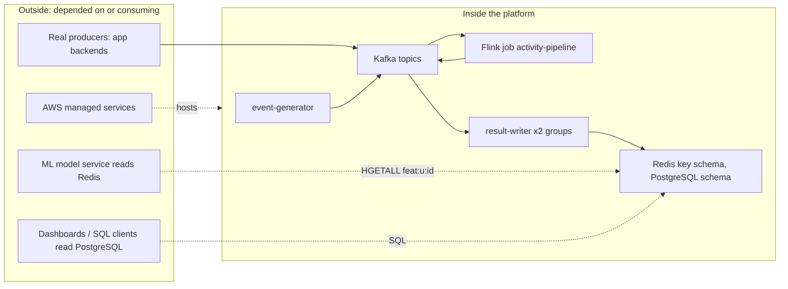

The platform starts at the Kafka `user-events` topic and ends at the Redis keys and PostgreSQL rows it writes. It does **not** define how producers authenticate to the business, how models use features, or how dashboards render.

---

## 2. High-Level Design

### 2.1 Architecture overview

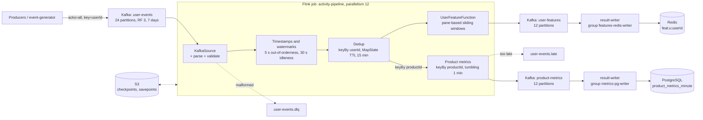

**Reading the diagram.** Events enter one Kafka topic. One Flink job parses, timestamps, deduplicates, and computes two outputs: per-user features (updated per event) and per-product minute metrics (emitted when windows close). Flink writes both to Kafka output topics. A small Java application, `result-writer`, consumes those topics in two consumer groups and writes Redis and PostgreSQL. Flink checkpoints its state and Kafka offsets to S3.

### 2.2 Why a Kafka hop between Flink and the stores?

| Option | Pros | Cons |
| --- | --- | --- |
| **Flink → Kafka output topics → result-writer → stores (chosen)** | Sink slowness becomes Kafka lag instead of Flink backpressure; writers scale independently through consumer groups; output topics can be replayed into the stores without re-running Flink; failures in Redis/PostgreSQL don't fail Flink checkpoints | One extra hop (~5–50 ms); one more deployable |
| Flink sinks directly to Redis and PostgreSQL | Fewer components, lower latency | A slow database backpressures the whole job and delays checkpoints; scaling sinks means rescaling Flink; external writes during recovery need the same idempotency anyway |

The extra hop costs a few tens of milliseconds against a 1-second budget and buys isolation, independent scaling, and cheap re-population of the serving stores.

### 2.3 Component responsibilities

| Component | Responsibility | Scaling unit |
| --- | --- | --- |
| `event-generator` | Produces realistic events at a configured rate with configurable duplicate %, out-of-order jitter, late events, and hot users; used for benchmarks and correctness tests | Kubernetes Job replicas |
| Kafka `user-events` | Durable, ordered-per-user input log; replay source | Partitions (24) |
| Flink `activity-pipeline` | Parsing, validation, event time, dedup, features, windows, late handling | Parallelism (12 slots: 3 TaskManagers × 4) |
| Kafka `user-features`, `product-metrics` | Durable outputs; decouple processing from serving | Partitions (12 each) |
| `result-writer` (group `features-redis-writer`) | Batch, compare-and-set write features to Redis | Consumer-group replicas (≤ 12) |
| `result-writer` (group `metrics-pg-writer`) | Batch upsert window results into PostgreSQL | Consumer-group replicas (≤ 12; 2–3 in practice) |
| Redis | Online feature serving | ElastiCache node size / replicas |
| PostgreSQL | Analytics storage and queries | RDS instance size |
| S3 | Checkpoints, savepoints, HA metadata | — |
| Flink Kubernetes Operator | Deploys the job, triggers savepoints, upgrades | — |

### 2.4 Communication mechanisms

| From → To | Mechanism | Sync / async | Delivery |
| --- | --- | --- | --- |
| Producer → `user-events` | Kafka producer | Async with acks | At-least-once (idempotent producer removes broker-level duplicates within a session) |
| `user-events` → Flink | `KafkaSource` (split assignment by Flink, offsets in checkpoints) | Async pull | Exactly-once **state** via checkpoints |
| Flink internal | Network shuffles (keyBy), credit-based flow control | Async | Exactly-once within the job |
| Flink → output topics | `KafkaSink` with `DeliveryGuarantee.AT_LEAST_ONCE` | Async | At-least-once (duplicates after recovery) |
| Output topics → writers | Kafka consumer groups, manual offset commit after write | Async pull | At-least-once, idempotent writes |
| Writers → Redis | Pipelined Lua `EVALSHA` | Sync per batch | Idempotent, monotonic |
| Writers → PostgreSQL | JDBC batched `INSERT ... ON CONFLICT DO UPDATE` | Sync per batch | Idempotent |
| Model service → Redis | `HGETALL` | Sync | Read-only (outside the platform) |

### 2.5 Data ownership

| Data | Owner | Authority |
| --- | --- | --- |
| Raw events | Kafka `user-events` | Source of truth for replay (7 days) |
| Dedup and feature state | Flink keyed state (checkpointed to S3) | Authoritative intermediate state |
| Window aggregates in flight | Flink window state | Authoritative until emitted |
| User features (serving copy) | Redis | Derived; rebuildable from `user-features` topic or by replay |
| Product metrics | PostgreSQL | Derived; rebuildable by replay |

### 2.6 Synchronous vs asynchronous operations

Everything in the pipeline is asynchronous and pull-based. The only synchronous operations are within each writer batch (write to Redis/PostgreSQL, then commit offsets) and the external reads by consumers of the stores.

### 2.7 Component interaction (inside the Flink job)

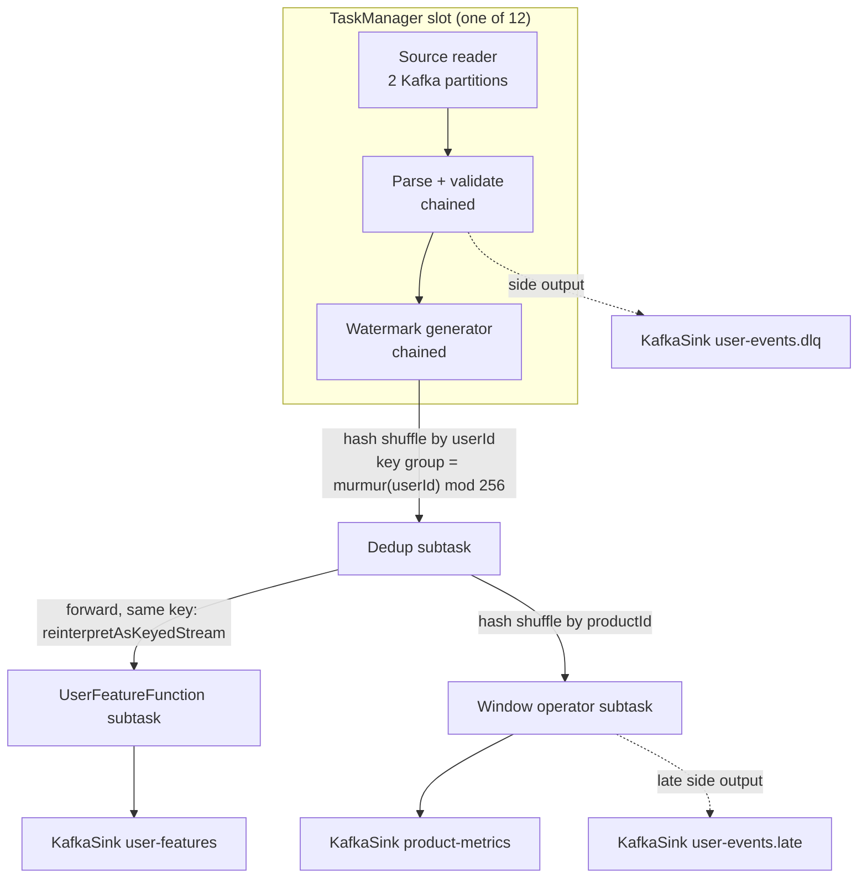

- Source, parse, and watermark assignment are **chained** in one task (no serialization between them).
- `keyBy(userId)` shuffles events across the network so all events of one user reach the same dedup subtask.
- Dedup and features use the same key, so the stream is re-interpreted as keyed without a second shuffle.
- Product metrics need `keyBy(productId)`: a second shuffle.

### 2.8 Data-flow architecture

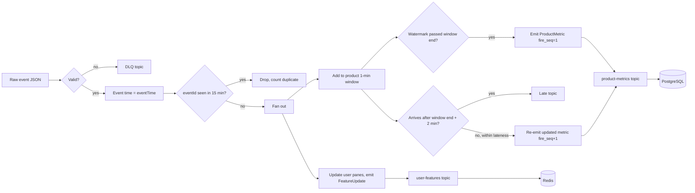

### 2.9 Important sequence: one event to a feature in Redis

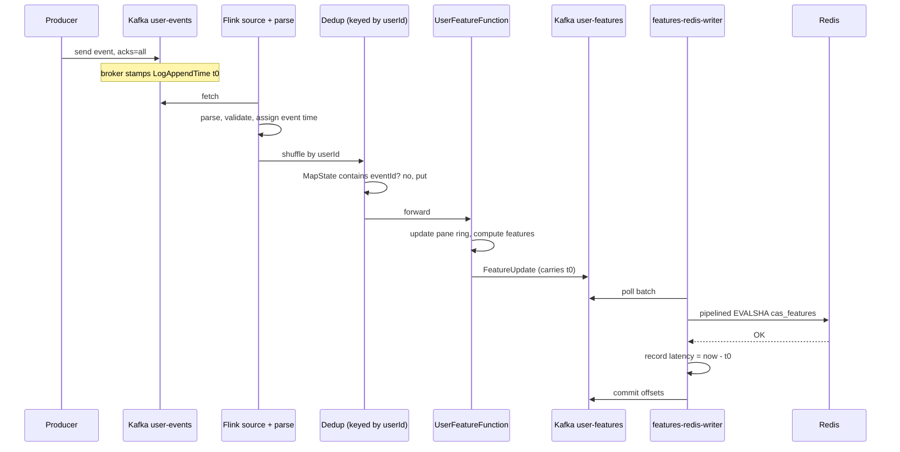

### 2.10 External dependencies

| Dependency | Failure impact | Mitigation |
| --- | --- | --- |
| MSK (Kafka) | Ingestion and processing stop | RF=3 across 3 AZs; producers buffer and retry |
| S3 | Checkpoints fail; job keeps running until tolerable failures are exceeded | `tolerable-failed-checkpoints: 3`; alert |
| ElastiCache | Feature writes back up as Kafka lag; serving reads fail | Writer retries; lag alert; features rebuildable |
| RDS | Metric writes back up as Kafka lag | Same |
| EKS | Pods rescheduled | Flink HA, spare TaskManager |

### 2.11 Scaling strategy

| Layer | How to scale | Limit |
| --- | --- | --- |
| Kafka | More partitions (planned up front; increasing later changes key→partition mapping) | Brokers, partitions per broker |
| Flink | Change parallelism by restarting from a savepoint (or the operator's autoscaler) | Source parallelism ≤ partitions; keyed parallelism ≤ max parallelism (256) |
| result-writer | Add replicas to the consumer group; cooperative rebalancing | Replicas ≤ output topic partitions (12) |
| Redis / PostgreSQL | Vertical scaling; Redis cluster mode if needed | Write batch efficiency |

### 2.12 Fault tolerance overview

- **Kafka** keeps every event for 7 days with RF=3, so any processing state can be recomputed.
- **Flink** checkpoints every 10 s: Kafka source offsets + all keyed/window state, consistently, to S3. On failure it restarts from the last completed checkpoint and re-reads Kafka from the checkpointed offsets.
- **Writers** commit offsets only after successful writes, and all writes are idempotent, so redelivery and Flink re-emission are harmless.

### 2.13 Deployment architecture (AWS)

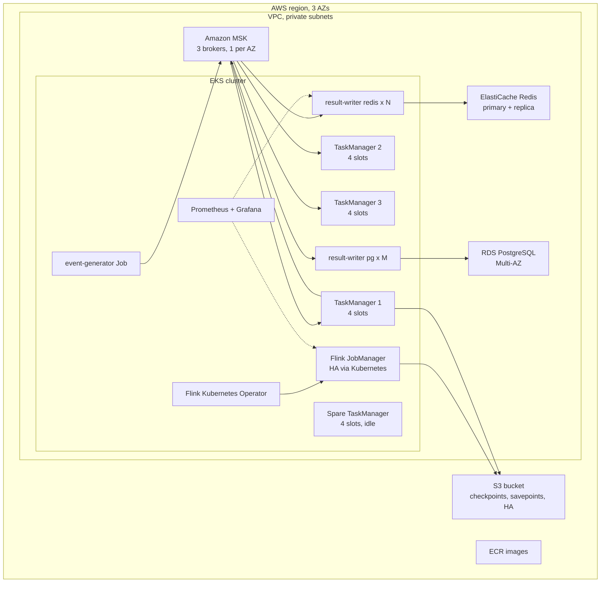

TaskManagers access S3 through IAM Roles for Service Accounts (IRSA), not static keys. The spare TaskManager exists so a failed TaskManager's slots can be replaced immediately instead of waiting for a new pod to be scheduled and started; it is the single most important ingredient of the < 30 s recovery target.

---

## 3. Low-Level Design

### 3.1 Module structure

```text
stream-platform/
├── pom.xml                                   # parent: Java 17, Flink 1.20, Kafka clients
├── common/
│   └── src/main/java/com/acme/stream/common/
│       ├── model/UserEvent.java              # POJO (Flink POJO rules: public no-arg ctor, public fields or getters/setters)
│       ├── model/EventType.java
│       ├── model/FeatureUpdate.java
│       ├── model/ProductMetric.java
│       ├── serde/JsonSerde.java              # shared Jackson ObjectMapper config
│       └── time/Clocks.java
├── activity-pipeline/                        # Flink job
│   └── src/main/java/com/acme/stream/pipeline/
│       ├── ActivityPipelineJob.java          # topology wiring, config
│       ├── source/UserEventDeserializer.java # KafkaRecordDeserializationSchema → ParseResult
│       ├── source/ParseAndValidate.java      # ProcessFunction with DLQ side output
│       ├── time/EventTimeAssigner.java       # WatermarkStrategy factory
│       ├── dedup/DedupFunction.java          # KeyedProcessFunction<String, UserEvent, UserEvent>
│       ├── features/UserFeatureFunction.java # KeyedProcessFunction<String, UserEvent, FeatureUpdate>
│       ├── features/PaneRing.java            # fixed-size circular pane buffer
│       ├── metrics/ProductAggregate.java     # AggregateFunction<UserEvent, Acc, Acc>
│       ├── metrics/ProductWindowFunction.java# ProcessWindowFunction adds window bounds + fire_seq
│       ├── sink/Sinks.java                   # KafkaSink builders
│       └── config/PipelineConfig.java
├── result-writer/                            # plain Java Kafka consumer application
│   └── src/main/java/com/acme/stream/writer/
│       ├── WriterMain.java                   # mode=redis|postgres
│       ├── ConsumerLoop.java                 # poll → batch → write → commit
│       ├── RedisFeatureWriter.java           # Lettuce, pipelined EVALSHA
│       ├── PostgresMetricWriter.java         # HikariCP + batched upserts
│       ├── LatencyRecorder.java              # Prometheus histogram
│       └── HealthServer.java                 # /health/live, /health/ready, /metrics
├── event-generator/
│   └── src/main/java/com/acme/stream/gen/
│       ├── GeneratorMain.java                # rate, users, products, dupes, jitter, late %
│       └── SessionModel.java
├── sql/V1__schema.sql                        # documented below; not created here
├── k8s/                                      # documented below; not created here
└── bench/                                    # proposed scripts, documented below
```

### 3.2 Class diagram

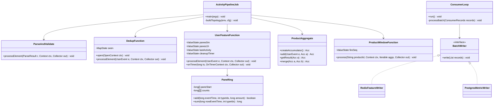

### 3.3 Topology wiring (Java)

```java
StreamExecutionEnvironment env = StreamExecutionEnvironment.getExecutionEnvironment();
env.setParallelism(12);
env.setMaxParallelism(256);                       // fixed for the life of the job's state
env.getConfig().disableGenericTypes();            // fail fast if any type falls back to Kryo
env.setBufferTimeout(20);                         // ms; default 100 ms trades latency for throughput

KafkaSource<ParseResult> source = KafkaSource.<ParseResult>builder()
    .setBootstrapServers(cfg.bootstrap())
    .setTopics("user-events")
    .setGroupId("activity-pipeline")              // used only for committing offsets for monitoring
    .setStartingOffsets(OffsetsInitializer.committedOffsets(OffsetResetStrategy.EARLIEST))
    .setDeserializer(new UserEventDeserializer()) // never throws; wraps failures in ParseResult
    .setProperty("partition.discovery.interval.ms", "60000")
    .build();

WatermarkStrategy<ParseResult> wm = WatermarkStrategy
    .<ParseResult>forBoundedOutOfOrderness(Duration.ofSeconds(5))
    .withTimestampAssigner((r, kafkaTs) -> r.isValid() ? r.event().eventTimeMs : kafkaTs)
    .withIdleness(Duration.ofSeconds(30))
    .withWatermarkAlignment("user-events", Duration.ofSeconds(30), Duration.ofSeconds(1));

SingleOutputStreamOperator<UserEvent> parsed = env
    .fromSource(source, wm, "user-events-source")
    .process(new ParseAndValidate()).name("parse-validate").uid("parse-validate");

parsed.getSideOutput(ParseAndValidate.DLQ).sinkTo(Sinks.dlq(cfg)).uid("dlq-sink");

SingleOutputStreamOperator<UserEvent> deduped = parsed
    .keyBy(e -> e.userId)
    .process(new DedupFunction(Duration.ofMinutes(15))).name("dedup").uid("dedup");

// Same key as dedup: no second shuffle
DataStreamUtils.reinterpretAsKeyedStream(deduped, e -> e.userId)
    .process(new UserFeatureFunction()).name("user-features").uid("user-features")
    .sinkTo(Sinks.features(cfg)).uid("features-sink");

SingleOutputStreamOperator<ProductMetric> metrics = deduped
    .keyBy(e -> e.productId)
    .window(TumblingEventTimeWindows.of(Duration.ofMinutes(1)))
    .allowedLateness(Duration.ofMinutes(2))
    .sideOutputLateData(LATE)
    .aggregate(new ProductAggregate(), new ProductWindowFunction())
    .name("product-metrics").uid("product-metrics");

metrics.sinkTo(Sinks.productMetrics(cfg)).uid("metrics-sink");
metrics.getSideOutput(LATE).sinkTo(Sinks.late(cfg)).uid("late-sink");

env.execute("activity-pipeline");
```

**Why every operator has a `uid`:** state in a savepoint is matched to operators by uid. Without explicit uids, changing the topology (adding an operator) can change auto-generated ids and make state unrestorable, which would break upgrades and replays.

### 3.4 Data structures and state

| State | Operator | Type | Per-key size (ILLUSTRATIVE) | TTL / cleanup |
| --- | --- | --- | --- | --- |
| Seen event ids | `DedupFunction` | `MapState<String, Long>` (eventId → eventTime) | ~20 entries × ~60 B ≈ 1.2 KB for an active user | `StateTtlConfig` 15 min, cleanup in RocksDB compaction filter |
| 5-minute panes | `UserFeatureFunction` | `ValueState<PaneRing>` 10 panes × 30 s × 4 counters | ~400 B | Event-time timer clears all user state 65 min after last event |
| 1-hour purchase panes | `UserFeatureFunction` | `ValueState<PaneRing>` 12 panes × 5 min × 1 amount | ~200 B | Same timer |
| Last activity | `UserFeatureFunction` | `ValueState<LastActivity>` | ~80 B | Same timer |
| Window accumulators | Window operator | `Acc{views, clicks, carts, purchases, revenueMinor, maxIngestTs}` per (product, window) | ~64 B | Purged at window end + allowed lateness |
| Fire sequence | `ProductWindowFunction` | Per-window `ValueState<Integer>` via `context.windowState()` | 4 B | Cleared with the window (`clear()`) |
| Kafka offsets | Source | Per split | — | In every checkpoint |

**Total state estimate (ILLUSTRATIVE):** 500K active users × (1.2 KB + 0.7 KB) ≈ 0.95 GB, plus window state (≈ 50K products × 3 open windows × 64 B ≈ 10 MB). RocksDB with incremental checkpoints handles this comfortably; each incremental checkpoint uploads only new SST files.

### 3.5 Critical algorithm: deduplication

**Input:** `UserEvent` keyed by `userId`. **Output:** the event if its `eventId` was not seen in the last 15 minutes (processing time), else nothing.

```java
public class DedupFunction extends KeyedProcessFunction<String, UserEvent, UserEvent> {
  private transient MapState<String, Long> seen;
  private final Duration ttl;

  @Override public void open(OpenContext ctx) {
    StateTtlConfig ttlCfg = StateTtlConfig.newBuilder(ttl)
        .setUpdateType(StateTtlConfig.UpdateType.OnCreateAndWrite)
        .setStateVisibility(StateTtlConfig.StateVisibility.NeverReturnExpired)
        .cleanupInRocksdbCompactFilter(1000)
        .build();
    MapStateDescriptor<String, Long> d = new MapStateDescriptor<>("seen", Types.STRING, Types.LONG);
    d.enableTimeToLive(ttlCfg);
    seen = getRuntimeContext().getMapState(d);
  }

  @Override public void processElement(UserEvent e, Context ctx, Collector<UserEvent> out) throws Exception {
    if (seen.contains(e.eventId)) {
      duplicates.inc();                     // metric
      return;
    }
    seen.put(e.eventId, e.eventTimeMs);
    out.collect(e);
  }
}
```

| Aspect | Detail |
| --- | --- |
| Time | `O(1)` amortized: one RocksDB point lookup + one put per event |
| Space | `O(unique events per user in 15 min)` per user |
| State transitions | unseen → seen (put) → expired (TTL) |
| Concurrency | Keyed state is accessed by exactly one subtask thread for that key; no locking needed |
| Failure behavior | On restore, `seen` rolls back to the checkpoint along with Kafka offsets, so replayed events are treated exactly as on first processing: exactly-once state |
| Guarantee boundary | Duplicates more than 15 minutes apart are **not** removed; documented |

**Why key dedup by `userId` instead of `eventId`?** Keying by `eventId` would need its own shuffle and spreads state over many tiny keys; keying by `userId` reuses the shuffle the feature operator needs anyway. Duplicates of an event always carry the same `userId`, so they land on the same key.

### 3.6 Critical algorithm: pane-based sliding window features

**Problem:** features like "views in the last 5 minutes" must update on **every** event (online features) rather than only every slide interval.

**Idea:** split the window into fixed panes (10 panes × 30 s for the 5-minute window). Each event increments its pane's counters; the feature is the sum of panes within `[now − 5 min, now]`, where "now" is the user's latest event time (event time, not wall clock).

```java
final class PaneRing {
  private final long paneMs; private final int panes;      // e.g. 30_000 ms × 10
  private final long[] paneStart;                          // start time of each slot, -1 if empty
  private final long[][] counts;                           // [slot][metric]

  /** Returns false if the event is older than the window relative to maxSeen. */
  boolean add(long eventTime, long maxSeen, int metric, long amount) {
    if (eventTime <= maxSeen - paneMs * panes) return false;        // too old for this window
    long start = eventTime - Math.floorMod(eventTime, paneMs);
    int slot = (int) Math.floorMod(start / paneMs, (long) panes);
    if (paneStart[slot] != start) {                                 // slot holds an expired pane: reuse it
      if (paneStart[slot] > start) return false;                    // slot already holds a newer pane
      paneStart[slot] = start;
      Arrays.fill(counts[slot], 0L);
    }
    counts[slot][metric] += amount;
    return true;
  }

  long sum(long now, int metric) {
    long lower = now - paneMs * panes;
    long s = 0;
    for (int i = 0; i < panes; i++)
      if (paneStart[i] > lower && paneStart[i] <= now) s += counts[i][metric];
    return s;
  }
}
```

`UserFeatureFunction.processElement`:

1. Read `panes5m`, `panes1h`, `lastActivity` from state.
2. `maxSeen = max(lastActivity.maxEventTime, e.eventTimeMs)`.
3. `panes5m.add(...)` for the event type; `panes1h.add(...)` for purchases with the amount. If `add` returns `false`, the event is too old for that window: count it as a late feature event and skip that window (no correction is emitted).
4. Compute features at `now = maxSeen`: `views_5m`, `clicks_5m`, `carts_5m`, `purchases_5m`, `purchase_amount_1h`.
5. Update `lastActivity` (max event time, last event type, last product).
6. Register an event-time timer at `maxSeen + 65 min` (delete the previous timer) to clear state for inactive users.
7. Emit `FeatureUpdate{userId, features, asOfEventTime = maxSeen, sourceIngestTs = Kafka timestamp of e}`.

| Aspect | Detail |
| --- | --- |
| Time | `O(P)` per event for the sum (P = 10 or 12 panes) + 3 state reads/writes |
| Space | `O(P × metrics)` per user, independent of event count |
| Precision | Window boundaries are pane-aligned: "last 5 minutes" is really the current pane plus 9 full panes, i.e., between 4.5 and 5 minutes. Documented approximation |
| Concurrency | Single-threaded per key (Flink keyed state) |
| Failure behavior | State restored from checkpoint; replayed events recompute the same values; emitted updates are re-sent (idempotent downstream) |
| Alternative | `SlidingEventTimeWindows.of(5 min, 30 s)` with an `AggregateFunction`: exact window semantics but results only every 30 s (freshness ~30 s + watermark delay), and each event updates 10 windows |

### 3.7 Critical algorithm: tumbling product windows with lateness

```java
public class ProductAggregate implements AggregateFunction<UserEvent, Acc, Acc> {
  public Acc createAccumulator() { return new Acc(); }
  public Acc add(UserEvent e, Acc a) {
    switch (e.eventType) {
      case VIEW -> a.views++;
      case CLICK -> a.clicks++;
      case ADD_TO_CART -> a.carts++;
      case PURCHASE -> { a.purchases++; a.revenueMinor += e.priceMinor; }
    }
    a.maxIngestTs = Math.max(a.maxIngestTs, e.kafkaTimestampMs);
    return a;
  }
  public Acc getResult(Acc a) { return a; }
  public Acc merge(Acc x, Acc y) { return x.plus(y); }   // used only by merging windows
}

public class ProductWindowFunction extends ProcessWindowFunction<Acc, ProductMetric, String, TimeWindow> {
  private static final ValueStateDescriptor<Integer> FIRE_SEQ =
      new ValueStateDescriptor<>("fireSeq", Types.INT);

  @Override public void process(String productId, Context ctx, Iterable<Acc> aggs, Collector<ProductMetric> out)
      throws Exception {
    ValueState<Integer> seq = ctx.windowState().getState(FIRE_SEQ);
    int next = (seq.value() == null ? 0 : seq.value()) + 1;   // 1 = on-time firing, >1 = late re-firing
    seq.update(next);
    Acc a = aggs.iterator().next();
    out.collect(ProductMetric.of(productId, ctx.window().getStart(), ctx.window().getEnd(), a, next,
                                 ctx.currentProcessingTime()));
  }

  @Override public void clear(Context ctx) { ctx.windowState().getState(FIRE_SEQ).clear(); }
}
```

State transitions for one window `[12:00, 12:01)`:

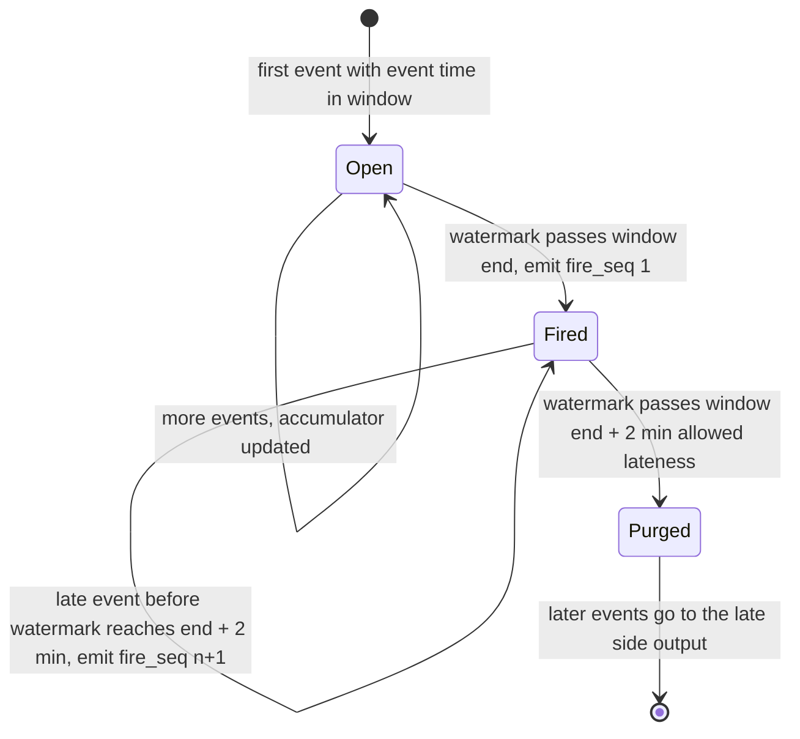

| Aspect | Detail |
| --- | --- |
| Time | `O(1)` per event (incremental aggregate) |
| Space | One accumulator per (product, open window); at most ~3 windows open per product at a time (current + those within allowed lateness) |
| Output semantics | Each firing carries the **full** window aggregate (not a delta), so downstream upserts overwrite rather than add |
| Failure behavior | After recovery, windows fire again from restored state; the same or a newer `fire_seq` arrives; the upsert guard (`fire_seq >= stored`) keeps the latest |

### 3.8 Threading model

| Process | Threads | Notes |
| --- | --- | --- |
| Flink TaskManager | One **task thread per subtask** (per slot per chained operator group); network I/O threads (Netty); RocksDB background threads; checkpoint async upload threads | User functions run single-threaded per subtask: keyed state needs no locks |
| Flink JobManager | Dispatcher, ResourceManager, JobMaster (checkpoint coordinator) | Coordinates checkpoints and restarts |
| `result-writer` | One consumer thread per replica (KafkaConsumer is not thread-safe) running poll → write → commit; Lettuce event loop for Redis; HikariCP pool for PostgreSQL | Simple and predictable; scale by replicas, not threads |
| `event-generator` | N sender threads sharing one `KafkaProducer` (thread-safe) with a rate limiter | Producer batches internally |

**Rule:** never block a Flink task thread on external I/O. This design has no external lookups inside Flink; if enrichment from a database were added later, it would use `AsyncDataStream.unorderedWait` (async I/O) so one slow lookup doesn't stall the task.

### 3.9 Synchronization

| Concern | Mechanism |
| --- | --- |
| Keyed state | Partitioned by key group; each key group is owned by exactly one subtask; no shared mutable state between subtasks |
| Consistent snapshots | Checkpoint barriers flow with the data; an operator snapshots its state when it has received the barrier on all inputs (aligned) or snapshots in-flight buffers too (unaligned) |
| Writer offsets vs writes | Commit offsets only after the batch write succeeded (`commitSync` after Redis/PostgreSQL ack) |
| Writer rebalances | `ConsumerRebalanceListener.onPartitionsRevoked` flushes and commits the current batch before partitions are reassigned (cooperative-sticky assignor minimizes stop-the-world) |

### 3.10 Error handling

| Error | Where | Handling |
| --- | --- | --- |
| Malformed JSON, missing fields, unknown event type | `UserEventDeserializer` / `ParseAndValidate` | Never throw (a throwing deserializer would fail and restart the job in a loop); emit to DLQ side output with an error reason |
| Event time far in the future (> 10 min ahead of ingest time) | `ParseAndValidate` | DLQ with reason `FUTURE_TIMESTAMP` (would otherwise advance watermarks and make everything else late) |
| Late beyond allowed lateness | Window operator | Late side output topic |
| Exceptions in user functions | Any operator | Task failure → restart strategy (exponential delay, max 10 attempts per 10 min) → restore from checkpoint |
| Checkpoint failure | JobManager | Tolerate 3 consecutive failures, then fail the job (forces recovery rather than running without checkpoints indefinitely) |
| Redis/PostgreSQL write failure | `result-writer` | Retry the batch with backoff (100 ms → 5 s); do not commit offsets; after N failures mark not-ready (lag alert fires) |
| Poison output record | `result-writer` | After 3 attempts for a single record (batch bisection isolates it), publish it to `<topic>.writer-dlq` and continue |

### 3.11 Design patterns

| Pattern | Where |
| --- | --- |
| Pipes and filters | The Flink topology |
| Side outputs (content-based router) | DLQ and late events |
| Idempotent receiver | Redis CAS script, PostgreSQL guarded upsert |
| Event sourcing / log as source of truth | Kafka `user-events` + replay |
| Strategy | `BatchWriter` (Redis vs PostgreSQL) in `result-writer` |
| Competing consumers | Writer consumer groups |

---

## 4. API and Message Contracts

This platform has **no public REST API**. Its contracts are Kafka topics and schemas, the Redis serving schema, the PostgreSQL query surface, and a small set of operational HTTP endpoints. A thin query API was deliberately left out: model services read Redis directly with a documented key contract, and dashboards query PostgreSQL. Adding a service would add a hop and a deployment without adding capability.

### 4.1 Kafka topics

| Topic | Partitions | RF | `min.insync.replicas` | Key | Retention | Cleanup | Timestamp type | Producer | Consumers |
| --- | --- | --- | --- | --- | --- | --- | --- | --- | --- |
| `user-events` | 24 | 3 | 2 | `userId` | 7 days | delete | `LogAppendTime` | App producers, `event-generator` | Flink `activity-pipeline` |
| `user-events.dlq` | 6 | 3 | 2 | `userId` or null | 14 days | delete | `CreateTime` | Flink | Operators (manual inspection, replay tool) |
| `user-events.late` | 6 | 3 | 2 | `productId` | 7 days | delete | `CreateTime` | Flink | Optional correction batch job (out of scope) |
| `user-features` | 12 | 3 | 2 | `userId` | 3 days | delete | `CreateTime` | Flink | `result-writer` group `features-redis-writer` |
| `product-metrics` | 12 | 3 | 2 | `productId` | 3 days | delete | `CreateTime` | Flink | `result-writer` group `metrics-pg-writer` |

**Why `LogAppendTime` on `user-events`?** The broker stamps each record with its append time. That gives a trustworthy, broker-clock "ingested at" timestamp for measuring processing latency, independent of client clocks. Event time comes from the payload's `eventTime`, so the two timestamps serve different purposes.

### 4.2 Input event schema (`user-events`)

```json
{
  "schemaVersion": 1,
  "eventId": "6f1d2c3b-8a9e-4b7c-9d10-2e3f4a5b6c7d",
  "eventType": "ADD_TO_CART",
  "userId": "u-1029384",
  "sessionId": "s-77a1c9",
  "productId": "p-55310",
  "priceMinor": 2599,
  "currency": "USD",
  "eventTime": "2026-02-10T12:00:01.234Z",
  "platform": "ios",
  "appVersion": "5.12.0"
}
```

| Field | Type | Required | Validation |
| --- | --- | --- | --- |
| `schemaVersion` | int | yes | Supported: 1 |
| `eventId` | UUID string | yes | Dedup key; producer-generated once per logical event, reused on retries |
| `eventType` | enum | yes | `VIEW`, `CLICK`, `ADD_TO_CART`, `PURCHASE` |
| `userId` | string ≤ 64 | yes | Partition key |
| `productId` | string ≤ 64 | yes | Window key |
| `priceMinor` | long | for `PURCHASE` | ≥ 0 |
| `currency` | ISO-4217 | for `PURCHASE` | Single currency assumed in aggregates |
| `eventTime` | ISO-8601 UTC | yes | Not more than 10 min ahead of the Kafka timestamp; not older than 7 days |
| others | string | no | Passed through, unused |

**Schema evolution:** additive optional fields only within version 1; a breaking change gets `schemaVersion: 2` and the parser supports both during migration. (A schema registry with Avro/Protobuf is a listed future improvement.)

### 4.3 Partitioning strategy

| Topic | Key | Why |
| --- | --- | --- |
| `user-events` | `userId` | Per-user ordering in Kafka (fewer out-of-order events within a user, which features benefit from); all duplicates of an event share a partition |
| `user-features` | `userId` | Per-user ordering of feature updates, so the writer applies them in order (the CAS guard handles the rest) |
| `product-metrics` | `productId` | Updates for one product/window are ordered, so a re-fired window is written after the original |

Default partitioner: `murmur2(keyBytes) % partitions`. **Partition counts are chosen up front**: adding partitions later changes which partition a key maps to, which breaks per-key ordering across the change and complicates replays.

Note that Kafka's partitioning and Flink's `keyBy` hashing are **independent**: Flink re-hashes keys into key groups (`murmurHash(key.hashCode()) % maxParallelism`) and assigns key-group ranges to subtasks. So even though Kafka is keyed by `userId`, Flink still shuffles after the source.

### 4.4 Output schemas

`user-features` value:

```json
{
  "userId": "u-1029384",
  "asOfEventTime": "2026-02-10T12:00:01.234Z",
  "features": {
    "views_5m": 14,
    "clicks_5m": 6,
    "carts_5m": 2,
    "purchases_5m": 0,
    "purchase_amount_1h_minor": 7598,
    "last_event_type": "ADD_TO_CART",
    "last_product_id": "p-55310"
  },
  "sourceIngestTs": 1739188801301,
  "emittedAt": 1739188801455,
  "pipelineVersion": "1.4.0"
}
```

`product-metrics` value:

```json
{
  "productId": "p-55310",
  "windowStart": "2026-02-10T12:00:00Z",
  "windowEnd": "2026-02-10T12:01:00Z",
  "views": 1840,
  "clicks": 412,
  "cartAdds": 97,
  "purchases": 31,
  "revenueMinor": 80569,
  "fireSeq": 1,
  "maxIngestTs": 1739188864012,
  "emittedAt": 1739188866120
}
```

DLQ value: the original raw bytes (base64) plus `errorCode`, `errorMessage`, `sourcePartition`, `sourceOffset`, `detectedAt`.

### 4.5 Producers and consumers

| Client | Key settings | Delivery semantics |
| --- | --- | --- |
| Event producers / generator | `acks=all`, `enable.idempotence=true`, `linger.ms=5`, `batch.size=65536`, `compression.type=lz4`, `max.in.flight.requests.per.connection=5` | At-least-once to Kafka; idempotence removes duplicates from internal retries within a producer session; application-level retries reuse `eventId`, and the pipeline dedups them |
| Flink `KafkaSource` | Offsets stored in checkpoints; commits offsets to Kafka on checkpoint completion (for lag monitoring only) | Exactly-once state |
| Flink `KafkaSink` | `DeliveryGuarantee.AT_LEAST_ONCE`, `linger.ms=10`, `compression.type=lz4`, `acks=all` | At-least-once; duplicates possible after recovery |
| `result-writer` | `enable.auto.commit=false`, `max.poll.records=500`, `partition.assignment.strategy=CooperativeStickyAssignor`, `isolation.level=read_uncommitted` (no Kafka transactions are used upstream) | At-least-once consumption; idempotent writes → effectively-once results |

**Why not an exactly-once (transactional) Kafka sink?** Flink's exactly-once `KafkaSink` writes in Kafka transactions that commit only when a checkpoint completes. Consumers with `read_committed` see output only after the commit, so output latency becomes at least the checkpoint interval (10 s) and typically ~1.5× that. That would violate the < 1 s latency target. Because every downstream write is idempotent (absolute values, monotonic guards), at-least-once delivery yields the same final state.

### 4.6 Redis serving contract

| Key | Type | Fields | TTL |
| --- | --- | --- | --- |
| `feat:u:{userId}` | Hash | `views_5m`, `clicks_5m`, `carts_5m`, `purchases_5m`, `purchase_amount_1h_minor`, `last_event_type`, `last_product_id`, `as_of_event_time_ms`, `updated_at_ms`, `pipeline_version` | 2 hours, refreshed on every write |

Read contract for consumers (model services):

- `HGETALL feat:u:{userId}`. A missing key means "no activity in the last ~2 hours": treat counts as 0.
- Values are **as of `as_of_event_time_ms`** (the user's latest processed event time), not as of the read time. A consumer that needs "views in the last 5 minutes relative to now" should treat the value as stale if `now − as_of_event_time_ms > 5 min`.
- Writes are monotonic in `as_of_event_time_ms`: a reader never sees features move backward in event time.

Compare-and-set script (`cas_features.lua`):

```lua
-- KEYS[1] = feat:u:{userId}
-- ARGV[1] = as_of_event_time_ms, ARGV[2] = ttl_seconds, ARGV[3..] = field, value pairs
local current = tonumber(redis.call('HGET', KEYS[1], 'as_of_event_time_ms') or '-1')
local incoming = tonumber(ARGV[1])
if incoming < current then
  return 0                                   -- stale update (replay or reordering): ignore
end
redis.call('HSET', KEYS[1], 'as_of_event_time_ms', ARGV[1], unpack(ARGV, 3))
redis.call('EXPIRE', KEYS[1], tonumber(ARGV[2]))
return 1
```

`>=` semantics (equal is accepted) makes a replayed update with the same event time a harmless overwrite with identical values.

### 4.7 PostgreSQL query surface

Representative analytics queries the schema is designed for:

```sql
-- Top 20 products by views in the last 15 minutes
SELECT product_id, sum(views) AS views, sum(purchases) AS purchases, sum(revenue_minor) AS revenue_minor
  FROM product_metrics_minute
 WHERE window_start >= now() - interval '15 minutes'
 GROUP BY product_id
 ORDER BY views DESC
 LIMIT 20;

-- Minute-by-minute series for one product over the last 6 hours
SELECT window_start, views, clicks, cart_adds, purchases, revenue_minor
  FROM product_metrics_minute
 WHERE product_id = :product_id
   AND window_start >= now() - interval '6 hours'
 ORDER BY window_start;

-- Conversion rate by category for the last hour
SELECT p.category,
       sum(m.purchases)::numeric / NULLIF(sum(m.views), 0) AS view_to_purchase
  FROM product_metrics_minute m
  JOIN products p USING (product_id)
 WHERE m.window_start >= now() - interval '1 hour'
 GROUP BY p.category;
```

### 4.8 Operational HTTP endpoints

| Endpoint | Owner | Purpose |
| --- | --- | --- |
| `GET /jobs/overview`, `GET /jobs/{jobId}` | Flink JobManager REST (port 8081) | Job status, vertex metrics, backpressure |
| `GET /jobs/{jobId}/checkpoints` | Flink REST | Checkpoint history, durations, sizes |
| `POST /jobs/{jobId}/savepoints` `{ "target-directory": "s3://.../savepoints", "cancel-job": false }` | Flink REST (normally triggered through the operator) | Savepoint for upgrades, rescaling, replay |
| `GET /jobs/{jobId}/vertices/{vertexId}/backpressure` | Flink REST | Backpressure ratio per subtask |
| `GET /health/live`, `GET /health/ready` | `result-writer` (port 8080) | Liveness (loop alive) / readiness (assigned partitions and last write succeeded within 60 s) |
| `GET /metrics` | `result-writer`, `event-generator`, Flink Prometheus reporter (port 9249) | Prometheus scrape |

Savepoint trigger response (Flink REST):

```json
{ "request-id": "2a4f6c9e1b7d8a3c5e0f1a2b3c4d5e6f" }
```

Status poll `GET /jobs/{jobId}/savepoints/{requestId}`:

```json
{ "status": { "id": "COMPLETED" },
  "operation": { "location": "s3://stream-platform/savepoints/savepoint-7c1e2a-4b5d6f7a8b9c" } }
```

These endpoints are internal (ClusterIP only), protected by Kubernetes network policy, and not exposed outside the cluster.

---

## 5. Database and Storage Design

### 5.1 Storage roles

| Store | Holds | Access pattern | Why this store |
| --- | --- | --- | --- |
| Kafka | Raw events (7 days), outputs (3 days) | Sequential append and read | Durable replayable log |
| Flink RocksDB state (local SSD) + S3 checkpoints | Dedup sets, feature panes, open windows, offsets | Keyed point reads/writes | Large state, incremental snapshots |
| Redis | Latest features per user | Point read by `userId`, sub-ms | Online serving |
| PostgreSQL | Per-minute product metrics, product dimension, replay audit | Range scans by time, aggregations | SQL analytics, upserts |

### 5.2 ER diagram

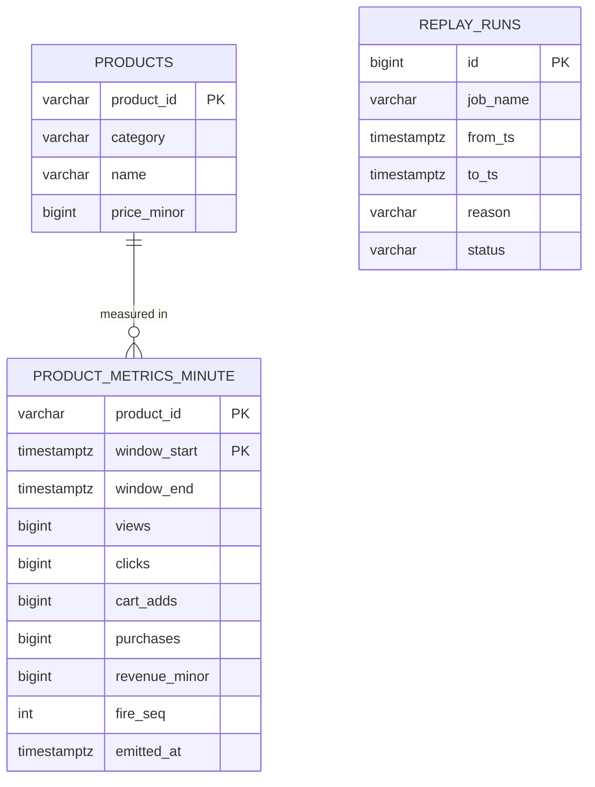

`product_metrics_minute.product_id` is **not** a foreign key to `products`: metrics can arrive for products not yet loaded into the dimension table (catalog sync lag), and an FK would make the writer fail on those rows. The join is done at query time.

### 5.3 Tables

```sql
CREATE TABLE products (
    product_id   VARCHAR(64) PRIMARY KEY,
    category     VARCHAR(64) NOT NULL,
    name         VARCHAR(255) NOT NULL,
    price_minor  BIGINT CHECK (price_minor >= 0),
    updated_at   TIMESTAMPTZ NOT NULL DEFAULT now()
);

CREATE TABLE product_metrics_minute (
    product_id     VARCHAR(64)  NOT NULL,
    window_start   TIMESTAMPTZ  NOT NULL,
    window_end     TIMESTAMPTZ  NOT NULL,
    views          BIGINT       NOT NULL DEFAULT 0,
    clicks         BIGINT       NOT NULL DEFAULT 0,
    cart_adds      BIGINT       NOT NULL DEFAULT 0,
    purchases      BIGINT       NOT NULL DEFAULT 0,
    revenue_minor  BIGINT       NOT NULL DEFAULT 0,
    fire_seq       INT          NOT NULL,
    max_ingest_ts  TIMESTAMPTZ  NOT NULL,
    emitted_at     TIMESTAMPTZ  NOT NULL,
    written_at     TIMESTAMPTZ  NOT NULL DEFAULT now(),
    PRIMARY KEY (product_id, window_start),
    CONSTRAINT chk_window_len CHECK (window_end = window_start + interval '1 minute'),
    CONSTRAINT chk_non_negative CHECK (views >= 0 AND clicks >= 0 AND cart_adds >= 0
                                       AND purchases >= 0 AND revenue_minor >= 0),
    CONSTRAINT chk_fire_seq CHECK (fire_seq >= 1)
) PARTITION BY RANGE (window_start);

-- One partition per day, created ahead of time by a scheduled job; old partitions dropped after 30 days
CREATE TABLE product_metrics_minute_20260210 PARTITION OF product_metrics_minute
    FOR VALUES FROM ('2026-02-10') TO ('2026-02-11');

-- "Top products in a time range": scan by time, then aggregate
CREATE INDEX idx_pmm_window_start ON product_metrics_minute (window_start);

CREATE TABLE replay_runs (
    id               BIGSERIAL PRIMARY KEY,
    job_name         VARCHAR(64)  NOT NULL,
    from_ts          TIMESTAMPTZ  NOT NULL,
    to_ts            TIMESTAMPTZ,
    reason           VARCHAR(255) NOT NULL,
    savepoint_path   TEXT,
    status           VARCHAR(16)  NOT NULL CHECK (status IN ('RUNNING','COMPLETED','FAILED','CANCELLED')),
    started_at       TIMESTAMPTZ  NOT NULL DEFAULT now(),
    finished_at      TIMESTAMPTZ,
    events_replayed  BIGINT
);
```

| Table | PK | Unique / check constraints | Indexes | Relationship |
| --- | --- | --- | --- | --- |
| `products` | `product_id` | `price_minor >= 0` | PK | Dimension for queries |
| `product_metrics_minute` | `(product_id, window_start)` | Window length = 1 min; counts ≥ 0; `fire_seq ≥ 1` | PK (per partition); `window_start` | Logical reference to `products` |
| `replay_runs` | `id` | Status enum | PK | Audit of operator replays |

The PK `(product_id, window_start)` serves the per-product time series query (equality on `product_id`, range on `window_start`). Each partition carries its own copy of every index; a PK on a partitioned table must include the partition key, which it does.

### 5.4 Idempotent upsert (the writer's only write)

```sql
INSERT INTO product_metrics_minute AS t
  (product_id, window_start, window_end, views, clicks, cart_adds, purchases, revenue_minor,
   fire_seq, max_ingest_ts, emitted_at)
VALUES ($1, $2, $3, $4, $5, $6, $7, $8, $9, $10, $11)
ON CONFLICT (product_id, window_start) DO UPDATE
   SET views = EXCLUDED.views,
       clicks = EXCLUDED.clicks,
       cart_adds = EXCLUDED.cart_adds,
       purchases = EXCLUDED.purchases,
       revenue_minor = EXCLUDED.revenue_minor,
       fire_seq = EXCLUDED.fire_seq,
       max_ingest_ts = EXCLUDED.max_ingest_ts,
       emitted_at = EXCLUDED.emitted_at,
       written_at = now()
 WHERE EXCLUDED.fire_seq >= t.fire_seq;
```

- Values are **absolute window totals**, never increments, so applying the same row twice is a no-op in effect.
- The `fire_seq` guard prevents an older firing (e.g., a duplicate delivered late) from overwriting a newer late re-firing.
- Batched through JDBC with `reWriteBatchedInserts=true` (pgjdbc rewrites the batch into multi-row `INSERT`s), 500 rows per batch, one transaction per batch.

### 5.5 Transaction boundaries

| Writer | Transaction | Then |
| --- | --- | --- |
| `metrics-pg-writer` | One transaction per polled batch (≤ 500 upserts) | `commitSync` the batch's offsets |
| `features-redis-writer` | No transaction; one pipelined round trip of `EVALSHA` per batch; each script is atomic per key | `commitSync` after all replies |
| Partition maintenance job | One transaction per `CREATE TABLE ... PARTITION OF` / `DROP TABLE` | — |

Crash between write and offset commit → redelivery → idempotent rewrite. That is the whole consistency argument for the sinks.

### 5.6 Normalization decisions

- `product_metrics_minute` is a fact table at minute grain in 3NF (every column depends on `(product_id, window_start)`).
- `window_end` is derivable from `window_start` but stored for query convenience; the CHECK constraint keeps it consistent.
- Category is **not** denormalized into metrics: catalog changes would otherwise require rewriting history. The join cost is small at minute grain.

### 5.7 Flink state storage layout

```text
s3://stream-platform/
├── checkpoints/activity-pipeline/<job-id>/
│   ├── chk-1842/_metadata          # checkpoint metadata: operator states, file handles
│   ├── shared/                     # incremental RocksDB SST files shared across checkpoints
│   └── taskowned/
├── savepoints/                     # self-contained, user-triggered, used for upgrades and rescaling
└── ha/                             # JobManager HA metadata (pointers to latest checkpoint)
```

- Incremental checkpoints upload only SST files created since the previous checkpoint; unchanged files are referenced from `shared/`.
- Retained checkpoints: last 3 (`state.checkpoints.num-retained: 3`), externalized and retained on cancellation, so a job can be restarted from a checkpoint even after a manual cancel.

---

## 6. Core Algorithms and Engineering Techniques

### 6.1 Event time, watermarks, and allowed lateness

1. **Problem:** results must reflect when events happened, and events arrive late and out of order.
2. **Why required:** processing-time windows would count a 12:00:59 event that arrived at 12:01:03 in the wrong minute, and results would change if the job were replayed.
3. **Core idea:** each event carries its event time. A **watermark** W(t) is the operator's assertion "I don't expect more events with timestamp ≤ t". Windows fire when the watermark passes their end. With bounded out-of-orderness B, `watermark = max_event_time_seen − B − 1 ms`.
4. **Steps:**
   - Per Kafka partition, the source tracks the max event time and emits watermarks periodically (every 200 ms, `pipeline.auto-watermark-interval`).
   - An operator's watermark is the **minimum** of its input watermarks (across all upstream subtasks/partitions).
   - Idle partitions (no data for 30 s) are excluded from the minimum so they don't hold back the watermark forever.
   - Watermark alignment pauses partitions whose watermark runs more than 30 s ahead of the slowest one (important during replay).
   - When the watermark passes `window_end`, the window fires; events arriving within allowed lateness (2 min) re-fire it; later events go to the side output.
5. **Pseudocode:** Section 3.3 (`WatermarkStrategy`), Section 3.7 (window).
6. **Time:** `O(1)` per event to update the max; watermark propagation is periodic.
7. **Space:** `O(partitions)` watermark trackers; window state retained for the allowed lateness.
8. **Alternatives:** processing-time windows (simple, non-deterministic); ingestion-time (Kafka timestamp) windows; punctuated watermarks from special markers.
9. **Advantages:** deterministic, replayable results; correct handling of moderate disorder.
10. **Disadvantages:** results wait for the watermark (window length + B before firing); one stalled partition can stall watermarks (mitigated by idleness); a single event with a wildly future timestamp can make everything else late (mitigated by validation).
11. **Failure scenarios:** a producer with a clock 1 hour ahead → its events push watermarks forward → everyone else's events become late. Defense: reject events more than 10 minutes ahead of their Kafka append time.
12. **Interview explanation:** "The watermark is the job's estimate of how far event time has progressed. With 5 seconds of bounded disorder, a minute window fires about 5 seconds after its end in event time. Up to 2 minutes later we still correct it by re-firing; after that, events are routed aside instead of silently dropped."

### 6.2 Tumbling vs sliding windows

| | Tumbling (product metrics) | Sliding (user features) |
| --- | --- | --- |
| Definition | Fixed, non-overlapping: [12:00, 12:01), [12:01, 12:02) | Overlapping: "last 5 minutes", evaluated continuously |
| Implementation here | Flink `TumblingEventTimeWindows` + incremental `AggregateFunction` | Custom pane ring in `KeyedProcessFunction` |
| Output timing | Once at window end (+ late re-firings) | On every event |
| Cost per event | 1 accumulator update | 1 pane update + `O(panes)` sum |
| Flink-native sliding alternative | — | `SlidingEventTimeWindows.of(5 min, 30 s)`: each event belongs to 10 windows (10 accumulator updates) and results appear only every 30 s |

**Interview explanation:** "Analytics wants exact minute buckets, so tumbling windows fit. Online features want a fresh 'last 5 minutes' on every event, so I used 30-second panes in keyed state: each event touches one pane and the feature is a sum over ten panes. That trades exact boundaries for per-event freshness."

### 6.3 Checkpointing (asynchronous barrier snapshots)

1. **Problem:** after a failure, resume with state and input positions that are consistent with each other, without stopping the world.
2. **Why required:** otherwise either events are lost (offsets ahead of state) or double-counted (state ahead of offsets).
3. **Core idea (Chandy-Lamport variant):** the JobManager injects numbered **barriers** into every source. A barrier separates "events before checkpoint n" from "after". Each operator snapshots its state when the barrier has arrived on all inputs (aligned), then forwards it. The checkpoint completes when every sink has acknowledged. The snapshot contains source offsets and all operator state as of the same logical cut.
4. **Steps:**
   1. Checkpoint coordinator triggers checkpoint n every 10 s (min pause 5 s, timeout 60 s, max 1 concurrent).
   2. Sources record their current offsets and emit barrier n downstream.
   3. Operators with multiple inputs **align**: buffer input from channels that already delivered barrier n until all channels deliver it (or, with unaligned checkpoints, snapshot the in-flight buffers instead of waiting).
   4. Each operator takes a synchronous snapshot (for RocksDB: flush memtable, hard-link SST files) and uploads asynchronously.
   5. On all acknowledgements, the coordinator writes `_metadata` and marks checkpoint n complete; sources commit offsets to Kafka (for monitoring).
5. **Time:** synchronous phase is short (milliseconds); async upload is proportional to **new** state since the last checkpoint (incremental).
6. **Space:** retained checkpoints in S3; shared SST files referenced across checkpoints.
7. **Alternatives:** Kafka Streams changelog topics (state replicated through Kafka); periodic external snapshots; no state (stateless processing).
8. **Advantages:** exactly-once state with low runtime overhead; recovery to a consistent cut.
9. **Disadvantages:** aligned checkpoints slow down under backpressure (barriers queue behind data); sink side effects between checkpoints are replayed (hence idempotent sinks).
10. **Failure scenarios:** S3 throttling makes checkpoints time out → after 3 consecutive failures the job fails and restarts from the last good checkpoint (with more replay).
11. **Configuration:**

```yaml
execution.checkpointing.interval: 10s
execution.checkpointing.mode: EXACTLY_ONCE
execution.checkpointing.timeout: 60s
execution.checkpointing.min-pause: 5s
execution.checkpointing.max-concurrent-checkpoints: 1
execution.checkpointing.tolerable-failed-checkpoints: 3
execution.checkpointing.unaligned.enabled: true
execution.checkpointing.aligned-checkpoint-timeout: 5s      # switch to unaligned only when alignment is slow
execution.checkpointing.externalized-checkpoint-retention: RETAIN_ON_CANCELLATION
state.backend.type: rocksdb
state.backend.incremental: true
state.checkpoints.dir: s3://stream-platform/checkpoints/activity-pipeline
state.checkpoints.num-retained: 3
```

12. **Interview explanation:** "A checkpoint is a consistent cut: Kafka offsets plus all operator state at the same logical point, created by barriers flowing with the data. On failure, Flink rewinds the sources to those offsets and restores the state, so every event affects state exactly once."

### 6.4 Exactly-once state vs effectively-once results

| Layer | Guarantee | Mechanism |
| --- | --- | --- |
| Kafka → Flink state | Exactly-once | Offsets and state in the same checkpoint |
| Flink → output topics | At-least-once | Records emitted after the last checkpoint are re-emitted after recovery |
| Output topics → Redis / PostgreSQL | At-least-once delivery, **effectively-once state** | Absolute values + monotonic guards (`as_of_event_time_ms`, `fire_seq`) |

Recomputation is **deterministic**: the same events in the same per-partition order produce the same state and outputs. Window firings depend on watermark progress, which depends on cross-partition interleaving; that can vary slightly between runs, but because every output is the full current value of its key and writes are monotonic, the final stored state converges to the same result.

### 6.5 Deduplication

Covered in Section 3.5. Summary for comparison:

| Option | Exactness | Cost | Chosen? |
| --- | --- | --- | --- |
| Keyed `MapState` by user with 15-min TTL | Exact within 15 min | ~1 KB per active user | Yes |
| Keyed `ValueState<Boolean>` by `eventId` | Exact within TTL | Extra shuffle; many tiny keys | No |
| Bloom filter per user | Probabilistic (false positives drop real events) | Smaller | No: dropping a real purchase is worse than missing a rare duplicate |
| Dedup in the sink only | Exact only for idempotent outputs | No state | Insufficient: counts would already be inflated |

### 6.6 Backpressure handling

1. **Problem:** a downstream operator (or sink) slower than the input rate.
2. **Core idea (credit-based flow control):** each receiving task grants **credits** (free network buffers) to its senders. A sender transmits only with credit. When a receiver is slow, credits run out, the sender's output buffers fill, the sender's task blocks on output, and the pressure propagates upstream until the Kafka source simply reads more slowly. Kafka absorbs the difference as consumer lag. Nothing is dropped and nothing runs out of memory.
3. **Steps to diagnose:** Flink metrics `backPressuredTimeMsPerSecond` and `busyTimeMsPerSecond` per subtask. The **bottleneck is the most downstream operator that is busy (near 1000 ms/s) but not itself backpressured**; operators upstream of it show high backpressured time.
4. **Responses in this design:**
   - Inside Flink: raise parallelism of the bottleneck operator (restart from savepoint), fix skew, reduce per-record cost (serialization, state access).
   - At the edges: output goes to Kafka (fast, rarely backpressures); slow Redis/PostgreSQL shows up as **writer lag**, not as Flink backpressure.
   - In `result-writer`: bounded batches; if a store slows, the poll loop slows; lag grows; scale the consumer group up to the partition count.
   - At producers: `buffer.memory` + `max.block.ms` make producers block (or fail) instead of exhausting memory when brokers slow.
5. **Time / space:** buffer memory is fixed per task (`taskmanager.memory.network.fraction`, buffer debloating keeps in-flight data near a target time, `taskmanager.network.memory.buffer-debloat.enabled: true`).
6. **Alternatives:** dropping/sampling under load (lossy); unbounded queues (OOM); rate limiting producers (pushes the problem upstream).
7. **Failure scenario:** sustained backpressure makes aligned barriers wait behind full buffers → checkpoints slow → timeouts. Unaligned checkpoints (after a 5 s alignment timeout) let barriers overtake buffered data.
8. **Interview explanation:** "Backpressure in Flink is lossless flow control: a slow operator stops granting credits, the pressure walks back to the Kafka source, and Kafka holds the backlog as lag. My job is to find the busy-but-not-backpressured operator and fix or scale it."

### 6.7 Kafka partitions × Flink parallelism

| Rule | Consequence |
| --- | --- |
| A partition is read by exactly one source subtask at a time | Source parallelism > partitions → idle subtasks (and, without idleness, stalled watermarks) |
| Partitions are spread over source subtasks | 24 partitions / 12 subtasks = 2 each (even). 6 partitions / 4 subtasks = 2, 2, 1, 1 (uneven: two subtasks do twice the work) |
| `keyBy` redistributes by key group, independent of Kafka partitions | Keyed operator load depends on key distribution, not on partition count |
| Max parallelism (256) fixes the number of key groups forever | Keyed operators can rescale up to 256; changing max parallelism requires state migration |
| Key groups per subtask = 256 / parallelism | 256/12 is not an integer: some subtasks own 22 key groups, some 21 (≈ 5% imbalance). Choosing parallelism that divides max parallelism (8, 16) or a larger max parallelism (e.g., 720, divisible by many numbers) reduces this |

**Interview explanation:** "Kafka partitions cap how many source tasks do useful work, and an uneven partition-to-task ratio skews the load. After the keyBy, partitions don't matter anymore; key groups do. So I size partitions as a multiple of the source parallelism with headroom (24 for 12), and I pick max parallelism up front because it's baked into the state."

### 6.8 Consumer-group scaling (result-writer)

1. **Problem:** sink throughput must scale independently of Flink.
2. **Core idea:** Kafka consumer groups assign each partition of the output topic to exactly one consumer in the group; adding consumers redistributes partitions.
3. **Steps:** scale `features-redis-writer` replicas 1 → 2 → 4 → 6; the cooperative-sticky assignor moves only the partitions that need to move, so other consumers keep processing during the rebalance; `onPartitionsRevoked` flushes and commits before giving up a partition.
4. **Limit:** replicas ≤ partitions (12); extra replicas idle.
5. **Time:** rebalance pause of a few seconds for moved partitions only.
6. **Alternatives:** threads inside one consumer (more complex offset management); Flink direct sinks (scale with Flink).
7. **Failure scenario:** a writer pod crashes → session timeout (default 45 s) or immediate leave on clean shutdown → partitions reassigned → uncommitted batch redelivered → idempotent rewrite.
8. **Interview explanation:** "The writers are a classic consumer group: one partition per consumer at a time, offsets committed after the write. Scaling is adding pods up to the partition count, and idempotent writes make rebalances and redeliveries harmless."

### 6.9 Event replay

Two kinds:

| Replay | Trigger | Mechanism | Effect on sinks |
| --- | --- | --- | --- |
| **Recovery replay** (automatic) | Task/JobManager failure | Restore checkpoint; sources rewind to checkpointed offsets; events since then are reprocessed | Re-emitted outputs are idempotent overwrites |
| **Operational replay** (manual) | Bug fix, logic change, backfill | Start the job (new version) from a savepoint, or with fresh state from Kafka offsets at a timestamp | Recomputed results overwrite old ones |

Operational replay procedure (from a timestamp T, fresh state):

1. Record the run in `replay_runs` (reason, from_ts).
2. Choose T as a window boundary minus the dedup TTL and feature window (e.g., T = desired start − 1 h) so that dedup and feature state are warm by the time the first window you care about is processed.
3. Deploy the job with `OffsetsInitializer.timestamp(T)` and a new job name/consumer id, writing to the same output topics.
4. Watermark alignment (30 s max drift) keeps partitions in step so window state doesn't explode while reading history fast.
5. As replay passes real time, the job is caught up; switch traffic by stopping the old job (or run the replay as the new production job).
6. Mark the run `COMPLETED` with `events_replayed`.

Why it's safe: tumbling-window outputs carry full window totals and overwrite; feature writes are guarded by `as_of_event_time_ms`. Caveat: during the replay, Redis features for replayed users can lag behind "now" until the replay catches up; the CAS guard prevents replayed (older) features from overwriting newer ones written by the still-running old job.

**Replay horizon:** 7 days of Kafka retention. Events older than that cannot be replayed.

### 6.10 Recovery time budget

Covered with numbers in the [Numerical Claims Defence](#claim-e3-less-than-30-second-recovery). The algorithmic point: **recovery time = detection + restart + state restore + backlog drain**, and backlog drain = `backlog / (catch_up_rate − input_rate)`. Throughput headroom is therefore part of recovery engineering.

---

## 7. End-to-End Execution Flows

### 7.1 Primary flow: one event through the platform

1. **Arrival:** a producer sends an event keyed by `userId` with `acks=all`. The broker appends it to partition `murmur2(userId) % 24`, stamps `LogAppendTime`, replicates to 2 in-sync followers, and acknowledges.
2. **Fetch:** the Flink source subtask that owns that partition fetches a batch (`fetch.min.bytes`, `fetch.max.wait.ms=50`).
3. **Validation:** the deserializer parses JSON with a shared Jackson `ObjectMapper`; failures become `ParseResult.invalid` and go to the DLQ side output.
4. **Event time:** the timestamp assigner sets event time = `eventTime`; the watermark generator updates the partition's max event time.
5. **Routing:** `keyBy(userId)` hashes the user to key group `k` and sends the record over the network to the subtask owning `k`.
6. **Dedup:** `MapState.contains(eventId)`; if new, `put` and forward.
7. **Features:** same subtask (re-interpreted keyed stream): update panes, compute features, emit `FeatureUpdate` to the `user-features` Kafka sink.
8. **Analytics:** in parallel, the deduped event is shuffled by `productId` to the window operator and added to the `[minute)` accumulator.
9. **Window firing:** when the operator's watermark (min across its inputs) passes the window end, the window emits a `ProductMetric` with `fire_seq = 1` to the `product-metrics` sink.
10. **Serving writes:** writers poll their topics, write batches to Redis (CAS script) and PostgreSQL (guarded upsert), then commit offsets.
11. **Checkpointing (concurrently, every 10 s):** barriers capture source offsets and all state to S3.
12. **Completion:** the event's effect is visible in Redis (features) within the processing-latency budget, and in PostgreSQL after the window closes (window length + watermark delay + processing latency).

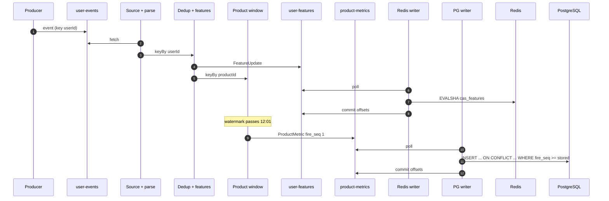

### 7.2 Latency anatomy

| Segment | Typical (ILLUSTRATIVE) | Main knob |
| --- | --- | --- |
| Broker append + replication (`acks=all`) | 2–10 ms | Broker load, AZ latency |
| Source fetch wait | 0–50 ms | `fetch.max.wait.ms` |
| Parse + watermark (chained) | < 1 ms | — |
| Network shuffle to dedup | 0–20 ms | `execution.buffer-timeout` (20 ms; default 100 ms) |
| Dedup + feature state access (RocksDB) | 0.05–0.5 ms | Block cache, state size |
| Kafka sink batching | 0–10 ms | `linger.ms=10` |
| Broker append of output | 2–10 ms | — |
| Writer poll + batch | 0–100 ms | `fetch.max.wait.ms`, batch size |
| Redis pipelined write | 1–3 ms | Batch size |
| **Total (healthy)** | **~50–250 ms** | |
| Under backpressure | Grows with lag | Scale or fix the bottleneck |
| During checkpoint alignment | +tens to hundreds of ms | Unaligned checkpoints, alignment timeout |

The < 1 s p95 target leaves headroom for checkpoint alignment, GC pauses, and brief bursts.

### 7.3 Alternative flow A1: duplicate event

1. The producer times out waiting for an ack and retries the send; the application-level retry reuses the same `eventId`. Both copies land in `user-events` (same key, same partition).
2. The first copy passes dedup and is processed.
3. The second copy hits `seen.contains(eventId) == true` and is dropped; `duplicates_total` increments.
4. If the duplicate arrives more than 15 minutes later, it is **not** dropped (documented limit); the generator's test mode measures how often that happens.

### 7.4 Alternative flow A2: late event

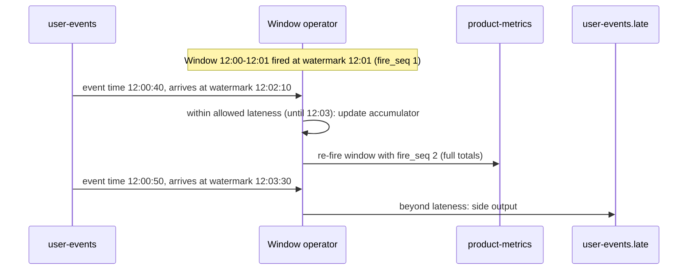

The user-feature path handles the same event independently: if it's within the user's 5-minute pane range relative to the user's latest event time, it's counted; otherwise it's counted as a late feature event and skipped.

### 7.5 Alternative flow A3: TaskManager failure and checkpoint recovery

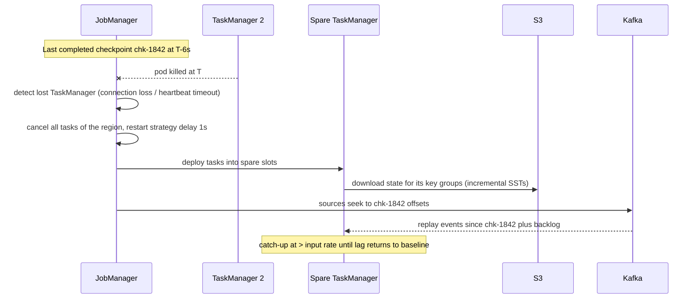

Step by step:

1. **Failure (T):** TaskManager 2 is killed. Its 4 subtasks die. Downstream and upstream tasks see broken network connections.
2. **Detection (T + ~1–10 s):** the JobManager notices the lost TaskManager through the broken RPC connection (fast) or heartbeat timeout (`heartbeat.timeout: 10s`, reduced from the 50 s default). Kubernetes also reports the pod deletion.
3. **Failover:** because the job graph is all-to-all connected (keyBy), the failover region is the whole job: all tasks are cancelled.
4. **Restart delay:** exponential-delay restart strategy, initial 1 s.
5. **Slot allocation:** the scheduler needs 12 slots. Two healthy TaskManagers provide 8; the **spare TaskManager** provides 4 immediately. (Without the spare, Flink requests a new pod: scheduling + image pull + JVM start ≈ 15–60 s, which alone could break the 30 s target.)
6. **State restore:** each subtask restores its key-group range from `chk-1842`. Subtasks restarting on a TaskManager that previously held their state can use **local recovery** (`state.backend.local-recovery: true`) and skip downloading; the subtasks moved to the spare download their SST files from S3.
7. **Source rewind:** sources seek to the offsets stored in `chk-1842`.
8. **Replay:** events between `chk-1842` and the failure are reprocessed; outputs for them are re-emitted (idempotent downstream).
9. **Catch-up:** events that accumulated in Kafka during the outage are processed at the job's maximum rate, which is above the input rate.
10. **Recovered:** lag returns to its pre-failure band and stays there; p95 latency returns below 1 s.
11. **Afterwards:** Kubernetes brings back a replacement TaskManager, which becomes the new spare.

### 7.6 Alternative flow A4: JobManager failure

1. The JobManager pod dies. Kubernetes HA (`high-availability.type: kubernetes`) stores leader information in ConfigMaps and job metadata (including the latest checkpoint pointer) in S3.
2. A new JobManager pod starts (Deployment restart), acquires leadership, reads the latest completed checkpoint pointer from HA storage.
3. TaskManagers re-register; the job is restored from the latest checkpoint exactly as in A3.
4. Recovery time is dominated by the JobManager pod restart (~10–30 s), so JobManager failure may exceed the 30 s target; the < 30 s claim is defined for TaskManager failures (see Claim E3).

### 7.7 Alternative flow A5: Redis unavailable (sink failure, backpressure contained)

1. ElastiCache primary fails over (typically tens of seconds).
2. `features-redis-writer` batch writes fail; the writer retries with backoff and does **not** commit offsets.
3. Lag on `user-features` grows; Flink is unaffected (it writes to Kafka).
4. Readiness turns false after 60 s without a successful write (alert, no restart loop).
5. Redis returns; writers drain the backlog with large batches; the CAS guard applies updates monotonically.
6. Consistency impact: feature reads are stale (or fail) during the outage; no updates are lost.

### 7.8 Alternative flow A6: malformed event

1. The deserializer can't parse the JSON (or validation fails).
2. `ParseAndValidate` emits a `DlqRecord` with raw bytes, partition, offset, and error code to the DLQ side output.
3. The main stream continues; `dlq_total{reason}` increments.
4. An operator inspects the DLQ; if the producer bug is fixed and the events are recoverable, a small replay tool re-publishes corrected events to `user-events` (dedup prevents double counting if some were valid).

### 7.9 Alternative flow A7: writer crash mid-batch

1. `metrics-pg-writer` pod crashes after the PostgreSQL commit but before `commitSync`.
2. The group rebalances (session timeout) and another replica takes the partitions.
3. It resumes from the last committed offset and re-applies the batch: the upserts write the same absolute values (or are skipped by the `fire_seq` guard). No double counting.

### 7.10 Alternative flow A8: operational replay after a bug fix

See Section 6.9. Example: a bug undercounted `ADD_TO_CART` for 3 hours. Fix, deploy a replay job from T = bug start − 1 h, let it overwrite the affected minute rows and features, record the run in `replay_runs`.

---

## 8. Concurrency and Distributed Systems

### 8.1 Race conditions and how the design avoids them

| Potential race | Where | Why it cannot happen (or is harmless) |
| --- | --- | --- |
| Two threads updating one user's state | Flink keyed operators | Each key belongs to one key group, owned by one subtask, processed by one thread |
| Two writers updating one Redis key | `features-redis-writer` replicas | One partition → one consumer at a time; same key → same partition. During a rebalance overlap, the Lua CAS is atomic and monotonic |
| Two writers upserting one PostgreSQL row | `metrics-pg-writer` | Same partitioning argument; the guarded upsert is atomic per row (row lock during `ON CONFLICT DO UPDATE`) |
| Stale replayed output overwriting fresh output | Sinks after recovery or replay | Monotonic guards (`as_of_event_time_ms`, `fire_seq`) |
| Offsets committed before writes | Writers | Commit only after the write succeeded |

### 8.2 Lost updates

- In Redis, a naive `HSET` from a replayed (older) feature update after a newer one would be a lost update. The CAS script prevents it.
- In PostgreSQL, an older window firing arriving after a re-firing would be a lost update. The `fire_seq` guard prevents it.
- Inside Flink there is no read-modify-write race, because keyed state is single-threaded per key.

### 8.3 Locking

Flink user code takes no locks. PostgreSQL takes row locks inside `INSERT ... ON CONFLICT`, held only for the batch transaction. Redis executes Lua scripts atomically (single-threaded command execution). The only coordination in the system is **partition ownership** (Kafka group protocol for writers; key-group assignment for Flink).

### 8.4 Atomicity

| Operation | Atomic? |
| --- | --- |
| Checkpoint (offsets + all state) | Yes, as a consistent cut; it either completes or is discarded |
| A writer batch to PostgreSQL | Yes (one transaction) |
| A writer batch to Redis | No (pipeline of independent scripts); each key's update is atomic, and partial batches are re-applied on redelivery |
| Write + offset commit | No; made safe by idempotency |

### 8.5 Ordering

| Scope | Guaranteed? |
| --- | --- |
| Events of one user within a Kafka partition | Yes (offset order) |
| Events of one user through Flink after `keyBy` | Yes: records from one upstream subtask to one downstream subtask stay in order, and one user's events come from one partition → one source subtask |
| Events across users or partitions | No |
| Event time order | No: arrival order ≠ event time order; watermarks + panes handle it |
| Feature updates per user in `user-features` | Yes (same key → same partition), and the CAS guard enforces event-time monotonicity anyway |
| Window results per product | Yes per key; `fire_seq` enforces it in the sink |

### 8.6 Consistency guarantees

| Guarantee | Holds? | Notes |
| --- | --- | --- |
| Each event affects Flink state exactly once | Yes | Checkpoints + rewind |
| No acknowledged event is lost | Yes | Kafka RF=3, `acks=all`, `min.insync.replicas=2`, 7-day retention |
| Output records delivered exactly once | **No** | At-least-once Kafka sink |
| Stored results equal exactly-once results | Yes, after convergence | Idempotent absolute writes + monotonic guards |
| Duplicates removed | Within 15 min | Beyond that, not guaranteed |
| Window results final at first firing | **No** | Late re-firings within 2 min can update them |
| Events later than allowed lateness counted | **No** | Routed to `user-events.late` |
| Redis reflects PostgreSQL | **No** | Independent outputs with different timing |
| Read-your-writes for producers | **No** | Asynchronous pipeline; freshness bounded by processing latency |

### 8.7 Duplicate delivery and retry semantics

| Source of duplicates | Layer that removes it |
| --- | --- |
| Producer application retries (same `eventId`) | Flink dedup (15 min) |
| Producer internal retries | Kafka idempotent producer |
| Flink recovery replay | Flink state rollback (no double counting); re-emitted outputs absorbed by idempotent sinks |
| Writer redelivery after crash/rebalance | Idempotent sink writes |
| Operational replay | Overwrite semantics in sinks |

### 8.8 Replication

- Kafka: RF=3 across 3 AZs; `min.insync.replicas=2` means an acknowledged write survives one broker loss.
- Flink state: not replicated live; durability comes from checkpoints in S3 (11 nines durability) plus replayable input.
- Redis: ElastiCache primary + replica with automatic failover (asynchronous replication; a failover can lose the last few writes, which the pipeline re-sends on its next update for that user, and the TTL bounds staleness).
- PostgreSQL: RDS Multi-AZ synchronous standby.

### 8.9 Distributed coordination

- Kafka brokers: KRaft controller quorum (managed by MSK).
- Flink: JobManager leader election and checkpoint pointer via Kubernetes HA (ConfigMap leases + S3).
- Writers: Kafka group coordinator.

The platform itself implements no consensus; it relies on these three well-tested mechanisms.

### 8.10 Ingestion throughput vs processing throughput

| Metric | Definition | Measured at |
| --- | --- | --- |
| **Ingestion throughput** | Records appended to `user-events` per second | Broker `MessagesInPerSec`, producer `record-send-rate` |
| **Processing throughput** | Records the Flink job consumes **and fully processes** per second | Source `numRecordsOutPerSecond` summed over subtasks, with **stable consumer lag** |
| **Output throughput** | Feature updates and metric rows written per second | Sink `numRecordsOut`, writer counters |

Kafka can ingest far more than Flink processes (it is just appending to a log). If ingestion > processing, lag grows without bound and latency grows with it. A throughput claim is only meaningful as **processing throughput at stable lag**. In steady state, ingestion = processing; during catch-up, processing > ingestion.

### 8.11 Event-time latency vs processing-time latency

| Latency | Definition | Controlled by the platform? |
| --- | --- | --- |
| **Event-time latency** (freshness from occurrence) | `t_visible − eventTime` | No: includes device buffering, mobile offline periods, network delays before Kafka |
| **Processing-time latency** (pipeline latency) | `t_visible − t_kafka_append` | Yes: this is the resume metric |
| **Window result latency** | `t_visible − window_end` for analytics | Partly: ≥ out-of-orderness bound (5 s) by design, + processing latency |

Example (ILLUSTRATIVE): a phone records a view at 12:00:00, is offline, and uploads at 12:04:00. Kafka appends at 12:04:00.010; the feature is visible in Redis at 12:04:00.250. Processing-time latency = 240 ms (good). Event-time latency = 4 min (not the platform's fault). For analytics, the 12:00 window has already fired and closed allowed lateness at ~12:03:05 watermark, so this event goes to the late topic.

---

## 9. Failure Handling and Recovery

### 9.1 Failure matrix

| Failure | Detection | System response | Recovery | Consistency impact |
| --- | --- | --- | --- | --- |
| TaskManager crash | Lost connection / heartbeat timeout (≤ 10 s) | Cancel job region; restart strategy | Restore from last checkpoint into spare + surviving slots; replay from checkpointed offsets | None for state; outputs since the checkpoint re-emitted (idempotent) |
| JobManager crash | Pod restart; HA leader lease | New leader reads latest checkpoint pointer | Job restored from checkpoint | Same as above |
| Checkpoint failures (S3 throttling, timeouts) | `numberOfFailedCheckpoints` | Continue up to 3 consecutive failures, then fail the job | Restart from last good checkpoint | More replay after recovery |
| Kafka broker failure | Leader election (MSK) | Producers and consumers fail over to new leaders | Automatic | None (RF=3, ISR=2) |
| Kafka unavailable (cluster-wide) | Source fetch errors; producer errors | Flink source retries; job may fail after timeouts; producers buffer then block/fail | Restart from checkpoint when Kafka returns | None for processed state; producers must retry |
| Duplicate events | Dedup state hit | Drop | — | None within 15 min |
| Late events | Watermark comparison | Re-fire (≤ 2 min) or side output | Optional correction job | Analytics excludes very late events |
| Malformed events | Parse/validation failure | DLQ | Fix producer; replay corrected events | Missing until replayed |
| Redis unavailable | Writer errors; readiness | Retry, don't commit; lag grows | Drain when Redis returns | Stale features during outage |
| PostgreSQL unavailable | Writer errors | Same | Same | Stale analytics during outage |
| Writer (consumer) crash | Group rebalance | Partitions reassigned | Redelivery from committed offsets | None (idempotent) |
| Network partition between TM and JM | Heartbeat timeout | TaskManager considered lost | As TaskManager crash | None |
| Partial writes | Writer crash mid-batch (Redis) | Some keys updated, offsets not committed | Redelivery re-applies all | None |
| Timeout (sink write) | Client timeout | Retry with backoff | Automatic | None |
| Hot key / skew | Busy time on one subtask | Backpressure; lag grows | Rescale, salting (future) | Latency only |
| State too large / RocksDB disk full | TaskManager disk alerts | Task failures | Increase volume; tune TTL | Recovery via checkpoint |
| Poison output record | Writer repeated failure on one record | Bisect batch, send record to writer DLQ | Manual | That record missing from the store |

### 9.2 Checkpoint recovery procedure

1. **Detect** the failed task or TaskManager.
2. **Determine the failover region.** With all-to-all `keyBy` connections, the region is the whole pipeline; all tasks are cancelled.
3. **Select the checkpoint:** the latest **completed** checkpoint (an in-progress one is discarded).
4. **Allocate slots:** surviving TaskManagers + spare TaskManager.
5. **Restore state:** each subtask is assigned key-group ranges; it reads the corresponding RocksDB SST files (local recovery when possible, otherwise from S3) and operator state (source split offsets).
6. **Reset sources:** source readers seek each partition to its checkpointed offset.
7. **Resume processing:** events after the checkpoint are reprocessed in order per partition; state evolves exactly as it would have.
8. **Re-emit outputs:** feature updates and window firings after the checkpoint are produced again; downstream idempotency absorbs them.
9. **Catch up:** process the backlog that accumulated while down, at maximum throughput.
10. **Declare recovered** when lag is back within the pre-failure band for 30 s (the definition used in Claim E3).

### 9.3 Replay procedure (operational)

Covered in Section 6.9, with `replay_runs` as the audit trail. Preconditions: the replay start is within Kafka retention; the new job version has all operator uids stable (or starts with fresh state intentionally).

### 9.4 Upgrade procedure (stateful)

1. Trigger a savepoint through the operator (`upgradeMode: savepoint` on the `FlinkDeployment`).
2. Deploy the new job version with the same operator uids.
3. The new job starts from the savepoint; Kafka offsets continue where they stopped.
4. If state schema changed, use Flink state schema evolution (POJO field additions are supported) or the State Processor API for migrations.

---

## 10. Performance Engineering

### 10.1 Bottlenecks to expect

| Area | Bottleneck | Symptom |
| --- | --- | --- |
| Source | Too few partitions; uneven partitions per subtask | Some source subtasks busy, others idle |
| Serialization | Kryo fallback for generic types; JSON parsing | High CPU in `KryoSerializer` / Jackson frames |
| Network shuffles | Small buffers flushed too often (low buffer timeout) or too rarely (latency) | Throughput vs latency trade-off |
| State access | RocksDB reads/writes per event; block cache misses | Busy keyed operators; high RocksDB read latency |
| Key skew | Hot users (bots) or hot products | One subtask busy at 1000 ms/s while others idle |
| Sinks | Synchronous per-record writes | Writer lag; or Flink backpressure if sinking directly |
| Checkpoints | Large or slow uploads; alignment under backpressure | Checkpoint duration near the interval; latency spikes |
| GC | Large heap objects | Latency spikes, busy time without throughput |

### 10.2 Algorithmic complexity per event

| Operator | Cost |
| --- | --- |
| Parse | `O(event bytes)` |
| Dedup | `O(1)` RocksDB get + put |
| Features | `O(P)` with P ≤ 12, plus 3 RocksDB value reads/writes |
| Window | `O(1)` heap or RocksDB accumulator update |
| Sinks | `O(1)` amortized with batching |

There are no superlinear algorithms; throughput is governed by constant factors (serialization, state access, network) and by parallelism.

### 10.3 Optimizations (baseline → optimized)

#### OPT-1: Partition count aligned with parallelism

| Aspect | Detail |
| --- | --- |
| Original bottleneck | Baseline `user-events` had 6 partitions and the job ran at parallelism 4. Source subtasks got 2, 2, 1, 1 partitions, so two of four source subtasks carried one third of the input each and capped the whole pipeline; source parallelism could not usefully exceed 6 anyway |
| Optimization | 24 partitions; source parallelism 12 (2 partitions each, even) |
| How it works | Even assignment removes the straggler; more partitions allow more parallel source readers and leave headroom to scale to 24 |
| Why it improves performance | Pipeline throughput is limited by its slowest subtask; balanced work raises the limit |
| Expected impact | Major contributor to the ~2× target (BENCHMARK TARGET) |
| Trade-offs | More partitions = more broker overhead, more open files, longer leader elections; changing partition counts later breaks key-to-partition mapping |
| How to measure | Per-subtask `numRecordsInPerSecond` and `busyTimeMsPerSecond` before/after; source records-lag per partition |

#### OPT-2: Parallelism sized to the bottleneck, max parallelism set explicitly

| Aspect | Detail |
| --- | --- |
| Original bottleneck | Parallelism 4 everywhere; keyed operators (dedup/features with RocksDB) saturated first |
| Optimization | Parallelism 12 on 3 TaskManagers × 4 slots (plus a spare); `maxParallelism = 256` set before the first deployment |
| Why it improves performance | More subtasks share keyed state work; key groups distribute users evenly |
| Trade-offs | More TaskManager resources; more network channels (all-to-all shuffles grow as p²); 256/12 key-group imbalance (~5%) |
| How to measure | Busy time per operator; throughput ramp test |

#### OPT-3: Eliminate Kryo and reuse parsers

| Aspect | Detail |
| --- | --- |
| Original bottleneck | Event classes with non-POJO fields (e.g., `Map<String,Object>` extras, `Instant`) fell back to Kryo for every shuffle; a new `ObjectMapper` per call |
| Optimization | Flat POJOs with primitive/String fields and `eventTimeMs` as `long`; `env.getConfig().disableGenericTypes()` to fail fast on any Kryo use; one shared, thread-safe `ObjectMapper` per task |
| Why | Flink's POJO serializer is much cheaper than Kryo; mapper construction is expensive |
| How to measure | Flame graph share of `KryoSerializer`; per-record CPU |

#### OPT-4: Avoid a redundant shuffle

| Aspect | Detail |
| --- | --- |
| Original bottleneck | Baseline did `keyBy(userId)` for dedup and again for features (two network shuffles) |
| Optimization | `DataStreamUtils.reinterpretAsKeyedStream` after dedup (chained, no shuffle) |
| Why | Each shuffle costs serialization, network buffers, and deserialization per record |
| Trade-off | `reinterpretAsKeyedStream` is only correct if the stream is already partitioned exactly as `keyBy` would partition it, which is true immediately after a keyed operator with the same key |
| How to measure | Job graph shows one fewer exchange; network bytes per record |

#### OPT-5: Batching at the edges

| Aspect | Detail |
| --- | --- |
| Original bottleneck | Baseline wrote Redis with one synchronous `HSET` per record and PostgreSQL with one statement per row |
| Optimization | Kafka sink `linger.ms=10`, `batch.size=64 KB`, lz4; writers use pipelined Lua (500 per round trip) and JDBC batches of 500 with `reWriteBatchedInserts=true` |
| Why | Network round trips dominate per-record costs; batching amortizes them |
| Trade-off | Up to `linger.ms` + poll interval of added latency |
| How to measure | Writer records/s per replica; Redis `instantaneous_ops_per_sec`; PostgreSQL `xact_commit` rate |

#### OPT-6: Latency-oriented network buffer timeout

| Aspect | Detail |
| --- | --- |
| Change | `execution.buffer-timeout: 20 ms` (default 100 ms) with buffer debloating enabled |
| Why | A network buffer is flushed when full or when the timeout fires; at moderate per-channel rates, the default 100 ms timeout alone can add up to ~100 ms per shuffle hop |
| Trade-off | More, smaller network buffers → slightly lower max throughput |
| How to measure | Latency histogram before/after at the same input rate |

#### OPT-7: RocksDB tuning

| Aspect | Detail |
| --- | --- |
| Change | Managed memory fraction 0.4 for RocksDB block cache and write buffers; `state.backend.rocksdb.predefined-options: FLASH_SSD_OPTIMIZED`; local SSD (EBS gp3 with provisioned IOPS or instance storage) for RocksDB working directories |
| Why | Most per-event state access should hit the block cache |
| How to measure | RocksDB native metrics (`block-cache-hit`, `estimate-live-data-size`), state access latency (`state.latency-track.keyed-state-enabled: true`) |

### 10.4 Partitioning, parallelism, and skew

- **Hot users:** bots can produce thousands of events per minute for one `userId`, overloading the subtask that owns its key group. Mitigations: detect and filter bots upstream; or route known-hot keys through a two-phase aggregation (salted pre-aggregation then merge). Not implemented in v1; the S8 benchmark scenario measures the impact.
- **Hot products:** a flash sale concentrates `productId` traffic. The window aggregate is incremental (cheap per event), so one subtask can absorb high per-key rates; if not, apply local pre-aggregation (a `KeyedProcessFunction` that combines per-subtask counts for 1 s before the keyBy).

### 10.5 Backpressure and asynchronous processing

See Section 6.6. The design's key decision is that **sinks are decoupled by Kafka**, so the most common backpressure source in streaming jobs (a slow database) never reaches Flink.

### 10.6 Memory utilization

| Component | Sizing (starting point) |
| --- | --- |
| TaskManager process | 8 GiB: framework + task heap ~2.5 GiB, managed memory (RocksDB) ~3.2 GiB, network ~0.8 GiB, JVM overhead |
| RocksDB local disk | 20 GiB per TaskManager |
| JobManager | 2 GiB |
| result-writer | 512 MiB heap |
| Redis | ~100 MB for 500K users × ~200 B (ILLUSTRATIVE) |

### 10.7 Network overhead

10K events/s × ~300 B ≈ 3 MB/s ingress (ILLUSTRATIVE); each keyBy re-sends roughly the serialized POJO size (~150–250 B) across the network; outputs ≈ 10K feature updates/s × ~350 B ≈ 3.5 MB/s plus metric rows. With RF=3, Kafka replication triples broker-to-broker traffic. All modest relative to instance bandwidth; latency rather than bandwidth is the concern.

### 10.8 Horizontal scaling

| Scale lever | Procedure |
| --- | --- |
| Flink parallelism | Savepoint → redeploy with new parallelism (or Flink Kubernetes Operator autoscaler, which uses busy time and lag to pick parallelism) |
| Kafka partitions | Plan ahead; increasing changes key placement |
| Writers | Increase replicas up to partitions |

---

## 11. Benchmarking and Load Testing

### 11.1 Objectives

1. Validate sustained processing throughput ≥ 10K events/s with bounded lag (BENCHMARK TARGET).
2. Validate p95 processing latency < 1 s at that rate (BENCHMARK TARGET).
3. Validate < 30 s recovery after a TaskManager failure under load (BENCHMARK TARGET).
4. Measure max sustainable throughput for baseline vs optimized partitioning/parallelism (~2× target).
5. Verify correctness: exact counts vs a batch reference computation, with duplicates and out-of-order events injected.

### 11.2 Environment

| Item | Value |
| --- | --- |
| AWS region | TBD |
| EKS worker nodes | TBD (e.g., 5 × m6i.xlarge: 4 vCPU, 16 GiB); record instance type and count |
| Flink | 1.20.x, Java 17, 1 JobManager (2 GiB) + 3 TaskManagers (4 slots, 4 vCPU, 8 GiB each) + 1 spare TaskManager |
| Kafka | MSK, 3 brokers, TBD instance type (e.g., kafka.m7g.large), Kafka 3.7, EBS TBD |
| Redis | ElastiCache, TBD node type, Redis 7.x, cluster mode off, 1 replica |
| PostgreSQL | RDS PostgreSQL 16, TBD instance class, gp3 storage |
| S3 | Same region, checkpoint bucket |
| Network | All in one VPC, 3 AZs; record cross-AZ placement of TaskManagers and brokers |
| Load generator | `event-generator` pods on a separate node group, CPU < 70% |
| Clock sync | AWS Time Sync (chrony); record offset |

### 11.3 Workload

| Parameter | Value |
| --- | --- |
| Event mix | 70% VIEW, 20% CLICK, 8% ADD_TO_CART, 2% PURCHASE |
| Users | 500K active in the test hour; Zipf(0.8) activity distribution (some users much more active) |
| Products | 50K; Zipf(1.0) popularity |
| Payload | ~300 B JSON |
| Duplicates | 1% of events re-sent with the same `eventId` within 0–60 s |
| Out-of-order | Event time jitter: uniform 0–3 s behind ingest time for 95%; 0–60 s for 4.9% |
| Late | 0.1% of events with event time 3–10 min behind |
| Rate | Constant 10K events/s for the claim run; step ramps for capacity |
| Warm-up | 5 min (fill state, JIT, RocksDB cache, at least 2 checkpoints) |
| Steady state | 30 min |
| Repetitions | 3 runs per configuration |

### 11.4 Tools and why

| Tool | Use | Why |
| --- | --- | --- |
| **`event-generator`** (custom Java) | Realistic events with duplicates, disorder, lateness, skew; exact rate control | Kafka's perf tool sends random bytes with no event semantics |
| **`kafka-producer-perf-test.sh` / `kafka-consumer-perf-test.sh`** | Establish the MSK ceiling independent of Flink | Proves Kafka is not the bottleneck |
| **Flink metrics → Prometheus → Grafana** | Throughput per operator, busy/backpressured time, checkpoint duration/size, watermark lag, restarts | Native, per-subtask visibility |
| **Kafka lag** (Flink `pendingRecords` / `records-lag-max`, `kafka-consumer-groups.sh` for writers) | Stability criterion for throughput, recovery completion | Lag is the definitive "keeping up" signal |
| **Writer latency histogram** (Prometheus client) | p50/p95/p99 processing latency per feature update | Measures the resume latency metric end to end |
| **Batch reference job** (SQL over raw events exported from Kafka, or a Flink batch job) | Correctness check of counts | Independent computation of the expected result |

Not used: k6/JMeter/wrk (no HTTP API), JMH (optional for serializer micro-benchmarks only), fio (not storage-bound).

### 11.5 Scenarios

| # | Scenario | Setup | Purpose | Pass criteria |
| --- | --- | --- | --- | --- |
| E1 | **Steady-state claim** | 10K events/s, 30 min, optimized config | Throughput + latency claims | Lag bounded (no upward trend); processing throughput ≥ 10K/s; p95 latency < 1 s; zero restarts |
| E2 | **Max sustainable throughput** | Step ramp 4K → 20K events/s, +2K every 5 min; baseline and optimized | ~2× claim | Max rate with stable lag and p95 < 1 s for the full step |
| E3 | **TaskManager kill** | E1 load; delete one TaskManager pod at minute 15 | Recovery claim | Recovery (definition in Claim E3) < 30 s; no lost/duplicated counts in correctness check |
| E4 | **JobManager kill** | E1 load; delete the JobManager pod | HA behavior | Job recovers; record time (not part of the < 30 s claim) |
| E5 | **Sink slowdown / backpressure isolation** | Inject 50 ms delay per Redis batch in the writer (config flag) or pause Redis with `CLIENT PAUSE 30000` | Backpressure contained in writer lag | Flink throughput unchanged; writer lag rises and drains after |
| E6 | **Replay** | Replay 1 h of history from a timestamp with fresh state | Replay throughput and correctness | Replay rate recorded; outputs equal the original run's outputs |
| E7 | **Correctness under disorder** | E1 workload with duplicates/jitter/late events; 30 min | Dedup + event-time correctness | Product metrics equal the batch reference exactly for all windows whose events were within allowed lateness; duplicates removed |
| E8 | **Hot key skew** | 5% of events from 10 bot users; one product with 20% of views | Skew impact | Record max subtask busy time and latency impact |
| E9 | **Writer scaling** | `features-redis-writer` replicas 1 → 2 → 4 → 6 at 15K updates/s | Consumer-group scaling | Writer throughput scales roughly linearly until Redis or partitions limit |
| E10 | **Soak** | 8K events/s for 6 h | State growth, checkpoint size, memory | Checkpoint size plateaus (TTL works); no latency drift |

### 11.6 Metrics

| Metric | Source | Note |
| --- | --- | --- |
| Ingestion rate (events/s) | MSK `MessagesInPerSec` / generator | Offered load |
| Processing throughput (events/s) | Sum of source subtask `numRecordsOutPerSecond` | Valid only with stable lag |
| Consumer lag (records) | Flink `pendingRecords` per split; writer group lag | Stability criterion |
| Processing latency p50/p95/p99 | Writer histogram: Redis-ack time − `sourceIngestTs` | Resume latency metric |
| Window emission delay | PG writer: write time − (window_end + 5 s) | Analytics freshness beyond the semantic wait |
| Busy / backpressured time per operator | Flink | Bottleneck identification |
| Checkpoint duration, size, alignment time | Flink | Recovery cost and latency spikes |
| Restart time, recovery time | Flink `fullRestarts`, lag series | Claim E3 |
| CPU / memory per TaskManager | cAdvisor | Efficiency |
| Duplicates dropped, DLQ count, late count | Custom counters | Correctness signals |
| Redis ops/s and latency, PostgreSQL commit rate | ElastiCache / RDS CloudWatch, exporters | Sink health |
| Error rate | Writer failed batches / total | Sink reliability |

### 11.7 Baseline vs optimized: controlled comparison

| Aspect | Baseline | Optimized |
| --- | --- | --- |
| `user-events` partitions | 6 | 24 |
| Flink parallelism | 4 | 12 |
| Max parallelism | default (128) | 256 |
| Serialization | Kryo fallback for event and feature types | POJO serializer; generic types disabled |
| Dedup → features | Two `keyBy` shuffles | One shuffle + `reinterpretAsKeyedStream` |
| Kafka sink | `linger.ms=0`, no compression | `linger.ms=10`, lz4 |
| Writers | Per-record synchronous writes | Pipelined/batched |
| Buffer timeout | 100 ms (default) | 20 ms |
| **Held constant** | Hardware, TaskManager count and size, workload, Flink version, state backend, checkpoint interval | |

Rules:

1. Same EKS node group and MSK cluster; re-create topics between runs (partition count is a variable).
2. Same generator seed so the event sequence is identical.
3. Each configuration: 3 runs; report the median max-sustainable throughput and the spread.
4. Ablation: start from optimized and revert one change at a time to attribute the gain.
5. Note that the baseline uses 4 of the 12 available slots. The comparison deliberately includes "using the hardware you already have", so it must be reported as "same cluster, different partitioning and parallelism", not as "same CPU allocation".

### 11.8 Result tables (blank until recorded)

**E1 steady state**

| Run | Ingest rate | Processing throughput | Lag trend | Latency p50 | p95 | p99 | Checkpoint duration p95 | Restarts | Duplicates dropped | DLQ | Late |
| --- | --- | --- | --- | --- | --- | --- | --- | --- | --- | --- | --- |
| 1 | | | | | | | | | | | |
| 2 | | | | | | | | | | | |
| 3 | | | | | | | | | | | |

**E2 max sustainable throughput**

| Config | Run 1 (events/s) | Run 2 | Run 3 | Median | First bottleneck operator | Ratio vs baseline |
| --- | --- | --- | --- | --- | --- | --- |
| Baseline (6 partitions, p=4) | | | | | | 1.0× |
| Optimized (24 partitions, p=12) | | | | | | |

**Ablation (revert one change from optimized)**

| Reverted change | Max sustainable (events/s) | Δ vs optimized |
| --- | --- | --- |
| None (optimized) | | — |
| Partitions 24 → 6 | | |
| Parallelism 12 → 4 | | |
| Kryo re-enabled | | |
| Extra shuffle restored | | |
| Unbatched writers | | |

**E3 recovery**

| Run | Kill time | Detected (s) | Job RUNNING (s) | State restored (s) | Lag peak (records) | Recovered (s) | Correctness check |
| --- | --- | --- | --- | --- | --- | --- | --- |
| 1 | | | | | | | |
| 2 | | | | | | | |
| 3 | | | | | | | |

**E9 writer scaling**

| Replicas | Updates/s written | Lag trend | Redis CPU % |
| --- | --- | --- | --- |
| 1 | | | |
| 2 | | | |
| 4 | | | |
| 6 | | | |

### 11.9 Interpreting results

| Observation | Interpretation | Next step |
| --- | --- | --- |
| Lag grows linearly at a given rate | Processing < ingestion; above capacity | That rate is not sustainable; find the bottleneck |
| One operator busy ~1000 ms/s, upstream backpressured | That operator is the bottleneck | Scale it, reduce per-record cost, check skew |
| One subtask much busier than its peers | Key skew or uneven partitions | Check partition assignment and key distribution |
| p95 fine, p99 spikes every 10 s | Checkpoint alignment or RocksDB flushes | Unaligned checkpoints; tune RocksDB |
| Latency high but no lag | Batching/timeouts (`linger.ms`, buffer timeout, writer poll) | Lower timeouts |
| Recovery slow in the "state restored" phase | Large state download | Local recovery, smaller state, more parallelism |
| Recovery slow in the catch-up phase | Little headroom | Increase capacity; shorter checkpoint interval |
| Correctness mismatch only for late windows | Expected for events beyond allowed lateness | Compare against reference with the same lateness rule |

### 11.10 Proposed reproduction commands

These commands are **proposed**; no scripts exist yet.

```bash
# Topics (baseline uses --partitions 6)
kafka-topics.sh --bootstrap-server "$MSK" --create --topic user-events \
  --partitions 24 --replication-factor 3 \
  --config min.insync.replicas=2 --config retention.ms=604800000 \
  --config message.timestamp.type=LogAppendTime

# Kafka ceiling check (independent of Flink)
kafka-producer-perf-test.sh --topic perf-check --num-records 3000000 --record-size 300 \
  --throughput -1 --producer-props bootstrap.servers="$MSK" acks=all linger.ms=5 compression.type=lz4

# Deploy the optimized job via the operator
kubectl apply -f k8s/flinkdeployment-activity-pipeline.yaml

# Steady-state claim run
kubectl -n stream run gen --image="$ECR/event-generator:1.4.0" --restart=Never -- \
  --rate=10000 --duration=35m --users=500000 --products=50000 \
  --dup-rate=0.01 --jitter-p95=3s --late-rate=0.001 --seed=42

# Recovery scenario: kill one TaskManager at minute 15
TM=$(kubectl -n stream get pod -l component=taskmanager -o name | head -1)
date -u +%s.%N > results/kill_time.txt
kubectl -n stream delete "$TM" --grace-period=0 --force --wait=false

# Writer lag
kafka-consumer-groups.sh --bootstrap-server "$MSK" --describe --group features-redis-writer
```

PromQL used for the claims:

```promql
# Processing throughput (events/s) of the source operator
sum(flink_taskmanager_job_task_operator_numRecordsOutPerSecond{operator_name=~"user-events-source.*"})

# Source backlog (records)
sum(flink_taskmanager_job_task_operator_pendingRecords)

# Processing latency p95 (seconds), all writer replicas merged
histogram_quantile(0.95, sum by (le) (rate(writer_processing_latency_seconds_bucket{sink="redis"}[1m])))
```

---

## Numerical Claims Defence

All four figures are **UNVERIFIED** and are **BENCHMARK TARGETS**. Arithmetic examples are **ILLUSTRATIVE**.

### Claim E1: "10K+ events/sec"

| # | Item | Detail |
| --- | --- | --- |
| 1 | Exact claim | "Implemented consumer-group scaling and backpressure handling, sustaining 10K+ events/sec with under 1-second p95 latency under concurrent I/O." |
| 2 | Technical meaning | The Flink job processes ≥ 10,000 input events per second end to end (parse → dedup → features → windows → outputs) while consumer lag stays bounded for the full steady-state window |
| 3 | Metric definition | Processing throughput = sum over source subtasks of records consumed per second, **valid only when lag is stable** |
| 4 | Unit | events/s |
| 5 | Measurement boundary | Kafka `user-events` → Flink outputs (and, for completeness, writer throughput reported separately) |
| 6 | Formula | `throughput = Δ(records consumed) / Δt` over 30 min; stability: lag slope ≈ 0 (e.g., linear-fit slope < 1% of the input rate) |
| 7 | Workload | Section 11.3 mix, 300 B events, 1% duplicates, jitter, 0.1% late |
| 8 | Concurrency model | 24 partitions, 12 Flink subtasks, writer groups with N replicas; producers on separate nodes |
| 9 | Tool | `event-generator`; Flink metrics in Prometheus; Kafka lag |
| 10 | Environment | Section 11.2 (TBD values) |
| 11 | Warm-up | 5 min |
| 12 | Duration | 30 min steady |
| 13 | Baseline | 6 partitions, parallelism 4 (expected to fall short of 10K; see E4) |
| 14 | Optimized | 24 partitions, parallelism 12, POJO serialization, one shuffle, batching |
| 15 | Responsible change | Partition/parallelism alignment and per-record cost reductions |
| 16 | Potential bottleneck | Keyed RocksDB state access; skewed keys; checkpoint alignment |
| 17 | Confounders | Measuring **ingestion** instead of processing; measuring during catch-up (temporarily higher); generator limited; tiny state (unrealistically warm cache) |
| 18 | Limitations | One region, one job, modest state; 10K/s is moderate for Flink, the substance is doing it with event time, dedup, exactly-once state, and two outputs |
| 19 | Reproduction | E1 three times; plot lag over time; report throughput and lag slope |
| 20 | Likely questions | "Ingested or processed?" "Per partition?" "What happens at 15K?" "Is lag stable?" |

**Ingestion vs processing (the key subtlety).** Kafka accepting 10K events/s says nothing about processing; Kafka could accept 100K/s. The claim is processing at stable lag. Per partition: `10,000 / 24 ≈ 417 events/s`; per source subtask: `≈ 833 events/s`; per keyed subtask: ~833 events/s on average (more for subtasks owning hot users).

**20-second answer.** "The Flink job processes at least 10,000 events per second end to end with consumer lag staying flat over a 30-minute run, so it's real processing throughput, not just Kafka ingestion. It's a benchmark target with a defined method."

**60-second answer.** "I distinguish ingestion from processing: Kafka can take far more than 10K a second, so the claim is the rate the Flink job keeps up with, judged by lag staying flat. With 24 partitions and parallelism 12, that's about 830 events per second per subtask through parse, dedup, feature updates in RocksDB, and windowing. I'd measure source throughput from Flink metrics over 30 minutes after a 5-minute warm-up and check the lag slope. The writers are a separate consumer group, and I'd report their throughput and lag separately, since that's where consumer-group scaling applies."

### Claim E2: "under 1-second p95 latency"

| # | Item | Detail |
| --- | --- | --- |
| 1 | Exact claim | "...with under 1-second p95 latency under concurrent I/O" |
| 2 | Meaning | 95% of feature updates are visible in Redis less than 1 s after their triggering event was appended to Kafka |
| 3 | Definition | Processing latency = `t_redis_ack − sourceIngestTs`, where `sourceIngestTs` is the Kafka `LogAppendTime` of the input event carried through the pipeline |
| 4 | Unit | ms |
| 5 | Boundary | Kafka append of input → Flink → `user-features` → writer → Redis acknowledgement. Excludes producer-side delays and model-side reads |
| 6 | Formula | p95 over all feature updates in the steady window, from a Prometheus histogram merged across writer replicas (`histogram_quantile(0.95, sum by (le) (...))`), with buckets at 100, 250, 500, 750, 1000, 1500 ms |
| 7 | Workload | E1 |
| 8 | Concurrency | As E1 ("concurrent I/O" = parallel source reads, shuffles, Kafka writes, and writer I/O all running concurrently) |
| 9 | Tool | Writer latency histogram; cross-check with Flink latency markers (source → sink transit only) |
| 11–12 | Warm-up / duration | 5 min / 30 min |
| 15 | Responsible engineering | Per-event feature updates (no window wait), 20 ms buffer timeout, small `linger.ms`, Kafka-decoupled sinks, unaligned-checkpoint fallback |
| 16 | Bottleneck | Checkpoint alignment under load; writer poll intervals; GC |
| 17 | Confounders | Using event time instead of ingest time (includes client delays); clock skew between broker and writer (AWS Time Sync keeps it ~ms); averaging percentiles across replicas; measuring analytics windows (which wait for window close by design) |
| 18 | Limitations | Applies to the feature path. Product metrics have window latency ≥ window length + 5 s watermark delay + processing latency |
| 19 | Reproduction | E1; report p50/p95/p99 and the latency series around checkpoints |
| 20 | Likely questions | "Latency from when?" "How with 1-minute windows?" "How do you measure across machines?" |

**Why this definition, not the alternatives.**

| Possible interpretation | Consistent with the design? |
| --- | --- |
| Event occurrence → visible (event-time latency) | No: includes device and network delays the platform doesn't control; late events would dominate the tail |
| Kafka append → feature visible in Redis (processing latency) | **Yes: the chosen definition** |
| Kafka append → product-minute row in PostgreSQL | No: a 1-minute window inherently waits up to 60 s + 5 s |
| Flink latency markers (source → sink) | Partial: excludes Kafka output hop and writer; useful as a cross-check |

**20-second answer.** "From the moment Kafka appends an event to the moment the updated feature is in Redis, 95% of events take under a second. That's processing latency; event-time latency includes device delays the pipeline doesn't control, and minute-window analytics have their own, longer, freshness definition."

**60-second answer.** "The broker stamps each input with LogAppendTime; that timestamp travels with the feature update, and the writer records the difference after Redis acknowledges. Typical latency should be a few hundred milliseconds: fetch wait, one shuffle with a 20 ms buffer timeout, RocksDB state access, a Kafka hop with 10 ms linger, a writer poll and a pipelined Redis write. The tail risks are checkpoint alignment under backpressure, which unaligned checkpoints mitigate, and GC. Window analytics are different: a one-minute window can't be fresher than its window plus the 5-second watermark delay, so I don't count that path in the sub-second number."

### Claim E3: "less than 30-second recovery"

| # | Item | Detail |
| --- | --- | --- |
| 1 | Exact claim | "Added checkpoint recovery and event replay, achieving less than 30-second recovery" |
| 2 | Meaning | After a TaskManager failure at 10K events/s, the pipeline is back to normal (caught up) in under 30 s |
| 3 | Definition | `RTO = T_recovered − T_fail`, where `T_fail` = pod kill time and `T_recovered` = first time after which total source lag stays within the pre-failure p99 lag band (+10%) for 30 consecutive seconds |
| 4 | Unit | seconds |
| 5 | Boundary | Single TaskManager failure with a spare TaskManager available; JobManager failure reported separately |
| 6 | Formula | `RTO ≈ t_detect + t_restart_delay + t_schedule + t_restore + t_drain`, with `t_drain = backlog / (catch_up_rate − input_rate)` |
| 7 | Workload | E1 (10K events/s) |
| 9 | Tool | Flink metrics (job status, `fullRestarts`, `pendingRecords`), pod event timestamps |
| 11–12 | Warm-up / duration | 15 min before the kill (≥ 50 checkpoints), 10 min after |
| 13–14 | Baseline / optimized | Recovery with optimized config; for contrast, without the spare TaskManager |
| 15 | Responsible engineering | 10 s checkpoint interval; incremental RocksDB checkpoints; heartbeat timeout 10 s; spare TaskManager; local recovery; throughput headroom from the 2× optimization |
| 16 | Bottleneck | Slot acquisition without a spare; state download; catch-up headroom |
| 17 | Confounders | Measuring "job RUNNING" instead of "caught up"; killing right after a checkpoint (best case) vs right before (worst case); tiny state |
| 18 | Limitations | Defined for TaskManager failures with a spare; JobManager failover or full node loss without spare capacity can take longer |
| 19 | Reproduction | E3 three times with kills at random offsets within the checkpoint interval |
| 20 | Likely questions | "Recovered meaning running or caught up?" "What if you kill the JobManager?" "How big is the state?" |

**Recovery budget (ILLUSTRATIVE).**

| Phase | Estimate | Driver |
| --- | --- | --- |
| Detection | 2–5 s (connection loss) up to 10 s (heartbeat timeout) | `heartbeat.timeout: 10s` |
| Restart delay | 1 s | Restart strategy |
| Slot allocation | ~1 s with spare TaskManager (15–60 s without) | Spare capacity |
| State restore | ~3–6 s: 1 GB total state; one third moves to the spare and downloads ~330 MB from S3 at ~100–200 MB/s; the rest uses local recovery | Incremental checkpoints, local recovery |
| Backlog | Events since last checkpoint (avg 5 s, worst 10 s) + downtime (~10 s): 15–20 s × 10K/s = **150K–200K events** | Checkpoint interval |
| Drain | At 20K events/s catch-up rate vs 10K/s input: net 10K/s → **15–20 s** | Throughput headroom |
| **Total** | **≈ 22–33 s** | |

The budget shows the claim is achievable but **tight**: it depends on a spare TaskManager, a 10 s checkpoint interval, and ~2× throughput headroom. Without the spare, scheduling alone can exceed 30 s. Shortening the checkpoint interval to 5 s cuts the replay portion but increases checkpoint overhead.

**Restart time vs replay time vs recovery completion.**

- **Restart time**: failure → job `RUNNING` again (detection + delay + scheduling + restore start), ~5–12 s here.
- **Replay time**: time to reprocess events between the checkpoint and the failure.
- **Recovery completion**: lag back to baseline; includes replay and the downtime backlog. The resume claim uses this one.

**20-second answer.** "When a TaskManager dies under 10K events per second, the job is caught up again in under 30 seconds, meaning lag is back to its normal band, not just that the job says RUNNING. That depends on a spare TaskManager, 10-second incremental checkpoints, and throughput headroom to drain the backlog."

**60-second answer.** "Recovery has four parts: detection, restart, state restore, and draining the backlog. With a 10-second heartbeat timeout and a spare TaskManager, the job is running again in roughly 5 to 12 seconds; incremental RocksDB checkpoints mean only a third of a roughly 1 GB state is downloaded from S3. Then it must reprocess events since the last checkpoint plus whatever arrived while it was down, about 150 to 200 thousand events, and if it can process 20K a second against 10K incoming, that's 15 to 20 seconds. So it lands in the mid-20s to around 30. I'd measure it three times with kills at random points in the checkpoint interval, and report JobManager failover separately because that takes longer."

### Claim E4: "~2× throughput improvement"

| # | Item | Detail |
| --- | --- | --- |
| 1 | Exact claim | "...optimized partitioning and parallelism, improving throughput approximately 2×" |
| 2 | Meaning | Max sustainable processing throughput of the optimized configuration is about twice the baseline's, on the same cluster |
| 3 | Definition | Max sustainable throughput = highest step in a ramp at which lag is stable and p95 latency < 1 s for the full 5-minute step |
| 4 | Unit | events/s; ratio |
| 5 | Boundary | Flink processing (source to output topics); writers sized so they are not the bottleneck |
| 6 | Formula | `improvement = max_sustainable_optimized / max_sustainable_baseline`. ILLUSTRATIVE: 6,000 → 12,500 events/s ≈ 2.1× |
| 7 | Workload | E2 step ramp, same generator seed |
| 8 | Concurrency | Baseline: 6 partitions, parallelism 4. Optimized: 24 partitions, parallelism 12 |
| 9 | Tool | `event-generator` ramp; Flink busy/backpressure metrics; lag |
| 11–12 | Warm-up / duration | 5 min, then 5-min steps |
| 13 | Baseline | Section 11.7 baseline column |
| 14 | Optimized | Section 11.7 optimized column |
| 15 | Responsible change | Even partition-to-subtask assignment; more keyed subtasks; POJO serialization; one fewer shuffle; batched edges |
| 16 | Bottleneck | Baseline: overloaded source subtasks (2 of 6 partitions each) and saturated keyed operators at p=4; optimized: keyed RocksDB access at higher rates |
| 17 | Confounders | The baseline uses only 4 slots of the same cluster, so part of the gain is simply using more of the existing CPU (it must be disclosed); generator or Kafka limits capping the optimized run; different state sizes between runs |
| 18 | Limitations | "2×" is relative to a specific, disclosed baseline. It is not a per-core efficiency claim unless the ablation shows per-record cost improvements |
| 19 | Reproduction | E2 three times per config + ablation table |
| 20 | Likely questions | "Isn't that just more slots?" "What was the bottleneck before?" "Per-core improvement?" |

**Why throughput roughly doubles (ILLUSTRATIVE model).** In the baseline, two of four source subtasks read 2 of 6 partitions each, carrying 1/3 of the input apiece. If one subtask can parse and forward ~2,000 events/s at baseline per-record cost, the source chain caps at `2,000 / (1/3) = 6,000 events/s`. In the optimized job, 12 subtasks each carry 1/12, and per-record cost is lower (no Kryo, one fewer shuffle), so the source chain is no longer the limit; the keyed operators become the limit at a higher rate. The honest framing: partitioning removes a straggler and lets the job use the slots it has; serialization and shuffle changes lower per-record cost. The ablation separates the two.

**20-second answer.** "On the same cluster, max sustainable throughput roughly doubles after moving from 6 partitions and parallelism 4 to 24 partitions and parallelism 12, plus removing Kryo serialization and a redundant shuffle. Part of that is using slots the baseline left idle, which I'd state openly."

**60-second answer.** "The baseline had six partitions spread over four source subtasks, so two subtasks each did a third of the work and capped the job, and keyed operators at parallelism four were saturated. The optimized job has 24 partitions over 12 subtasks, two each, evenly, with max parallelism fixed at 256 so it can be rescaled later. I also removed Kryo fallback and the second keyBy. I'd measure max sustainable throughput with a step ramp, judged by flat lag and p95 under a second at each step, three runs each, and do an ablation reverting one change at a time so I can say how much came from partitioning versus per-record cost. And this headroom is what makes the 30-second recovery possible, because catching up needs spare capacity."

### How partitions, parallelism, checkpoints, and replay affect the numbers

| Factor | Throughput | p95 latency | Recovery time |
| --- | --- | --- | --- |
| Partition count | Caps source parallelism; uneven ratios create stragglers | Indirect | More partitions → more parallel catch-up |
| Flink parallelism | More subtasks → more capacity (until skew or network) | Lower under load | More subtasks share restore and catch-up |
| Checkpoint interval | Slight overhead per checkpoint | Alignment spikes at each checkpoint | Shorter interval → less replay |
| State size | RocksDB cost per access | — | Larger → slower restore |
| Replay | Temporarily higher processing rate | Latency high until caught up | Drain term dominates RTO |
| Spare TaskManager | None | None | Removes pod scheduling from RTO |

---

## 13. Testing Strategy

This is the intended plan. None of these tests has been executed.

| Test | Objective | Setup | Input | Execution | Expected output / assertions | Failure criteria |
| --- | --- | --- | --- | --- | --- | --- |
| **Unit: PaneRing** | Correct sliding sums and expiry | JUnit 5 | Events at t, t+29 s, t+31 s, t+5 min+1 s; out-of-order inserts | `add`, `sum` | Sums equal a brute-force reference for every query time; too-old events rejected | Any mismatch |
| **Unit: dedup function** | Duplicates dropped within TTL | Flink `KeyedOneInputStreamOperatorTestHarness` | Same `eventId` twice, then again after advancing processing time 16 min | Push elements | Output count 1, then 2 after TTL | Wrong count |
| **Unit: window function** | `fire_seq` increments; late handling | Harness with watermarks | Events, watermark past end, late event within lateness, event beyond lateness | Push + advance watermark | Outputs fire_seq 1 then 2; beyond-lateness event on side output | Wrong outputs |
| **Unit: parser** | Never throws | JUnit | Valid, malformed JSON, missing fields, future timestamps | Parse | Valid → event; others → DLQ with correct reason | Any exception |
| **Integration: pipeline on MiniCluster** | Topology produces correct outputs | `MiniClusterWithClientResource` + Testcontainers Kafka | 100K generated events with known expected aggregates | Run job, read output topics | Outputs match the reference exactly (allowing late-window semantics) | Mismatch |
| **Integration: writers** | Idempotent sinks | Testcontainers Kafka, Redis, PostgreSQL | Same output records delivered twice, out of order (older `fire_seq` after newer) | Run writer | Redis and PostgreSQL hold the newest values; no double counts | Regression or double count |
| **API/contract: schemas** | Producers and consumers agree | JSON Schema validation in CI | Sample events and outputs | Validate | All samples conform | Validation failure |
| **Database: constraints and upsert guard** | Constraints and guard behave | Testcontainers PostgreSQL | Rows violating CHECKs; upserts with lower `fire_seq` | Execute | CHECK violations rejected; lower `fire_seq` does not overwrite | Accepted invalid row or overwrite |
| **Concurrency: writer rebalance** | No lost or double writes during scaling | Testcontainers; 2 → 4 writer instances | Continuous output stream | Add/remove instances mid-stream | Final store state equals expected; no gaps | Missing or regressed values |
| **Failure injection: TaskManager kill** | Exactly-once state across failure | kind or EKS staging; job with checkpoints | Deterministic generator stream | Kill a TaskManager mid-run | Final aggregates equal the no-failure run | Any difference |
| **Failure injection: checkpoint storage outage** | Tolerable failures then recovery | Block S3 access with a network policy for 2 min | E1 load | Block, then unblock | Job keeps running ≤ 3 failed checkpoints, or restarts from the last good one | Data loss or stuck job |
| **Recovery: timing** | < 30 s RTO | E3 setup | 10K events/s | Kill TaskManager 3 times at random checkpoint offsets | RTO < 30 s each time by the lag-band definition | Any run ≥ 30 s |
| **Replay correctness** | Replay reproduces results | Staging | 1 h of events | Replay from a timestamp with fresh state into a shadow PostgreSQL schema | Shadow results equal original results | Mismatch |
| **Stress** | Graceful behavior above capacity | Staging | 2× max sustainable rate for 10 min | Run | Lag grows (expected); no crashes, no OOM, checkpoints still complete (unaligned) | Crash loop or checkpoint starvation |
| **Load** | Claim validation | Section 11 | E1 | 30 min | Thresholds met | Thresholds missed |
| **Soak** | State and memory stability | Staging | 8K events/s for 6 h | Run | Checkpoint size plateaus; latency flat; no restarts | Growth or drift |

The most persuasive correctness test is the **failure-injection comparison**: run the same deterministic input with and without a TaskManager kill and require identical final aggregates. That directly demonstrates exactly-once state plus idempotent sinks.

---

## 14. Deployment and Infrastructure

### 14.1 Docker images

| Image | Base | Contents |
| --- | --- | --- |
| `activity-pipeline` | `flink:1.20-java17` | Job JAR in `/opt/flink/usrlib/`; S3 filesystem plugin (`flink-s3-fs-presto`) enabled via `ENABLE_BUILT_IN_PLUGINS` |
| `result-writer` | `eclipse-temurin:17-jre` | Fat JAR; non-root user |
| `event-generator` | `eclipse-temurin:17-jre` | Fat JAR |

### 14.2 Kubernetes resources

| Resource | Purpose |
| --- | --- |
| Flink Kubernetes Operator (Helm) | Manages `FlinkDeployment` CRs, savepoints, upgrades |
| `FlinkDeployment activity-pipeline` | Application-mode job: JobManager + TaskManagers |
| `Deployment result-writer-redis`, `Deployment result-writer-pg` | Writer consumer groups |
| `Job event-generator` | Benchmarks and tests |
| `ConfigMap pipeline-config`, `ConfigMap writer-config` | Topics, bootstrap servers, tuning |
| `Secret writer-secrets` | Redis auth token, PostgreSQL password (or IAM auth) |
| `ServiceAccount flink` with IRSA role | S3 read/write for checkpoints without static keys |
| `PodDisruptionBudget` for writers | `minAvailable: 1` |
| `ServiceMonitor`s | Prometheus scraping |

Representative `FlinkDeployment` (documentation only):

```yaml
apiVersion: flink.apache.org/v1beta1
kind: FlinkDeployment
metadata:
  name: activity-pipeline
  namespace: stream
spec:
  image: <account>.dkr.ecr.<region>.amazonaws.com/activity-pipeline:1.4.0
  flinkVersion: v1_20
  serviceAccount: flink
  flinkConfiguration:
    taskmanager.numberOfTaskSlots: "4"
    parallelism.default: "12"
    pipeline.max-parallelism: "256"
    execution.checkpointing.interval: "10s"
    execution.checkpointing.unaligned.enabled: "true"
    execution.checkpointing.aligned-checkpoint-timeout: "5s"
    state.backend.type: rocksdb
    state.backend.incremental: "true"
    state.backend.local-recovery: "true"
    state.checkpoints.dir: s3://stream-platform/checkpoints/activity-pipeline
    state.savepoints.dir: s3://stream-platform/savepoints
    high-availability.type: kubernetes
    high-availability.storageDir: s3://stream-platform/ha
    heartbeat.timeout: "10000"
    restart-strategy.type: exponential-delay
    restart-strategy.exponential-delay.initial-backoff: 1s
    restart-strategy.exponential-delay.max-backoff: 60s
    slotmanager.redundant-taskmanager-num: "1"
    execution.buffer-timeout: 20ms
    metrics.reporter.prom.factory.class: org.apache.flink.metrics.prometheus.PrometheusReporterFactory
    metrics.reporter.prom.port: "9249"
  jobManager:
    resource: { memory: "2048m", cpu: 1 }
  taskManager:
    resource: { memory: "8192m", cpu: 4 }
  job:
    jarURI: local:///opt/flink/usrlib/activity-pipeline.jar
    parallelism: 12
    upgradeMode: savepoint
    state: running
```

`slotmanager.redundant-taskmanager-num: 1` keeps one extra TaskManager's worth of slots allocated, which is the "spare TaskManager" in the recovery budget.

Representative writer Deployment fragment:

```yaml
apiVersion: apps/v1
kind: Deployment
metadata: { name: result-writer-redis, namespace: stream }
spec:
  replicas: 3
  selector: { matchLabels: { app: result-writer, sink: redis } }
  template:
    metadata: { labels: { app: result-writer, sink: redis } }
    spec:
      terminationGracePeriodSeconds: 30
      containers:
        - name: writer
          image: <ecr>/result-writer:1.4.0
          args: ["--mode=redis", "--topic=user-features", "--group=features-redis-writer"]
          envFrom: [{ configMapRef: { name: writer-config } }, { secretRef: { name: writer-secrets } }]
          readinessProbe: { httpGet: { path: /health/ready, port: 8080 }, periodSeconds: 10 }
          livenessProbe:  { httpGet: { path: /health/live,  port: 8080 }, periodSeconds: 15 }
          resources:
            requests: { cpu: 500m, memory: 768Mi }
            limits:   { cpu: "1",  memory: 768Mi }
```

### 14.3 Configuration and secrets

| Setting | Where |
| --- | --- |
| Kafka bootstrap (MSK, TLS endpoint) | ConfigMap |
| Topic names, partitions expected | ConfigMap |
| Redis endpoint, TLS on | ConfigMap |
| Redis AUTH token, PostgreSQL credentials | Secret (sourced from AWS Secrets Manager by the deploy pipeline) |
| S3 access | IRSA role on the `flink` ServiceAccount (no keys in pods) |

### 14.4 Health checks

| Component | Readiness | Liveness |
| --- | --- | --- |
| Flink JobManager | Operator-managed (REST reachable) | Operator-managed |
| Flink job health | Operator `job.state`; alerts on restarts and failed checkpoints | — |
| result-writer | Assigned partitions and a successful write within 60 s | Poll loop heartbeat updated within 30 s |

Liveness deliberately does not depend on Redis/PostgreSQL: a sink outage must not cause restart loops.

### 14.5 Resource limits and scaling

- TaskManagers: 4 vCPU / 8 GiB each; RocksDB working directory on an EBS gp3 volume (or instance store).
- Writers: scale replicas manually or with an HPA on CPU; consumer-lag-based autoscaling (KEDA or a Prometheus Adapter external metric) is a listed future improvement.
- Flink: rescaling via savepoint and redeploy with a new `parallelism`; the operator autoscaler is optional.

### 14.6 Graceful shutdown

- Flink upgrades use `upgradeMode: savepoint` (stop-with-savepoint, then start from it), so no events are reprocessed unnecessarily and outputs aren't duplicated beyond the idempotent tail.
- Writers handle `SIGTERM`: stop polling, finish the in-flight batch, commit offsets, close the consumer (triggering an immediate, clean rebalance instead of waiting for session timeout).

### 14.7 AWS architecture notes

| Service | Configuration | Reason |
| --- | --- | --- |
| EKS | Managed node groups: `flink` (TaskManagers), `apps` (writers, generator), `ops` (Prometheus) | Isolate benchmark load from monitoring |
| MSK | 3 brokers across 3 AZs, TLS in transit, IAM or SASL/SCRAM auth | RF=3 with AZ fault tolerance |
| ElastiCache Redis | Primary + replica, Multi-AZ automatic failover, in-transit encryption | Serving availability |
| RDS PostgreSQL | Multi-AZ, gp3, Performance Insights on | Analytics durability; query visibility |
| S3 | Versioning off for checkpoints (Flink manages files), lifecycle rule to delete old savepoints after 30 days | Cost |
| IAM | IRSA roles scoped to the bucket prefix | Least privilege |
| Cost control | Scale node groups to 0 and stop RDS outside test windows | Individual project budget |

---

## 15. Observability

### 15.1 Structured logging

JSON logs with `job`, `operator`, `subtask`, `checkpointId` (Flink), and `topic`, `partition`, `offset`, `batchSize`, `latencyMs` (writers). DLQ records include source partition and offset, which act as correlation ids back to the raw event. `eventId` is the end-to-end correlation key for a single event.

### 15.2 Key metrics

| Metric | Source | Why it matters |
| --- | --- | --- |
| `numRecordsInPerSecond` / `numRecordsOutPerSecond` per operator | Flink | Throughput and where records are dropped |
| `pendingRecords` (source backlog) | Flink Kafka source | Lag: the primary health signal |
| `busyTimeMsPerSecond`, `backPressuredTimeMsPerSecond`, `idleTimeMsPerSecond` | Flink | Bottleneck identification |
| `currentInputWatermark`, watermark lag (`now − watermark`) | Flink | Event-time progress; stuck partitions |
| `lastCheckpointDuration`, `lastCheckpointSize`, `numberOfFailedCheckpoints`, `checkpointAlignmentTime` | Flink | Checkpoint health, recovery cost |
| `numRestarts` / `fullRestarts`, `uptime` | Flink | Stability |
| `duplicates_dropped_total`, `dlq_records_total{reason}`, `late_records_total{path}` | Custom Flink counters | Data quality |
| `writer_processing_latency_seconds` (histogram, label `sink`) | result-writer | p50/p95/p99 processing latency |
| `writer_batch_size`, `writer_batch_duration_seconds`, `writer_failures_total` | result-writer | Sink health |
| `kafka_consumergroup_lag` (per group/partition) | Kafka exporter or MSK metrics | Writer lag |
| Redis `instantaneous_ops_per_sec`, latency; RDS CPU, `xact_commit` | CloudWatch / exporters | Dependency health |
| JVM GC pause time, heap | Flink / writers | Latency spikes |

### 15.3 Dashboards

1. **Pipeline overview:** ingest rate vs processing rate, source lag, p95/p99 processing latency, restarts, DLQ/late/duplicate rates.
2. **Operator detail:** busy/backpressured time per operator and subtask (heatmap), records in/out, watermark per subtask.
3. **Checkpoints:** duration, size, alignment time, failures; S3 request errors.
4. **Sinks:** writer lag per group, batch sizes and durations, Redis and PostgreSQL latency, writer replicas.
5. **Recovery view:** job status timeline, lag spike and drain, per-phase timings for the last restart.

### 15.4 Alerts

| Alert | Condition | Action |
| --- | --- | --- |
| SourceLagGrowing | `deriv(sum(pendingRecords)[10m]) > 0` and lag > 100K for 10 min | Capacity or bottleneck investigation |
| LatencySLO | processing latency p95 > 1 s for 10 min | Check backpressure, checkpoints, writers |
| CheckpointFailing | `increase(numberOfFailedCheckpoints[15m]) >= 2` | Check S3, alignment, state size |
| JobRestarting | `increase(numRestarts[10m]) > 0` | Inspect exceptions |
| WatermarkStalled | watermark lag > 5 min | Idle/stuck partition or future timestamps |
| WriterLag | writer group lag > 50K for 10 min | Scale writers or check store |
| DLQSpike | DLQ rate > 0.5% of input for 5 min | Producer bug |

---

## 16. Architecture Decisions and Trade-offs

| Decision | Selected approach | Alternative | Reason | Trade-off |
| --- | --- | --- | --- | --- |
| Stream processor | Apache Flink | Kafka Streams; Spark Structured Streaming | True event time, watermarks, RocksDB keyed state, barrier checkpoints, independent scaling from partitions | Operational complexity (JobManager, operator, checkpoints) |
| Time semantics | Event time with 5 s bounded disorder + 2 min allowed lateness | Processing time | Deterministic, replayable results | Results wait for watermarks; late events need a policy |
| Feature windows | Pane-based sliding windows in `KeyedProcessFunction`, updated per event | `SlidingEventTimeWindows` | Per-event freshness for online features; 1 pane update per event | Pane-aligned approximate boundaries; custom code to test |
| Dedup | Keyed `MapState` by `userId`, 15-min TTL | Keyed by `eventId`; Bloom filter | No extra shuffle; exact within TTL | Bounded dedup horizon; state cost per active user |
| Flink → stores | Via Kafka output topics + `result-writer` consumer groups | Direct Flink sinks | Isolates sink slowness, independent scaling, cheap store rebuild | Extra hop and component |
| Output delivery | At-least-once Kafka sink + idempotent writes | Exactly-once transactional sink | Sub-second latency (transactional output is visible only after checkpoints) | Sinks must be idempotent and monotonic |
| State backend | RocksDB + incremental checkpoints | Heap (HashMap) backend | State ~1 GB+, incremental checkpoints, larger-than-memory state | Slower per access than heap |
| Partitions / parallelism | 24 partitions, parallelism 12, max parallelism 256 | 6 partitions, parallelism 4 | Even assignment, headroom to scale to 24, rescalable state | More broker overhead; must be chosen up front |
| Checkpoint interval | 10 s, unaligned fallback after 5 s | 60 s; always aligned | Shorter replay for the < 30 s recovery; alignment spikes avoided under backpressure | More frequent uploads; unaligned checkpoints are larger |
| Recovery capacity | One spare TaskManager | Rely on pod rescheduling | Removes 15–60 s pod scheduling from RTO | Pays for idle capacity |
| Analytics store | PostgreSQL with daily partitions | ClickHouse/Druid; Redis only | SQL, upserts, small data volume at minute grain; on the resume stack | Not a columnar OLAP engine; heavy scans at large scale would need one |
| Serving store | Redis hashes with Lua CAS and TTL | DynamoDB; PostgreSQL | Sub-ms reads, atomic monotonic updates, automatic expiry | Memory-bound; asynchronous replication can lose recent writes on failover (re-sent on the next update) |

---

## 17. Limitations and Future Improvements

| Category | Limitation | Future improvement |
| --- | --- | --- |
| Functional | Late events beyond 2 min are excluded from analytics | Periodic batch correction job reading `user-events.late` |
| Functional | Features are counts/sums only; no distinct counts | HyperLogLog sketches in keyed state |
| Functional | No offline feature store / training data | Sink features to S3 (Parquet) for point-in-time-correct training |
| Correctness | Dedup horizon 15 min | Longer TTL with a compact representation, at a state cost |
| Correctness | Pane-aligned sliding windows | Finer panes (more state) or exact event lists for small windows |
| Scalability | Partition count fixed up front | Plan for growth; migrate to a new topic with more partitions via dual-write |
| Scalability | Hot keys concentrate on one subtask | Two-phase aggregation with key salting |
| Reliability | JobManager failover may exceed 30 s | Faster JM restart, standby JobManager |
| Reliability | Single region | MSK replication (MirrorMaker 2) and a standby job in a second region |
| Security | JSON without a schema registry; producers trusted | Avro/Protobuf + schema registry; per-producer ACLs on MSK |
| Performance | JSON parsing cost | Avro/Protobuf binary encoding |
| Performance | Manual rescaling | Flink Kubernetes Operator autoscaler; KEDA for writers |

---

## 18. Interview Preparation

Everything here describes the design. Do not describe benchmark numbers as measured results.

### 18.1 30-second explanation

> "I designed a real-time streaming platform on AWS: events go into Kafka keyed by user, a Flink job does event-time processing with watermarks, deduplicates by event id in keyed state, keeps per-user sliding-window features updated on every event, and computes per-product minute metrics with tumbling windows. Results go through Kafka to writer consumer groups that update Redis for online features and PostgreSQL for analytics, idempotently. Checkpoints to S3 give exactly-once state, and the targets are 10K events a second, sub-second p95, and under 30-second recovery."

### 18.2 2-minute explanation

> "The input is user activity: views, clicks, cart-adds, purchases. Events arrive out of order and sometimes twice. Kafka keeps them for seven days with 24 partitions keyed by user. The Flink job parses and validates, sending bad records to a DLQ, assigns event time from the payload, and generates watermarks that allow five seconds of disorder. It keys by user, drops duplicate event ids seen in the last 15 minutes, and updates a ring of 30-second panes so features like views-in-last-five-minutes are fresh on every event. In parallel it keys by product into one-minute tumbling windows with two minutes of allowed lateness; later events go to a side topic. Outputs go to Kafka with at-least-once delivery, because an exactly-once transactional sink would only expose output after each checkpoint and break the latency target; instead, the writers make every write idempotent: a Lua compare-and-set in Redis on event time, and a guarded upsert in PostgreSQL on the window's fire sequence. Checkpoints every 10 seconds to S3 capture offsets and state together, so after a TaskManager failure the job rewinds and recomputes exactly. Moving from 6 partitions and parallelism 4 to 24 and 12, plus removing Kryo and a redundant shuffle, roughly doubles sustainable throughput, and that headroom is also what lets recovery finish within 30 seconds."

### 18.3 5-minute HLD walkthrough (outline)

1. Problem and two consumers of results: online features and analytics (30 s).
2. Draw: producers → `user-events` → Flink (parse, watermarks, dedup, features, windows) → output topics → writer groups → Redis / PostgreSQL; S3 checkpoints (60 s).
3. Time semantics: event time, watermarks, lateness, late side output (60 s).
4. Correctness: exactly-once state via checkpoints; effectively-once outputs via idempotent sinks; why not transactional Kafka sink (60 s).
5. Scaling: partitions vs parallelism, consumer groups for writers, backpressure contained by Kafka (45 s).
6. Failure and recovery: TaskManager failure, spare slots, replay (45 s).

### 18.4 10-minute deep technical walkthrough (outline)

1. Kafka design: keys, partitions, LogAppendTime, retention, RF/ISR (1 min).
2. Watermarks: per-partition, min across inputs, idleness, alignment, future-timestamp defense (1.5 min).
3. Dedup and features: keyed state, TTL, pane ring algorithm and complexity, `reinterpretAsKeyedStream` (2 min).
4. Windows: incremental aggregate, `fire_seq`, allowed lateness state machine (1 min).
5. Checkpoints: barriers, alignment vs unaligned, incremental RocksDB, recovery steps (2 min).
6. Sinks: at-least-once + idempotence, Lua CAS, guarded upsert, writer offset commits, rebalances (1 min).
7. Performance and claims: ingestion vs processing, latency definition, recovery budget, 2× with ablation (1.5 min).

### 18.5 Focused explanations

**LLD.** "The job is one class wiring a KafkaSource with a watermark strategy, a parse function with a DLQ side output, a keyed dedup function with TTL'd MapState, a keyed feature function holding two pane rings and last-activity state with a cleanup timer, and a tumbling window with an incremental aggregate plus a process-window function for metadata and fire sequence. Every operator has a stable uid for savepoint compatibility. The writer is a plain Kafka consumer loop with a BatchWriter strategy for Redis or PostgreSQL."

**API / contracts.** "No REST API. Contracts are topics with defined keys, partitions, retention, and JSON schemas; a Redis hash per user with a monotonic `as_of_event_time_ms`; and a PostgreSQL table at minute grain with an idempotent upsert. Operations use the Flink REST API for savepoints and checkpoints."

**Database design.** "One fact table, `product_metrics_minute`, keyed by product and window start, range-partitioned by day for cheap retention, with CHECK constraints for window length and non-negative counts. Rows hold absolute totals so re-delivery overwrites rather than adds, and `fire_seq` prevents older firings from overwriting newer ones."

**Algorithms.** "Watermarks as min-of-max event time minus a bound; pane-based sliding aggregation in O(panes) per event; TTL dedup in O(1); incremental tumbling aggregates; barrier-based snapshots; credit-based flow control."

**Performance.** "Partitions evenly divisible by parallelism, explicit max parallelism, POJO serialization with generic types disabled, one fewer shuffle, batched sinks, and a lower network buffer timeout for latency. Bottlenecks are found with busy and backpressured time per operator."

**Benchmark methodology.** "A custom generator with duplicates, disorder, lateness, and skew at a fixed rate; 5-minute warm-up, 30-minute steady state, three runs; throughput only counts with flat lag; latency from broker append time to Redis ack in a merged histogram; recovery measured to lag back in band; max sustainable throughput from a step ramp with an ablation."

### 18.6 Resume bullet defences

**Bullet 1: "Built distributed Kafka and Flink pipelines with event-time windows, checkpointing and deduplication for reliable real-time stream processing."**

- *Direct answer:* one Flink job on Kafka with event-time tumbling and pane-based sliding windows, 10 s exactly-once checkpoints to S3, and keyed dedup with a 15-minute TTL.
- *How it works:* watermarks with bounded disorder; keyed state per user and per product; barriers snapshot offsets and state together.
- *Why:* replayable, deterministic results despite disorder and duplicates.
- *Alternatives:* processing-time windows; Kafka Streams; dedup only at the sink.
- *Trade-off:* windows wait for watermarks; dedup has a horizon.
- *Failure example:* TaskManager killed mid-stream; final aggregates identical to the no-failure run.
- *Follow-up:* "Exactly-once end to end?" State yes; outputs at-least-once made effectively-once by idempotent writes.

**Bullet 2: "Implemented consumer-group scaling and backpressure handling, sustaining 10K+ events/sec with under 1-second p95 latency under concurrent I/O."**

- *Direct answer:* writer services scale as Kafka consumer groups up to the partition count; Flink's credit-based flow control propagates backpressure to the Kafka source; sinks are decoupled by Kafka so slow stores become writer lag rather than job backpressure.
- *Precision:* Flink's Kafka source does not use consumer-group rebalancing for assignment; it assigns partitions itself and scales by parallelism. Consumer-group scaling applies to the writers.
- *Numbers:* targets; see Claims E1 and E2.

**Bullet 3: "Added checkpoint recovery and event replay, achieving less than 30-second recovery; optimized partitioning and parallelism, improving throughput approximately 2×."**

- *Direct answer:* automatic restore from the latest checkpoint with a spare TaskManager and incremental state; operational replay from a timestamp within Kafka's 7-day retention; partitioning and parallelism aligned (24/12) with lower per-record cost.
- *Honesty line:* "Those are benchmark targets with a defined method and a recovery budget that shows they're achievable but tight; I wouldn't call them production measurements."

### 18.7 Interview questions and answers

**Q1. (HLD) Why put Kafka between Flink and the databases?**  
So a slow or failing database shows up as writer lag instead of Flink backpressure and checkpoint delays; writers scale independently; and Redis/PostgreSQL can be rebuilt by re-consuming output topics without rerunning Flink. The cost is one hop of tens of milliseconds.

**Q2. (HLD) Why not a REST ingestion service in front of Kafka?**  
Producers are internal backends that can use the Kafka client with `acks=all` and idempotence. An HTTP layer would add latency, another failure point, and its own scaling problem without adding a guarantee. If external clients needed to send events, a thin ingestion service would be justified.

**Q3. (HLD) What is the source of truth?**  
Kafka `user-events` for 7 days. All Flink state and both stores are derived and can be recomputed by replay within that horizon.

**Q4. (LLD) Why must every operator have a uid?**  
Savepoint state is mapped to operators by uid. Auto-generated ids change when the topology changes, which would make state unrestorable during upgrades or rescaling.

**Q5. (LLD) Why does the deserializer never throw?**  
A thrown exception fails the task, the job restarts from the checkpoint, re-reads the same bad record, and fails again: an infinite restart loop. Bad records go to the DLQ instead.

**Q6. (LLD) What does `reinterpretAsKeyedStream` do and when is it safe?**  
It tells Flink a stream is already partitioned by a key, so keyed state can be used without a shuffle. It's safe only if the stream is partitioned exactly as `keyBy` on that key would partition it, which holds right after a keyed operator with the same key and forward (chained) connections.

**Q7. (API) Why `LogAppendTime` on the input topic?**  
It's stamped by the broker at append time, so it's a trusted, consistent ingest timestamp for latency measurement, independent of producer clocks. Event time stays in the payload.

**Q8. (API) Why at-least-once on the Kafka sink?**  
An exactly-once Kafka sink commits transactions on checkpoint completion; `read_committed` consumers would see outputs only every ~10 s, breaking sub-second latency. Idempotent, monotonic writes downstream give the same final state.

**Q9. (Database) Why store absolute window totals rather than increments?**  
Increments are not idempotent: a redelivered increment double counts. Absolute totals can be applied any number of times; with the `fire_seq` guard, only the newest firing wins.

**Q10. (Database) Why partition the metrics table by day?**  
Retention becomes `DROP TABLE` on an old partition (instant, no vacuum debt) instead of a huge `DELETE`; queries constrained by time prune partitions. The PK includes `window_start`, as PostgreSQL requires for partitioned tables.

**Q11. (Algorithms) How is a watermark computed?**  
Each source split tracks the max event time seen; its watermark is `max − 5 s − 1 ms`. An operator's watermark is the minimum over its inputs. Idle inputs (30 s without data) are excluded so they don't freeze progress.

**Q12. (Algorithms) What's the complexity of updating a sliding feature?**  
`O(P)` per event with P = 10 panes for the 5-minute window and 12 for the 1-hour window, plus constant state reads and writes. Space per user is `O(P)` regardless of how many events the user sends.

**Q13. (Data structures) Why a ring of panes instead of a list of event timestamps?**  
A list grows with the user's event rate (bots could send thousands per window) and requires eviction work proportional to events. A fixed ring has constant size and constant work, at the cost of pane-granularity boundaries.

**Q14. (Concurrency) Do you need locks in Flink functions?**  
No. Each key belongs to one key group owned by one subtask, processed by one thread. State access for a key is never concurrent.

**Q15. (Concurrency) How do two writer replicas avoid writing the same key concurrently?**  
Same key → same Kafka partition → one consumer at a time. During a rebalance there can be a brief overlap; the Lua CAS and guarded upsert are atomic and monotonic, so overlap can't regress values.

**Q16. (Distributed systems) What exactly does a checkpoint contain?**  
For each source split, the Kafka offset; for each operator, its keyed state (RocksDB SST references for its key groups) and operator state; all taken at the same logical position in the stream defined by barrier n.

**Q17. (Distributed systems) What is barrier alignment and why can it hurt latency?**  
An operator with several inputs must wait until barrier n arrives on all of them before snapshotting, buffering the faster inputs meanwhile. Under backpressure, barriers queue behind data, so alignment takes longer and buffered records wait. Unaligned checkpoints let barriers overtake data by snapshotting in-flight buffers.

**Q18. (Distributed systems) How do Kafka partitions relate to Flink parallelism?**  
Each partition is read by one source subtask at a time, so useful source parallelism ≤ partitions, and uneven ratios skew load. After a `keyBy`, records are redistributed by key group, so keyed operator parallelism is independent of partitions (bounded by max parallelism).

**Q19. (Fault tolerance) Walk through checkpoint recovery.**  
Detect the failure → cancel the failover region (whole job here) → pick the latest completed checkpoint → allocate slots (spare TaskManager) → restore each subtask's key-group state and source offsets → seek Kafka to those offsets → reprocess → re-emitted outputs absorbed by idempotent sinks → catch up the backlog.

**Q20. (Fault tolerance) What if Redis is down for 5 minutes?**  
Writers retry without committing offsets; `user-features` lag grows; Flink is unaffected. When Redis returns, writers drain the backlog; the CAS applies updates monotonically. Feature reads are stale or failing during the outage, but nothing is lost.

**Q21. (Fault tolerance) What happens to dedup state after recovery?**  
It rolls back to the checkpoint together with the offsets. Events after the checkpoint are reprocessed and are **not** considered duplicates, because their first processing was rolled back too. That's what makes state exactly-once.

**Q22. (Performance) How do you find the bottleneck operator?**  
Look for the most downstream operator with busy time near 1000 ms/s that is not itself backpressured; operators upstream of it show high backpressured time. Then check whether all its subtasks are busy (scale) or just one (skew).

**Q23. (Performance) Why lower the network buffer timeout to 20 ms?**  
Buffers flush when full or on timeout. At moderate per-channel rates, buffers rarely fill, so the 100 ms default timeout adds up to 100 ms per shuffle hop. 20 ms trades a little throughput for latency.

**Q24. (Performance) Why does max parallelism matter?**  
It fixes the number of key groups in the state. You can rescale keyed operators up to it, but changing it later requires state migration. 256 allows scaling to 24 subtasks comfortably, but 256/12 is not an integer, so there's a small key-group imbalance.

**Q25. (Benchmarking) Why is throughput only valid with stable lag?**  
If lag grows, the job is processing slower than input, and the "throughput" you see is limited by the job's capacity while the backlog grows indefinitely. Sustained means input rate = processing rate over a long window.

**Q26. (Benchmarking) How do you measure latency across machines?**  
Broker `LogAppendTime` and writer wall clock, both synchronized by AWS Time Sync (sub-ms to low-ms error), compared to a 1 s threshold. The error is negligible relative to the budget; I'd record chrony offsets with the results.

**Q27. (Benchmarking) How would you test correctness at load?**  
Generate a deterministic stream with known duplicates, disorder, and lateness; export the raw events; compute the expected per-minute aggregates with a batch job applying the same lateness rule; compare row by row with PostgreSQL.

**Q28. (Trade-offs) Kafka Streams instead of Flink?**  
Kafka Streams is a library (no cluster), with state in RocksDB backed by changelog topics; parallelism is tied to partitions and recovery replays changelogs. Flink offers richer event-time windowing, independent parallelism, and faster incremental checkpoints to S3. For a team already operating Flink, or with large state, Flink fits better.

**Q29. (Trade-offs) Why not compute features with Flink's sliding windows API?**  
It would emit features only every slide (30 s), so features could be 30+ seconds stale, and each event would update ten overlapping windows. The pane ring updates features on every event with one pane update.

**Q30. (Trade-offs) Why PostgreSQL instead of an OLAP store for analytics?**  
At minute grain for 50K products, volume is modest (≤ 72M rows/day worst case, far fewer in practice since only active products emit), PostgreSQL handles upserts and SQL well, and it's on the stack. At much larger scale or with heavy ad-hoc scans, a columnar store would be the next step.

**Q31. (HLD) How does replay not corrupt Redis while the old job is still running?**  
Replayed feature updates carry older `as_of_event_time_ms` values than what the live job has written, so the CAS rejects them until the replay catches up to the present. Window rows are overwritten with recomputed totals, which is the intended fix.

**Q32. (Concurrency) Why is the writer single-threaded per replica?**  
`KafkaConsumer` isn't thread-safe, and committing offsets correctly with multi-threaded processing requires tracking per-partition completion. One thread per replica with batched I/O is simple and scales by adding replicas up to the partition count.

### 18.8 Difficult follow-up questions

**F1. "Your sink is at-least-once. How can you claim exactly-once?"**  
I claim exactly-once **state** in Flink and **effectively-once results** in the stores. Output records can be duplicated, but every write is an idempotent, monotonic overwrite, so the final stored state equals what an exactly-once pipeline would produce.

**F2. "Window firings depend on watermarks, which depend on interleaving across partitions. Is replay really deterministic?"**  
Not bit-for-bit in emission timing. A window might fire at a slightly different moment, or a late event might fall inside or outside allowed lateness differently depending on interleaving. The final stored totals converge for all events within lateness under both runs; borderline-late events are the exception, and they're routed to the late topic in either case.

**F3. "A producer's clock is an hour ahead. What happens?"**  
Without defenses, its events push the partition's watermark an hour ahead, making everything else on that partition late. Validation rejects events more than 10 minutes ahead of their Kafka append time to the DLQ, and watermark alignment limits how far any one partition can run ahead.

**F4. "One partition stops receiving data. What happens to windows?"**  
The operator's watermark is the minimum across inputs, so it would freeze and no window would fire. `withIdleness(30 s)` marks the partition idle so it is excluded from the minimum until data arrives again.

**F5. "Your 15-minute dedup misses a duplicate sent 20 minutes later. What's the impact?"**  
That event is counted twice in features (if still within the window) and analytics. It's a documented guarantee boundary; the generator measures how often retries exceed 15 minutes; extending the TTL costs state proportional to active users.

**F6. "How does the job behave if the input rate doubles suddenly?"**  
Processing stays at capacity; lag grows; latency grows with lag; checkpoints may switch to unaligned. Nothing is lost. Then scale parallelism via savepoint (or autoscaler), and lag drains thanks to the extra capacity.

**F7. "Increasing partitions from 24 to 48 later: any problem?"**  
New keys hash to different partitions, so a user's events can split across the old and new partitions around the change, briefly breaking per-user Kafka ordering. Flink's keyed state is unaffected (it re-keys anyway), but per-user event order in the stream around the change is not guaranteed. Planning partitions up front avoids this.

**F8. "Why is recovery time dominated by catch-up, and how do you reduce it?"**  
Backlog = events since the last checkpoint plus downtime, and it drains at (capacity − input rate). Reduce it with a shorter checkpoint interval, faster detection, a spare TaskManager, and more headroom. The 2× throughput improvement directly shrinks drain time.

**F9. "Unaligned checkpoints: what's the downside?"**  
They include in-flight network buffers in the snapshot, so checkpoints are larger and restore must replay those buffers; they also constrain some topology changes on restore. That's why they're used only as a fallback after a 5 s alignment timeout.

**F10. "What if a TaskManager is slow but not dead?"**  
It becomes the bottleneck (high busy time) and backpressures upstream; lag grows. Flink doesn't speculatively re-execute streaming tasks. Detection is via metrics; remediation is to replace the node (delete the pod) and let checkpoint recovery move its work.

**F11. "Your latency metric starts at Kafka append. Isn't that hiding producer latency?"**  
Yes, deliberately, and I'd say so: the claim is about the platform's processing latency. I'd report event-time latency separately as a data-freshness metric, because it includes device and network delays outside the pipeline's control.

**F12. "Baseline used 4 slots, optimized 12. Isn't '2×' unfair?"**  
It's a real effect (the baseline couldn't use the cluster because of its partitioning), but it's not a per-core efficiency claim. I'd present it as "same cluster, different partitioning and parallelism", and the ablation would show how much came from per-record cost reductions (Kryo removal, one fewer shuffle) versus using more slots.

**F13. "Why is the < 30 s recovery claim limited to TaskManager failures?"**  
JobManager failover includes restarting the JobManager pod and leader election, typically tens of seconds before restore even starts. I'd report it separately rather than stretch the claim.

**F14. "Could Redis and PostgreSQL disagree?"**  
Yes, temporarily: they're fed by different topics and writers with different timing, and windows emit later than features. They're independent read models, not a transactionally consistent pair; consumers must not assume cross-store consistency.

**F15. "What breaks first at 100K events/s?"**  
Likely keyed state access in dedup/features (RocksDB) and JSON parsing, then shuffle network, then Redis writes for 100K feature updates/s (which would need Redis cluster mode or update throttling per user). Kafka and S3 would be fine. I'd scale parallelism and partitions, switch to binary encoding, and throttle feature emissions per user (e.g., at most one per 100 ms).

---

## 19. Interview Question Bank

A graded set of 45 questions (15 easy, 15 medium, 15 hard), ordered by how likely they are to come up in a project discussion. It brings together and extends Sections 18.7 and 18.8. Where a topic appears at more than one level, the later question tests a deeper aspect.

**Ground rules for answering:** the four resume figures (10K+ events/sec, < 1 s p95, < 30 s recovery, ~2× throughput) are **BENCHMARK TARGET / UNVERIFIED**. Configuration values (24 partitions, parallelism 12, 10 s checkpoints, 5 s out-of-orderness, 15-minute dedup TTL, and so on) are the **design's starting points**. Arithmetic marked ILLUSTRATIVE explains a mechanism and is not a measurement. No code, test, or benchmark in this document has been run, so say so when asked.

- [Easy Questions (Top 15)](#easy-questions-top-15)
- [Medium Questions (Top 15)](#medium-questions-top-15)
- [Hard Questions (Top 15)](#hard-questions-top-15)

### Easy Questions (Top 15)

#### Q1. Give me a quick overview of this project.

**Answer:**
- **What it is:** a real-time streaming platform for e-commerce activity events (views, clicks, add-to-cart, purchases) running on AWS.
- **The flow:**
  1. Producers write JSON events to Kafka topic `user-events` (24 partitions, keyed by `userId`, 7-day retention).
  2. One **Flink job** parses, assigns event time and watermarks, **deduplicates** by `eventId`, and computes two outputs:
     - **Per-user sliding-window features** (views in the last 5 minutes, purchase amount in the last hour), updated on **every event**.
     - **Per-product 1-minute tumbling-window metrics** with 2 minutes of allowed lateness.
  3. Both outputs go to Kafka topics, and a `result-writer` app (two consumer groups) writes **Redis** (online ML features) and **PostgreSQL** (analytics).
- **Correctness model:** checkpoints to S3 every 10 s give **exactly-once state**. Idempotent writes give **effectively-once results**.
- **Honesty line:** "It's a reference design. 10K events/s, sub-second p95, and under-30-second recovery are targets with a documented method to verify them."

#### Q2. Why Kafka and Flink, rather than RabbitMQ, Kafka Streams, or Spark?

**Answer:**
- **Kafka over RabbitMQ:** Kafka is a **durable, partitioned, replayable log**. Retention (7 days) gives replay for free, consumer groups give scaling, and per-partition order gives per-user order. RabbitMQ deletes messages on ack and has no partitioned replay.
- **Flink over Kafka Streams:**
  - True **event-time** windowing with watermarks and allowed lateness.
  - **Parallelism independent of partition count.**
  - **Incremental RocksDB checkpoints to S3.** Kafka Streams stores state in changelog topics and ties scaling to partitions.
- **Flink over Spark Structured Streaming:** Spark is micro-batch, so it has a higher latency floor. Flink processes record by record, which matters for a < 1 s target.
- **Cost of Flink:** operational complexity. You run a JobManager, TaskManagers, the Kubernetes operator, checkpoint storage, and savepoint management.

#### Q3. What is the difference between event time and processing time, and why use event time?

**Answer:**
- **Event time** is when the event *happened* (the payload's `eventTime`). **Processing time** is when the job *sees* it.
- **Why event time:** mobile clients buffer and networks delay. A view at 12:00:59 that arrives at 12:01:03 belongs in the **12:00 minute**. Processing-time windows would put it in the wrong bucket, and **results would change on every replay**.
- **Event time makes results deterministic and replayable.** Re-running the same events gives the same windows.
- **Cost:** you have to decide when a window is "done" (watermarks), and what to do with events that arrive after that (allowed lateness and the late topic).
- **Two timestamps in this design:**
  - `eventTime` drives windows.
  - Kafka **`LogAppendTime`** (stamped by the broker) is used only to **measure processing latency**, because client clocks can't be trusted.

#### Q4. What is a watermark?

**Answer:**
- A watermark W(t) is the job's assertion: **"I don't expect any more events with timestamp ≤ t."** It is how Flink decides that event time has moved forward.
- **In this project:** bounded out-of-orderness of **5 s**, so `watermark = max event time seen − 5 s − 1 ms`.
- **When it passes a window's end**, the window fires. For example, the window [12:00, 12:01) fires once the watermark passes 12:01, which is about 5 s after the latest events reach 12:01.
- **Trade-off:** a larger bound tolerates more disorder but delays results. A smaller bound gives faster results but makes more events late.
- Deeper mechanics (minimum across inputs, idleness, alignment) are in Medium Q1, and pitfalls are in Hard Q3.

#### Q5. Tumbling vs sliding windows: which did you use where, and why?

**Answer:**

| | Tumbling: product metrics | Sliding: user features |
| --- | --- | --- |
| Shape | Fixed, non-overlapping minutes | "Last 5 minutes" / "last hour", rolling |
| Implementation | Flink `TumblingEventTimeWindows` + incremental `AggregateFunction` | **Custom pane ring** in a `KeyedProcessFunction` |
| Output | Once at window end (plus late re-firings) | **On every event** |
| Cost per event | 1 accumulator update | 1 pane update + an `O(panes)` sum |

- **Why tumbling for analytics:** dashboards want exact minute buckets.
- **Why custom panes for features:** an ML model wants a *fresh* "last 5 minutes" on every request. Flink's `SlidingEventTimeWindows(5 min, 30 s)` would emit only every 30 s, and each event would update 10 overlapping windows.

#### Q6. What is a Flink checkpoint, and what does it contain?

**Answer:**
- A checkpoint is a **consistent snapshot** of the whole job: the **Kafka offset of every source split** plus **all operator state** (dedup sets, feature panes, open windows), all taken at the same logical point in the stream.
- It is taken every **10 s** to **S3**, using **incremental RocksDB** snapshots (only new SST files are uploaded).
- **Why it matters:** after a failure, Flink restores the state and **rewinds Kafka to the matching offsets**. Every event affects state **exactly once**: no loss (offsets ahead of state) and no double counting (state ahead of offsets).
- **Savepoints** are the manual, self-contained version, used for upgrades, rescaling, and replay.
- The barrier mechanics are in Medium Q4.

#### Q7. How does deduplication work?

**Answer:**
- **The problem:** producers retry and reuse the same `eventId`, so the same event can land in Kafka twice.
- **The mechanism:** after `keyBy(userId)`, a `DedupFunction` keeps `MapState<eventId, eventTime>` per user with a **15-minute TTL**:
  ```java
  if (seen.contains(e.eventId)) { duplicates.inc(); return; }
  seen.put(e.eventId, e.eventTimeMs); out.collect(e);
  ```
- **Complexity:** `O(1)`, one RocksDB lookup and one put per event. State is about 1.2 KB per active user (ILLUSTRATIVE).
- **Why key by `userId`:** duplicates of an event always share a `userId`, and the features operator needs that shuffle anyway.
- **Guarantee boundary:** duplicates more than **15 minutes apart are not removed**. That is documented.

#### Q8. What is backpressure, and how does this design handle it?

**Answer:**
- **Backpressure** means a downstream stage is slower than the input rate.
- **Flink's answer is credit-based flow control.** A receiver grants credits (free buffers) to senders. When it is slow, credits run out, the sender blocks, and the pressure walks back to the **Kafka source, which simply reads more slowly**. Kafka holds the backlog as **consumer lag**. Nothing is dropped, and memory doesn't grow.
- **The design's key move:** sinks go through **Kafka output topics**. A slow Redis or PostgreSQL therefore becomes **writer lag**, not Flink backpressure, so it can't slow the job or its checkpoints.
- **Fixing it:** find the bottleneck operator using busy and backpressured metrics, then scale or fix it (Medium Q11).

#### Q9. Why is there a Kafka hop between Flink and the databases?

**Answer:**
- **Isolation:** a slow or failing database shows up as **writer lag** instead of backpressuring Flink and delaying checkpoints.
- **Independent scaling:** writers scale as consumer groups (up to 12 replicas per topic) without rescaling Flink.
- **Cheap rebuild:** Redis or PostgreSQL can be **re-populated by re-consuming the output topics** (3-day retention) without rerunning Flink.
- **Cost:** one extra hop (about 5–50 ms, ILLUSTRATIVE) and one more deployable. That is small against a 1 s budget.
- **Alternative:** direct Flink sinks have fewer components, but a slow database stalls the whole job, and you still need idempotent writes for recovery.

#### Q10. What does `result-writer` do, and how does it scale?

**Answer:**
- It is a plain Java Kafka consumer app deployed as **two consumer groups**:
  - `features-redis-writer` reads `user-features` and writes Redis with a Lua compare-and-set.
  - `metrics-pg-writer` reads `product-metrics` and writes batched guarded upserts to PostgreSQL.
- **The loop:** `poll` (up to 500 records) → batch write → **`commitSync` only after the write succeeds**. A crash between write and commit means redelivery, and the idempotent rewrite makes it harmless.
- **Scaling:** add replicas. Kafka assigns each partition to one consumer, so the limit is **replicas ≤ partitions (12)**. The cooperative-sticky assignor moves only the partitions that need to move.
- **One thread per replica,** because `KafkaConsumer` isn't thread-safe and per-partition offset tracking stays simple.
- **Precision:** Flink's Kafka source does **not** use consumer-group rebalancing. It assigns partitions itself. "Consumer-group scaling" applies to the writers.

#### Q11. Why Redis for features and PostgreSQL for analytics?

**Answer:**
- **Redis (ElastiCache):** model services need features **per request in single-digit milliseconds**.
  - Hash `feat:u:{userId}` with a 2-hour TTL, refreshed on every write, so inactive users expire on their own.
  - **Lua** gives an atomic compare-and-set on `as_of_event_time_ms`.
  - About 100 MB for 500K users (ILLUSTRATIVE).
- **PostgreSQL (RDS):** dashboards need **SQL** (top products, time series, conversion rates).
  - `INSERT ... ON CONFLICT` makes upserts idempotent.
  - Daily range partitions make retention cheap.
- **Alternatives:**
  - DynamoDB for serving.
  - ClickHouse or Druid for analytics. A columnar OLAP store would be the next step at much larger scale or with heavy ad-hoc scans.
- **Trade-off:** they are **independent read models**. Redis and PostgreSQL can disagree temporarily.

#### Q12. What happens to malformed events and late events?

**Answer:**
- **Malformed** (bad JSON, missing fields, unknown type, or `eventTime` more than 10 minutes in the future):
  - The deserializer **never throws**. If it did, the job would restart from the checkpoint, re-read the same record, and fail forever.
  - The event goes to the **DLQ side output** (`user-events.dlq`, 14-day retention) with raw bytes, error code, partition, and offset.
  - The pipeline keeps running. After a producer fix, corrected events can be re-published, and dedup prevents double counting.
- **Late** (product windows):
  - Within **2 minutes** of allowed lateness, the window **re-fires** with updated full totals (`fire_seq + 1`).
  - Later than that, the event goes to `user-events.late`. It is excluded from analytics, but not silently dropped.
- **Late on the feature path:** if the event is too old for the user's pane ring, it is counted as a late feature event and skipped, with no correction.

#### Q13. Why key `user-events` by `userId`, and why 24 partitions?

**Answer:**
- **Key = `userId`:**
  - All of one user's events go to **one partition in order**, so there is less disorder within a user, which the features benefit from.
  - **All duplicates of an event share a partition.**
- **24 partitions with parallelism 12:** each source subtask reads exactly **2 partitions**, evenly, with headroom to scale to 24 subtasks.
- **The baseline problem:** 6 partitions over 4 subtasks splits as 2, 2, 1, 1, so two subtasks each carry a third of the input and cap the job.
- **Chosen up front:** adding partitions later changes `murmur2(key) % partitions`, which breaks per-key ordering across the change (Hard Q7).
- **Note:** Flink still shuffles after the source. Its key groups are independent of Kafka partitions (Medium Q9).

#### Q14. What is the source of truth, and what are the two kinds of replay?

**Answer:**
- **Source of truth:** Kafka `user-events` for **7 days**. Flink state, Redis, and PostgreSQL are all **derived** and can be recomputed.
- **Recovery replay (automatic):** after a TaskManager or JobManager failure, restore the last checkpoint and reprocess events since its offsets. Re-emitted outputs are idempotent overwrites.
- **Operational replay (manual):** after a bug fix or for a backfill:
  1. Start the new job version from a savepoint, or with fresh state from `OffsetsInitializer.timestamp(T)`.
  2. Pick T as **about 1 hour before** the period you care about, so dedup and feature state are warm.
  3. Watermark alignment keeps partitions in step while reading history fast.
  4. Audit the run in `replay_runs`.
- **Limit:** nothing older than 7 days can be replayed.

#### Q15. Your resume claims 10K+ events/s, < 1 s p95, and < 30 s recovery. Are those measured?

**Answer:**
- **No. They are benchmark targets**, marked UNVERIFIED, with defined methods and blank result tables.
- **What each means precisely:**
  - **10K+ events/s** is **processing** throughput (not Kafka ingestion), and only counts if **consumer lag stays flat** over a 30-minute run.
  - **< 1 s p95** is measured from the **Kafka append (`LogAppendTime`) to the feature being acknowledged in Redis**. It covers the feature path only, since minute windows can't be sub-second by design.
  - **< 30 s recovery** runs from **TaskManager kill to lag back in its normal band for 30 s**, not merely "job RUNNING", and assumes a spare TaskManager.
- **Perspective:** 10K/s is moderate for Flink. The substance is doing it with event time, dedup, exactly-once state, and two outputs.

### Medium Questions (Top 15)

#### Q1. Explain watermark mechanics in detail, with a concrete firing timeline.

**Answer:**
- **Per Kafka partition**, the source tracks the max event time and emits `max − 5 s − 1 ms` every **200 ms** (`auto-watermark-interval`).
- **An operator's watermark = the minimum over all its inputs.** One slow partition holds back everything downstream.
- **Idleness (30 s):** a partition with no data is excluded from the minimum, so it doesn't freeze progress.
- **Alignment (30 s max drift):** partitions whose watermark runs too far ahead of the slowest one are **paused**. This matters during replay, so window state doesn't explode.
- **Timeline for window [12:00, 12:01) (ILLUSTRATIVE):**
  - The slowest partition's max event time reaches 12:01:05, so the watermark is about 12:01:00 and **the window fires** with `fire_seq = 1`.
  - An event at 12:00:40 arrives when the watermark is 12:02:10. That is within lateness, so it **re-fires** with `fire_seq = 2` and full totals.
  - The watermark passes 12:03:00 (window end + 2 min), so the window state is **purged**, and any later event goes to `user-events.late`.
- **Analytics freshness** is at least window length + 5 s + processing latency. That is why the sub-second claim covers features only.

#### Q2. How do allowed lateness and `fire_seq` work together?

**Answer:**
- **Allowed lateness (2 min):** the window's state is kept after the first firing. Each late event updates the accumulator and **re-fires the full aggregate**.
- **`fire_seq`:** `ProductWindowFunction` keeps a per-window `ValueState<Integer>` via `context.windowState()`. 1 means on time and >1 means a late re-firing. It is cleared in `clear()` when the window is purged.
- **Why full totals, not deltas:** a redelivered delta would **double count**. A full total can be applied any number of times.
- **The sink guard:**
  ```sql
  ON CONFLICT (product_id, window_start) DO UPDATE SET ... WHERE EXCLUDED.fire_seq >= t.fire_seq;
  ```
  A duplicate of firing 1 that arrives after firing 2 is **rejected**, so a newer result is never overwritten by an older one.
- **State cost:** at most about 3 open windows per product (the current one plus those within lateness). That is about 10 MB for 50K products (ILLUSTRATIVE).
- **Edge case worth knowing:** the guard's interaction with operational replay (Hard Q9).

#### Q3. Walk me through the pane-ring algorithm for sliding features. What are its complexity and its approximation?

**Answer:**
- The 5-minute window is split into **10 panes × 30 s**, and the 1-hour purchase window into **12 panes × 5 min**, each in a fixed circular array.
- **`add(eventTime)`:**
  1. If the event is older than `maxSeen − window`, return false.
  2. Compute the pane start, then `slot = (start / paneMs) mod panes`.
  3. If the slot holds an **expired** pane, reset it. If it holds a **newer** pane, reject the event.
  4. Increment the counters.
- **`sum(now)`:** add up the panes whose start falls in `(now − window, now]`, where `now = maxSeen`, the user's latest **event time**, not wall clock.
- **Per event:** read state, `add`, compute features, update `lastActivity`, reset a cleanup **timer at maxSeen + 65 min**, and emit a `FeatureUpdate`.
- **Complexity:** `O(P)` per event (P = 10 or 12) plus 3 state reads and writes. Space is `O(P × metrics)` per user, **independent of event rate**, so bots can't blow up memory.
- **Approximation:** pane-aligned boundaries mean "last 5 minutes" actually covers **4.5–5 minutes**. Events too old for the ring are skipped with no correction.
- **Alternative:** a list of event timestamps is exact, but it grows with event rate and needs eviction work.

#### Q4. How do checkpoint barriers work? Aligned vs unaligned?

**Answer:**
- **Chandy-Lamport style:**
  1. The checkpoint coordinator injects **barrier n** into every source, and the sources record their offsets.
  2. Barriers flow **with the data**, splitting "before checkpoint n" from "after".
  3. An operator with several inputs **aligns**: it buffers the inputs that already delivered barrier n until all inputs have delivered it.
  4. It takes a **short synchronous snapshot** (for RocksDB: flush the memtable and hard-link SSTs), then **uploads asynchronously**, and forwards the barrier.
  5. When all sinks acknowledge, the coordinator writes `_metadata`, and checkpoint n is complete.
- **Aligned vs unaligned:**
  - Under backpressure, barriers queue behind data, so alignment drags on and adds latency.
  - **Unaligned** checkpoints let barriers overtake data by **snapshotting in-flight buffers**. The cost is larger checkpoints and slower restores.
  - **This design:** aligned by default, switching to unaligned after a **5 s alignment timeout**.
- **Config:** interval 10 s, timeout 60 s, min pause 5 s, max 1 concurrent, 3 tolerable failures, 3 retained, externalized on cancel.
- **Incremental:** only SST files created since the last checkpoint are uploaded, and unchanged ones are referenced from `shared/`.

#### Q5. Explain "exactly-once state" vs "effectively-once results". How do the Redis and PostgreSQL writes make duplicates harmless?

**Answer:**

| Layer | Guarantee |
| --- | --- |
| Kafka → Flink state | **Exactly-once** (offsets and state in one checkpoint) |
| Flink → output topics | **At-least-once** (records after the last checkpoint are re-emitted on recovery) |
| Output → stores | At-least-once delivery, **effectively-once state** |

- **Redis Lua CAS:**
  ```lua
  local current = tonumber(redis.call('HGET', KEYS[1], 'as_of_event_time_ms') or '-1')
  if tonumber(ARGV[1]) < current then return 0 end          -- stale: ignore
  redis.call('HSET', KEYS[1], 'as_of_event_time_ms', ARGV[1], unpack(ARGV, 3))
  redis.call('EXPIRE', KEYS[1], tonumber(ARGV[2])); return 1
  ```
  - Lua runs **atomically**, so there is no race between the check and the write.
  - `>=` semantics (equal is accepted) make an identical replayed update a harmless overwrite.
- **PostgreSQL:** **absolute totals** plus a `fire_seq` guard. 500 rows per batch, one transaction, then `commitSync`.
- **The idea:** every output is the **full current value of its key**, and writes are **monotonic**, so applying them twice, or old-then-new, converges to the exactly-once result.

#### Q6. Why not use Flink's exactly-once (transactional) Kafka sink?

**Answer:**
- **How it works:** the sink writes into Kafka **transactions that commit only when a checkpoint completes**. Consumers with `read_committed` see the output only after that commit.
- **The latency cost:** output becomes visible at least once per **checkpoint interval (10 s)**, typically about 1.5× that. That **breaks the < 1 s p95** target.
- **What you'd also take on:** transaction timeouts that must exceed the checkpoint interval and the recovery time, a producer per subtask, and in-doubt transactions after failures.
- **This design:** `DeliveryGuarantee.AT_LEAST_ONCE`, with writers using `read_uncommitted` because there are no transactions upstream. Idempotent, monotonic writes give **the same final state**.
- **When I'd choose transactional:** if a downstream consumer **can't be idempotent** (for example, it sends emails or charges money per record) and seconds of latency are acceptable.

#### Q7. What happens to dedup state on recovery? And why not dedup with a Bloom filter or by `eventId` keying?

**Answer:**
- **On recovery,** dedup state **rolls back to the checkpoint together with the offsets**. Events after the checkpoint are reprocessed and are **not** treated as duplicates, because their first processing was rolled back too. That is exactly-once state.
- **TTL details:**
  - `OnCreateAndWrite`: the TTL starts at insert.
  - `NeverReturnExpired`: expired entries are never visible.
  - Cleanup runs inside **RocksDB compaction** (`cleanupInRocksdbCompactFilter(1000)`), with no timers per entry.
  - Note that the TTL is **processing time**, so the 15-minute horizon is wall-clock, not event-time.
- **Alternatives rejected:**
  - Keying by `eventId`: an extra shuffle and many tiny keys.
  - A **Bloom filter**: false positives would **drop real events**. Losing a real purchase is worse than missing a rare duplicate.
  - Sink-only dedup: counts would already be inflated before they reach the sink.

#### Q8. How do Kafka partitions, Flink parallelism, and max parallelism relate?

**Answer:**
- **Partitions cap source parallelism.** Each partition is read by one source subtask. If there are more subtasks than partitions, some sit idle (and could stall watermarks without the idleness setting).
- **Uneven ratios create stragglers.** The baseline's 6 partitions over 4 subtasks splits as 2/2/1/1, so the pipeline runs at the speed of the slowest subtask.
- **After `keyBy`, partitions no longer matter. Key groups do.** `keyGroup = murmurHash(key.hashCode()) % maxParallelism`, and each subtask owns a contiguous range of key groups.
- **Max parallelism (256) is fixed for the life of the state.** You can rescale keyed operators up to 256, but changing it means state migration.
- **Imbalance:** 256 / 12 isn't an integer, so subtasks own 21 or 22 key groups, about 5% imbalance. Choosing parallelism that divides 256 (8 or 16), or a max parallelism like 720, avoids it.
- **The rule of thumb:** partitions = a multiple of source parallelism, with headroom (24 for 12), and max parallelism decided before the first deployment.

#### Q9. Kafka is already keyed by `userId`. Why does Flink still shuffle, and what does `reinterpretAsKeyedStream` save?

**Answer:**
- **Two independent hash functions:** Kafka uses `murmur2(keyBytes) % 24`, while Flink uses `murmurHash(hashCode) % 256` to key groups, which are then assigned to subtasks. A partition's users don't map onto one subtask's key groups, so **`keyBy(userId)` must shuffle** after the source.
- **Shuffles in the job:**
  1. Source → `keyBy(userId)` → dedup.
  2. Dedup → features: the **same key**, so `DataStreamUtils.reinterpretAsKeyedStream` uses keyed state **without a second shuffle** (OPT-4 removed this redundant `keyBy`).
  3. Dedup → `keyBy(productId)` → windows: a real second shuffle, because the key is different.
- **Why it matters:** each shuffle costs serialization, network buffers, and deserialization per record.
- **When `reinterpretAsKeyedStream` is safe:** only if the stream is partitioned **exactly** as `keyBy` would partition it. That holds right after a keyed operator with the same key and a forward (chained) connection. Using it anywhere else silently corrupts keyed state.

#### Q10. Walk me through the writer's consumer loop, including rebalances and poison records.

**Answer:**
```text
loop:
  records = poll(max 500)
  write batch (Redis: pipelined EVALSHA | PG: one TX, reWriteBatchedInserts)
  on failure: retry with backoff 100 ms → 5 s, DON'T commit; after N failures → not ready
  commitSync(offsets of this batch)
```
- **Rebalances:** a `ConsumerRebalanceListener.onPartitionsRevoked` **flushes and commits** before giving up partitions. The **cooperative-sticky** assignor avoids stop-the-world rebalances.
- **Clean shutdown** (`SIGTERM`): stop polling, finish the batch, commit, then close. The close triggers an immediate rebalance instead of waiting for the 45 s session timeout.
- **Poison record:** if a batch keeps failing, **bisect** it to isolate the bad record. After 3 attempts that record goes to `<topic>.writer-dlq`, and the rest proceed.
- **Health:** readiness requires assigned partitions and a successful write within 60 s. **Liveness doesn't depend on Redis or PostgreSQL**, so a sink outage doesn't cause restart loops.
- **Brief overlap during a rebalance** is harmless because the CAS and the guarded upsert are atomic and monotonic.

#### Q11. How do you find and fix the bottleneck operator?

**Answer:**
- **Metrics per subtask:** `busyTimeMsPerSecond`, `backPressuredTimeMsPerSecond`, and `idleTimeMsPerSecond`.
- **The rule:** the bottleneck is **the most downstream operator that is busy (near 1000 ms/s) but not itself backpressured**. Operators upstream of it show high backpressured time.
- **Then ask:** are **all** its subtasks busy, or just one?
  - All busy: scale parallelism (savepoint, then redeploy) or reduce per-record cost (Kryo, JSON, RocksDB cache misses).
  - One busy: **skew**, such as a hot user or product (Hard Q4).
- **Typical culprits here:**
  - Keyed RocksDB access in dedup and features.
  - Kryo fallback, caught by `disableGenericTypes()`.
  - JSON parsing.
  - Checkpoint alignment under load.
- **Outside Flink:** a slow store shows up as `kafka_consumergroup_lag` on the writers, not as Flink backpressure.

#### Q12. Where does the sub-second latency budget go, and how is it measured?

**Answer:**

| Segment (ILLUSTRATIVE) | Typical | Knob |
| --- | --- | --- |
| Broker append + replication (`acks=all`) | 2–10 ms | — |
| Source fetch wait | 0–50 ms | `fetch.max.wait.ms=50` |
| Shuffle to dedup | 0–20 ms | `execution.buffer-timeout: 20ms` (default 100) |
| RocksDB state access | 0.05–0.5 ms | Block cache |
| Kafka sink batching | 0–10 ms | `linger.ms=10` |
| Writer poll + batch | 0–100 ms | Batch size, poll wait |
| Redis pipelined write | 1–3 ms | — |
| **Healthy total** | **~50–250 ms** | |

- **Measurement:** the broker stamps `LogAppendTime`, which travels in the `FeatureUpdate` as `sourceIngestTs`. The writer records `now − sourceIngestTs` **after Redis acks** into a Prometheus histogram with buckets at 100, 250, 500, 750, 1000, and 1500 ms. Replicas are merged with `histogram_quantile(0.95, sum by (le)(...))`.
- **Clock sync:** AWS Time Sync keeps broker and writer clocks within about a millisecond, which is negligible against 1 s.
- **Why not event time:** it includes device buffering the pipeline doesn't control.
- **Tail risks:** checkpoint alignment, GC, and bursts. The remaining headroom up to 1 s exists for these.

#### Q13. How do you upgrade a stateful Flink job without losing state? Why does every operator have a `uid`?

**Answer:**
- **The procedure:**
  1. Run `upgradeMode: savepoint` on the `FlinkDeployment`, which stops with a savepoint.
  2. Deploy the new version **with the same operator uids**.
  3. Start from the savepoint. Kafka offsets continue exactly where they stopped.
- **Why uids:** savepoint state is matched to operators **by uid**. Auto-generated ids change when the topology changes (for example, adding an operator), which would make state **unrestorable**.
- **State schema changes:** Flink POJO schema evolution handles adding or removing fields. Bigger changes use the **State Processor API** to rewrite the savepoint offline.
- **Rescaling** uses the same path: savepoint, then redeploy with new parallelism. Key groups are redistributed, up to max parallelism (256).
- **Why `disableGenericTypes()` helps here too:** Kryo-serialized state is fragile to evolve. POJO serializers support evolution.

#### Q14. Explain the PostgreSQL table design.

**Answer:**
- **`product_metrics_minute`:** a fact table at minute grain.
  - **PK `(product_id, window_start)`**, which serves the per-product time-series query (equality, then range).
  - **`PARTITION BY RANGE (window_start)`**, daily partitions created ahead of time, **dropped after 30 days**. `DROP TABLE` is instant and leaves no vacuum debt, unlike a giant `DELETE`. Time filters also prune partitions.
  - A PK on a partitioned table **must include the partition key**, which this one does.
  - Index on `window_start` for "top products in the last 15 minutes".
  - CHECKs: window length = 1 minute, counts ≥ 0, `fire_seq ≥ 1`.
- **No FK to `products`:** metrics can arrive before the catalog sync, and an FK would make the writer fail on those rows. The join happens at query time.
- **Category isn't denormalized,** so catalog changes don't rewrite history.
- **Writes:** absolute totals plus the `fire_seq` guard, 500-row batches with `reWriteBatchedInserts=true` (multi-row `INSERT`), one transaction per batch.
- **Scale check (ILLUSTRATIVE):** at most 72M rows/day worst case, far fewer in practice. That is fine for PostgreSQL. Heavy ad-hoc scans at larger scale would need a columnar store.

#### Q15. What specifically produces the targeted ~2× throughput improvement, and how would you attribute it?

**Answer:**

| Optimization | Effect |
| --- | --- |
| OPT-1: 24 partitions (from 6), even 2-per-subtask | Removes the straggler source subtasks |
| OPT-2: parallelism 12 (from 4), max parallelism 256 | More subtasks share keyed RocksDB work |
| OPT-3: flat POJOs, `disableGenericTypes()`, shared `ObjectMapper` | Removes Kryo fallback and mapper construction |
| OPT-4: `reinterpretAsKeyedStream` | One fewer network shuffle |
| OPT-5: batching at the edges | Kafka `linger`, 500-record Redis pipelines and JDBC batches |
| OPT-6: 20 ms buffer timeout | A latency lever (slightly *lowers* max throughput) |
| OPT-7: RocksDB tuning | Higher block-cache hit rate |

- **The ILLUSTRATIVE model:** in the baseline, two subtasks each carry 1/3 of the input. At about 2,000 events/s per subtask, the job caps at about 6,000 events/s. In the optimized job, each subtask carries 1/12 at lower per-record cost.
- **Metric:** **max sustainable throughput**, the highest ramp step with flat lag and p95 < 1 s for 5 minutes.
- **Honesty:** the baseline used **4 slots and the optimized job uses 12** on the same cluster, so part of the gain is just using idle capacity. An **ablation** separates "more slots" from "lower per-record cost". It is not a per-core efficiency claim.

### Hard Questions (Top 15)

#### Q1. Walk me through the < 30 s recovery budget. What makes it fragile?

**Answer:**
- **The formula:** `RTO = detect + restart delay + slot allocation + state restore + backlog drain`, where `drain = backlog / (catch_up_rate − input_rate)`.

| Phase (ILLUSTRATIVE) | Estimate |
| --- | --- |
| Detection | 2–5 s (connection loss) up to 10 s (`heartbeat.timeout: 10s`, down from the 50 s default) |
| Restart delay | 1 s |
| Slots | ~1 s **with a spare TaskManager** (15–60 s without one) |
| Restore | ~3–6 s: about a third of ~1 GB of state downloaded from S3; the rest via local recovery |
| Backlog | 15–20 s × 10K/s = 150K–200K events |
| Drain | 20K/s capacity vs 10K/s input means a net 10K/s, so 15–20 s |
| **Total** | **≈ 22–33 s**, achievable but **tight** |

- **What makes it fragile:**
  - **No spare TaskManager:** pod scheduling, image pull, and JVM start alone can exceed 30 s.
  - **Killed just before a checkpoint:** 10 s of replay instead of about 5 s.
  - **Less headroom:** at 1.5× capacity the drain doubles. That is why the 2× throughput work **is recovery engineering**.
  - **Bigger state** means a slower restore.
  - **JobManager failure** is excluded. The pod restart plus leader election take tens of seconds (Hard Q10).
- **Levers:** a 5 s checkpoint interval (less replay, more overhead), local recovery, and more headroom.
- **Measurement:** three kills at random points within the checkpoint interval, with "recovered" meaning lag back within the pre-failure p99 band (+10%) for 30 s.

#### Q2. After recovery, outputs are re-emitted. Is the final Redis state really identical, and can a reader see anything odd in the meantime?

**Answer:**
- **The final state converges.** One user's events come from one partition in order, so recomputation is **deterministic per key**, and the last update per user carries the same values.
- **But values can transiently regress.** The CAS is monotonic in **`as_of_event_time_ms`**, not in the feature values:
  1. Event A (t=100) gives `asOf=100, views=1`.
  2. Late event B (t=90) is still within the panes. `maxSeen` stays 100, so `asOf=100, views=2`. **Same asOf.**
  3. The writer has stored `views=2`. Then a failure happens, and the replay re-emits A's update (`asOf=100, views=1`). With `>=` it is **accepted**, so views drops to 1 until B's replayed update restores 2.
- **So the doc's guarantee is precise:** readers never see features go backwards **in event time**, but counts can briefly dip during a replay.
- **Fix if it matters:** add a per-user **emit sequence** (a counter kept in keyed state, which is restored deterministically) and compare `(asOf, seq)` lexicographically in Lua. That gives strictly monotonic updates.
- **Windows:** emission *timing* depends on cross-partition watermark interleaving, so it is not bit-for-bit deterministic. **Borderline-late events** may fall inside lateness in one run and outside in another. Final totals converge for all events within lateness.

#### Q3. What can go wrong with watermarks in production?

**Answer:**
- **A future timestamp from a skewed producer clock:** one event at +1 h jumps that partition's watermark forward, and **everything else becomes late**. Defense: send events more than 10 minutes ahead of their Kafka append time to the DLQ (`FUTURE_TIMESTAMP`).
- **A stalled partition** freezes the operator watermark, because it is a minimum, so no window fires. Defense: `withIdleness(30 s)`.
- **The idleness trap:** when an idle partition **resumes** with events stamped around the time it went quiet, the overall watermark has already moved on, so **those events are late**. They are re-fired within 2 minutes or sent to the late topic beyond that. This is a real trade-off between progress and completeness.
- **Replay skew:** reading history fast, one partition races ahead and window state for many open windows piles up. Defense: **watermark alignment** (30 s max drift) pauses partitions that are ahead.
- **Late *features* are silently skipped** (no correction is emitted), unlike windows. They are only counted.
- **Monitoring:** watermark lag (`now − watermark`) with a `WatermarkStalled` alert at more than 5 minutes, plus `late_records_total{path}`.
- **The 5 s bound itself:** too small means many late re-firings and late-topic traffic; too large delays analytics. It should be tuned from the observed disorder distribution, not guessed.

#### Q4. A bot generates thousands of events per second for one `userId`, or a flash sale hits one product. What happens, and how do you fix it?

**Answer:**
- **What happens:** one key lives in one key group, owned by **one subtask**. That subtask runs at about 1000 ms/s busy while the others idle. It backpressures upstream, lag grows, and latency rises for **every user on that subtask**.
- **Checkpoints suffer too:** barriers queue behind the hot subtask's backlog, so alignment drags and the job switches to unaligned checkpoints.
- **Adding parallelism doesn't help:** a single key can't be split across subtasks.
- **Fixes:**
  - **Hot users (bots):** detect and filter upstream, or apply per-key rate limiting or sampling before features. Bot traffic shouldn't feed ML features anyway.
  - **Hot products:** the window aggregate is cheap per event, so one subtask can absorb a lot. Beyond that, use **local pre-aggregation**: a per-subtask combine for 1 s **before** the `keyBy(productId)`, so the hot key receives pre-summed partials.
  - **General:** **two-phase aggregation with key salting**, `key#rand(0..k)`, aggregate, then merge by key. This only works for decomposable aggregates (counts and sums yes; the dedup set per user no).
- **Status:** not implemented in v1. The S8 benchmark scenario measures the impact, and it is listed as a limitation.

#### Q5. ElastiCache fails over and asynchronous replication loses the last second of feature writes. What happens, and how do you repair it?

**Answer:**
- **The impact:** the new primary holds **older** values for some users. The writer believes those writes succeeded (they were acked and the offsets committed), so it won't resend them.
- **Self-healing case:** an active user's **next** event produces a newer `asOf`, and the CAS accepts it, so the gap closes within seconds.
- **The real problem:** an **inactive** user's stale features stay until their next event or the 2-hour TTL. A model reads slightly wrong counts.
- **Repair with the Kafka hop** (this is why it exists):
  1. Find the failover time T from CloudWatch.
  2. **Rewind the `features-redis-writer` group's offsets** on `user-features` to T minus a margin (`kafka-consumer-groups --reset-offsets --to-datetime`). The topic has 3-day retention.
  3. Re-consume. The **CAS makes this safe**: updates older than what is stored are ignored, and the lost ones are re-applied.
- **No Flink rerun needed.**
- **Detection:** a failover event alert, plus a sampled comparison of Redis `as_of` against the latest offsets per user.
- **Trade-off acknowledged in the doc:** Redis's async replication can lose recent writes. The design chooses sub-millisecond reads over synchronous durability for a **derived, rebuildable** store.

#### Q6. Product wants duplicates removed over 24 hours instead of 15 minutes. How would you design it?

**Answer:**
- **Naive approach:** raise the `MapState` TTL to 24 h. State grows with **unique events per user in 24 h**, not 15 minutes. With an ILLUSTRATIVE 96× more retained ids per active user, dedup state could go from about 0.6 GB to tens of GB. That means slower restores, which **threatens the 30 s recovery target**, plus more RocksDB I/O.
- **Better options:**
  1. **Tiered:** exact `MapState` for 15 minutes (most retries happen fast), plus a **compact per-user structure** for the long tail (a set of 64-bit `eventId` hashes bucketed by hour, dropping whole buckets as they expire).
  2. **Probabilistic for the long tail only:** a per-hour Bloom or cuckoo filter. False positives drop real events, which the doc rejected for the main path. Only acceptable if the business accepts a tiny, quantified loss rate on late retries.
  3. **Fix the producer side:** if the long-delay duplicates come from client retries, make the client retry window match 15 minutes, or have producers keep their own outbox with stable ids.
  4. **Downstream exact dedup** for the subset that matters (purchases) via a unique `eventId` in an OLTP store.
- **Measure first:** the generator can measure how often retries exceed 15 minutes. If it is 0.001%, the extra state cost may not be worth it.
- **Remember:** the TTL is in **processing time**, so replays that read history quickly fit more event time into the same TTL.

#### Q7. You need to go from 24 to 48 partitions, or rescale Flink beyond 24 subtasks. What breaks?

**Answer:**
- **Adding Kafka partitions:**
  - `murmur2(userId) % 48` maps most users to **new partitions**. Around the change, a user's older events sit in the old partition and newer ones in the new partition, so **per-user order in Kafka breaks** temporarily.
  - **Flink keyed state is fine,** because it re-keys anyway. But the per-user order the features assumed, and `user-features` ordering, are briefly not guaranteed. The CAS guard limits the damage.
  - **A cleaner migration:** create `user-events-v2` with 48 partitions, dual-write from producers, start a job version on v2 from a savepoint (aligning offsets by timestamp), then cut over.
- **Rescaling Flink:**
  - **Source parallelism ≤ partitions:** beyond 24 subtasks, source subtasks sit idle.
  - **Keyed parallelism ≤ max parallelism (256):** that is fine up to 256. Going **beyond 256** means **migrating the state** (State Processor API) because the key-group count is baked in.
  - **The procedure:** savepoint, then redeploy with new parallelism. Key-group ranges are redistributed, and restore time grows with state size.
- **Output topics (12 partitions)** cap writer replicas at 12. The same repartitioning concerns apply.
- **The lesson:** "Partition count and max parallelism are one-way doors, so I chose them with headroom up front."

#### Q8. Checkpoints start failing or slowing down. What are the causes and the consequences?

**Answer:**
- **Causes:**
  - **S3 throttling** or latency: uploads time out (60 s).
  - **Backpressure:** aligned barriers wait behind full buffers. The unaligned fallback after 5 s makes checkpoints **larger** (in-flight buffers are included).
  - **State growth:** dedup TTL not cleaning up (compaction filter lag), or too many open windows during replay without alignment.
  - **RocksDB local disk full** (20 GiB per TaskManager): task failures.
- **Consequences:**
  - After **3 consecutive failures** the job **fails deliberately** and restarts from the last good checkpoint. Running indefinitely without checkpoints would make the eventual recovery replay unbounded.
  - Every failed checkpoint **lengthens the replay** after the next failure, which pushes recovery past 30 s.
  - Checkpoint duration close to the interval leaves **no pause** (min pause 5 s), so the job spends most of its time checkpointing.
- **Diagnosis:** `lastCheckpointDuration`, `checkpointAlignmentTime`, `lastCheckpointSize`, `numberOfFailedCheckpoints`, and S3 request errors.
- **Mitigations:** incremental checkpoints (already on), local recovery, S3 prefix sharding (entropy injection), fixing the backpressure root cause, a larger interval if recovery allows, and alerts (`CheckpointFailing`: 2 or more in 15 minutes).

#### Q9. During an operational replay, does the `fire_seq` guard always let corrected totals overwrite the old rows?

**Answer:**
- **Not always. This is an edge case I'd raise myself.** The guard is `WHERE EXCLUDED.fire_seq >= t.fire_seq`.
- **The scenario:** the original job produced window W with a late re-firing, so `fire_seq = 2` is stored. A replay with **fresh state** recomputes W. If its run sees no late arrival for W (different interleaving), it emits only `fire_seq = 1`, so **the corrected total is rejected** (1 < 2), and the bug-fixed value never lands.
- **A second hazard:** if the **old job is still running** during the replay, its own late re-firings for recent windows can overwrite the replay's corrections. Both are writing the same rows.
- **The README's claim** ("recomputed results overwrite") holds when the replay's `fire_seq` reaches at least the stored one, which covers the common case of windows that never re-fired.
- **Fixes:**
  1. Add a **`run_epoch`** (pipeline version or replay id) to the row and guard on `(run_epoch, fire_seq)` lexicographically, so a newer run always wins.
  2. Write the replay into a **staging table** or partition and swap partitions atomically.
  3. **Stop the old job** for the affected range, or start the replay from a **savepoint**, which preserves `fire_seq` state.
- **Redis is fine here:** the CAS rejecting older replayed features is *intended*. Features are current-state only, and correct values flow once the replay catches up.

#### Q10. What happens when the JobManager fails? Why does any TaskManager failure restart the whole job?

**Answer:**
- **JobManager failure:**
  1. Kubernetes HA (`high-availability.type: kubernetes`) keeps the leader lease in ConfigMaps and the **latest checkpoint pointer** in S3.
  2. A new JobManager pod starts, acquires leadership, and reads the pointer. TaskManagers re-register, and the job restores as for a TaskManager failure.
  3. **The JobManager pod restart alone is about 10–30 s,** so the **< 30 s claim is defined for TaskManager failures only**. The doc says so explicitly.
  4. Improvement: a **standby JobManager** for faster takeover.
- **Why it is whole-job failover:** Flink restarts the **failover region** containing the failed task. In a streaming job, a region is the set of tasks linked by pipelined data exchanges. With only pointwise (forward) edges, each parallel pipeline would be its own region. `keyBy` is an **all-to-all** connection, so every task is linked to every upstream task, and the region is the entire job.
- **Consequence:** a failure on one TaskManager makes **all 12 subtasks restore**. Local recovery saves the download for subtasks staying on surviving TaskManagers.
- **What would shrink it:** independent pipelines with no shuffle between them form separate regions, which is not possible with this topology. Splitting into two jobs is another option (Hard Q14).

#### Q11. Walk me through the durability chain from producer to Kafka. What if brokers fail?

**Answer:**
- **The chain:**
  - Producer: `acks=all` and `enable.idempotence=true` (no duplicates from internal retries, order preserved with `max.in.flight=5`).
  - Topic: **RF=3** across 3 AZs and **`min.insync.replicas=2`**. An acked write exists on at least 2 brokers, so it survives one broker or AZ loss.
- **One broker down:** leader election (MSK/KRaft) moves partition leadership. Producers and consumers fail over, and the ISR is still at least 2, so writes continue.
- **Two brokers down:** ISR < 2, so **`acks=all` writes are rejected** (`NotEnoughReplicas`). Producers buffer (`buffer.memory`), then **block or fail** (`max.block.ms`). This deliberately chooses **consistency over availability**: no write is acked that one more failure could lose.
- **Unclean leader election** must stay **disabled**. Enabling it would let an out-of-sync replica become leader and **drop acknowledged events**.
- **A whole-cluster outage:** the Flink source retries and the job may fail after timeouts. It restarts from the checkpoint when Kafka returns, and **processed state is unaffected**. Producers must retry with the same `eventId`, and dedup absorbs the duplicates.
- **Note:** the idempotent producer only removes duplicates **within a producer session**. Application-level retries after a restart rely on Flink dedup (15 minutes).

#### Q12. How would you *prove* the pipeline's results are correct after failures, not just claim it?

**Answer:**
1. **A deterministic generator:** a fixed seed with known duplicate %, out-of-order jitter, late %, and hot users. Export the raw events.
2. **A batch oracle:** compute the expected per-minute product totals from the raw events with the **same rules** (dedup within 15 minutes, 5 s bound, 2 min allowed lateness, late events excluded).
3. **Chaos runs:** kill TaskManagers at random points within the checkpoint interval, crash writers between write and commit, and fail Redis over.
4. **Compare:**
   - PostgreSQL rows against the oracle, **row by row**.
   - The chaos run against a **no-failure run**, with identical final totals for all events within lateness.
   - Redis: final `as_of` and values per user against the last expected update.
5. **Invariants:**
   - No negative counts (DB CHECK).
   - `fire_seq` monotonic per row.
   - `duplicates_dropped_total` matches the injected duplicates within 15 minutes.
   - DLQ count matches the injected malformed events.
6. **Report honestly:** borderline-late events can differ between runs (Hard Q2) and are listed as an expected deviation class.
- **Status:** this is the intended test plan. None of it has been executed. The single most convincing artifact would be "the final aggregates are identical to the no-failure run after a mid-stream TaskManager kill."

#### Q13. What are the semantic limitations of the features a model reads from Redis?

**Answer:**
- **"As of the user's latest event," not "as of now":** `views_5m = 14` written at 12:00 is **still 14 at 12:30** until the next event or the 2-hour TTL. The model must check `now − as_of_event_time_ms`. If it is more than 5 minutes, treat the value as stale or zero. **A model that ignores this gets a wrong signal.**
- **Pane approximation:** "last 5 minutes" is actually **4.5–5 minutes**.
- **Late feature events are dropped** (counted but not corrected), unlike windows, which re-fire.
- **Dedup horizon:** a duplicate after 15 minutes is double counted.
- **Counts and sums only:** no distinct counts (HyperLogLog is listed as a future improvement).
- **Training-serving skew:** no offline feature store. Training data would be computed differently from what is served unless features are also sunk to S3 with point-in-time correctness (listed as a future improvement).
- **Redis can lose recent writes on failover** (Hard Q5), and **Redis and PostgreSQL can disagree** because they are independent read models.
- **Interview framing:** "These are explicit contracts in the README's Redis serving section. The platform is honest about what 'fresh' means."

#### Q14. Why one Flink job computing both outputs? What would splitting it into two jobs buy and cost?

**Answer:**
- **One job (chosen):**
  - Gains: one Kafka read, **one parse and dedup** shared by both paths, one checkpoint, one deployment.
  - Costs: **failure coupling**. A bug or exception in the product-window path restarts the feature path too (whole-job failover region), and a slow window operator backpressures features. Upgrades are coupled as well: changing the window logic means redeploying the feature path.
- **Two jobs** (features job and metrics job, both reading `user-events`):
  - Gains: **independent failure domains**, independent scaling and upgrades, and smaller state per job, so faster recovery.
  - Costs: **double source reads and parsing**, and **dedup state duplicated** in both jobs (or a third job that dedups once and writes `user-events-deduped`, adding a Kafka hop and latency).
- **When I'd split:** if the feature path's SLO (sub-second, a model dependency) and the analytics path's (minutes are fine) diverge in criticality, or if one path's changes become frequent.
- **A middle ground:** a dedup job writing a deduplicated topic, with two downstream jobs. This trades one more hop (tens of ms) for isolation.

#### Q15. A skeptical interviewer attacks your benchmark claims. Defend them.

**Answer:**
- **First, the status:** all four figures are **targets**, with methods and blank result tables.
- **Likely attacks, and honest responses:**
  - *"Kafka can ingest 100K/s. 10K means nothing."* Correct, so the claim is **processing throughput at stable lag** (lag slope about 0 over 30 minutes), not ingestion. It works out to about 833 events/s per subtask through parse, dedup, RocksDB features, and windows.
  - *"Your latency excludes the producer."* Deliberately: it measures the platform from **Kafka append to Redis ack**. Event-time freshness is reported separately because it includes device delays.
  - *"Minute windows can't be sub-second."* Right. The claim covers the **feature path only**. Window freshness is at least 60 s + 5 s by design.
  - *"Recovery means RUNNING?"* No. **Lag back in band for 30 s**, with kills at random points in the checkpoint interval and JobManager failover reported separately. The budget (22–33 s) shows it is **tight**.
  - *"2× is just more slots."* Partly. The baseline couldn't use the cluster because of its partitioning. An **ablation** separates slot usage from per-record cost, and it isn't sold as per-core efficiency.
  - *"Clock skew across machines?"* AWS Time Sync is at the millisecond level against a 1 s threshold. Record chrony offsets with the results.
  - *"Latency spikes at checkpoints?"* Report the latency series around checkpoints, plus p99 and not just p95.
- **Closing line:** "I'd defend the definitions and the mechanisms, and I'd let a recorded run, not the resume, carry the numbers."

---

## 20. 30-Minute Complete Project Walkthrough

This is a speaking script for explaining the whole project continuously in about 30 minutes. Each segment has what to say (written to be spoken aloud), the technical details behind the words, the diagram to draw, the points you must not forget, the most likely interruption, and a transition into the next segment.

**Honesty rule for the whole talk:** the four resume figures (10K+ events/sec, < 1 s p95 latency, < 30 s recovery, ~2× throughput) are **benchmark targets**, not measured results, and nothing in the design has been deployed or run. Say so the first time you mention a number.

| Time | Segment |
| --- | --- |
| 0–2 min | 1. Problem statement and motivation |
| 2–5 min | 2. Requirements, scope, and technology stack |
| 5–10 min | 3. High-level design and architecture |
| 10–15 min | 4. Low-level design: the Flink job and the writers |
| 15–19 min | 5. Core algorithms: time, windows, dedup, checkpoints |
| 19–23 min | 6. Message contracts, storage, concurrency, and consistency |
| 23–26 min | 7. Failure handling, recovery, and replay |
| 26–28 min | 8. Performance engineering and benchmarking |
| 28–30 min | 9. Trade-offs, limitations, and future improvements |

### Segment 1 (0–2 min): Problem statement and motivation

**What to say:**

> "This is a real-time streaming platform for an e-commerce application. The app emits user-activity events: product views, clicks, add-to-cart, and purchases. Two consumers need them processed within about a second.
>
> The first is **online features for ML models**, like recommendation or fraud. A model asks, per request, 'how many products has this user viewed in the last 5 minutes?' or 'how much has this user spent in the last hour?', and needs fresh answers in single-digit milliseconds. The second is **real-time product analytics**: views, clicks, cart-adds, purchases, and revenue per product per minute, queryable with SQL by dashboards.
>
> What makes it hard is that real event streams are messy. Events arrive **out of order**, because mobile clients buffer and networks delay. Some arrive **twice**, because producers retry. Volume is **bursty**. And machines fail. The platform has to keep results correct anyway: no losing events, no double-counting, and keep up at 10,000 or more events per second."

**Technical details to understand:**
- *Event time* (when it happened) differs from *processing time* (when the system sees it); correct results must use event time.
- Duplicates come from producer retries that reuse the same `eventId`.
- "Correct under failure" means exactly-once *state* inside the processor and idempotent *writes* outside it.

**Diagram to draw:** a timeline showing an event at 12:00:59 that arrives at 12:01:03, to make "out of order" concrete.

**Key points to remember:**
- Two outputs: per-user features (Redis) and per-product minute metrics (PostgreSQL).
- Three data problems: disorder, duplicates, bursts; plus machine failures.

**Likely interruption:** *"Do you build the ML model too?"* No. The model, its serving service, an offline feature store, and the dashboard UI are out of scope. The platform ends at the Redis keys and PostgreSQL rows it writes.

**Transition:** "Here is exactly what the platform must do and what I built it with."

### Segment 2 (2–5 min): Requirements, scope, and technology stack

**What to say:**

> "Functionally: ingest JSON events into a Kafka topic `user-events`, keyed by user id. Validate them and send malformed ones to a dead-letter topic without stopping. Assign event time from the event's own timestamp, with watermarks that tolerate 5 seconds of disorder. Deduplicate by event id within 15 minutes. Maintain per-user sliding-window features updated on **every** event. Compute 1-minute tumbling-window product metrics, with 2 minutes of allowed lateness, sending later events to a late topic. Serve features from Redis with updates that never go backwards. Store metrics in PostgreSQL idempotently, so re-emitted windows overwrite rather than double count. Recover automatically from failures. Support operator-triggered replay from a timestamp. And scale the sink writers through Kafka consumer groups.
>
> Non-functionally, the targets are 10,000 events per second with bounded lag, p95 under one second from Kafka append to the feature being visible in Redis, recovery under 30 seconds after a TaskManager failure, and about 2× the throughput of an unoptimized partitioning baseline. These are benchmark targets. The correctness requirements are design requirements: exactly-once state, effectively-once results, no acknowledged event lost, and a 7-day replay horizon.
>
> The stack: Kafka on Amazon MSK, because it's a durable, partitioned, replayable log. Apache Flink 1.20, because it does true event-time processing with watermarks, keyed state in RocksDB, exactly-once checkpoints, and credit-based backpressure. Redis on ElastiCache for sub-millisecond feature reads with Lua compare-and-set. PostgreSQL on RDS for SQL analytics with upserts. S3 for checkpoints. Kubernetes on EKS with the Flink Kubernetes Operator. Prometheus and Grafana for monitoring. All in Java 17."

**Technical details to understand:**
- Kafka durability settings: RF=3, `acks=all`, `min.insync.replicas=2`, 7-day retention on `user-events`.
- Flink alternatives: Kafka Streams ties parallelism to partitions and stores state in changelog topics; Spark Structured Streaming is micro-batch with a higher latency floor.
- Assumptions (ILLUSTRATIVE, for state sizing): ~500K active users per hour, ~50K products, ~300-byte events.

**Diagram to draw:** skip, or a list "inputs: user-events / outputs: Redis features, PostgreSQL metrics".

**Key points to remember:**
- 5 s out-of-orderness, 15 min dedup, 2 min allowed lateness, 7-day replay.
- Throughput claim is **processing** throughput at stable lag, not ingestion.

**Likely interruption:** *"Why not Kafka Streams?"* It's a good library, but parallelism is tied to partitions and recovery replays changelog topics. Flink gives richer event-time windows, independent parallelism, and fast incremental checkpoints to S3.

**Transition:** "Let me draw the architecture end to end."

### Segment 3 (5–10 min): High-level design and architecture

**What to say:**

> "Events enter one Kafka topic, `user-events`, with 24 partitions, keyed by user id, retained for 7 days. That topic is the source of truth: everything downstream can be recomputed from it.
>
> One Flink job, `activity-pipeline`, runs with parallelism 12 on three TaskManagers of four slots each, plus one spare TaskManager. Inside the job: a Kafka source parses and validates events, sending bad ones to `user-events.dlq`; a watermark generator assigns event time; a dedup operator keyed by user drops repeated event ids; a user-feature function updates sliding-window features on every event; and, after a second shuffle by product id, a tumbling window computes per-product minute metrics, sending too-late events to `user-events.late`.
>
> Flink writes its two outputs to Kafka topics, `user-features` and `product-metrics`, 12 partitions each. A small Java application, `result-writer`, consumes those topics in two consumer groups: one writes features to Redis, the other writes metrics to PostgreSQL.
>
> Why a Kafka hop between Flink and the databases? If Flink wrote directly to Redis and PostgreSQL, a slow database would backpressure the whole job and delay checkpoints, and scaling the sinks would mean rescaling Flink. With the hop, a slow database just becomes writer lag; writers scale independently up to the partition count; and the stores can be rebuilt by re-consuming the output topics without rerunning Flink. It costs one hop of a few tens of milliseconds against a one-second budget.
>
> Checkpoints of all Flink state plus Kafka offsets go to S3 every 10 seconds. On AWS, everything runs in one region across three availability zones: EKS for compute, MSK with one broker per zone, ElastiCache with a replica, RDS Multi-AZ, and S3 accessed through IAM roles for service accounts."

**Technical details to understand:**
- Data ownership: raw events → Kafka (authoritative for 7 days); dedup/feature/window state → Flink keyed state (authoritative intermediate); Redis and PostgreSQL → derived and rebuildable.
- Everything is asynchronous and pull-based; the only synchronous parts are inside a writer batch.
- The spare TaskManager is the single most important ingredient of the < 30 s recovery target.

**Diagram to draw:** producers → `user-events` (24p) → Flink [source+parse → watermarks → dedup (keyBy user) → features; → keyBy product → windows] → `user-features` / `product-metrics` → writer groups → Redis / PostgreSQL; DLQ and late topics as side arrows; S3 checkpoints below Flink.

**Key points to remember:**
- One input topic, one Flink job, two output topics, one writer app in two groups.
- The Kafka hop isolates sink slowness and enables cheap store rebuilds.

**Likely interruption:** *"What's the source of truth?"* Kafka `user-events` for 7 days. All Flink state and both stores are derived and can be recomputed by replay within that horizon.

**Transition:** "Let me go one level down into the job's operators and the writer."

### Segment 4 (10–15 min): Low-level design: the Flink job and the writers

**What to say:**

> "The job is wired in one class. Source, parse, and watermark assignment are **chained** into one task, so there's no serialization between them. The deserializer never throws: a throwing deserializer would fail the task, the job would restart from the checkpoint, re-read the same bad record, and fail forever. Instead, failures become an invalid parse result and go to the DLQ side output.
>
> Then `keyBy(userId)` shuffles events over the network so all events of one user reach the same subtask. Note that Kafka is already keyed by user, but Flink still has to shuffle, because Flink hashes keys into its own key groups, independently of Kafka's partitioner. The dedup operator and the feature operator use the same key, so after dedup I use `reinterpretAsKeyedStream` to avoid a second shuffle. Product metrics need `keyBy(productId)`, which is a genuine second shuffle.
>
> Every operator has an explicit `uid`. Savepoint state is matched to operators by uid, so without them, adding an operator could make state unrestorable during an upgrade.
>
> The state is all keyed and lives in RocksDB: a map of seen event ids per user with a 15-minute TTL; two pane rings per user for the 5-minute and 1-hour windows; last activity; a cleanup timer; and window accumulators per product. ILLUSTRATIVE total: about 1 GB.
>
> Threading in Flink is simple: one task thread per subtask, so keyed state is accessed single-threaded and needs no locks. The rule is never to block a task thread on external I/O; this job has no external lookups.
>
> The `result-writer` is a plain consumer loop: poll up to 500 records, write the batch, then commit offsets synchronously, only after the write succeeds. It's one thread per replica because `KafkaConsumer` isn't thread-safe; scaling is adding replicas up to 12. On rebalance it flushes and commits before giving up partitions, using the cooperative-sticky assignor. A record that keeps failing is isolated by bisecting the batch and sent to a writer DLQ after 3 attempts."

**Technical details to understand:**
- `env.setMaxParallelism(256)` is fixed for the life of the state; `disableGenericTypes()` fails fast on Kryo fallback; `setBufferTimeout(20)` trades a little throughput for latency.
- Watermark strategy: bounded out-of-orderness 5 s, idleness 30 s, alignment 30 s max drift.
- Writer readiness: assigned partitions and a successful write within 60 s; liveness does not depend on Redis or PostgreSQL.

**Diagram to draw:** inside one TaskManager slot: [source → parse → watermark] chained → network shuffle by user key group → [dedup → features] → KafkaSink; dedup → shuffle by product → window → KafkaSink; side outputs to DLQ and late.

**Key points to remember:**
- Chained source/parse/watermark; two shuffles (user, product); `reinterpretAsKeyedStream` removed the redundant one.
- Stable uids, no throwing deserializer, single-threaded keyed state.
- Writer: poll → write → commitSync.

**Likely interruption:** *"When is `reinterpretAsKeyedStream` safe?"* Only if the stream is partitioned exactly as `keyBy` on that key would partition it, which holds right after a keyed operator with the same key and a forward connection. Anywhere else it silently corrupts keyed state.

**Transition:** "Now the algorithms that give correct results despite disorder, duplicates, and failures."

### Segment 5 (15–19 min): Core algorithms: time, windows, dedup, checkpoints

**What to say:**

> "First, **event time and watermarks**. A watermark is the job saying 'I don't expect more events at or before time t'. Each Kafka partition tracks its maximum event time, and its watermark is that maximum minus 5 seconds. An operator's watermark is the **minimum** across its inputs, so one slow partition holds everything back; that's why idle partitions are excluded after 30 seconds. When the watermark passes a window's end, the window fires.
>
> Second, **tumbling windows with lateness** for product metrics. A minute window, say 12:00 to 12:01, fires when the watermark passes 12:01, emitting the full totals with `fire_seq` 1. A late event that arrives before the watermark passes 12:03 updates the accumulator and re-fires the window with `fire_seq` 2, again with full totals. After that, the window is purged and later events go to the late topic, so they're routed aside rather than silently dropped.
>
> Third, **pane-based sliding features**. The model wants a fresh 'views in the last 5 minutes' on every event. Flink's sliding windows would only emit every slide, say every 30 seconds, and each event would update 10 overlapping windows. Instead I keep a ring of 10 panes of 30 seconds each in keyed state. An event increments its pane; the feature is the sum of panes within the last 5 minutes of the user's latest event time. That's `O(panes)` per event and constant memory per user. The approximation is that 'last 5 minutes' is really between 4.5 and 5 minutes.
>
> Fourth, **dedup**: a keyed map of event id to event time with a 15-minute TTL, cleaned up by RocksDB's compaction filter. `O(1)` per event. Duplicates more than 15 minutes apart are not removed, which is documented.
>
> Fifth, **checkpointing**, a variant of the Chandy-Lamport snapshot algorithm. Every 10 seconds the JobManager injects a numbered barrier into every source. Barriers flow with the data; an operator snapshots its state when the barrier has arrived on all its inputs, then forwards it. The checkpoint contains the Kafka offsets and all state at the same logical point. RocksDB snapshots are incremental, uploading only new files to S3. Under backpressure, aligning barriers can be slow, so after 5 seconds the checkpoint switches to unaligned, which snapshots the in-flight buffers instead of waiting."

**Technical details to understand:**
- Exactly-once state: on failure, Flink restores state and rewinds Kafka to the checkpoint's offsets, so every event affects state once. Dedup state rolls back too, so replayed events aren't treated as duplicates.
- Checkpoint config: interval 10 s, timeout 60 s, min pause 5 s, 1 concurrent, 3 tolerable failures, 3 retained.
- A future-timestamp event (> 10 minutes ahead of Kafka time) goes to the DLQ, because it would push watermarks forward and make everything else late.

**Diagram to draw:** a timeline for one window: open → fires at watermark 12:01 (fire_seq 1) → late event re-fires (fire_seq 2) → purged at 12:03 → later events to the late topic. Then a barrier diagram: source → barrier n → operator snapshot → sink ack.

**Key points to remember:**
- Watermark = max event time − 5 s; operator watermark = min of inputs; idleness 30 s.
- Each firing carries full totals; `fire_seq` orders firings.
- Pane ring: 10 × 30 s and 12 × 5 min; `O(P)` per event.
- Checkpoint = offsets + state at one consistent cut.

**Likely interruption:** *"What's barrier alignment and why can it hurt latency?"* An operator with several inputs must buffer the faster ones until barrier n arrives on all of them. Under backpressure, barriers queue behind data, so alignment drags and buffered records wait. Unaligned checkpoints let barriers overtake the data.

**Transition:** "Exactly-once state is only half the story, because Redis and PostgreSQL are outside Flink. Here's how the outputs stay correct."

### Segment 6 (19–23 min): Message contracts, storage, concurrency, and consistency

**What to say:**

> "There's no public REST API. The contracts are Kafka topics, a Redis key schema, and a PostgreSQL table. Input events are JSON with schema version, event id, type, user id, product id, price in minor units, and an ISO event time. `user-events` uses broker-side `LogAppendTime`, so I have a trustworthy ingest timestamp for measuring latency that doesn't depend on client clocks.
>
> I deliberately use an **at-least-once** Kafka sink, not the exactly-once transactional sink. The transactional sink only commits output when a checkpoint completes, so consumers would see results every 10 seconds or so, which breaks the one-second target. So outputs can be duplicated, and every downstream write is made idempotent and monotonic instead.
>
> In Redis, each user has a hash `feat:u:{userId}` with a 2-hour TTL. The writer applies updates with a Lua compare-and-set: if the incoming `as_of_event_time_ms` is older than the stored one, ignore it; otherwise write. Lua runs atomically, so there's no race. Equal timestamps are accepted, which makes a replayed identical update a harmless overwrite.
>
> In PostgreSQL, `product_metrics_minute` has primary key product id plus window start, is range-partitioned by day and dropped after 30 days, and the writer does a batched upsert of **absolute** window totals, guarded by `WHERE EXCLUDED.fire_seq >= t.fire_seq`. Absolute totals mean applying twice changes nothing; the guard stops an older firing from overwriting a newer one.
>
> So the guarantee is: exactly-once state inside Flink, at-least-once delivery of outputs, and effectively-once results in the stores. Inside Flink there are no locks, because each key belongs to exactly one subtask. Between writer replicas, one partition belongs to one consumer at a time, and same key means same partition; during a brief rebalance overlap, the atomic monotonic writes prevent regressions.
>
> What's not guaranteed: duplicates beyond 15 minutes, events later than the 2-minute lateness, finality of the first window firing, and consistency between Redis and PostgreSQL, which are independent read models."

**Technical details to understand:**
- Partitioning: `user-events` and `user-features` by `userId`, `product-metrics` by `productId`; partition counts are chosen up front because adding partitions changes key placement.
- The PostgreSQL table has no foreign key to `products` (metrics can arrive before catalog sync); batches of 500 with `reWriteBatchedInserts=true`.
- Writer offset commit is not atomic with the write; idempotency makes redelivery harmless.

**Diagram to draw:** the guarantee ladder: Kafka → Flink state (exactly-once) → output topics (at-least-once) → stores (effectively-once via CAS and guarded upsert).

**Key points to remember:**
- At-least-once sink because the transactional sink adds checkpoint-interval latency.
- Redis CAS on `as_of_event_time_ms`; PostgreSQL absolute totals + `fire_seq` guard.

**Likely interruption:** *"Your sink is at-least-once. How can you claim exactly-once?"* I claim exactly-once state and effectively-once results. Output records can repeat, but every write is an idempotent, monotonic overwrite, so the stored state matches what an exactly-once pipeline would produce.

**Transition:** "Let me walk through what happens when things fail, and how replay works."

### Segment 7 (23–26 min): Failure handling, recovery, and replay

**What to say:**

> "The main failure is a TaskManager dying. The JobManager notices quickly through the broken connection, or within the 10-second heartbeat timeout. Because `keyBy` connects every task to every other, the failover region is the whole job, so all tasks are cancelled. After a 1-second restart delay, the scheduler needs 12 slots: two healthy TaskManagers give 8 and the spare gives 4 immediately. Without the spare, Flink would wait for a new pod to be scheduled and started, which alone can take 15 to 60 seconds. Each subtask restores its key groups from the last completed checkpoint, using local recovery where possible and downloading from S3 otherwise. Sources rewind to the checkpoint offsets, events since then are reprocessed, re-emitted outputs are absorbed by the idempotent writers, and the backlog drains at the job's full speed.
>
> Recovery time is detection, plus restart, plus restore, plus draining the backlog, where drain time is backlog divided by spare capacity. That's why throughput headroom is part of recovery engineering.
>
> A JobManager failure uses Kubernetes HA: leader information in ConfigMaps and the latest checkpoint pointer in S3. A new JobManager restores from it, but the pod restart alone takes 10 to 30 seconds, so my 30-second claim is defined for TaskManager failures only.
>
> If Redis fails over, writers retry without committing offsets; lag grows on `user-features` but Flink is untouched; when Redis returns, writers drain and the CAS applies updates monotonically. Malformed events go to the DLQ and can be republished after a fix. A writer crash between the database commit and the offset commit just leads to redelivery and an idempotent rewrite.
>
> Finally, **operational replay**, for example after a bug that undercounted add-to-cart for 3 hours: deploy the fixed job reading from a timestamp about an hour before the bug, so dedup and feature state are warm, with watermark alignment keeping partitions in step; recomputed window totals overwrite the old rows, the Redis CAS stops replayed older features from overwriting newer ones, and the run is recorded in a `replay_runs` audit table. The horizon is Kafka's 7-day retention."

**Technical details to understand:**
- Restart strategy: exponential delay, max 10 attempts per 10 minutes. After 3 consecutive failed checkpoints the job fails deliberately rather than running without checkpoints.
- Stateful upgrades use `upgradeMode: savepoint` with stable uids; schema changes via POJO evolution or the State Processor API.
- Redis replication is asynchronous; a failover can lose the last few writes, which the next update for that user re-sends.

**Diagram to draw:** the recovery timeline: kill → detect (≤ 10 s) → restart delay 1 s → slots from spare → restore from S3 → rewind offsets → drain backlog → lag back in band.

**Key points to remember:**
- Whole-job failover because of all-to-all `keyBy` edges.
- Spare TaskManager, 10 s checkpoints, local recovery, and 2× headroom make < 30 s plausible.
- JobManager failover is reported separately.

**Likely interruption:** *"Is recovery 'job RUNNING' or 'caught up'?"* Caught up: lag back within its pre-failure band for 30 consecutive seconds. RUNNING alone would hide the drain time.

**Transition:** "That recovery budget depends on throughput headroom, which brings me to performance."

### Segment 8 (26–28 min): Performance engineering and benchmarking

**What to say:**

> "The 2× target comes from partitioning and parallelism. The baseline had 6 partitions read by 4 source subtasks, so the split was 2, 2, 1, 1: two subtasks each carried a third of the input and capped the job, and the keyed operators at parallelism 4 were saturated. The optimized job has 24 partitions over 12 subtasks, exactly 2 each, and max parallelism 256 set before the first deployment. On top of that, I removed Kryo serialization by using flat POJOs and disabling generic types, removed the redundant shuffle, batched writes at the edges, lowered the network buffer timeout to 20 milliseconds for latency, and tuned RocksDB.
>
> I want to be honest that the baseline used 4 slots and the optimized job 12 on the same cluster, so part of the gain is simply using capacity the baseline couldn't. An ablation separates slot usage from per-record cost reductions; it's not a per-core efficiency claim.
>
> For latency, a healthy event takes roughly 50 to 250 milliseconds end to end: broker append, fetch wait, one shuffle, RocksDB state access, a Kafka hop with 10-millisecond linger, the writer's poll, and a pipelined Redis write. Those are illustrative estimates; the rest of the one-second budget absorbs checkpoint alignment, GC, and bursts.
>
> Measurement: throughput counts only when consumer lag stays flat over a 30-minute run after a 5-minute warm-up, because Kafka can ingest far more than Flink processes. Latency is measured from the broker's `LogAppendTime` to the Redis acknowledgement, merged across writer replicas from Prometheus histograms. Recovery is measured by killing a TaskManager at random points in the checkpoint interval, three times."

**Technical details to understand:**
- ILLUSTRATIVE model: at ~2,000 events/s per baseline subtask, a subtask carrying 1/3 caps the job at ~6,000 events/s.
- Find bottlenecks with `busyTimeMsPerSecond` and `backPressuredTimeMsPerSecond`: the bottleneck is the most downstream operator that is busy but not itself backpressured.
- 256 / 12 is not an integer, so key groups split 21/22 (~5% imbalance).

**Diagram to draw:** baseline 6 partitions → 4 subtasks (2,2,1,1) next to optimized 24 → 12 (2 each).

**Key points to remember:**
- Partition-to-subtask balance, more keyed subtasks, no Kryo, one fewer shuffle, batching.
- Throughput = processing at stable lag; latency from Kafka append to Redis ack.

**Likely interruption:** *"Isn't 2× just more slots?"* Partly, and I say so. The baseline couldn't use the cluster because of its partitioning. The ablation shows how much came from per-record cost reductions versus using more slots.

**Transition:** "I'll finish with the trade-offs I accepted and what I'd improve."

### Segment 9 (28–30 min): Trade-offs, limitations, and future improvements

**What to say:**

> "The defining trade-offs: event time gives deterministic, replayable results but results wait for watermarks and late events need a policy. Pane-based features give per-event freshness but approximate window boundaries. At-least-once output keeps latency under a second but forces every sink to be idempotent and monotonic. The Kafka hop isolates sinks at the cost of one more component. A spare TaskManager buys fast recovery at the cost of idle capacity. And PostgreSQL is fine at minute grain but isn't a columnar OLAP engine.
>
> Documented limitations: late events beyond 2 minutes are excluded from analytics; features are counts and sums only; there's no offline feature store; dedup covers 15 minutes; partition counts are fixed up front; hot keys concentrate on one subtask; JobManager failover may exceed 30 seconds; single region; no schema registry; JSON parsing cost; and manual rescaling.
>
> Future improvements, none implemented: a batch correction job for the late topic, HyperLogLog for distinct counts, sinking features to S3 for training, key salting for hot keys, a standby JobManager, cross-region replication, Avro or Protobuf with a schema registry, and the Flink operator's autoscaler plus KEDA for writers.
>
> To summarize: Kafka is the replayable source of truth, Flink computes event-time results with exactly-once state, and idempotent, monotonic writers turn at-least-once outputs into correct stored results."

**Technical details to understand:**
- Features are "as of the user's latest event time", not "as of now"; consumers must check `as_of_event_time_ms`.
- Redis and PostgreSQL can temporarily disagree; consumers must not assume cross-store consistency.

**Diagram to draw:** none; point back at the architecture.

**Key points to remember:**
- Trade-offs are explicit; limitations documented; improvements are future work.

**Likely interruption:** *"What breaks first at 100K events/s?"* Keyed RocksDB state access and JSON parsing, then shuffle network, then Redis writes for 100K feature updates per second. I'd scale parallelism and partitions, move to binary encoding, and throttle feature emissions per user.

**Closing:** "That's the full system. I'm happy to go deeper into watermarks, checkpoint recovery, or the sink idempotency."
