# Production LLM Gateway & Inference Router

A **Spring Boot** gateway that gives applications one authenticated, rate-limited, observable API for chat completions across **multiple LLM backends** (a hosted Anthropic model, a hosted OpenAI-compatible model, and a self-hosted OpenAI-compatible inference server). It normalizes requests and responses, routes each request to a healthy backend, streams tokens, protects backends with **concurrency scheduling and circuit breakers**, caches eligible responses in **Redis**, tracks **tokens and cost** through **Kafka** usage events, and exposes **Prometheus/Grafana** metrics. It runs on **Kubernetes (EKS) on AWS** with autoscaling.

**Project window:** Jul 2026 – Aug 2026  
**Stack:** Java, Spring Boot, Redis, Kafka, Kubernetes, AWS

---

## How to read this document

This is a **reference architecture and intended implementation**. No source repository, deployment, test, or benchmark described here has been independently verified.

| Label | Meaning |
| --- | --- |
| **BENCHMARK TARGET** | A goal the design is sized for; a recorded run must confirm it |
| **ILLUSTRATIVE** | Arithmetic or an example used to explain a mechanism; not a measurement |
| **UNVERIFIED** | A resume figure with no recorded evidence yet |
| **MEASURED** | Only for numbers backed by a recorded run with environment details. **Nothing in this document is currently MEASURED** |

Resume figures (50+ concurrent clients, ~2× throughput, ~25% p95 reduction, p99/error-rate benchmarking) are **BENCHMARK TARGET / UNVERIFIED** and are defended in [Numerical Claims Defence](#numerical-claims-defence).

**Provider facts in this document** (request fields, headers, stream event names, error codes, model IDs) reflect the providers' public APIs as of late 2026 and must be re-checked against provider documentation when implementing. **All prices are placeholders**; the gateway reads prices from versioned configuration and never hardcodes them.

**Resume bullets this document supports**

1. Built a unified LLM API with authentication, rate limiting, model routing, streaming and circuit breakers, supporting multiple inference backends.
2. Implemented Redis caching and concurrent scheduling, improving throughput approximately 2× and reducing p95 latency approximately 25% under 50+ concurrent clients.
3. Added token/cost tracking and Prometheus/Grafana observability; deployed on Kubernetes with autoscaling, benchmarking p99 latency and error rates.

---

## Table of Contents

1. [Project Overview](#1-project-overview)
2. [High-Level Design](#2-high-level-design)
3. [Low-Level Design](#3-low-level-design)
4. [API Design](#4-api-design)
5. [Data and Storage Design](#5-data-and-storage-design)
6. [Core Algorithms and Engineering Techniques](#6-core-algorithms-and-engineering-techniques)
7. [End-to-End Execution Flows](#7-end-to-end-execution-flows)
8. [Concurrency and Distributed Systems](#8-concurrency-and-distributed-systems)
9. [Failure Handling and Recovery](#9-failure-handling-and-recovery)
10. [Performance Engineering](#10-performance-engineering)
11. [Benchmarking and Load Testing](#11-benchmarking-and-load-testing)
12. [Numerical Claims Defence](#numerical-claims-defence)
13. [Testing Strategy](#13-testing-strategy)
14. [Deployment and Infrastructure](#14-deployment-and-infrastructure)
15. [Observability](#15-observability)
16. [Architecture Decisions and Trade-offs](#16-architecture-decisions-and-trade-offs)
17. [Limitations and Future Improvements](#17-limitations-and-future-improvements)
18. [Interview Preparation](#18-interview-preparation)
19. [Interview Question Bank](#19-interview-question-bank) (15 easy, 15 medium, 15 hard)
20. [30-Minute Complete Project Walkthrough](#20-30-minute-complete-project-walkthrough)

---

## 1. Project Overview

### 1.1 Problem statement

Teams inside a company call several LLM providers directly. Each team re-implements API keys, retries, timeouts, streaming parsers, and cost tracking; nobody knows total spend per team; one team's burst exhausts a shared provider rate limit for everyone; when a provider has an outage, every application fails at once; and switching models means code changes in every service.

A gateway centralizes these concerns:

1. One API and one SDK shape for every backend.
2. Authentication per application, with quotas.
3. Routing by logical model name to the best healthy backend, with fallback.
4. Streaming that behaves the same regardless of provider.
5. Protection of backends (and of the gateway itself) under concurrent load.
6. Exact token accounting and estimated cost per tenant, per model.
7. Metrics and dashboards for latency, errors, tokens, and cost.

### 1.2 Motivation

LLM traffic has unusual properties for a gateway: requests last seconds to minutes, responses stream, cost is per token rather than per request, providers throttle on tokens per minute, and failures are frequent and partial. Building a gateway for it exercises concurrency control, resilience patterns, streaming I/O, caching correctness, and usage accounting in one service.

### 1.3 Objective

Build a production-grade gateway for routing, monitoring, and optimizing concurrent requests across multiple LLM backends.

### 1.4 Functional requirements

| ID | Requirement |
| --- | --- |
| F1 | `POST /v1/chat/completions`: one request schema for all backends; streaming (SSE) and non-streaming |
| F2 | Authenticate every request with a gateway API key mapped to a tenant, scopes, allowed models, and limits |
| F3 | Enforce per-key limits on requests per minute (RPM) and tokens per minute (TPM) |
| F4 | Route a logical model alias (e.g., `chat-smart`) to one of several provider deployments by priority, health, load, and capability |
| F5 | Normalize provider responses (content, finish reason, usage) into one schema |
| F6 | Apply per-deployment timeouts, bounded retries, fallback, and circuit breakers |
| F7 | Schedule concurrent requests with per-deployment concurrency limits and fair queuing across tenants |
| F8 | Cache eligible responses in Redis with tenant isolation and explicit bypass |
| F9 | Record prompt, completion, and cached tokens and estimated cost for every request; publish usage events to Kafka |
| F10 | Serve per-tenant usage aggregates (`GET /v1/usage`) |
| F11 | Expose Prometheus metrics and health endpoints; provide Grafana dashboards and alerts |
| F12 | Run on Kubernetes with horizontal autoscaling and graceful draining of streams |

### 1.5 Non-functional requirements

| Area | Goal | Status |
| --- | --- | --- |
| Gateway overhead | p99 added latency < 20 ms on cache misses (excluding provider time) | BENCHMARK TARGET (not a resume claim) |
| Concurrency | Correct behaviour under 50+ concurrent clients and hundreds of open streams per pod | BENCHMARK TARGET |
| Throughput | ~2× vs a naive baseline gateway under 50 concurrent clients | BENCHMARK TARGET |
| Latency | ~25% lower p95 end-to-end latency vs the baseline under the same load | BENCHMARK TARGET |
| Availability | One provider's outage does not fail requests that can fall back to another | Design requirement |
| Accounting | Usage recorded for every completed request; loss only under documented Kafka-outage conditions | Design requirement |
| Security | Provider credentials never leave the gateway; tenants cannot read each other's cache entries or usage | Design requirement |

### 1.6 Scope

**In scope:** gateway service, provider adapters (Anthropic Messages API, OpenAI-compatible Chat Completions API used for a hosted model and for a self-hosted vLLM server), routing, scheduling, resilience, Redis cache and rate limits, usage events and aggregation, S3 usage archive, Kubernetes on EKS, a mock provider for load testing, k6 benchmarks.

**Out of scope:** model training or hosting decisions, embeddings and image endpoints, tool execution on behalf of clients (tool definitions are passed through, not executed), semantic (embedding-similarity) caching, prompt-content moderation, billing/invoicing UI, multi-region deployment.

### 1.7 Assumptions

- Clients are internal services that call the gateway over HTTPS inside the company network.
- Provider credentials are stored in AWS Secrets Manager and injected as Kubernetes Secrets.
- Load tests use a **mock provider** with a configurable latency and capacity model, because real providers are rate limited, costly, and non-deterministic. Real providers are used only for functional smoke tests.
- Prices change; they are configuration with effective dates.
- Token counts reported by providers are the source of truth for accounting; gateway-side token estimates are used only for admission control and for incomplete streams.

### 1.8 Technology stack and justification

| Layer | Choice | Version target | Why this, not something else |
| --- | --- | --- | --- |
| Language / runtime | Java 21 | 21 LTS | Virtual threads make thousands of long-lived, I/O-bound requests cheap without reactive code |
| Framework | Spring Boot (Web MVC on virtual threads, Validation, Actuator) | 3.4.x | Mature HTTP stack, `SseEmitter` streaming, Micrometer metrics, configuration binding. WebFlux is a valid alternative (see decisions) |
| Upstream HTTP | JDK `HttpClient` (HTTP/2, connection reuse, streaming body) | JDK 21 | Streams response lines as they arrive; one client per provider with explicit timeouts; works naturally with virtual threads |
| Resilience | Resilience4j (CircuitBreaker, TimeLimiter patterns) | 2.x | Standard, metric-exporting circuit breakers; per-deployment instances |
| Cache / rate limits | Redis (Amazon ElastiCache) via Lettuce | 7.x | Atomic Lua scripts for token buckets; sub-ms reads for cache hits; TTLs |
| Usage events | Kafka (Amazon MSK) | 3.7+ | Durable, decoupled usage pipeline; replayable for re-aggregation |
| Usage archive | Amazon S3 | — | Cheap, durable raw usage records for billing analysis (no database in the stack) |
| Metrics | Micrometer → Prometheus → Grafana | — | Histograms with percentiles, counters for tokens/cost |
| Orchestration | Kubernetes (Amazon EKS), HPA, AWS Load Balancer Controller (ALB) | 1.31 | Autoscaling, rolling updates, managed ingress with configurable idle timeouts for SSE |
| Load testing | k6 (+ xk6-sse extension or a small JDK client for streaming) | latest | Scriptable HTTP load with percentiles and thresholds |

### 1.9 Main engineering challenges

| Challenge | Why it is hard | Where it is solved |
| --- | --- | --- |
| Provider differences | Different request shapes, auth headers, stream event formats, usage fields, error codes | Adapter pattern with a canonical model (Section 3) |
| Long, streaming requests | Thousands of open connections; partial responses can't be retried transparently | Virtual threads, SSE pipeline, first-byte retry rule |
| Shared provider capacity | One tenant can exhaust a provider's limits; overload makes every request slow | Per-deployment bulkheads + fair queuing + TPM limits |
| Partial failures | Providers return 429/5xx/529 or stall mid-stream | Timeouts, circuit breakers, fallback, retry budget |
| Cache correctness | LLM outputs are non-deterministic and context-dependent | Strict eligibility, exact-match keys, tenant scoping, TTL |
| Accurate cost | Usage arrives at the end of streams; prices change | Usage from provider fields, versioned price table, integer micro-dollar arithmetic |
| Autoscaling streaming services | CPU is a poor load signal for I/O-bound pods; scale-in cuts streams | In-flight metric for HPA; graceful drain |

### 1.10 System boundaries

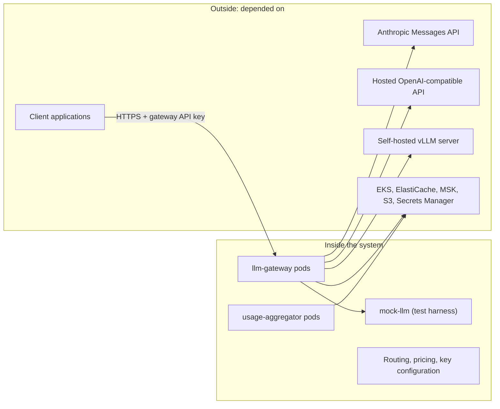

The gateway **does**: authenticate, limit, route, normalize, stream, protect, cache, account, and observe. It **does not**: run models, execute tools, moderate content, guarantee deterministic outputs, or produce invoices.

---

## 2. High-Level Design

### 2.1 Architecture overview

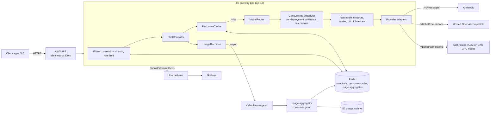

**Request path in one sentence:** a filter chain authenticates the API key and charges the rate limiter, the controller checks the cache, the router picks a provider deployment, the scheduler admits the request under that deployment's concurrency limit, the resilience layer applies timeouts, retries, and the circuit breaker, the adapter translates to and from the provider's API, and the usage recorder publishes token and cost data to Kafka after the response completes.

### 2.2 Component responsibilities

| Component | Responsibility | State |
| --- | --- | --- |
| `CorrelationFilter` | Accept or generate `X-Request-Id`; put it in MDC and response headers | None |
| `ApiKeyAuthFilter` | Parse key, look up hashed record, verify, attach `GatewayPrincipal` (tenant, scopes, limits, allowed aliases) | In-memory key table reloaded from a mounted Secret |
| `RateLimitFilter` | RPM token bucket; TPM reservation based on estimated tokens | Redis buckets |
| `ChatController` | Validate request, coordinate cache → route → execute → respond (JSON or SSE) | None |
| `ResponseCache` | Eligibility, canonical key, get/put, per-pod single-flight | Redis entries |
| `ModelRouter` | Resolve alias → candidate deployments → filter → choose (priority tiers + power-of-two-choices on load-aware score) | Reads health/load snapshots |
| `ConcurrencyScheduler` | Per-deployment permits (max concurrency) and bounded wait queue with deficit round-robin across tenants | In-memory per pod |
| `ResilienceExecutor` | Circuit breaker per deployment, timeouts (connect, first byte, idle, total), retry/fallback policy with retry budget | Resilience4j state per pod |
| `ProviderAdapter`s | `AnthropicAdapter`, `OpenAiCompatibleAdapter` (hosted + vLLM), `MockAdapter` | Stateless |
| `HealthTracker` | EWMA time-to-first-token, in-flight counts, provider throttle cooldowns per deployment | In-memory per pod |
| `TokenEstimator` | Pre-request prompt token estimate for TPM admission and context-length checks | None |
| `CostCalculator` | Usage × versioned price table → integer micro-USD | Price table from config |
| `UsageRecorder` | Build `UsageEvent`, reconcile the TPM reservation, publish to Kafka asynchronously | Producer buffer |
| `usage-aggregator` | Consume usage events; dedup; update Redis aggregates; batch-archive to S3 | Kafka offsets |
| `mock-llm` | Test-only provider with configurable latency, token rate, capacity, and error injection | None |

### 2.3 Service boundaries

There are two deployables from one codebase, plus a test harness:

1. **`llm-gateway`** (Spring profile `gateway`): the synchronous request path. Stateless; any pod can serve any request.
2. **`usage-aggregator`** (Spring profile `aggregator`): asynchronous usage processing. Separate deployment so a slow S3 or Redis aggregate update never touches request latency.
3. **`mock-llm`**: benchmark and test dependency only.

Why not more services (separate auth service, separate rate-limit service, separate router service)? Each would add a network hop and a failure mode to every request for no isolation benefit at this scale; they are modules inside the gateway.

### 2.4 Communication mechanisms

| From → To | Protocol | Sync / async | Notes |
| --- | --- | --- | --- |
| Client → gateway | HTTPS (HTTP/1.1 or HTTP/2 via ALB), JSON or SSE | Sync | Long-lived for streams |
| Gateway → providers | HTTPS, HTTP/2 where supported, JSON or SSE | Sync | One `HttpClient` per provider; keep-alive connection reuse |
| Gateway → Redis | RESP over TLS (Lettuce) | Sync, sub-ms | Rate limits and cache; fail-open/fallback rules in Section 9 |
| Gateway → Kafka | Kafka producer | Async | Fire after response completes; never blocks the response |
| Kafka → aggregator | Consumer group | Async | At-least-once; dedup by `requestId` |
| Aggregator → Redis, S3 | RESP; S3 PUT | Async | Batched |
| Prometheus → pods | HTTP scrape | Async | 15 s interval |

### 2.5 Data ownership

| Data | Owner | Store | Authority |
| --- | --- | --- | --- |
| API key records | Platform team (config) | Secrets Manager → K8s Secret → in-memory | Authoritative |
| Routing and pricing config | Platform team (config) | ConfigMap (versioned in git) | Authoritative |
| Rate-limit buckets | Gateway | Redis | Ephemeral |
| Cached responses | Gateway | Redis (TTL) | Derived, disposable |
| Usage events | Gateway (producer) | Kafka (7 days), S3 (long-term) | S3 archive is the durable usage record |
| Usage aggregates | Aggregator | Redis hashes | Derived; rebuildable from Kafka (7 days) or S3 |
| Circuit-breaker / health state | Each gateway pod | Memory | Local view per pod |

### 2.6 Synchronous vs asynchronous operations

| Step | Mode |
| --- | --- |
| Auth, RPM/TPM admission, validation | Sync, before any provider call |
| Cache lookup | Sync |
| Routing, scheduling, provider call, streaming | Sync (the client waits or streams) |
| TPM reconciliation (refund unused reserved tokens) | Sync but fire-and-forget after completion |
| Cache write | Async after completion |
| Usage event publish | Async after completion |
| Aggregation and archiving | Async in another deployment |

### 2.7 Component interaction (non-streaming cache miss)

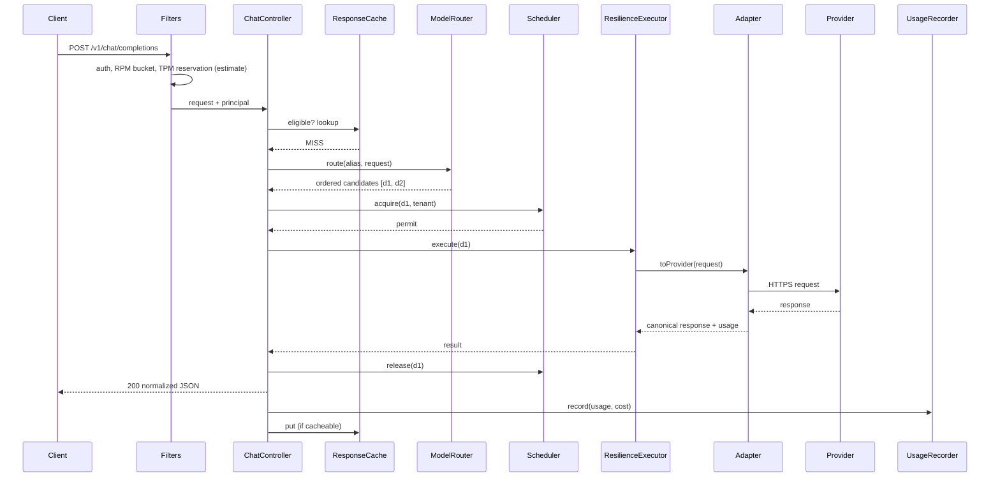

### 2.8 Data-flow architecture

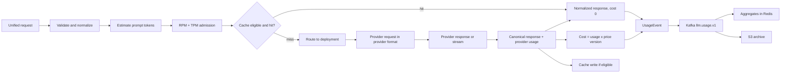

### 2.9 Important sequence: streaming request with provider failure before first token

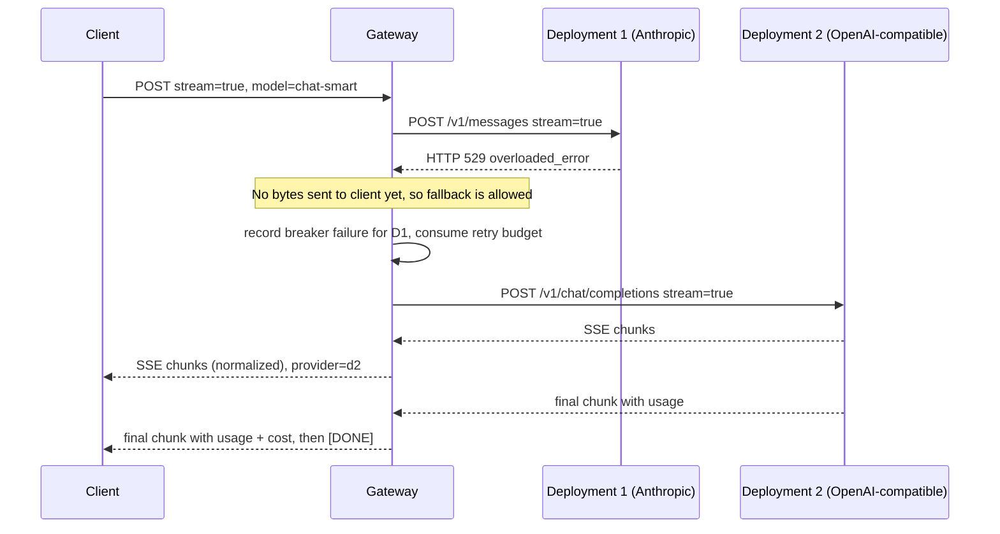

### 2.10 External dependencies

| Dependency | Failure effect | Mitigation |
| --- | --- | --- |
| Anthropic / hosted OpenAI-compatible / vLLM | Errors or latency for routed requests | Circuit breakers, fallback, per-deployment concurrency limits |
| Redis | Rate limits and cache unavailable | Local in-memory limiter fallback (limit ÷ replicas); cache bypass |
| Kafka | Usage events not published | Bounded producer buffer, then structured-log fallback record; alert |
| Secrets Manager / Secret mount | Key reload fails | Keep last good key table; alert |
| ALB | Ingress outage | AWS-managed; multi-AZ |

### 2.11 Scaling strategy

- Gateway pods are stateless and scale horizontally. Per-pod resources are dominated by open connections and in-flight requests, not CPU, so the HPA uses **in-flight requests per pod** (custom metric) together with CPU.
- **Per-deployment concurrency limits are per pod.** A cluster-wide provider limit of L concurrent requests is divided across pods (`L / replicas`), recomputed when the replica count changes (pods read the replica count from the Kubernetes Downward API or a ConfigMap updated by the deploy pipeline). Approximate, but avoids a distributed semaphore on every request.
- Rate limits and cache are shared through Redis, so they are cluster-wide.
- The aggregator scales as a consumer group (≤ 6 partitions).

### 2.12 Fault tolerance

- Provider failure: breaker opens per deployment per pod; routing skips open deployments; fallback to the next priority tier.
- Pod failure: ALB health checks remove the pod; in-flight streams on that pod are cut (clients see a broken stream and retry); no shared state is lost.
- Redis failure: degraded local limiting, no cache; requests continue.
- Kafka failure: requests continue; usage is buffered, then logged.

### 2.13 Deployment architecture

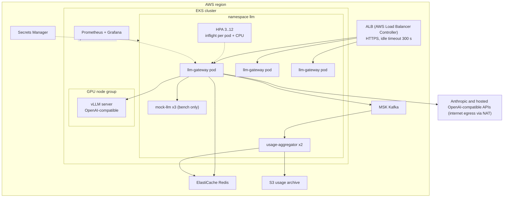

---

## 3. Low-Level Design

### 3.1 Package structure

```text
llm-gateway/
├── pom.xml                                     # Java 21, Spring Boot 3.4, Resilience4j, Lettuce, Kafka, Micrometer
└── src/main/java/com/acme/llmgw/
    ├── LlmGatewayApplication.java
    ├── api/
    │   ├── ChatController.java                 # POST /v1/chat/completions
    │   ├── ModelsController.java               # GET /v1/models
    │   ├── UsageController.java                # GET /v1/usage
    │   ├── AdminController.java                # /admin/v1/providers
    │   ├── dto/ChatRequest.java, ChatResponse.java, ChatChunk.java, Message.java, UsageDto.java, ErrorBody.java
    │   └── GlobalExceptionHandler.java
    ├── security/
    │   ├── ApiKeyAuthFilter.java
    │   ├── ApiKeyStore.java                    # loads hashed keys from mounted file; hot reload
    │   └── GatewayPrincipal.java
    ├── ratelimit/
    │   ├── RateLimitFilter.java
    │   ├── RedisTokenBucket.java               # Lua scripts: RPM bucket, TPM reserve/settle
    │   └── LocalFallbackLimiter.java
    ├── routing/
    │   ├── ModelRouter.java
    │   ├── RoutingConfig.java                  # aliases → deployments (from ConfigMap)
    │   ├── Deployment.java                     # id, provider, providerModel, priority, weight, limits, capabilities
    │   └── HealthTracker.java                  # EWMA TTFT, inflight, throttle cooldowns
    ├── scheduling/
    │   ├── ConcurrencyScheduler.java
    │   ├── DeploymentBulkhead.java             # permits + fair queue
    │   └── FairQueue.java                      # deficit round-robin across tenants
    ├── resilience/
    │   ├── ResilienceExecutor.java
    │   ├── RetryPolicy.java
    │   └── RetryBudget.java
    ├── provider/
    │   ├── ProviderAdapter.java                # interface
    │   ├── AnthropicAdapter.java
    │   ├── OpenAiCompatibleAdapter.java
    │   ├── MockAdapter.java
    │   ├── SseLineReader.java
    │   └── ProviderException.java              # carries status, retryable flag, retry-after
    ├── streaming/
    │   ├── StreamRelay.java                    # provider events → canonical chunks → SseEmitter
    │   └── StreamAccumulator.java              # assembles final text/usage for cache + accounting
    ├── cache/
    │   ├── ResponseCache.java
    │   ├── CacheKeyFactory.java                # canonical JSON + SHA-256
    │   └── SingleFlight.java
    ├── usage/
    │   ├── TokenEstimator.java
    │   ├── CostCalculator.java
    │   ├── PriceTable.java
    │   ├── UsageEvent.java
    │   └── UsageRecorder.java                  # Kafka producer + log fallback
    ├── aggregator/                             # active only with profile "aggregator"
    │   ├── UsageAggregatorListener.java
    │   ├── RedisUsageAggregates.java           # Lua: dedup + HINCRBY
    │   └── S3UsageArchiver.java
    └── observability/
        ├── GatewayMetrics.java
        └── CorrelationFilter.java
```

### 3.2 Class diagram

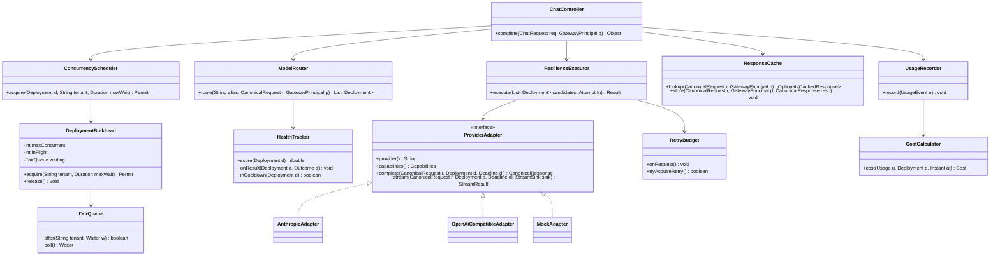

### 3.3 Canonical model

All internal logic works on provider-neutral records; adapters translate at the edge.

```java
public record CanonicalRequest(
    String requestId, String tenantId, String alias,
    List<CanonicalMessage> messages,          // roles: system, user, assistant, tool
    Integer maxTokens,                         // required by some providers; defaulted per alias
    Double temperature, Double topP,           // optional; dropped for providers/models that reject them
    List<String> stop,
    List<ToolDefinition> tools,                // passed through, never executed by the gateway
    ResponseFormat responseFormat,             // e.g. JSON schema, where supported
    boolean stream,
    CacheMode cacheMode,                       // DEFAULT, BYPASS, PREFER
    Map<String, String> metadata) {}

public record CanonicalResponse(
    String id, String provider, String deploymentId, String providerModel,
    String content, List<ToolCall> toolCalls,
    FinishReason finishReason,                 // STOP, LENGTH, TOOL_CALLS, CONTENT_FILTER, ERROR
    Usage usage, Duration providerLatency, Duration ttft) {}

public record Usage(long promptTokens, long completionTokens,
                    long cacheReadTokens, long cacheWriteTokens, boolean estimated) {}
```

### 3.4 Provider abstraction

```java
public interface ProviderAdapter {
  String provider();                                   // "anthropic", "openai-compatible", "mock"
  Capabilities capabilities(Deployment d);             // streaming, tools, json mode, sampling params, context window
  CanonicalResponse complete(CanonicalRequest r, Deployment d, Deadline deadline) throws ProviderException;
  StreamResult stream(CanonicalRequest r, Deployment d, Deadline deadline, StreamSink sink) throws ProviderException;
}

public interface StreamSink {
  void onFirstToken();                                 // marks "bytes committed to client"
  void onDelta(String text);
  void onToolCallDelta(ToolCallDelta d);
  void onUsage(Usage partialOrFinal);
}
```

**Translation table (illustrative; verify against provider docs when implementing):**

| Concern | Canonical | Anthropic Messages API | OpenAI-compatible Chat Completions (hosted / vLLM) |
| --- | --- | --- | --- |
| Endpoint | — | `POST {base}/v1/messages` | `POST {base}/v1/chat/completions` |
| Auth header | — | `x-api-key: <key>` + `anthropic-version: <pinned version>` | `Authorization: Bearer <key>` (vLLM: optional) |
| System prompt | message with role `system` | Top-level `system` field | Message with role `system` |
| Max tokens | `maxTokens` | `max_tokens` (required) | `max_tokens` / `max_completion_tokens` (optional) |
| Sampling | `temperature`, `topP` | Rejected by current models under the newer API version; adapter drops them per capability flags | Passed through |
| Streaming | `stream=true` | SSE events: `message_start`, `content_block_start`, `content_block_delta` (`text_delta`), `content_block_stop`, `message_delta`, `message_stop`, `ping`, `error` | SSE `data:` chunks with `choices[].delta`, terminated by `data: [DONE]` |
| Usage (non-stream) | `Usage` | `usage.input_tokens`, `usage.output_tokens`, `usage.cache_read_input_tokens`, `usage.cache_creation_input_tokens` | `usage.prompt_tokens`, `usage.completion_tokens` |
| Usage (stream) | final `Usage` | Input and cache tokens in `message_start.message.usage`; cumulative `output_tokens` in `message_delta.usage` | Final chunk with `usage` when `stream_options.include_usage=true` |
| Finish reason | `FinishReason` | `stop_reason`: `end_turn`→STOP, `max_tokens`→LENGTH, `tool_use`→TOOL_CALLS, `refusal`→CONTENT_FILTER | `finish_reason`: `stop`, `length`, `tool_calls`, `content_filter` |
| Non-text blocks | ignored for content | `thinking` content blocks are skipped (not forwarded as text) | n/a |
| Rate limited | `ProviderException(429, retryAfter)` | HTTP 429 `rate_limit_error`, `retry-after` header | HTTP 429, `retry-after` header (if sent) |
| Overloaded | `ProviderException(529/503, retryable)` | HTTP 529 `overloaded_error` | HTTP 503 |
| Server error | retryable | HTTP 500 `api_error` | HTTP 5xx |
| Client error | non-retryable | 400 `invalid_request_error`, 401, 403, 404, 413 | 400, 401, 403, 404 |

Example model mapping in routing configuration (model IDs current as of late 2026; OpenAI model IDs left as placeholders):

```yaml
aliases:
  chat-smart:
    defaultMaxTokens: 1024
    deployments:
      - { id: anthropic-opus,   provider: anthropic,         model: claude-opus-5-5,       priority: 1, weight: 1, maxConcurrentPerCluster: 64 }
      - { id: oai-large,        provider: openai-compatible, model: "<openai-model-id>",   priority: 2, weight: 1, maxConcurrentPerCluster: 64 }
  chat-fast:
    defaultMaxTokens: 512
    deployments:
      - { id: anthropic-haiku,  provider: anthropic,         model: claude-haiku-5-5,      priority: 1, weight: 2, maxConcurrentPerCluster: 128 }
      - { id: vllm-local,       provider: openai-compatible, model: "llama-3.1-8b-instruct", baseUrl: "http://vllm.llm.svc:8000", priority: 1, weight: 1, maxConcurrentPerCluster: 48 }
  chat-bench:
    deployments:
      - { id: mock-a, provider: mock, priority: 1, weight: 1, maxConcurrentPerCluster: 96 }
      - { id: mock-b, provider: mock, priority: 1, weight: 1, maxConcurrentPerCluster: 48 }
```

### 3.5 Threading model

| Work | Thread type | Notes |
| --- | --- | --- |
| HTTP request handling | **Virtual thread per request** (`spring.threads.virtual.enabled=true`) | Blocking calls (Redis, upstream HTTP, queue waits) park the virtual thread, not a carrier thread |
| Upstream HTTP | JDK `HttpClient` with its own selector threads; the request's virtual thread blocks reading the response body stream | One client per provider; HTTP/2 multiplexing where supported |
| SSE writes | The request's virtual thread writes via `SseEmitter` | Writes are blocking; a slow client applies backpressure to the upstream read (see Section 10) |
| Scheduler waits | The request's virtual thread parks on a per-waiter `CompletableFuture` | No thread pool sized to queue length |
| Kafka producer | Producer I/O thread | `send()` is async; callbacks update metrics |
| Redis | Lettuce event loop (Netty) | Synchronous API used from virtual threads |
| Metrics | Micrometer | Lock-free counters/histograms |

**Virtual-thread caveat (Java 21):** a virtual thread blocked inside a `synchronized` block **pins** its carrier thread. Gateway code uses `ReentrantLock` instead of `synchronized` on paths that block; third-party libraries are checked with `-Djdk.tracePinnedThreads=short` during load tests. (Java 24 removed most pinning, but the project targets 21 LTS.)

### 3.6 Concurrent request scheduling: `DeploymentBulkhead`

**Input:** deployment, tenant, max wait. **Output:** a permit, or a rejection (queue full or wait timeout).

```java
final class DeploymentBulkhead {
  private final ReentrantLock lock = new ReentrantLock();
  private volatile int maxConcurrent;          // per-pod share of the deployment's cluster limit
  private int inFlight;
  private final FairQueue waiting;             // DRR across tenants, bounded total size

  Permit acquire(String tenant, Duration maxWait) throws SaturatedException {
    CompletableFuture<Permit> grant;
    lock.lock();
    try {
      if (inFlight < maxConcurrent && waiting.isEmpty()) {   // fast path: no queue
        inFlight++;
        return new Permit(this);
      }
      grant = new CompletableFuture<>();
      if (!waiting.offer(tenant, new Waiter(grant))) throw new SaturatedException("queue full");
    } finally { lock.unlock(); }
    try {
      return grant.get(maxWait.toMillis(), TimeUnit.MILLISECONDS);   // parks the virtual thread
    } catch (TimeoutException e) {
      lock.lock();
      try {
        if (grant.isDone()) return grant.join();       // granted at the last moment: keep it
        grant.cancel(false);                            // mark cancelled; poll() skips cancelled waiters
      } finally { lock.unlock(); }
      throw new SaturatedException("queue wait timeout");
    }
  }

  void release() {
    lock.lock();
    try {
      Waiter next;
      while ((next = waiting.poll()) != null) {
        if (next.grant().complete(new Permit(this))) return;   // hand the slot over: inFlight unchanged
      }
      inFlight--;                                               // nobody waiting: free the slot
    } finally { lock.unlock(); }
  }
}
```

**Deficit round-robin (`FairQueue`)**: one FIFO per tenant plus a round-robin ring of tenants with non-empty queues; each tenant has a quantum (weight from its key configuration). `poll()` visits tenants in ring order, serving a tenant while its deficit counter covers the cost of its head request (cost = 1 request here; a token-weighted variant would use estimated tokens).

| Aspect | Detail |
| --- | --- |
| Time | `acquire`/`release` `O(1)` amortized (cancelled waiters are skipped lazily) |
| Space | `O(queued requests)`, bounded (e.g., 200 per deployment per pod) |
| State transitions | waiting → granted → released; waiting → timed out (cancelled) |
| Concurrency | One lock per deployment; held only for counter and queue operations, never during I/O |
| Fairness | A tenant with 500 queued requests cannot starve a tenant with 1: the ring alternates between them |
| Failure behavior | Queue full → try the next candidate deployment; all saturated → `503 PROVIDER_SATURATED` with `Retry-After` |

**Why handoff instead of decrement-then-reacquire in `release()`:** if the permit were freed and the waiter signalled to "try again", a newly arriving request could take the slot first (barging), breaking FIFO/fairness. Handing the permit directly to the chosen waiter keeps fairness and keeps `inFlight` exact.

### 3.7 Request execution pseudocode (controller)

```java
Object complete(ChatRequest dto, GatewayPrincipal p) {
  CanonicalRequest req = normalizer.toCanonical(dto, p);              // validate, defaults, alias check
  long estPrompt = tokenEstimator.estimate(req);
  Reservation tpm = rateLimiter.reserveTokens(p, estPrompt + req.maxTokens());   // 429 if insufficient

  Optional<CachedResponse> hit = cache.lookup(req, p);
  if (hit.isPresent()) {
    tpm.settle(0);                                                     // cache hits consume no provider tokens
    usage.record(UsageEvent.cacheHit(req, p, hit.get()));
    return req.stream() ? relay.replay(hit.get()) : hit.get().toResponse();
  }

  List<Deployment> candidates = router.route(req.alias(), req, p);     // ordered, filtered
  if (req.stream()) return relay.startStreaming(req, p, candidates, tpm);   // returns SseEmitter; continues on this virtual thread

  Result r = resilience.execute(candidates, (d, deadline) -> {
    try (Permit permit = scheduler.acquire(d, p.tenantId(), cfg.queueWait())) {
      return adapters.get(d.provider()).complete(req, d, deadline);
    }
  });
  tpm.settle(r.usage().promptTokens() + r.usage().completionTokens());
  usage.record(UsageEvent.of(req, p, r, costCalculator.cost(r.usage(), r.deployment(), Instant.now())));
  cache.storeAsync(req, p, r.response());
  return ChatResponse.from(r);
}
```

### 3.8 Streaming relay

```java
SseEmitter startStreaming(CanonicalRequest req, GatewayPrincipal p, List<Deployment> candidates, Reservation tpm) {
  SseEmitter emitter = new SseEmitter(cfg.maxStreamDuration().toMillis());
  StreamAccumulator acc = new StreamAccumulator();
  AtomicBoolean committed = new AtomicBoolean(false);           // true once any byte went to the client
  emitter.onCompletion(acc::markClientGone);
  emitter.onTimeout(acc::markClientGone);
  emitter.onError(t -> acc.markClientGone());

  Thread.startVirtualThread(() -> {
    try {
      Result r = resilience.executeStreaming(candidates, committed, (d, deadline) -> {
        try (Permit permit = scheduler.acquire(d, p.tenantId(), cfg.queueWait())) {
          return adapters.get(d.provider()).stream(req, d, deadline, new StreamSink() {
            public void onFirstToken() { committed.set(true); }
            public void onDelta(String text) {
              if (acc.clientGone()) throw new ClientDisconnected();   // cancels the upstream read
              acc.append(text);
              send(emitter, ChatChunk.delta(req, d, text));
            }
            public void onToolCallDelta(ToolCallDelta t) { acc.append(t); send(emitter, ChatChunk.tool(req, d, t)); }
            public void onUsage(Usage u) { acc.usage(u); }
          });
        }
      });
      Cost cost = costCalculator.cost(r.usage(), r.deployment(), Instant.now());
      send(emitter, ChatChunk.finalChunk(req, r, cost));
      sendRaw(emitter, "[DONE]");
      emitter.complete();
      finish(req, p, tpm, r, cost, acc);                        // settle TPM, usage event, cache store
    } catch (ProviderException e) {
      if (committed.get()) {                                    // mid-stream failure: cannot fall back
        send(emitter, ChatChunk.error(req, e.code(), acc.estimatedUsage()));
        emitter.complete();
        finishPartial(req, p, tpm, acc, e);                     // usage for tokens already streamed (estimated if needed)
      } else {
        emitter.completeWithError(e);                           // mapped to an HTTP error status by the handler
      }
    } catch (ClientDisconnected e) {
      finishPartial(req, p, tpm, acc, null);                    // stop billing beyond what was generated
    }
  });
  return emitter;
}
```

Before any byte is written, the HTTP status can still be an error (`502`, `503`, `504`). After the first byte, the status is already `200`, so failures are reported **in-band** as an SSE `error` event.

### 3.9 Design patterns

| Pattern | Where | Why |
| --- | --- | --- |
| Adapter | `ProviderAdapter` implementations | Isolates provider formats behind one interface |
| Strategy | Routing policies (priority/P2C/weighted), cache eligibility rules | Swappable per alias |
| Bulkhead | `DeploymentBulkhead` | One slow provider can't consume all gateway capacity |
| Circuit breaker | Resilience4j per deployment | Fail fast on unhealthy providers; allow recovery probes |
| Chain of responsibility | Servlet filters (correlation → auth → rate limit) | Cross-cutting concerns before the controller |
| Single-flight | `SingleFlight` in the cache | Coalesce identical concurrent cache misses |
| Producer–consumer | Usage events via Kafka | Accounting off the request path |
| Template method | Adapter base class for SSE parsing + error mapping | Shared streaming plumbing |

### 3.10 Error handling

| Error source | Internal type | Retryable | HTTP to client (if before first byte) |
| --- | --- | --- | --- |
| Validation | `ValidationException` | No | 400 `INVALID_REQUEST` |
| Unknown or disallowed alias | `ModelNotAllowedException` | No | 404 `MODEL_NOT_FOUND` / 403 `MODEL_NOT_ALLOWED` |
| Auth failure | `AuthenticationException` | No | 401 `INVALID_API_KEY` |
| RPM / TPM exceeded | `RateLimitedException` | Yes (after `Retry-After`) | 429 `RATE_LIMITED` |
| All deployments saturated | `SaturatedException` | Yes | 503 `PROVIDER_SATURATED` |
| All circuits open / no healthy candidate | `NoHealthyDeploymentException` | Yes | 503 `NO_HEALTHY_PROVIDER` |
| Provider 4xx (bad request, context too long) | `ProviderException(retryable=false)` | No | 400 `PROVIDER_REJECTED` (provider message sanitized) |
| Provider 429 / 529 / 5xx / connect failure after retries | `ProviderException(retryable=true)` | Yes | 502 `PROVIDER_ERROR` |
| Timeout before first byte | `ProviderTimeoutException` | Yes | 504 `PROVIDER_TIMEOUT` |
| Failure after first byte | — | — | In-band SSE `error` event |

---

## 4. API Design

Base URL: `https://llm-gateway.internal.example.com`. All endpoints require `Authorization: Bearer <gateway key>` except health endpoints. JSON is UTF-8. The request/response shape is intentionally close to the widely used Chat Completions format so existing client libraries can point at the gateway with minimal changes, plus gateway-specific fields (`provider`, `cost`, `cached`, `routing`, `cache`).

### 4.1 Common headers

| Header | Direction | Rule |
| --- | --- | --- |
| `Authorization: Bearer gk_live_<keyId>_<secret>` | Request | Required |
| `Content-Type: application/json` | Request | Required on POST |
| `Accept: text/event-stream` | Request | Recommended when `stream=true` |
| `X-Request-Id` | Both | Optional on request (UUID); generated if absent; echoed and logged everywhere |
| `X-Request-Timeout-Ms` | Request | Optional overall deadline (1,000–300,000); defaults per alias |
| `Cache-Control: no-store` | Request | Bypass the gateway response cache (same as `cache.mode = "bypass"`) |
| `X-Gateway-Provider`, `X-Gateway-Deployment`, `X-Gateway-Model` | Response | Which backend served the request (non-streaming; also in the first SSE chunk) |
| `X-Gateway-Cache: HIT|MISS|BYPASS|INELIGIBLE` | Response | Cache outcome |
| `Server-Timing: gw;dur=3.8, queue;dur=0.0, upstream;dur=1812.4` | Response | Gateway overhead, scheduler wait, and provider time (non-streaming) |
| `X-RateLimit-Limit-Requests`, `X-RateLimit-Remaining-Requests`, `X-RateLimit-Remaining-Tokens` | Response | Current limit state |
| `Retry-After` | Response | Seconds; with 429 and 503 |

### 4.2 `POST /v1/chat/completions`

**Purpose:** generate a chat completion through a logical model alias.  
**Auth:** scope `chat`; alias must be in the key's `allowedAliases`.  
**Rate limits:** RPM and TPM per key (Section 6.4).  
**Idempotency:** not idempotent (each call can incur cost). Retrying a timed-out request may produce a second provider call; deterministic, cache-eligible requests are deduplicated in practice by the cache. A client-supplied idempotency key is a listed future improvement.  
**Timeouts:** connect 2 s; first byte 20 s (per alias); idle gap between stream chunks 30 s; total per `X-Request-Timeout-Ms` or the alias default (120 s non-streaming, 600 s streaming).

Request:

```json
{
  "model": "chat-smart",
  "messages": [
    { "role": "system", "content": "You are a support assistant for ACME billing." },
    { "role": "user", "content": "Summarize this ticket in two sentences: ..." }
  ],
  "max_tokens": 300,
  "temperature": 0,
  "stop": ["\n\n###"],
  "stream": false,
  "response_format": { "type": "text" },
  "cache": { "mode": "default" },
  "routing": { "fallback": true },
  "metadata": { "feature": "ticket-summary", "end_user_hash": "u_93ac..." }
}
```

| Field | Type | Required | Validation |
| --- | --- | --- | --- |
| `model` | string | yes | A configured alias allowed for the key |
| `messages` | array | yes | 1–200 messages; roles `system`, `user`, `assistant`, `tool`; total content ≤ 1 MB |
| `max_tokens` | int | no | 1 – alias max; default per alias |
| `temperature`, `top_p` | number | no | Ranges 0–2 / 0–1; silently dropped for deployments that reject sampling parameters (reported in `X-Gateway-Dropped-Params`) |
| `stop` | string[] | no | ≤ 4 entries |
| `stream` | bool | no | Default false |
| `tools`, `tool_choice` | arrays/objects | no | Passed through when the deployment supports tools; otherwise that deployment is filtered out by routing |
| `response_format` | object | no | `text` or `json_schema` where supported |
| `cache.mode` | enum | no | `default` (eligibility rules apply), `bypass`, `prefer` (opt-in caching even when temperature > 0) |
| `routing.fallback` | bool | no | Default true; false pins to the first healthy candidate only |
| `metadata` | map | no | ≤ 16 string pairs; recorded in usage events; never sent to providers |

Non-streaming response (`200 OK`):

```json
{
  "id": "gw-01J9Z8Q4K3W1T7N0V5B2C6D8E9",
  "object": "chat.completion",
  "created": 1785312000,
  "model": "chat-smart",
  "provider": "anthropic",
  "deployment": "anthropic-opus",
  "provider_model": "claude-opus-5-5",
  "choices": [
    {
      "index": 0,
      "message": { "role": "assistant", "content": "The customer was double-charged ... A refund was requested." },
      "finish_reason": "stop"
    }
  ],
  "usage": { "prompt_tokens": 412, "completion_tokens": 48, "cache_read_tokens": 0, "total_tokens": 460, "estimated": false },
  "cost": { "currency": "USD", "amount_micros": 2608, "price_version": "2026-07-01" },
  "cached": false,
  "latency_ms": { "total": 1816, "queue": 0, "provider": 1812, "ttft": null }
}
```

(The cost value is ILLUSTRATIVE arithmetic using placeholder prices.)

Streaming response (`200 OK`, `Content-Type: text/event-stream`):

```text
data: {"id":"gw-01J9...","object":"chat.completion.chunk","model":"chat-smart","provider":"anthropic","deployment":"anthropic-opus","choices":[{"index":0,"delta":{"role":"assistant","content":""},"finish_reason":null}]}

data: {"id":"gw-01J9...","object":"chat.completion.chunk","choices":[{"index":0,"delta":{"content":"The customer"},"finish_reason":null}]}

: keep-alive

data: {"id":"gw-01J9...","object":"chat.completion.chunk","choices":[{"index":0,"delta":{"content":" was double-charged"},"finish_reason":null}]}

data: {"id":"gw-01J9...","object":"chat.completion.chunk","choices":[{"index":0,"delta":{},"finish_reason":"stop"}],"usage":{"prompt_tokens":412,"completion_tokens":48,"total_tokens":460,"estimated":false},"cost":{"currency":"USD","amount_micros":2608,"price_version":"2026-07-01"}}

data: [DONE]
```

- A `: keep-alive` SSE comment is sent every 15 s while waiting, so the ALB and intermediaries don't close idle connections.
- Mid-stream failure:

```text
event: error
data: {"error":{"code":"PROVIDER_STREAM_INTERRUPTED","message":"Upstream stream ended unexpectedly","retriable":true},"usage":{"prompt_tokens":412,"completion_tokens":131,"estimated":true}}
```

**What happens internally:** see Sections 3.7, 3.8, and 7.1.

**Error responses** (before any streamed byte):

```json
{
  "error": {
    "code": "RATE_LIMITED",
    "message": "Token-per-minute limit exceeded for key gk_live_7QW",
    "retriable": true,
    "request_id": "8f2c1e9a-3b7d-4c55-9e10-0a1b2c3d4e5f"
  }
}
```

| Status | Code | When |
| --- | --- | --- |
| 400 | `INVALID_REQUEST` | Schema or range violation |
| 400 | `CONTEXT_TOO_LONG` | Estimated prompt + `max_tokens` exceeds every candidate's context window |
| 400 | `PROVIDER_REJECTED` | Provider returned a non-retryable 4xx (sanitized message) |
| 401 | `INVALID_API_KEY` | Missing, malformed, unknown, revoked, or wrong secret |
| 403 | `MODEL_NOT_ALLOWED` | Alias not permitted for this key |
| 404 | `MODEL_NOT_FOUND` | Unknown alias |
| 413 | `PAYLOAD_TOO_LARGE` | Body > 1 MB |
| 429 | `RATE_LIMITED` | RPM or TPM exceeded |
| 429 | `QUOTA_EXCEEDED` | Monthly cost budget exhausted (soft, aggregate-lag bounded) |
| 502 | `PROVIDER_ERROR` | Retryable provider failures exhausted |
| 503 | `PROVIDER_SATURATED` | All candidate bulkheads full or queue wait timed out |
| 503 | `NO_HEALTHY_PROVIDER` | All candidates' circuits open or in throttle cooldown |
| 504 | `PROVIDER_TIMEOUT` | First-byte or total timeout before any streamed byte |

### 4.3 `GET /v1/models`

Lists aliases available to the caller with capabilities (no provider credentials or internal URLs):

```json
{
  "data": [
    { "id": "chat-smart", "streaming": true, "tools": true, "max_context_tokens": 200000, "default_max_tokens": 1024 },
    { "id": "chat-fast",  "streaming": true, "tools": false, "max_context_tokens": 32000,  "default_max_tokens": 512 }
  ]
}
```

`max_context_tokens` is the minimum across the alias's deployments, so any request that fits can go to any of them.

### 4.4 `GET /v1/usage`

**Purpose:** the caller's tenant usage aggregates. **Auth:** scope `usage:read`; a key sees only its own tenant.

`GET /v1/usage?from=2026-08-01&to=2026-08-07&group_by=day,model`

```json
{
  "tenant": "billing-team",
  "from": "2026-08-01",
  "to": "2026-08-07",
  "rows": [
    { "day": "2026-08-01", "model": "chat-smart", "requests": 1820, "cache_hits": 410,
      "prompt_tokens": 931200, "completion_tokens": 120440, "cost_micros": 0, "price_versions": ["2026-07-01"] }
  ],
  "freshness_seconds": 4,
  "complete": true
}
```

- `group_by`: `day`, `model`, or both. Range ≤ 31 days; older data comes from the S3 archive (offline analysis).
- Pagination: not needed (bounded by days × aliases); a `next_cursor` is reserved in the schema.
- `freshness_seconds`: aggregator lag; usage is eventually consistent.
- `complete: false` if the aggregator detected usage-event loss (e.g., fallback-log records not yet re-ingested).
- (`cost_micros: 0` above is a placeholder value.)

### 4.5 Admin endpoints

| Endpoint | Scope | Purpose |
| --- | --- | --- |
| `GET /admin/v1/providers` | `admin` | Per-deployment status from this pod's view: circuit state, in-flight, queue length, EWMA TTFT, cooldown |
| `POST /admin/v1/providers/{deploymentId}/state` `{"enabled": false}` | `admin` | Drain a deployment cluster-wide: stored in Redis `gw:flags`; pods poll every 5 s |

### 4.6 Health and metrics

| Endpoint | Purpose |
| --- | --- |
| `/actuator/health/liveness` | Process alive (no dependency checks) |
| `/actuator/health/readiness` | Key table loaded, routing config valid, not draining. **Redis and providers are not readiness dependencies** (degraded modes exist) |
| `/actuator/prometheus` | Metrics scrape |

### 4.7 Kafka contract: `llm.usage.v1`

| Property | Value |
| --- | --- |
| Partitions / RF / ISR | 6 / 3 / 2 |
| Key | `tenantId` (per-tenant ordering, aggregation locality) |
| Retention | 7 days |
| Producer | `llm-gateway`: `acks=all`, `enable.idempotence=true`, `linger.ms=20`, `compression.type=lz4`, `buffer.memory=32MB`, `max.block.ms=0` (never block a request thread on a full buffer) |
| Consumer | `usage-aggregator`, group `usage-aggregator`, manual commit after Redis update; S3 batches committed separately (Section 5.4) |
| Delivery | At-least-once; dedup by `requestId` |

```json
{
  "schemaVersion": 1,
  "requestId": "8f2c1e9a-3b7d-4c55-9e10-0a1b2c3d4e5f",
  "eventTime": "2026-08-01T10:15:30.123Z",
  "tenantId": "billing-team",
  "apiKeyId": "7QW",
  "alias": "chat-smart",
  "provider": "anthropic",
  "deploymentId": "anthropic-opus",
  "providerModel": "claude-opus-5-5",
  "stream": true,
  "cacheHit": false,
  "outcome": "SUCCESS",
  "finishReason": "STOP",
  "attempts": 2,
  "fallbackUsed": true,
  "usage": { "promptTokens": 412, "completionTokens": 48, "cacheReadTokens": 0, "cacheWriteTokens": 0, "estimated": false },
  "cost": { "currency": "USD", "amountMicros": 2608, "priceVersion": "2026-07-01" },
  "latencyMs": { "total": 2410, "queue": 3, "ttft": 610, "provider": 2390 },
  "metadata": { "feature": "ticket-summary" }
}
```

`outcome` ∈ `SUCCESS`, `PARTIAL` (stream interrupted or client disconnected), `PROVIDER_ERROR`, `REJECTED` (429/400 before any provider call; zero cost). Failed attempts that a provider still billed (e.g., a stream cut after tokens were generated) are recorded with `PARTIAL` and their usage.

---

## 5. Data and Storage Design

There is **no relational database** in this project. State lives in configuration, Redis (ephemeral and derived), Kafka (7-day log), and S3 (durable usage archive).

### 5.1 Configuration model

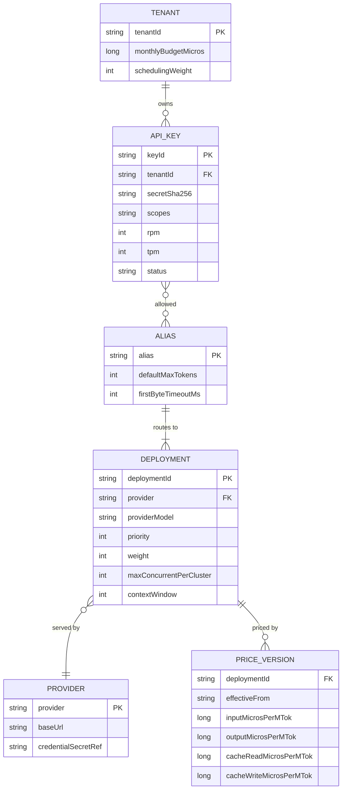

This is a **configuration** model (YAML in a ConfigMap and a Secret), drawn as an ER diagram to show relationships. Key records (hashed secrets) come from a Secret; everything else from a ConfigMap, versioned in git and validated at startup (unknown provider, missing price, duplicate ids → pod fails readiness).

API key record (stored hashed):

```yaml
keys:
  - keyId: "7QW"
    tenantId: billing-team
    secretSha256: "3f0a9c...e1"            # SHA-256 of the secret part; the plaintext is shown once at issuance
    scopes: [chat, usage:read]
    allowedAliases: [chat-smart, chat-fast]
    limits: { rpm: 600, tpm: 400000 }
    status: ACTIVE
```

Price table (placeholders):

```yaml
prices:
  - deploymentId: anthropic-opus
    effectiveFrom: "2026-07-01T00:00:00Z"
    inputMicrosPerMTok: <placeholder>
    outputMicrosPerMTok: <placeholder>
    cacheReadMicrosPerMTok: <placeholder>
    cacheWriteMicrosPerMTok: <placeholder>
  - deploymentId: vllm-local
    effectiveFrom: "2026-07-01T00:00:00Z"
    inputMicrosPerMTok: 0                   # self-hosted: priced by an internal chargeback rate, or 0
    outputMicrosPerMTok: 0
```

### 5.2 Redis key design

| Key | Type | Value | TTL | Writer | Reader |
| --- | --- | --- | --- | --- | --- |
| `rl:rpm:{keyId}` | Hash `{tokens, ts}` | Token bucket state | 2 min idle | Gateway (Lua) | Gateway |
| `rl:tpm:{keyId}` | Hash `{tokens, ts}` | Token bucket in LLM tokens | 2 min idle | Gateway (Lua) | Gateway |
| `cache:v1:{tenantId}:{sha256}` | String (gzip JSON) | Normalized response + usage + provider model + created_at | 1 h default (per alias) | Gateway | Gateway |
| `usage:dedup:{requestId}` | String | `1` | 48 h | Aggregator (Lua) | Aggregator |
| `usage:agg:{tenantId}:{yyyyMMdd}` | Hash | Fields `{alias}|{field}` → integer (requests, cache_hits, prompt_tokens, completion_tokens, cost_micros) | 40 days | Aggregator (Lua) | Usage API |
| `usage:month:{tenantId}:{yyyyMM}` | String | Cost micros (for budget checks) | 40 days | Aggregator | Gateway |
| `gw:flags` | Hash | Deployment enable flags | none | Admin API | Gateway (poll 5 s) |

Key-design notes:

- The tenant id is **inside** the cache key, so identical prompts from two tenants never share an entry (no cross-tenant leakage, at the cost of a lower hit rate).
- Rate-limit keys are per API key so one leaked or runaway key can be throttled without affecting other keys of the same tenant.
- With Redis Cluster (not required at this scale), keys that a Lua script touches together must share a hash slot; the dedup + aggregate script would use hash tags like `{tenantId}` in both keys.

### 5.3 Cache entry format

```json
{
  "v": 1,
  "providerModel": "claude-opus-5-5",
  "deploymentId": "anthropic-opus",
  "adapterVersion": "1.3.0",
  "createdAt": "2026-08-01T10:15:30Z",
  "response": { "content": "...", "finishReason": "STOP", "toolCalls": [] },
  "usage": { "promptTokens": 412, "completionTokens": 48 }
}
```

Stored gzip-compressed; entries over 256 KB uncompressed are not cached.

### 5.4 S3 usage archive layout

```text
s3://acme-llm-usage/usage/v1/dt=2026-08-01/hour=10/part-<aggregatorPod>-<firstOffset>-<lastOffset>.jsonl.gz
```

- The aggregator buffers events and flushes every 5 minutes or 10,000 events, whichever comes first.
- Kafka offsets for a partition are committed only after both the Redis updates (per record) and the S3 object containing those records are written. A crash after the S3 PUT but before the commit re-writes the same records into a new object; the file name includes the offset range, so duplicates are identifiable, and downstream queries (e.g., Athena) deduplicate on `requestId`.
- Redis updates are idempotent per `requestId` (dedup key), so reprocessing never double counts aggregates.

### 5.5 Transaction boundaries

| Operation | Atomicity |
| --- | --- |
| RPM bucket check-and-consume | Atomic (single Lua script) |
| TPM reserve / settle | Each atomic (Lua); reserve and settle are separate operations |
| Cache get / put | Single commands |
| Usage aggregate update | Atomic per event: Lua does `SET dedup NX EX` then `HINCRBY`s only if the SET succeeded |
| Kafka offset commit vs Redis/S3 writes | Not atomic; safe because writes are idempotent |

---

## 6. Core Algorithms and Engineering Techniques

### 6.1 Provider abstraction and normalization

1. **Problem:** each provider has its own request format, auth, streaming protocol, usage fields, and error codes.
2. **Why required:** without it, routing, fallback, caching, and accounting would need provider-specific branches everywhere.
3. **Core idea:** translate to a canonical request at the edge, call a provider through an adapter, translate back to a canonical response or chunk stream.
4. **Steps:** validate unified request → canonical request (defaults, alias) → adapter checks capabilities (drop unsupported sampling params; reject tools if unsupported, which routing pre-filters) → build provider JSON and headers → parse response or stream events → map finish reason and usage → canonical result.
5. **Pseudocode:** Section 3.4 and the translation table.
6. **Time:** `O(request + response size)`.
7. **Space:** `O(response size)` for non-streaming; `O(1)` per chunk for streaming plus the accumulator (needed for caching and estimates).
8. **Alternatives:** pass-through proxy per provider (no normalization); a third-party SDK that abstracts providers.
9. **Advantages:** provider swaps are configuration; consistent client experience; one place to fix quirks.
10. **Disadvantages:** lowest common denominator; provider-specific features (e.g., Anthropic prompt caching controls, thinking configuration) need explicit extension fields; translation bugs affect everyone.
11. **Failure scenarios:** a provider adds a new stream event type; the adapter must ignore unknown event types (forward compatibility) rather than fail the stream.
12. **Interview explanation:** "Each provider is an adapter that turns our canonical request into its API call and its responses back into our canonical shape, including usage and finish reasons. Routing, retries, caching and billing only ever see the canonical form."

### 6.2 Model routing

1. **Problem:** choose which deployment serves a request.
2. **Core idea:** an alias maps to deployments with priorities; filter out ineligible ones; among the best available priority tier, pick by **power of two choices** on a load-aware score; keep the rest as ordered fallbacks.
3. **Steps:**
   1. Candidates = alias deployments.
   2. Filter: enabled (flags), tenant allowed, capability match (stream, tools, JSON mode), context window ≥ estimated prompt + `max_tokens`, circuit not OPEN (HALF_OPEN only if a probe slot is free), not in provider-429 cooldown.
   3. Group by priority; take the lowest priority number with at least one candidate.
   4. If one candidate, choose it. Otherwise sample two at random (weighted by `weight`) and pick the lower **score**:  
      `score(d) = ewmaTtftMs(d) × (inFlight(d) + queued(d) + 1) / maxConcurrent(d)`
   5. Return `[chosen] + remaining candidates of that tier ordered by score + lower tiers by priority`.
4. **Pseudocode:**

```java
List<Deployment> route(String alias, CanonicalRequest r, GatewayPrincipal p) {
  List<Deployment> eligible = config.deployments(alias).stream()
      .filter(d -> flags.enabled(d) && p.allows(alias))
      .filter(d -> d.capabilities().supports(r))
      .filter(d -> d.contextWindow() >= estimator.estimate(r) + r.maxTokens())
      .filter(d -> breakers.allowsCall(d) && !health.inCooldown(d))
      .toList();
  if (eligible.isEmpty()) throw new NoHealthyDeploymentException(alias);
  int best = eligible.stream().mapToInt(Deployment::priority).min().getAsInt();
  List<Deployment> tier = eligible.stream().filter(d -> d.priority() == best).collect(toCollection(ArrayList::new));
  Deployment first = tier.size() == 1 ? tier.get(0) : p2c(tier);
  List<Deployment> ordered = new ArrayList<>(List.of(first));
  tier.stream().filter(d -> d != first).sorted(comparingDouble(health::score)).forEach(ordered::add);
  eligible.stream().filter(d -> d.priority() > best).sorted(comparingInt(Deployment::priority)).forEach(ordered::add);
  return ordered;
}
```

5. **Time:** `O(D)` for filtering (D ≤ ~5 deployments per alias); P2C is `O(1)`.
6. **Space:** `O(D)`.
7. **Why TTFT and not total latency in the score:** total latency depends mostly on how many tokens the client asked for, which says nothing about the backend's health. Time to first token reflects queueing and prefill speed at the provider, which is what routing should react to.
8. **Alternatives:** round-robin (ignores load and health); weighted random (ignores load); least-outstanding-requests over all candidates (herding: every pod sends to the same "best" backend at once, since every pod's view lags); cost-based (cheapest that meets constraints).
9. **Advantages:** P2C avoids herding while still preferring lightly loaded, fast deployments; priorities express "primary vs fallback" clearly.
10. **Disadvantages:** each pod has a local, partial view of load; EWMA reacts with a delay.
11. **Failure scenario:** a deployment starts returning fast errors (low "latency"). Errors feed the circuit breaker, not the TTFT EWMA (only successful first tokens update it), so the deployment is removed rather than favored.
12. **Interview explanation:** "Routing filters to deployments that can serve the request, prefers the primary priority tier, and within the tier picks the better of two random choices by TTFT times load. Fallbacks are the remaining candidates in order."

### 6.3 Concurrent request scheduling (bulkheads + fair queuing)

1. **Problem:** LLM backends degrade sharply when overloaded (queues inside the provider, GPU KV-cache pressure in self-hosted servers, provider 429/529s). The gateway must keep each backend near its efficient concurrency and share capacity fairly between tenants.
2. **Core idea:** a per-deployment concurrency limit (bulkhead) plus a bounded wait queue served by deficit round-robin across tenants; waiting happens in the gateway, where it is cheap and fair, instead of inside the provider.
3. **Steps:** Section 3.6.
4. **Time / space:** `O(1)` per acquire/release; `O(queued)` memory.
5. **Alternatives:** no limit (let the provider queue or reject); global semaphore (one slow provider consumes all permits); token-weighted scheduling (fairer for mixed request sizes, more complex).
6. **Advantages:** prevents overload collapse and retry storms; isolates providers from each other; fairness across tenants; overload becomes fast, explicit `503`s instead of slow timeouts.
7. **Disadvantages:** per-pod limits are approximate cluster-wide; the right limit per backend must be measured (the knee of its throughput curve).
8. **Failure scenario:** limit set too low → the gateway queues while the provider has spare capacity → throughput below potential. Detect with queue wait time high while provider TTFT stays flat; raise the limit.
9. **Interview explanation:** "Each backend gets a fixed number of concurrent slots per pod, sized to where its throughput stops improving. Extra requests wait in a fair queue in the gateway, so one tenant can't monopolize a backend, and the backend never gets pushed into its overload regime."

**How this relates to Little's law:** a backend with service time S and concurrency limit C can complete at most `C / S` requests per second. Pushing concurrency above its knee does not raise throughput; it only raises latency (and, with timeouts and retries, lowers goodput). The scheduler holds each backend at its knee.

### 6.4 Rate limiting: RPM token bucket and TPM reserve-and-settle

**RPM token bucket (Lua, atomic):**

```lua
-- KEYS[1] = rl:rpm:{keyId}; ARGV: capacity, refill_per_ms, now_ms, cost
local cap, rate, now, cost = tonumber(ARGV[1]), tonumber(ARGV[2]), tonumber(ARGV[3]), tonumber(ARGV[4])
local s = redis.call('HMGET', KEYS[1], 'tokens', 'ts')
local tokens = tonumber(s[1]) or cap
local ts = tonumber(s[2]) or now
tokens = math.min(cap, tokens + (now - ts) * rate)
local allowed = 0
if tokens >= cost then tokens = tokens - cost; allowed = 1 end
redis.call('HSET', KEYS[1], 'tokens', tokens, 'ts', now)
redis.call('PEXPIRE', KEYS[1], 120000)
return { allowed, tostring(tokens) }
```

**TPM (tokens per minute) needs a reservation** because the real token count is known only after the response:

1. Before the call: `estimate = promptTokensEstimate + max_tokens`; reserve `estimate` from `rl:tpm:{keyId}` (same bucket script with `cost = estimate`). Reject with 429 if it doesn't fit.
2. After the call: `actual = promptTokens + completionTokens` (from provider usage); **settle** by refunding `estimate − actual` (never above capacity). If actual exceeds the estimate (the prompt estimate was low), charge the difference, allowing the bucket to go slightly negative so the next requests wait.
3. If the gateway crashes between reserve and settle, the reservation simply expires as the bucket refills: the error is bounded by one request's estimate.

| Aspect | Detail |
| --- | --- |
| Time / space | `O(1)` per operation; 2 small hashes per active key |
| Why `now` comes from the gateway | Redis `TIME` inside scripts is fine too; using one clock source consistently matters. Gateway clocks are NTP-synced; small skew only slightly shifts refill |
| Alternatives | Fixed window counters (bursty at boundaries); sliding log (memory per request); provider-side limits only (one tenant exhausts the shared provider quota) |
| Redis down | `LocalFallbackLimiter` with `limit / replicas` per pod (approximate, fail-soft rather than fail-open) |
| Interview explanation | "Requests are limited with a token bucket; tokens-per-minute are limited by reserving the worst case before the call and refunding the difference after, because the real usage is only known at the end" |

### 6.5 Circuit breakers, timeouts, retries, and fallback

**Breaker (per deployment, per pod, Resilience4j):**

| Setting | Value | Reason |
| --- | --- | --- |
| Sliding window | Count-based, 50 calls | Enough samples at moderate traffic |
| Minimum calls | 20 | Avoid opening on a handful of errors |
| Failure rate threshold | 50% | Open when half of recent calls fail |
| Slow-call threshold | First byte > 15 s; slow-call rate 80% | A provider that accepts connections but stalls is unhealthy |
| Open duration | 30 s | Give the provider time to recover |
| Half-open probes | 5 calls | Close if probes succeed |
| Recorded as failure | Connect errors, timeouts, 5xx, 529 | Provider-side problems |
| Ignored | 400, 401, 403, 404, 413 (client errors) | Bad requests must not open the circuit for everyone |
| 429 | Not a breaker failure; sets a **cooldown** on that deployment for `Retry-After` seconds (default 5 s) | Throttling is a capacity signal, not a health failure |

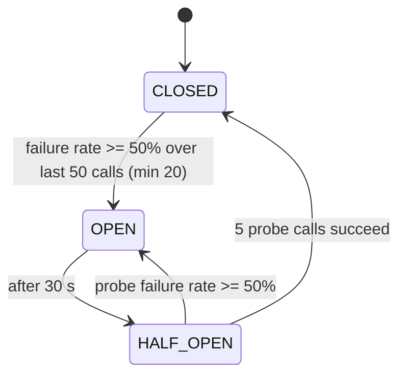

**Timeouts:** connect 2 s; first byte (TTFT) 20 s; idle gap between chunks 30 s; total per alias/request. The first-byte timeout is what makes fallback useful: a stalled provider is abandoned while there is still time to try another.

**Retry and fallback policy:**

```java
Result execute(List<Deployment> candidates, Attempt fn) {
  budget.onRequest();                                  // deposits 0.1 retry tokens per request
  ProviderException last = null;
  for (int i = 0; i < Math.min(candidates.size(), 2); i++) {     // at most 2 attempts total
    Deployment d = candidates.get(i);
    if (i > 0 && !budget.tryAcquireRetry()) break;     // retry budget exhausted: fail fast
    if (deadline.remaining().compareTo(cfg.minAttemptTime()) < 0) break;
    try {
      return breakers.get(d).executeCallable(() -> fn.call(d, deadline.forAttempt()));
    } catch (CallNotPermittedException open) {
      continue;                                        // breaker opened meanwhile; next candidate, no budget used
    } catch (ProviderException e) {
      last = e;
      if (!e.retryable() || committedToClient()) throw e;          // never retry after first streamed byte
      if (e.status() == 429) health.cooldown(d, e.retryAfterOr(Duration.ofSeconds(5)));
    } catch (SaturatedException e) {
      continue;                                        // bulkhead full: try next candidate
    }
  }
  throw last != null ? last : new NoHealthyDeploymentException();
}
```

- Retries go to the **next candidate** (fallback), not the same deployment, except when only one candidate exists and the error was a connect failure.
- **Retry budget:** a token bucket where each request adds 0.1 tokens (cap 100) and each retry spends 1. Retries are therefore limited to ~10% of traffic, which prevents **retry amplification**: during a provider outage, unlimited retries would double load on the remaining providers at the worst moment, and client-side retries multiply further (gateway 2× × client 3× = 6× load).
- Non-retryable: 4xx client errors, content filter results, anything after the first streamed byte.

### 6.6 Response caching and its correctness limits

**Eligibility (all must hold):**

| Rule | Reason |
| --- | --- |
| `cache.mode != bypass` and no `Cache-Control: no-store` | Explicit opt-out |
| `temperature == 0` (or omitted for deployments whose default is deterministic-leaning), **or** `cache.mode == prefer` | With sampling, users expect different outputs per call; caching would silently change semantics |
| Response `finish_reason` is `stop` or `tool_calls` | Don't cache truncated (`length`), filtered, or error responses |
| Stream completed normally (not interrupted, not client-cancelled) | Partial responses must never be served as complete |
| Response ≤ 256 KB | Memory bound |
| Alias allows caching (per-alias flag; off for aliases flagged as time-sensitive or personalized) | Some prompts depend on "now" or user state |

**Key:** `SHA-256(canonical JSON of {tenantId, resolved deployment id, provider model, adapter version, messages, system, max_tokens, temperature, top_p, stop, tools, tool_choice, response_format})`, with JSON keys sorted and whitespace normalized. The provider model is part of the key because the alias can route to different models; a cache hit returns the response of the model it was generated by, and that model is reported in `provider_model`.

Including the model makes the key depend on routing, so the lookup happens **before** routing and uses the alias's **primary** deployment as the key's model component. Responses produced by a fallback deployment are stored under the fallback's own model key, so a later lookup that assumes the primary never receives a fallback model's output. This keeps "same model, same answer" semantics.

**Single-flight:** concurrent identical misses within one pod share one provider call:

```java
CompletableFuture<CanonicalResponse> f = inFlight.computeIfAbsent(key, k -> new CompletableFuture<>());
if (f is the one we created) { try { r = callProvider(); f.complete(r); store(r); } catch (e) { f.completeExceptionally(e); } finally { inFlight.remove(key); } }
else return f.get(remainingDeadline);
```

Across pods, duplicates are allowed (a distributed lock per key is not worth its latency and failure modes).

**Why caching arbitrary LLM responses is problematic (interview core):**

1. **Non-determinism:** even at temperature 0, providers don't guarantee identical outputs (batching, floating-point, model updates). Caching makes one sample "the" answer; acceptable for deterministic-style tasks (classification, extraction, FAQ templates), wrong for creative or conversational tasks.
2. **Hidden context:** answers depending on time ("today"), external state, or user identity are stale or wrong when replayed. The key can't see that dependency.
3. **Model changes:** a provider silently updating a model behind the same id makes cached answers stale relative to the live model; TTL bounds this.
4. **Privacy and isolation:** prompts and responses can contain personal data; caching them stores that data in Redis. Mitigations: tenant-scoped keys, TTL, encryption in transit and at rest (ElastiCache), opt-out per request and per alias, never logging content.
5. **Poisoning:** if keys were shared across tenants, one tenant could seed answers another receives. Tenant scoping prevents it.
6. **Semantic caching is riskier:** embedding-similarity matches can return answers to a *different* question that "looks similar". Not implemented.
7. **Low real-world hit rates:** exact-match hits require byte-identical requests; typical chat traffic hits rarely. Templated, deterministic workloads hit often. Any benchmark hit rate is a workload property and must be disclosed.

**Gateway response cache vs provider prompt caching:** provider-side prompt caching (e.g., Anthropic's `cache_control`, reported as `cache_read_input_tokens`) still runs the model but bills cached input tokens at a lower rate and reduces time to first token; the gateway cache skips the call entirely. The adapter passes provider cache usage through into `Usage.cacheReadTokens` / `cacheWriteTokens` so cost is computed correctly.

### 6.7 Token usage tracking and cost calculation

**Sources of truth:**

| Situation | Prompt tokens | Completion tokens | `estimated` |
| --- | --- | --- | --- |
| Non-streaming success | Provider `usage` | Provider `usage` | false |
| Streaming success (Anthropic) | `message_start.message.usage.input_tokens` (+ cache read/creation tokens) | Final `message_delta.usage.output_tokens` (cumulative) | false |
| Streaming success (OpenAI-compatible) | Final chunk `usage` (requires `stream_options.include_usage=true`) | Same | false |
| Stream interrupted / client disconnected before final usage | Provider value if already received (Anthropic sends input tokens at start); else estimate | Tokenizer count of the text actually streamed | true |
| Cache hit | Original usage recorded for information; **billed tokens = 0** | 0 | false |
| Rejected before provider call | 0 | 0 | false |

**Estimator:** `TokenEstimator` uses a tokenizer library where one exists for the model family (e.g., an OpenAI-encoding tokenizer for OpenAI-compatible models) and a calibrated characters-per-token ratio (≈ 4 chars/token for English, tuned per model from historical `actual / chars` ratios) otherwise. It is used for TPM admission and context-window checks, never for billing when provider usage is available. Provider token counting endpoints exist (e.g., Anthropic's `count_tokens`), but calling one per request would add a round trip, so they're used offline for calibration.

**Cost formula** (integer micro-USD, prices in micro-USD per million tokens, looked up by `effectiveFrom ≤ request time`):

```text
cost_micros = ceil( ( prompt_uncached × input_price
                    + cache_read     × cache_read_price
                    + cache_write    × cache_write_price
                    + completion     × output_price ) / 1,000,000 )
```

where `prompt_uncached = promptTokens − cacheReadTokens − cacheWriteTokens` when the provider reports cache tokens inside the prompt total, or `promptTokens` when it reports them separately (adapter-specific normalization; Anthropic reports `input_tokens` excluding cache reads and writes).

Worked example (ILLUSTRATIVE, placeholder prices): input price P_in = 3,000,000 µ$/MTok, output price P_out = 15,000,000 µ$/MTok, 412 prompt tokens, 48 completion tokens:

```text
(412 × 3,000,000 + 48 × 15,000,000) / 1,000,000 = (1,236,000,000 + 720,000,000) / 1,000,000 = 1,956 µ$ ≈ $0.001956
```

| Design choice | Reason |
| --- | --- |
| Integer micro-dollars, `long` arithmetic | No floating-point drift when summing millions of requests; `tokens × price` fits easily in a `long` |
| Price versions with effective dates | Price changes don't rewrite history; each event records the `priceVersion` used |
| Cost computed in the gateway, not the aggregator | The event is self-describing; re-aggregation never needs historical config |
| "Estimated cost", not invoice | Provider invoices are authoritative (discounts, batch pricing, taxes); the gateway's number is for attribution and budgets |

### 6.8 Streaming relay and cancellation

- The relay reads provider SSE lines on the request's virtual thread, translates each event to a canonical chunk, and writes it to the client immediately (`SseEmitter.send` flushes).
- **Client disconnect:** the next write fails (or `onCompletion/onError` fires), the relay throws `ClientDisconnected`, closes the upstream `InputStream` (which aborts the HTTP/2 stream or TCP connection to the provider), and records `PARTIAL` usage. This stops generation (and billing) early for providers that stop when the connection closes.
- **Backpressure:** writes block when the client reads slowly; the upstream read then pauses; TCP/HTTP/2 flow control pushes back to the provider. Memory stays bounded per stream.

---

## 7. End-to-End Execution Flows

### 7.1 Primary flow: streaming chat completion (cache miss)

1. **Arrival:** ALB forwards `POST /v1/chat/completions` (`stream: true`) to a gateway pod; Tomcat assigns a virtual thread.
2. **Correlation:** `CorrelationFilter` sets `X-Request-Id`, MDC.
3. **Authentication:** `ApiKeyAuthFilter` parses `gk_live_<keyId>_<secret>`, finds the key record by `keyId`, compares `SHA-256(secret)` with the stored hash using `MessageDigest.isEqual` (constant time), checks status and scope, attaches `GatewayPrincipal`.
4. **Validation and normalization:** schema checks; alias allowed; defaults applied; canonical request built.
5. **Rate limiting:** RPM bucket consume; TPM reservation of `estimatedPrompt + max_tokens`; monthly budget check against `usage:month:{tenant}`.
6. **Cache:** eligibility check; `GET cache:v1:{tenant}:{hash}` → miss (or ineligible).
7. **Routing:** filter candidates; choose primary by P2C; ordered fallbacks.
8. **Scheduling:** acquire a permit from the chosen deployment's bulkhead (fast path or fair-queue wait up to 2 s).
9. **Resilience:** circuit breaker permits the call; deadline computed.
10. **Provider call:** adapter builds the provider request (e.g., Anthropic: `system` field, `max_tokens`, `stream: true`, headers `x-api-key` and `anthropic-version`) and opens the stream.
11. **Streaming:** each provider event is translated; text deltas are sent to the client as SSE chunks; `thinking` blocks are skipped; usage fields are captured from `message_start` and `message_delta`.
12. **Completion:** final chunk with `finish_reason`, `usage`, `cost`; `[DONE]`; emitter completes; permit released; breaker records success; EWMA TTFT updated.
13. **Async work:** TPM settle (refund unused reservation); `UsageEvent` sent to Kafka; response stored in cache if eligible.
14. **Aggregation (other deployment):** aggregator dedups by `requestId`, increments the tenant/day hash and month total, buffers for S3.

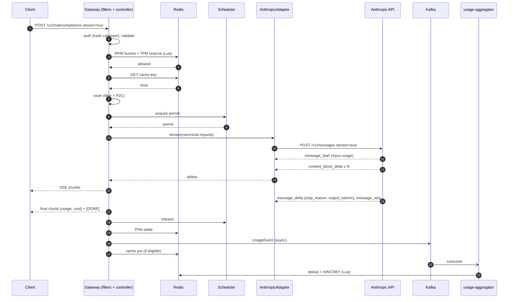

### 7.2 Alternative flow A1: cache hit

1. Steps 1–5 as above.
2. `GET cache:v1:...` returns an entry.
3. Non-streaming: return it with `cached: true`, `X-Gateway-Cache: HIT`, provider fields from the entry, `cost.amount_micros: 0`.
4. Streaming: replay the cached content as a small number of SSE chunks followed by the final chunk and `[DONE]`.
5. TPM settles to 0; a usage event with `cacheHit: true`, billed tokens 0, is published.

Latency: Redis round trip (~1 ms) + decompression + serialization: a few milliseconds versus seconds for a provider call.

### 7.3 Alternative flow A2: provider failure before the first byte → fallback

Shown in Section 2.9. The primary returns 529 (or times out at 20 s waiting for the first byte, or the connection is refused); the breaker records a failure; the retry budget allows one fallback; the second candidate serves the request. The client sees one successful stream with `provider` naming the fallback. Usage event: `attempts: 2`, `fallbackUsed: true`.

### 7.4 Alternative flow A3: provider failure mid-stream

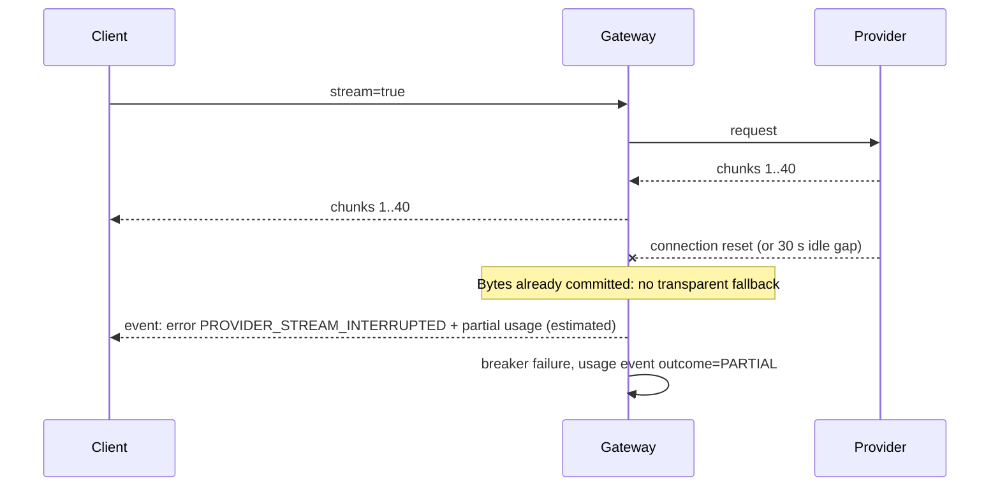

The client decides whether to retry (it has the partial text). The gateway does not silently restart the generation on another provider because that would produce a different continuation spliced onto text the user already saw.

### 7.5 Alternative flow A4: rate limited

1. TPM reservation fails: `estimated 1,800 tokens > 1,200 remaining`.
2. Response `429 RATE_LIMITED` with `Retry-After` = seconds until the bucket refills enough (computed from refill rate), `X-RateLimit-Remaining-Tokens: 1200`.
3. Usage event `outcome: REJECTED`, zero cost. No provider call is made.

### 7.6 Alternative flow A5: all candidates saturated

1. The primary bulkhead's queue wait times out after 2 s; the fallback's queue is full.
2. `503 PROVIDER_SATURATED`, `Retry-After: 2`.
3. Metrics: `llm_gateway_scheduler_rejections_total{reason="timeout"}`; if sustained, HPA scale-out does **not** help (the limit is the provider's), so the alert points to provider capacity or limits.

### 7.7 Alternative flow A6: client disconnects mid-stream

1. The client closes the connection after 2 seconds.
2. The next `SseEmitter.send` fails; the relay throws `ClientDisconnected`, closes the upstream stream (aborting generation).
3. Usage recorded as `PARTIAL` with input tokens (from `message_start`, if Anthropic) and completion tokens counted from text streamed so far (`estimated: true`).
4. Permit released; breaker **not** charged (not a provider failure); nothing cached.

### 7.8 Alternative flow A7: duplicate identical requests at once

1. 20 clients send the same deterministic classification prompt simultaneously to one pod.
2. Single-flight: the first creates the in-flight future; 19 wait on it.
3. One provider call; 20 responses; one cache write; 20 usage events (19 marked `cacheHit: true`, i.e., coalesced, billed 0).

### 7.9 Alternative flow A8: Kafka unavailable

1. `producer.send` fails quickly (`max.block.ms=0` → `BufferExhaustedException` once the 32 MB buffer is full; before that, records wait in the buffer and retry).
2. On failure, `UsageRecorder` writes the event as a structured log line `{"type":"USAGE_FALLBACK", ...}` and increments `llm_gateway_usage_events_failed_total`.
3. The response to the client is unaffected.
4. After recovery, an ops job re-publishes `USAGE_FALLBACK` records from the log store; aggregator dedup makes re-publishing safe.

---

## 8. Concurrency and Distributed Systems

### 8.1 Concurrent request handling

- Each HTTP request runs on its own **virtual thread**. Blocking on Redis, on a bulkhead queue, or on an upstream socket parks the virtual thread and frees the carrier thread, so a pod can hold thousands of concurrent requests and open streams with a small number of OS threads.
- Concurrency limits are explicit and layered:

| Layer | Limit | Purpose |
| --- | --- | --- |
| ALB / ingress | Connection limits | Edge protection |
| Tomcat | `server.tomcat.max-connections` (e.g., 10,000), accept queue | Socket-level bound per pod |
| Per-pod in-flight guard | e.g., 2,000 in-flight requests | Memory bound; excess gets `503` immediately |
| RPM / TPM per key | Redis buckets | Tenant fairness over time |
| Per-deployment bulkhead | `maxConcurrentPerCluster / replicas` | Keep each backend at its efficient concurrency |
| Fair queue | Bounded, DRR by tenant | Fairness at the moment of contention |
| Upstream connection pool | ≥ bulkhead size (JDK HttpClient manages per-host connections; HTTP/2 multiplexes) | Never the hidden bottleneck |

### 8.2 Race conditions

| Race | Where | Prevention |
| --- | --- | --- |
| Two requests consuming the last RPM token | Redis bucket | Lua script executes atomically |
| Lost TPM refund | Settle after reserve | Each operation is atomic; refunds are additive; crash loses at most one reservation (self-heals by refill) |
| Permit leak (permit acquired, never released) | Bulkhead | `try-with-resources` on `Permit`; release on every path including exceptions and client disconnect |
| Permit granted to a timed-out waiter | Bulkhead | Handoff uses `CompletableFuture.complete`, which fails if the waiter already cancelled; `release()` keeps polling until a live waiter accepts or frees the slot |
| Duplicate provider calls for identical requests | Cache misses | Per-pod single-flight; cross-pod duplicates accepted |
| Double-counted usage | Aggregator redelivery | Lua dedup on `requestId` + increments in one script |
| Circuit breaker state updates | Resilience4j | Internally thread-safe (atomic state transitions) |

### 8.3 Atomicity

Atomic: RPM consume, TPM reserve, TPM settle, aggregate update (dedup + increments). **Not** atomic across the request lifecycle: a request can be charged an RPM token and a TPM reservation and then fail at the provider; the TPM reservation is refunded on failure (settle with actual = 0 if no tokens were generated), the RPM token is not (it counts requests, including failed ones).

### 8.4 Ordering

- Stream chunks for one request are delivered in provider order (one thread reads and writes sequentially).
- Usage events for one tenant are ordered per partition (key = tenantId); the aggregator does not depend on order (increments commute).
- No cross-request ordering is guaranteed or needed.

### 8.5 Consistency guarantees

| Data | Guarantee |
| --- | --- |
| Rate limits | Cluster-wide, linearizable per key (single Redis primary); approximate in Redis-down fallback mode |
| Circuit breaker state | **Per pod.** Pods may disagree briefly about a provider's health; each converges from its own traffic |
| Bulkhead limits | Per pod share of a cluster limit; total in-flight to a provider is ≤ the sum of pod limits, approximately the cluster limit |
| Cache | Eventually consistent, TTL-bounded; a cache entry is immutable once written |
| Usage aggregates | Eventually consistent (seconds); exactly-once per `requestId` within the 48 h dedup window |
| Usage archive in S3 | At-least-once records; dedup by `requestId` downstream |
| Budget enforcement | Soft: checked against aggregates that lag by seconds; a burst can exceed a budget slightly |

### 8.6 Duplicate delivery and retry semantics

| Duplicate | Handling |
| --- | --- |
| Client retries after a timeout | Not deduplicated (no idempotency key in v1); cost may double; cacheable requests hit the cache |
| Gateway fallback attempt | At most 2 attempts; only before first byte; recorded as `attempts` |
| Kafka redelivery to the aggregator | Dedup key |
| Re-publishing fallback-log usage records | Dedup key |

### 8.7 How provider failures affect ongoing requests

| Failure moment | Effect on that request | Effect on other requests |
| --- | --- | --- |
| Before connect / connect refused | Fallback to next candidate (if budget allows) | Breaker failure count increases |
| HTTP 429 from provider | Fallback; deployment enters cooldown for `Retry-After` | New requests skip the deployment during cooldown |
| HTTP 529 / 503 / 5xx before body | Fallback | Breaker failure count increases; may open |
| First-byte timeout (20 s) | Abandon, fallback if deadline allows | Breaker slow/failure count |
| Mid-stream disconnect or idle gap | In-band SSE error; partial usage recorded; no fallback | Breaker failure count |
| Breaker opens while requests are in flight | In-flight requests continue to completion or their own timeout (opening a breaker does not cancel calls) | New requests route elsewhere |
| Provider slow but healthy | Requests take longer; bulkhead slots stay occupied longer, so queue waits grow | P2C score shifts traffic to other deployments in the tier |

### 8.8 Distributed coordination

None beyond Redis atomic scripts and the Kafka group coordinator. There is no leader election: every gateway pod is identical. Configuration changes propagate by ConfigMap reload (Spring Cloud Kubernetes is not required; pods watch the mounted file) and admin flags by polling Redis.

---

## 9. Failure Handling and Recovery

### 9.1 Failure matrix

| Failure | Detection | System response | Recovery | Consistency impact |
| --- | --- | --- | --- | --- |
| Provider outage (5xx/529) | Error responses; breaker failure rate | Fallback; breaker opens after threshold; route to other deployments | Half-open probes after 30 s close the breaker | None; requests on that provider fail over or error |
| Provider throttling (429) | 429 with `Retry-After` | Cooldown on that deployment; fallback | Cooldown expires | None |
| Provider slow / stalled | First-byte timeout; slow-call rate | Abandon + fallback; slow-call breaker trip | Probes | None |
| Provider failure mid-stream | Read error / idle timeout | In-band error event; partial usage | Client retries | Partial completion billed (estimated) |
| Network failure gateway → provider | Connect timeout | Fallback | Automatic | None |
| Redis unavailable | Lettuce command timeout (50 ms) | Local fallback limiter (`limit / replicas`); cache bypass; budget check skipped (fail-open, alerted) | Automatic on reconnect | Rate limits approximate; budgets temporarily unenforced |
| Kafka unavailable | Producer errors, buffer exhaustion | Usage written to structured fallback log | Re-publish from logs; aggregator dedups | Aggregates lag; `complete: false` until re-ingested |
| Aggregator crash | Consumer group rebalance; lag alert | Partitions move to the other replica | Redelivery from last committed offset | None (dedup) |
| S3 write failure | PUT errors | Aggregator retries; offsets not committed | Automatic | Archive delayed |
| Gateway pod crash | ALB health check; K8s restart | Other pods serve | New pod | In-flight requests on that pod fail (clients retry); TPM reservations self-heal; usage for those requests may be lost (no event published) |
| Duplicate usage events | Dedup key hit | Ignored | — | None |
| Timeout (client deadline) | Deadline passed | `504` before first byte; in-band error after | Client retry | Possible provider cost without a delivered result (recorded as PARTIAL if any usage known) |
| Key table reload fails | Reload exception | Keep last good table; alert | Fix secret | New/revoked keys not applied until fixed |
| Bad routing config | Startup validation | Pod not ready; rollout halts | Fix and redeploy | None (old pods keep serving) |

### 9.2 Recovery procedures

**Provider outage (primary deployment of an alias):**

1. Breakers on each pod open independently as failures accumulate (≥ 20 calls, ≥ 50% failures).
2. Routing filters the open deployment; traffic moves to the next priority tier (fallback deployments); their bulkheads absorb it, queueing if needed.
3. After 30 s, each pod's breaker goes half-open and lets 5 probe requests through.
4. Successful probes close the breaker; traffic returns per priority.
5. Operators can force a drain (`POST /admin/v1/providers/{id}/state`) to skip probing during a known incident.

**Kafka outage:**

1. Requests continue. The producer buffer (32 MB, roughly 50K–100K events) absorbs short outages and retries transparently.
2. When the buffer is exhausted, events go to the fallback log and `usage_events_failed_total` increases (alert).
3. After Kafka returns, the ops job replays fallback records to `llm.usage.v1`; the aggregator's dedup prevents double counting; usage API shows `complete: true` again.

**Redis outage:**

1. Rate limiting switches to the local limiter per pod (each pod enforces `limit / replicas`); cache is bypassed; budget enforcement is skipped and alerted.
2. Latency rises slightly for would-be cache hits (now provider calls), and provider load increases accordingly; bulkheads still protect providers.
3. On recovery, normal operation resumes; buckets start full (a brief allowance burst is possible).

**Gateway rolling deploy / scale-in:**

1. Pod receives SIGTERM; readiness turns false; ALB stops sending new requests after deregistration delay.
2. Non-streaming requests finish normally.
3. Streams get up to 100 s to finish; remaining streams receive an in-band `GATEWAY_SHUTTING_DOWN` error event and are closed.
4. Usage events flushed (`producer.flush()` with a timeout); pod exits within the 120 s grace period.

---

## 10. Performance Engineering

### 10.1 Where the time goes

For an LLM request, **provider time dominates**: hundreds of milliseconds to the first token and seconds for the full generation. The gateway's own work (auth, two Redis round trips, JSON translation) is a few milliseconds. Performance engineering here is therefore mostly about:

1. **Not adding queueing** in the gateway (connection pools, thread pools).
2. **Not pushing backends into overload** (scheduling at their knee).
3. **Avoiding provider calls** where it's correct to (cache).
4. **Sending work to the faster/less loaded backend** (routing).
5. **Not wasting capacity on retries** (retry budget, fallback instead of retrying the same overloaded backend).

ILLUSTRATIVE budget for a non-streaming cache miss:

| Step | Time |
| --- | --- |
| Auth (in-memory hash lookup + SHA-256) | < 0.1 ms |
| RPM + TPM Lua scripts (1–2 Redis round trips, can be pipelined) | 0.5–2 ms |
| Cache GET | 0.3–1 ms |
| Routing + scheduling (no queue) | < 0.1 ms |
| Request translation + JSON | 0.2–1 ms |
| **Provider time** | **0.5–30 s** |
| Response translation | 0.2–1 ms |
| Total gateway overhead | ~2–5 ms (target p99 < 20 ms) |

### 10.2 Bottlenecks in a naive gateway (the baseline)

| Bottleneck | Mechanism | Symptom |
| --- | --- | --- |
| Fixed platform thread pool | Each in-flight request holds an OS thread for seconds | Thread pool exhaustion; requests queue in Tomcat |
| Small upstream connection pool | e.g., an HTTP client with a low per-route connection limit | Requests wait for a connection; latency rises with no provider-side cause |
| Load-blind routing (round-robin) | Equal traffic to unequal backends | The weaker backend overloads; its latency explodes while the other idles |
| No concurrency control | Backends pushed past their efficient concurrency | Provider-side queueing, 429/529s, timeouts |
| Unbounded retries | Failures trigger more load | Retry storms; goodput collapses during incidents |
| No cache | Repeated deterministic prompts all go to providers | Wasted capacity and cost |

### 10.3 Optimizations

#### OPT-1: Virtual threads and right-sized upstream connection pools

| Aspect | Detail |
| --- | --- |
| Original bottleneck | Platform threads (Tomcat 200) and a small per-route connection pool cap concurrent upstream calls well below the number of concurrent clients |
| Optimization | Java 21 virtual threads for request handling; JDK `HttpClient` per provider (HTTP/2 multiplexing where supported) with explicit per-host connection limits ≥ the bulkhead size |
| How it works | Waiting requests park cheaply; the only intentional queue is the bulkhead's fair queue |
| Why it helps | Removes accidental, unfair, invisible queues (thread pool and connection pool) |
| Expected impact | Lower queueing latency; part of the throughput gain |
| Trade-offs | Pinning on `synchronized` in Java 21; ThreadLocal-heavy libraries multiply memory per virtual thread |
| How to measure | `jvm_threads_live`, Tomcat busy threads (baseline), connection-pool wait time, `Server-Timing` `queue` vs `upstream` |

#### OPT-2: Load-aware routing (P2C on TTFT × load)

| Aspect | Detail |
| --- | --- |
| Original bottleneck | Round-robin sends equal traffic to a fast high-capacity backend and a slower low-capacity one; the weak backend becomes the bottleneck for half the requests |
| Optimization | P2C over EWMA TTFT × (in-flight + queued + 1) / capacity |
| Why it helps | Traffic flows in proportion to available capacity; the fast backend absorbs more |
| Expected impact | Higher throughput, lower mean and p95 under heterogeneous backends |
| Trade-offs | Local per-pod view; EWMA lag |
| How to measure | Per-deployment request share vs capacity; per-deployment TTFT; overall throughput |

#### OPT-3: Per-deployment bulkheads with fair queuing

| Aspect | Detail |
| --- | --- |
| Original bottleneck | Backends pushed past their knee: self-hosted servers slow down for everyone; hosted providers return 429/529, which triggers retries |
| Optimization | Concurrency cap per deployment at its measured knee; DRR queue in the gateway |
| Why it helps | Keeps every backend in its efficient regime (max goodput); converts overload into short, fair gateway waits instead of provider-side collapse |
| Trade-offs | Requires measuring each backend's knee; per-pod approximation of cluster limits |
| How to measure | Provider TTFT vs in-flight curve (find the knee); gateway queue wait histogram; provider 429/529 rate |

#### OPT-4: Redis exact-match response cache with single-flight

| Aspect | Detail |
| --- | --- |
| Original bottleneck | Repeated deterministic requests (templated classification/extraction prompts at temperature 0) each consume seconds of provider time and capacity |
| Optimization | Eligibility-gated exact-match cache; per-pod single-flight |
| Why it helps | A hit costs ~1–3 ms and frees a provider slot for a miss; single-flight removes duplicate concurrent misses |
| Expected impact | Throughput rises roughly with `1 / (1 − h)` for the cached share when provider-bound; mean latency falls; p95 falls much less (Section 12) |
| Trade-offs | Correctness limits (Section 6.6); memory; privacy surface |
| How to measure | Hit/miss/ineligible counters; latency split by cache outcome; provider call rate |

#### OPT-5: Retry budget and fallback-first retries

| Aspect | Detail |
| --- | --- |
| Original bottleneck | Baseline retried failed calls up to 2 times on the same backend; during overload that tripled load on an already overloaded backend |
| Optimization | At most one retry, to a different deployment, within a 10% retry budget; never after first byte |
| Why it helps | Avoids retry amplification; fallback goes to spare capacity |
| How to measure | Retry amplification = upstream attempts / client requests; goodput during fault injection |

#### OPT-6: Cheap per-request gateway work

| Aspect | Detail |
| --- | --- |
| Changes | Auth keys in memory (no Redis/DB lookup per request); RPM and TPM scripts pipelined in one round trip; streaming chunks serialized with a reused Jackson `ObjectWriter`; no request/response body logging |
| Why | Keeps gateway overhead in the low milliseconds so it never shows up next to provider time |
| How to measure | `Server-Timing` `gw` component; JFR CPU profile |

### 10.4 Batching and asynchronous processing

- Usage events are batched by the Kafka producer (`linger.ms=20`, lz4) and processed in batches by the aggregator (Redis pipelining, S3 batch files).
- Cache writes and usage publishing happen after the response is sent.
- **Request batching to providers** (combining multiple users' prompts into one call) is not done: hosted APIs don't support it for chat, and self-hosted servers (vLLM) already batch continuously across concurrent requests internally, which is precisely why their throughput depends on the concurrency the gateway allows.

### 10.5 Backpressure

| Point | Mechanism |
| --- | --- |
| Slow client on a stream | Blocking SSE write → pauses upstream read → TCP/HTTP2 flow control to provider |
| Saturated backend | Bulkhead queue (bounded) → `503` with `Retry-After` |
| Saturated tenant | RPM/TPM `429` with `Retry-After` |
| Pod overload | In-flight guard `503`; HPA scale-out |
| Kafka slow | Producer buffer; never blocks request threads (`max.block.ms=0`) |

### 10.6 Memory utilization

Per in-flight request: virtual thread stack (grows as needed, typically a few KB), request/response buffers (prompt up to 1 MB, streaming chunk buffers small), accumulator for streamed text (needed for cache and partial-usage estimation). A pod with 2 GiB heap can comfortably hold ~2,000 in-flight requests of typical size; the in-flight guard enforces it.

### 10.7 Network overhead

- Client ↔ gateway: SSE adds ~100–200 bytes of framing per chunk.
- Gateway ↔ provider: HTTP/2 reuses connections (no TLS handshake per request); TLS handshake to a hosted provider would otherwise add a round trip or more per request.
- Cross-AZ traffic between ALB, gateway, and Redis adds ~0.5–1 ms per hop; keep Redis in the same AZ set.

### 10.8 Horizontal scaling

Add gateway pods when per-pod in-flight requests or CPU rise. Scaling gateway pods does **not** increase provider capacity: if bulkhead queues are full on all pods, more pods only add more queues (and re-divide the same provider limit). The alerting distinguishes "gateway-bound" (CPU/in-flight high, queues short) from "provider-bound" (queues long, provider TTFT high).

---

## 11. Benchmarking and Load Testing

### 11.1 Objectives

1. Compare a **baseline** gateway configuration with the **optimized** configuration under **50+ concurrent clients**: throughput (~2× target) and p95 latency (~25% reduction target).
2. Measure p99 latency and error rate under normal load and under injected provider faults (bullet 3).
3. Measure gateway overhead (target p99 < 20 ms) separately from provider time.
4. Validate autoscaling behavior and stream draining.
5. Validate accounting accuracy: usage events vs mock-provider ground truth.

### 11.2 Environment

| Item | Value |
| --- | --- |
| AWS region | TBD |
| EKS nodes | TBD (e.g., 3 × m6i.xlarge for gateway, 2 × m6i.large for mock providers, separate node for k6) |
| Gateway pods | 3 (fixed for A/B; HPA scenario separately), 1 vCPU / 2 GiB each, Java 21, Spring Boot 3.4 |
| Redis | ElastiCache, TBD node type, same AZs |
| Kafka | MSK, 3 brokers, TBD instance type |
| Mock provider | `mock-llm`, 2 deployments (`mock-a`, `mock-b`) with different capacity and latency profiles (below) |
| Load generator | k6 on a dedicated node; generator CPU < 70% |
| Network | Same VPC; record ALB → pod and pod → mock latency |
| Software versions | Exact JVM, Spring Boot, Resilience4j, k6 versions recorded with results |

### 11.3 Mock provider model

Real providers can't be used for controlled benchmarks (cost, rate limits, non-determinism, shared infrastructure). `mock-llm` emulates an OpenAI-compatible endpoint with:

| Parameter | `mock-a` (strong) | `mock-b` (weak) |
| --- | --- | --- |
| Efficient concurrency (capacity) | TBD (e.g., 24) | TBD (e.g., 12) |
| TTFT distribution | Lognormal, configurable median/p95 | Same family, slower |
| Output tokens | Drawn per request from a configured distribution (long-tailed), capped by `max_tokens` | Same |
| Inter-token time | Configurable | Slower |
| Overload behavior | When in-flight > capacity, inter-token time scales by `in_flight / capacity` (models a batching server whose per-request speed falls as concurrency rises) and TTFT adds queue time | Same |
| Fault injection | Error rate (503/529/429), stall rate (no first byte), mid-stream disconnect rate | Same |
| Usage reporting | Exact prompt/completion token counts in responses (ground truth for accounting tests) | Same |

All mock parameters are recorded with the results. **Results depend heavily on these parameters**; that dependency must be stated whenever a number is quoted.

### 11.4 Workload

| Parameter | Value |
| --- | --- |
| Endpoint | `POST /v1/chat/completions`, alias `chat-bench` (routes to `mock-a`, `mock-b`, same priority) |
| Mode | Non-streaming for the A/B claim; streaming in separate scenarios |
| Clients | 50 k6 virtual users (closed loop, zero think time) for the claim; additional runs at 64, 80, 100 VUs |
| Prompt mix | 30% drawn from a pool of 200 templated prompts at `temperature: 0` (cache-eligible); 70% unique prompts |
| Prompt size | 200–2,000 tokens (uniform) |
| `max_tokens` | 600 |
| Warm-up | 2 min (JIT, connection pools, cache fill for the templated pool) |
| Steady state | 10 min |
| Repetitions | 3 runs per configuration |
| Rate limits | Raised so the load test is never throttled; any 429 counts as an error |

### 11.5 Tools and why

| Tool | Use | Why |
| --- | --- | --- |
| **k6** | HTTP load (closed-loop VUs and arrival-rate executors), percentiles, thresholds, tags | Scriptable, accurate percentiles, both closed and open models |
| **xk6-sse** extension or a small JDK `HttpClient` load client | Streaming TTFT and stream duration | k6 core doesn't measure per-event SSE timing |
| **Prometheus + Grafana** | Server-side histograms, queue waits, breaker states, provider latency, HPA replicas | Correlate client-side results with internal causes |
| **JFR / async-profiler** | Gateway CPU and allocation profile; virtual-thread pinning | Verify gateway overhead claims |
| **`mock-llm` counters** | Ground truth for upstream attempts and tokens | Retry amplification and accounting accuracy |

Not used: JMeter (k6 suffices), wrk (no scripting for varied bodies), JMH (no hot pure-CPU path that matters relative to provider time).

### 11.6 Scenarios

| # | Scenario | Setup | Purpose | Pass criteria |
| --- | --- | --- | --- | --- |
| L1 | **A/B claim run** | 50 VUs, baseline vs optimized, non-streaming, workload above | ~2× throughput, ~25% p95 | Median-of-3 ratios reported with spread |
| L2 | **Ablation** | Optimized minus one optimization at a time (no cache; round-robin; no bulkheads; no retry budget; platform threads) | Attribute the gains | Each delta reported |
| L3 | **Concurrency sweep** | 25, 50, 64, 80, 100, 150 VUs on both configs | Behavior at and beyond 50 clients; find the knee | Throughput and p95/p99 curves |
| L4 | **Streaming** | 50 VUs, `stream: true` | TTFT p50/p95/p99, stream duration, in-band error rate | Recorded; TTFT dominated by mock TTFT + small gateway overhead |
| L5 | **Provider fault injection** | `mock-a` returns 503/529 for 30% of calls for 3 min; then stalls 10% | Breaker, fallback, retry budget | Error rate and p99 with breaker/budget vs without; retry amplification ≤ 1.1 |
| L6 | **Provider outage** | `mock-a` fully down for 2 min | Failover and recovery | Error burst limited to breaker-opening window; traffic shifts to `mock-b`; recovery after half-open |
| L7 | **Gateway overhead** | Mock with fixed 100 ms latency, no output variance | Isolate gateway overhead | `Server-Timing` gw p99 < 20 ms |
| L8 | **Autoscaling** | Ramp 50 → 400 VUs over 15 min with HPA enabled | Scale-out on in-flight metric | Replicas increase before p99 degrades; no errors from scale events |
| L9 | **Drain** | Rolling restart during L4 | Graceful stream draining | Streams complete or receive `GATEWAY_SHUTTING_DOWN`; no abrupt resets within the grace period |
| L10 | **Accounting accuracy** | 100K requests (mix of stream/non-stream, cache hits, disconnects) | Usage events vs mock ground truth | Non-estimated token counts match exactly; estimated ones within a documented tolerance; no missing events with Kafka healthy |
| L11 | **Soak** | 50 VUs for 4 h | Leaks, pinning, memory | Flat heap after GC; stable p99 |

### 11.7 Metrics

| Metric | Source | Definition |
| --- | --- | --- |
| Throughput | k6 | Successful (2xx, complete) responses / steady-state seconds |
| p50 / p95 / p99 latency | k6 `http_req_duration` (non-streaming) | Client-measured, steady state only |
| TTFT p50/p95/p99 | SSE client | Request start → first content chunk |
| Error rate | k6 + SSE client | (non-2xx + in-band stream errors) / total requests |
| Cache hit rate | Gateway counters | hits / (hits + misses), excluding ineligible |
| Gateway overhead | `Server-Timing` / server histogram | total − upstream − queue |
| Queue wait | Server histogram | Bulkhead wait per request |
| Provider latency | Server histogram per deployment | Upstream time |
| Retry amplification | `mock-llm` attempts / client requests | ≥ 1.0 |
| Breaker state | Resilience4j metrics | Time in OPEN per deployment |
| CPU / memory per pod | cAdvisor, JVM metrics | Efficiency |
| Tokens and cost | Usage aggregates vs mock ground truth | Accounting accuracy |

### 11.8 Baseline vs optimized: controlled comparison

| Aspect | Baseline | Optimized |
| --- | --- | --- |
| Request threads | Tomcat platform threads (default 200) | Virtual threads |
| Upstream client | Blocking client with a small per-route connection pool (value recorded, e.g., 20) | JDK `HttpClient`, per-host limits ≥ bulkhead |
| Routing | Round-robin across `mock-a`/`mock-b` | P2C on TTFT × load |
| Concurrency control | None | Bulkheads at measured capacity + DRR queue |
| Cache | Off | On (eligibility rules) |
| Retries | Up to 2 retries on the same deployment | 1 fallback attempt within a 10% budget |
| **Held constant** | Gateway pod count and size, mock parameters, workload and prompt pool, Redis/Kafka, k6 node, versions | |

Rules: same k6 script and seed; same mock parameters; three runs each; median and spread; ablation from the optimized side. Report what the baseline's connection pool and thread settings were, because a deliberately crippled baseline inflates any ratio.

### 11.9 Result tables (blank until recorded)

**L1 A/B (non-streaming, 50 VUs)**

| Config | Run | Throughput (req/s) | p50 (ms) | p95 (ms) | p99 (ms) | Error % | Cache hit % | Mean queue wait (ms) | Retry amplification |
| --- | --- | --- | --- | --- | --- | --- | --- | --- | --- |
| Baseline | 1 | | | | | | n/a | n/a | |
| Baseline | 2 | | | | | | n/a | n/a | |
| Baseline | 3 | | | | | | n/a | n/a | |
| Optimized | 1 | | | | | | | | |
| Optimized | 2 | | | | | | | | |
| Optimized | 3 | | | | | | | | |
| **Ratio / change (medians)** | | | | | | | | | |

**L2 ablation (remove one optimization from optimized)**

| Removed | Throughput | p95 | p99 | Δ throughput vs optimized | Δ p95 vs optimized |
| --- | --- | --- | --- | --- | --- |
| None | | | | — | — |
| Cache | | | | | |
| Load-aware routing (→ round-robin) | | | | | |
| Bulkheads + fair queue | | | | | |
| Retry budget (→ 2 same-deployment retries) | | | | | |
| Virtual threads + pool sizing | | | | | |

**L3 concurrency sweep**

| VUs | Baseline req/s | Baseline p95 | Baseline p99 | Optimized req/s | Optimized p95 | Optimized p99 | Optimized error % |
| --- | --- | --- | --- | --- | --- | --- | --- |
| 25 | | | | | | | |
| 50 | | | | | | | |
| 64 | | | | | | | |
| 80 | | | | | | | |
| 100 | | | | | | | |
| 150 | | | | | | | |

**L4 streaming / L5–L6 faults**

| Scenario | TTFT p95 | TTFT p99 | Error % | In-band stream errors | Retry amplification | Time breaker OPEN (s) |
| --- | --- | --- | --- | --- | --- | --- |
| L4 streaming | | | | | | |
| L5 faults, optimized | | | | | | |
| L5 faults, no breaker / no budget | | | | | | |
| L6 outage | | | | | | |

### 11.10 Interpretation

| Observation | Meaning |
| --- | --- |
| Baseline queue time appears in total latency but provider latency is flat | Gateway-side queueing (threads or connection pool) |
| `mock-b` latency much higher than `mock-a` under round-robin | Load-blind routing overloading the weak backend |
| Optimized queue waits high, provider TTFT flat | Bulkhead limits too conservative; raise toward the knee |
| Optimized provider TTFT rising with in-flight | Limits too high; past the knee |
| p95 improves much less than mean | Expected when the tail is dominated by long generations (Section 12) |
| Cache hit rate far from the 30% templated share | Key instability (non-canonical JSON, varying metadata) or eligibility rules excluding requests |
| Error rate rises with VUs only in baseline | Overload collapse (timeouts/429s) that bulkheads prevent |
| Retry amplification > 1.2 during faults | Retry policy too aggressive; budget not applied |

### 11.11 Proposed reproduction commands

These are **proposed**; no scripts exist yet.

```bash
# Configure mock providers (capacity and latency model recorded with the run)
kubectl -n llm set env deploy/mock-a CAPACITY=24 TTFT_MEDIAN_MS=250 TTFT_P95_MS=800 TOKEN_MS=8 OUTPUT_TOKENS_DIST=lognormal:120:500
kubectl -n llm set env deploy/mock-b CAPACITY=12 TTFT_MEDIAN_MS=400 TTFT_P95_MS=1200 TOKEN_MS=14 OUTPUT_TOKENS_DIST=lognormal:120:500

# Baseline profile
kubectl -n llm set env deploy/llm-gateway SPRING_PROFILES_ACTIVE=gateway,baseline
kubectl -n llm rollout status deploy/llm-gateway

# A/B claim run (closed loop, 50 VUs, 2 min warm-up + 10 min steady)
k6 run -e VUS=50 -e WARMUP=2m -e DURATION=10m -e TEMPLATED_SHARE=0.30 -e SEED=42 \
  --summary-export=results/baseline-run1.json bench/chat-closed-loop.js

# Optimized profile, then repeat
kubectl -n llm set env deploy/llm-gateway SPRING_PROFILES_ACTIVE=gateway,optimized

# Fault injection for L5
kubectl -n llm set env deploy/mock-a ERROR_RATE=0.30 ERROR_CODES=503,529 FAULT_DURATION=3m
```

Representative k6 configuration (tagging warm-up so steady-state percentiles exclude it):

```javascript
export const options = {
  scenarios: {
    warmup: { executor: 'constant-vus', vus: __ENV.VUS, duration: __ENV.WARMUP, tags: { phase: 'warmup' } },
    steady: { executor: 'constant-vus', vus: __ENV.VUS, duration: __ENV.DURATION,
              startTime: __ENV.WARMUP, tags: { phase: 'steady' } },
  },
  thresholds: {
    'http_req_duration{phase:steady}': ['p(95)<10000', 'p(99)<20000'],
    'http_req_failed{phase:steady}': ['rate<0.01'],
  },
  summaryTrendStats: ['avg', 'p(50)', 'p(95)', 'p(99)', 'max'],
};
```

---

## Numerical Claims Defence

All figures are **UNVERIFIED** and are **BENCHMARK TARGETS**. Numeric examples are **ILLUSTRATIVE**.

### Claim G1: "50+ concurrent clients"

| # | Item | Detail |
| --- | --- | --- |
| 1 | Exact claim | "...improving throughput approximately 2× and reducing p95 latency approximately 25% under 50+ concurrent clients" |
| 2 | Technical meaning | The A/B comparison runs with 50 concurrent client sessions, each issuing requests back to back; additional runs at 64–150 sessions show behavior above 50 |
| 3 | Definition | k6 virtual users in a closed loop with zero think time; each VU has exactly one request in flight at a time |
| 4 | Unit | concurrent clients (VUs) |
| 5 | Boundary | Client side (k6) |
| 6 | Formula | In a closed loop with zero think time, in-flight requests at the gateway ≈ VUs (minus the negligible time each VU spends between requests); throughput `X = N / R̄` by Little's law |
| 7 | Workload | Section 11.4 |
| 8 | Concurrency model | 50 in flight at the gateway; at most the bulkhead limits in flight at the mock providers; the rest wait in the gateway's fair queue (optimized) or in thread/connection pools and provider queues (baseline) |
| 9 | Tool | k6 `constant-vus` |
| 10 | Environment | Section 11.2 |
| 11–12 | Warm-up / duration | 2 min / 10 min |
| 13–14 | Baseline / optimized | Section 11.8 |
| 15 | Responsible engineering | Virtual threads (no thread ceiling), bulkheads, fair queuing |
| 16 | Bottleneck | Provider capacity (mock), by design |
| 17 | Confounders | Think time (with think time, 50 clients mean far fewer in-flight requests); the k6 node saturating |
| 18 | Limitations | 50 concurrent clients is a moderate load for a gateway; the point is behavior under contention for limited provider capacity, not raw gateway scale (L8 tests scale) |
| 19 | Reproduction | L1 and L3 |
| 20 | Likely questions | "Clients or requests?" "Why only 50?" "What happens at 500?" |

**Concurrent clients vs in-flight requests.** With zero think time, 50 VUs keep ~50 requests in flight, so here clients ≈ in-flight requests at the gateway. Those 50 are **not** all in flight at the providers: with illustrative bulkhead limits of 24 + 12 = 36, about 14 wait in the gateway queue. With think time Z, in-flight would be `N × R̄ / (R̄ + Z)`; for R̄ = 2 s and Z = 8 s, 50 clients would mean only ~10 in flight. That's why the benchmark states "closed loop, zero think time".

**20-second answer.** "Fifty k6 virtual users in a closed loop with no think time, so about fifty requests in flight at the gateway at all times, competing for backends that can efficiently serve fewer than that concurrently. I also ran the sweep above fifty to see where it degrades."

**60-second answer.** "The interesting regime for an LLM gateway is when demand exceeds what the backends can serve efficiently. With 50 closed-loop clients, the gateway always has about 50 requests in flight, but the two mock backends are configured with efficient capacities that add up to less than that, so something has to queue. In the baseline, queueing happens in thread and connection pools and inside the overloaded weaker backend; in the optimized version it happens in a fair, bounded gateway queue while each backend runs at its knee. The sweep from 25 to 150 clients shows how both configurations behave as contention grows. I'd be explicit that these are mock backends, and the results depend on their capacity settings."

### Claim G2: "~2× throughput"

| # | Item | Detail |
| --- | --- | --- |
| 1 | Exact claim | "Implemented Redis caching and concurrent scheduling, improving throughput approximately 2×..." |
| 2 | Meaning | Successful completions per second roughly double versus the baseline at 50 concurrent clients |
| 3 | Definition | `X = successful complete responses in steady state / steady-state seconds` |
| 4 | Unit | requests/s (ratio for the claim) |
| 5 | Boundary | k6 → gateway → mock providers → back |
| 6 | Formula | `improvement = X_opt / X_base`; closed loop: `X = N / R̄`, so 2× throughput at fixed N ⇔ mean latency halves |
| 7 | Workload | 30% cache-eligible templated prompts, 70% unique; non-streaming |
| 8 | Concurrency | 50 VUs, zero think time |
| 9 | Tool | k6 |
| 13 | Baseline | Platform threads, small per-route connection pool, round-robin, no bulkheads, no cache, same-deployment retries |
| 14 | Optimized | Virtual threads, sized pools, P2C routing, bulkheads + DRR, cache with single-flight, retry budget |
| 15 | Responsible change | (a) Cache hits removing ~30% of provider work; (b) load-aware routing and bulkheads keeping both backends at efficient concurrency instead of overloading the weaker one; (c) removing accidental pool queueing |
| 16 | Bottleneck | Provider capacity |
| 17 | Confounders | **Cache hit rate is set by the workload** (the 30% templated share); different mock capacity ratios change the routing gain; baseline pool settings |
| 18 | Limitations | With unique prompts only (hit rate ≈ 0), the gain comes only from scheduling and routing and will be smaller; on a single homogeneous backend, routing contributes nothing |
| 19 | Reproduction | L1 + L2 ablation |
| 20 | Likely questions | "How much was the cache?" "Is 30% hit rate realistic?" "Throughput of what?" |

**Illustrative decomposition (ILLUSTRATIVE, not measured).** Closed loop, N = 50, zero think time:

```text
Baseline:  R̄_base = 4.0 s            → X_base = 50 / 4.0 = 12.5 req/s
Optimized: hit rate h = 0.30, hit latency ≈ 0.005 s
           scheduling + routing cut mean miss latency to R̄_miss = 2.85 s
           R̄_opt = 0.30 × 0.005 + 0.70 × 2.85 ≈ 2.0 s
                                       → X_opt = 50 / 2.0 = 25 req/s  (2.0×)
Without the cache (h = 0): R̄ = 2.85 s → X = 17.5 req/s (1.4×) from scheduling/routing alone
```

This illustrates why the ablation matters: in this example, scheduling and routing give ~1.4× and the cache turns it into ~2×. Different mock parameters or hit rates would give different splits.

**20-second answer.** "At 50 concurrent clients, completed requests per second roughly double versus a naive gateway. Part comes from load-aware routing and per-backend concurrency limits keeping both backends efficient, and part from cache hits on deterministic repeated prompts. The cache share depends on how repetitive the workload is, which I'd state."

**60-second answer.** "In a closed loop with fixed clients, throughput is clients divided by mean latency, so doubling throughput means halving mean latency. Two mechanisms do that. First, the baseline round-robins across a strong and a weak backend and has no concurrency control, so the weak one is overloaded and slow for half the traffic; P2C routing on time-to-first-token times load, plus bulkheads at each backend's knee, shifts traffic toward spare capacity. Second, 30% of the benchmark prompts are templated temperature-zero requests, and cache hits return in milliseconds and free provider slots. I'd run an ablation to show each piece; in a plausible split, scheduling alone is around 1.4× and the cache provides the rest. With a workload of unique prompts, I'd expect only the scheduling part."

### Claim G3: "~25% p95 latency reduction"

| # | Item | Detail |
| --- | --- | --- |
| 1 | Exact claim | "...and reducing p95 latency approximately 25% under 50+ concurrent clients" |
| 2 | Meaning | At the same 50-client load, p95 end-to-end latency of non-streaming requests is ~25% lower than baseline |
| 3 | Definition | 95th percentile of client-measured request duration (send → full response) over the steady window |
| 4 | Unit | ms; percent change |
| 5 | Boundary | k6 ↔ gateway ↔ provider, non-streaming |
| 6 | Formula | `reduction = (p95_base − p95_opt) / p95_base`; for a mixture with hit fraction h and near-zero hit latency, `p95_overall = quantile_miss( (0.95 − h) / (1 − h) )` |
| 7 | Workload | Same as G2 |
| 9 | Tool | k6 |
| 15 | Responsible change | Removing queueing (pools, overloaded weak backend) from the slow tail; cache hits move the overall percentile to a lower miss-quantile |
| 16 | Bottleneck | Long generations (many output tokens) dominate the tail and are unchanged by caching or routing |
| 17 | Confounders | Output-length distribution of the mock; hit rate; percentiles merged incorrectly across runs |
| 18 | Limitations | p95 for streaming requests is better described by TTFT; the claim is for non-streaming total latency |
| 19 | Reproduction | L1; report p50/p95/p99 together |
| 20 | Likely questions | "Why only 25% if throughput doubled?" "Streaming or not?" |

**Why p95 improves much less than throughput (the key insight).**

1. **Throughput tracks the mean; p95 tracks the tail.** Doubling throughput at fixed concurrency halves mean latency, but the tail is made of the longest generations, whose duration is mostly provider generation time (output tokens × per-token time). Neither the cache nor routing makes a 600-token generation faster.
2. **Cache hits shift which miss-quantile becomes the overall p95.** With h = 0.30, the overall p95 equals the `(0.95 − 0.30) / 0.70 ≈ 92.9th` percentile of misses: only modestly lower than the miss p95.
3. **Scheduling removes queueing from the tail.** In the baseline, the slowest requests are long generations that also landed on the overloaded weak backend and waited in pools. Removing that queueing trims the tail by a fraction, not by half.

ILLUSTRATIVE: baseline p95 = 8.0 s; optimized miss distribution's 92.9th percentile = 6.0 s → p95 reduction = (8.0 − 6.0) / 8.0 = 25%, while mean latency halves (4.0 s → 2.0 s).

**20-second answer.** "p95 of non-streaming requests dropped about a quarter at 50 clients, while throughput doubled. The difference is expected: the slowest requests are long generations that caching and routing can't shorten; what improves is the queueing that used to sit on top of them."

**60-second answer.** "Throughput at fixed concurrency follows the mean, and the mean improves a lot because 30% of requests become cache hits and queueing at the weak backend disappears. The 95th percentile is set by long generations, where most of the time is the model producing hundreds of tokens; that doesn't change. With a 30% hit rate, the overall p95 becomes roughly the 93rd percentile of the misses, and scheduling trims the queueing component from those slow requests. That gives a reduction around 25% rather than 50%. For streaming, the user-visible latency is time to first token, which I measure separately."

### Claim G4: "Benchmarking p99 latency and error rates"

| # | Item | Detail |
| --- | --- | --- |
| 1 | Exact claim | "...deployed on Kubernetes with autoscaling, benchmarking p99 latency and error rates" |
| 2 | Meaning | The benchmark suite reports p99 latency and error rate for normal load, faults, outages, and autoscaling, not only averages or p95 |
| 3 | Definitions | p99: 99th percentile of client latency (non-streaming total; streaming TTFT). Error rate: `(non-2xx responses + in-band stream errors + incomplete streams) / total requests` |
| 4 | Unit | ms; percent |
| 5 | Boundary | Client-measured; server-side histograms for attribution |
| 6 | Formula | p99 = value at rank `ceil(0.99 × N)`; merged across pods with `histogram_quantile(0.99, sum by (le)(rate(...)))`, never averaged |
| 7 | Workload | L1, L4–L8 |
| 9 | Tool | k6 (+ SSE client), Prometheus |
| 15 | Responsible engineering | Breakers, first-byte timeouts, retry budget, bulkheads, graceful drain, HPA on in-flight |
| 16 | Bottleneck | Provider faults; autoscaling lag |
| 17 | Confounders | Too few samples for a stable p99 (10 min at 25 req/s = 15,000 samples → p99 is ranked among the slowest 150, acceptable); counting client-side k6 timeouts inconsistently |
| 18 | Limitations | No numeric p99 or error target appears on the resume; targets are TBD per alias (e.g., p99 TTFT, error rate < 1% under single-provider failure) |
| 19 | Reproduction | L5, L6, L8 tables |
| 20 | Likely questions | "Why p99?" "What error rate during a provider outage?" "Do retries hide errors?" |

**Retry amplification and how it shows up in these metrics.** Retries reduce the client-visible error rate but increase upstream load. The benchmark reports both:

```text
retry_amplification = upstream attempts (mock counters) / client requests
```

ILLUSTRATIVE: with 30% injected 503s and unlimited same-deployment retries (2 retries), amplification ≈ 1 + 0.3 + 0.09 = 1.39, adding ~39% load to an already failing backend. With fallback-first retries capped by a 10% budget, amplification ≤ 1.1, and the breaker opens so most traffic stops hitting the failing backend entirely.

**Circuit-breaker behavior in the numbers.** During L6 (provider outage), the error rate spikes only until each pod's breaker sees ≥ 20 calls with ≥ 50% failures; with fallback, many of those calls still succeed via the second deployment. After that, the outage costs latency (traffic concentrated on the weaker backend, more queueing) rather than errors.

**20-second answer.** "The benchmarks report p99 and error rate, not just averages: for normal load, provider faults, a full provider outage, and autoscaling. I also track retry amplification, because retries can make the error rate look better while overloading the providers."

**60-second answer.** "p95 tells you what most users see; p99 tells you about the tail, which for an LLM gateway is where timeouts, fallbacks, and overloaded backends show up. I measure p99 client-side in k6 and attribute it with server histograms, merging histograms across pods rather than averaging percentiles. Error rate counts non-2xx responses plus streams that end with an in-band error. Under fault injection I compare runs with and without circuit breakers and the retry budget, and report upstream attempts per client request; a good result is a low error rate with amplification near one. There's no numeric p99 target on the resume; those targets would be set per alias."

### Provider latency, streaming, and cache: how they move the numbers

| Factor | Throughput | p95 | p99 / errors |
| --- | --- | --- | --- |
| Provider latency (TTFT, tokens/s) | Dominant term in R̄ | Dominant (long generations) | Stalls → timeouts |
| Cache hit rate h | `≈ 1/(1−h)` boost when provider-bound | Moves p95 to miss-quantile `(0.95−h)/(1−h)` | Small effect |
| Streaming vs non-streaming | Same provider work | User-visible latency is TTFT (much lower) | Mid-stream failures can't fall back |
| Scheduling (bulkheads, fair queue) | Keeps backends at max goodput | Removes overload queueing | Fewer timeouts and 429/529s |
| Circuit breaker | Avoids wasting capacity on failing backends | — | Fewer errors after the opening window |
| Retry policy | Unbounded retries reduce goodput | Retries add latency | Amplification under faults |

---

## 13. Testing Strategy

The following is the intended plan; none of it has been executed.

| Test | Objective | Setup | Input | Execution | Expected output / assertions | Failure criteria |
| --- | --- | --- | --- | --- | --- | --- |
| **Unit: adapters** | Correct translation both ways | JUnit 5, recorded provider fixtures (JSON and SSE transcripts) | Anthropic and OpenAI-compatible responses incl. tool calls, `thinking` blocks, `refusal`, unknown event types | Parse fixtures | Canonical content, finish reasons, usage exactly as expected; unknown events ignored; thinking not emitted as text | Any mismatch or exception on unknown events |
| **Unit: cost calculator** | Exact integer arithmetic | JUnit | Usage + price versions straddling an effective date | Compute | Correct micro-dollar values; correct version chosen by timestamp | Off-by-one rounding, wrong version |
| **Unit: cache key** | Canonical, stable, sensitive | JUnit | Same request with reordered JSON keys / whitespace; one with a different `max_tokens`; same request, two tenants | Compute keys | Equal for reordering; different for parameter change and tenant | Unstable or colliding keys |
| **Unit: router** | Filtering and P2C | JUnit with fake `HealthTracker` | Candidates with open breaker, cooldown, small context window | Route | Ineligible excluded; lower score chosen more often (statistical test over 10K draws) | Ineligible chosen |
| **Unit: bulkhead** | Permits, fairness, timeouts | JUnit + virtual threads | Tenant A floods 500 requests, tenant B sends 5; limit 4 | Concurrent acquire/release | B's 5 requests are served within the first ~10 grants; no permit leaks; timed-out waiters never hold permits | Starvation, leak, `inFlight` drift |
| **Integration: Redis Lua** | Atomic limits and dedup | Testcontainers Redis | 1,000 concurrent RPM consumes on a 100-token bucket; duplicate usage events | Run | Exactly 100 allowed; aggregates counted once | Over-admission or double counting |
| **Integration: end-to-end with mock** | Full request path | Testcontainers Redis + Kafka + WireMock/mock-llm | Streaming and non-streaming requests | Call the gateway | Normalized responses; SSE order; usage event published with correct tokens and cost | Contract or accounting mismatch |
| **API: contract and errors** | Status codes and bodies | MockMvc / WebTestClient | Missing key, bad key, disallowed alias, oversized body, invalid params | Call | 401/403/404/413/400 with documented codes; no provider call made | Wrong code or provider called |
| **Concurrency: single-flight** | One provider call per identical burst | Integration | 50 identical deterministic requests at once | Concurrent | Mock sees 1 call; 50 identical responses | > 1 call |
| **Concurrency: virtual-thread pinning** | No carrier pinning in hot paths | Run load with `-Djdk.tracePinnedThreads=short` | L1 load | 10 min | No pinning stack traces from gateway code | Pinning reported |
| **Failure injection: provider errors** | Breaker + fallback | mock-llm fault settings | 30% 503s on primary | L5 | Breaker opens; fallback serves; amplification ≤ 1.1 | Error rate or amplification above thresholds |
| **Failure injection: mid-stream cut** | In-band error + partial usage | mock-llm disconnect after N chunks | Streaming requests | Run | SSE `error` event; usage event `PARTIAL` with estimated completion tokens; no cache write | Silent truncation or cached partial |
| **Failure injection: Redis down** | Degraded mode | Stop Redis container | Normal load | Run | Requests succeed; local limiter applies; cache bypassed; alert metric set | Request failures |
| **Failure injection: Kafka down** | Usage fallback | Stop Kafka | Normal load | Run, restore, replay | Fallback log records present; after replay, aggregates match ground truth | Missing usage after replay |
| **Recovery: breaker half-open** | Return to primary | mock-llm outage then recovery | Steady load | Outage 2 min | Breaker closes after probes; traffic returns to primary | Stuck open |
| **Stress** | Graceful overload | k6 ramp to 300 VUs at fixed 3 pods, no HPA | — | Ramp | `503 PROVIDER_SATURATED` with `Retry-After` rather than timeouts; memory bounded | OOM, crash, or timeouts dominating |
| **Load** | Claim validation | Section 11 | L1 | 10 min × 3 | Results recorded | — |
| **Soak** | Leaks | L11 | 50 VUs | 4 h | Flat heap; stable p99 | Growth |

The test that most directly supports bullet 2's "concurrent scheduling" is the **bulkhead fairness test**: it proves a flooding tenant cannot starve another, and that permits are never leaked under timeouts and cancellations.

---

## 14. Deployment and Infrastructure

### 14.1 Docker

```dockerfile
# Representative only; not created in this repository.
FROM eclipse-temurin:21-jre
RUN useradd -u 10001 app
WORKDIR /app
COPY target/llm-gateway.jar app.jar
USER app
ENV JAVA_OPTS="-XX:+UseG1GC -XX:MaxRAMPercentage=75 -Djdk.tracePinnedThreads=short"
EXPOSE 8080
ENTRYPOINT ["sh", "-c", "exec java $JAVA_OPTS -jar app.jar"]
```

The same image runs `gateway` and `aggregator` profiles; `mock-llm` is a separate small image.

### 14.2 Kubernetes resources

| Resource | Purpose |
| --- | --- |
| `Deployment llm-gateway` | Gateway pods (profile `gateway`) |
| `HorizontalPodAutoscaler llm-gateway` | 3–12 replicas on `llm_gateway_inflight_requests` per pod (target 300) and CPU (70%) |
| `Service llm-gateway` + `Ingress` (ALB) | HTTPS entry; ALB idle timeout raised to 300 s for SSE |
| `Deployment usage-aggregator` | 2 replicas (profile `aggregator`) |
| `Deployment mock-a`, `mock-b` | Benchmarks only |
| `ConfigMap llm-routing`, `ConfigMap llm-pricing` | Aliases, deployments, prices (versioned in git) |
| `Secret llm-provider-keys`, `Secret llm-gateway-keys` | Provider API keys; hashed gateway keys (synced from Secrets Manager by the deploy pipeline) |
| `ServiceAccount` + IRSA | S3 write for the aggregator |
| `PodDisruptionBudget` | `minAvailable: 2` for the gateway |
| `ServiceMonitor` | Prometheus scraping |

Representative gateway Deployment (documentation only):

```yaml
apiVersion: apps/v1
kind: Deployment
metadata: { name: llm-gateway, namespace: llm }
spec:
  replicas: 3
  selector: { matchLabels: { app: llm-gateway } }
  strategy: { rollingUpdate: { maxSurge: 1, maxUnavailable: 0 } }
  template:
    metadata: { labels: { app: llm-gateway } }
    spec:
      terminationGracePeriodSeconds: 120
      containers:
        - name: gateway
          image: <account>.dkr.ecr.<region>.amazonaws.com/llm-gateway:1.3.0
          env:
            - { name: SPRING_PROFILES_ACTIVE, value: gateway }
            - { name: SPRING_THREADS_VIRTUAL_ENABLED, value: "true" }
            - name: POD_REPLICAS_HINT
              valueFrom: { configMapKeyRef: { name: llm-runtime, key: replicas } }
          envFrom:
            - secretRef: { name: llm-provider-keys }
          volumeMounts:
            - { name: routing, mountPath: /config/routing }
            - { name: pricing, mountPath: /config/pricing }
            - { name: gateway-keys, mountPath: /config/keys, readOnly: true }
          ports: [{ containerPort: 8080 }]
          readinessProbe: { httpGet: { path: /actuator/health/readiness, port: 8080 }, periodSeconds: 5 }
          livenessProbe:  { httpGet: { path: /actuator/health/liveness,  port: 8080 }, periodSeconds: 10 }
          lifecycle:
            preStop: { exec: { command: ["sh", "-c", "sleep 10"] } }
          resources:
            requests: { cpu: "1", memory: 2Gi }
            limits:   { cpu: "2", memory: 2Gi }
      volumes:
        - { name: routing, configMap: { name: llm-routing } }
        - { name: pricing, configMap: { name: llm-pricing } }
        - { name: gateway-keys, secret: { secretName: llm-gateway-keys } }
```

Representative HPA:

```yaml
apiVersion: autoscaling/v2
kind: HorizontalPodAutoscaler
metadata: { name: llm-gateway, namespace: llm }
spec:
  scaleTargetRef: { apiVersion: apps/v1, kind: Deployment, name: llm-gateway }
  minReplicas: 3
  maxReplicas: 12
  metrics:
    - type: Pods
      pods:
        metric: { name: llm_gateway_inflight_requests }        # exposed via Prometheus Adapter
        target: { type: AverageValue, averageValue: "300" }
    - type: Resource
      resource: { name: cpu, target: { type: Utilization, averageUtilization: 70 } }
  behavior:
    scaleUp:   { stabilizationWindowSeconds: 30,  policies: [{ type: Pods, value: 2, periodSeconds: 60 }] }
    scaleDown: { stabilizationWindowSeconds: 300, policies: [{ type: Pods, value: 1, periodSeconds: 120 }] }
```

**Why in-flight requests instead of CPU alone:** an LLM gateway spends most of each request waiting on providers. CPU can stay at 20% while a pod holds thousands of open streams and its memory and connection limits approach saturation. In-flight requests per pod is the direct load signal. Slow scale-down avoids cutting long streams unnecessarily.

**Autoscaling caveat:** scaling the gateway does not add provider capacity. When the bottleneck is the provider (long bulkhead queues), more pods don't help; the HPA's in-flight metric would still rise (queued requests count as in flight), so the per-deployment cluster limit (divided across replicas) keeps total provider concurrency constant regardless of replica count.

### 14.3 Configuration and secrets

| Item | Source | Reload |
| --- | --- | --- |
| Routing (aliases, deployments, limits, timeouts) | ConfigMap file | File watch; validated before swap; invalid config is rejected and logged |
| Prices | ConfigMap file | Same |
| Gateway API keys (hashed) | Secret file (from Secrets Manager) | File watch every 60 s |
| Provider credentials | Secret env vars | Pod restart (rotation via rolling update) |
| Replica count hint for per-pod limits | ConfigMap updated by the deploy pipeline / HPA watcher | File watch |

### 14.4 Health checks

| Probe | Checks | Not checked (on purpose) |
| --- | --- | --- |
| Readiness | Key table loaded; routing/pricing config valid; not draining | Redis, Kafka, providers (degraded modes exist; marking every pod unready during a provider outage would cause a full outage) |
| Liveness | Event loop / app context alive | Any dependency |

### 14.5 Resource limits

- Memory limit = request (2 GiB), heap 75%: predictable, avoids OOM kills under burst.
- CPU request 1, limit 2: JSON and TLS bursts can use extra CPU; watch throttling metrics.

### 14.6 Graceful shutdown

1. `preStop` sleep 10 s so the ALB deregisters the pod before it stops accepting.
2. Spring `server.shutdown=graceful` with `spring.lifecycle.timeout-per-shutdown-phase=100s`.
3. The gateway's drain hook: stop accepting new streams; wait for active streams up to 100 s; then send `event: error` `GATEWAY_SHUTTING_DOWN` to remaining streams and close.
4. `producer.flush(5s)` for pending usage events.
5. `terminationGracePeriodSeconds: 120` exceeds the total.
6. ALB target group deregistration delay set to ≥ the drain time so the ALB doesn't cut connections first.

### 14.7 AWS architecture

| Service | Role | Notes |
| --- | --- | --- |
| EKS | Gateway, aggregator, mock, vLLM (GPU node group) | Managed node groups; cluster autoscaler or Karpenter for nodes |
| ALB (AWS Load Balancer Controller) | HTTPS ingress | Idle timeout 300 s for SSE; HTTP/2 to clients |
| ElastiCache Redis | Rate limits, cache, aggregates | Multi-AZ, TLS, AUTH |
| MSK | Usage events | 3 brokers, TLS, IAM auth |
| S3 | Usage archive | Lifecycle to cheaper storage classes after 90 days |
| Secrets Manager | Provider credentials, key hashes | Synced into Kubernetes Secrets by the pipeline |
| NAT gateway | Egress to hosted providers | Egress cost and a single point of failure per AZ; one NAT per AZ |
| CloudWatch | AWS service metrics (ElastiCache, MSK) | Prometheus covers the application |

---

## 15. Observability

### 15.1 Structured logging

One JSON log line per request at completion (no prompt or response content):

```json
{"ts":"2026-08-01T10:15:32.533Z","level":"INFO","requestId":"8f2c1e9a-...","tenant":"billing-team","keyId":"7QW","alias":"chat-smart","deployment":"anthropic-opus","stream":true,"cache":"MISS","status":200,"outcome":"SUCCESS","attempts":2,"fallback":true,"promptTokens":412,"completionTokens":48,"costMicros":2608,"ttftMs":610,"totalMs":2410,"queueMs":3,"gwMs":4.1}
```

`requestId` is propagated to providers where supported (as a metadata/user field or header) and logged by `mock-llm`, so a single request can be traced across gateway, provider, and usage pipeline. OpenTelemetry tracing is a listed improvement.

### 15.2 Prometheus metrics

| Metric | Type | Labels | Use |
| --- | --- | --- | --- |
| `llm_gateway_requests_total` | Counter | `alias`, `deployment`, `status`, `outcome`, `cache`, `stream` | Throughput, error rate |
| `llm_gateway_request_duration_seconds` | Histogram | `alias`, `stream`, `cache` | p50/p95/p99 end to end |
| `llm_gateway_ttft_seconds` | Histogram | `alias`, `deployment` | Streaming responsiveness; routing input |
| `llm_gateway_provider_duration_seconds` | Histogram | `deployment`, `status` | Provider latency |
| `llm_gateway_overhead_seconds` | Histogram | — | Gateway-added time |
| `llm_gateway_queue_wait_seconds` | Histogram | `deployment` | Scheduler waits |
| `llm_gateway_inflight_requests` | Gauge | — (per pod) | HPA metric |
| `llm_gateway_deployment_inflight` / `_queued` | Gauge | `deployment` | Bulkhead utilization |
| `llm_gateway_scheduler_rejections_total` | Counter | `deployment`, `reason` | Saturation |
| `llm_gateway_rate_limited_total` | Counter | `limit=rpm|tpm|quota` | Tenant throttling (tenant label omitted for cardinality; tenant detail is in usage aggregates) |
| `llm_gateway_retries_total`, `llm_gateway_fallbacks_total` | Counter | `deployment`, `reason` | Resilience activity |
| `llm_gateway_retry_budget_exhausted_total` | Counter | — | Amplification guard firing |
| `resilience4j_circuitbreaker_state` | Gauge | `name` | Breaker state per deployment |
| `llm_gateway_cache_requests_total` | Counter | `result=hit|miss|bypass|ineligible` | Hit rate |
| `llm_gateway_tokens_total` | Counter | `alias`, `deployment`, `type=prompt|completion|cache_read|cache_write`, `estimated` | Token volume |
| `llm_gateway_cost_micros_total` | Counter | `alias`, `deployment` | Spend rate (estimated) |
| `llm_gateway_usage_events_failed_total` | Counter | `reason` | Accounting risk |
| `kafka_consumergroup_lag` (aggregator) | Gauge | `partition` | Usage freshness |

**Cardinality rule:** no `tenantId`, `requestId`, or `userId` labels on high-volume metrics; per-tenant views come from the usage aggregates (Redis/S3), not Prometheus.

Representative PromQL:

```promql
# p99 end-to-end latency, non-streaming, merged across pods
histogram_quantile(0.99, sum by (le) (rate(llm_gateway_request_duration_seconds_bucket{stream="false"}[5m])))

# Error rate (5xx + in-band stream errors)
sum(rate(llm_gateway_requests_total{outcome=~"PROVIDER_ERROR|PARTIAL"}[5m]))
  / sum(rate(llm_gateway_requests_total[5m]))

# Cache hit rate among eligible requests
sum(rate(llm_gateway_cache_requests_total{result="hit"}[5m]))
  / sum(rate(llm_gateway_cache_requests_total{result=~"hit|miss"}[5m]))

# Estimated spend per hour by alias (USD)
sum by (alias) (rate(llm_gateway_cost_micros_total[1h])) * 3600 / 1e6
```

### 15.3 Grafana dashboards

1. **Gateway overview:** requests/s by alias and status, error rate, p50/p95/p99 (non-streaming) and TTFT p95/p99 (streaming), in-flight per pod, replicas.
2. **Providers:** per-deployment latency, TTFT, in-flight vs limit, queue length and wait, 429/529/5xx rates, breaker state timeline, cooldowns.
3. **Cost and tokens:** tokens/s by type and alias, estimated spend/hour, cache hit rate and estimated savings (hits × average miss cost), top aliases by spend.
4. **Resilience:** retries, fallbacks, retry-budget exhaustion, amplification (from mock in benchmarks, from attempts metric in production).
5. **Usage pipeline:** Kafka producer errors, fallback-log count, aggregator lag, S3 flush errors.

### 15.4 Alerts

| Alert | Condition | Action |
| --- | --- | --- |
| HighErrorRate | error rate > 5% for 5 min | Check provider dashboard |
| LatencyP99 | p99 above alias SLO for 10 min | Queueing vs provider latency |
| CircuitOpen | breaker OPEN > 2 min for any deployment | Provider incident; consider manual drain |
| ProviderSaturated | scheduler rejections > 1% for 10 min | Increase provider limits or capacity |
| RetryBudgetExhausted | sustained exhaustion | Ongoing provider failure |
| UsageEventsFailing | `usage_events_failed_total` increasing | Kafka problem; accounting at risk |
| CostBurn | spend/hour > 2× trailing 7-day average | Runaway client or misrouting |
| PinnedVirtualThreads | pinning events in logs (benchmark/staging) | Fix the blocking `synchronized` path |

---

## 16. Architecture Decisions and Trade-offs

| Decision | Selected approach | Alternative | Reason | Trade-off |
| --- | --- | --- | --- | --- |
| Concurrency model | Spring MVC on Java 21 virtual threads | Spring WebFlux (reactive) | Blocking-style code for adapters, streaming, and scheduling is simpler to write, read, and debug, while still holding thousands of in-flight requests | Pinning pitfalls on Java 21; less built-in backpressure than Reactor |
| API shape | Chat-Completions-like unified schema + gateway extensions | Pass-through per provider | Existing client libraries work with a base-URL change; providers are interchangeable | Lowest common denominator; provider-specific features need extensions |
| Provider integration | Adapters over raw HTTP (JDK `HttpClient`) | Each provider's SDK inside the gateway | One HTTP/streaming/timeout model for every provider; full control of connection pooling and cancellation | Must track provider API changes manually; SDK conveniences lost |
| Routing | Priority tiers + P2C on TTFT × load | Round-robin; least-outstanding globally | Load- and health-aware without herding | Local view per pod; tuning of EWMA |
| Scheduling | Per-deployment bulkheads + DRR fair queue in the gateway | Let providers queue/reject | Keeps backends at max goodput; fairness across tenants; explicit fast rejections | Limits must be measured per backend; per-pod approximation |
| Resilience | Per-deployment breakers, first-byte timeouts, fallback-first single retry with a budget | Generic retries with backoff | Avoids retry storms; fallback uses spare capacity; no retries after streaming starts | Some transient errors surface to clients |
| Rate limiting | Redis token buckets for RPM and TPM with reserve-and-settle | Fixed windows; provider limits only | Cluster-wide, smooth, token-aware | Redis dependency; estimate-based admission |
| Cache | Exact-match, tenant-scoped, eligibility-gated, TTL | Semantic cache; no cache | Correct by construction for deterministic requests; cheap hits | Low hit rates on conversational traffic; privacy surface |
| Usage accounting | Gateway computes cost; Kafka events; aggregator to Redis + S3 | Synchronous writes to a database per request | No latency or availability coupling with accounting; replayable | Eventually consistent usage; Kafka-outage fallback needed |
| Storage | No relational DB: config + Redis + Kafka + S3 | PostgreSQL for keys and usage | Matches the stack; keys are small config; usage is append-only analytics data | Ad-hoc usage queries go through S3/Athena; key management is config-driven |
| Autoscaling | HPA on in-flight per pod + CPU | CPU only | In-flight reflects real load for I/O-bound streaming pods | Requires Prometheus Adapter; doesn't add provider capacity |
| Benchmarking | Mock providers with capacity/latency models | Real providers | Controlled, repeatable, free | Results depend on mock parameters; real-provider behavior differs |

---

## 17. Limitations and Future Improvements

| Category | Limitation | Improvement |
| --- | --- | --- |
| Functional | Chat completions only; no embeddings/images/batch APIs | Add endpoints with the same adapter pattern |
| Functional | No idempotency key; client retries can double cost | `Idempotency-Key` with Redis-stored in-flight markers and response replay |
| Functional | No content moderation or PII redaction | Pre/post-processing hooks with a moderation provider |
| Correctness | Per-pod breaker and load views can disagree | Share health signals via Redis pub/sub (with care about herding) |
| Correctness | Budgets are soft (aggregate lag) | Reserve budget in Redis per request like TPM |
| Accounting | Usage loss possible if a pod crashes before publishing, or Kafka is down longer than the buffer and the log pipeline also fails | Local durable spool (disk) or synchronous publish for high-value tenants |
| Scalability | Per-pod division of provider limits is approximate | Distributed semaphore with leases in Redis for strict limits (costs a round trip per request) |
| Reliability | Single region; NAT egress dependency | Multi-region active-passive; VPC endpoints/PrivateLink where providers support them |
| Security | Static API keys | OAuth2 client credentials / JWT; per-key IP allowlists; key rotation automation |
| Security | Cached responses stored in Redis | Encrypt cache values with a per-tenant key; shorter TTLs for sensitive aliases |
| Performance | Exact-match cache only | Provider-side prompt caching passthrough controls; semantic cache only for explicitly opted-in FAQ-style aliases with similarity thresholds and evaluation |
| Observability | No distributed tracing | OpenTelemetry spans across gateway → provider → usage pipeline |

---

## 18. Interview Preparation

Everything here describes the design. Do not present benchmark numbers as measured results.

### 18.1 30-second explanation

> "I designed an LLM gateway in Spring Boot that gives internal apps one API for several model backends. It authenticates API keys, enforces request and token rate limits in Redis, routes a logical model name to the healthiest, least-loaded backend with fallback, streams tokens over SSE, and protects backends with per-backend concurrency limits, fair queuing, and circuit breakers. Deterministic requests can be served from a Redis cache. Every request's tokens and estimated cost go to Kafka for per-tenant usage, and Prometheus and Grafana show latency, errors, and spend. It runs on EKS with autoscaling on in-flight requests."

### 18.2 2-minute explanation

> "Teams were calling providers directly, each re-implementing retries, streaming parsers, and keys, with no view of cost. The gateway exposes a Chat-Completions-style API. A request is authenticated by hashing the key's secret and comparing it to a stored hash, then charged against a Redis token bucket for requests per minute and a reservation for tokens per minute, since real token usage is only known at the end. Eligible requests check a tenant-scoped exact-match cache. On a miss, the router filters an alias's deployments by capability, context window, breaker state, and throttle cooldown, then picks the better of two random candidates by time-to-first-token times load. The scheduler admits the request under that backend's concurrency limit or queues it fairly by tenant. Adapters translate to the provider's API, Anthropic's Messages API or an OpenAI-compatible one, and back, including usage and finish reasons. If a provider fails before the first byte, we fall back once within a retry budget; after streaming starts, we report the error in-band. After completion we settle the token reservation, compute cost in integer micro-dollars from a versioned price table, and publish a usage event to Kafka, which an aggregator dedups into Redis and archives to S3. The benchmark compares this against a naive round-robin gateway at 50 concurrent clients, with targets of about 2× throughput and 25% lower p95, and I can explain why p95 improves less than throughput."

### 18.3 5-minute HLD walkthrough (outline)

1. Problem and goals (30 s).
2. Draw: clients → ALB → gateway pods (filters, cache, router, scheduler, resilience, adapters) → providers; Redis; Kafka → aggregator → Redis/S3; Prometheus/Grafana (60 s).
3. Request path for a streaming miss (60 s).
4. Protection: rate limits, bulkheads + fair queue, breakers, timeouts, retry budget (60 s).
5. Accounting: usage from providers, cost, Kafka, aggregation (45 s).
6. Deployment and scaling: stateless pods, HPA on in-flight, provider limits divided across pods, graceful drain (45 s).

### 18.4 10-minute deep technical walkthrough (outline)

1. Canonical model and adapter translation, including streaming event mapping and usage extraction (1.5 min).
2. Routing algorithm: filters, priority tiers, P2C score, why TTFT (1.5 min).
3. Scheduler: bulkhead code, permit handoff, DRR fairness, Little's law and the backend knee (2 min).
4. Resilience: breaker configuration, 429 cooldown vs failure, first-byte timeout, retry budget and amplification (1.5 min).
5. Cache: eligibility, key, single-flight, correctness limits, gateway cache vs provider prompt caching (1.5 min).
6. Accounting: reservation/settle, cost formula, partial streams, Kafka at-least-once with dedup (1 min).
7. Benchmark and claims: closed-loop model, mixture percentile argument, ablation, p99 and error rate under faults (1 min).

### 18.5 Focused explanations

**LLD.** "Filters handle correlation, auth, and rate limiting. The controller coordinates cache, router, scheduler, and resilience executor. Adapters implement one interface with `complete` and `stream`. The scheduler holds a bulkhead per deployment: a lock-protected counter plus a fair queue of `CompletableFuture` waiters, with permits handed directly to the next waiter. Requests run on virtual threads, so waiting is cheap and the code stays blocking-style."

**API design.** "One POST endpoint in a widely used chat format with gateway extensions for cache mode and routing, SSE for streaming with a final usage-and-cost chunk, in-band error events after the first byte, precise status codes before it, rate-limit headers, `Server-Timing` to separate gateway overhead from provider time, and request ids everywhere."

**Data design.** "No relational database. Keys, routes, and prices are versioned config. Redis holds token buckets, tenant-scoped cache entries, dedup keys, and usage aggregates; Kafka carries usage events; S3 is the durable archive. Each usage event is self-describing, with the price version used."

**Algorithms.** "Token bucket with reserve-and-settle for TPM, P2C routing, deficit round-robin fair queuing, a count-based circuit breaker, EWMA latency tracking, SHA-256 over canonical JSON for cache keys, single-flight coalescing."

**Performance.** "Provider time dominates, so the gateway's job is to not add queueing, to keep each backend at its efficient concurrency, to send work to spare capacity, to avoid provider calls when that's correct, and to keep retries from amplifying incidents."

**Benchmark methodology.** "Mock providers with configured capacity, latency, and long-tailed output lengths; 50 closed-loop k6 clients, a 2-minute warm-up and 10 minutes steady; three runs per configuration; ablation; concurrency sweep; fault injection measuring p99, error rate, and retry amplification from the mock's attempt counters."

### 18.6 Resume bullet defences

**Bullet 1: "Built a unified LLM API with authentication, rate limiting, model routing, streaming and circuit breakers, supporting multiple inference backends."**

- *Direct answer:* one Chat-Completions-style API; hashed API keys; Redis RPM/TPM buckets; alias-based routing with P2C; SSE streaming normalized across providers; Resilience4j breakers per deployment; adapters for Anthropic, a hosted OpenAI-compatible API, and self-hosted vLLM.
- *Why:* centralize cross-cutting concerns; make providers interchangeable.
- *Alternatives:* client-side libraries per team; a pass-through proxy.
- *Trade-off:* normalization hides provider-specific features.
- *Failure example:* primary returns 529 before first byte → fallback serves the stream transparently.
- *Follow-up:* "What happens mid-stream?" In-band error; no transparent fallback.

**Bullet 2: "Implemented Redis caching and concurrent scheduling, improving throughput approximately 2× and reducing p95 latency approximately 25% under 50+ concurrent clients."**

- *Direct answer:* exact-match tenant-scoped cache with single-flight; per-backend bulkheads with fair queuing and load-aware routing; A/B targets against a naive gateway at 50 closed-loop clients.
- *Honesty line:* "Those are benchmark targets against mock backends, and the cache share depends on how repetitive the workload is; I'd show the ablation."
- *Follow-up:* "Why does p95 improve less?" Mixture-percentile argument.

**Bullet 3: "Added token/cost tracking and Prometheus/Grafana observability; deployed on Kubernetes with autoscaling, benchmarking p99 latency and error rates."**

- *Direct answer:* provider-reported usage per request (estimated only for interrupted streams), integer micro-dollar cost from versioned prices, Kafka usage events aggregated idempotently; Micrometer metrics with histograms; Grafana dashboards; HPA on in-flight requests; p99 and error rate measured under normal load, faults, outages, and scaling.
- *Follow-up:* "Why not autoscale on CPU?" I/O-bound pods.

### 18.7 Interview questions and answers

**Q1. (HLD) Why a gateway instead of a shared client library?**  
A library still puts provider keys in every service, can't enforce cross-service quotas or fairness, can't fail over centrally, and needs coordinated upgrades. A gateway centralizes credentials, limits, routing, and accounting, at the cost of one network hop of a few milliseconds.

**Q2. (HLD) What state does a gateway pod hold, and why does that matter?**  
Only soft state: circuit breakers, health EWMAs, bulkhead counters, single-flight maps. Losing a pod loses its in-flight requests but no shared state, so pods can be added, removed, and restarted freely.

**Q3. (HLD) How does a request get from alias to provider model?**  
The alias maps to deployments (provider, provider model, priority, weight, limits). The router filters and orders them; the adapter for the chosen deployment's provider builds the provider request with that provider model id.

**Q4. (LLD) Why virtual threads rather than WebFlux?**  
Most time is spent waiting on providers. Virtual threads make waiting cheap while keeping straightforward blocking code for parsing streams, scheduling, and timeouts. WebFlux would also work and has more built-in backpressure, but the code is harder to reason about. The caveat is pinning on `synchronized` in Java 21, which I check with JFR/pinning traces.

**Q5. (LLD) How does the bulkhead avoid barging and permit leaks?**  
On release, the permit is handed directly to the next live waiter instead of being freed, so a newly arriving request can't jump the queue. Permits are `AutoCloseable` and released in `finally`/try-with-resources, including on client disconnect and exceptions; a timed-out waiter cancels its future, and handoff skips cancelled futures.

**Q6. (LLD) How does streaming translation work for Anthropic?**  
The adapter reads SSE events: `message_start` carries input token usage, `content_block_delta` with `text_delta` carries text, `message_delta` carries the stop reason and cumulative output tokens, `message_stop` ends the message. Text deltas become canonical chunks; thinking blocks are skipped; unknown event types are ignored.

**Q7. (API) Why report errors in-band after streaming starts?**  
The HTTP status (200) and headers were already sent with the first chunk. The only way to tell the client is an SSE `error` event, which includes partial usage so the client knows what it received.

**Q8. (API) Why `Server-Timing`?**  
It lets clients and benchmarks separate gateway overhead, queue wait, and provider time per request, which is essential for proving the gateway isn't the source of latency.

**Q9. (API) Why scope the cache by tenant?**  
To prevent cross-tenant data leakage and cache poisoning: identical prompts from two tenants must never share a response. It lowers the hit rate slightly.

**Q10. (Data) Why no database?**  
Keys and routes are small, slowly changing configuration that fits versioned config files. Usage is append-only and analytical, which suits Kafka plus S3, with Redis for fast aggregates. A relational DB would be justified for self-service key management or complex billing.

**Q11. (Data) Why integer micro-dollars?**  
Floating-point sums drift over millions of additions. Prices in micro-dollars per million tokens times token counts fit in a `long`; one division per request with explicit rounding keeps totals exact and reproducible.

**Q12. (Algorithms) Explain TPM reserve-and-settle.**  
Before the call, reserve estimated prompt tokens plus `max_tokens` from the per-key bucket; reject if it doesn't fit. After the call, refund the difference between the reservation and actual usage. This prevents a key from launching many large requests at once and only discovering afterwards that it blew through its limit.

**Q13. (Algorithms) Why power of two choices?**  
Picking the global best backend makes every pod pick the same one simultaneously based on slightly stale data (herding), overloading it. Choosing the better of two random candidates gets most of the load-balancing benefit with far less herding, in O(1).

**Q14. (Algorithms) Why TTFT for routing rather than total latency?**  
Total latency depends mainly on how many tokens the client requested, which says nothing about backend health. TTFT reflects provider queueing and prefill speed.

**Q15. (Data structures) What does the fair queue look like?**  
A map from tenant to FIFO of waiters, a ring of tenants with non-empty queues, and a deficit counter per tenant. `poll` walks the ring, serving each tenant up to its quantum. Enqueue and dequeue are O(1) amortized.

**Q16. (Concurrency) Two pods both think a provider is healthy while a third has opened its breaker. Is that a problem?**  
It's acceptable: each pod independently converges based on its own failures within seconds. Sharing breaker state would add a dependency and could cause synchronized flapping. Total traffic to a failing provider drops as pods' breakers open.

**Q17. (Concurrency) How do you prevent duplicate provider calls for identical concurrent requests?**  
Per-pod single-flight keyed by the cache key: the first request makes the call, others await its future. Cross-pod duplicates are accepted rather than adding a distributed lock.

**Q18. (Distributed systems) What delivery guarantee do usage events have?**  
At-least-once from gateway to Kafka (idempotent producer, retries) and from Kafka to the aggregator; the aggregator dedups per `requestId` in one Lua script with the increments, giving exactly-once aggregates within the 48-hour dedup window. Events can be lost if a pod crashes before publishing, or if Kafka is down longer than the buffer and the log fallback fails.

**Q19. (Distributed systems) How are provider concurrency limits enforced across pods?**  
Each pod gets `cluster_limit / replicas`. It's approximate (uneven traffic across pods leaves some capacity unused) but needs no coordination per request. A strict alternative is a Redis lease-based semaphore, at the cost of extra round trips.

**Q20. (Fault tolerance) What's the difference between how 429 and 503 are handled?**  
503/529/5xx are health failures: they count toward the breaker. 429 means the provider is throttling us: the deployment enters a cooldown for `Retry-After` and requests fall back, but the breaker isn't charged, because the provider is healthy, just at capacity.

**Q21. (Fault tolerance) What happens to in-flight streams when a breaker opens?**  
Nothing immediately: opening a breaker only affects new calls. In-flight streams finish or fail on their own timeouts.

**Q22. (Fault tolerance) Redis is down. What still works?**  
Everything on the request path: rate limiting falls back to per-pod local buckets at limit ÷ replicas, the cache is bypassed, and budget checks are skipped (alerted). Providers see more load because there are no cache hits.

**Q23. (Performance) Where is the gateway's own latency?**  
Two or three Redis round trips (pipelined), JSON translation, and in-memory work: a few milliseconds. The design target is p99 overhead under 20 ms, measured with `Server-Timing` against a fixed-latency mock.

**Q24. (Performance) Why does limiting concurrency to a backend increase throughput?**  
Beyond a backend's efficient concurrency, extra requests don't increase its completion rate; they slow every request (self-hosted servers share GPU capacity; hosted providers queue or return 429/529). Timeouts and retries then waste capacity. Holding concurrency at the knee and queueing in the gateway keeps goodput at the maximum.

**Q25. (Performance) When does caching hurt?**  
When hit rates are near zero (pure overhead of a Redis GET and key hashing, ~1 ms), when it changes semantics (sampled outputs), or when responses depend on time or user state. That's why eligibility is strict and per-alias configurable.

**Q26. (Benchmarking) Why mock providers?**  
Real providers are costly, rate limited, shared with other customers, and non-deterministic, so A/B comparisons would be noisy and expensive. A mock with a capacity and latency model gives repeatable conditions. The trade-off is that results depend on the mock's parameters, which must be reported.

**Q27. (Benchmarking) How do you compute p95 across three runs and multiple pods?**  
Client-side, from k6's raw samples per run; across runs, report the median of per-run p95s (or merge raw samples), never average percentiles. Server-side, merge histogram buckets across pods before `histogram_quantile`.

**Q28. (Benchmarking) What's retry amplification and how do you measure it?**  
The ratio of upstream attempts to client requests, measured from the mock provider's request counter divided by k6's request count. It shows whether resilience features are multiplying load during failures.

**Q29. (Trade-offs) Why not semantic caching?**  
Similar-looking prompts can need different answers, and a false positive returns a wrong answer with no error. Exact-match is correct by construction for eligible requests. Semantic caching would need per-use-case evaluation and similarity thresholds.

**Q30. (Trade-offs) Why compute cost in the gateway rather than in the aggregator?**  
The gateway knows which deployment served the request and at what time, so it can apply the correct price version immediately; the event becomes self-describing, and re-aggregation never needs historical config.

**Q31. (HLD) How do you add a new provider?**  
Implement `ProviderAdapter` (request/response/stream translation, error mapping, usage extraction), add capability flags, add deployments and prices in config, and add fixture-based adapter tests. No changes to routing, scheduling, caching, or accounting.

**Q32. (Concurrency) How does a slow client affect the provider?**  
SSE writes block when the client's TCP window is full; the relay stops reading upstream; flow control pushes back to the provider. Memory stays bounded, and the bulkhead slot stays occupied for longer, which shows up as queue wait for others. Very slow clients are bounded by the idle timeout.

### 18.8 Difficult follow-up questions

**F1. "Your cache serves temperature-0 responses. Temperature 0 isn't deterministic. Isn't the cache wrong?"**  
It changes behavior from "a fresh sample each time" to "the same sample for the TTL". For deterministic-style tasks (classification, extraction, templated answers), that is usually desirable, since consistency is a feature. For anything else, the alias disables caching or clients send `bypass`. I'd describe it as an explicit product decision, not a correctness guarantee.

**F2. "Some providers reject `temperature` entirely. How does that interact with cache eligibility?"**  
The adapter drops unsupported sampling parameters per capability flags and reports them in `X-Gateway-Dropped-Params`. For those deployments, "temperature 0" can't be enforced, so eligibility for their aliases is driven by explicit `cache.mode: prefer` or per-alias policy rather than by the temperature field.

**F3. "Throughput doubled but p95 only improved 25%. Doesn't that contradict Little's law?"**  
No. Little's law ties throughput to **mean** latency at fixed concurrency: doubling throughput means halving the mean. The 95th percentile is a different statistic; it's driven by long generations, which neither caching nor routing shortens, and with a 30% hit rate the overall p95 becomes the ~93rd percentile of misses.

**F4. "Your 30% cache hit rate is a benchmark choice. Isn't the 2× just a cache artifact?"**  
Partly, and I'd say so. In the illustrative decomposition, scheduling and routing alone give roughly 1.4×, and the cache adds the rest at a 30% hit rate. The ablation would measure each part. On a workload of unique prompts, the honest expectation is the scheduling part only.

**F5. "What if the baseline was just badly configured?"**  
Then the ratio is inflated, so I'd report the baseline's exact thread and pool settings and also compare against a "reasonably tuned naive" baseline (adequate pools, round-robin, no cache, no bulkheads). The claim should survive that comparison, mostly from routing and bulkheads on heterogeneous backends.

**F6. "A provider fails after 500 tokens of a 1,000-token stream. What does the user get, and what do you bill?"**  
The user gets the 500 tokens and an in-band error event. Usage records the provider's input tokens (Anthropic reports them at `message_start`) and ~500 completion tokens counted from streamed text, marked estimated. The provider may bill differently; the gateway's figure is an estimate for attribution.

**F7. "Can a tenant exceed its TPM limit?"**  
Briefly, by at most the error in the estimate: if a prompt's tokens are underestimated, settle charges the difference afterward and the bucket can go negative, delaying that tenant's next requests. Over a minute, the limit holds.

**F8. "Why not retry mid-stream failures on another provider and continue the text?"**  
A different model (or even the same model) would produce a different continuation; splicing it onto text the user already saw would be incoherent and misleading. The client has the partial text and can decide to retry with it as context.

**F9. "How do you set the bulkhead limit for a backend?"**  
Measure its throughput and TTFT as concurrency rises (a sweep against that backend alone). The limit is near the knee where throughput flattens and TTFT starts climbing. For hosted providers, the limit also has to respect their rate limits (RPM/TPM per organization), divided across gateway replicas.

**F10. "Autoscaling added pods, but latency didn't improve. Why?"**  
Because the bottleneck was provider capacity, not the gateway. More pods mean more queues sharing the same divided provider limit. The dashboards distinguish this: long bulkhead queues and flat gateway CPU mean provider-bound.

**F11. "What's the blast radius of a bad routing config?"**  
Validation at load time rejects malformed config (unknown providers, missing prices, duplicate ids), and pods keep the last good config. A semantically bad but valid config (e.g., routing `chat-fast` to an expensive model) is caught by the cost-burn alert and rolled back through git.

**F12. "How do you prevent one API key from causing a provider-level 429 for everyone?"**  
Per-key RPM/TPM limits sized so the sum of active keys stays within provider limits, plus bulkheads per deployment and fair queuing so a flooding tenant's requests wait behind others' rather than all being sent. When the provider still returns 429, the cooldown stops sending to it for `Retry-After` and fallbacks absorb traffic.

**F13. "What's the risk of usage loss, concretely?"**  
A pod crash between response completion and Kafka send (small window per request), and prolonged Kafka outages beyond the producer buffer if the log fallback also fails. The `usage_events_failed_total` metric and the aggregator's `complete` flag make loss visible; the improvement is a local durable spool.

**F14. "p99 for streaming: what do you measure?"**  
Time to first token p99, and separately total stream duration and in-band error rate. Total duration p99 for streams mostly reflects requested output length, so it's not a useful quality signal on its own.

**F15. "If you had to cut one component, which?"**  
The response cache is the most optional: it only helps repetitive deterministic workloads and adds correctness and privacy considerations. Scheduling, resilience, and accounting are the core value of the gateway.

---

## 19. Interview Question Bank

A graded set of 45 questions (15 easy, 15 medium, 15 hard), ordered by how likely they are to come up in a project discussion. It brings together and extends Sections 18.7 and 18.8. Where a topic appears at more than one level, the later question tests a deeper aspect.

**Ground rules for answering:** the resume figures (50+ concurrent clients, ~2× throughput, ~25% p95 reduction, p99/error-rate benchmarking) are **BENCHMARK TARGET / UNVERIFIED**, and they are measured against **mock providers**. Configuration values (timeouts, breaker thresholds, the 10% retry budget, bulkhead sizes, and so on) are the **design's starting points**. All prices are placeholders. Arithmetic marked ILLUSTRATIVE explains a mechanism and is not a measurement. Provider API details must be re-checked against provider documentation when implementing.

- [Easy Questions (Top 15)](#easy-questions-top-15)
- [Medium Questions (Top 15)](#medium-questions-top-15)
- [Hard Questions (Top 15)](#hard-questions-top-15)

### Easy Questions (Top 15)

#### Q1. Give me a quick overview of this project. What problem does it solve?

**Answer:**
- **The problem:** internal teams were calling LLM providers directly. Each team re-implemented keys, retries, timeouts, and streaming parsers. Nobody knew total spend, one team's burst exhausted a shared provider limit, a provider outage broke every app at once, and switching models meant code changes everywhere.
- **The gateway** is a Spring Boot (Java 21) service that provides:
  - One **Chat-Completions-style API** (`POST /v1/chat/completions`, streaming and non-streaming).
  - Per-tenant **API keys** and **RPM/TPM rate limits** (Redis).
  - **Routing** from a logical alias (`chat-smart`) to the healthiest, least-loaded backend, **with fallback**.
  - **Per-backend concurrency limits, fair queuing, and circuit breakers.**
  - An optional **Redis response cache** for deterministic requests.
  - **Token and cost accounting** through Kafka, an aggregator, and Redis plus S3.
  - Prometheus and Grafana, running on EKS with an HPA.
- **Backends:** Anthropic Messages API, a hosted OpenAI-compatible API, and self-hosted vLLM.
- **Honesty line:** "It's a reference design. The 2× and 25% figures are benchmark targets against mock providers."

#### Q2. Why a gateway instead of a shared client library? And why two deployables?

**Answer:**
- **The library approach falls short:** provider keys still sit in every service, there is no cross-service quota or fairness, no central failover or cost view, and upgrades have to be coordinated across teams.
- **What the gateway centralizes:** credentials, limits, routing, resilience, and accounting.
- **Cost:** one network hop, a few milliseconds (ILLUSTRATIVE), against provider calls of 0.5–30 s.
- **Two deployables from one codebase:**
  - **`llm-gateway`:** the synchronous request path. Stateless, so any pod serves any request.
  - **`usage-aggregator`:** the Kafka consumer that updates usage in Redis and S3. It is separate so **slow S3 or aggregate updates never touch request latency**.
- **Why not more services** (auth, rate-limit, router)? Each would add a hop and a failure mode to every request with no isolation benefit at this scale, so they are modules inside the gateway.

#### Q3. Why Java 21 virtual threads instead of WebFlux or a classic thread pool?

**Answer:**
- **The workload:** requests last **seconds to minutes**, and nearly all of that time is spent waiting on a provider.
- **Classic platform threads** (Tomcat's 200): each in-flight request holds an OS thread, so 200 slow streams exhaust the pool and requests queue invisibly. That is part of the baseline's bottleneck.
- **Virtual threads:** a blocking call (Redis, upstream socket, queue wait) **parks** the virtual thread and frees the carrier. A pod can hold thousands of streams with **simple blocking-style code**.
- **WebFlux** would also work and has more built-in backpressure, but reactive code for stream parsing, scheduling, and timeouts is harder to write and debug.
- **Caveats:**
  - **Pinning:** a virtual thread blocking inside `synchronized` pins its carrier in Java 21, so the code uses `ReentrantLock` and checks with `-Djdk.tracePinnedThreads`.
  - **ThreadLocal-heavy** libraries multiply memory per thread.
  - Virtual threads remove the *natural* concurrency limit, so explicit limits are required (Hard Q8).

#### Q4. What is the canonical model, and how do provider adapters work?

**Answer:**
- **Canonical model:** provider-neutral records, `CanonicalRequest` (messages, maxTokens, sampling, tools, stream, cacheMode) and `CanonicalResponse` (content, toolCalls, `FinishReason`, `Usage`, TTFT).
- **The adapter pattern:** a `ProviderAdapter` interface with `complete()` and `stream()`, implemented by `AnthropicAdapter`, `OpenAiCompatibleAdapter` (hosted and vLLM), and `MockAdapter`.
- **What adapters translate:**
  - Endpoint and auth headers (`x-api-key` + `anthropic-version` vs `Authorization: Bearer`).
  - The system prompt (a top-level `system` field vs a system-role message).
  - Stream events, usage fields, finish reasons (`end_turn` → STOP, `max_tokens` → LENGTH), and error codes (429, 529, 5xx).
- **Why:** routing, retries, caching, and billing only ever see the canonical form. **Adding a provider is one adapter plus config.**
- **Forward compatibility:** unknown stream event types are **ignored**, not treated as fatal.
- **Cost:** lowest-common-denominator behavior (Hard Q11).

#### Q5. How does API-key authentication work?

**Answer:**
- Key format: `gk_live_<keyId>_<secret>`. The filter parses it, finds the record by `keyId` in an **in-memory table** (loaded from a mounted Secret and reloaded every 60 s), and compares `SHA-256(secret)` to the stored hash with **`MessageDigest.isEqual`**, a constant-time comparison that avoids timing leaks.
- It then checks `status`, scopes (`chat`, `usage:read`), and `allowedAliases`, and attaches a `GatewayPrincipal` (tenant, limits, aliases).
- **Why in memory:** no Redis or database lookup per request, so auth costs under 0.1 ms (ILLUSTRATIVE).
- **Why plain SHA-256 and not bcrypt:** the secrets are **high-entropy random strings**, not passwords, so brute force isn't feasible and a slow hash would just add latency on every request.
- **Failure behavior:** if the reload fails, the gateway keeps the last good table and alerts. That means newly revoked keys aren't applied until it is fixed, which is a known gap.
- Provider credentials **never leave the gateway**. Clients only hold gateway keys.

#### Q6. What are RPM and TPM limits, and why do you need both?

**Answer:**
- **RPM** (requests per minute) is a **token bucket per API key** in Redis, implemented as an atomic Lua script that refills, checks, and consumes in one call.
- **TPM** (tokens per minute) exists because LLM cost and provider throttling are **per token**, not per request. One 100K-token request costs as much as hundreds of small ones.
- **TPM is tricky because the real token count is known only after the response**, so TPM uses **reserve-and-settle** (Medium Q2).
- **Example key limits:** `rpm: 600`, `tpm: 400000`.
- **Per API key, not per tenant,** so one leaked or runaway key can be throttled without hurting the tenant's other keys.
- **When Redis is down:** a `LocalFallbackLimiter` enforces `limit / replicas` per pod. That is approximate and fail-soft, not fail-open.
- **Response:** `429 RATE_LIMITED` with `Retry-After` and `X-RateLimit-Remaining-*` headers.

#### Q7. What is a circuit breaker, and how is it configured here?

**Answer:**
- **The concept:** stop calling a dependency that is failing, so you **fail fast** instead of waiting on timeouts, and give it time to recover.
- **The states:** CLOSED → (failure rate ≥ 50% over the last 50 calls, minimum 20) → **OPEN** for 30 s → **HALF_OPEN**, which lets 5 probes through → CLOSED if they succeed, or OPEN again.
- **Scope:** **one breaker per deployment, per pod** (Resilience4j).
- **What counts as a failure:**
  - Counted: connect errors, timeouts, 5xx, 529, and **slow calls** (first byte over 15 s at an 80% slow-call rate).
  - Not counted: 400, 401, 403, 404, 413. A client's bad request must not open the circuit for everyone.
  - **429 is not a failure.** It sets a cooldown instead (Medium Q7).
- **Effect on routing:** OPEN deployments are filtered out, so traffic moves to the next tier.
- **In-flight requests aren't cancelled** when a breaker opens. Only new calls are affected.

#### Q8. How does streaming work?

**Answer:**
- The client sends `stream: true` and receives **Server-Sent Events** (`text/event-stream`) via Spring's `SseEmitter`.
- **Chunks:**
  - The first chunk names `provider`, `deployment`, and the model.
  - Delta chunks carry text.
  - A **final chunk** carries `finish_reason`, `usage`, and `cost`, followed by `data: [DONE]`.
- **`: keep-alive` comments every 15 s** while waiting, so the ALB (idle timeout 300 s) and proxies don't close the connection.
- **The relay** reads provider SSE lines on the request's virtual thread, translates each event, and writes it immediately.
- **Errors:**
  - **Before the first byte**, the gateway can still return a real HTTP error (502, 503, 504) or fall back to another provider.
  - **After the first byte**, the status is already `200`, so errors go **in-band** as `event: error`, with partial usage.
- **Cache hits** are replayed as a few SSE chunks.

#### Q9. What is a model alias, and how does routing choose a backend at a high level?

**Answer:**
- **An alias** (`chat-smart`, `chat-fast`) is a logical name that clients use. Config maps it to **deployments**, each with provider, provider model, **priority**, weight, concurrency limit, and context window.
- **Routing in three steps:**
  1. **Filter:** enabled, tenant allowed, capability match (streaming, tools, JSON mode), context window ≥ estimated prompt + `max_tokens`, breaker not OPEN, not in 429 cooldown.
  2. **Pick the best priority tier,** then the better of two random candidates by a load-aware score (Medium Q3).
  3. **Order the rest** as fallbacks: the same tier by score, then lower tiers.
- **Why aliases:** switching or adding a model is a **config change**, with no client code changes.
- **Fallback:** if the chosen deployment fails before the first byte, try the next one (within the retry budget).

#### Q10. What gets cached, and why only some requests?

**Answer:**
- **An exact-match response cache in Redis:** `cache:v1:{tenantId}:{sha256}`, gzip-compressed, **1-hour default TTL**, entries larger than 256 KB not cached.
- **Eligibility (all must hold):**
  - Not bypassed (`cache.mode: bypass` or `Cache-Control: no-store`).
  - `temperature == 0`, **or** an explicit `cache.mode: prefer`.
  - Finished with `stop` or `tool_calls` (not truncated, filtered, or errored).
  - The stream completed normally.
  - The alias allows caching.
- **Why so strict:** LLM outputs are sampled. With temperature > 0 users expect a different answer each time, and caching would silently change that behavior.
- **Tenant id in the key** means two tenants never share an entry (no leakage, no poisoning).
- **Where it helps:** templated, deterministic tasks (classification, extraction). **Conversational traffic rarely hits.**
- **A hit** costs about 1–3 ms (ILLUSTRATIVE) and **bills 0 tokens**.

#### Q11. How are tokens and cost tracked?

**Answer:**
- **The source of truth is provider-reported usage:**
  - Anthropic: `input_tokens` and cache tokens in `message_start`, cumulative `output_tokens` in `message_delta`.
  - OpenAI-compatible: a final chunk `usage` when `stream_options.include_usage=true`.
- **Estimates are used only for:** TPM admission, context checks, and **interrupted streams** (marked `estimated: true`).
- **Cost:** computed in **integer micro-USD** from a **versioned price table** (`effectiveFrom` dates):
  ```text
  cost = ceil((uncached_prompt×in + cache_read×cr + cache_write×cw + completion×out) / 1,000,000)
  ```
- **Why integers:** floating-point sums drift over millions of requests.
- **Why price versions:** price changes don't rewrite history, and each event records its `priceVersion`.
- **Why compute cost in the gateway:** it knows which deployment served the request and when, so the event is self-describing.
- **Caveat:** this is "estimated cost" for attribution and budgets. Provider invoices are authoritative.

#### Q12. Why publish usage to Kafka, and what does the aggregator do?

**Answer:**
- **Why Kafka:** accounting is **off the request path**. A publish happens after the response, never blocks (`max.block.ms=0`), and never affects latency or availability. Kafka is durable and **replayable** (7 days) for re-aggregation.
- **Topic `llm.usage.v1`:** 6 partitions, RF 3, `min.insync.replicas=2`, key `tenantId`. Producer settings: `acks=all`, idempotent, `linger.ms=20`, lz4, 32 MB buffer.
- **The aggregator** (a consumer group):
  - A Lua script does `SET usage:dedup:{requestId} NX EX 48h` and **only if new**, runs `HINCRBY` on `usage:agg:{tenant}:{day}` and the monthly total.
  - It batch-archives events to **S3** every 5 minutes or 10,000 events.
  - It commits offsets only after Redis **and** S3 succeed.
- **Result:** exactly-once aggregates within the 48-hour dedup window. `GET /v1/usage` is **eventually consistent** and shows `freshness_seconds`.

#### Q13. Why is there no relational database?

**Answer:**
- **Keys, routes, and prices** are small, slowly changing **configuration**. They live in YAML (ConfigMap plus Secret), versioned in git and validated at startup. An invalid config fails readiness, and old pods keep serving.
- **Usage** is **append-only analytical data**, which suits Kafka (log) plus S3 (durable archive, queryable with Athena), with Redis for fast aggregates.
- **Request-path state** (rate buckets, cache) is ephemeral, which suits Redis.
- **Trade-offs:** ad-hoc usage queries go through S3/Athena, and key management is config-driven (no self-service UI).
- **When I'd add one:** for self-service key management, complex billing, or audit requirements that need transactional history.

#### Q14. How is it deployed and autoscaled? What do the health checks check?

**Answer:**
- **EKS:** gateway pods (HPA **3–12**), aggregator ×2, a vLLM server on a GPU node group, and an ALB with a **300 s idle timeout** for SSE.
- **The HPA metric is in-flight requests per pod plus CPU.** CPU is a poor signal for I/O-bound streaming pods, which can be at their memory or connection limit while CPU sits idle.
- **Readiness:** key table loaded, routing and pricing config valid, not draining. **Redis, Kafka, and providers are deliberately not checked.** Degraded modes exist, and marking every pod unready during a provider outage would turn it into a full outage.
- **Liveness:** the app context is alive, with no dependency checks.
- **Resources:** 2 GiB memory (request = limit, 75% heap), CPU request 1 and limit 2.
- **Important limit:** scaling pods **doesn't add provider capacity**. If queues are long on every pod, more pods just add more queues.

#### Q15. Your resume claims ~2× throughput and ~25% lower p95 under 50+ concurrent clients. Are those measured?

**Answer:**
- **No. They are benchmark targets**, marked UNVERIFIED, run against **mock providers** with configured capacity and latency.
- **What they mean precisely:**
  - **50+ concurrent clients:** 50 k6 VUs in a **closed loop with zero think time**, so about 50 requests are always in flight at the gateway. Sweeps run from 25 to 150.
  - **~2× throughput:** successful completions per second compared with a naive gateway (platform threads, a small connection pool, round-robin, no bulkheads, no cache, same-deployment retries).
  - **~25% p95:** non-streaming end-to-end latency at the same load.
- **Why p95 improves less than throughput** is a key insight (Hard Q1).
- **Honesty line:** "The cache's share depends on how repetitive the workload is (30% cache-eligible in the benchmark), so I'd show an ablation."

### Medium Questions (Top 15)

#### Q1. Walk me through a streaming cache-miss request end to end.

**Answer:**
1. The ALB forwards to a pod, which assigns a **virtual thread**. `CorrelationFilter` sets `X-Request-Id`.
2. **Auth:** parse the key, constant-time hash compare, scope and alias check.
3. **Validate and normalize** into a `CanonicalRequest` (defaults per alias).
4. **Limits:** RPM bucket, **TPM reservation** of `estimatedPrompt + max_tokens`, and a monthly budget check (`usage:month:{tenant}`).
5. **Cache:** eligible? `GET cache:v1:{tenant}:{hash}` returns a miss.
6. **Route:** filter, then P2C in the best tier, then the ordered fallbacks.
7. **Schedule:** acquire a bulkhead permit (fast path, or a fair-queue wait of up to 2 s).
8. **Resilience:** the breaker permits the call and the deadline is computed.
9. **Adapter:** build the provider request (Anthropic: `system`, `max_tokens`, `stream: true`, `x-api-key`, `anthropic-version`) and open the stream.
10. **Relay:** translate events to SSE chunks, skip `thinking` blocks, and capture usage from `message_start` and `message_delta`.
11. **Finish:** final chunk (usage + cost), `[DONE]`, release the permit, breaker success, update the TTFT EWMA.
12. **Asynchronously:** settle TPM, send the `UsageEvent` to Kafka, store in the cache if eligible.
13. **Aggregator:** dedup, `HINCRBY`, buffer for S3.
- **Gateway overhead (ILLUSTRATIVE):** about 2–5 ms (target p99 < 20 ms) against seconds of provider time.

#### Q2. Explain TPM reserve-and-settle in detail.

**Answer:**
- **The problem:** actual tokens are known only **after** the response. Checking afterwards would let a key launch 50 huge requests at once and blow through its limit.
- **Reserve:** before the call, `estimate = promptTokensEstimate + max_tokens` (the worst-case completion). Run the same token-bucket Lua script with `cost = estimate`. If it doesn't fit, return `429`.
- **Settle:** after the call, `actual = prompt + completion` from provider usage.
  - Refund `estimate − actual`, never going above capacity.
  - If **actual > estimate** (the prompt was underestimated), charge the difference and let the bucket **go slightly negative**, so the key's next requests wait.
- **Cache hit:** settle(0), a full refund. **Failed before generation:** settle with 0.
- **Crash between reserve and settle:** the reservation is simply never refunded, and the bucket **refills naturally**. The error is bounded by one request's estimate.
- **The bucket script:** `tokens = min(cap, tokens + (now − ts) × rate)`, then consume if `tokens ≥ cost`, then `HSET` and `PEXPIRE 120000`, all atomic in Lua.
- **Estimator:** a model-family tokenizer where available, otherwise a calibrated ratio of about 4 characters per token. Provider `count_tokens` endpoints are used **offline** for calibration only, since calling them per request would add a round trip.

#### Q3. Explain the routing algorithm. Why power of two choices, and why score on TTFT?

**Answer:**
- **The score:** `score(d) = ewmaTtftMs(d) × (inFlight(d) + queued(d) + 1) / maxConcurrent(d)`, so lower is better. It combines **speed** (time to first token) with **utilization**.
- **P2C:** within the best priority tier, sample **two** candidates at random (weighted by `weight`) and take the lower score. `O(1)`, and filtering is `O(D)` with D at most about 5.
- **Why not "always pick the global best":** every pod makes the decision from **slightly stale local data**, so they would all pick the same backend at the same moment (**herding**) and overload it. P2C gets most of the balancing benefit while spreading the choices.
- **Why TTFT and not total latency:** total latency depends mainly on **how many tokens the client asked for**, which says nothing about backend health. TTFT reflects provider queueing and prefill speed.
- **Fast errors don't fool it:** only **successful** first tokens update the EWMA. Errors feed the breaker, so a deployment that fails quickly gets removed, not favored.
- **Limitations:** each pod has its own partial view, and the EWMA reacts with a delay.

#### Q4. Walk me through the `DeploymentBulkhead` code. How does it avoid barging and permit leaks?

**Answer:**
- **State:** `inFlight`, `maxConcurrent` (this pod's share), and a bounded `FairQueue` (for example 200 waiters), all guarded by **one `ReentrantLock` per deployment**, held only for counter and queue operations, **never during I/O**.
- **`acquire`:**
  - Fast path: `inFlight < max && queue empty`, so `inFlight++` and return a permit.
  - Otherwise enqueue a `CompletableFuture` waiter. If the queue is full, throw `SaturatedException`, and the caller tries the next candidate.
  - Park on `grant.get(maxWait)`, which is cheap on a virtual thread.
  - On timeout, take the lock. If the grant **was just completed, keep it**. Otherwise `cancel()` and throw.
- **`release`:** poll waiters. `next.grant().complete(permit)` succeeds only for a **live** waiter (it fails on cancelled ones), and then **the slot is handed over with `inFlight` unchanged**. If nobody is waiting, `inFlight--`.
- **Why handoff:** if release decremented and signalled "try again", a newly arriving request could **barge** in and take the slot, breaking FIFO and fairness.
- **No leaks:** `Permit` is `AutoCloseable` and used in try-with-resources, so it is released on every path, including exceptions and client disconnects.
- **Why `ReentrantLock` and not `synchronized`:** it avoids **virtual-thread pinning** in Java 21.
- **Complexity:** `O(1)` amortized, since cancelled waiters are skipped lazily.

#### Q5. How does deficit round-robin fair queuing work here?

**Answer:**
- **Structure:** a FIFO of waiters per tenant, a **ring** of tenants with non-empty queues, and a **deficit counter** per tenant, with a quantum equal to the tenant's `schedulingWeight`.
- **`poll()`:** visit tenants in ring order. Add the quantum to a tenant's deficit, serve its head request while `deficit ≥ cost` (cost = 1 request), then move on. Tenants whose queues empty leave the ring.
- **Effect:** a tenant with **500 queued requests cannot starve** one with 1. The ring alternates between them. A proposed unit test has tenant A flood 500 while B sends 5 with a limit of 4, and B's 5 must be served within the first ~10 grants.
- **Complexity:** `O(1)` amortized enqueue and dequeue, with memory bounded by the queue limit.
- **Why fairness *in the gateway*:** waiting happens where it is **cheap, bounded, and fair**, not inside the provider, where an overloaded backend slows everyone.
- **Weakness:** cost = 1 *request* ignores token size (Hard Q10).

#### Q6. Explain the retry and fallback policy, and the retry budget.

**Answer:**
- **At most 2 attempts in total.** A retry goes to the **next candidate** (fallback), not the same deployment, except for a connect failure when only one candidate exists.
- **Never retried:** non-retryable 4xx, content-filter results, and **anything after the first streamed byte**.
- **Skipped without spending budget:** an OPEN breaker (`CallNotPermittedException`) or a full bulkhead. Just move to the next candidate.
- **Deadline-aware:** don't start an attempt if the remaining deadline is below `minAttemptTime`.
- **Retry budget:** a token bucket where each request deposits **0.1** tokens (cap 100) and each retry spends 1, so **retries are at most about 10% of traffic**.
- **Why a budget:** during an outage, unlimited retries double the load on the remaining providers at the worst moment, and **client retries multiply on top** (gateway 2× × client 3× = 6×).
- **Amplification math (ILLUSTRATIVE):** with 30% injected 503s and 2 same-deployment retries, `1 + 0.3 + 0.09 = 1.39×` upstream load. Fallback-first with a 10% budget gives **≤ 1.1×**, and the breaker then stops traffic to the failing backend entirely.
- **Measured as** `upstream attempts / client requests`, from the mock's counters.

#### Q7. Why handle a provider 429 differently from a 503 or 529?

**Answer:**
- **503/529/5xx/timeouts are health failures:** the provider is broken or overloaded. They count toward the **breaker**, which opens at 50% failures.
- **429 is a capacity signal:** the provider is healthy, but **we** are over our quota. Opening the breaker would wrongly mark it unhealthy for every tenant on every pod.
  - Instead, the deployment enters a **cooldown** for `Retry-After` seconds (default 5 s). Routing skips it, and requests fall back.
- **Client errors** (400, 401, 403, 404, 413) are **ignored** by the breaker. One tenant's malformed requests must not open the circuit for everyone.
- **Slow calls** (first byte over 15 s at an 80% rate) **are** failures: a provider that accepts connections but stalls is unhealthy.
- **Preventing 429s in the first place:** per-key RPM/TPM sized so the sum of active keys stays within provider limits, plus bulkheads and fair queuing so a flooding tenant waits behind others instead of being sent.

#### Q8. What timeouts exist, and why is the first-byte timeout the important one?

**Answer:**

| Timeout | Value | Purpose |
| --- | --- | --- |
| Connect | 2 s | Dead or unreachable endpoint |
| **First byte (TTFT)** | **20 s** (per alias) | Stalled provider |
| Idle gap between chunks | 30 s | Stream hung mid-generation |
| Total | `X-Request-Timeout-Ms` (1–300 s) or the alias default (120 s non-streaming, 600 s streaming) | Overall deadline |
| Bulkhead queue wait | 2 s | Saturation becomes a fast `503` |
| Redis command | 50 ms | Fail into degraded mode quickly |

- **Why first byte matters:** before the first byte the request is **still retryable**. Abandoning a stalled provider at 20 s leaves time to **fall back** within the total deadline. Without it, a stall would consume the whole deadline and fail.
- **Per-attempt deadlines:** each attempt gets `deadline.forAttempt()`, and the executor won't start an attempt with too little time left.
- **Deadline vs TTFT for long generations:** a 600-token generation is slow by nature, not unhealthy, which is why breakers use the **first-byte** slow-call threshold and not total duration.

#### Q9. How is the cache key built, and why does lookup use the primary deployment's model?

**Answer:**
- **Key:** `SHA-256` of **canonical JSON** (keys sorted, whitespace normalized) of `{tenantId, resolved deployment id, provider model, adapter version, messages, system, max_tokens, temperature, top_p, stop, tools, tool_choice, response_format}`.
- **Why the model is in the key:** an alias can route to different models. A hit must return the response **of the model that generated it** (reported in `provider_model`), preserving "same model, same answer."
- **The chicken-and-egg problem:** the key depends on routing, but lookup happens **before** routing (to skip routing on a hit). So lookup uses the alias's **primary** deployment. Responses produced by a fallback are stored under the **fallback's own key**, so a primary-model lookup never returns another model's output.
- **Adapter version in the key:** translation changes invalidate old entries.
- **Single-flight:** concurrent identical misses **on one pod** share one provider call:
  ```java
  f = inFlight.computeIfAbsent(key, k -> new CompletableFuture<>());
  // creator calls provider, completes f, stores, removes; others wait on f
  ```
- **Cross-pod duplicates are accepted.** A distributed lock per key isn't worth its latency and failure modes.
- **Example:** 20 identical concurrent requests on one pod mean 1 provider call, 1 cache write, and 20 usage events (19 coalesced, billed 0).

#### Q10. What happens on a mid-stream provider failure, and on a client disconnect?

**Answer:**
- **The `committed` flag** (an `AtomicBoolean`) is set on the first token. It decides everything that follows.
- **Provider failure after commit** (reset, or a 30 s idle gap):
  - **No fallback:** a different model, or even the same one, would produce a different continuation spliced onto text the user has already seen.
  - Send `event: error` (`PROVIDER_STREAM_INTERRUPTED`, `retriable: true`) with **partial usage** (`estimated: true`).
  - The breaker records a failure, and the usage event has `outcome: PARTIAL`.
  - The client has the partial text and decides whether to retry.
- **Client disconnect:**
  - The next `SseEmitter.send` fails, or `onCompletion`/`onError` fires, so the relay throws `ClientDisconnected`.
  - It **closes the upstream `InputStream`**, aborting the HTTP/2 stream or TCP connection, which **stops generation and billing** early for providers that stop on disconnect.
  - Usage is recorded as `PARTIAL`: input tokens (Anthropic sends them in `message_start`) plus completion tokens counted from the streamed text.
  - The permit is released, the **breaker is not charged** (not the provider's fault), and **nothing is cached**.
- **Before commit:** an ordinary error status (502, 503, 504), or a transparent fallback.

#### Q11. How do usage extraction and cost normalization differ between providers?

**Answer:**

| | Anthropic Messages | OpenAI-compatible |
| --- | --- | --- |
| Input tokens (stream) | `message_start.message.usage.input_tokens` (+ cache read/creation) | Final chunk `usage` (needs `stream_options.include_usage=true`) |
| Output tokens (stream) | Cumulative `output_tokens` in `message_delta.usage` | Final chunk |
| Cache tokens | `cache_read_input_tokens`, `cache_creation_input_tokens`, **excluded** from `input_tokens` | Not reported (or provider-specific) |

- **Normalization trap:** `prompt_uncached = promptTokens − cacheRead − cacheWrite` only when a provider **includes** cache tokens in the prompt total. Anthropic reports them separately, so the adapter must normalize, or cached input gets billed twice.
- **Worked example (ILLUSTRATIVE, placeholder prices):** P_in = 3,000,000 µ$/MTok, P_out = 15,000,000 µ$/MTok, 412 prompt tokens, 48 completion tokens:
  `(412×3,000,000 + 48×15,000,000) / 1,000,000 = 1,956 µ$`.
- **Overflow check:** `tokens × price` fits easily in a `long`.
- **Price lookup** uses `effectiveFrom ≤ request time`, and a unit test straddles an effective date.
- **Gateway cache vs provider prompt caching:** provider caching still runs the model but bills cached input cheaper and cuts TTFT. The gateway cache skips the call entirely. Both are tracked in `Usage`.

#### Q12. Walk me through the usage pipeline's exactly-once mechanics.

**Answer:**
- **Producer:** `acks=all`, idempotent, `max.block.ms=0` (never blocks a request thread). If the 32 MB buffer is exhausted, write a `USAGE_FALLBACK` structured log line and increment `usage_events_failed_total`.
- **Aggregator, per record:** one Lua script:
  ```text
  if SET usage:dedup:{requestId} 1 NX EX 172800 then HINCRBY usage:agg:{tenant}:{day} ... ; INCRBY usage:month:...
  ```
  The dedup check and the increments are **atomic together**, so a redelivered event can't double count.
- **S3:** buffer events and flush every **5 minutes or 10,000 events** to `dt=/hour=/part-<pod>-<firstOffset>-<lastOffset>.jsonl.gz`.
- **Offset commit only after both** Redis (per record) **and** the S3 object succeed.
  - A crash after the S3 PUT but before the commit means the same records are rewritten into a **new object**. The offset range in the filename makes duplicates identifiable, and queries (Athena) **dedup on `requestId`**.
- **Fallback-log re-publish:** an ops job replays `USAGE_FALLBACK` records into Kafka, and dedup makes that safe.
- **Guarantee:** exactly-once aggregates **within the 48-hour dedup window**, and at-least-once records in S3. The window is an edge (Hard Q14).

#### Q13. How are provider concurrency limits enforced across many gateway pods?

**Answer:**
- **Config** gives `maxConcurrentPerCluster` per deployment (for example 64). **Each pod enforces `cluster_limit / replicas`.**
- **The replica count** comes from the Downward API or a ConfigMap updated by the deploy pipeline or HPA watcher. Pods recompute their share when it changes.
- **Why not a distributed semaphore:** a Redis lease per request adds a round trip and a new failure mode **on every request**. Per-pod division needs no coordination.
- **Consequences:**
  - **Under-utilization:** the ALB doesn't spread load perfectly evenly, so a busy pod queues while an idle pod's share sits unused.
  - **Transient over-subscription:** during scaling, until every pod sees the new replica count, the sum of shares can briefly exceed the cluster limit.
  - **Rounding:** for example, 48 / 5 pods.
- **Strict alternative** (listed as a future improvement): a Redis lease-based semaphore for providers with hard contractual limits.
- Rate limits and the cache **are** cluster-wide because they live in Redis. Breakers and health are per pod.

#### Q14. How do you drain streams during a rolling deploy or scale-in?

**Answer:**
1. **`preStop` sleeps 10 s**, so the ALB deregisters the pod before it stops accepting.
2. Readiness turns false, and no new requests arrive.
3. `server.shutdown=graceful` with a **100 s** shutdown phase. Non-streaming requests finish normally.
4. **The drain hook** stops new streams and waits up to 100 s for active ones. Remaining streams get an in-band `GATEWAY_SHUTTING_DOWN` error and are closed.
5. `producer.flush(5 s)` for pending usage events.
6. `terminationGracePeriodSeconds: 120` exceeds the total.
7. The **ALB deregistration delay is ≥ the drain time**, so the ALB doesn't cut connections first.
- **Why it matters:** streams can last minutes. Killing pods on scale-in would cut users off mid-answer, and that is the reason CPU-only autoscaling with fast scale-in is dangerous here.
- **Trade-off:** streams longer than 100 s are still cut. The client gets a clear, retriable error instead of a broken TCP connection.

#### Q15. What still works when Redis is down, and when Kafka is down?

**Answer:**
- **Redis down** (detected by the 50 ms command timeout):
  - Rate limiting falls back to a **per-pod local limiter at `limit / replicas`**. It is approximate but **fail-soft**.
  - The cache is **bypassed**, so all would-be hits become provider calls and provider load rises. Bulkheads still protect the providers.
  - **Budget checks are skipped** (fail-open, alerted).
  - On recovery, buckets start full, so a brief allowance burst is possible.
- **Kafka down:**
  - Requests are unaffected. The producer **buffers up to 32 MB** (roughly 50K–100K events) and retries.
  - When the buffer fills, events go to the **`USAGE_FALLBACK` log** and the alert fires.
  - Aggregates lag, and `GET /v1/usage` returns `complete: false`.
  - After recovery, re-publish the log records. The aggregator dedups them.
- **The design principle:** **neither is a readiness dependency.** The request path degrades instead of failing, and accounting is made eventually complete.

### Hard Questions (Top 15)

#### Q1. Throughput doubled but p95 improved only ~25%. Explain mathematically why that is expected.

**Answer:**
- **Throughput tracks the mean.** In a closed loop with N clients and zero think time, Little's law gives `X = N / R̄`. **2× throughput at fixed N means mean latency halves.**
- **p95 tracks the tail,** and the tail consists of **long generations** (output tokens × per-token time). Neither the cache nor routing makes a 600-token generation faster.
- **The mixture effect of cache hits:** with hit fraction h and near-zero hit latency,
  `p95_overall = quantile_miss((0.95 − h) / (1 − h))`. With h = 0.30, that is the **≈ 92.9th percentile of misses**, only modestly below the miss p95.
- **Scheduling trims queueing from the tail:** in the baseline, slow requests also sat in pools and on the overloaded weak backend. Removing that cuts a *fraction* of the tail, not half.
- **ILLUSTRATIVE numbers:**
  ```text
  Baseline: R̄ = 4.0 s → X = 50/4.0 = 12.5 req/s;  p95 = 8.0 s
  Optimized: R̄ = 0.30×0.005 + 0.70×2.85 ≈ 2.0 s → X = 25 req/s (2.0×)
             92.9th pct of misses = 6.0 s → p95 reduction = (8−6)/8 = 25%
  Without cache: R̄ = 2.85 s → 17.5 req/s (1.4×) from scheduling/routing alone
  ```
- **For streaming,** the user-visible metric is **TTFT**, measured separately. Total stream duration mostly reflects the requested output length.

> **Likely follow-up:** *"Doesn't that contradict Little's law?"* No. Little's law ties throughput to the **mean**, not to any percentile.

#### Q2. The primary provider for `chat-smart` goes fully down. Walk me through the first 60 seconds.

**Answer:**
- **t = 0–a few seconds:** calls fail with 5xx/529 or connect errors. Each failure happens **before the first byte**, so a request **falls back** to the next candidate if the retry budget allows. Most clients see success, with `attempts: 2`, at higher latency.
- **Breakers open per pod:** each pod opens once it has seen at least 20 calls with ≥ 50% failures. A pod with little traffic opens **later**, so its users see errors and fallbacks for longer.
- **The retry budget drains:** at 10% of traffic, a busy pod can exhaust the budget **before** its breaker opens. Some requests then fail fast with `502 PROVIDER_ERROR`. This is the price of preventing amplification.
- **After the breakers open:** routing filters the primary, and **all traffic moves to the fallback tier**.
  - The fallback's bulkhead (its own, often smaller, limit) **saturates**, the fair queues fill, and some requests get `503 PROVIDER_SATURATED` with `Retry-After`.
  - p95 and p99 rise because there is less total capacity.
  - **The HPA doesn't help:** the limit is the provider's, not the gateway's.
- **t = 30 s after each pod's breaker opened:** HALF_OPEN lets 5 probes through. If the provider is still down, the breaker re-opens.
- **Operator lever:** `POST /admin/v1/providers/{id}/state {"enabled": false}` drains the deployment **cluster-wide** (pods poll every 5 s) and skips the probes during a known incident.
- **What the metrics show:** an error-rate spike limited to the opening window, then **latency instead of errors**, plus `CircuitOpen`, `ProviderSaturated`, and `RetryBudgetExhausted` alerts.

#### Q3. Breakers and health are per pod. What problems does that create?

**Answer:**
- **Disagreement:** pods open at different times based on their own traffic. Low-traffic pods detect the failure **later** (minimum 20 calls) and keep sending users to a dead provider for longer.
- **Synchronized probe bursts:** pods whose breakers opened at about the same time all go HALF_OPEN about **30 s later together**. With 12 pods × 5 probes, that is **60 probes** hitting a provider that is just recovering, and possibly 12 breakers closing at once and sending full traffic, a **thundering herd**. Mitigations: **jitter** the open duration per pod, ramp traffic back gradually after closing, and use the cluster-wide admin flag during known incidents.
- **Stale load views:** P2C relies on local `inFlight` and the TTFT EWMA. A pod doesn't see other pods' load on a backend. P2C limits herding, but a slow EWMA can keep sending traffic to a backend that just degraded.
- **Why not share breaker state in Redis?**
  - It would add a dependency on every request path.
  - One noisy pod could open the breaker **cluster-wide**.
  - Pods would flap in sync.
  - The doc lists "share health signals via Redis pub/sub, with care about herding" as a future improvement.
- **Why it is acceptable:** each pod converges within seconds from its own traffic, and total traffic to a failing provider drops as breakers open.

#### Q4. Per-pod division of provider limits is "approximate." Quantify what goes wrong.

**Answer:**
- **Uneven pod load:** the ALB balances connections, not request cost. Long streams cluster unevenly. Example (ILLUSTRATIVE): a cluster limit of 48 over 4 pods gives 12 each. If one pod has 20 waiting while another has 4 in flight, **8 slots sit idle cluster-wide while users queue**, so goodput falls below what the provider allows.
- **Scaling transitions:** the replica-count hint propagates through a ConfigMap and file watch. During scale-in, surviving pods keep their old (smaller) share for a moment, which under-uses capacity. During scale-out, new pods take a share before old pods shrink theirs, so the sum can briefly **exceed** the cluster limit and the provider may return 429/529.
- **Limit semantics mismatch:** hosted providers usually limit **RPM/TPM per organization**, not concurrency. Concurrency is a proxy. The real protection against provider-level 429s is per-key RPM/TPM plus the **cooldown** when 429s happen anyway.
- **Rounding:** 48 / 5 pods means 9 or 10 per pod.
- **When it matters:** contractual hard limits, or a self-hosted vLLM whose knee is sharp (KV-cache pressure).
- **The strict alternative:** a **Redis lease-based semaphore** (acquire with a TTL lease, renew while streaming, release on finish). The costs are a round trip per acquire, lease renewal for long streams, and a Redis dependency on the hot path. That is why it is a listed future improvement, not the default.

#### Q5. Clients can double-pay by retrying after a timeout. Design an idempotency key for this gateway.

**Answer:**
- **The current gap (v1):** `POST /v1/chat/completions` is **not idempotent**. A client that retries after a timeout may trigger a second provider call and double cost. Only cache-eligible requests are deduplicated, and only by accident.
- **Design (listed as a future improvement, sketched here):**
  1. The client sends `Idempotency-Key`, scoped by **tenant** (`idem:{tenant}:{key}`), plus a **request hash** so the same key with a different body returns `409`.
  2. **In-flight marker:** `SET idem:... {state: IN_PROGRESS, requestHash, pod} NX EX <total deadline + margin>`.
     - If the SET succeeds, this request proceeds.
     - If the marker exists and is `IN_PROGRESS`, either **wait** for it (poll or pub/sub) or return `409 IN_PROGRESS` with `Retry-After`.
     - If the marker is `COMPLETED`, **replay** the stored response.
  3. On completion, store the normalized response with a TTL (for example 24 h, size-capped).
- **The hard parts:**
  - **Streaming replay:** a duplicate arriving mid-stream can't easily attach to the original's live SSE without a pub/sub fan-out. A simpler contract is "the duplicate gets `409` until complete, then a replay."
  - **Pod crash while `IN_PROGRESS`:** the marker's TTL expires and a retry runs again. It may double bill, but it never hangs forever.
  - **Partial streams:** do you store and replay a `PARTIAL` result, or allow re-execution? Probably allow re-execution, since partial results aren't cached either.
  - **Cost:** one extra Redis round trip per request that carries a key.

#### Q6. Where can usage accounting be wrong or lost, and how big can a budget overshoot get?

**Answer:**
- **Loss windows:**
  1. **A pod crashes** between response completion and the Kafka `send` (a small window per request). No event exists, and the provider still bills.
  2. **A Kafka outage longer than the 32 MB buffer** *and* a failed log-fallback pipeline.
  3. In-flight requests on a crashed pod: no event, although TPM reservations self-heal.
- **Accuracy limits:**
  - **Interrupted streams** use **estimated** completion tokens (tokenizer count of the streamed text). The provider may bill differently, for example for tokens generated but not yet streamed.
  - Gateway prices are placeholders or config. **Discounts, batch pricing, and taxes** mean provider invoices are authoritative, so the gateway's number is for **attribution**.
- **Budget overshoot (soft enforcement):** the check reads `usage:month:{tenant}`, which **lags by seconds**. Worst case, approximately: `overshoot ≈ in-flight requests for the tenant × max cost per request + spend during aggregator lag`. ILLUSTRATIVE: 40 concurrent requests × (100K prompt + 4K completion tokens) on a premium model can overshoot by a meaningful amount at the moment the budget flips.
- **Fixes:**
  - **Reserve budget in Redis per request**, like TPM: reserve the worst-case cost, then settle. This is listed as a future improvement.
  - A **local durable spool** (disk) for usage events, or a synchronous publish for high-value tenants.
  - Reconcile periodically against provider usage exports.
- **Visibility today:** `usage_events_failed_total` and the aggregator's `complete` flag make loss **visible**, not silent.

#### Q7. Go deeper on cache correctness. What can go wrong even with strict eligibility?

**Answer:**
- **Non-determinism:** even at temperature 0, providers don't guarantee identical outputs (batching, floating point, model updates). The cache turns "a fresh sample" into "**the same sample for an hour**." That is a product decision, not a correctness guarantee.
- **Hidden context:** a prompt like "What's today's date?" or one that depends on external or user state replays stale answers, and the key can't see that dependency. Per-alias flags turn caching off for time-sensitive or personalized aliases.
- **Silent model updates:** a provider can change a model behind the same id. `adapterVersion` and `providerModel` in the key don't catch that. Only the **TTL** bounds the staleness.
- **Dropped parameters:** for deployments that reject `temperature`, "temperature 0" can't be enforced, so eligibility must come from `cache.mode: prefer` or alias policy, not from the field.
- **Outage-time hit-rate collapse (a subtle one):** lookups use the **primary** deployment's model in the key. During a primary outage, traffic is served by the fallback and stored under the **fallback's** key, but lookups keep using the primary key, so they **miss**. The hit rate drops exactly when capacity is scarcest. This is a deliberate trade-off for "same model, same answer." An alternative is to look up the fallback key when the primary is known to be OPEN.
- **Privacy:** prompts and responses (possibly PII) sit in Redis for an hour. Mitigations: tenant scoping, TTL, encryption in transit and at rest, opt-out, never logging content. Future: per-tenant value encryption and shorter TTLs for sensitive aliases.
- **Semantic caching** would add a worse failure mode, a confident answer to a *different* question, so it is not implemented.

#### Q8. What are the pitfalls of virtual threads in this design?

**Answer:**
- **Pinning (Java 21):** a virtual thread blocking inside `synchronized` (or native code) **pins its carrier thread**. With few carriers (roughly one per core), a handful of pinned threads stall the whole pod.
  - Mitigation: `ReentrantLock` in gateway code, `-Djdk.tracePinnedThreads=short` in load tests, and a `PinnedVirtualThreads` alert in staging.
  - Third-party libraries (JDBC drivers, older HTTP clients) may still use `synchronized`. Java 24 removed most pinning, but the project targets 21 LTS.
- **No natural concurrency limit:** a fixed thread pool used to cap concurrency, accidentally. With virtual threads, a burst can create **unbounded** in-flight work, memory, and upstream calls. That is why the limits are **explicit and layered**:
  - Tomcat `max-connections` (for example 10,000).
  - A per-pod **in-flight guard** (about 2,000) that returns an immediate `503`.
  - Per-key RPM/TPM.
  - Per-deployment bulkheads and bounded queues.
- **ThreadLocal memory:** libraries that cache large objects in ThreadLocals multiply memory by thousands of threads.
- **CPU-bound work** (JSON on huge prompts, gzip) still occupies carriers. It's fine at this scale, but there is no free lunch.
- **Debugging:** thread dumps with thousands of virtual threads need JFR or `jcmd Thread.dump_to_file`.
- **The bottom line:** "Virtual threads make waiting cheap. They don't make capacity infinite, so every queue still needs a bound."

#### Q9. A client reads a stream very slowly. What does that do to the system, and is it an attack vector?

**Answer:**
- **The mechanism:** SSE writes **block** when the client's TCP window is full. The relay stops reading upstream, and HTTP/2/TCP flow control pushes back to the provider. Memory stays bounded per stream, which is good.
- **The hidden cost:** the request **keeps its bulkhead permit** for the whole slow read. Provider slots are scarce (sized at the backend's knee), so **a few slow clients reduce capacity for everyone**. Others see longer queue waits or `503 PROVIDER_SATURATED`.
- **As an attack:** a tenant that opens many streams and reads them at a trickle is a slowloris against provider capacity. It is bounded by RPM/TPM, fair queuing (it can't take *all* slots ahead of others), the per-pod in-flight guard, the **total stream deadline** (600 s default), and the provider's own idle behavior.
- **Possible improvement:** **decouple** provider read speed from client read speed. Buffer the provider's output in gateway memory up to a cap (for example a few hundred KB per stream). The provider finishes at generation speed and **the permit is released early**, while the gateway drains the buffer to the slow client.
  - Trade-off: memory per stream, and losing end-to-end backpressure once the cap is reached (then block, or abort with an error).
- **Monitoring:** permit hold time vs provider generation time per request. A large gap points to slow consumers.

#### Q10. What are the limitations of the fairness guarantee?

**Answer:**
- **Token-blind cost:** DRR uses **cost = 1 request**. A tenant sending 100K-token prompts gets the same share of *slots* as one sending 100-token prompts, yet consumes far more provider time and TPM. A token-weighted variant would use estimated tokens as the cost. The doc mentions it, and it is more complex: estimates can be wrong, and large requests risk starvation without care.
- **Per pod, per deployment:** fairness is enforced **inside each pod's queue for one deployment**. A tenant whose traffic is spread across 12 pods gets a fair share on each pod. Globally that may or may not be fair, depending on how the ALB spread the tenants.
- **Only at contention:** DRR orders the **queue**. With no queue (the fast path), whoever arrives first gets the slot. Over time, fairness comes from **RPM/TPM**, not DRR.
- **Weights are static config** (`schedulingWeight`). There is no dynamic priority (for example interactive vs batch) unless it is modeled as separate keys or aliases.
- **Across deployments:** fallback can push a tenant's traffic onto another deployment's queue and compete with tenants there, so fairness is not cross-deployment.
- **Why it is still valuable:** it removes the worst case, **one flooding tenant starving everyone at the moment of contention**, at `O(1)` cost.

#### Q11. What does normalization hide, and when does fallback silently change behavior?

**Answer:**
- **Lowest common denominator:** provider-specific features (Anthropic prompt-caching controls, thinking configuration, special response formats) need **explicit extension fields**, or they are simply unavailable. Translation bugs affect **every** client at once.
- **Dropped parameters:** some deployments reject `temperature` or `top_p`. The adapter **drops** them and reports this in `X-Gateway-Dropped-Params`. A client asking for temperature 0 may silently get the deployment's default sampling.
- **Fallback changes the model:** `chat-smart` falling back from one provider's large model to another's means **different quality, style, tool-calling behavior, and refusal policy**. The response names the `provider_model` (and `fallbackUsed` is in usage), but clients that ignore those fields won't notice.
  - Mitigation: `routing.fallback: false` to pin, and aliases grouped by **equivalence class**, not just "any model."
- **Thinking blocks are skipped:** reasoning content isn't forwarded as text, so clients can't see it even if they want it.
- **Context window is the minimum across deployments** (`GET /v1/models`), so any request that fits can go anywhere. That under-reports the primary's real capacity.
- **Tools:** passed through and never executed. Deployments without tool support are filtered out, which can shrink the candidate set to one (no fallback).
- **Interview line:** "Normalization buys interchangeability. The cost is that 'same alias' doesn't mean 'same behavior,' so the response always says which model actually answered."

#### Q12. Do a security review of this design. What would you harden first?

**Answer:**
- **Done well:**
  - Provider credentials live only in the gateway (Secrets Manager → K8s Secret).
  - Gateway keys are stored **hashed** and compared in constant time.
  - **Tenant-scoped** cache keys (no leakage or poisoning), and the usage API only shows a key's own tenant.
  - `metadata` is never sent to providers, and **no prompt or response content** is logged.
  - The provider error messages relayed to clients are **sanitized** (`PROVIDER_REJECTED`).
  - Prometheus labels exclude tenant, request, and user ids.
- **Gaps:**
  1. **Static API keys:** no rotation automation, no IP allowlists, and **revocation waits for the 60 s reload** (or longer if the reload fails, since the last good table is kept). Harden with OAuth2 client credentials or JWT, and automated rotation.
  2. **Cached responses in Redis:** encrypt values with a per-tenant key and use shorter TTLs for sensitive aliases.
  3. **No content moderation or PII redaction:** the gateway forwards whatever clients send to third-party providers. Add pre/post hooks.
  4. **Prompt injection** is not addressed. Tools are passed through, not executed, which limits the blast radius **at the gateway**, but clients executing tool calls remain exposed.
  5. **NAT egress** is a dependency and a single point of failure per AZ. PrivateLink would help where providers support it.
  6. **Admin endpoints** (drain a provider cluster-wide) rely on an `admin` scope on a static key, which is high impact if leaked.
- **First priority:** key lifecycle (rotation, fast revocation), because a leaked key means spend and data exposure across every provider.

#### Q13. What breaks first at 10× the traffic?

**Answer:**
- **Provider capacity.** That was already the bottleneck by design. The gateway can't create capacity, so 10× demand means **more `503 PROVIDER_SATURATED` and 429s** unless contracts, limits, or self-hosted capacity grow. The dashboards separate "gateway-bound" (CPU and in-flight high, short queues) from "provider-bound" (long queues, high TTFT).
- **Redis on the hot path:** every request does RPM plus TPM Lua (pipelined into one round trip), a cache `GET`, a TPM settle, and possibly a cache `SET`. At 10×, a single Redis primary sees roughly 3–5 ops per request, which is still fine for Redis in absolute terms, but:
  - Large gzip cache values use **network bandwidth**.
  - **Hot keys:** one high-volume API key's bucket lives on one shard.
  - Moving to **Redis Cluster** requires **hash tags** so multi-key Lua scripts (dedup + aggregate) stay on one slot. The doc notes this.
- **Pods:** the HPA scales 3 to 12. Beyond that, raise the max. Per-pod limit division gets **coarser** with more pods (rounding, uneven load), which strengthens the case for a distributed semaphore.
- **Kafka (6 partitions):** usage events are small, so it is fine. Aggregator parallelism is capped at 6 consumers, so add partitions if aggregation lags.
- **NAT gateway bandwidth and cost** for hosted-provider egress.
- **Per-pod breakers** at 12+ pods amplify the probe-burst problem (Hard Q3).
- **Not a problem:** gateway CPU per request (a few ms of work) and memory (the in-flight guard bounds it).

#### Q14. Usage aggregates are "exactly-once." Where exactly does that guarantee end?

**Answer:**
- **Mechanism:** one Lua script does `SET usage:dedup:{requestId} NX EX 48h` and runs the increments **only if the SET succeeded**, atomically. Redelivery within 48 hours is a no-op.
- **Where it breaks:**
  1. **After 48 hours,** the dedup key expires. Re-publishing `USAGE_FALLBACK` log records **after a long Kafka outage**, or an aggregator lagging more than 48 hours, would **double count** events that were already applied. Operational rule: re-publish within the window, or rebuild instead of replaying incrementally.
  2. **Rebuilding aggregates** from Kafka (7 days) or S3 can't be incremental, because the dedup keys for old events are gone. You must **clear the affected aggregate keys first** and recompute from a deduplicated source (S3 deduplicated on `requestId`).
  3. **Redis data loss** (failover with async replication): the most recent script effects (dedup key **and** increments together) can be lost. Their Kafka offsets were already committed, so those events are **undercounted** unless the consumer group is rewound past the failover time. Rewinding is safe, because the dedup keys of events that survived block double counting. When in doubt, rebuild the aggregates from S3, since they are derived state.
  4. **S3 archive:** at-least-once by design. Duplicates are identifiable by offset range in the filename and are deduplicated at query time.
  5. **Lost events** (a pod crash before publish) are outside the guarantee entirely. Exactly-once applies only to events that exist.
- **Precise statement:** "Exactly-once per `requestId` **within the 48-hour dedup window**, for events that reached Kafka. S3 is the durable record, at-least-once, deduplicated downstream."

#### Q15. A skeptical interviewer attacks your benchmark. Defend it.

**Answer:**
- **First, the status:** all figures are **targets** against **mock providers**, with blank result tables.
- **Likely attacks, and honest responses:**
  - *"Isn't 2× just a cache artifact?"* Partly. In the illustrative decomposition, scheduling and routing give about **1.4×**, and the 30%-hit-rate cache adds the rest. The **hit rate is a workload property**, so with unique prompts I'd expect only the scheduling share. The ablation measures each part.
  - *"Was the baseline a strawman?"* Report its exact thread and pool settings, **and** compare against a "reasonably tuned naive" baseline (adequate pools, round-robin, no cache, no bulkheads). The claim should survive mostly through routing and bulkheads on **heterogeneous** backends. On a single homogeneous backend, routing contributes nothing.
  - *"Mock providers aren't real."* True. They make A/B comparisons repeatable, cheap, and deterministic. Results depend on the mock's capacity, latency, and **long-tailed output-length** parameters, which must be published with the results. Real providers are used only for functional smoke tests.
  - *"50 clients is tiny."* The interesting regime is **contention for limited provider capacity** (50 in flight against about 36 efficient slots, ILLUSTRATIVE). Gateway scale is tested separately (L8), and a sweep covers 25–150.
  - *"Closed loop hides overload?"* It is stated explicitly. With think time, 50 clients would mean far fewer in flight (`N × R̄ / (R̄ + Z)`).
  - *"Do retries hide errors?"* Report **retry amplification** next to the error rate.
  - *"p99 statistics?"* 10 minutes at about 25 req/s is about 15,000 samples, so p99 is ranked among the slowest 150, which is acceptable. Merge histograms, never average percentiles.
- **Closing line:** "I'd present the mechanism and the ablation. The numbers are only as good as the mock model and the baseline, and I'd publish both."

---

## 20. 30-Minute Complete Project Walkthrough

This is a speaking script for explaining the whole project continuously in about 30 minutes. Each segment has what to say (written to be spoken aloud), the technical details behind the words, the diagram to draw, the points you must not forget, the most likely interruption, and a transition into the next segment.

**Honesty rule for the whole talk:** the resume figures (50+ concurrent clients, ~2× throughput, ~25% p95 reduction, p99/error-rate benchmarking) are **benchmark targets** measured against **mock providers**, not recorded results. All prices are placeholders. Say so the first time you mention a number.

| Time | Segment |
| --- | --- |
| 0–2 min | 1. Problem statement and motivation |
| 2–5 min | 2. Requirements, scope, and technology stack |
| 5–10 min | 3. High-level design and architecture |
| 10–15 min | 4. Low-level design: request path, adapters, threads |
| 15–19 min | 5. Core algorithms: routing, scheduling, rate limiting, resilience |
| 19–23 min | 6. API, data, caching, accounting, and consistency |
| 23–26 min | 7. Failure handling and recovery |
| 26–28 min | 8. Performance engineering and benchmarking |
| 28–30 min | 9. Trade-offs, limitations, and future improvements |

### Segment 1 (0–2 min): Problem statement and motivation

**What to say:**

> "This project is an LLM gateway: one internal service that sits between a company's applications and several large-language-model providers. Before it, every team called providers directly. Each team re-implemented API keys, retries, timeouts, streaming parsers, and cost tracking. Nobody knew total spend per team. One team's burst could exhaust a shared provider rate limit for everyone. When a provider had an outage, every application failed at once. And switching models meant code changes in every service.
>
> The gateway centralizes all of that: one API for every backend, per-application authentication and quotas, routing from a logical model name to the best healthy backend with fallback, streaming that behaves the same regardless of provider, protection of backends under concurrent load, exact token accounting with estimated cost per tenant, and metrics and dashboards.
>
> LLM traffic is unusual for a gateway: requests last seconds to minutes, responses stream token by token, cost is per token rather than per request, providers throttle on tokens per minute, and failures are frequent and partial. So it exercises concurrency control, resilience patterns, streaming I/O, caching correctness, and usage accounting all in one service."

**Technical details to understand:**
- *Inference* = running a trained model to produce output; the gateway does not run models, it routes requests to providers that do.
- *Provider* = Anthropic's Messages API, a hosted OpenAI-compatible API, or a self-hosted vLLM server.
- *Token* = the unit models read and write; billing and rate limits are per token.

**Diagram to draw:** "before" (many apps → many providers, a tangle) vs "after" (apps → gateway → providers).

**Key points to remember:**
- Centralizes keys, limits, routing, resilience, streaming, accounting, observability.
- LLM traffic: long, streaming, token-priced, token-throttled, failure-prone.

**Likely interruption:** *"Why not a shared client library?"* A library still puts provider keys in every service, can't enforce cross-service quotas or fairness, can't fail over centrally, and needs coordinated upgrades. The gateway costs one hop of a few milliseconds.

**Transition:** "Let me be precise about the requirements and the stack."

### Segment 2 (2–5 min): Requirements, scope, and technology stack

**What to say:**

> "Functionally: one endpoint, `POST /v1/chat/completions`, in a Chat-Completions-style schema, streaming and non-streaming. Every request authenticates with a gateway API key mapped to a tenant, scopes, allowed models, and limits. Per-key requests-per-minute and tokens-per-minute limits. Routing of a logical alias like `chat-smart` to one of several provider deployments by priority, health, load, and capability. Normalized responses. Per-deployment timeouts, bounded retries, fallback, and circuit breakers. Concurrency limits per deployment with fair queuing across tenants. A Redis response cache for eligible requests with tenant isolation. Token and cost tracking for every request, published to Kafka, with a per-tenant usage API. Prometheus metrics, Grafana dashboards, and Kubernetes autoscaling with graceful draining of streams.
>
> Non-functionally: the gateway's own added latency should be under 20 milliseconds at p99 on cache misses; it must behave correctly with 50-plus concurrent clients and hundreds of open streams per pod; the A/B targets are about 2× throughput and about 25% lower p95 versus a naive gateway at 50 clients. One provider's outage must not fail requests that can fall back. Usage is recorded for every completed request, with loss only under documented Kafka-outage conditions. Provider credentials never leave the gateway, and tenants can't see each other's cache or usage.
>
> The stack: Java 21 with virtual threads and Spring Boot 3.4 Web MVC, because waiting on providers becomes cheap while the code stays simple and blocking. The JDK `HttpClient` for upstream calls, with HTTP/2 and streaming bodies. Resilience4j circuit breakers. Redis via Lettuce for rate limits and the cache, with atomic Lua scripts. Kafka for usage events. S3 as the durable usage archive, so there's no relational database at all. Micrometer, Prometheus, and Grafana. EKS with an ALB and an HPA. And k6 against a mock provider for benchmarks."

**Technical details to understand:**
- Out of scope: training or hosting models, embeddings and image endpoints, executing tools (tool definitions are passed through), semantic caching, content moderation, billing UI, multi-region.
- Provider token counts are the source of truth; gateway estimates are only for admission control and incomplete streams.
- Prices are versioned configuration with effective dates.

**Diagram to draw:** skip, or a stack list.

**Key points to remember:**
- One endpoint, alias-based routing, RPM + TPM, bulkheads + fair queues, breakers, cache, accounting.
- Virtual threads; no relational database.

**Likely interruption:** *"Why virtual threads rather than WebFlux?"* Most time is spent waiting on providers. Virtual threads make waiting cheap while keeping blocking-style code for stream parsing, scheduling, and timeouts. WebFlux would work and has more built-in backpressure, but it's harder to read. The caveat is pinning on `synchronized` in Java 21.

**Transition:** "Here's how the pieces fit together."

### Segment 3 (5–10 min): High-level design and architecture

**What to say:**

> "Clients call an AWS Application Load Balancer, with its idle timeout raised to 300 seconds so streams aren't cut, which forwards to stateless `llm-gateway` pods, three to twelve of them under an HPA.
>
> Inside a pod, a request passes a filter chain: correlation id, API-key authentication, and rate limiting against Redis. The controller checks the response cache. On a miss, the **router** picks a provider deployment; the **scheduler** admits the request under that deployment's concurrency limit or queues it fairly; the **resilience layer** applies timeouts, retries, and the circuit breaker; and a **provider adapter** translates to and from the provider's API. After the response completes, the **usage recorder** publishes token and cost data to Kafka asynchronously.
>
> Behind the gateway: Anthropic's Messages API, a hosted OpenAI-compatible API, and a self-hosted vLLM server on GPU nodes. Redis holds rate-limit buckets, the response cache, and usage aggregates. Kafka topic `llm.usage.v1` carries usage events to a separate deployment, `usage-aggregator`, which deduplicates them into Redis aggregates and archives them to S3. Prometheus scrapes everything for Grafana.
>
> There are deliberately just two deployables from one codebase: the synchronous gateway and the asynchronous aggregator, separate so a slow S3 or Redis aggregate update never touches request latency. Auth, rate limiting, and routing are modules, not services, because each extra service would add a hop and a failure mode to every request.
>
> State is important here: gateway pods hold only soft state, meaning circuit breakers, health averages, bulkhead counters, and single-flight maps. Losing a pod loses its in-flight requests but no shared state. Rate limits and the cache live in Redis, so they're cluster-wide. Provider concurrency limits are divided across pods, so each pod enforces the cluster limit divided by the replica count."

**Technical details to understand:**
- Request path in one sentence: filters authenticate and charge the rate limiter → controller checks the cache → router picks a deployment → scheduler admits → resilience layer protects → adapter translates → usage recorder publishes after completion.
- Synchronous: auth, admission, cache lookup, routing, scheduling, provider call, streaming. Asynchronous: TPM settle, cache write, usage publish, aggregation and archiving.
- Kafka `llm.usage.v1`: 6 partitions, RF 3, key `tenantId`, 7-day retention, at-least-once with dedup by `requestId`.

**Diagram to draw:** clients → ALB → gateway pod [filters → controller → cache → router → scheduler → resilience → adapters] → Anthropic / OpenAI-compatible / vLLM; Redis next to filters and cache; usage recorder → Kafka → aggregator → Redis + S3; Prometheus → Grafana.

**Key points to remember:**
- Stateless pods with soft state; Redis for shared limits and cache.
- Two deployables: gateway and aggregator.

**Likely interruption:** *"How are provider concurrency limits enforced across pods?"* Each pod takes `cluster_limit / replicas`, recomputed when the replica count changes. It's approximate, but needs no coordination per request; a Redis lease-based semaphore is the strict alternative at the cost of a round trip.

**Transition:** "Let me walk through the request path in the code."

### Segment 4 (10–15 min): Low-level design: request path, adapters, threads

**What to say:**

> "Everything internal works on a provider-neutral **canonical model**: a `CanonicalRequest` with messages, max tokens, sampling parameters, tools, stream flag, and cache mode; and a `CanonicalResponse` with content, tool calls, a normalized finish reason, usage, and time to first token. Adapters translate at the edge. The `ProviderAdapter` interface has `complete` and `stream`. The Anthropic adapter, for example, moves the system prompt into Anthropic's top-level `system` field, sends `x-api-key` and a pinned `anthropic-version` header, parses Anthropic's stream events, reading input tokens from `message_start` and cumulative output tokens from `message_delta`, maps `end_turn` to STOP and `max_tokens` to LENGTH, skips thinking blocks, and ignores unknown event types for forward compatibility. The OpenAI-compatible adapter serves both the hosted API and vLLM.
>
> The controller: normalize to canonical; estimate prompt tokens; **reserve** estimated prompt plus max tokens from the tenant's tokens-per-minute bucket; check the cache; on a miss, route to an ordered candidate list; for non-streaming, run the call through the resilience executor while holding a bulkhead permit; then **settle** the reservation with actual usage, record a usage event with cost, and store in the cache asynchronously.
>
> For streaming, the relay returns an `SseEmitter` and continues on a virtual thread. It tracks a `committed` flag that flips on the first token. Before that, a failure can still become a real HTTP error or a fallback to another provider. After it, the status is already 200, so failures are reported **in-band** as an SSE error event with partial usage. If the client disconnects, the next write fails, the relay closes the upstream stream, which stops generation and billing, and records partial usage.
>
> Threading: one virtual thread per request. Blocking on Redis, on a bulkhead queue, or on an upstream socket parks the virtual thread, not an OS thread, so a pod can hold thousands of streams. One Java 21 caveat: blocking inside `synchronized` pins the carrier thread, so the code uses `ReentrantLock` on blocking paths and checks for pinning in load tests."

**Technical details to understand:**
- Patterns: Adapter (providers), Strategy (routing policies, cache eligibility), Bulkhead, Circuit breaker, Chain of responsibility (filters), Single-flight, Producer–consumer (usage via Kafka), Template method (shared SSE parsing).
- Error mapping before the first byte: 400 / 401 / 403 / 404 / 413 / 429 / 502 / 503 / 504 with codes like `RATE_LIMITED`, `PROVIDER_SATURATED`, `NO_HEALTHY_PROVIDER`, `PROVIDER_TIMEOUT`.
- Permits are `AutoCloseable` and released in try-with-resources on every path.

**Diagram to draw:** the class picture: `ChatController` → `ResponseCache`, `ModelRouter` (→ `HealthTracker`), `ConcurrencyScheduler` (→ `DeploymentBulkhead` → `FairQueue`), `ResilienceExecutor` (→ `ProviderAdapter`, `RetryBudget`), `UsageRecorder` (→ `CostCalculator`).

**Key points to remember:**
- Canonical model + adapters; reserve → call → settle.
- `committed` flag decides fallback vs in-band error.

**Likely interruption:** *"Why not retry mid-stream on another provider?"* Another model, or even the same one, would produce a different continuation spliced onto text the user already saw. The client has the partial text and decides whether to retry.

**Transition:** "The interesting algorithms are in routing, scheduling, rate limiting, and resilience."

### Segment 5 (15–19 min): Core algorithms: routing, scheduling, rate limiting, resilience

**What to say:**

> "**Routing.** An alias maps to deployments with priorities. I filter out ineligible ones: disabled, missing a capability like tools or streaming, context window too small for the estimated prompt plus max tokens, circuit open, or in a 429 cooldown. I take the best priority tier and, if it has several candidates, use **power of two choices**: sample two at random, weighted, and pick the lower score, where score is the EWMA of time-to-first-token times in-flight plus queued plus one, divided by max concurrency. Why not always pick the global best? Every pod decides from slightly stale local data, so they'd all pick the same backend at once and overload it; that's herding. P2C spreads the choice in constant time. Why time-to-first-token and not total latency? Total latency mostly reflects how many tokens the client asked for; TTFT reflects provider queueing and prefill speed. The rest of the tier, then lower tiers, become ordered fallbacks.
>
> **Scheduling.** Each deployment has a bulkhead: a concurrency limit at the backend's efficient 'knee', plus a bounded wait queue. Beyond the knee, extra concurrency doesn't increase a backend's completions; it just slows everything and triggers 429s, timeouts, and retries. The queue is served by **deficit round-robin** across tenants, so a tenant with 500 queued requests can't starve a tenant with one. On release, the permit is **handed directly** to the next live waiter instead of being freed, so a newly arriving request can't barge in.
>
> **Rate limiting.** Requests per minute is a Redis token bucket in an atomic Lua script. Tokens per minute is harder because real usage is only known at the end, so I **reserve** the worst case, estimated prompt plus max tokens, before the call and **settle** after, refunding the difference or charging extra and letting the bucket go slightly negative. If the gateway crashes in between, the bucket refills naturally, so the error is bounded by one request.
>
> **Resilience.** One circuit breaker per deployment per pod: open at 50% failures over the last 50 calls, minimum 20; open for 30 seconds; half-open with 5 probes. Client errors don't count, and a 429 doesn't count either; it sets a cooldown for `Retry-After` seconds, because throttling is a capacity signal, not a health failure. Timeouts: connect 2 seconds, first byte 20 seconds, idle gap 30 seconds. The first-byte timeout is what makes fallback useful. Retries go to the **next candidate**, at most two attempts total, never after the first streamed byte, within a **retry budget** where each request deposits 0.1 tokens and each retry spends one, so retries are at most about 10% of traffic. That prevents retry amplification during outages."

**Technical details to understand:**
- Complexity: routing `O(D)` filtering with D ≤ ~5, P2C `O(1)`; bulkhead acquire/release `O(1)` amortized; bucket operations `O(1)`.
- Little's law: a backend with service time S and concurrency C completes at most C / S requests per second.
- ILLUSTRATIVE amplification: 30% injected 503s with 2 same-deployment retries → 1 + 0.3 + 0.09 = 1.39× load; fallback-first with a 10% budget → ≤ 1.1×.

**Diagram to draw:** a routing flowchart (filter → best tier → P2C → ordered fallbacks) and a bulkhead box (permits + per-tenant queues on a round-robin ring).

**Key points to remember:**
- P2C on TTFT × load; bulkhead at the knee + DRR; handoff on release.
- RPM bucket; TPM reserve-and-settle.
- Breaker 50/50/20/30 s/5; 429 = cooldown; retry budget 10%.

**Likely interruption:** *"Why does limiting concurrency increase throughput?"* Past the knee, extra requests slow every request, and timeouts and retries waste capacity. Holding each backend at its knee and queueing in the gateway keeps goodput at the maximum.

**Transition:** "Let me cover the API contract, the data, the cache, and accounting."

### Segment 6 (19–23 min): API, data, caching, accounting, and consistency

**What to say:**

> "The API shape is intentionally close to the widely used Chat Completions format, so existing clients can switch by changing the base URL. Gateway extensions include `cache.mode` (default, bypass, prefer) and `routing.fallback`. Responses add `provider`, `deployment`, `provider_model`, `usage`, `cost` in integer micro-dollars with a price version, `cached`, and latency breakdowns. Headers report which backend served the request, the cache outcome, rate-limit state, and `Server-Timing` separating gateway overhead, queue wait, and provider time. Streaming uses Server-Sent Events, with a keep-alive comment every 15 seconds and a final chunk carrying usage and cost before `[DONE]`.
>
> There's no relational database. Keys, routes, and prices are versioned configuration in a ConfigMap and a Secret; API keys are stored as SHA-256 hashes and compared in constant time. Redis holds token buckets, the cache, dedup keys, and usage aggregates. Kafka carries usage events; S3 is the durable archive.
>
> The cache is exact-match and deliberately strict. A request is eligible only if not bypassed, temperature is 0 or the client opted in with `prefer`, the response finished normally, the stream completed, the response is under 256 KB, and the alias allows caching. The key is SHA-256 over canonical JSON of the tenant id, deployment, provider model, adapter version, and all request parameters. The tenant id inside the key prevents cross-tenant leakage and poisoning. Within a pod, identical concurrent misses are coalesced with **single-flight**. I'm explicit about the correctness limits: outputs aren't deterministic even at temperature 0, answers can depend on hidden context like today's date, providers can update a model behind the same id, and real chat traffic rarely hits.
>
> Accounting uses provider-reported usage as the source of truth, estimates only for interrupted streams, and computes cost in integer micro-dollars from a versioned price table, so floating-point drift can't accumulate and price changes don't rewrite history. The aggregator deduplicates each event by `requestId` with a Lua script that sets a 48-hour dedup key and increments aggregates only if the key was new, all atomically.
>
> Consistency, stated precisely: rate limits are cluster-wide and atomic per key; breaker state is per pod and can briefly disagree; bulkhead limits are a per-pod share of a cluster limit; the cache is TTL-bounded; usage aggregates are eventually consistent and exactly-once per request within the 48-hour window; budgets are soft because they're checked against aggregates that lag by seconds."

**Technical details to understand:**
- Cost formula: `ceil((uncached_prompt × in + cache_read × cr + cache_write × cw + completion × out) / 1,000,000)`; Anthropic reports cache tokens separately from `input_tokens`.
- Cache lookup happens before routing using the alias's primary deployment in the key; fallback responses are stored under the fallback's own key.
- Kafka producer: `acks=all`, idempotent, `linger.ms=20`, lz4, 32 MB buffer, `max.block.ms=0`.

**Diagram to draw:** the cost formula and the usage pipeline: gateway → Kafka → aggregator (Lua: `SET NX` then `HINCRBY`) → Redis aggregates + S3 files.

**Key points to remember:**
- Chat-Completions-compatible API with gateway extensions; `Server-Timing`.
- Exact-match, tenant-scoped, eligibility-gated cache with single-flight.
- Integer micro-dollars, price versions, dedup by `requestId`.

**Likely interruption:** *"Temperature 0 isn't deterministic. Isn't the cache wrong?"* It changes behaviour from "a fresh sample each time" to "the same sample for the TTL". For classification or extraction that's desirable; for anything else the alias disables caching or clients bypass. It's a product decision, not a correctness guarantee.

**Transition:** "Now, what happens when providers, Redis, Kafka, or pods fail."

### Segment 7 (23–26 min): Failure handling and recovery

**What to say:**

> "Start with a provider failing **before the first byte**, say Anthropic returning 529 overloaded. The breaker records a failure, the retry budget allows one fallback, the next candidate serves the request, and the client sees one successful stream that names the fallback provider. If a provider returns 429, the deployment goes into cooldown for the `Retry-After` period and requests fall back, without charging the breaker.
>
> A **full outage** of a primary: calls fail and fall back; each pod's breaker opens after at least 20 calls with half failing; routing skips it and traffic shifts to the next tier, whose bulkhead may saturate, producing `503 PROVIDER_SATURATED` with `Retry-After`. After 30 seconds each breaker goes half-open, sends 5 probes, and closes if they succeed. Operators can also drain a deployment cluster-wide through an admin endpoint that sets a flag in Redis, polled every 5 seconds. Autoscaling doesn't help here, because the limit is the provider's, not the gateway's.
>
> A failure **mid-stream**: an in-band error event with partial, estimated usage, and a usage event marked `PARTIAL`. No transparent fallback.
>
> **Redis down**: rate limiting falls back to a per-pod local limiter at the limit divided by replicas, the cache is bypassed, and budget checks are skipped with an alert. Requests keep working; providers see more load. Redis is deliberately not a readiness dependency.
>
> **Kafka down**: the producer buffers up to 32 megabytes and retries; it never blocks a request thread. When the buffer fills, events are written to a structured fallback log line and an alert fires; after recovery an ops job re-publishes them, and the aggregator's dedup makes that safe. The usage API reports `complete: false` meanwhile.
>
> A **pod crash** loses its in-flight requests, clients retry, TPM reservations self-heal, and usage for those requests may be lost. **Rolling deploys** drain: a 10-second preStop so the ALB deregisters the pod, graceful shutdown with up to 100 seconds for active streams, then an in-band `GATEWAY_SHUTTING_DOWN` error for any remaining, a final producer flush, all within a 120-second grace period. Readiness checks only the key table, valid config, and not draining, because marking every pod unready during a provider outage would turn it into a total outage."

**Technical details to understand:**
- In-flight requests are not cancelled when a breaker opens; only new calls are affected.
- Client disconnect: release permit, don't charge the breaker, don't cache, record `PARTIAL`.
- Key-table reload failure keeps the last good table; bad routing config fails validation and old pods keep serving.

**Diagram to draw:** the sequence "client → gateway → D1 returns 529 → fallback to D2 → SSE chunks → final usage + cost → [DONE]".

**Key points to remember:**
- Before first byte: fallback. After first byte: in-band error.
- 429 = cooldown, 5xx/529 = breaker; budget prevents amplification.
- Redis and Kafka have degraded modes; neither is a readiness dependency.

**Likely interruption:** *"What happens to in-flight streams when a breaker opens?"* Nothing immediately. Opening a breaker only affects new calls; in-flight streams finish or fail on their own timeouts.

**Transition:** "Finally, the performance work and how I'd prove the claims."

### Segment 8 (26–28 min): Performance engineering and benchmarking

**What to say:**

> "For an LLM request, provider time dominates: hundreds of milliseconds to the first token and seconds for the whole generation. The gateway's own work, auth, a couple of pipelined Redis round trips, and JSON translation, is a few milliseconds. So performance engineering here means: don't add accidental queueing, don't push backends past their knee, avoid provider calls where it's correct, send work to spare capacity, and don't let retries amplify incidents.
>
> The naive baseline has a fixed platform thread pool, a small connection pool, round-robin routing, no concurrency control, no cache, and up to two retries on the same backend. The optimized version adds virtual threads and right-sized connection pools, P2C routing, bulkheads with fair queues, the cache with single-flight, and the retry budget with fallback-first retries.
>
> The benchmark uses 50 k6 virtual users in a closed loop with zero think time, so about 50 requests are always in flight, against two mock providers, a strong and a weak one, whose efficient capacities add up to less than 50. 30% of prompts are templated temperature-0 prompts, which are cache-eligible. In a closed loop, throughput equals clients divided by mean latency, so 2× throughput means mean latency halves. Illustratively, scheduling and routing alone give about 1.4× and the cache provides the rest.
>
> Why would p95 only improve about 25%? Because throughput tracks the **mean** and p95 tracks the **tail**, which is made of long generations that neither caching nor routing makes faster. With a 30% hit rate, the overall p95 becomes roughly the 93rd percentile of the misses. All of these are targets against mock providers, and the results depend on the mock's parameters, which must be published with any number."

**Technical details to understand:**
- p95 mixture formula: `p95_overall = quantile_miss((0.95 − h) / (1 − h))`; with h = 0.3, ≈ 92.9th percentile.
- ILLUSTRATIVE: baseline R̄ = 4.0 s → 12.5 req/s; optimized R̄ ≈ 2.0 s → 25 req/s; p95 8.0 s → 6.0 s = 25%.
- Retry amplification = upstream attempts (mock counters) / client requests.

**Diagram to draw:** a small table: baseline vs optimized per bottleneck.

**Key points to remember:**
- Provider time dominates; gateway overhead target p99 < 20 ms.
- Closed loop: X = N / R̄; p95 improves less than throughput by design.
- Cache share depends on workload; ablation required.

**Likely interruption:** *"Isn't the 2× just a cache artifact?"* Partly, and I'd say so. The ablation separates it. With unique prompts only, I'd expect just the scheduling and routing share.

**Transition:** "Let me close with trade-offs and limitations."

### Segment 9 (28–30 min): Trade-offs, limitations, and future improvements

**What to say:**

> "The key trade-offs: a unified API buys interchangeability at the cost of a lowest common denominator, where provider-specific features need extension fields. Per-pod breakers and limits avoid coordination on every request at the cost of approximate cluster-wide behaviour. The exact-match cache is correct by construction for eligible requests but rarely hits on conversational traffic and stores prompts in Redis. Asynchronous accounting keeps latency and availability decoupled from billing at the cost of eventual consistency and a Kafka-outage fallback. And benchmarking against mock providers is repeatable but depends on the mock's parameters.
>
> Documented limitations: chat completions only; no idempotency key, so client retries can double cost; no content moderation or PII redaction; per-pod breaker and load views can disagree; budgets are soft; usage can be lost if a pod crashes before publishing or Kafka is down longer than the buffer and the log fallback fails; per-pod division of provider limits is approximate; single region with a NAT egress dependency; static API keys; cached responses stored in Redis; and no distributed tracing.
>
> Future improvements, none implemented: an idempotency key with Redis markers, moderation hooks, shared health signals, budget reservations like TPM, a local durable spool for usage, a Redis lease-based semaphore for strict limits, multi-region, OAuth2 client credentials, per-tenant cache encryption, and OpenTelemetry tracing.
>
> In one sentence: the gateway turns many unreliable, token-priced, streaming backends into one dependable API by routing on live health, holding each backend at its efficient concurrency, failing over before the first byte, and accounting for every token off the request path."

**Technical details to understand:**
- If one component had to be cut, it would be the cache: it only helps repetitive deterministic workloads and adds correctness and privacy considerations.
- Scaling pods doesn't add provider capacity; dashboards distinguish gateway-bound from provider-bound.

**Diagram to draw:** none; point back at the architecture.

**Key points to remember:**
- Trade-offs explicit; limitations documented; improvements are future work.

**Likely interruption:** *"Autoscaling added pods but latency didn't improve. Why?"* The bottleneck was provider capacity. More pods just add more queues sharing the same divided provider limit; long bulkhead queues with flat CPU mean provider-bound.

**Closing:** "That's the whole system. I'm happy to go deeper into the scheduler, the streaming relay, or the benchmark math."
