# High-Concurrency Payment & Transaction Processing System — Study Guide

*A self-contained learning booklet that takes you from zero knowledge of this project to explaining and defending it in an SDE interview.*

---

## How to Use This Booklet

Read it from front to back the first time. Each part builds on the one before it:

| Part | What you learn | Sections |
| --- | --- | --- |
| Part 1 | What the project is and the background concepts you need | 1–3 |
| Part 2 | The architecture: technologies, high-level and low-level design | 4–6 |
| Part 3 | The implementation: APIs, database, algorithms, flows, concurrency | 7–11 |
| Part 4 | Reliability: failures, performance, testing, deployment, monitoring | 12–16 |
| Part 5 | Interview preparation: 30-minute script, 45 questions, trade-offs, numbers, revision | 17–22 |

**How to read the labels.** This project is a *reference architecture*: a detailed, intended design with an implementation and verification plan. No code, test run, deployment, or benchmark has been independently verified. The booklet keeps four kinds of statements apart:

| Label | Meaning |
| --- | --- |
| **Project fact** | Documented in the project's design (the default for everything not otherwise labelled) |
| **Background** | General computer-science knowledge, added so the project makes sense |
| **ILLUSTRATIVE** | Example arithmetic or a made-up scenario used to explain a mechanism |
| **BENCHMARK TARGET / UNVERIFIED** | A number the design is sized for; nothing has been measured |

> **The most important honesty rule:** the four resume numbers (10K+ `POST /payments` per minute, < 200 ms p95, ~40% p95 reduction, ~30% database CPU reduction) are **targets**, never measured results. Say so in every interview.

## Table of Contents

**Part 1: Understand the Project**
1. [Project Introduction](#1-project-introduction)
2. [Fundamentals Required to Understand the Project](#2-fundamentals-required-to-understand-the-project)
3. [Requirements and Scope](#3-requirements-and-scope)

**Part 2: Understand the Architecture**
4. [Technology Stack](#4-technology-stack)
5. [High-Level Design (HLD)](#5-high-level-design-hld)
6. [Low-Level Design (LLD)](#6-low-level-design-lld)

**Part 3: Understand the Implementation**
7. [API Design](#7-api-design)
8. [Database and Storage Design](#8-database-and-storage-design)
9. [Core Algorithms and Data Structures](#9-core-algorithms-and-data-structures)
10. [Complete End-to-End Execution Flows](#10-complete-end-to-end-execution-flows)
11. [Concurrency and Distributed Systems](#11-concurrency-and-distributed-systems)

**Part 4: Engineering and Reliability**
12. [Failure Handling and Recovery](#12-failure-handling-and-recovery)
13. [Performance Engineering](#13-performance-engineering)
14. [Benchmarking and Testing](#14-benchmarking-and-testing)
15. [Deployment and Infrastructure](#15-deployment-and-infrastructure)
16. [Observability](#16-observability)

**Part 5: Interview Preparation**
17. [Complete 30-Minute Project Explanation](#17-complete-30-minute-project-explanation)
18. [Existing Interview Question Bank](#18-existing-interview-question-bank)
19. [Architecture Decisions and Trade-offs](#19-architecture-decisions-and-trade-offs)
20. [Limitations and Future Improvements](#20-limitations-and-future-improvements)
21. [Numerical Claims Defence](#21-numerical-claims-defence)
22. [Final Revision Sheets](#22-final-revision-sheets)

<div style="page-break-before: always;"></div>

# Part 1: Understand the Project

## 1. Project Introduction

### 1.1 What is this project?

It is the **backend of a payment system for internal account-to-account transfers**. "Backend" means the server-side software that apps talk to over the network. "Internal" means both accounts live inside this one system, in the same currency: no credit cards, no external banks, no currency exchange.

It is built as **two Spring Boot services** (Java programs that serve requests) on top of three data systems:

- **PostgreSQL**, a relational database, which is the single source of truth for money.
- **Kafka**, a message broker, which carries "a payment happened" events to other parts of the system.
- **Redis**, an in-memory store, which speeds up balance reads and counts requests for rate limiting.

Everything runs in Docker containers on Kubernetes. The project window was May–June 2026.

### 1.2 What problem does it solve?

Moving money from one database row to another sounds trivial. It becomes hard because of four things that happen in real systems:

1. **Two payments race for the same balance.** An account holds 1,000. Two requests each try to send 800 at the same instant. Both can read "1,000 is enough" before either one writes. Without protection the balance ends at −600.
2. **Clients retry.** A phone sends a payment and the network times out. The phone cannot know whether the payment never ran or ran and only the reply was lost. If it retries blindly, the user pays twice.
3. **Other systems must be told, reliably.** After a payment, an audit system must record it. Telling Kafka and writing the database are two separate operations; a crash between them loses the event or announces a payment that never happened.
4. **Reads must be fast, but caches are stale.** A cache makes balance reads quick, but a cached balance can be seconds old, so it must never be used to approve a payment.

The project's design is a direct answer to these four problems.

### 1.3 Why is this problem important?

Money is the one kind of data where "mostly correct" is not acceptable. A double charge or a negative balance is a real loss and a loss of trust. At the same time, payment APIs must be fast and must keep working when a supporting system (like the event broker) is having a bad day.

### 1.4 What would happen without such a system?

| Without the design | What goes wrong |
| --- | --- |
| No concurrency control | Concurrent debits overdraw accounts |
| No idempotency keys | A timeout plus a retry charges the customer twice |
| Publishing events "after commit" without an outbox | A crash at the wrong moment silently loses the audit event |
| Making Kafka part of the payment commit | A broker outage blocks payments the database could have completed |
| Approving debits from a cache | Stale balances allow overspending |

### 1.5 A real-world analogy

Picture an old-fashioned bank branch.

- **The ledger book in the vault** is PostgreSQL. Only the ledger decides how much money anyone has.
- **The teller** is `payment-service`. Every transfer is written into the ledger in one sitting: take from A, give to B, and note both lines. If the teller is interrupted halfway, the half-written lines are torn out (a *rollback*).
- **The numbered receipt** you get at the counter is the **idempotency key**. If you come back and say "I'm not sure my transfer went through, here is my receipt number", the teller looks it up and shows you the original result instead of doing the transfer again.
- **The "out tray" for memos to head office** is the **outbox table**. The teller drops a memo in the tray in the same sitting as the ledger entry. A courier (the outbox publisher) later carries memos to head office (Kafka). If the courier is sick, memos pile up in the tray, but no transfer is blocked and no memo is lost.
- **The whiteboard in the lobby showing recent balances** is **Redis**. It is convenient, it may be a few seconds out of date, and the teller never uses it to approve a withdrawal.

**Where the analogy breaks:** a real system has many tellers working at the same time on the same ledger, which is exactly why the concurrency mechanisms in this booklet exist.

### 1.6 A concrete example

Alice owns account A with $1,000.00 (stored as `100000` cents). She sends $800.00 to Bob's account B.

1. Her app generates a random **idempotency key**, say `9f1c…` (a UUID), and sends `POST /api/v1/payments` with her login token (a **JWT**), the key, and the body `{source: A, destination: B, amountMinor: 80000, currency: "USD"}`.
2. `payment-service` checks her token and that she owns account A.
3. In **one database transaction** it records the key, subtracts 80000 from A (only if A still has at least 80000), adds 80000 to B, writes a payment row, writes two ledger rows (a DEBIT on A and a CREDIT on B), and writes an outbox row. Then it **commits**.
4. It replies `201 Created` with a `paymentId`.
5. A moment later, a background publisher sends a `PAYMENT_COMPLETED` event to Kafka, and `payment-consumer` writes an audit record.

If Alice's phone times out and retries with the same key, she gets `200 OK` with the same `paymentId`, and no second debit happens. If she simultaneously tries another $800 transfer with a new key, that one gets `422 INSUFFICIENT_FUNDS` because only $200 remains.

<div style="page-break-before: always;"></div>

## 2. Fundamentals Required to Understand the Project

This section teaches the background concepts the project relies on. Each concept follows the same pattern: simple explanation, technical explanation, why the project needs it, and how the project uses it. Everything in the "simple" and "technical" parts is **Background**; the "how it is used" parts are **Project facts**.

### 2.1 Money as integer minor units

- **Simple:** store amounts as a whole number of cents, never as a decimal fraction.
- **Technical:** binary floating-point numbers cannot represent most decimal fractions exactly (`0.1 + 0.2` is not exactly `0.3`), and errors accumulate across millions of operations. A 64-bit integer (`BIGINT`) of the smallest currency unit is exact and fast.
- **Why the project needs it:** a ledger must balance to the cent, forever.
- **How it is used:** every money column is `BIGINT` "minor units" (`amount_minor`, `balance_minor`). $800.00 is `80000`. `FLOAT`, `REAL`, and `DOUBLE PRECISION` are forbidden.

### 2.2 Database transactions and ACID

- **Simple:** a transaction is a group of database changes that either all happen or none happen, like an "all-or-nothing" button.
- **Technical:** ACID stands for four properties:
  - **Atomicity:** all statements in the transaction commit together, or all are rolled back.
  - **Consistency:** constraints (rules such as "balance ≥ 0") hold before and after.
  - **Isolation:** concurrent transactions do not see each other's half-done work (to a degree set by the *isolation level*).
  - **Durability:** once `COMMIT` returns, the change survives a crash (the database flushes its write-ahead log, the *WAL*, to disk).
- **Why the project needs it:** a transfer is at least two account updates plus several inserts. A crash between the debit and the credit must not leave money missing.
- **How it is used:** each transfer attempt is one PostgreSQL transaction that updates both accounts and inserts the payment, two ledger rows, the outbox row, and the idempotency outcome. The `COMMIT` of that transaction is the project's **financial commit point**.

### 2.3 Isolation levels, row locks, and READ COMMITTED

- **Simple:** when two transactions touch the same row, the database makes one wait for the other.
- **Technical:** PostgreSQL's default isolation level is **READ COMMITTED**: each statement sees data committed before that statement began. An `UPDATE` takes a **row-level lock** on every row it changes and holds it until the transaction ends. If a second `UPDATE` wants the same row, it waits. When the first transaction commits, PostgreSQL re-checks the second statement's `WHERE` clause against the *new* version of the row (an internal mechanism called *EvalPlanQual*). If the condition no longer matches, the second statement updates zero rows. The stricter **SERIALIZABLE** level detects more anomalies but adds tracking overhead and aborts transactions with error `40001`, which must be retried.
- **Why the project needs it:** the "re-check after waiting" behaviour is exactly what stops two debits from overspending.
- **How it is used:** the project uses READ COMMITTED with a **conditional `UPDATE`** (the balance check is inside the `WHERE` clause). SERIALIZABLE was considered and rejected as unnecessary overhead.

### 2.4 Optimistic vs pessimistic locking

- **Simple:** *pessimistic* locking says "lock the row before I even look, in case someone else wants it". *Optimistic* locking says "don't lock while reading; when I write, check nobody changed it, and if they did, react".
- **Technical:** pessimistic locking uses `SELECT ... FOR UPDATE`, holding the lock from the read through the application logic to the commit. Optimistic locking adds a `version` number to the row: you read version 7, and your write says `UPDATE ... SET version = 8 WHERE version = 7`. If someone else wrote first, your update matches zero rows. This is a *compare-and-set*.
- **Why the project needs it:** concurrent payments must never both succeed when funds are insufficient, and the design wants short lock times.
- **How it is used:** every account row has a `version BIGINT`. The debit is `UPDATE ... WHERE id = ? AND version = ? AND status = 'ACTIVE' AND balance_minor >= ?`. **Important nuance:** this is *not* lock-free. The `UPDATE` itself still takes a row lock until commit. "Optimistic" here means no lock is held between the read and the write.

### 2.5 Deadlocks

- **Simple:** two people each hold one key and each wait for the other's key. Nobody ever moves.
- **Technical:** transaction T1 locks row A then wants row B; T2 locks row B then wants row A. PostgreSQL detects such cycles after `deadlock_timeout` (default 1 second) and aborts one transaction with error `40P01`. The four classic conditions for deadlock (the *Coffman conditions*) include **circular wait**; forcing every transaction to lock resources in the same global order breaks that condition.
- **Why the project needs it:** "A pays B" and "B pays A" at the same time would lock the same two rows in opposite orders.
- **How it is used:** both account updates always run in **ascending account-id order**, whichever account is the source. Rare deadlocks through other locks (index or foreign-key locks) are still possible, so `40P01` is retried.

### 2.6 Idempotency and idempotency keys

- **Simple:** an operation is *idempotent* if doing it twice has the same effect as doing it once. Pressing an elevator button five times still calls one elevator.
- **Technical:** "send $800" is naturally *not* idempotent. To make it idempotent, the client attaches a unique **idempotency key** to the request and reuses it on every retry. The server remembers the key and its result; a repeat returns the remembered result instead of running again.
- **Why the project needs it:** network timeouts make retries unavoidable, and retries must never double-charge.
- **How it is used:** `POST /payments` requires an `Idempotency-Key` header (16–128 characters, UUIDv4 recommended). The table `idempotency_keys` has primary key `(subject, idempotency_key)`, where `subject` is the user id from the token. The key insert is the first statement of the money transaction, and it doubles as a lock (Section 9.2). Keys are kept for 24 hours.

### 2.7 Double-entry ledger

- **Simple:** every movement of money is written twice: once as "money left account A" and once as "money arrived at account B".
- **Technical:** each payment produces a `DEBIT` entry and a `CREDIT` entry with equal amounts. The sum of all entries for a payment is zero, which proves money was neither created nor destroyed. Balances can be recomputed as `opening balance + credits − debits`.
- **Why the project needs it:** a balance column alone cannot explain *why* it changed; the ledger is the audit trail.
- **How it is used:** table `ledger_entries` gets exactly two rows per successful payment, in the same transaction as the balance updates. The `accounts.balance_minor` column is a deliberate copy (a *denormalization*) so the debit check is fast.

### 2.8 Message brokers and Kafka

- **Simple:** a message broker is a durable mailbox between programs. One program drops messages in; others read them later at their own pace.
- **Technical:** in Kafka, messages are appended to a **topic**, which is split into **partitions** (ordered, append-only logs). A message's **key** decides its partition, so messages with the same key stay in order. **Consumers** in the same **consumer group** share the partitions: each partition is read by exactly one consumer in the group at a time. A consumer tracks its position with an **offset** and *commits* it to mark progress. Messages are retained for a configured time (here 7 days), so they can be re-read.
- **Why the project needs it:** audit work should not slow down or block payments, and it should survive the audit service being down for a while.
- **How it is used:** topic `payment.events` (12 partitions, key = `sourceAccountId`, 7-day retention), consumer group `payment-audit-consumers`, and a dead-letter topic `payment.events.DLT` for messages that keep failing.

### 2.9 Delivery semantics and the dual-write problem

- **Simple:** when you send a message across a network, you can promise "at most once" (may be lost), "at least once" (may be duplicated), or, with extra machinery, "exactly once".
- **Technical:** the **dual-write problem** is writing to two independent systems (here PostgreSQL and Kafka) without a shared transaction. Commit-then-publish loses the event on a crash in between; publish-then-commit can announce a payment that later rolls back. A **transactional outbox** solves it by writing the event as a row *in the same database transaction*, then relaying rows to the broker separately. Relaying is at-least-once, so receivers must be **idempotent** (deduplicate).
- **Why the project needs it:** every committed payment must eventually produce exactly one audit effect.
- **How it is used:** `outbox_events` rows are written with the payment; a lease-based publisher relays them; the consumer deduplicates on `eventId`. Money is exactly-once (in the database); events are at-least-once; audit side effects are effectively once.

### 2.10 Caching, cache-aside, and TTL

- **Simple:** a cache keeps a copy of frequently read data somewhere faster.
- **Technical:** in **cache-aside**, the application reads the cache first; on a *miss* it reads the database and writes the result into the cache with a **TTL** (time-to-live, after which the entry expires). After a write to the database, the application deletes (*invalidates*) the cached entry. Cached data can be **stale**, meaning out of date.
- **Why the project needs it:** balance and account reads compete with transfers for database connections and CPU.
- **How it is used:** Redis keys `account:meta:{id}` (TTL 60 s) and `account:balance:{id}` (TTL 5 s). After a transfer commits, both accounts' keys are deleted. Debits **never** read Redis.

### 2.11 Authentication, authorization, JWT, and OAuth2

- **Simple:** *authentication* answers "who are you?"; *authorization* answers "are you allowed to do this?".
- **Technical:** a **JWT** (JSON Web Token) is a signed token containing claims such as `sub` (subject, the user id), `exp` (expiry), `iss` (issuer), `aud` (audience), and scopes. An **OAuth2 resource server** verifies the token's signature with the issuer's public keys (published at a *JWKS* endpoint) and checks the claims. It never issues tokens itself; an **identity provider** (IdP) does.
- **Why the project needs it:** only the owner of an account may move its money.
- **How it is used:** Keycloak issues tokens in development. `payment-service` validates signature, `exp`/`nbf`, `iss`, `aud`, then checks **scopes** (`payments.read`, `payments.write`) as capabilities and **ownership** (`accounts.owner_id = jwt.sub`) per row. Scopes alone never grant access to someone else's account.

### 2.12 Connection pools and Little's law

- **Simple:** opening a database connection is slow, so applications keep a pool of open connections and lend them out.
- **Technical:** **HikariCP** is the pool used by Spring Boot. If all connections are busy, requests wait. **Little's law** says *average items in a system = arrival rate × average time in the system*. For a pool: busy connections ≈ requests per second × connection hold time. Queueing theory also says waiting time grows sharply as utilization approaches 100%.
- **Why the project needs it:** with long tails of queueing, the pool, not the code, decides p95 latency.
- **How it is used:** `maximum-pool-size: 20` per `payment-service` pod, `connection-timeout: 2s` (then `503`). ILLUSTRATIVE: 167 transfers/s × 15–40 ms ≈ 2.5–6.7 busy connections cluster-wide on average.

### 2.13 Percentiles: p50, p95, p99

- **Simple:** sort all request times. p95 is the time that 95% of requests beat.
- **Technical:** averages hide the slow tail. p95 and p99 describe what the unluckiest users see. Percentiles cannot be averaged across servers; you must merge the raw data (or histograms) and then compute the percentile.
- **How it is used:** the latency target is p95 < 200 ms on `POST /payments` (BENCHMARK TARGET). Prometheus computes p95 with `histogram_quantile` over merged histogram buckets.

### 2.14 Containers and Kubernetes

- **Simple:** a container packages a program with everything it needs. Kubernetes runs many containers and keeps them healthy.
- **Technical:** a Kubernetes **Deployment** keeps N copies (*pods*) running; a **Service** gives them a stable address; **ConfigMaps** and **Secrets** hold configuration and passwords; **readiness probes** decide whether a pod gets traffic and **liveness probes** decide whether it should be restarted.
- **How it is used:** two Deployments (`payment-service`, `payment-consumer`, 2 replicas each), one ConfigMap, one Secret. PostgreSQL, Kafka, and Redis are treated as provided dependencies.

<div style="page-break-before: always;"></div>

## 3. Requirements and Scope

### 3.1 Functional requirements

| ID | Requirement | Why it matters |
| --- | --- | --- |
| F1 | Create an account owned by the authenticated user, with a currency and a **zero** opening balance | The public API must never be able to create money |
| F2 | Read account details and balance **only for owned accounts** | Prevents users reading other people's balances |
| F3 | Transfer from an owned account to any other internal account | The core use case; the destination may belong to someone else |
| F4 | Read a payment **only if the caller owns the source or destination** | Privacy of payment details |
| F5 | Authenticate with JWT; authorize with scopes **and** ownership | Scopes alone would allow broken object-level authorization |
| F6 | Create payments idempotently with `Idempotency-Key`, unique per user | Safe retries |
| F7 | Persist a double-entry ledger for every successful transfer | Auditability and reconciliation |
| F8 | Publish a payment event after the commit, without losing it on crash | Downstream systems must hear about every payment |
| F9 | Retry failed event processing and route exhausted failures to a DLQ | One bad message must not block all others |

### 3.2 Non-functional requirements

| Area | Goal | Status |
| --- | --- | --- |
| Financial correctness | No negative balances, balanced ledger, no partial transfers | Design requirement, enforced by constraints, one transaction, tests |
| ACID | Each transfer attempt is one PostgreSQL transaction | Design requirement |
| Concurrency safety | Two competing debits cannot both succeed if funds are insufficient | Conditional `UPDATE` + version |
| Idempotency | One `(subject, key)` never executes the financial effect twice | Unique insert in the money transaction |
| Security | Unauthenticated callers cannot move money; authenticated callers cannot use others' accounts | JWT + ownership checks |
| Availability | Pod restart or Kafka outage must not corrupt money | Outbox leases + probes |
| Throughput / latency | 10K+ `POST /payments` per minute at p95 < 200 ms on that endpoint | **BENCHMARK TARGET** |
| Efficiency | ~40% lower POST p95 and ~30% lower PostgreSQL CPU vs an unoptimized baseline | **BENCHMARK TARGET** |
| Observability | Health, metrics, structured logs, correlation ids | Actuator + Prometheus |

**Why the split matters in an interview:** the correctness requirements are guaranteed by design; the performance ones are goals that a recorded load test would have to confirm.

### 3.3 System boundaries

**Figure 3.1 — What is inside the system and what it depends on**

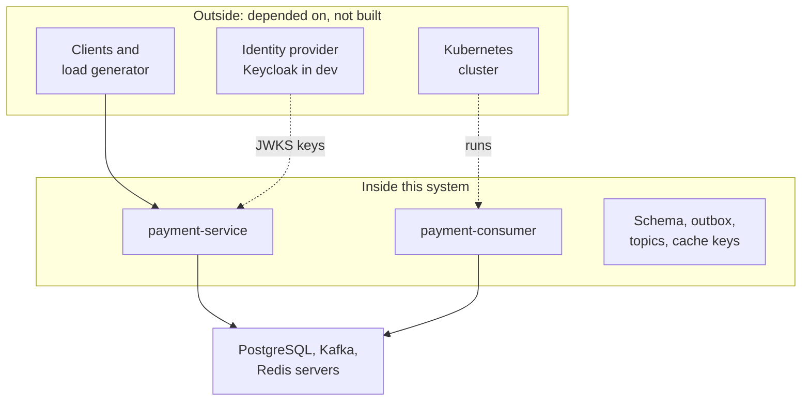

The system starts at the HTTP boundary of `payment-service` and ends at the rows it writes, the events it produces, and the audit rows the consumer writes. Token issuance, external money movement, bank reconciliation, and fraud scoring are outside.

### 3.4 Assumptions

- Amounts are integers in minor units; no floating-point money.
- Overdrafts are prohibited (`balance_minor >= 0` is a database constraint).
- A transfer is financially committed when the PostgreSQL transaction commits; Kafka acknowledgement is not part of that commit.
- Keycloak issues JWTs in development; the system only validates them.
- `jwt.sub` is the account owner id; scopes grant capabilities, not access to every row.
- Idempotency keys are unique per `(subject, idempotency_key)`, not per header value alone.
- One PostgreSQL database is shared by both services (a known anti-pattern, defended in Section 19).
- Cached GET balances may be briefly stale; debits never read Redis.

### 3.5 In scope and out of scope

| In scope | Deliberately out of scope |
| --- | --- |
| Create and read internal accounts | Card networks, external banks, payment gateways |
| Same-currency transfers between internal accounts | FX conversion, overdrafts, holds, multi-currency transfers |
| Payment status and history | Distributed two-phase commit, cross-service database transactions |
| JWT validation, scope and ownership authorization | A full OAuth authorization server |
| Publishing `PAYMENT_COMPLETED` events after commit | Multi-region active-active deployment |
| Audit persistence and supplemental cache eviction | Regulatory, PCI, or AML product claims |
| | Client-facing minting of opening balances |

### 3.6 Main engineering challenges

| Challenge | Why it is hard | Where it is solved in this booklet |
| --- | --- | --- |
| Concurrent debits on one account | Both requests can read an affordable balance before either writes | Section 9.1 (conditional update) |
| Client retries after timeouts | "Not executed" and "executed, response lost" look identical | Section 9.2 (idempotency mutex) |
| The same retry arriving twice at once | Two in-flight copies race each other | Section 9.2 |
| Reliable events without 2PC | PostgreSQL commit and Kafka produce are separate systems | Section 9.4 (outbox) |
| Duplicate event delivery | Outbox and Kafka are at-least-once | Section 9.5 (idempotent consumer) |
| Fast reads without unsafe money decisions | Caches are stale by definition | Section 9.6 (cache-aside) |
| Tail latency at 10K+ writes/min | Connection waits and bad query plans dominate p95 | Section 13 |

<div style="page-break-before: always;"></div>

# Part 2: Understand the Architecture

## 4. Technology Stack

### 4.1 Summary table

| Layer | Choice | Version target | One-line reason |
| --- | --- | --- | --- |
| Language | Java | 21 LTS | Mature ecosystem; optional virtual threads |
| Framework | Spring Boot (Web, Validation, Data JPA, Actuator) | 3.4.x | Transactions, security, Kafka, metrics out of the box |
| Security | Spring Security OAuth2 Resource Server (JWT) | 6.4.x | Standard JWT validation |
| Database | PostgreSQL | 16 | ACID, constraints, row-level locking |
| Messaging | Apache Kafka + Spring Kafka | 3.8.x | Durable async events, consumer groups |
| Cache / rate limit | Redis | 7.4 | Sub-millisecond reads; atomic Lua scripts |
| Connection pool | HikariCP | Bundled | Bounds concurrent transactions |
| Build | Maven | 3.9.x | Multi-module build |
| Tests | JUnit 5, Spring Boot Test, Testcontainers | 5.x / 1.20.x | Real PostgreSQL and Kafka in tests |
| Load test | k6 | Latest stable | Open-loop arrival-rate load |
| Containers | Docker, Docker Compose | — | Local stack |
| Orchestration | Kubernetes | 1.31 | Rolling updates, probes, scaling |

Explicitly **not** used: a service mesh, a saga orchestrator, a distributed transaction coordinator, or a payment-gateway SDK.

### 4.2 Each technology in context

**Java 21 and Spring Boot.**
- *What it is:* a language runtime and an application framework.
- *Problem it solves:* mature JDBC/JPA transaction management, Spring Security for JWT validation, Spring Kafka, and Actuator for health and metrics, all with little plumbing.
- *Interacts with:* PostgreSQL via JDBC and HikariCP, Kafka via Spring Kafka, Redis via a Redis client.
- *Alternative considered:* a from-scratch Netty service. Rejected because the project would be spent on plumbing instead of payment correctness.
- *Trade-off:* JVM memory footprint and warm-up; `@Transactional` is proxy-based and has a self-invocation pitfall (Section 6.4).

**PostgreSQL 16.**
- *What it is:* a relational database with ACID transactions.
- *Problem it solves:* durable, atomic multi-row updates; constraints such as `CHECK (balance_minor >= 0)`; row-level locking; unique indexes that double as locks.
- *Alternative considered:* Redis as a ledger. Rejected because Redis cannot provide durable multi-row atomic transfers without reinventing a database.
- *Trade-off:* one primary is the write-scaling ceiling; there is no horizontal write scale-out.

**Apache Kafka.**
- *What it is:* a distributed, durable, partitioned log.
- *Problem it solves:* decouples audit work from the payment request, survives consumer downtime (7-day retention), and supports parallel consumers.
- *Alternative considered:* doing audit inline inside the request. Rejected because it lengthens p95 and couples payment availability to side effects.
- *Trade-off:* audit is eventually consistent, and a broker must be operated.

**Redis.**
- *What it is:* an in-memory key-value store.
- *Problem it solves:* fast GET account and balance reads, and per-user rate-limit counters.
- *Alternative considered:* keeping balances in Redis for debit authorization. Rejected because it would make Redis a financial system of record.
- *Trade-off:* GET balance may be up to 5 seconds stale.

**HikariCP.**
- *What it is:* a JDBC connection pool.
- *Problem it solves:* reuses expensive database connections and **bounds** how many transactions run at once.
- *Trade-off:* too small and requests queue (the baseline problem); too large and PostgreSQL wastes CPU on contention.

**Spring Security OAuth2 Resource Server + Keycloak.**
- *What it is:* JWT validation in the application; Keycloak is the identity provider in development.
- *Problem it solves:* stateless authentication, no session store.
- *Trade-off:* JWT revocation is not checked before expiry (Section 20).

**Docker, Kubernetes, k6, Testcontainers.**
- Docker packages each service; Kubernetes gives rolling updates, probes, and independent replica counts for API and consumer; k6 drives open-loop load tests; Testcontainers starts real PostgreSQL and Kafka for integration tests.
- A service mesh was rejected as unnecessary; Docker Compose alone could not demonstrate the Kubernetes deployment claim.

### 4.3 How the technologies interact

**Figure 4.1 — Technology interaction at a glance**

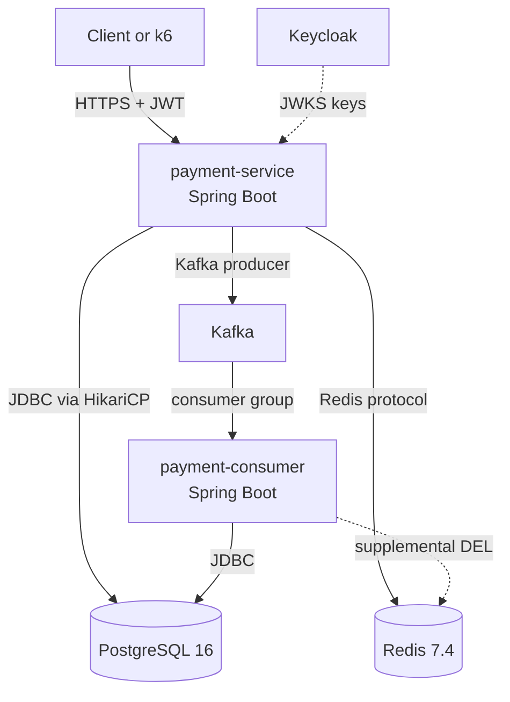

<div style="page-break-before: always;"></div>

## 5. High-Level Design (HLD)

### 5.1 The idea in one picture (beginner view)

**Figure 5.1 — Simplified conceptual architecture**

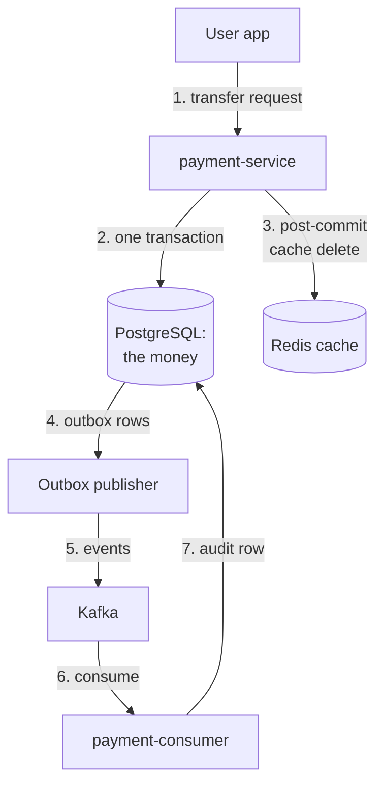

Read it as a story. A user asks `payment-service` to move money (1). The service does all the money work in **one** PostgreSQL transaction (2), then deletes stale cache entries (3) and replies. Separately, the outbox rows written in that same transaction are picked up by a publisher (4) and sent to Kafka (5). `payment-consumer` reads the events (6) and records an audit row (7).

### 5.2 Detailed technical architecture

**Figure 5.2 — Detailed architecture with deployment boundaries**

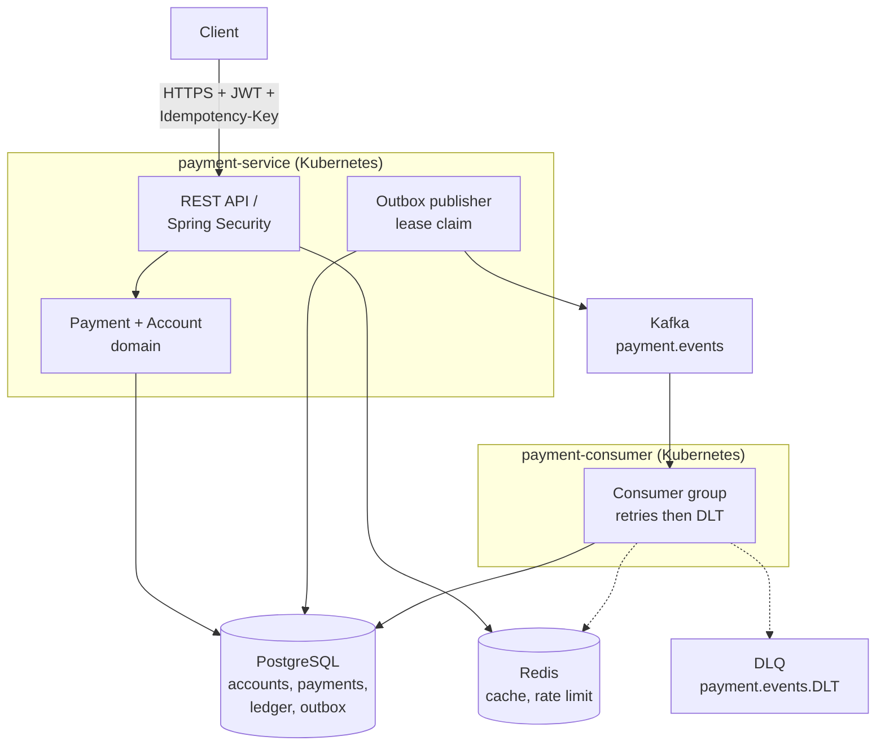

The solid `API → Redis` edge is post-commit cache invalidation plus cache-aside reads. The dashed `Consumer → Redis` edge is a **supplemental** eviction only; it is not how GET freshness is guaranteed.

### 5.3 The three data paths

**Figure 5.3a — Write path and event path**

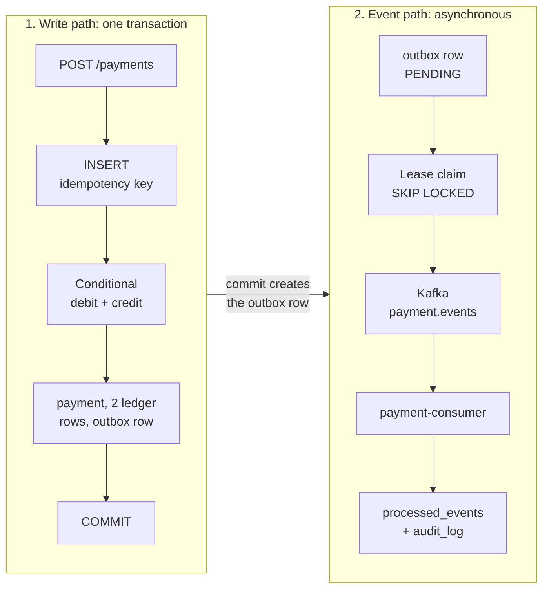

**Figure 5.3b — Read path (cache-aside)**

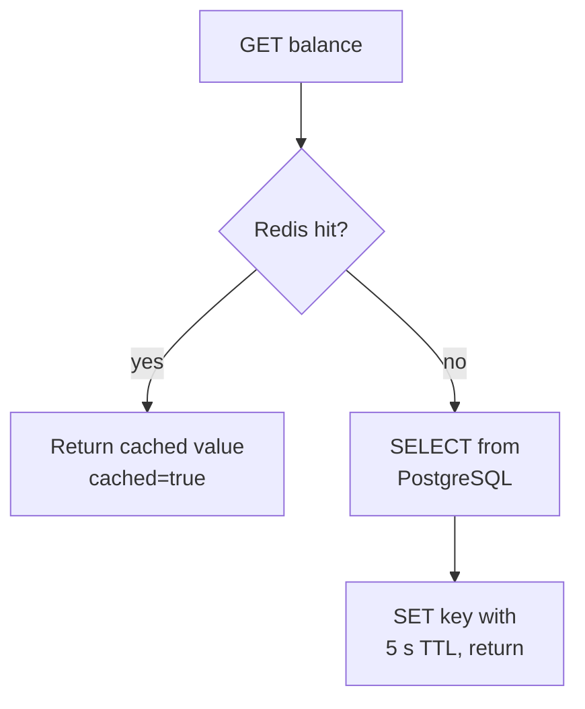

After the commit, `payment-service` deletes the two accounts' Redis keys (post-commit `DEL`); the consumer deletes them again as a supplement. Neither edge is drawn, to keep the three paths readable.

**Why this matters:** money only moves on the write path. The event path reads committed facts and never changes balances. The read path never feeds back into the write path. That one-way flow is the reason a Kafka or Redis failure **cannot corrupt a balance**.

### 5.4 Component responsibilities

Each component is described with the same six questions.

**`payment-service` — API layer (Spring Security filter chain, `RateLimitFilter`, controllers)**
1. *Responsibility:* accept HTTPS requests, validate the JWT (signature, `exp`, `iss`, `aud`, scope), apply the per-user rate limit, map JSON to DTOs.
2. *Input:* HTTP request with `Authorization: Bearer <jwt>`, `Idempotency-Key` (for `POST /payments`), JSON body.
3. *Processing:* authentication, rate limiting (best effort, via Redis), validation. Controllers never open transactions.
4. *Output:* a call into `PaymentService` or `AccountService`; finally an HTTP response.
5. *Next component:* the domain services.
6. *If it fails:* the request fails before any money moves; the client may retry with the same key.

**`payment-service` — domain (`PaymentService`, `AccountService`, `IdempotencyService`)**
1. *Responsibility:* the transfer use case and account lifecycle; `PaymentService` is the **only** class that defines the money transaction boundary.
2. *Input:* validated request, `jwt.sub`, idempotency key, request hash.
3. *Processing:* key insert, ownership and currency checks, ordered conditional updates, payment/ledger/outbox inserts, response stored on the key row, commit; on conflicts, bounded retries.
4. *Output:* a `PaymentResponse` (201, 200 replay, or a stored/returned error).
5. *Next component:* PostgreSQL (inside the transaction), then `AccountCacheService` after commit.
6. *If it fails mid-transaction:* PostgreSQL rolls back everything, including the key insert.

**`payment-service` — `OutboxPublisher` (background)**
1. *Responsibility:* relay committed outbox rows to Kafka.
2. *Input:* `PENDING` rows, or `PUBLISHING` rows whose lease expired.
3. *Processing:* every 200 ms, claim up to 50 rows with `FOR UPDATE SKIP LOCKED`, set a 30-second lease, commit, produce to Kafka, mark `PUBLISHED` after acknowledgement.
4. *Output:* `PAYMENT_COMPLETED` events on `payment.events`.
5. *Next component:* Kafka, then `payment-consumer`.
6. *If it fails:* rows stay `PUBLISHING` until the lease expires; another pod reclaims them. Payments are unaffected.

**PostgreSQL**
1. *Responsibility:* the single source of truth for balances, payments, ledger, idempotency keys, outbox, plus the consumer's `processed_events` and `audit_log`.
2. *Input:* SQL from both services.
3. *Processing:* ACID transactions, row locks, constraint checks, unique-index enforcement.
4. *Output:* committed rows.
5. *Next component:* read by the outbox publisher and by GET requests on cache misses.
6. *If it fails:* `payment-service` returns `503 DATABASE_UNAVAILABLE`, readiness fails, and no money moves.

**Kafka (`payment.events`, `payment.events.DLT`)**
1. *Responsibility:* at-least-once delivery of already-committed payment facts.
2. *Input:* events keyed by `sourceAccountId`.
3. *Processing:* durable storage across 12 partitions, 7-day retention.
4. *Output:* records to consumer group `payment-audit-consumers`.
5. *Next component:* `payment-consumer`.
6. *If it fails:* transfers continue; outbox rows accumulate and drain later.

**`payment-consumer`**
1. *Responsibility:* write one audit row per completed payment; supplemental Redis eviction.
2. *Input:* `PAYMENT_COMPLETED` events.
3. *Processing:* insert `processed_events(event_id)` and `audit_log` in one transaction; treat duplicate keys as success; retry transient errors (1 s, 2 s, 4 s); send exhausted records to the DLT.
4. *Output:* audit rows, committed offsets.
5. *Next component:* none (end of the event path).
6. *If it fails:* the group rebalances; uncommitted offsets are redelivered; dedup absorbs duplicates.

**Redis**
1. *Responsibility:* GET cache (`account:meta`, `account:balance`) and rate-limit counters.
2. *Input:* cache-aside reads and writes, post-commit deletes, Lua rate-limit scripts.
3. *Processing:* in-memory operations with TTLs.
4. *Output:* cached values or "miss".
5. *Next component:* none on the money path.
6. *If it fails:* 50 ms timeout, then fail open: reads go to PostgreSQL, rate limiting is skipped, payments continue.

### 5.5 Communication protocols

| From → To | Protocol | Sync or async | Notes |
| --- | --- | --- | --- |
| Client → `payment-service` | HTTPS, REST/JSON, bearer JWT | Sync | `Idempotency-Key` on POST payments |
| `payment-service` → Keycloak | HTTPS (JWKS fetch, cached) | Sync, occasional | Public keys for signature checks |
| `payment-service` → PostgreSQL | JDBC over HikariCP | Sync | One transaction per transfer attempt |
| `payment-service` → Redis | Redis protocol | Sync, best effort | 50 ms timeout, fail open |
| `OutboxPublisher` → Kafka | Kafka producer, `acks=all`, idempotent | Async | Key `sourceAccountId` |
| Kafka → `payment-consumer` | Kafka consumer group | Async pull | Offset committed after DB commit |
| `payment-consumer` → PostgreSQL | JDBC | Sync | One transaction per record |

### 5.6 Synchronous vs asynchronous steps

| Step | Mode | If it fails |
| --- | --- | --- |
| Auth, scope, validation | Sync | Request fails; no money moved |
| Key insert, checks, account updates, ledger, payment, outbox | Sync, **one** transaction | Rollback; no money moved |
| HTTP response (201, or 200 replay) | Sync, after commit | Client may retry; idempotency absorbs it |
| Redis `DEL` after commit | Sync, best effort | Money already moved; GET may be stale up to TTL |
| Outbox → Kafka | Async | Money already moved; event published later |
| Consumer audit / supplemental `DEL` | Async | Money already moved; side effects catch up |

**The commit point** is the PostgreSQL `COMMIT` of the transfer transaction. Neither Kafka nor Redis is on that path.

### 5.7 Why accounts are not a separate service

A transfer must debit, credit, and write the ledger atomically. If accounts lived in a separate service with its own database, every transfer would need two-phase commit or a saga with compensating actions. Keeping accounts inside `payment-service` keeps the whole transfer in one ACID boundary. **Cost:** the two services share one database (Section 19 defends this).

<div style="page-break-before: always;"></div>

## 6. Low-Level Design (LLD)

### 6.1 Package and module organisation

The intended layout is a Maven multi-module project. (The project documents the intended layout; no source repository exists yet.)

```text
payment-platform/
├── pom.xml
├── payment-service/
│   ├── pom.xml
│   └── src/
│       ├── main/java/com/payments/platform/payment/
│       │   ├── PaymentServiceApplication.java
│       │   ├── api/
│       │   │   ├── AccountController.java
│       │   │   ├── PaymentController.java
│       │   │   └── dto/
│       │   │       ├── CreateAccountRequest.java
│       │   │       ├── AccountResponse.java
│       │   │       ├── CreatePaymentRequest.java
│       │   │       ├── PaymentResponse.java
│       │   │       └── ErrorResponse.java
│       │   ├── domain/
│       │   │   ├── AccountService.java
│       │   │   ├── PaymentService.java
│       │   │   ├── IdempotencyService.java
│       │   │   └── model/
│       │   │       ├── Account.java
│       │   │       ├── Payment.java
│       │   │       ├── LedgerEntry.java
│       │   │       ├── IdempotencyRecord.java
│       │   │       └── OutboxEvent.java
│       │   ├── persistence/
│       │   │   ├── AccountRepository.java
│       │   │   ├── PaymentRepository.java
│       │   │   ├── LedgerEntryRepository.java
│       │   │   ├── IdempotencyRepository.java
│       │   │   └── OutboxEventRepository.java
│       │   ├── kafka/
│       │   │   ├── PaymentEvent.java
│       │   │   └── OutboxPublisher.java
│       │   ├── jobs/
│       │   │   ├── IdempotencyCleanupJob.java
│       │   │   └── OutboxCleanupJob.java
│       │   ├── security/
│       │   │   └── SecurityConfig.java
│       │   ├── redis/
│       │   │   ├── AccountCacheService.java
│       │   │   └── RateLimitFilter.java
│       │   ├── config/
│       │   │   ├── KafkaProducerConfig.java
│       │   │   ├── RedisConfig.java
│       │   │   └── JacksonConfig.java
│       │   └── exception/
│       │       ├── ApiException.java
│       │       └── GlobalExceptionHandler.java
│       └── test/java/com/payments/platform/payment/
│           ├── api/PaymentControllerIT.java
│           ├── domain/PaymentServiceConcurrencyTest.java
│           ├── domain/IdempotencyServiceTest.java
│           └── kafka/OutboxPublisherIT.java
├── payment-consumer/
│   ├── pom.xml
│   └── src/
│       ├── main/java/com/payments/platform/consumer/
│       │   ├── PaymentConsumerApplication.java
│       │   ├── kafka/
│       │   │   ├── PaymentEventConsumer.java
│       │   │   └── ConsumerKafkaConfig.java
│       │   ├── domain/
│       │   │   ├── AuditService.java
│       │   │   └── ProcessedEvent.java
│       │   ├── persistence/
│       │   │   ├── AuditLogRepository.java
│       │   │   └── ProcessedEventRepository.java
│       │   ├── jobs/
│       │   │   └── ProcessedEventCleanupJob.java
│       │   └── config/
│       └── test/java/...
├── docker/
│   ├── docker-compose.yml
│   ├── payment-service.Dockerfile
│   └── payment-consumer.Dockerfile
├── k8s/
│   ├── namespace.yaml
│   ├── payment-service-deployment.yaml
│   ├── payment-consumer-deployment.yaml
│   ├── services.yaml
│   └── config.yaml
├── load-tests/
│   └── payments.js
└── README.md
```

**How the LLD maps to the HLD:**

| HLD component | LLD packages / classes |
| --- | --- |
| API layer | `api/` controllers and DTOs, `security/SecurityConfig`, `redis/RateLimitFilter`, `exception/GlobalExceptionHandler` |
| Domain | `domain/PaymentService`, `AccountService`, `IdempotencyService`, `domain/model/*` |
| Persistence | `persistence/*Repository` (Spring Data JPA + explicit modifying queries) |
| Outbox publisher | `kafka/OutboxPublisher`, `kafka/PaymentEvent` |
| Cleanup | `jobs/IdempotencyCleanupJob`, `jobs/OutboxCleanupJob` |
| Cache | `redis/AccountCacheService` |
| Consumer service | `consumer/kafka/PaymentEventConsumer`, `domain/AuditService`, `jobs/ProcessedEventCleanupJob` |

### 6.2 Important classes

**PaymentController**
- Responsibility: thin HTTP adapter for payments.
- Important methods: `createPayment(idempotencyKey, request, principal)`, `getPayment(paymentId, principal)`, `listAccountPayments(...)`.
- Input: HTTP request, `JwtAuthenticationToken`.
- Output: `PaymentResponse` / `PaymentPage`.
- Dependencies: `PaymentService`.
- Why this class exists: keeps HTTP concerns out of the domain; never opens transactions.

**AccountController**
- Responsibility: account create and read.
- Important methods: `createAccount`, `getAccount`, `getBalance`.
- Input: request plus principal; `ownerId` always comes from `jwt.sub`, never from the body.
- Output: `AccountResponse`, `BalanceResponse` (with a `cached` flag).
- Dependencies: `AccountService`.
- Why it exists: ownership is enforced before a cached or database value is returned.

**PaymentService**
- Responsibility: the transfer use case; the only owner of the money transaction boundary.
- Important methods: `transfer(key, request, subject)` (facade), `executeNew(...)`, `replay(...)`, `classifyZeroRows(...)`.
- Input: idempotency key, request, subject.
- Output: `PaymentResponse`, or an `ApiException`.
- Dependencies: `TransactionTemplate`, `IdempotencyService`, `AccountRepository`, payment/ledger/outbox repositories, `AccountCacheService`.
- Why it exists: hides retry, replay, and transaction plumbing from controllers (Facade pattern).

**AccountService**
- Responsibility: account lifecycle and cache-aside reads. No public "set balance" API exists.
- Important methods: `create(subject, currency)`, `getOwned(accountId, subject)`, `getBalanceOwned(accountId, subject)`.
- Dependencies: `AccountRepository`, `AccountCacheService`.
- Why it exists: balance changes happen **only** inside `PaymentService.executeNew`.

**IdempotencyService**
- Responsibility: database-backed (not Redis-backed) idempotency, scoped to `jwt.sub`.
- Important methods: `insertKey(subject, key, hash)` (a unique violation aborts the transaction), `find(subject, key)` (in a fresh transaction), `complete(subject, key, httpStatus, body)` (same transaction as the financial outcome).
- Why it exists: the uncommitted insert *is* the in-flight lock; a committed row always has a stored HTTP outcome.

**AccountRepository**
- Responsibility: account persistence with explicit conditional updates.
- Important methods: `debitIfSufficient(id, version, amount)` and `creditIfActive(id, version, amount)`, both returning the number of updated rows.
- Why it exists: explicit modifying queries are required because Hibernate does not roll back managed-entity state on a savepoint rollback.

```java
@Modifying
@Query("""
    update Account a
       set a.balanceMinor = a.balanceMinor - :amount,
           a.version = a.version + 1,
           a.updatedAt = CURRENT_TIMESTAMP
     where a.id = :id
       and a.version = :version
       and a.status = 'ACTIVE'
       and a.balanceMinor >= :amount
    """)
int debitIfSufficient(UUID id, long version, long amount);

@Modifying
@Query("""
    update Account a
       set a.balanceMinor = a.balanceMinor + :amount,
           a.version = a.version + 1,
           a.updatedAt = CURRENT_TIMESTAMP
     where a.id = :id
       and a.version = :version
       and a.status = 'ACTIVE'
    """)
int creditIfActive(UUID id, long version, long amount);
```

**OutboxPublisher**
- Responsibility: scheduled poller on each `payment-service` replica; claims, produces, marks published.
- Important methods: `pollAndPublish()`, `claimBatch(limit)`, `markPublished(eventId)`.
- Why it exists: relays the transactional outbox to Kafka without holding database locks during network I/O.

**AccountCacheService**
- Responsibility: Redis cache-aside for account metadata and balance; eviction after commit.
- Important methods: `getMeta`, `getBalance`, `put`, `evict(accountIds)`.

**PaymentEventConsumer and AuditService (in `payment-consumer`)**
- Responsibility: `@KafkaListener` on `payment.events`; `recordOnce(event)` inserts `processed_events` and `audit_log`; a duplicate `event_id` is treated as success.

**Cleanup jobs**
- `IdempotencyCleanupJob`: deletes completed keys older than 24 hours.
- `OutboxCleanupJob`: deletes `PUBLISHED` rows older than 7 days (never `PENDING` or `PUBLISHING`).
- `ProcessedEventCleanupJob`: deletes `processed_events` older than 14 days, longer than the 7-day topic retention.

### 6.3 Class diagram

**Figure 6.1a — Request-side classes (synchronous path)**

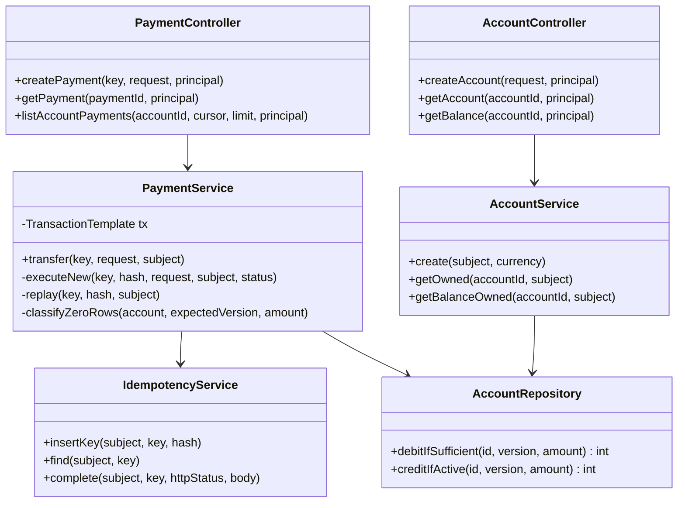

**Figure 6.1b — Cache, outbox, and consumer classes**

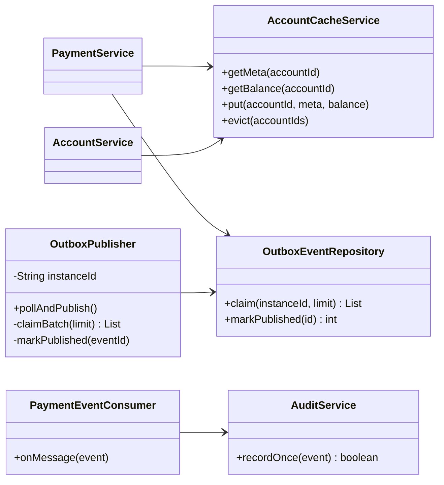

Read the diagram from the top: controllers depend on services; `PaymentService` depends on `IdempotencyService`, `AccountRepository`, `OutboxEventRepository`, and `AccountCacheService`; the outbox publisher and consumer are separate entry points.

### 6.4 The facade and transaction pseudocode

This is the heart of the implementation. Study it line by line.

```java
public PaymentResponse transfer(String key, CreatePaymentRequest req, String subject) {
    validateShape(key, req);                                  // 400s; no DB work
    String hash = RequestHasher.sha256(canonical(req));       // source, dest, amount, currency, description
    boolean replayMissRetried = false;

    for (int attempt = 1; attempt <= 3; attempt++) {
        try {
            return tx.execute(status -> executeNew(key, hash, req, subject, status));
        } catch (DataIntegrityViolationException e) {
            if (!isIdempotencyPkViolation(e)) throw e;        // 23505 on (subject, idempotency_key)
            // The aborted session is gone; read in a NEW transaction.
            Optional<StoredOutcome> stored = readOnlyTx.execute(s -> idempotency.find(subject, key));
            if (stored.isPresent()) {
                if (!stored.get().requestHash().equals(hash)) throw ApiException.conflict(IDEMPOTENCY_KEY_REUSED);
                return stored.get().replayAs200();            // 201 body replayed as 200, or stored 422
            }
            if (replayMissRetried) throw ApiException.conflict(CONCURRENT_UPDATE);
            replayMissRetried = true;                         // winner rolled back; try executeNew once more
            attempt--;
        } catch (VersionConflictException | PessimisticLockingFailureException e) {
            // version conflict, 40P01 deadlock, 40001 serialization: whole TX already rolled back
            sleepJitter(10, 50);
        }
    }
    throw ApiException.conflict(CONCURRENT_UPDATE);           // 409, retriable=true
}

private PaymentResponse executeNew(String key, String hash, CreatePaymentRequest req,
                                   String subject, TransactionStatus status) {
    idempotency.insertKey(subject, key, hash);                // blocks on a concurrent same-key insert
    Object sp = status.createSavepoint();

    Account src = accounts.findById(req.sourceAccountId()).orElseThrow(ApiException::notFound);
    Account dst = accounts.findById(req.destinationAccountId()).orElseThrow(ApiException::notFound);
    if (!src.ownerId().equals(subject)) throw ApiException.accessDenied();   // full rollback

    Optional<ApiError> terminal = precheck(src, dst, req);    // inactive, currency mismatch, snapshot balance < amount
    if (terminal.isEmpty()) terminal = applyInIdOrder(src, dst, req.amountMinor(), status, sp);
    if (terminal.isPresent()) {
        idempotency.complete(subject, key, terminal.get().httpStatus(), terminal.get().body());
        return terminal.get().asResponse();                   // COMMIT: key + stored error, no money moved
    }

    Payment p = payments.insertCompleted(req, subject);
    ledger.insert(p.id(), src.id(), DEBIT,  req.amountMinor(), req.currency());
    ledger.insert(p.id(), dst.id(), CREDIT, req.amountMinor(), req.currency());
    outbox.insertPending(UUID.randomUUID(), p.id(), "PAYMENT_COMPLETED", PaymentEvent.from(p));
    PaymentResponse body = PaymentResponse.from(p);
    idempotency.complete(subject, key, 201, body);
    TransactionSynchronizationManager.registerSynchronization(
        afterCommit(() -> cache.evict(List.of(src.id(), dst.id()))));
    return body;
}
```

**Key implementation decisions in this code:**

1. **Why `TransactionTemplate` instead of `@Transactional`.** `@Transactional` is applied by a Spring proxy. If `transfer` called `this.executeNew()`, the call would bypass the proxy and **no transaction would start**: each statement would auto-commit, so a debit could commit without its credit. `TransactionTemplate` starts the transaction programmatically and also offers `createSavepoint()` and `rollbackToSavepoint()`.
2. **Why the replay uses a new transaction.** After a unique violation (`23505`), PostgreSQL marks the transaction aborted; every further statement fails with `25P02` until rollback.
3. **Why a savepoint right after the key insert.** For terminal business failures discovered after a debit already matched (for example, a frozen destination), the code rolls back to the savepoint (undoing the debit) but keeps the key row, writes the stored error, and commits. Retries then replay the error instead of re-executing.
4. **Why validation happens before database work.** Shape errors (amount ≤ 0, same account, bad key) are `400`s and are never stored.

### 6.5 Design patterns

| Pattern | Where | Why |
| --- | --- | --- |
| Facade | `PaymentService.transfer` | Hides retry, replay, and transaction plumbing |
| Template method | `TransactionTemplate` | Programmatic transactions and savepoints without the self-invocation trap |
| Repository | Spring Data repositories | Persistence isolated from domain logic |
| Transactional outbox | `outbox_events` + `OutboxPublisher` | Atomic "state change + event intent" without 2PC |
| Idempotent receiver | `PaymentEventConsumer` | Safe under at-least-once delivery |
| Cache-aside | `AccountCacheService` | Cache filled on miss; database stays the authority |
| Chain of responsibility | Security filter chain + `RateLimitFilter` | Cross-cutting checks before controllers |
| DTO | `api/dto` | API contract decoupled from JPA entities |

### 6.6 Threading model

| Thread pool | Owner | Size (starting point) | Work | Blocking? |
| --- | --- | --- | --- | --- |
| Tomcat request threads | `payment-service` | Default 200 max | Filters, controller, transfer transaction | Yes (JDBC, Redis) |
| HikariCP connections | `payment-service` | `maximum-pool-size: 20` per pod | Bounds concurrent transactions | Waits up to 2 s, then `503` |
| Scheduler | `payment-service` | Pool size 2 | Outbox publisher every 200 ms, cleanup jobs | Briefly uses a connection |
| Kafka producer I/O | `payment-service` | 1 per producer | Batches and sends records | No; publisher awaits futures per batch |
| Kafka listener threads | `payment-consumer` | Concurrency 6 per pod | One `KafkaConsumer` per thread | Yes (JDBC per record) |

**Consequences to remember:**
- The Hikari pool, not Tomcat, is the real write-concurrency limit: 2 pods × 20 = at most 40 transfer transactions in flight.
- `KafkaConsumer` is not thread-safe, so each listener thread owns its own consumer, and listener threads must not exceed partitions (2 × 6 = 12 = partitions).
- Java 21 virtual threads are optional; they remove the Tomcat thread ceiling but not the database limit.

### 6.7 Synchronisation mechanisms

The application code takes no in-process locks for money. All coordination happens in PostgreSQL:

| Concern | Mechanism |
| --- | --- |
| Two debits on one account | Row lock taken by the conditional `UPDATE`; predicate re-checked after the wait |
| Two requests with the same key | Unique-index lock on `(subject, idempotency_key)` |
| A→B vs B→A | Ascending-id update order; `40P01` retried |
| Several outbox publishers | `FOR UPDATE SKIP LOCKED` plus a committed lease |
| Duplicate events | Primary key on `processed_events.event_id`, unique `audit_log.payment_id` |
| Rate-limit counters | Atomic Redis Lua script |

No leader election or consensus is needed: PostgreSQL row locks and unique indexes are the only coordination.

<div style="page-break-before: always;"></div>

# Part 3: Understand the Implementation

## 7. API Design

### 7.1 Common rules

- **Style:** REST over HTTPS, base path `/api/v1`, `Content-Type: application/json`.
- **Authentication:** `Authorization: Bearer <jwt>` on every endpoint.
- **Scopes are capabilities, not access to every row:**

| Scope | Capability |
| --- | --- |
| `payments.write` | Create an account for `sub`; create a transfer **from an account owned by `sub`** |
| `payments.read` | Read accounts and payments **the caller is a party to** |

`jwt.sub` maps to `accounts.owner_id` and `payments.created_by`.

**Common headers**

| Header | Direction | Rule |
| --- | --- | --- |
| `Authorization: Bearer <jwt>` | Request | Required on every endpoint |
| `Idempotency-Key` | Request | Required on `POST /payments`; 16–128 characters; client-generated (UUIDv4 recommended) |
| `Content-Type: application/json` | Request | Required on POST |
| `X-Correlation-Id` | Both | Optional on request; generated if absent; echoed and logged |
| `Retry-After` | Response | Sent with `429` and `503` |
| `X-RateLimit-Limit` / `X-RateLimit-Remaining` | Response | Sent when the Redis limiter is active |

**Rate limit:** per `jwt.sub`, default 600 requests/minute across all endpoints (configurable; raised for load tests). Best effort; fails open when Redis is down. It protects PostgreSQL from one abusive user; it is not a security boundary.

**Timeouts (starting points)**

| Timeout | Value | When exceeded |
| --- | --- | --- |
| HikariCP `connection-timeout` | 2 s | `503 DATABASE_UNAVAILABLE`, `retriable: true` |
| PostgreSQL `lock_timeout` (per transfer) | 1 s | SQLSTATE `55P03`; treated like a version conflict: rollback, bounded retry, then `409` |
| PostgreSQL `statement_timeout` | 2 s | Rollback; `503` |
| Redis command timeout | 50 ms | Fail open (cache miss, limiter skipped, `DEL` skipped) |
| Kafka `delivery.timeout.ms` | 20 s | Outbox row stays `PUBLISHING`; the 30 s lease is deliberately longer |
| Recommended client timeout | ≥ 3 s | Retry with the **same** key and exponential backoff |

**Error body (every error)**

```json
{
  "code": "INSUFFICIENT_FUNDS",
  "message": "Source account does not have enough balance",
  "correlationId": "7c2e0b1a-…",
  "retriable": false
}
```

### 7.2 Create account — `POST /api/v1/accounts`

- **Purpose:** create an account owned by the caller.
- **Auth:** scope `payments.write`. `owner_id` is always `jwt.sub`; the body does not accept `ownerId`.
- **Validation:** `currency` must be an ISO-4217 code.
- **Opening balance:** always `0`. The public API cannot mint funds; demo and load-test balances are seeded with SQL.
- **Success:** `201 Created`. **Errors:** `400`, `401`, `403` (missing scope).

Request:

```json
{
  "currency": "USD"
}
```

Response:

```json
{
  "accountId": "2f1c0a3e-6b1a-4d2e-9c41-1c8f7a0b9d11",
  "ownerId": "user-123",
  "currency": "USD",
  "balanceMinor": 0,
  "status": "ACTIVE",
  "version": 0,
  "createdAt": "2026-05-12T10:15:30Z"
}
```

**Internally:** JWT + scope check → insert into `accounts` with `owner_id = sub`, balance 0, version 0 → `201`.

### 7.3 Get account and balance — `GET /api/v1/accounts/{accountId}` and `/balance`

- **Auth:** `payments.read` **and** `accounts.owner_id = jwt.sub`.
- **Success:** `200 OK`.
- **Errors:** `401`; `403` missing scope; `403 ACCOUNT_ACCESS_DENIED` if the account exists but is not yours; `404` if it does not exist.
- **Caching:** metadata TTL 60 s, balance TTL 5 s; `cached: true` when served from Redis. Never used to authorize a debit.

Balance response:

```json
{
  "accountId": "2f1c0a3e-6b1a-4d2e-9c41-1c8f7a0b9d11",
  "currency": "USD",
  "balanceMinor": 20000,
  "asOf": "2026-05-12T10:16:01Z",
  "cached": false
}
```

**Internally:** JWT + scope → Redis `account:meta:{id}` (or `account:balance:{id}`) → on a miss, `SELECT` by primary key and `SET` with TTL → ownership check → `200`.

### 7.4 Create transfer — `POST /api/v1/payments`

The most important API. Required header: `Idempotency-Key`.

Request:

```json
{
  "sourceAccountId": "2f1c0a3e-6b1a-4d2e-9c41-1c8f7a0b9d11",
  "destinationAccountId": "9a44b2c1-0d77-4e18-b8aa-55c1d2e3f4a5",
  "amountMinor": 80000,
  "currency": "USD",
  "description": "invoice-4412"
}
```

Successful response:

```json
{
  "paymentId": "c7e2d1a0-1111-4b2c-8d3e-777777777777",
  "status": "COMPLETED",
  "sourceAccountId": "2f1c0a3e-6b1a-4d2e-9c41-1c8f7a0b9d11",
  "destinationAccountId": "9a44b2c1-0d77-4e18-b8aa-55c1d2e3f4a5",
  "amountMinor": 80000,
  "currency": "USD",
  "description": "invoice-4412",
  "createdAt": "2026-05-12T10:16:05Z"
}
```

| Status | When |
| --- | --- |
| `201 Created` | First successful processing of this `(subject, key)` |
| `200 OK` | Same subject, same key, **and** same request hash: the original body is replayed |
| `400` | Validation (missing fields, amount ≤ 0, bad UUID, missing key, source equals destination) |
| `401` / `403` | Bad JWT, missing scope, or `ACCOUNT_ACCESS_DENIED` (caller does not own the source) |
| `404` | Unknown source or destination account |
| `409 IDEMPOTENCY_KEY_REUSED` | Same subject and key with a **different** request hash |
| `422` | Insufficient funds, frozen/closed account, currency mismatch |
| `409 CONCURRENT_UPDATE` | Optimistic-lock or deadlock retries exhausted (`retriable: true`) |
| `429` | Rate limited |
| `503` | Database unavailable |

**Authorization:** the caller must own the **source**. The destination may belong to anyone (that is the point of a transfer). Owning the destination does not allow debiting it.

**What gets stored for failures:**
- *Terminal* failures discovered after the key insert (insufficient funds, inactive account, currency mismatch) **commit the key row with the error body** but write no payment, ledger, or outbox rows. A retry returns the stored error.
- *Retryable* failures (version conflict, deadlock) **roll back**, including the key insert, so a client retry is a new attempt.

**Internally:** rate limit → JWT + scope → validation → request hash → transfer transaction (Section 9) → post-commit Redis `DEL` → `201` / `200` / error.

### 7.5 Get payment — `GET /api/v1/payments/{paymentId}`

- **Auth:** `payments.read` **and** the caller owns the source or the destination account.
- **Success:** `200` with the payment body shown above.
- **Errors:** `401`; `403`; `403 ACCOUNT_ACCESS_DENIED` if you are not a party; `404` if unknown.
- There is **no `PENDING` financial state**. If `POST` returned `201`, PostgreSQL has committed. Kafka processing is not reflected in payment status.

### 7.6 List payments (keyset pagination) — `GET /api/v1/accounts/{accountId}/payments`

Query: `?direction=ALL&limit=20&cursor=<opaque>`.

| Item | Rule |
| --- | --- |
| Auth | `payments.read` **and** you own the account |
| `direction` | `OUTGOING`, `INCOMING`, or `ALL` (default) |
| `limit` | 1–100, default 20 |
| `cursor` | Opaque base64url of `(created_at, id)` of the last item; omitted for the first page |
| Success | `200` with `items` (newest first) and `nextCursor` (`null` on the last page) |
| Errors | `400` bad cursor or limit; `401`; `403`; `404` |
| Caching | Not cached |

```json
{
  "items": [
    {
      "paymentId": "c7e2d1a0-1111-4b2c-8d3e-777777777777",
      "status": "COMPLETED",
      "sourceAccountId": "2f1c0a3e-6b1a-4d2e-9c41-1c8f7a0b9d11",
      "destinationAccountId": "9a44b2c1-0d77-4e18-b8aa-55c1d2e3f4a5",
      "amountMinor": 80000,
      "currency": "USD",
      "createdAt": "2026-05-12T10:16:05Z"
    }
  ],
  "nextCursor": "MjAyNi0wNS0xMlQxMDoxNjowNVp8YzdlMmQxYTA"
}
```

The algorithm behind the cursor is explained in Section 9.8.

<div style="page-break-before: always;"></div>

## 8. Database and Storage Design

### 8.1 Why PostgreSQL

Money needs multi-row atomic transactions, constraints, durable commits, and row-level concurrency control. PostgreSQL gives all four. The cost is that a single primary is the write-scaling ceiling.

### 8.2 The schema

Every money column is `BIGINT` minor units.

```sql
CREATE TABLE accounts (
    id              UUID PRIMARY KEY,
    owner_id        VARCHAR(64)  NOT NULL,
    currency        CHAR(3)      NOT NULL,
    balance_minor   BIGINT       NOT NULL,
    version         BIGINT       NOT NULL DEFAULT 0,
    status          VARCHAR(16)  NOT NULL,
    created_at      TIMESTAMPTZ  NOT NULL,
    updated_at      TIMESTAMPTZ  NOT NULL,
    CONSTRAINT chk_accounts_balance_non_negative CHECK (balance_minor >= 0),
    CONSTRAINT chk_accounts_status CHECK (status IN ('ACTIVE', 'FROZEN', 'CLOSED'))
);

CREATE INDEX idx_accounts_owner_id ON accounts (owner_id);

CREATE TABLE payments (
    id                      UUID PRIMARY KEY,
    source_account_id       UUID         NOT NULL REFERENCES accounts (id),
    destination_account_id  UUID         NOT NULL REFERENCES accounts (id),
    amount_minor            BIGINT       NOT NULL,
    currency                CHAR(3)      NOT NULL,
    status                  VARCHAR(16)  NOT NULL,
    description             VARCHAR(255),
    created_by              VARCHAR(64)  NOT NULL,
    created_at              TIMESTAMPTZ  NOT NULL,
    CONSTRAINT chk_payments_positive_amount CHECK (amount_minor > 0),
    CONSTRAINT chk_payments_status CHECK (status IN ('COMPLETED')),
    CONSTRAINT chk_payments_distinct_accounts
        CHECK (source_account_id <> destination_account_id)
);

-- id is the keyset tie-breaker for payments created in the same microsecond
CREATE INDEX idx_payments_source_created
    ON payments (source_account_id, created_at DESC, id DESC);
CREATE INDEX idx_payments_dest_created
    ON payments (destination_account_id, created_at DESC, id DESC);

CREATE TABLE ledger_entries (
    id            UUID PRIMARY KEY,
    payment_id    UUID        NOT NULL REFERENCES payments (id),
    account_id    UUID        NOT NULL REFERENCES accounts (id),
    entry_type    VARCHAR(8)  NOT NULL,
    amount_minor  BIGINT      NOT NULL,
    currency      CHAR(3)     NOT NULL,
    created_at    TIMESTAMPTZ NOT NULL,
    CONSTRAINT chk_ledger_type CHECK (entry_type IN ('DEBIT', 'CREDIT')),
    CONSTRAINT chk_ledger_positive CHECK (amount_minor > 0)
);

CREATE UNIQUE INDEX uq_ledger_payment_entry_type
    ON ledger_entries (payment_id, entry_type);
CREATE INDEX idx_ledger_account_created
    ON ledger_entries (account_id, created_at DESC);

CREATE TABLE idempotency_keys (
    subject          VARCHAR(64)  NOT NULL,
    idempotency_key  VARCHAR(128) NOT NULL,
    request_hash     CHAR(64)     NOT NULL,
    payment_id       UUID         REFERENCES payments (id),
    http_status      INT,
    response_body    JSONB,
    created_at       TIMESTAMPTZ  NOT NULL,
    completed_at     TIMESTAMPTZ,
    PRIMARY KEY (subject, idempotency_key)
);

CREATE INDEX idx_idempotency_completed_at
    ON idempotency_keys (completed_at)
    WHERE completed_at IS NOT NULL;

CREATE TABLE outbox_events (
    id            UUID PRIMARY KEY,
    aggregate_id  UUID         NOT NULL,
    event_type    VARCHAR(64)  NOT NULL,
    payload       JSONB        NOT NULL,
    status        VARCHAR(16)  NOT NULL,
    created_at    TIMESTAMPTZ  NOT NULL,
    published_at  TIMESTAMPTZ,
    claimed_by    VARCHAR(64),
    lease_until   TIMESTAMPTZ,
    publish_tries INT          NOT NULL DEFAULT 0,
    CONSTRAINT chk_outbox_status
        CHECK (status IN ('PENDING', 'PUBLISHING', 'PUBLISHED'))
);

CREATE INDEX idx_outbox_claimable
    ON outbox_events (created_at)
    WHERE status IN ('PENDING', 'PUBLISHING');

CREATE INDEX idx_outbox_published_at
    ON outbox_events (published_at)
    WHERE status = 'PUBLISHED';

CREATE TABLE processed_events (
    event_id      UUID PRIMARY KEY,
    payment_id    UUID        NOT NULL,
    processed_at  TIMESTAMPTZ NOT NULL
);

CREATE TABLE audit_log (
    id            UUID PRIMARY KEY,
    payment_id    UUID        NOT NULL UNIQUE,
    event_id      UUID        NOT NULL UNIQUE,
    payload       JSONB       NOT NULL,
    created_at    TIMESTAMPTZ NOT NULL
);
```

**Table by table:**

| Table | Purpose | Key columns |
| --- | --- | --- |
| `accounts` | One row per account; holds the authoritative balance | `version` for optimistic locking; `CHECK (balance_minor >= 0)`; `status` ACTIVE / FROZEN / CLOSED |
| `payments` | One row per successful transfer | `status` can only be `COMPLETED`; amount > 0; source ≠ destination |
| `ledger_entries` | Two immutable rows per payment (DEBIT, CREDIT) | Unique `(payment_id, entry_type)` |
| `idempotency_keys` | One row per `(subject, key)` with the stored outcome | PK `(subject, idempotency_key)`; `request_hash`; `response_body` JSONB |
| `outbox_events` | Event intents written with the money | `status` PENDING / PUBLISHING / PUBLISHED; `claimed_by`, `lease_until`, `publish_tries` |
| `processed_events` | Consumer dedup | PK `event_id` |
| `audit_log` | One audit row per payment | Unique `payment_id`, unique `event_id` |

### 8.3 Entity relationships

**Figure 8.1 — ER diagram**

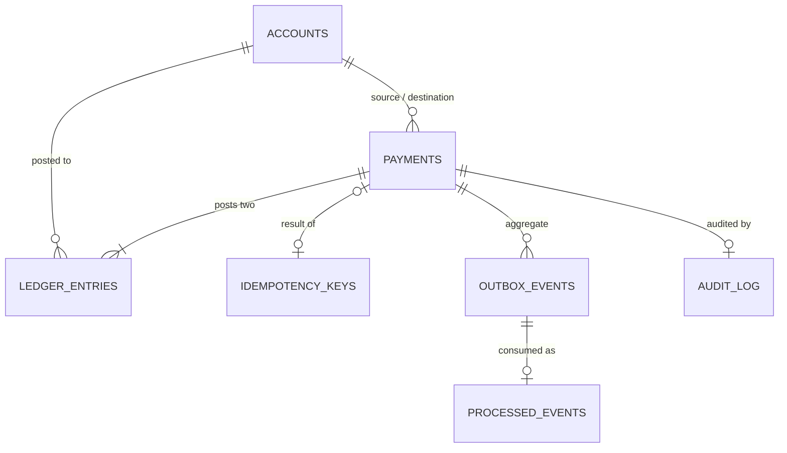

`ACCOUNTS` relates to `PAYMENTS` twice: once as the source account and once as the destination account.

`outbox_events.aggregate_id`, `processed_events`, and `audit_log` reference payments **logically, without foreign keys**. The consumer-owned tables must keep working if they move to a separate database, and outbox rows are deleted on their own schedule.

### 8.4 Indexes and why each exists

| Index | Serves | Why |
| --- | --- | --- |
| PK `(subject, idempotency_key)` | Key insert, mutex, replay lookup on every POST | `O(log n)`; the unique index *is* the lock |
| Account PK | Load and conditional update on every POST | `O(log n)` plus row lock |
| `idx_accounts_owner_id` | Accounts by owner | Account list / ops |
| `idx_payments_source_created`, `idx_payments_dest_created` | Keyset payment history | `(account, created_at DESC, id DESC)` matches the page query |
| `uq_ledger_payment_entry_type` | At most one DEBIT and one CREDIT per payment | Uniqueness, **not** amount equality |
| `idx_ledger_account_created` | Statements and reconciliation | Range scan on one account |
| `idx_outbox_claimable` (partial: `status IN ('PENDING','PUBLISHING')`) | Publisher poll, 5× per second per pod | Contains only the small unpublished backlog |
| `idx_outbox_published_at` (partial: `status = 'PUBLISHED'`) | 7-day outbox cleanup | Range scan |
| `idx_idempotency_completed_at` (partial: `completed_at IS NOT NULL`) | 24-hour key cleanup | Range scan |

**What a partial index is (Background):** an index that contains only rows matching its `WHERE` clause. Here it keeps the outbox index tiny and cache-resident, and rows drop out of it once they become `PUBLISHED`.

### 8.5 Constraints and invariants

A normal `CHECK` constraint can see **only the columns of one row**. So the project separates three kinds of guarantees:

| Kind | Invariant | Enforced by |
| --- | --- | --- |
| Database constraint | `balance_minor >= 0`; `amount_minor > 0`; `entry_type` is DEBIT or CREDIT; source ≠ destination; one DEBIT and one CREDIT per payment; one outcome per `(subject, key)`; outbox status valid | `CHECK`, `UNIQUE`, `PRIMARY KEY`, `REFERENCES` |
| Transactional guarantee | Both ledger rows, the payment, and both account updates are in the **same** transaction; debit amount = credit amount = payment amount; currencies match | `PaymentService.executeNew` copies one `amount` variable into both inserts |
| Test-verified invariant | Every completed payment has exactly two balanced ledger rows; `balance = opening + credits − debits`; failed transfers write nothing | Integration tests and a reconciliation query |

### 8.6 Transaction boundaries

| Operation | Scope | Isolation | Statements | Commit means |
| --- | --- | --- | --- | --- |
| Create account | One short transaction | READ COMMITTED | 1 `INSERT` | Account exists with balance 0 |
| Transfer (`executeNew`) | One transaction with a savepoint after the key insert | READ COMMITTED | Key insert, 2 PK selects, 2 conditional updates, payment insert, 2 ledger inserts, outbox insert, key completion | Money moved **and** event intent recorded, atomically |
| Replay after `23505` | New read-only transaction | READ COMMITTED | 1 PK select | Nothing written |
| Outbox claim | Short transaction | READ COMMITTED | `UPDATE ... WHERE id IN (SELECT ... FOR UPDATE SKIP LOCKED)` | Lease recorded; no Kafka I/O inside |
| Outbox mark published | Short transaction per batch | READ COMMITTED | `UPDATE ... WHERE id = ANY(:ids) AND status = 'PUBLISHING'` | Row will not be republished |
| Consumer processing | One transaction per record | READ COMMITTED | `processed_events` + `audit_log` inserts | Offset committed **after**; not atomic, hence dedup |
| Cleanup jobs | Batched short transactions | READ COMMITTED | `DELETE ... WHERE ctid IN (SELECT ctid ... LIMIT 1000)` repeated | Avoids one giant delete holding locks and bloating WAL |

### 8.7 How one transfer changes the database

1. `INSERT` into `idempotency_keys`. If this does not succeed **in this transaction**, the transaction must not touch accounts.
2. `SAVEPOINT`. Load both accounts; enforce ownership, `ACTIVE`, and currency.
3. Update accounts in **ascending id order** with the conditional debit and credit.
4. Insert the payment (`COMPLETED`).
5. Insert the DEBIT (source) and CREDIT (destination) ledger rows with the same amount and currency.
6. Insert the outbox row (`PENDING`).
7. Write `http_status = 201`, `response_body`, `completed_at` on the key row.
8. `COMMIT`.

There is never a durable "debit succeeded, credit pending" state.

### 8.8 Query patterns

| Query | Frequency | Index | Cost |
| --- | --- | --- | --- |
| Idempotency insert / lookup | Every POST | PK | `O(log n)` |
| Load accounts | Every POST, GET miss | PK | `O(log n)` |
| Conditional debit / credit | Every POST | PK | `O(log n)` + row lock |
| Outbox claim | 5×/s per pod | Partial `idx_outbox_claimable` | Proportional to the backlog, not the table |
| Outbox / key cleanup | Periodic | Partial indexes | Range scan |
| Payment history page | Per page | History indexes | `O(log n + limit)` per branch |
| Reconciliation | Tests, ops | `idx_ledger_account_created` | Range scan on one account |

The keyset history query for `direction=ALL` combines two index range scans:

```sql
SELECT * FROM (
    (SELECT id, source_account_id, destination_account_id, amount_minor, currency, status, created_at
       FROM payments
      WHERE source_account_id = :acct
        AND (created_at, id) < (:cursor_ts, :cursor_id)
      ORDER BY created_at DESC, id DESC
      LIMIT :limit_plus_one)
    UNION ALL
    (SELECT id, source_account_id, destination_account_id, amount_minor, currency, status, created_at
       FROM payments
      WHERE destination_account_id = :acct
        AND (created_at, id) < (:cursor_ts, :cursor_id)
      ORDER BY created_at DESC, id DESC
      LIMIT :limit_plus_one)
) page
ORDER BY created_at DESC, id DESC
LIMIT :limit_plus_one;
```

### 8.9 Normalization decisions

| Decision | Why it is acceptable |
| --- | --- |
| `accounts.balance_minor` stored although derivable from the ledger | `O(1)` balance check inside the conditional update; the ledger stays the audit trail |
| `currency` repeated on `payments` and `ledger_entries` | Ledger rows are immutable facts and must stay correct if account metadata changes |
| `response_body` JSONB on `idempotency_keys` | Replay must return the **exact** original body, including stored errors with no payment row |
| `outbox_events.payload` JSONB | The event is an immutable snapshot |
| Everything else | Third normal form |

### 8.10 Retention

| Data | Kept for | Removed by |
| --- | --- | --- |
| Completed idempotency keys | 24 hours (the idempotency window) | `IdempotencyCleanupJob` |
| `PUBLISHED` outbox rows | 7 days | `OutboxCleanupJob` (PENDING/PUBLISHING never deleted) |
| Kafka `payment.events` | 7 days | Topic retention |
| `processed_events` | 14 days (must exceed topic retention) | `ProcessedEventCleanupJob` |

### 8.11 Redis key design

| Key | Value | TTL | Use |
| --- | --- | --- | --- |
| `account:meta:{accountId}` | Owner, currency, status | 60 s | GET account |
| `account:balance:{accountId}` | `balanceMinor` | 5 s | GET balance only |
| `ratelimit:{subject}:{minuteEpoch}` | Counter (current + previous minute) | 120 s | Rate limit |

<div style="page-break-before: always;"></div>

## 9. Core Algorithms and Data Structures

### 9.1 Conditional UPDATE with version and balance predicate (optimistic locking)

1. **Problem:** lost updates and overspending when two payments debit one account at once.
2. **Why it is needed:** both transactions can read "balance 1,000" before either writes.
3. **Concept:** put the business rule *inside* the write. `UPDATE ... SET balance_minor = balance_minor − :amt, version = version + 1 WHERE id = :id AND version = :v AND status = 'ACTIVE' AND balance_minor >= :amt`. Zero updated rows means "the world changed or the rule failed".
4. **Steps:**
   1. Snapshot each account's `id`, `version`, `balance_minor`.
   2. Order the two accounts by id.
   3. Run `debitIfSufficient` (source) and `creditIfActive` (destination) in that order.
   4. On a `0`-row result, **re-`SELECT` the account** and classify in this exact order.

**Figure 9.1 — Classifying a zero-row update**

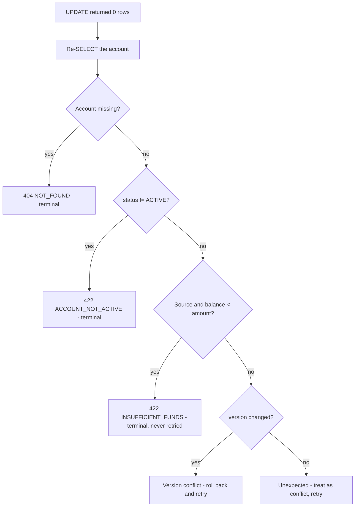

5. **Retry policy:** maximum 3 attempts, only for version conflicts, deadlocks (`40P01`), serialization failures (`40001`), and lock timeouts (`55P03`); jittered backoff 10–50 ms; each retry is a new transaction with fresh versions. When attempts run out: `409 CONCURRENT_UPDATE`, `retriable: true`.
6. **Worked example: 1,000 balance, two 800 debits with different keys**
   1. T1 and T2 both read `version = 0`, `balance = 1000`.
   2. T1's update matches 1 row, takes the row lock, sets 200 / version 1 (not yet committed).
   3. T2's update on the same row **waits** for T1's lock.
   4. T1 commits. Under READ COMMITTED, T2 re-checks `version = 0 AND balance >= 800` against the new row: **0 rows**.
   5. T2 reloads: balance 200 < 800, so `422 INSUFFICIENT_FUNDS`, even though the version also changed.
   - Without the predicate (`SET balance = balance − 800`), the balance would end at −600.
7. **Why funds are checked before version:** otherwise T2 would retry three times pointlessly and return a misleading `409`.
8. **Complexity:** `O(log n)` per update (primary-key B-tree lookup); retries multiply by at most 3. Space `O(1)`: one `BIGINT` version per account.
9. **Alternatives:** `SELECT ... FOR UPDATE` (pessimistic; longer lock, no correctness gain); `SERIALIZABLE` (overhead on every transaction, `40001` retries); a Redis distributed lock (not atomic with the database commit).
10. **Trade-off:** a very hot account causes retries and some `409`s. And the update still holds a row lock until commit; it is not lock-free.

### 9.2 Unique-insert idempotency mutex with request hash

1. **Problem:** retries and concurrent duplicates of the *same* request must not execute twice.
2. **Concept:** the first statement of the money transaction inserts `(subject, idempotency_key, request_hash)`. The primary key's unique index allows only one in-flight inserter. The lock and the money commit or vanish together.
3. **Steps:** insert key → do the transfer → store the response on the key row → commit. On `23505`: roll back, open a **new** transaction, read the row, compare hashes, replay.

**Figure 9.2 — Two concurrent requests with the same key**

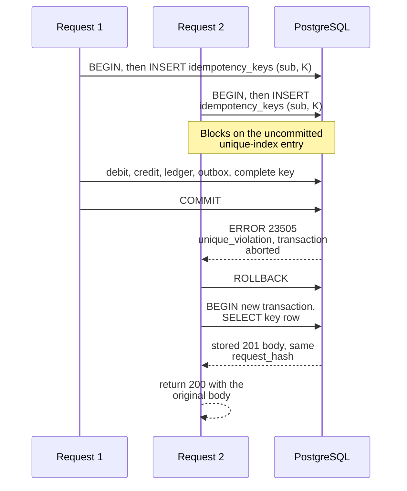

4. **All outcomes:**
   - Winner commits → loser gets `23505` → replay: same hash = stored response (`201` body replayed as `200`, or the stored `422`); different hash = `409 IDEMPOTENCY_KEY_REUSED`.
   - Winner rolls back (crash, deadlock, conflict) → its uncommitted insert disappears → the loser's blocked insert **succeeds** and the loser becomes the only one allowed to debit.
   - Rare: the row is missing on replay (the winner rolled back after the loser failed) → retry `executeNew` once (`replayMissRetried`), then `409 CONCURRENT_UPDATE`.
5. **Request hash:** SHA-256 over a canonical serialization of `sourceAccountId`, `destinationAccountId`, `amountMinor`, `currency`, `description` (field order does not change it).
6. **Scope:** a different user with the same header value is a **different row** and may pay independently. Replay is always looked up as `(jwt.sub, header)`.
7. **Complexity:** `O(log n)` per request; space ≈ keys in 24 hours (ILLUSTRATIVE: `10,000 × 60 × 24 ≈ 14.4M` rows at 10K/min).
8. **Alternatives:** Redis `SET NX` lock; a separately committed "IN_PROGRESS" row; client-side dedup only. All leave a window where the key is reserved but the money state is unknown.
9. **Trade-off:** a blocked duplicate holds a database connection while it waits; the table needs cleanup.

| Mechanism | Solves | Does **not** solve |
| --- | --- | --- |
| Idempotency key | Retries and concurrent replays of the **same** `(subject, key)` | Two **different** keys competing for one balance |
| Optimistic locking | Lost updates and overspending between different payments | A client that retries without a key |

### 9.3 Ordered locking for deadlock avoidance

- **Problem:** A→B and B→A transfers lock rows in opposite orders and deadlock.
- **Idea:** always update the two accounts in ascending UUID order, regardless of which is the source. This breaks the circular-wait condition.
- **Complexity:** `O(1)` comparison.
- **Alternative:** rely on PostgreSQL deadlock detection alone (default `deadlock_timeout` 1 s, then abort), which would add a 1-second stall to p99.
- **Residual risk:** other lock interactions (foreign-key checks, unique-index waits) can still deadlock rarely, so `40P01` stays retryable.

### 9.4 Transactional outbox with lease-based claim

1. **Problem:** the database commit and the Kafka produce cannot be made atomic without two-phase commit.
2. **Concept:** write the event as a row in the money transaction; a separate publisher relays rows to Kafka.
3. **The claim query** (every 200 ms, per pod):

```sql
UPDATE outbox_events o
   SET status        = 'PUBLISHING',
       claimed_by    = :instanceId,
       lease_until   = now() + interval '30 seconds',
       publish_tries = o.publish_tries + 1
 WHERE o.id IN (
           SELECT e.id
             FROM outbox_events e
            WHERE e.status = 'PENDING'
               OR (e.status = 'PUBLISHING' AND e.lease_until < now())
            ORDER BY e.created_at
            LIMIT 50
            FOR UPDATE SKIP LOCKED
       )
 RETURNING o.id, o.payload;
```

4. **Steps:**
   1. Claim up to 50 rows that are `PENDING` or whose `PUBLISHING` lease expired; `FOR UPDATE SKIP LOCKED` makes concurrent publishers skip rows another publisher is claiming.
   2. **Commit the claim** (status `PUBLISHING`, `lease_until = now() + 30 s`). No Kafka I/O happens inside a database transaction.
   3. Produce each event to Kafka (`acks=all`, key `sourceAccountId`).
   4. On acknowledgement, `UPDATE ... SET status = 'PUBLISHED', published_at = now() WHERE id = :id AND status = 'PUBLISHING'`.
   5. If producing fails, do nothing; the lease expires and a later poll reclaims the row.

**Figure 9.3 — Outbox row lifecycle**

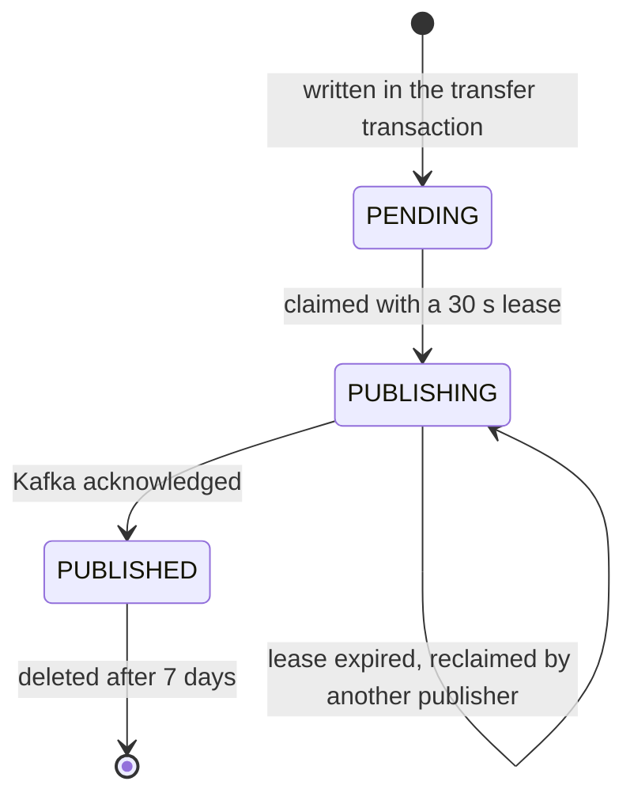

5. **Crash recovery:**

| Crash point | Result |
| --- | --- |
| After transfer commit, before any claim | Row stays `PENDING`; next poll claims it |
| After claim commit, before Kafka send | Lease expires; another publisher reclaims |
| After Kafka ack, before `PUBLISHED` | Lease expires; event is produced **again** (duplicate) |
| Publisher holds a live lease | Others skip the row |

6. **Why `delivery.timeout.ms` (20 s) < lease (30 s):** a healthy publisher finishes or gives up before anyone else may reclaim, so two publishers only send the same event concurrently in the crash case.
7. **Complexity:** claim `O(batch × log n)` via the partial index; publish `O(batch)` sends. Capacity ≈ 50 rows / 200 ms = 250 claims/s per pod, above the 167/s target.
8. **Alternatives:** Debezium change-data-capture from the WAL (more infrastructure); `@TransactionalEventListener(AFTER_COMMIT)` (still loses events on a crash); Kafka transactions (do not cover the PostgreSQL write).
9. **Trade-off:** at-least-once; ~200 ms relay latency; polling load on PostgreSQL.

### 9.5 Idempotent consumer with bounded retry and DLT

- **Problem:** at-least-once delivery plus transient failures in the consumer.
- **Steps:** receive → in one transaction insert `processed_events(event_id)` and `audit_log` → commit → commit the Kafka offset. A duplicate key means "already done": acknowledge.
- **Retries:** 1 attempt + 3 retries with exponential backoff 1 s / 2 s / 4 s, only for transient exceptions; deserialization and validation errors are not retryable and go straight to `payment.events.DLT` via `DeadLetterPublishingRecoverer`.
- **Key rule:** dedup state must outlive topic retention: `processed_events` keeps 14 days against a 7-day topic.
- **Complexity:** `O(log n)` per event.
- **Trade-off:** blocking in-process retries stall a partition for up to ~7 s; non-blocking retry topics were rejected for simplicity.

### 9.6 Cache-aside with post-commit invalidation and TTL backstop

- **Read path:** get key; on a miss query PostgreSQL and `SET` with TTL.
- **Write path:** after the transfer **commits**, `DEL` the meta and balance keys of both accounts (registered as an `afterCommit` callback). Failure to delete is logged; the response is still `201`.
- **Why delete after commit, not before:** deleting before commit lets a concurrent GET refill the cache with the old value before the commit lands.
- **The cache-aside fill race (cannot be closed by deletes):**
  1. A GET misses and reads the **pre-transfer** balance.
  2. The transfer commits and deletes the key (already absent).
  3. The GET writes the old balance into Redis.
  The **5-second TTL** bounds how long that stale value can live. Debits never read it.
- **Complexity:** `O(1)` Redis operations.
- **Alternatives:** write-through cache; CDC-driven invalidation; no cache plus a read replica.

### 9.7 Sliding-window rate limiter

- **Idea:** two fixed one-minute counters per user. Estimated count = `current + previous × (1 − elapsed fraction of the current minute)`.
- **Steps:** one Lua script does `INCR` current, `EXPIRE 120`, `GET` previous, computes the estimate, returns allow or deny atomically.
- **Worked example (ILLUSTRATIVE):** 20 s into the minute, previous = 500, current = 200: `200 + 500 × 40/60 ≈ 533` < 600, so allowed.
- **Complexity:** `O(1)` time, 2 keys per active user.
- **Alternatives:** fixed window (bursts at boundaries), sliding log in a sorted set (`O(log n)` and memory per request), token bucket.
- **Limitations:** approximate and fail-open.

### 9.8 Keyset pagination

- **Problem:** `OFFSET` pagination scans and discards every skipped row and drifts when new rows arrive.
- **Idea:** the cursor is the last `(created_at, id)`; the next page is `WHERE (created_at, id) < cursor ORDER BY created_at DESC, id DESC LIMIT limit + 1`. Fetching one extra row reveals whether `nextCursor` exists. `id` breaks ties for rows created in the same microsecond.
- **Complexity:** `O(log n + limit)` per page at any depth.
- **Trade-off:** no random page jumps; the cursor must be opaque and validated.

### 9.9 Double-entry ledger posting

- **Steps:** conditional debit → conditional credit → insert payment → insert DEBIT → insert CREDIT → commit.
- **Complexity:** `O(1)` per transfer (two extra inserts); the ledger grows `O(payments)`.
- **Failure scenario:** a bug writing different amounts to the two rows would commit silently; only integration tests and a reconciliation query catch it, because equality across rows is not a constraint.

<div style="page-break-before: always;"></div>

## 10. Complete End-to-End Execution Flows

### 10.1 Successful transfer

**Figure 10.1a — Successful transfer: the synchronous request**

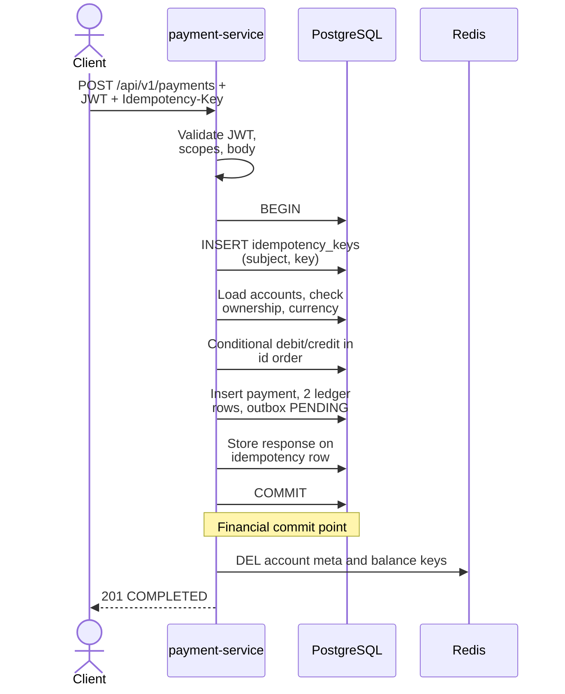

**Figure 10.1b — Successful transfer: the asynchronous event path**

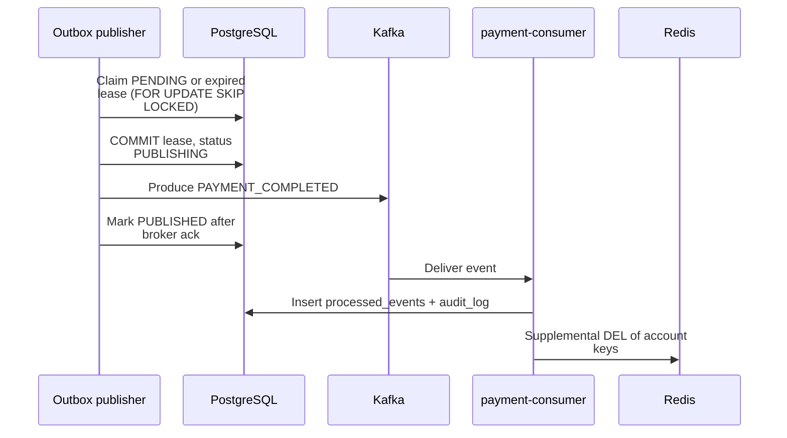

**Step by step:**
1. The client sends `POST /api/v1/payments` with JWT and `Idempotency-Key`.
2. Spring Security validates the token; the rate limiter checks Redis; the controller validates the body.
3. `PaymentService` computes the request hash and opens a transaction (`BEGIN`).
4. `INSERT` into `idempotency_keys` (the mutex); `SAVEPOINT`.
5. Load both accounts; check ownership, `ACTIVE`, and currency.
6. Conditional debit and credit in ascending id order.
7. Insert payment, two ledger rows, outbox row (`PENDING`); store the response on the key row.
8. `COMMIT`: **the financial commit point**.
9. Best-effort Redis `DEL` of both accounts' keys; return `201 COMPLETED`.
10. Within ~200 ms, a publisher claims the outbox row (`PUBLISHING`), commits, produces to Kafka, then marks `PUBLISHED`.
11. `payment-consumer` receives the event, inserts `processed_events` and `audit_log` in one transaction, commits the offset, and deletes the cache keys again (supplemental).

### 10.2 Two different payments race for the same balance

**Figure 10.2 — Overspend race resolved by the conditional update**

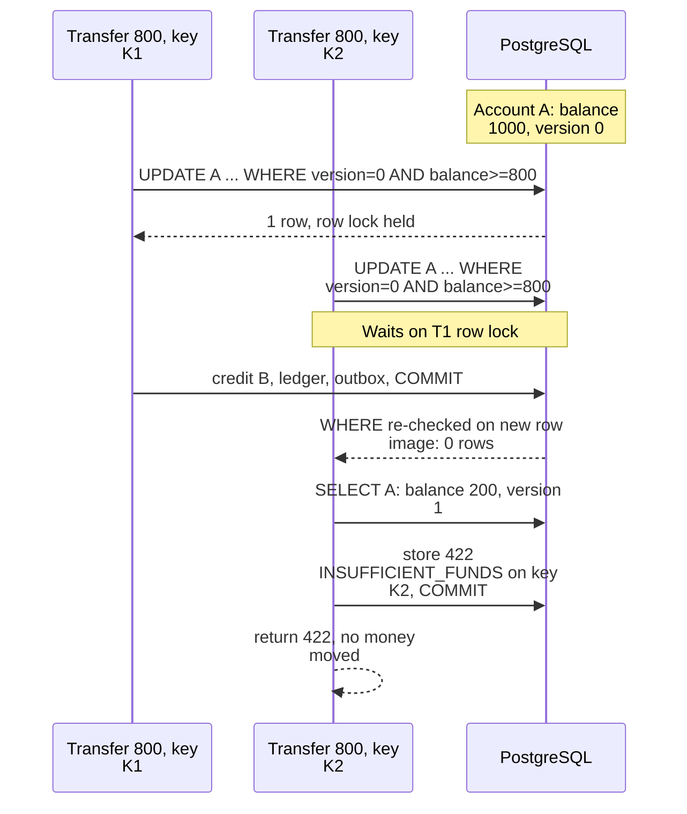

The second transfer gets `422` and its key row stores that outcome, so its own retries replay the `422`.

### 10.3 Crash after commit, before the HTTP response

**Figure 10.3 — Retry after a lost response**

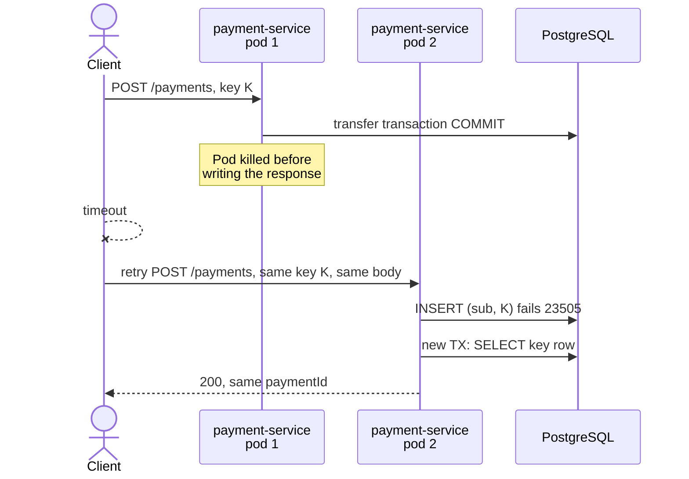

The outbox row was committed with the money, so the event is still published by whichever pod's publisher claims it next.

### 10.4 Kafka unavailable after commit

**Figure 10.4 — Outbox absorbs a broker outage**

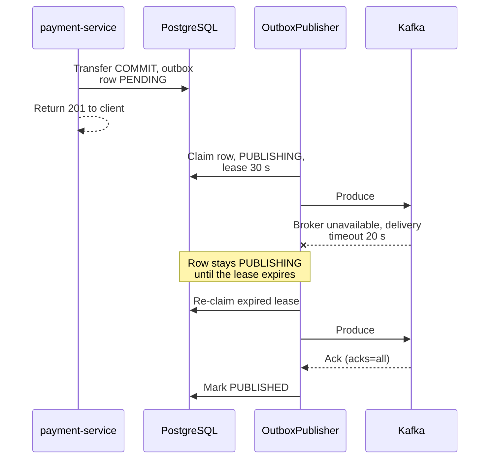

### 10.5 Consumer failure, retries, and DLT

**Figure 10.5 — Poison message routed to the dead-letter topic**

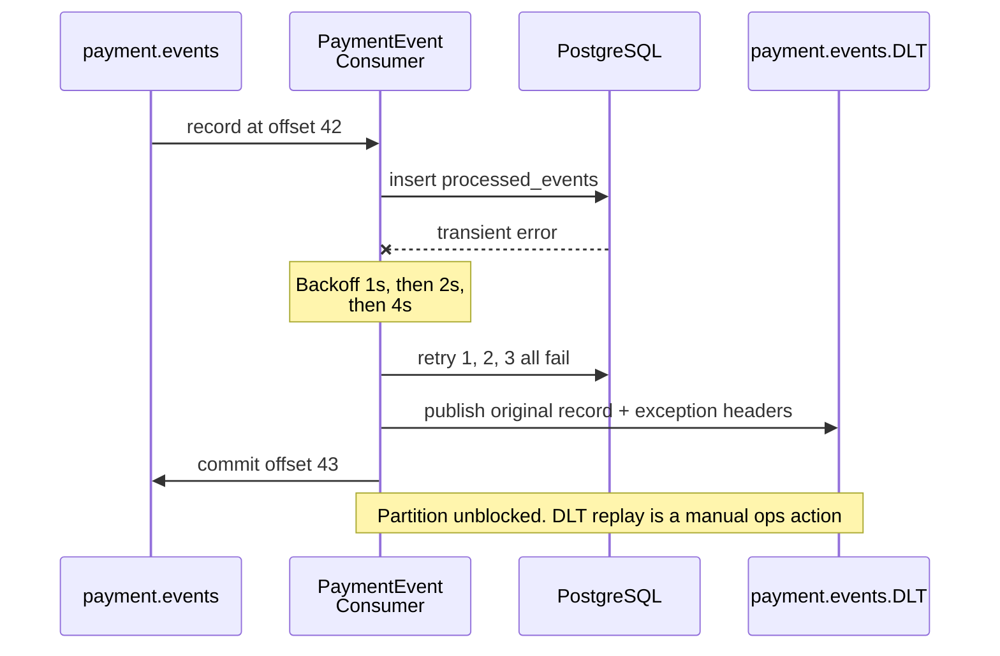

### 10.6 Deadlock or version conflict, bounded retry

1. Attempt 1 hits `40P01` (deadlock), or a `0`-row update whose reload shows funds are still sufficient but the version changed.
2. The whole transaction rolls back, **including the idempotency insert**.
3. The facade sleeps a jittered 10–50 ms and starts attempt 2 in a new transaction with fresh versions.
4. After 3 failed attempts the API returns `409 CONCURRENT_UPDATE` with `retriable: true`. Because the key was never committed, a client retry with the same key is a new attempt, not a replay.

### 10.7 Terminal failure after the debit matched

1. The source debit succeeds; the destination credit returns 0 rows; the reload shows the destination is `FROZEN`.
2. `ROLLBACK TO SAVEPOINT` undoes the debit (no account row stays changed).
3. The error body (`422 ACCOUNT_NOT_ACTIVE`) is written on the key row, and the transaction **commits**.
4. Retries with the same key replay the stored `422` and never attempt another debit.

<div style="page-break-before: always;"></div>

## 11. Concurrency and Distributed Systems

### 11.1 Where concurrency happens

- Many Tomcat threads in each `payment-service` pod run transfers at once; up to 40 hold a database connection at a time across two pods.
- Several `OutboxPublisher` instances (one per pod) poll the same table.
- Twelve consumer threads (2 pods × 6) process 12 partitions in parallel.

### 11.2 Race conditions and how each is prevented

| Race | Scenario | Prevention |
| --- | --- | --- |
| Overspend | Two different payments debit one account | Conditional `UPDATE` with balance + version predicate; row lock; re-check after wait |
| Duplicate execution | Two copies of the same request | Unique-index blocking on `(subject, key)` |
| Deadlock | A→B and B→A | Ascending-id update order, `40P01` retry |
| Double claim of outbox rows | Two publishers poll at once | `FOR UPDATE SKIP LOCKED` + committed lease |
| Duplicate audit | Event delivered twice | PK `processed_events.event_id`, unique `audit_log.payment_id` |
| Stale cache fill | GET reads old value, transfer commits, GET writes old value | Bounded by the 5 s TTL (not prevented) |

### 11.3 ACID applied to a transfer

| Property | Meaning here |
| --- | --- |
| Atomicity | Accounts, payment, ledger, key completion, and outbox row commit together or not at all |
| Consistency | Row-level constraints plus the transfer transaction keep balances non-negative and the ledger balanced |
| Isolation | READ COMMITTED plus the conditional update; the update takes a row lock until commit |
| Durability | After `COMMIT`, the money movement survives a JVM crash |

### 11.4 Is READ COMMITTED enough? (write skew)

**Background:** *write skew* happens when two transactions read overlapping data and then write **different** rows based on what they read; neither sees the other's write. Here every invariant that matters (balance ≥ 0) is checked **in the same statement that writes the row**, and conflicting transfers write **the same row**, so the row lock plus re-check prevents the anomaly without SERIALIZABLE. A future rule like "daily limit across all of a user's accounts", computed by summing rows, would be vulnerable and would need to be materialized as a row and updated conditionally.

### 11.5 Message delivery semantics

| Hop | Guarantee |
| --- | --- |
| Money in PostgreSQL | Exactly once per `(subject, key)` within 24 hours |
| Outbox → Kafka | At least once (duplicates on ack-then-crash and lease reclaim) |
| Kafka → consumer | At least once (offset committed after the database commit) |
| Audit side effect | Effectively once (dedup on `event_id` and `payment_id`) |

An idempotent Kafka producer removes duplicates only **within one producer session**; it does not remove resends by a different publisher pod. Consumer idempotency is therefore mandatory.

### 11.6 Partitioning and ordering

- Events are keyed by `sourceAccountId`, so events for one source account land on one partition.
- **But ordering is not strictly guaranteed per account:** several publishers can send one account's events out of creation order, a lease reclaim resends an older event later, and DLT replays arrive much later. The audit consumer is order-independent, so this is acceptable.
- There is **no global ordering**.

### 11.7 What the system guarantees and what it does not

| Property | Guaranteed? | Mechanism / reason |
| --- | --- | --- |
| No negative balance | **Yes** | Conditional update + `CHECK (balance_minor >= 0)` |
| No partial transfer | **Yes** | One transaction; savepoint for terminal failures |
| At most one financial effect per `(subject, key)` in 24 h | **Yes** | Composite primary key insert is the mutex |
| Balanced ledger per payment | **Yes, by transaction + tests** | Not expressible as a row-level `CHECK` |
| Event eventually published for every committed payment | **Yes, while PostgreSQL is intact** | Outbox row committed with the money; leases reclaim stuck rows |
| Event published exactly once | **No** | At-least-once |
| Audit side effect exactly once | **Effectively** | Dedup |
| Global ordering of events | **No** | Only per partition, and weakened by multiple publishers |
| Fresh GET balance | **No** | Up to 5 s stale |
| Duplicate protection without a key | **No** | A new key per retry creates a new payment |
| Leader election / consensus | **Not needed** | Row locks, unique indexes, and leases in the same database |

<div style="page-break-before: always;"></div>

# Part 4: Engineering and Reliability

## 12. Failure Handling and Recovery

### 12.1 Failure-scenario table

| Failure scenario | Why it happens | System behaviour | Recovery mechanism | Remaining risk |
| --- | --- | --- | --- | --- |
| Client retries after a timeout | Network loss, slow response | Same key: unique insert fails, fresh-transaction replay of the stored body | Idempotency key | Client generating a new key per retry creates a new payment |
| Two transfers compete for a balance | Concurrent users or retries with different keys | Conditional update; loser classified `422` or retried | Row lock + predicate re-check | Hot accounts see retries and `409`s |
| Crash before commit | Pod killed, JVM crash | PostgreSQL rolls back everything, including the key insert | Client retry; a waiting duplicate may win | None for money |
| Crash after commit, before response | Pod killed at the worst moment | Client sees a timeout | Retry → `200` replay; outbox row published by any pod | None |
| PostgreSQL unavailable | DB outage, network | `503 DATABASE_UNAVAILABLE`; readiness fails; pods leave the Service | Automatic when DB returns; client retries with same key | Thundering-herd spike on recovery |
| Lock contention / slow DB | Hot rows, slow queries | `lock_timeout` 1 s (`55P03`) → bounded retry → `409` | Client retry with same key | Tail latency |
| Deadlock | Lock cycles beyond account rows | `40P01` → rollback → retry (max 3) | Automatic | Rare `409` |
| Kafka unavailable | Broker outage | Transfers continue; outbox rows accumulate | Leases expire; rows reclaimed after Kafka returns | Audit delayed; disk growth if very long |
| Duplicate events | Ack-then-crash, lease reclaim, redelivery | PK conflict treated as success | Dedup | None for audit |
| Consumer crash | Pod failure | Rebalance; lag rises | Redelivery from last committed offset | None (dedup) |
| Poison message | Bug, unexpected JSON | Retries exhausted or non-retryable → DLT; partition continues | Fix bug, replay DLT manually | Audit row missing until replay |
| Redis unavailable | Redis outage | 50 ms timeout; cache, rate limit, and `DEL` skipped | Automatic; stale keys expire by TTL | GET may be stale ≤ 5 s after Redis returns |
| Outbox publisher frozen | Long GC pause, frozen pod | Rows stuck `PUBLISHING` | Another replica reclaims after the 30 s lease | Duplicate publication |
| Pod restart mid-request | Rolling deploy, node drain | Graceful shutdown drains requests | Commit is the only success signal; client retries | None for money |

### 12.2 Important failures, step by step

**A. Crash after commit (the "lost response" case)**
1. The transfer commits; the pod dies before writing the HTTP response.
2. The client times out and retries **with the same key**, likely reaching the other pod.
3. The key insert fails with `23505`; a fresh transaction reads the stored row; the hash matches; the API returns `200` with the original `paymentId`.
4. The outbox row from step 1 is published by whichever publisher claims it.

**B. Kafka outage**
1. Transfers keep committing; each adds a `PENDING` outbox row.
2. Publishers claim rows, fail to produce within the 20 s delivery timeout, and leave them `PUBLISHING`.
3. Leases expire after 30 s; rows become claimable again.
4. When Kafka returns, publishers drain the backlog at up to ~250 events/s per pod.
5. Operators confirm `outbox_pending` returns to ~0, consumer lag recovers, and `audit_log` count matches `payments` for the outage window.

ILLUSTRATIVE: a one-hour outage at 10K/min accumulates ~600K rows; two pods draining at ~250/s each, while new events keep arriving at ~167/s, clear the backlog in roughly 20 minutes.

**C. Consumer bug sends records to the DLT**
1. Deploy the fix.
2. Replay DLT records to `payment.events` (manual tool, headers preserved).
3. Dedup makes the replay safe even if some records had already succeeded.

**D. PostgreSQL outage**
1. Hikari cannot get a connection within 2 s; requests get `503`; readiness turns red so the Service stops routing to the pod.
2. Liveness does **not** depend on the database, so pods are not restart-looped.
3. When the database returns, readiness turns green; clients retry with the same key; nothing was committed, so retries are first executions.
4. Watch `hikaricp_connections_pending` and p95 for a thundering herd; rate limits and client backoff spread the load.

**Figure 12.1 — Recovery paths after a publisher or consumer failure**

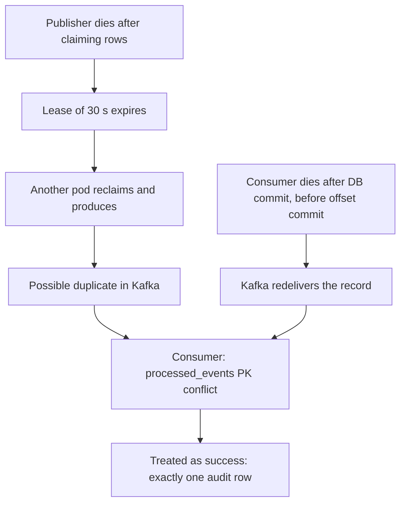

### 12.3 Graceful shutdown

- `server.shutdown=graceful` with a 20 s shutdown phase; Kubernetes `terminationGracePeriodSeconds: 30` exceeds it, and a `preStop` hook sleeps 5 s so endpoints update first.
- In-flight requests finish; the outbox publisher stops claiming new rows; the Kafka listener stops after the current record.
- Any rows the pod had leased become reclaimable after their lease expires.

### 12.4 Guarantees summary

The system guarantees **money correctness** under every failure above: no negative balance, no partial transfer, at most one financial effect per key. It does **not** guarantee exactly-once event publication, strict event ordering, or fresh cached reads. See Section 11.7 for the full table.

<div style="page-break-before: always;"></div>

## 13. Performance Engineering

### 13.1 Where the time goes in one `POST /payments` (ILLUSTRATIVE budget)

| Step | Typical cost | Grows under load because |
| --- | --- | --- |
| TLS, HTTP parse, JWT verify (cached JWKS) | 1–3 ms | CPU saturation |
| Redis rate-limit Lua script | 0.3–1 ms | Redis latency; skipped if Redis is down |
| **Wait for a Hikari connection** | 0 ms when idle | **Pool exhaustion: the dominant tail term in the baseline** |
| ~10 SQL round trips in one transaction | 5–15 ms | Row-lock waits on hot accounts, plan regressions, WAL fsync |
| `COMMIT` (WAL flush) | 1–5 ms | Disk fsync latency, checkpoint I/O |
| Post-commit Redis `DEL` | 0.3–1 ms | Bounded by the 50 ms timeout |
| Response serialization | < 1 ms | — |

Uncontended, this sums to roughly 10–25 ms. **A < 200 ms p95 target therefore leaves most of the budget for queueing** (for connections and row locks), and that is what the optimizations attack.

### 13.2 Latency vs throughput, and the percentiles

- **Throughput** target: ≥ 167 `POST /payments` per second (10K+/min). BENCHMARK TARGET.
- **Latency** target: p95 < 200 ms on that endpoint. BENCHMARK TARGET.
- **p99** must be reported alongside p95, because p95 hides the worst 5%.
- By Little's law, in-flight requests ≈ 167 × 0.05 s ≈ 8 at a 50 ms mean (ILLUSTRATIVE): the system is not capacity-bound at this rate; tail latency is the concern.

### 13.3 The optimizations

**O1. Indexes on the write path**
- *Bottleneck:* without `idx_outbox_claimable`, every publisher poll (5×/s per pod) scans the whole outbox, including 7 days of `PUBLISHED` rows; cleanup and history queries also scan.
- *Change:* partial indexes for claimable outbox rows and completed keys; composite history indexes.
- *Why it helps:* removes repeated full scans that burn CPU and evict useful pages from PostgreSQL's buffer cache; shorter claim transactions.
- *Cost:* every index adds write cost; partial indexes help only queries whose predicate matches.
- *Expected impact:* main lever for the ~30% DB CPU target. BENCHMARK TARGET.
- *Measure:* `pg_stat_statements` (`total_exec_time`, `calls`, `shared_blks_read`), `EXPLAIN (ANALYZE, BUFFERS)`, `pg_stat_user_tables.seq_scan` deltas.

**O2. HikariCP sizing**
- *Bottleneck:* baseline pool of 5 per pod; bursts plus uncached GETs push demand past 10 connections cluster-wide.
- *Change:* `maximum-pool-size: 20`, `minimum-idle` = max (fixed pool, no connection churn), `connection-timeout: 2s`, `max-lifetime` below any idle cut-off.
- *Why it helps:* queueing delay grows sharply as utilization approaches 1 (M/M/c queueing behaviour); dropping utilization from ~90% to ~40% removes most waiting.
- *Cost:* too many connections cause PostgreSQL context switching and lock contention. Budget: `2 pods × 20 + 2 consumers × 10 + admin < max_connections (100)`.
- *Expected impact:* main lever for the ~40% POST p95 target. BENCHMARK TARGET.
- *Measure:* `hikaricp_connections_pending`, `hikaricp_connections_acquire_seconds` p95, `pg_stat_activity`.

**O3. Short, fixed-shape transactions**
- No Kafka or Redis I/O inside the money transaction; only primary-key statements; the outbox claim commits before any Kafka send. Lock hold time ≈ connection hold time ≈ database work only.

**O4. Redis cache-aside for GET**
- Removes GET queries and pool checkouts from PostgreSQL. ILLUSTRATIVE: an 80% hit rate on 500 GET/s removes ~400 queries/s. Lowers DB CPU and pool contention; **not** the main POST p95 lever. Cost: stale GETs up to the TTL.

**O5. Kafka batching and consumer parallelism**
- Claim batches of 50, send asynchronously and await the batch; producer `linger.ms=5`, `compression.type=lz4`; 12 partitions × 12 consumer threads.

**Optimizations considered and rejected**

| Idea | Why rejected |
| --- | --- |
| Batch multiple transfers in one transaction | Couples unrelated payments' fate; complicates idempotency |
| Read replica for balance checks | Replica lag makes balance decisions unsafe |
| `synchronous_commit = off` | Trades durability of acknowledged payments for latency |
| Pessimistic `SELECT FOR UPDATE` | Longer lock hold for no correctness gain |

### 13.4 Performance trade-offs to state in interviews

- More pods add connections, not database capacity; the connection budget bounds the replica count.
- The polling outbox costs a few queries per second even when idle (an adaptive interval or `LISTEN/NOTIFY` would help).
- Blocking consumer retries can stall a partition for ~7 s.

<div style="page-break-before: always;"></div>

## 14. Benchmarking and Testing

> **Status:** everything in this section is an **intended** plan. No test has been executed and no benchmark result exists. Never present any number here as measured.

### 14.1 Test layers

| Layer | What | Tools | Acceptance |
| --- | --- | --- | --- |
| Unit | Hashing, validation, error mapping, 0-row classification | JUnit 5 | Deterministic, no Spring context |
| API integration | Create account (balance 0), transfer, get status, ownership `403` | MockMvc, Testcontainers PostgreSQL | Status codes and JSON contracts |
| Database integration | Constraints, unique keys, update row counts | Testcontainers | `CHECK` (`23514`) and unique (`23505`) violations behave as designed |
| Concurrency | Competing debits; same key; A→B vs B→A | `ExecutorService` + `CountDownLatch` + Testcontainers | Invariants hold, checked in SQL |
| Kafka | Retry then success; DLT after budget; duplicate delivery | Embedded/Testcontainers Kafka | One audit row per payment |
| Failure injection | Kill DB backend mid-transaction; pause Kafka; stop a publisher | Testcontainers | No partial rows; outbox drains; leases reclaimed |
| Security | No token, expired token, wrong audience, missing scope, other user's account | Spring Security test | `401` / `403` |
| Load / stress / soak | Targets, knee, leaks | k6 | Targets evaluated, not assumed |

### 14.2 The tests that matter most

**Competing debits (the core claim).** Account A = 1,000; release N threads at once (latch start gate), each transferring 800 with a distinct key. Expected: exactly one `201`, the rest `422`, A ≥ 0, exactly 2 ledger rows. Repeat ~200 times; assert invariants **from the database**, not just from HTTP responses.

**Same key.** 10 threads, same subject, key, and body. Expected: one `201`, nine `200` with the same `paymentId`, exactly one payment row.

**A→B vs B→A.** 100 alternating transfers. Expected: all complete or return retriable `409`; `A + B` constant; no unhandled `40P01`.

**Crash before commit.** Terminate the backend (`pg_terminate_backend`) after the debit statement. Expected: no payment, ledger, or key row; balances unchanged.

**Kafka down.** Pause the broker, run 100 transfers, unpause. Expected: all `201`; outbox drains to `PUBLISHED`; 100 audit rows.

**Lease reclaim.** Publisher 1 claims 50 rows and is stopped. Expected: publisher 2 publishes all 50 after the 30 s lease.

**Acceptance criteria:** no negative balance; repeated or concurrent use of one key never creates a second debit/credit pair; every completed payment has two equal ledger rows; failed transfers write nothing; a `0`-row debit with `balance < amount` is `INSUFFICIENT_FUNDS`, not `CONCURRENT_UPDATE`; pending outbox rows publish after Kafka recovers; duplicates never duplicate audit rows; scopes never grant access to another user's account.

### 14.3 Benchmark design

- **Workload:** k6 `ramping-arrival-rate` at ≥ 167 `POST /payments`/s for 10 minutes after a 2-minute ramp (discarded), plus ~500 GET/s of background traffic (example). POST and GET reported separately. At least 200 test users; balances seeded by SQL; many accounts so contention is realistic; 429s counted as errors.
- **Baseline:** Redis disabled, non-essential indexes dropped (keep the correctness-required PKs and uniques), `maximum-pool-size: 5`.
- **Optimized:** indexes, pool tuning, Redis enabled. **No business-logic changes between runs.**
- **Scenarios:** steady claim run, baseline vs optimized A/B, saturation ramp to find the knee, same-key retry storm, hot account, Kafka outage, soak (2 h at 120 POST/s).
- **Rules:** same data snapshot and refreshed statistics, three runs per configuration, load generator on a separate machine, ablation (indexes only → + pool → + Redis), SQL invariant checks after every run.

### 14.4 Metrics to capture

| Metric | Source | Notes |
| --- | --- | --- |
| `POST /payments` p50 / p95 / p99 | k6 | p95 < 200 ms is a **target** |
| POST rate and successful transfers / min | k6 | Target ≥ 10,000 / min |
| GET rate and GET p95 | k6 | Extra traffic, not part of the 10K claim |
| Error rate | k6 | 4xx and 5xx separated |
| Kafka produce / consume rate | JMX / Micrometer | ≥ 10K events/min plus rare duplicates |
| PostgreSQL CPU | Container metrics | Average over the steady window |
| Cache hit rate | Micrometer | Explains GET offload, not POST p95 |
| Outbox lag | `count(*) WHERE status IN ('PENDING','PUBLISHING')` | Near zero in steady state |

**Expected vs actual:** no actual results exist. The results table in the project is intentionally blank, and hardware, node sizes, `shared_buffers`, and environment must be recorded next to any future numbers.

<div style="page-break-before: always;"></div>

## 15. Deployment and Infrastructure

### 15.1 Deployment architecture

**Figure 15.1 — Kubernetes deployment (dashed border = provided dependency, not deployed by this project)**

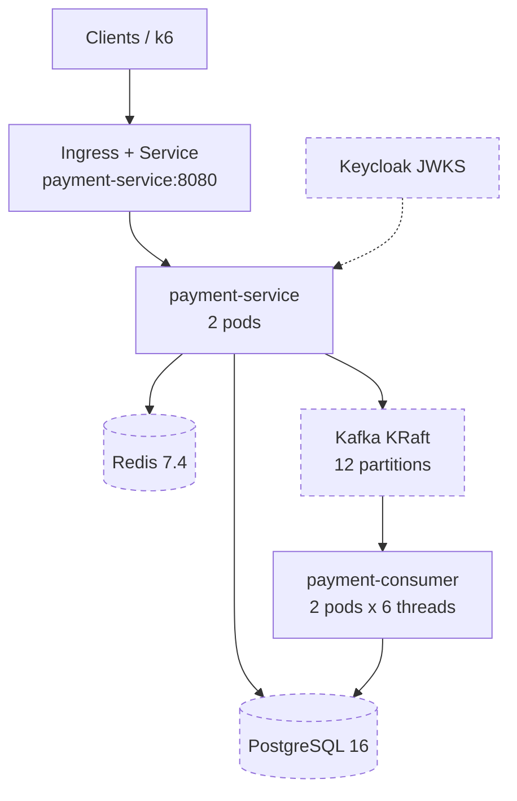

Both Deployments also read the ConfigMap `payment-config` and the Secret `payment-secrets` (omitted from the drawing for readability). PostgreSQL, Kafka, Redis, and Keycloak are provided dependencies, not part of the cluster manifests.

Both Deployments read the same ConfigMap and Secret (only one edge of each is drawn). PostgreSQL, Kafka, and Redis are **provided dependencies**; the project ships no operators for them.

### 15.2 Docker

Local development uses Docker Compose with PostgreSQL 16, Kafka (KRaft mode, no ZooKeeper), Redis 7.4, and Keycloak. The application image:

```dockerfile
# docker/payment-service.Dockerfile
FROM eclipse-temurin:21-jre
WORKDIR /app
COPY payment-service/target/payment-service.jar app.jar
ENV JAVA_OPTS="-XX:+UseG1GC -XX:MaxRAMPercentage=75"
EXPOSE 8080
ENTRYPOINT ["sh", "-c", "java $JAVA_OPTS -jar app.jar"]
```

The consumer image follows the same pattern on port `8081` (Actuator only).

### 15.3 Kubernetes objects

Two Deployments, two Services, one ConfigMap, one Secret.

```yaml
apiVersion: apps/v1
kind: Deployment
metadata:
  name: payment-service
spec:
  replicas: 2
  selector:
    matchLabels:
      app: payment-service
  template:
    metadata:
      labels:
        app: payment-service
    spec:
      terminationGracePeriodSeconds: 30
      containers:
        - name: payment-service
          image: payment-service:local
          ports:
            - containerPort: 8080
          envFrom:
            - configMapRef: { name: payment-config }
            - secretRef: { name: payment-secrets }
          readinessProbe:
            httpGet: { path: /actuator/health/readiness, port: 8080 }
            periodSeconds: 5
          livenessProbe:
            httpGet: { path: /actuator/health/liveness, port: 8080 }
            periodSeconds: 15
          lifecycle:
            preStop:
              exec:
                command: ["sh", "-c", "sleep 5"]
          resources:
            requests: { cpu: "250m", memory: "512Mi" }
            limits: { cpu: "1", memory: "1Gi" }
```

**Configuration (ConfigMap and Secret):**

```yaml
apiVersion: v1
kind: ConfigMap
metadata:
  name: payment-config
data:
  SPRING_DATASOURCE_URL: jdbc:postgresql://postgres:5432/payments
  SPRING_DATASOURCE_HIKARI_MAXIMUM_POOL_SIZE: "20"
  SPRING_DATASOURCE_HIKARI_CONNECTION_TIMEOUT: "2000"
  SPRING_KAFKA_BOOTSTRAP_SERVERS: kafka:9092
  SPRING_DATA_REDIS_HOST: redis
  SPRING_SECURITY_OAUTH2_RESOURCESERVER_JWT_ISSUER_URI: http://keycloak:8082/realms/payments
  OUTBOX_POLL_INTERVAL_MS: "200"
  OUTBOX_BATCH_SIZE: "50"
  OUTBOX_LEASE_SECONDS: "30"
---
apiVersion: v1
kind: Secret
metadata:
  name: payment-secrets
type: Opaque
stringData:
  SPRING_DATASOURCE_PASSWORD: "<set at deploy time>"
  SPRING_DATA_REDIS_PASSWORD: "<set at deploy time>"
```

Secrets (database and Redis passwords) come from Kubernetes Secrets or Compose environment files and are never committed to git.

### 15.4 Probes, resources, and scaling

| Setting | Value | Reason |
| --- | --- | --- |
| Readiness | `/actuator/health/readiness`, includes the DB indicator | A pod that cannot reach PostgreSQL should not get traffic |
| Liveness | `/actuator/health/liveness`, no dependencies | A DB outage must not restart-loop every pod |
| Startup | Optional `startupProbe` (~60 s) | JVM warm-up and Flyway migration must not trip liveness |
| CPU | Request 250m / limit 1 | Watch CFS throttling, which shows up as p99 spikes |
| Memory | 512 Mi / 1 Gi, `MaxRAMPercentage=75` | Heap sized from the container limit |
| HPA | Optional: CPU 70%, min 2, max 4 for `payment-service` | Max bounded by the DB connection budget |
| Consumer scaling | Manual; `replicas × concurrency ≤ 12` | Extra threads sit idle |
| PodDisruptionBudget | `minAvailable: 1` per Deployment | Node drains cannot remove all pods |

Kafka is **not** a readiness dependency for `payment-service` (the outbox absorbs broker loss); consumer readiness requires Kafka; Redis is not required for readiness.

### 15.5 Deployment flow and local setup

1. Start infrastructure: `docker compose -f docker/docker-compose.yml up -d postgres kafka redis keycloak`.
2. Build: `mvn -q -DskipTests package`.
3. Schema: Flyway runs on application start.
4. Run both services (or deploy the images to Kubernetes with rolling updates).
5. Seed balances with SQL (the API cannot mint money), then run `k6 run load-tests/payments.js`.

Typical local ports: API 8080, consumer Actuator 8081, PostgreSQL 5432, Kafka 9092, Redis 6379, Keycloak 8082.

<div style="page-break-before: always;"></div>

## 16. Observability

### 16.1 Signals

- **Actuator endpoints:** `/actuator/health`, `/health/liveness`, `/health/readiness`, `/actuator/prometheus`, `/actuator/metrics`.
- **Logs:** JSON with `correlationId` (from `X-Correlation-Id` or generated), `paymentId`, `idempotencyKey`. The JWT is never logged.
- **Tracing:** not required; Micrometer Tracing plus a collector could be added later.
- **Grafana dashboard:** POST p95, transfer rate, Kafka consume rate, 5xx rate, outbox lag, consumer lag, PostgreSQL CPU, Redis hit ratio.

### 16.2 Key metrics

| Metric | Type | Question it answers |
| --- | --- | --- |
| `http_server_requests_seconds_bucket{uri="/api/v1/payments",method="POST"}` | Histogram | POST p50 / p95 / p99 |
| `http_server_requests_seconds_count{status=~"5.."}` | Counter | 5xx rate |
| `payment_transfer_seconds` | Timer | Time inside the transfer transaction |
| `payment_transfer_outcome_total{outcome}` | Counter | completed, replayed, insufficient_funds, concurrent_update, … |
| `payment_transfer_retries_total` | Counter | Contention signal |
| `hikaricp_connections_pending`, `hikaricp_connections_acquire_seconds` | Gauge / Timer | Pool saturation |
| `outbox_pending`, `outbox_oldest_pending_age_seconds` | Gauge | Publication lag |
| `kafka_consumer_fetch_manager_records_lag_max` | Gauge | Consumer lag |
| `payment_consumer_dlt_total` | Counter | Poison messages |
| `cache_gets_total{result}` | Counter | Redis hit ratio |
| `jvm_gc_pause_seconds` | Timer | GC contribution to the tail |
| `container_cpu_usage_seconds_total{container="postgres"}` | Counter | DB CPU |

Representative PromQL:

```promql
# POST /payments p95 over 5 minutes, all pods merged
histogram_quantile(0.95,
  sum by (le) (rate(http_server_requests_seconds_bucket{uri="/api/v1/payments",method="POST"}[5m])))

# Successful transfers per minute
sum(rate(payment_transfer_outcome_total{outcome=~"completed|replayed"}[1m])) * 60

# Redis hit ratio
sum(rate(cache_gets_total{result="hit"}[5m])) / sum(rate(cache_gets_total[5m]))
```

Histogram buckets should include 50, 100, 150, 200, 300, 500 ms so that 200 ms is a bucket edge and the p95 estimate is accurate around the target.

### 16.3 Alerts

| Alert | Condition | Why |
| --- | --- | --- |
| PaymentP95High | POST p95 > 200 ms for 10 min | SLO breach |
| Payment5xxRate | 5xx > 1% for 5 min | Dependency or bug |
| HikariSaturated | `hikaricp_connections_pending > 0` for 5 min | Pool is the bottleneck |
| OutboxStuck | `outbox_oldest_pending_age_seconds > 120` | Kafka or publisher problem |
| ConsumerLagHigh | Lag > 10,000 for 10 min | Consumers falling behind |
| DLTNonEmpty | `increase(payment_consumer_dlt_total[15m]) > 0` | Manual action needed |

### 16.4 How an engineer would debug a production issue

This is a reasoning procedure built from the documented signals (the project does not prescribe a runbook beyond the alerts).

| Symptom | First check | Likely cause | Action |
| --- | --- | --- | --- |
| POST p95 high | `hikaricp_connections_pending`, acquire time | Pool saturation | Check slow queries in `pg_stat_statements`; check pool size vs budget |
| POST p95 high, pool fine | `payment_transfer_retries_total`, `pg_locks` waits | Hot account contention | Identify the account; consider pessimistic locking for it |
| Many `409 CONCURRENT_UPDATE` | Retry counter by account | Hot row | Same as above |
| `OutboxStuck` | Kafka broker health; publisher logs | Kafka down or publisher frozen | Payments are fine; watch the backlog drain after recovery |
| Audit rows missing | `payment_consumer_dlt_total`, consumer lag | Poison messages or consumer down | Fix, replay DLT (dedup makes it safe) |
| Stale balances reported | `cache_gets_total`, Redis health | Fill race or failed `DEL` | Bounded by 5 s TTL; explain `cached: true` |
| `503` spike | DB health, readiness | PostgreSQL outage | Recover DB; clients retry with the same key |

Trace a single payment end to end by searching logs for its `correlationId` and `paymentId`, then the matching `eventId` (equal to `outbox_events.id`) in the consumer logs.

<div style="page-break-before: always;"></div>

# Part 5: Interview Preparation

## 17. Complete 30-Minute Project Explanation

This is a speaking script for explaining the whole project continuously in about 30 minutes. Each segment has what to say (written to be spoken aloud), the technical details you need to understand behind the words, the diagram to draw, the points you must not forget, the interruption an interviewer is most likely to make, and a transition into the next segment.

**Honesty rule for the whole talk:** every throughput, latency, and percentage figure in this project (10K+ `POST /payments` per minute, < 200 ms p95, ~40% p95 reduction, ~30% database CPU reduction) is a **benchmark target**, not a measured result. Say so the first time you mention a number.

| Time | Segment |
| --- | --- |
| 0–2 min | 1. Problem statement and motivation |
| 2–5 min | 2. Requirements, scope, and technology stack |
| 5–10 min | 3. High-level design and architecture |
| 10–15 min | 4. Low-level design and component implementation |
| 15–19 min | 5. Core algorithms and data structures |
| 19–23 min | 6. APIs, database, concurrency, and consistency |
| 23–26 min | 7. Failure handling and recovery |
| 26–28 min | 8. Performance engineering and benchmarking |
| 28–30 min | 9. Trade-offs, limitations, and future improvements |

### Segment 1 (0–2 min): Problem statement and motivation

**What to say:**

> "This project is a payment backend for internal account-to-account transfers. Think of a wallet app where user A sends money to user B, both of whom hold accounts inside the same system, in the same currency. It is not a card processor and it does not talk to external banks.
>
> The interesting part is not moving a number from one row to another. It is doing that correctly when many things go wrong at once. I designed it around four problems.
>
> First, **two transfers racing for the same balance**. If an account has 1,000 and two requests each try to send 800 at the same moment, both can read 'balance is 1,000, that's enough' before either writes. Without protection the account ends at minus 600.
>
> Second, **client retries**. A mobile client sends a payment and times out. It cannot tell whether the payment never ran or ran and only the response was lost. If it retries blindly, the user pays twice.
>
> Third, **events without coupling to Kafka**. After a payment, other systems like audit need to know. If I publish to Kafka after the database commit and the process crashes in between, the event is lost forever. If I make Kafka part of the commit, a broker outage blocks payments that the database could have done perfectly well.
>
> Fourth, **fast reads without unsafe money decisions**. Balance reads should be fast, which suggests a cache, but a cache is stale by definition, so it must never be used to approve a debit.
>
> The rest of the design is the answer to those four problems."

**Technical details to understand:**
- A *transfer* is a debit on one account plus a credit on another, which must happen together or not at all.
- The race is a classic *lost update / overspend* problem. The retry problem is the *ambiguous outcome* of any network call. The Kafka problem is the *dual-write* problem (two systems cannot be committed atomically without a coordinator).
- Money is stored as integer **minor units** (cents) in `BIGINT` columns; overdrafts are prohibited.

**Diagram to draw:** nothing yet, or two boxes "Account A: 1,000" with two arrows "debit 800" racing toward it, to make the race concrete.

**Key points to remember:**
- Internal transfers only, same currency, PostgreSQL is the source of truth for money.
- Four problems: overspend race, retry duplicates, dual write, safe caching.

**Likely interruption:** *"Is this a real banking system?"* No. It is a two-service Spring Boot reference design, sized for one engineer, documented with an intended implementation and verification plan. Regulatory, PCI, and AML claims are explicitly out of scope.

**Transition:** "So given those four problems, let me say exactly what the system has to do and what I chose to build it with."

### Segment 2 (2–5 min): Requirements, scope, and technology stack

**What to say:**

> "Functionally, a user can create an account they own, which always starts with a zero balance, so the public API can never mint money. They can read the balance of accounts they own, transfer from an account they own to any other active account, and read a payment if they're on either side of it. Every successful transfer writes a double-entry ledger, publishes a payment event after the commit without ever losing it, and the event consumer retries failures and parks poison messages in a dead-letter topic.
>
> Non-functionally, the hard requirements are correctness ones: no negative balances, no partial transfers, a balanced ledger, at most one financial effect per idempotency key, and money must stay correct if Redis or Kafka is down. The performance requirements are benchmark targets: 10,000 or more `POST /payments` per minute, which is about 167 per second, at under 200 milliseconds p95 on that endpoint. I want to be clear that these are targets the design is sized for; nothing in the document is a recorded measurement.
>
> The stack is Java 21 and Spring Boot 3.4 for the two services, PostgreSQL 16 as the source of truth, Kafka for asynchronous events, Redis for read caching and rate limiting, HikariCP as the connection pool, Spring Security as an OAuth2 resource server that validates JWTs issued by Keycloak, and Docker plus Kubernetes for deployment, with k6 for load tests and Testcontainers for integration tests.
>
> Just as important is what I deliberately left out: card networks, external banks, FX, overdrafts, holds, two-phase commit, multi-region, and building my own authorization server. Leaving those out let me go deep on correctness."

**Technical details to understand:**
- *p95 latency* = the value 95% of requests are faster than. It describes the slow tail better than an average.
- *OAuth2 resource server* = the service only **validates** tokens (signature against the identity provider's JWKS keys, expiry, issuer, audience). It never issues them.
- PostgreSQL was chosen because only it offers multi-row ACID transactions, constraints, and row-level concurrency control. Redis as a ledger was rejected because it cannot do durable multi-row atomic transfers.

**Diagram to draw:** a small table on the whiteboard: "In scope / Out of scope", or skip and go straight to the architecture.

**Key points to remember:**
- Account creation always uses `owner_id = jwt.sub` and balance 0.
- Scopes (`payments.read`, `payments.write`) are capabilities; ownership is checked per row.
- 10K/min = about 167/s, POST only, GETs are extra and not counted. Target, not measurement.

**Likely interruption:** *"Is 167 per second a lot?"* Not for PostgreSQL. The interesting part is holding it with a full ACID transfer, an idempotency key, a ledger, and an outbox row in every transaction, at a tight p95.

**Transition:** "With that scope, here is the shape of the system."

### Segment 3 (5–10 min): High-level design and architecture

**What to say:**

> "There are two Spring Boot services and three data systems. I'll draw them.
>
> The client calls `payment-service` over HTTPS with a bearer JWT and an `Idempotency-Key` header. `payment-service` owns everything synchronous and financial: the REST API, JWT validation, ownership checks, the transfer transaction, writing outbox rows, and also running the outbox publisher in the background.
>
> PostgreSQL holds accounts, payments, ledger entries, idempotency keys, and the outbox table. It is the only place money lives.
>
> Kafka has one topic, `payment.events`, with 12 partitions, plus a dead-letter topic `payment.events.DLT`. The outbox publisher inside `payment-service` relays committed events into Kafka.
>
> `payment-consumer` is the second service. It is a Kafka consumer group that writes an audit row for each completed payment, and as a supplement it deletes cached Redis keys again.
>
> Redis caches account metadata and balances for GET requests and stores rate-limit counters. It is never on the debit path.
>
> The key property is that data flows one way. Money only moves on the **write path**: one PostgreSQL transaction. The **event path** reads committed facts and never changes balances. The **read path** uses the cache and never feeds back into writes. That is why a Kafka or Redis outage cannot corrupt a balance.
>
> One decision I want to call out: accounts are not a separate microservice. A transfer debits, credits, and writes the ledger. If accounts lived in another service with its own database, every transfer would need a distributed transaction or a saga. Keeping them in one ACID boundary is the central design decision. The cost is that both services share one PostgreSQL database, which is a known microservices anti-pattern. I accept it because the consumer only writes audit and dedup tables and never touches balances, and I have a migration path: the consumer could move to its own database because it only talks to the payment side through Kafka."

**Technical details to understand:**
- *Commit point* = the PostgreSQL `COMMIT` of the transfer transaction. A `201` response means the money moved. There is no `PENDING` financial state.
- Kubernetes runs 2 `payment-service` pods and 2 `payment-consumer` pods (listener concurrency 6 each, so 12 threads for 12 partitions).
- The solid API → Redis edge is post-commit invalidation plus cache-aside reads; the consumer → Redis edge is supplemental only.

**Diagram to draw:** Client → `payment-service` (API, domain, outbox publisher) → PostgreSQL; `payment-service` → Redis; outbox publisher → Kafka `payment.events` → `payment-consumer` → PostgreSQL (audit) and Redis (supplemental delete), and → DLT. Then label three paths: write (solid), event (async), read (cache-aside).

**Key points to remember:**
- Two services, three data systems, one-way data flow.
- Accounts stay inside `payment-service` to avoid 2PC; shared database accepted and defended.

**Likely interruption:** *"Isn't a shared database a microservices anti-pattern?"* Yes, and I say so first. The consumer is not a second owner of balances; it writes only `audit_log` and `processed_events`, which reference payments logically without foreign keys, so the split is ready. The risks are resource contention, schema coupling, and shared blast radius.

**Transition:** "Let me zoom into `payment-service` and show how a transfer is actually implemented."

### Segment 4 (10–15 min): Low-level design and component implementation

**What to say:**

> "Inside `payment-service`, requests pass through the Spring Security filter chain, which validates the JWT, then a rate-limit filter, then a thin controller. Controllers never open transactions. The only class that defines the money transaction boundary is `PaymentService`.
>
> `PaymentService.transfer` is a facade. It first validates the request shape, things like amount must be positive and source must differ from destination, without touching the database. Then it computes a SHA-256 hash of the canonical request body. Then it runs `executeNew` inside a transaction.
>
> One subtle implementation point: Spring's `@Transactional` works through a proxy. If the facade called `this.executeNew()`, the call would bypass the proxy and no transaction would start, so each statement would auto-commit and a debit could commit without its credit. So the facade runs `executeNew` through a `TransactionTemplate`, which also gives me savepoints.
>
> Inside `executeNew`, in order: insert the idempotency key row; create a savepoint; load both accounts by primary key and check that the caller owns the source, both are active, and currencies match; update the two accounts in ascending id order with conditional updates; insert the payment row, two ledger rows, and one outbox row; write the HTTP status and response body onto the idempotency row; commit. After commit, a registered callback deletes the two accounts' Redis keys, best effort, and the API returns `201`.
>
> All account changes use explicit modifying queries like `debitIfSufficient`, not Hibernate dirty checking, because rolling back to a savepoint does not undo Hibernate's in-memory entity state.
>
> The other background components are the `OutboxPublisher`, which runs every 200 milliseconds on each pod, and two cleanup jobs: idempotency keys older than 24 hours and published outbox rows older than 7 days.
>
> On threading: Tomcat has up to 200 request threads, but the real concurrency limit for writes is the HikariCP pool, 20 connections per pod, so at most 40 transfer transactions are in flight across two pods. Extra requests wait for a connection for up to 2 seconds and then get `503`."

**Technical details to understand:**
- Patterns: Facade (`PaymentService.transfer`), Template method (`TransactionTemplate`), Repository, Transactional outbox, Idempotent receiver, Cache-aside, Chain of responsibility (filter chain), DTO.
- Retries live in the facade; each retry is a new transaction with freshly loaded versions.
- `KafkaConsumer` is not thread-safe; Spring gives each listener thread its own consumer, so listener threads must not exceed partitions.

**Diagram to draw:** the component box diagram inside the pod: filter chain → RateLimitFilter → controllers → `PaymentService` → `IdempotencyService` and repositories → PostgreSQL; `AccountCacheService` → Redis; `OutboxPublisher` → Kafka.

**Key points to remember:**
- One transaction, about 10 SQL round trips, all by primary key or unique index.
- `TransactionTemplate` avoids the `@Transactional` self-invocation trap.
- Pool size, not Tomcat threads, bounds concurrent writes.

**Likely interruption:** *"Why not just put `@Transactional` on `transfer`?"* Because the facade must catch a unique-violation error and then start a **new** transaction to read the winner's row. After a unique violation PostgreSQL marks the current transaction aborted, so the retry and replay logic has to sit outside the transaction.

**Transition:** "That ordering of steps hides the two algorithms that make the system correct, so let me explain them properly."

### Segment 5 (15–19 min): Core algorithms and data structures

**What to say:**

> "The first algorithm is the **conditional update**, my optimistic-locking compare-and-set. Every account has a `version` column. The debit is one SQL statement:
> `UPDATE accounts SET balance = balance − amount, version = version + 1 WHERE id = ? AND version = ? AND status = 'ACTIVE' AND balance >= amount`.
> If it updates one row, the debit happened. If it updates zero rows, I reload the account and classify why: missing account is 404; inactive is a 422; if the balance is now below the amount, that's `422 INSUFFICIENT_FUNDS` and I don't retry; only if funds are still sufficient but the version changed do I treat it as a conflict and retry the whole transaction, at most three attempts with 10 to 50 milliseconds of jittered backoff.
>
> Walk through the race: balance 1,000, two 800 debits with different keys. T1's update matches and takes a row lock. T2's update on the same row waits for that lock. When T1 commits, PostgreSQL re-evaluates T2's WHERE clause against the new row, sees balance 200 and version 1, and matches zero rows. T2 reloads, sees 200 is less than 800, and returns 422. Checking funds before version matters: otherwise T2 would retry pointlessly and finally return a misleading 409.
>
> I want to be precise: this is not lock-free. The update takes a row lock until commit. 'Optimistic' means I never hold a lock between reading and writing.
>
> To avoid deadlocks when A pays B while B pays A, every transaction updates the two accounts in ascending id order, which breaks the circular-wait condition. Deadlocks are still possible through other locks, so I still retry PostgreSQL's deadlock error `40P01`.
>
> The second algorithm is the **unique-insert idempotency mutex**. The first statement of the transaction inserts `(subject, idempotency_key)`, which is the primary key. If two identical requests arrive at once, the second insert **blocks** on the first one's uncommitted index entry. If the first commits, the second gets unique-violation `23505`, rolls back, opens a fresh transaction, reads the stored response and returns it as a `200` replay, or `409` if the request hash differs. If the first rolls back, the second's insert succeeds and it becomes the only one allowed to debit. The lock and the money commit or vanish together, so there is no window where a key is reserved but the outcome is unknown.
>
> Other techniques: a double-entry ledger, two equal rows per payment; keyset pagination for payment history, which is `O(log n + limit)` per page; and a sliding-window rate limiter in Redis using two minute counters in a Lua script."

**Technical details to understand:**
- Under `READ COMMITTED`, a blocked `UPDATE` re-checks its predicate on the newest row version (PostgreSQL's EvalPlanQual). That is why the predicate approach is correct without `SERIALIZABLE`.
- Complexity of one transfer: a constant number of B-tree operations, `O(log n)` each, multiplied by at most 3 attempts.
- Rate-limit estimate: `current + previous × (1 − elapsed fraction of the current minute)`.
- Request hash: SHA-256 over canonical `sourceAccountId`, `destinationAccountId`, `amountMinor`, `currency`, `description`.

**Diagram to draw:** a two-column timeline T1 / T2 for the 1,000 / 800 / 800 race, and a second timeline for two same-key requests showing "blocks → 23505 → new transaction → replay".

**Key points to remember:**
- Idempotency key solves *duplicate retries of one payment*; optimistic locking solves *two different payments overspending*. You need both.
- Insufficient funds is terminal (422, stored); version conflict is retryable (rolled back).

**Likely interruption:** *"Why not `SELECT ... FOR UPDATE`?"* It would hold a lock from read through application logic to commit, with no correctness gain over the predicate. I'd switch to it only for a small set of very hot accounts, where serializing beats a retry storm.

**Transition:** "Those algorithms lean heavily on the schema and on the API contract, so let me show those, and then talk about consistency."

### Segment 6 (19–23 min): APIs, database, concurrency, and consistency

**What to say:**

> "The API is REST under `/api/v1`, bearer JWT on every endpoint. `POST /accounts` creates an account for the caller with zero balance. `GET /accounts/{id}` and `/balance` read owned accounts, possibly from cache, with a `cached` flag in the response. `POST /payments` requires an `Idempotency-Key` of 16 to 128 characters. It returns `201` on first execution, `200` on a replay with the original body, `409 IDEMPOTENCY_KEY_REUSED` for the same key with a different body, `422` for insufficient funds or inactive accounts, `409 CONCURRENT_UPDATE` with `retriable: true` when contention retries run out, `429` when rate limited, and `503` if the database is unavailable. `GET /payments/{id}` requires being a party to the payment, and payment history uses an opaque keyset cursor.
>
> The schema: `accounts` with a `version` column and `CHECK (balance_minor >= 0)`; `payments`; `ledger_entries` with a unique index on payment and entry type, so at most one debit and one credit per payment; `idempotency_keys` with primary key subject plus key, storing the request hash and the response body as JSONB; `outbox_events` with status `PENDING`, `PUBLISHING`, or `PUBLISHED` plus lease columns; and on the consumer side `processed_events` and `audit_log`.
>
> One honest point: a row-level CHECK can only see one row, so 'debit equals credit' is not a database constraint. It is guaranteed because the application writes both rows with the same amount variable in one transaction, and verified by integration tests and a reconciliation query.
>
> I also denormalized deliberately: the balance column is derivable from the ledger, but storing it makes the debit check `O(1)` inside the conditional update.
>
> Indexes: partial indexes on unpublished outbox rows and on completed idempotency keys keep polling and cleanup proportional to the small backlog, not the whole table; composite history indexes serve keyset pagination.
>
> For consistency guarantees: no negative balance, no partial transfer, at most one financial effect per subject and key within 24 hours, and every committed payment's event is eventually published. What I do **not** guarantee: exactly-once event publication, global ordering, or fresh cached balances, which can be up to five seconds stale."

**Technical details to understand:**
- Terminal business failures commit the key row with the stored error; version conflicts, deadlocks, `404`, and `403` roll back the whole transaction including the key insert.
- Idempotency keys are scoped per subject, so two users can reuse the same header value, and one user cannot probe another's stored responses.
- Replay returns `200` rather than `201` because nothing new was created; the important property is the identical body and `paymentId`.

**Diagram to draw:** the ER diagram: ACCOUNTS → PAYMENTS (source, destination); PAYMENTS → LEDGER_ENTRIES (exactly two); PAYMENTS ↔ IDEMPOTENCY_KEYS; PAYMENTS → OUTBOX_EVENTS → PROCESSED_EVENTS; PAYMENTS → AUDIT_LOG.

**Key points to remember:**
- Status codes: 201 / 200 replay / 409 reused key / 422 business / 409 retriable contention.
- Row-level invariants are constraints; cross-row invariants are transactional guarantees plus tests.

**Likely interruption:** *"Is READ COMMITTED enough? What about write skew?"* Write skew needs two transactions that write *different* rows based on overlapping reads. Here every invariant is checked in the statement that writes the row, and conflicting transfers write the same row. If I later added a rule like a per-customer daily limit computed by summing rows, I'd materialize it as a row updated conditionally, because that rule would be vulnerable to write skew.

**Transition:** "So far I've described the happy path. Most of the design effort went into what happens when things fail."

### Segment 7 (23–26 min): Failure handling and recovery

**What to say:**

> "Let me walk failure points in order.
>
> Crash before commit: PostgreSQL rolls everything back, including the idempotency insert, so nothing happened and a waiting duplicate may become the winner.
>
> Crash after commit but before the response: the client times out and retries with the same key; the insert fails with a unique violation; the replay returns `200` with the same `paymentId`. The outbox row was committed with the money, so any pod's publisher will still publish the event.
>
> Kafka down: transfers keep succeeding because Kafka isn't in the commit. That is the whole point of the **transactional outbox**. The transfer transaction inserts an outbox row with status `PENDING`. Every 200 milliseconds a publisher claims up to 50 rows with an `UPDATE ... WHERE id IN (SELECT ... FOR UPDATE SKIP LOCKED)` that sets status `PUBLISHING` with a 30-second lease, commits that claim, sends to Kafka with `acks=all`, and only after the broker acknowledges marks them `PUBLISHED`. If a publisher dies, its lease expires and another pod reclaims the rows. The producer's delivery timeout is 20 seconds, deliberately shorter than the 30-second lease.
>
> There is one window I cannot close: Kafka acknowledges, then the publisher crashes before marking the row published. The row is reclaimed and sent again. So publication is at-least-once, and the consumer must be idempotent. It inserts the event id into `processed_events` and the audit row in one transaction, treats a duplicate key as success, and commits the Kafka offset only after the database commit. Dedup rows live 14 days, longer than the 7-day topic retention, so a replayed event is still recognized.
>
> Consumer failures: one attempt plus three retries with 1, 2, and 4 second backoff, then the record goes to the dead-letter topic with exception headers and the partition moves on. Replay from the DLT is a manual operation and is safe because of dedup.
>
> Redis down: commands time out after 50 milliseconds and the system fails open. Reads go to PostgreSQL, rate limiting is skipped, deletes are skipped, and payments continue.
>
> Health checks are split: readiness includes the database so a pod that can't reach PostgreSQL stops getting traffic; liveness has no dependencies so a database outage doesn't restart every pod."

**Technical details to understand:**
- Why not `@TransactionalEventListener(AFTER_COMMIT)`? It still loses the event if the process dies before the send.
- Why not Kafka transactions? They make Kafka writes atomic with each other, not with PostgreSQL.
- Graceful shutdown: drain requests, stop claiming outbox rows, stop the listener after the current record; leases expire for anything left.

**Diagram to draw:** the outbox state machine `PENDING → PUBLISHING (lease 30 s) → PUBLISHED`, with an arrow "lease expired → reclaim", and a crash-point table next to it.

**Key points to remember:**
- Money is exactly-once (in the database); events are at-least-once; side effects are effectively once through dedup.
- Lease 30 s > delivery timeout 20 s.

**Likely interruption:** *"Then why not exactly-once with Kafka?"* Because exactly-once needs one atomic boundary, and here there are two systems. The honest guarantee is to make the receiver idempotent and claim effectively-once side effects.

**Transition:** "Correctness is the first priority; the second is meeting the latency target, so here is how I'd engineer and prove the performance."

### Segment 8 (26–28 min): Performance engineering and benchmarking

**What to say:**

> "An uncontended transfer is roughly 10 to 25 milliseconds of real work: about ten indexed statements plus the commit's WAL flush. That's an illustrative budget, not a measurement. So a 200 millisecond p95 budget is mostly about **queueing**: waiting for a pooled connection or a row lock.
>
> The levers therefore target queueing. First, HikariCP sizing. By Little's law, busy connections equal arrival rate times hold time: 167 per second times 15 to 40 milliseconds is only about 2.5 to 7 connections on average, but bursts plus GET traffic push utilization up, and queueing delay explodes near full utilization. The baseline uses a pool of 5 per pod; the optimized configuration uses 20, within the connection budget of PostgreSQL's 100 connections. Second, partial indexes so the outbox poll and cleanup jobs stop scanning ever-growing tables. Third, short transactions with no network I/O inside. Fourth, Redis cache-aside for GETs, which mainly reduces database CPU, not POST latency.
>
> The resume figures, about 40% lower p95 and about 30% lower database CPU, are targets for an A/B benchmark: same code, baseline versus optimized, same open-loop arrival rate of 167 POST per second plus background GETs, a 2-minute warm-up discarded, 10 minutes steady, three runs each, and an ablation adding one lever at a time. I'd use k6's arrival-rate executor to avoid coordinated omission, and merge histograms rather than average percentiles across pods."

**Technical details to understand:**
- `reduction = (baseline − optimized) / baseline`; ILLUSTRATIVE: 300 ms → 180 ms = 40%.
- A pool of 5 is deliberately under-provisioned and must be disclosed; a fairer comparison includes Hikari's default of 10.
- Rejected optimizations: batching transfers in one transaction, replica reads for balance checks, `synchronous_commit = off`, pessimistic locking.

**Diagram to draw:** a latency bar: JWT 1–3 ms | rate limit < 1 ms | **pool wait (variable)** | SQL 5–15 ms | commit 1–5 ms | Redis delete < 1 ms, with "queueing" highlighted.

**Key points to remember:**
- The p95 budget is mostly queueing; the pool is the main lever for POST p95, indexes and Redis for CPU.
- All four numbers are targets; the benchmark method is the defence.

**Likely interruption:** *"Isn't a pool of 5 a strawman baseline?"* It is under-provisioned and I disclose it; that is why I'd also compare against the default and show absolute p95 values next to the percentage.

**Transition:** "Let me finish with what I'd change and what I deliberately accepted."

### Segment 9 (28–30 min): Trade-offs, limitations, and future improvements

**What to say:**

> "The main trade-offs: a single PostgreSQL primary is the write-scaling ceiling, which I accept for ACID transfers. Optimistic locking is great when load is spread, but a very hot account serializes on one row and produces retries and `409`s; the mitigation there is pessimistic locking or sub-account bucketing for those accounts. The polling outbox adds about 200 milliseconds of event delay and some database load; at higher scale I'd move to change-data-capture with Debezium. Event order per account isn't strictly preserved because several publishers can send one account's events out of order. Cached balances can be up to five seconds stale, including through a cache-fill race that post-commit deletes cannot close. Idempotency keys expire after 24 hours. The services share a database. And there is no mTLS and no JWT revocation check before expiry.
>
> Future improvements, none of which are implemented: time-partitioned tables for idempotency keys and the outbox, a read replica for history only, never for balances, CDC for the outbox, OpenTelemetry tracing, and sharding accounts with a saga for cross-shard transfers if the load ever demanded it.
>
> To summarize the whole system in one sentence: one ACID transaction is the single source of truth for money, and everything after it, events, audit, cache invalidation, is asynchronous, idempotent, and retryable."

**Technical details to understand:**
- Async replication failover could lose an acknowledged commit; the fix is a synchronous standby. The README lists "single region, DB failover loses in-flight transactions" as a limitation.
- Sharding would break the single-database idempotency mutex unless the key row lives on the source account's shard.

**Diagram to draw:** none; point back at the architecture and the three paths.

**Key points to remember:**
- Limitations are deliberate and documented; improvements are future work, not implemented.
- The one-sentence summary above.

**Likely interruption:** *"If you could change one decision, what would it be?"* At higher scale, polling outbox to CDC, to cut relay latency and polling load. At this scale, polling is simpler and easier to debug.

**Closing:** "That's the end-to-end picture. I'm happy to go deeper on any part: the concurrency algorithm, the outbox, or how I'd run the benchmark."

**How to practise:** read each "What to say" block aloud with a timer. Then close the booklet and redraw the segment's diagram from memory while speaking. Aim to finish within 30–32 minutes; if you overrun, shorten Segments 4 and 8 first, never Segments 5 and 7.

<div style="page-break-before: always;"></div>

## 18. Existing Interview Question Bank

These are the project's 45 existing questions and answers (15 easy, 15 medium, 15 hard), reproduced in full. Cross-references such as "Hard Q8" point to questions in this section. Section numbers mentioned inside answers refer to the original project document; the same material is covered in this booklet (database in Section 8, algorithms in Section 9, failures in Section 12).

**Ground rules for answering:** every throughput, latency, and percentage figure is a **BENCHMARK TARGET / UNVERIFIED**. Configuration values (pool sizes, TTLs, timeouts, partition counts) are the design's starting points.

### Easy Questions (Top 15)

#### Q1. Give me a quick overview of this project. What does it do, and what is deliberately out of scope?

**Answer:**
- **What it is:** a backend for **internal account-to-account transfers** in a single currency. It has two Spring Boot services (Java 21), `payment-service` and `payment-consumer`, plus PostgreSQL, Kafka, and Redis, all running on Kubernetes.
- **The four problems it solves:**
  1. Two concurrent transfers must never overspend one account.
  2. A client retry after a timeout must never double-post.
  3. Every committed payment must produce an event, without making payments depend on Kafka being up.
  4. Reads should be fast, but a cache must never be used to make a money decision.
- **Out of scope, on purpose:** card networks, external banks, FX, overdrafts, holds, 2PC, multi-region, and building an OAuth authorization server. Keeping the scope small lets the project go deep on correctness.
- **Honesty line:** "This is a reference design. The 10K/min and p95 figures are benchmark targets, and the doc includes the method to verify them."

#### Q2. What is the role of PostgreSQL, Kafka, and Redis? Why not let one of them do everything?

**Answer:**

| System | Role | What it is *not* |
| --- | --- | --- |
| PostgreSQL | Source of truth: balances, payments, ledger, idempotency keys, outbox | Not optional. If it is down, no money moves (`503`) |
| Kafka | At-least-once delivery of **already-committed** payment facts to the audit consumer | Not part of the commit. It never creates or rolls back money |
| Redis | Cache for GET account and balance, plus a best-effort rate limiter | Never read by a debit. Fails open |

- **Why this split:** money needs multi-row atomicity, constraints, and durability. Only PostgreSQL provides all three here.
- The data flow is one-way: **write path → event path**, with a **read path** that never feeds back into writes. That is why a Kafka or Redis outage cannot corrupt a balance.
- **Trade-off:** a single PostgreSQL primary is the ceiling for write throughput.

#### Q3. Why two services? And why are accounts not their own microservice?

**Answer:**
- `payment-service` owns everything synchronous and financial: the API, JWT checks, the transfer transaction, outbox writes, and the outbox publisher.
- `payment-consumer` owns asynchronous audit work. It can scale, lag, or crash on its own without touching the payment p95.
- **Why accounts are not separate:** a transfer debits and credits accounts *and* writes the ledger. If accounts had their own database, every transfer would need 2PC or a saga with compensation. Keeping them inside one ACID boundary is the central design decision.
- **Weakness to admit up front:** both services share one PostgreSQL database, which is a known microservices anti-pattern (see Hard Q8).

#### Q4. What is an idempotency key, and why does a payment API need one?

**Answer:**
- **The problem:** a client sends `POST /payments` and times out. It cannot tell "never executed" from "executed, but the response was lost." Retrying blindly could pay twice.
- **The fix:** the client generates a unique `Idempotency-Key` header (16–128 characters, UUIDv4 recommended) and sends **the same key on every retry** of that payment.
- **In this project:**
  - The key is stored in `idempotency_keys` with primary key `(subject, idempotency_key)`, where `subject` is the JWT `sub`.
  - The first execution stores the HTTP status and response body on that row.
  - A retry finds the row and replays the stored body as `200`, so no second debit happens.
  - Keys are scoped per user, so two users can use the same header value without colliding.
  - Completed keys are deleted after **24 hours**, which is the idempotency window.
- **Key line:** "It turns an at-least-once client into an exactly-once financial effect."

#### Q5. Why store money as `BIGINT` minor units?

**Answer:**
- `amount_minor = 80000` means $800.00. Integer arithmetic is exact and fast.
- **Floats are never acceptable:** `0.1 + 0.2 != 0.3` in binary floating point, and rounding errors add up across millions of postings.
- **`NUMERIC` alternative:** also exact, but slower, and it invites fractional-cent values the business does not allow.
- The `CHECK (balance_minor >= 0)` and `CHECK (amount_minor > 0)` constraints work naturally on integers.
- **Caveat:** different currencies have different minor-unit exponents (for example, 0 or 3 decimals). That is safe here because transfers are same-currency only and `currency` is stored on every row. Multi-currency support would need per-currency scaling rules.

#### Q6. What is a double-entry ledger, and why keep both a ledger and a `balance_minor` column?

**Answer:**
- Every successful payment writes **two immutable rows** to `ledger_entries`: a `DEBIT` on the source and a `CREDIT` on the destination, with the same amount and currency and the same `payment_id`.
- **Why the ledger:** a balance column alone cannot explain *why* it changed. The ledger is the audit trail and makes reconciliation a SQL query: `balance = opening + credits − debits`.
- **Why also a balance column:** a deliberate denormalization so the debit check is `O(1)` inside one conditional `UPDATE`. Summing the ledger on every transfer would be slow and racy.
- **They cannot drift on a crash** because both are written in the same transaction.
- **Limitation:** "debit amount equals credit amount" is **not** a database constraint. A `CHECK` only sees one row. `UNIQUE (payment_id, entry_type)` stops two DEBITs but does not compare amounts. Equality is guaranteed by the application and checked by tests and a reconciliation query.

#### Q7. What is optimistic locking, and how does the `version` column work here?

**Answer:**
- **Concept:** you don't lock when you read. At write time you check that nothing changed since your read. If something did, the write affects 0 rows and you react.
- **In this project:** every account has a `version BIGINT`. The debit is a single SQL statement:
  ```sql
  UPDATE accounts SET balance_minor = balance_minor - :amt, version = version + 1
   WHERE id = :id AND version = :v AND status = 'ACTIVE' AND balance_minor >= :amt;
  ```
  - 1 row updated: success.
  - 0 rows updated: reload the account and decide whether funds are insufficient or someone else changed the version.
- **Important nuance:** this is not lock-free. The `UPDATE` still takes a row lock until commit. "Optimistic" only means no lock is held between the read and the write.
- **Why it fits:** load is spread across many accounts, so conflicts are rare and you avoid long `SELECT ... FOR UPDATE` locks.

#### Q8. How do authentication and authorization work?

**Answer:**
- **Authentication:** `payment-service` is an **OAuth2 resource server**. It only validates JWTs issued by an external IdP (Keycloak in dev). It checks the signature against JWKS, `exp`/`nbf`, `iss`, and `aud`.
- **Authorization has two layers:**
  1. **Scopes are capabilities:** `payments.read` and `payments.write`.
  2. **Ownership is per row:** `jwt.sub` must own the account.
     - Create account: `owner_id = sub`, opening balance always 0, so the API cannot mint money.
     - Transfer: you must own the **source**. The destination can be anyone's active account.
     - Get payment: you must own the source or the destination.
- A missing scope returns `403 FORBIDDEN`. Wrong ownership returns `403 ACCOUNT_ACCESS_DENIED`.
- **Why both layers:** scopes alone would let any token holding `payments.write` debit any account. That is the classic broken-object-level-authorization (BOLA/IDOR) bug.

#### Q9. Why use Kafka at all, and what does the consumer do?

**Answer:**
- After a payment commits, a `PAYMENT_COMPLETED` event goes to topic `payment.events`. Consumer group `payment-audit-consumers` reads it, writes an `audit_log` row, and does a supplemental Redis eviction.
- **Why asynchronous:**
  - Audit work stays out of the request path, so POST p95 does not include it.
  - The consumer can be down for hours and catch up later from the retained topic (7-day retention).
  - It is durable fan-out: new downstream consumers can be added without touching the payment code.
- **Trade-off:** audit is **eventually consistent**, and you have to operate a broker.
- **Key point:** Kafka carries facts that already happened. It is not where a payment gets decided.

#### Q10. What is the transactional outbox, in simple terms?

**Answer:**
- **The problem (dual write):**
  - Commit to the DB, then publish to Kafka: a crash between the two loses the event.
  - Publish first, then commit: you may announce a payment that later rolled back.
- **The fix:** inside the **same** transaction as the money, insert a row into `outbox_events` with status `PENDING`. Either the payment and its event intent both commit, or neither does.
- A separate `OutboxPublisher` (runs every 200 ms in each API pod) reads pending rows, sends them to Kafka, and marks them `PUBLISHED` after the broker acks.
- **Result:** no event is lost once money is committed, and a Kafka outage does not block payments.
- **Cost:** at-least-once delivery (duplicates are possible), roughly 200 ms of extra event latency, and some polling load on PostgreSQL.

#### Q11. What does Redis cache, and why is it never used to approve a debit?

**Answer:**

| Key | TTL | Purpose |
| --- | --- | --- |
| `account:meta:{id}` | 60 s | Owner, currency, status for GET account |
| `account:balance:{id}` | 5 s | GET balance only |
| `ratelimit:{subject}:{minute}` | 120 s | Sliding-window rate limit |

- **Cache-aside:** read Redis; on a miss, read PostgreSQL and `SET` with the TTL. After a transfer commits, `DEL` both accounts' keys.
- **Never for debits:** a cache is stale by definition. Approving a debit from a 5-second-old balance could overspend. The debit only trusts the conditional `UPDATE` in PostgreSQL.
- **Fail-open:** Redis has a 50 ms command timeout. If Redis is down, GETs go to PostgreSQL, rate limiting is skipped, and payments continue.
- Responses carry `cached: true/false` so clients know a balance might be up to about 5 s stale.

#### Q12. What status codes can `POST /payments` return, and what does each mean?

**Answer:**

| Code | Meaning | Client should |
| --- | --- | --- |
| `201` | First successful execution for this `(sub, key)` | Done |
| `200` | Replay: same key and same body; original response returned | Done (same `paymentId`) |
| `400` | Validation (amount ≤ 0, same account, missing key) | Fix the request |
| `401` / `403` | Bad token, missing scope, or you don't own the source | Fix auth |
| `404` | Unknown account | Fix the IDs |
| `409 IDEMPOTENCY_KEY_REUSED` | Same key, **different** body | Client bug; use a new key |
| `409 CONCURRENT_UPDATE` | Contention retries exhausted (`retriable: true`) | Retry with the **same** key |
| `422` | Insufficient funds, frozen/closed account, currency mismatch | Don't retry blindly |
| `429` / `503` | Rate limited, or DB unavailable (`Retry-After`) | Back off and retry with the same key |

- **Why `422` for insufficient funds:** the request is valid (so not `400`), and retrying won't fix it (so not `409`).

#### Q13. How do consumer retries and the dead-letter topic work?

**Answer:**
- Spring Kafka's `DefaultErrorHandler` makes **1 attempt plus 3 retries**, with exponential backoff of 1 s, 2 s, then 4 s, and only for transient exceptions.
- Deserialization and validation errors are marked **not retryable** and go straight to `payment.events.DLT` through the `DeadLetterPublishingRecoverer`, along with exception headers.
- Once a record is in the DLT, its offset is committed and the partition moves on, so one poison message cannot block the partition forever.
- **Replay:** after fixing the bug, an operator republishes DLT records to `payment.events`. This is safe because the consumer deduplicates on `eventId`.
- **Trade-off:** retries are **blocking**. A failing record stalls its partition for about 7 s of backoff. Non-blocking retry topics would avoid that, at the cost of more topics and weaker ordering.

#### Q14. When exactly is a payment "done"? What if the client got `201` but the consumer hasn't run yet?

**Answer:**
- **The commit point is the PostgreSQL `COMMIT`** of the transfer transaction. Kafka and Redis are both outside that path.
- With `201`, the payment, both ledger rows, both balance updates, and the outbox row are durable. `GET /payments/{id}` shows `COMPLETED`.
- There is **no `PENDING` financial state**. The only possible status value is `COMPLETED` (`CHECK (status IN ('COMPLETED'))`).
- Still catching up after `201`: Kafka publication, the audit row, and possibly a stale cached balance for up to 5 s.
- If the pod crashes **after** commit but before responding, the client times out and retries with the same key. It gets a `200` replay with the same `paymentId`, and the outbox row is still published by any pod.

#### Q15. Your resume says 10K+ requests/min at < 200 ms p95. Are those measured?

**Answer:**
- **No. They are benchmark targets the design is sized for**, labeled UNVERIFIED in the doc. No result table has been filled in.
- **What they mean precisely:**
  - 10K+ means at least 10,000 `POST /payments` per minute (about 167/s), each a full ACID transfer. GETs are extra and not counted.
  - < 200 ms p95 means that, at that load, 95% of POSTs finish in under 200 ms, measured client-side by k6.
- **How I'd verify it:** k6 open-loop arrival rate at 167 POST/s, plus about 500 GET/s of background load, a 2-minute warm-up that is discarded, a 10-minute steady window, three runs, and SQL invariant checks afterwards.
- **Perspective:** 167 TPS is modest for PostgreSQL. The interesting part is holding it with idempotency, a ledger, and an outbox inside every transaction.

> **Likely follow-up:** *"Then why put it on your resume?"* Say it describes the design target and how it is validated, and never present it as a production metric.

### Medium Questions (Top 15)

#### Q1. Walk me through exactly what happens inside the transfer transaction.

**Answer:**
`PaymentService.transfer` (the facade) validates the request shape (bad requests are `400`s with no DB work), then computes a SHA-256 request hash. It then runs `executeNew` in one `READ COMMITTED` transaction:

```text
BEGIN
 1. INSERT idempotency_keys(subject, key, hash)  -- the mutex; blocks a concurrent same-key insert
 2. SAVEPOINT sp_after_key
 3. SELECT source, destination by PK; check caller owns source (else 403 → full rollback)
    check ACTIVE + same currency
 4. Sort the two ids; run debitIfSufficient / creditIfActive in ascending-id order
 5. INSERT payments (COMPLETED), 2 ledger rows, 1 outbox row (PENDING)
 6. UPDATE idempotency row: http_status=201, response_body, completed_at
COMMIT
 7. afterCommit: best-effort Redis DEL for both accounts → return 201
```

- That is roughly 10 SQL round trips. Everything uses a primary key or a unique index, so the complexity is `O(log n)` with a small constant.
- **No network I/O inside the transaction:** no Kafka and no Redis, so lock-hold time equals DB work time.
- **Failure branches:**
  - `23505` on the key insert: replay in a new transaction (Medium Q3).
  - Version conflict or deadlock: full rollback, then retry (Medium Q6).
  - Terminal business failure: roll back to the savepoint and store the error (Medium Q5).

#### Q2. The conditional `UPDATE` returns 0 rows. How do you decide what happened?

**Answer:**
Zero rows can mean several things, so the code **re-`SELECT`s the account** and classifies the result in a fixed order:

1. Account missing → `404` (shouldn't happen because of the FK).
2. `status != 'ACTIVE'` → `422 ACCOUNT_NOT_ACTIVE` (terminal).
3. Source and `balance_minor < amount` → `422 INSUFFICIENT_FUNDS` (terminal, **even if the version also changed**).
4. `version != expected` → version conflict, roll back and retry.
5. Anything else → treat as a conflict and retry.

- **Why funds are checked before version:** in the "1,000 balance, two 800 debits" race, the loser sees `version = 1` **and** `balance = 200`. Calling that a version conflict would waste three retries and then return a misleading `409`. Checking funds first returns the correct `422` right away.
- **Example:** T1 debits 800 and commits. T2 was waiting on the row lock. It re-evaluates `version = 0 AND balance >= 800` against the new row, matches 0 rows, reloads, sees 200 < 800, and returns `422`.
- A unit test pins this down: a reloaded `(balance=200, version=1)` with expected version 0 and amount 800 must return `INSUFFICIENT_FUNDS`, never `RETRY`.

#### Q3. Two requests arrive at the same moment with the same user and the same new idempotency key. What happens inside PostgreSQL?

**Answer:**
- Both open a transaction and `INSERT (subject, key)`. The composite primary key's unique index allows only one in-flight inserter.
- **The loser's `INSERT` blocks** on the winner's uncommitted index entry. It has not touched any account.
- **If the winner commits**, whether it succeeded or stored a terminal error:
  - The loser gets `23505 unique_violation`, and its transaction is aborted.
  - The facade starts a **fresh** read-only transaction and `SELECT`s the key row.
  - Same hash: return the stored status and body (`201` becomes a `200` replay, or the stored `422`).
  - Different hash: `409 IDEMPOTENCY_KEY_REUSED`.
- **If the winner rolls back** (crash, deadlock, version conflict), its uncommitted insert disappears. The loser's blocked `INSERT` then **succeeds**, and the loser becomes the only session allowed to debit.
- **Edge case:** the row is missing on replay because the winner rolled back after the loser had already failed. The facade retries `executeNew` once (`replayMissRetried`), and after that returns `409 CONCURRENT_UPDATE`.
- **Invariant:** the debit only runs in the transaction whose insert succeeded, so two financial effects for one `(subject, key)` are impossible.

> **Likely follow-up:** *"Why not a Redis `SETNX` lock?"* A Redis lock is not atomic with the DB commit. If it is lost or expires, or the DB transaction fails, you end up with a double execution or a stuck key. The unique insert commits or rolls back **together with the money**.

#### Q4. Why does the facade use `TransactionTemplate` instead of `@Transactional`, and why must the replay run in a new transaction?

**Answer:**
- **The proxy pitfall:** `@Transactional` works through a Spring AOP proxy. If `transfer()` calls `this.executeNew()`, the call skips the proxy and **no transaction starts**. Each statement auto-commits, which would silently break atomicity: a debit could commit without its credit.
- **The fix:** run `executeNew` and `replay` through `TransactionTemplate.execute(...)` inside the facade. It also exposes `createSavepoint()` and `rollbackToSavepoint()`, which the terminal-failure path needs.
- **Why a new transaction for replay:** after `23505`, PostgreSQL puts the transaction in an aborted state. Every further statement fails with `25P02 in_failed_sql_transaction` until rollback. A fresh transaction is clean and sees the winner's committed row.
- **Hibernate detail:** a savepoint rollback does **not** revert Hibernate's managed-entity state. That is why account changes use explicit `@Modifying` queries (`debitIfSufficient`) instead of dirty-checked entities.

#### Q5. Why is there a savepoint right after the idempotency insert? Which failures are stored and which are rolled back?

**Answer:**
- **The problem:** suppose the source debit succeeds, then the destination turns out to be `FROZEN`. You must undo the debit, but **keep** the key row with a stored `422`, so retries replay the error instead of trying again.
- `ROLLBACK TO SAVEPOINT sp_after_key` undoes only the account updates. The code then writes the error onto the key row and `COMMIT`s. The stored error and the "no money moved" state commit together.
- **Storage policy:**

| Failure | Key row committed? | Why |
| --- | --- | --- |
| Insufficient funds, inactive account, currency mismatch | **Yes**, with the `422` body | Deterministic business outcome; a replay must return the same answer |
| Version conflict, deadlock, lock timeout | **No**, full rollback | Transient; the client's same-key retry should be a **new attempt** |
| `404` unknown account, `403` not owner | **No**, full rollback | The request was never authorized, so don't record anything for it |
| `400` validation | Never reaches the DB | Rejected before any DB work |

#### Q6. How do you prevent deadlocks, and what is the retry policy?

**Answer:**
- **The deadlock:** transfer A→B locks A then B, while B→A locks B then A. That is a circular wait.
- **Lock ordering:** always update the two accounts in **ascending UUID order**, whichever one is the source. This removes the circular-wait condition (one of the four Coffman conditions) for the account rows.
- **Why still retry:** other locks, such as unique-index waits and FK share locks taken by inserts, can still form rare cycles. PostgreSQL detects these after `deadlock_timeout` (default 1 s) and aborts one victim with `40P01`.
- **Retry policy (in the facade, each attempt is a new transaction):**
  - Retryable: version conflict, `40P01` deadlock, `40001` serialization failure (rare under READ COMMITTED), and `55P03` lock timeout (`lock_timeout` is 1 s per transfer).
  - Up to **3 attempts**, with a jittered backoff of 10–50 ms so colliding transactions don't stay in lock-step.
  - When attempts run out: `409 CONCURRENT_UPDATE` with `retriable: true`. The key was never committed, so the client's same-key retry is a fresh attempt.
- **Never retried by the server:** insufficient funds, inactive account, hash mismatch, and auth failures.

#### Q7. Explain the outbox publisher's claim query. Why `SKIP LOCKED`, and why a lease?

**Answer:**
```sql
UPDATE outbox_events o SET status='PUBLISHING', claimed_by=:me,
       lease_until = now() + interval '30 seconds', publish_tries = publish_tries + 1
 WHERE o.id IN (SELECT id FROM outbox_events
                 WHERE status='PENDING' OR (status='PUBLISHING' AND lease_until < now())
                 ORDER BY created_at LIMIT 50
                 FOR UPDATE SKIP LOCKED)
RETURNING o.id, o.payload;
```
- **`FOR UPDATE SKIP LOCKED`:** several API pods poll at the same time. Without it, they would queue behind each other's row locks. With it, each one skips rows another publisher is currently claiming and takes the next ones.
- **Why a lease, not just a lock:** a row lock lasts only as long as the transaction. Holding it while calling Kafka would put network I/O inside a DB transaction. So the claim is **committed** as `PUBLISHING` with `lease_until`. Other publishers ignore the row until the lease expires.
- **Then:** produce to Kafka (`acks=all`, key `sourceAccountId`). Only after the broker acks, `UPDATE ... SET status='PUBLISHED' WHERE id=:id AND status='PUBLISHING'`.
- **Crash recovery:** if the claimer dies, the lease expires after 30 s and any pod reclaims the row.
- **Capacity:** a batch of 50 every 200 ms is about 250 claims/s per pod, which is above the 167/s target.

#### Q8. How does the consumer stay correct when Kafka delivers the same event twice?

**Answer:**
- **Duplicates come from two places:**
  - The outbox: Kafka acks, then the publisher crashes before marking `PUBLISHED`, so the event is sent again.
  - Kafka itself: the consumer commits to the DB but crashes before the offset commit, so the record is redelivered.
- **Idempotent receiver:** in **one DB transaction**, insert `processed_events(event_id)` (PK) and `audit_log` (unique `payment_id` and `event_id`). A duplicate-key error means "already done": treat it as success so the offset can advance.
- **Ordering of commits:** DB commit first, offset commit second. If the process dies between them, the record is redelivered and the dedup absorbs it.
- `eventId` **equals `outbox_events.id`**, so publication and dedup share one identity even when two publishers send the same row.
- **Retention rule:** `processed_events` keeps **14 days**, longer than the topic's **7-day** retention. If dedup state expired before the topic did, a replayed old event would look new.
- An idempotent Kafka producer does **not** help here. It deduplicates retries within one producer session, not resends from two different publisher pods.

#### Q9. What goes into the request hash, and why compare it on replay?

**Answer:**
- SHA-256 over a **canonical** serialization of `sourceAccountId`, `destinationAccountId`, `amountMinor`, `currency`, and `description`. Canonical means field order and whitespace don't change the hash (there is a unit test for that).
- It is stored on the key row as `request_hash CHAR(64)`.
- **On replay:**
  - Same `(sub, key)` and same hash: replay the stored response.
  - Same `(sub, key)` and a **different** hash: `409 IDEMPOTENCY_KEY_REUSED`, with no financial effect.
- **Why:** reusing a key with a different body is a client bug (for example, a reused UUID). Silently returning the *old* payment's result would hide it and could make the client believe a different payment went through.
- **Trade-off:** `description` is part of the hash, so a retry that only changes the memo text also gets `409`. That strictness is intentional.

#### Q10. How and when is the Redis cache invalidated after a transfer? Why not before the commit?

**Answer:**
- `executeNew` registers a `TransactionSynchronization` with `afterCommit(() -> cache.evict(src, dst))`. The `DEL` runs **only after PostgreSQL commits** and deletes both the `meta` and `balance` keys for both accounts.
- **Why not before or inside the transaction:**
  - Delete before commit: a concurrent GET can miss, read the *old* committed balance, and refill the cache before your commit lands. You get stale data with nothing to fix it except the TTL.
  - Redis I/O inside the transaction would lengthen row-lock hold time, and a Redis error could roll back a valid payment.
- **If the `DEL` fails:** log a warning and still return `201`. The 5-second TTL is the backstop.
- The consumer's later `DEL` is **supplemental**. It is asynchronous and can lag, so it cannot provide immediate consistency.

#### Q11. Walk me through the index design. Which ones are partial, and why?

**Answer:**

| Index | Type | Serves |
| --- | --- | --- |
| PK `(subject, idempotency_key)` | Composite unique | Idempotency insert, mutex, and replay lookup on every POST |
| `idx_outbox_claimable ON (created_at) WHERE status IN ('PENDING','PUBLISHING')` | **Partial** | Publisher poll (5×/s per pod) |
| `idx_outbox_published_at WHERE status='PUBLISHED'` | **Partial** | 7-day outbox cleanup |
| `idx_idempotency_completed_at WHERE completed_at IS NOT NULL` | **Partial** | 24-hour key cleanup |
| `(source_account_id, created_at DESC, id DESC)` and the same on destination | Composite | Keyset payment history |
| `uq_ledger_payment_entry_type` | Unique | At most one DEBIT and one CREDIT per payment |
| `(account_id, created_at DESC)` on the ledger | Composite | Statements and reconciliation |

- **Why partial indexes:** the outbox poll only needs the small unpublished backlog, not 7 days of `PUBLISHED` rows. A partial index contains only matching rows, so it stays tiny and cache-resident, and it can answer `ORDER BY created_at LIMIT 50` directly. Rows drop out of the index once they are `PUBLISHED`.
- **Without it:** every poll does a sequential scan over a growing table, five times a second per pod. This is the main expected lever for the **~30% DB CPU target**.
- **Trade-off:** every index adds write cost, and a partial index only helps queries whose predicate matches it.

#### Q12. How does payment-history pagination work, and why not `OFFSET`?

**Answer:**
- **Keyset (cursor) pagination:** the cursor is an opaque base64url of `(created_at, id)` from the last row on the previous page.
  ```sql
  WHERE source_account_id = :acct AND (created_at, id) < (:ts, :id)
  ORDER BY created_at DESC, id DESC LIMIT :limit + 1
  ```
- For `direction=ALL`, there are two branches (source and destination), each an **index range scan** limited to `limit + 1` rows, combined with `UNION ALL` and re-sorted. Fetching one extra row tells you whether `nextCursor` exists.
- `id` is the **tie-breaker** for two payments with the same timestamp.
- **Complexity:** `O(log n + limit)` per page, at any depth.
- **Why not `OFFSET`:** page 1000 scans and discards 20,000 rows. New inserts between requests also shift rows, causing duplicates or gaps.
- **Trade-off:** you can't jump straight to page N, and the cursor must be validated (`400` on a bad cursor).

#### Q13. How did you size the HikariCP pool? Why is it, and not Tomcat, the real concurrency limit?

**Answer:**
- **Little's law (ILLUSTRATIVE):** busy connections = arrival rate × hold time. At 167 transfers/s × 15–40 ms, that is about **2.5–6.7 busy connections** cluster-wide on average.
- **Why the average isn't enough:** bursts plus uncached GETs push utilization up, and in an M/M/c queue the wait time grows sharply as utilization approaches 1. The baseline pool of **5 per pod** is where queueing dominates p95.
- **Design choice:** `maximum-pool-size: 20` per pod, fixed size (`minimum-idle = max`, so no connection churn during bursts), and `connection-timeout: 2s`, after which the API returns `503`.
- **Connection budget:** `2 API pods × 20 + 2 consumers × 10 + admin < max_connections (100)`. This also caps HPA replicas.
- **Why not Tomcat:** Tomcat allows 200 threads, but only 40 transactions can be in flight (2 × 20). Extra requests just wait for a connection. Enabling Java 21 virtual threads removes the thread ceiling but **not** the DB limit.
- **Too large is bad too:** more connections than PostgreSQL can usefully run (roughly its core count times a small factor) adds context switching and lock contention.

#### Q14. How is Kafka sized, and why is `sourceAccountId` the partition key?

**Answer:**
- **The target:** one event per successful payment, so about **167 events/s** (10K+/min), plus rare duplicates.
- **Layout:** 12 partitions on `payment.events` and 2 consumer pods × `concurrency: 6` = **12 listener threads, one per partition**. That is about 14 events/s per partition (ILLUSTRATIVE), with headroom so one pod restart doesn't collapse the topic onto a few threads.
- **Why consumers ≤ partitions:** a partition is consumed by at most one consumer in the group. Extra threads sit idle. `KafkaConsumer` is not thread-safe, so Spring gives each thread its own consumer.
- **Key = `sourceAccountId`:** all events for one source account land on one partition, which keeps them in order.
- **Trade-offs:**
  - A very hot account creates a hot partition.
  - The ordering guarantee is weaker than it looks, because several publishers can send one account's events out of order (Hard Q5).
- **Producer:** `acks=all`, idempotent producer, `linger.ms=5`, `lz4` compression.

#### Q15. How does the sliding-window rate limiter work?

**Answer:**
- **Per `jwt.sub`**, a default of 600 requests/min, implemented as two fixed one-minute counters in Redis.
- **The estimate:** `count ≈ current + previous × (1 − elapsed_fraction_of_current_minute)`.
- **Example (ILLUSTRATIVE):** 20 s into the minute, with previous = 500 and current = 200, the estimate is `200 + 500 × (40/60) ≈ 533`, which is under 600, so the request is allowed.
- **Atomicity:** a Lua script does `INCR` current, `EXPIRE 120`, `GET` previous, computes the estimate, and returns allow or deny in one round trip, with no race between check and increment.
- **Complexity:** `O(1)` time and 2 keys per active subject.
- **Alternatives:**
  - Fixed window: allows 2× bursts at window boundaries.
  - Sliding log in a sorted set: exact, but `O(log n)` per request and memory per request.
  - Token bucket: good for bursts, but needs more state.
- **Limitations:** it is approximate and **fails open** when Redis is down. It protects PostgreSQL from one noisy subject; it is not a security boundary.

### Hard Questions (Top 15)

#### Q1. Is `READ COMMITTED` really enough? When would this design produce an anomaly?

**Answer:**
- **Why it works today:** under READ COMMITTED, a blocked `UPDATE` waits for the row lock, then PostgreSQL follows the update chain to the newest row version and **re-evaluates the `WHERE` clause** (EvalPlanQual). The invariant `balance ≥ amount` is checked in the **same statement that writes the row**, and conflicting transfers write the **same row**. So there is no lost update and no overspend.
- **Write skew** needs two transactions that read overlapping data but write **different** rows based on what they read. Today no invariant is enforced that way.
- **Where it would break:** suppose you add "total debits per customer per day ≤ 5,000," computed with `SELECT SUM(...) FROM payments`. Two concurrent transfers from *different* accounts of the same customer would each read 4,000, each pass, and each insert separate rows. That is write skew, and READ COMMITTED won't stop it.
- **Fixes:**
  1. Materialize the limit as a row (`daily_limits`) and update it with the same conditional-`UPDATE` pattern. This reuses the existing technique and is my preference.
  2. `SELECT ... FOR UPDATE` on a per-customer row.
  3. `SERIALIZABLE` for that path, which brings SSI overhead and `40001` retries.
- **Takeaway:** "READ COMMITTED is enough *because* every invariant is attached to the row being written. That property has to be kept deliberately as features are added."

#### Q2. Walk me through every crash point from request to audit row. What does the system look like after each one?

**Answer:**

| Crash point | State afterwards | How it heals |
| --- | --- | --- |
| Before `COMMIT` | PostgreSQL rolls back everything, including the key insert | A blocked same-key request may become the winner; the client retries |
| After `COMMIT`, before HTTP response | Money moved, key row has the stored `201`, outbox `PENDING` | Client retries with the same key and gets `200` replay; any pod publishes the event |
| After commit, before Redis `DEL` | Stale GET possible | 5 s TTL |
| Publisher: after claim commit, before Kafka send | Row stuck `PUBLISHING` | Lease expires after 30 s; another pod reclaims |
| Publisher: after Kafka ack, before `PUBLISHED` | Event in Kafka, row still `PUBLISHING` | Reclaimed and **sent again**, so a duplicate (unavoidable) |
| Consumer: after DB commit, before offset commit | Audit row written | Redelivery hits the PK conflict and is treated as success |
| Consumer: mid-processing | Nothing committed | Rebalance and redelivery |

- **What makes the system crash-safe:** exactly one durable commit point for money, and everything after it is **idempotent and retryable**.
- **The one window that cannot be closed** is "ack, then crash before marking." That is why the design claims at-least-once publication plus effectively-once side effects, not exactly-once.

#### Q3. Why can't you get exactly-once publication? Wouldn't Kafka transactions or the idempotent producer fix it?

**Answer:**
- **Exactly-once needs one atomic boundary.** Here there are two systems: the PostgreSQL commit, and the Kafka produce plus the `PUBLISHED` mark.
- **The idempotent producer** deduplicates broker-side retries **within one producer session**. A different pod reclaiming the row after a lease expiry is a different producer, so the broker sees two legitimate sends.
- **Kafka transactions** make Kafka reads and writes atomic **with each other** (read-process-write within Kafka). They cannot include the PostgreSQL row update in the same commit.
- **CDC (Debezium)** reads the WAL and tracks its own offsets. It cuts latency and polling load, but on connector restart it is still at-least-once.
- **The honest guarantee:** money is exactly-once (in the DB), events are at-least-once, and side effects are **effectively once** through dedup on `eventId` plus a unique `audit_log.payment_id`.
- **Design principle:** "Push exactly-once to the edge where state changes, by making the receiver idempotent. Don't try to get it from the transport."

#### Q4. Is the outbox lease safe? What if a publisher pauses longer than 30 seconds?

**Answer:**
- **The intended timing:** `delivery.timeout.ms = 20 s` < lease of 30 s. A healthy publisher either finishes or gives up on its send before anyone else may reclaim the row.
- **The failure mode:** a long GC pause, a frozen container, or a network partition stops publisher P1 for more than 30 s. P2 reclaims and sends. P1 wakes up and finishes its own send. **Both sends land**, giving a duplicate.
- **There is no fencing token.** `markPublished` checks `status = 'PUBLISHING'` but not `claimed_by`. A stale P1 can mark a row `PUBLISHED` that P2 has re-claimed.
- **Why that is acceptable here:** the worst outcome is a **duplicate event**, which the consumer already absorbs. It can't lose an event: a row only becomes `PUBLISHED` after *some* successful ack.
- **If it mattered** (non-idempotent downstream): add a fencing check (`WHERE claimed_by = :me AND publish_tries = :token`), or move to CDC or a single publisher per key range.
- **General lesson:** leases are a liveness tool, not a safety guarantee, because clocks and pauses break them. Safety has to come from idempotent receivers or fencing tokens.

#### Q5. You partition by `sourceAccountId` for ordering. Is ordering actually guaranteed per account?

**Answer:**
- **No, and the doc says so.** Kafka orders records within a partition **in the order they were produced**, but several publishers produce:
  - P1 claims event E1 (account A), P2 claims E2 (account A, created later). If P2 sends first, the partition holds E2 before E1.
  - A lease reclaim re-sends E1 **after** E2.
  - DLT replay puts old events back much later.
- **Why it is fine today:** the audit consumer is **order-independent**. It inserts one row per payment.
- **If a consumer needed order** (for example, a running per-account balance projection):
  1. Put a per-account sequence or version in the event, and have the consumer ignore anything older than what it has applied (version-gated upsert).
  2. Use a single publisher per key range.
  3. Use CDC, which follows WAL commit order (commit order, which still differs from `created_at` order).
- **Interview line:** "Partitioning gives *at most* per-key order. End-to-end order needs a single ordered writer or versioned events, and I chose versioned-if-needed because the current consumer doesn't care."

#### Q6. One account receives 30% of all debits. What happens to throughput and p95, and how would you fix it?

**Answer:**
- **Mechanism:** every debit on that account takes the **same row lock** until its transaction commits, so those transactions run strictly one at a time.
- **Throughput ceiling (ILLUSTRATIVE):** about `1 / lock-hold-time`. If the lock is held for about 10 ms from the `UPDATE` to `COMMIT`, that account caps at roughly 100 debits/s. 30% of 167/s is about 50/s, which is already at 50% utilization of one row, so queueing delay climbs quickly.
- **Symptoms:** `lock_timeout` (1 s) errors, rising `payment_transfer_retries_total`, more `409 CONCURRENT_UPDATE`, and a hot Kafka partition.
- **Mitigations, in order:**
  1. **Shorter lock hold:** today the payment, ledger, outbox, and key-completion writes run *after* the account `UPDATE`s, so the row lock covers them too. Reordering so the account updates are the last statements before `COMMIT`, and keeping the commit fast (WAL fsync), shortens the time each debit holds the lock.
  2. **Sub-account bucketing:** split the hot account into N buckets and debit one with enough funds. The cost is a more complex balance read and a possible false `422` when funds are spread across buckets.
  3. **Pessimistic lock plus an in-app queue** for that one account: serialize deliberately instead of failing through retries.
  4. For a hot *destination* (a merchant), credit asynchronously through a pending-credits table and settle in batches. This changes the semantics.
- **Admit the weakness:** optimistic locking is the wrong tool for a hot spot. It is chosen for a workload spread across many accounts.

#### Q7. Explain the cache-aside fill race. How would you close it, and is it worth doing?

**Answer:**
- **The race:**
  1. A GET misses and reads the **pre-transfer** balance from PostgreSQL.
  2. A transfer commits and `DEL`s the key, which is already absent.
  3. The GET `SET`s the **old** balance.
  4. Stale data now lives until the TTL. Post-commit `DEL` cannot prevent this, and neither can Kafka eviction, because the consumer runs later and can lag.
- **Current bound:** a **5 s TTL**. Debits never read Redis, so the impact is a stale *display*, never wrong money.
- **Ways to close it:**

| Technique | How | Cost |
| --- | --- | --- |
| Versioned SET | Cache `{balance, version}`; a Lua script only writes if the incoming version > the cached one | Every reader carries the version; a little more code |
| Delayed double delete | `DEL` again about 500 ms after commit | Narrows the window, doesn't close it |
| Lease/token (Facebook memcache style) | On a miss, get a token; a `DEL` invalidates the token so the late SET is rejected | More Redis round trips |
| No balance cache | Always read PostgreSQL | Costs DB CPU, which the cache was there to save |

- **My call:** the versioned SET is cheap because the version column already exists. But for a 5 s display staleness that is clearly labeled (`cached: true`), the TTL is an acceptable engineering trade-off.

#### Q8. You admit the two services share one database. What actually goes wrong because of that?

**Answer:**
- **Real coupling risks:**
  - **Resource contention:** a consumer catching up on a backlog (after a Kafka outage) hammers the same PostgreSQL CPU, WAL, and `max_connections`, which raises POST p95.
  - **Schema coupling:** a migration on consumer tables runs against the money database, so a bad lock-taking migration can stall transfers.
  - **Connection budget:** consumers take 2 × 10 of the 100 connections, which limits how far the API can scale.
  - **Blast radius:** one database outage takes down both services.
- **Why it was accepted:** the consumer **never writes money tables**. It only writes `audit_log` and `processed_events`, which reference payments **logically, without FKs**, so the split is ready to happen. The real anti-pattern to avoid is two services both writing balances.
- **Mitigations before splitting:** a separate DB role with privileges only on consumer tables, a smaller consumer pool, and rate-limiting backlog consumption (lower concurrency during catch-up).
- **Migration path:** point the consumer at its own database. Kafka is already the only interface, so `payment-service` stays the single writer of accounts, payments, ledger, and outbox, with no dual writes.

#### Q9. What are the weaknesses of using a database unique index as the idempotency lock?

**Answer:**
- **A blocked duplicate holds a connection.** While it waits on the winner's index entry it occupies one of only 40 pool slots. A buggy client firing many same-key requests can eat pool capacity. The bounds are `lock_timeout` (1 s), the per-subject rate limit, and the short winner transaction.
- **Table growth:** about **14.4M rows/day** at 10K/min (ILLUSTRATIVE). A batched `DELETE` creates bloat and vacuum work. Better: **time-partition** the table and drop old partitions.
- **A 24-hour window, not forever:** after cleanup, the same key creates a **new** payment. That is a documented client contract, not a server guarantee.
- **Response schema evolution:** stored bodies are replayed as-is. A release that changes `PaymentResponse` within the window must stay backward compatible or version the stored body.
- **Scoped per subject:** if the IdP ever changes a user's `sub`, their keys stop matching. That is unlikely, but it is an assumption.
- **Single-DB assumption:** the mutex only works because key and money live in **one** database. Sharding accounts across databases breaks this unless the key row is placed on the same shard as the source account.
- **Why it is still the right choice:** it is the only option with **no in-flight window**. The lock and the financial effect commit or vanish together.

#### Q10. The PostgreSQL primary fails over to an async replica. What can go wrong for money and events?

**Answer:**
- **The core risk:** with **asynchronous** replication, the primary can ack `COMMIT` (so the client gets `201`) before the replica has the WAL. If it fails over at that moment, the **transaction is gone** on the new primary.
- **Consequences:**
  - The client holds a `201` for a payment that no longer exists, so the API broke its durability promise.
  - The idempotency row is also gone, so a retry would execute the payment **again**. Arguably correct, but surprising.
  - **Worse:** if the outbox publisher had already sent that event to Kafka, the audit log now records a payment that doesn't exist in the ledger. That is a reconciliation break.
- **What the doc says:** single primary; failover loses in-flight transactions; the suggested improvement is a synchronous standby or multi-AZ managed PostgreSQL. `synchronous_commit = off` is explicitly rejected.
- **The fix:** synchronous replication to at least one standby (`synchronous_standby_names` with `synchronous_commit = on` or `remote_apply`). This gives RPO = 0 for acked commits, at the cost of a replica round trip added to every commit's latency.
- **Detection:** a reconciliation job comparing `audit_log` against `payments` and ledger sums. Mismatches after a failover window get flagged.
- **Interview line:** "Durability is only as strong as the replication mode. A 201 on async replication means durable on one node."

#### Q11. How would this design change at 10× or 100× the load?

**Answer:**
- **What breaks first:** the single PostgreSQL primary (WAL fsync, CPU), then the connection budget. The API and Kafka tiers already scale horizontally.
- **Steps, roughly in order:**
  1. **Efficiency:** check plans, keep transactions short, add PgBouncer in transaction mode to get past the connection ceiling (be careful with session-level settings like `lock_timeout`; use `SET LOCAL`).
  2. **Vertical scaling** of the primary, and faster disks for fsync.
  3. **Time-partition** `idempotency_keys`, `outbox_events`, and `payments`; drop partitions instead of `DELETE`.
  4. **Read replicas for history only.** Never for balance decisions, because replica lag makes them unsafe (the doc explicitly rejects replica balance reads).
  5. Move to a **CDC outbox** to remove polling load.
  6. **Shard accounts** by id range across PostgreSQL clusters.
- **What sharding costs:** a cross-shard transfer is no longer one ACID transaction. You need a **saga**: debit with a hold on shard 1, credit on shard 2, and an explicit compensation on failure. Idempotency keys must live on the source account's shard. Guarantees weaken from atomic to **eventually consistent, with compensations**, so place related accounts on the same shard whenever possible.
- **Honest framing:** at 167 TPS none of this is needed. Building it now would be speculative complexity.

#### Q12. Compare `SERIALIZABLE`, `SELECT ... FOR UPDATE`, a Redis distributed lock, and the conditional `UPDATE`. When would you switch?

**Answer:**

| Approach | Correct? | Cost | When it wins |
| --- | --- | --- | --- |
| Conditional `UPDATE` (chosen) | Yes, the predicate is re-checked after the lock wait | Retries/`409` on hot rows; the app must classify 0 rows | Many accounts, low contention |
| `SELECT ... FOR UPDATE` then `UPDATE` | Yes | Lock held from the read through app logic to commit, which is longer | **Hot accounts**: serializing is better than retry storms |
| `SERIALIZABLE` (SSI) | Yes, and also catches write skew | Predicate-lock tracking on **all** transactions; `40001` aborts needing retries | Many cross-row invariants that are hard to attach to one row |
| Redis lock (Redlock/SETNX) | **No**, not atomic with the DB commit; the lease can expire mid-transaction | An extra dependency on the money path | Never for money in this design |

- **When to switch:**
  - If `payment_transfer_retries_total` and `409` rates show sustained contention on a small set of accounts, use `FOR UPDATE` **for those accounts only**. The doc lists this as a future step.
  - If the business adds cross-row rules (like the daily limit in Hard Q1) that can't be materialized as a row, consider `SERIALIZABLE` for that path.
- **Rejected because it adds nothing:** `FOR UPDATE` everywhere. It means longer locks with no correctness gain over the predicate.

#### Q13. PostgreSQL is unreachable from the consumer for 5 minutes. What happens to the event pipeline?

**Answer:**
- **This is a real weakness of bounded in-process retries.** A DB connection error counts as "transient," so each record gets 1 + 3 attempts (about 7 s of backoff) and then goes to the **DLT**.
- **What actually happens:**
  - Retries are blocking, so each partition advances about **one record per ~7 s** into the DLT.
  - Over 5 minutes that is roughly 40 records per partition, about 500 across 12 partitions (ILLUSTRATIVE).
  - The rest stay unconsumed, so consumer lag grows.
- **Impact:** no data is lost. Records in the DLT and records still in the backlog are both recoverable. But healthy events are now in the DLT, `DLTNonEmpty` pages someone, and audit rows are missing until a **manual replay** (safe because of dedup).
- **A better design:**
  1. Classify infrastructure errors (connection refused, timeouts) differently from data errors. For infra errors, **pause the listener container** or retry indefinitely with capped backoff; send only data errors to the DLT.
  2. Gate consumption on a DB health check (a circuit breaker around the repository).
  3. Use **non-blocking retry topics** for slow, per-record transient failures.
- **Interview point:** "A DLT is for poison messages, not for dependency outages. Mixing the two turns an outage into a manual cleanup job."

#### Q14. A skeptical interviewer attacks the "~40% p95 reduction" claim. How do you defend it?

**Answer:**
- **First, the status:** it is a **target**. The A/B procedure and blank result tables are documented, and nothing is measured.
- **Likely attacks, and honest responses:**
  - *"A pool of 5 is a strawman."* It is deliberately under-provisioned, which has to be disclosed. A fairer comparison also includes Hikari's default (10). The honest claim is "pool sizing derived from Little's law and measured wait time."
  - *"Which lever did what?"* Run an **ablation**: indexes only, then add the pool, then add Redis, at the same arrival rate. My expectation is that the pool matters most for POST p95, indexes and Redis matter most for CPU, and Redis does **not** directly reduce POST p95.
  - *"Coordinated omission?"* Use k6's open-loop `ramping-arrival-rate`. A closed-loop generator slows down when the server does, which hides queueing.
  - *"Noise?"* Three runs per configuration, the same data snapshot and refreshed statistics, and compare the medians to the run-to-run spread. Then check that the **mechanism moved**: `hikaricp_connections_pending` and acquire time should fall along with p95.
  - *"Percentiles across pods?"* Never average them. Merge histograms with `histogram_quantile(0.95, sum by (le)(rate(...)))`.
  - *"Confounders?"* Autovacuum or a checkpoint running in only one run, a load generator on the same host, or a cold buffer cache.
- **Closing line:** "A percentage is only as honest as its baseline, so I'd always show the absolute p95s and the baseline configuration next to it."

#### Q15. If you were attacking this API, where would you look? What are its security limitations?

**Answer:**
- **JWT revocation:** tokens are validated locally against JWKS, and **revocation is not checked before expiry**. A stolen token works until `exp`. Mitigations: short lifetimes, and token introspection for high-value transfers.
- **Rate limiter fails open:** during a Redis outage there is no per-subject throttling, so PostgreSQL is protected only by pool size, `connection-timeout`, and `statement_timeout`. That is acceptable for availability, but worth stating.
- **Account enumeration:** `POST /payments` returns `404` for an unknown destination, which reveals whether an account exists. UUIDv4 IDs make guessing impractical, but a stricter design returns the same error for both cases.
- **Connection holding:** a flood of same-key requests can tie up pool connections (Hard Q9). This is bounded by `lock_timeout` and the rate limit.
- **Network trust:** there is no mTLS between services. Redis and Kafka rely on passwords and network policy. The fixes are NetworkPolicies, Kafka SASL/SCRAM, and mTLS.
- **What is solid:** ownership checks on every row (no BOLA/IDOR), idempotency keys scoped by `sub` (no probing other users' stored responses), no client-supplied `ownerId`, the API cannot mint balances, no JWT in logs, and secrets in Kubernetes `Secret` objects.
- **Out of scope:** PCI, AML, and fraud scoring. Say so plainly.

### Follow-Up Drill

Interviewers rarely stop at the first answer. For each question, be ready for this follow-up. Most follow-ups are answered by another question in this bank, noted in brackets.

| Question | Likely follow-up | Where answered |
| --- | --- | --- |
| Easy Q1 | "Why internal transfers only?" | Section 3.5 (scope) |
| Easy Q2 | "What happens if Redis is down?" | Medium Q10, Section 12 |
| Easy Q3 | "Isn't sharing one database an anti-pattern?" | Hard Q8 |
| Easy Q4 | "What if two identical requests arrive at once?" | Medium Q3 |
| Easy Q5 | "What about currencies with 0 or 3 decimals?" | Easy Q5 caveat |
| Easy Q6 | "Can a CHECK constraint enforce debit = credit?" | Easy Q6, Section 8.5 |
| Easy Q7 | "If the update locks the row, why call it optimistic?" | Easy Q7, Hard Q12 |
| Easy Q8 | "Can a token with both scopes read any account?" | Easy Q8 |
| Easy Q9 | "Does Kafka give exactly-once payments?" | Hard Q3 |
| Easy Q10 | "What if Kafka acks and the publisher crashes?" | Hard Q2, Hard Q4 |
| Easy Q11 | "Can the cached balance be wrong?" | Hard Q7 |
| Easy Q12 | "Why 422 and not 409 for insufficient funds?" | Easy Q12 |
| Easy Q13 | "What happens if the database is down for the consumer?" | Hard Q13 |
| Easy Q14 | "Is there a PENDING state?" | Easy Q14 |
| Easy Q15 | "Is 167 per second a lot?" | Section 21 |
| Medium Q1 | "Why no Kafka call inside the transaction?" | Medium Q1, Section 13.3 (O3) |
| Medium Q2 | "Why check funds before version?" | Medium Q2 |
| Medium Q3 | "Why not a Redis SETNX lock?" | Medium Q3 follow-up |
| Medium Q4 | "What exactly goes wrong with self-invocation?" | Medium Q4 |
| Medium Q5 | "Why is a 404 rolled back but a 422 stored?" | Medium Q5 table |
| Medium Q6 | "Can sorted locking still deadlock?" | Medium Q6 |
| Medium Q7 | "Why commit the claim before calling Kafka?" | Medium Q7 |
| Medium Q8 | "Why 14 days of dedup for a 7-day topic?" | Medium Q8 |
| Medium Q9 | "What if only the description differs on retry?" | Medium Q9 |
| Medium Q10 | "Why not delete the cache before commit?" | Medium Q10 |
| Medium Q11 | "What is the cost of an extra index?" | Medium Q11 |
| Medium Q12 | "How do you handle two payments with the same timestamp?" | Medium Q12 (id tie-breaker) |
| Medium Q13 | "Why not just add more pods?" | Medium Q13, Section 13.4 |
| Medium Q14 | "Is per-account order really guaranteed?" | Hard Q5 |
| Medium Q15 | "What happens when Redis is down?" | Medium Q15 |
| Hard Q1 | "Give an example of write skew in a future feature." | Hard Q1 |
| Hard Q2 | "Which crash window cannot be closed?" | Hard Q2 |
| Hard Q3 | "Would Debezium give exactly-once?" | Hard Q3 |
| Hard Q4 | "How would you add fencing?" | Hard Q4 |
| Hard Q5 | "How would an order-dependent consumer cope?" | Hard Q5 |
| Hard Q6 | "What is the throughput ceiling of one hot row?" | Hard Q6 |
| Hard Q7 | "Is closing the fill race worth the complexity?" | Hard Q7 |
| Hard Q8 | "How would you migrate the consumer to its own database?" | Hard Q8 |
| Hard Q9 | "How do you stop the idempotency table growing?" | Hard Q9 |
| Hard Q10 | "What replication mode gives RPO = 0?" | Hard Q10 |
| Hard Q11 | "What changes for cross-shard transfers?" | Hard Q11 |
| Hard Q12 | "When would you switch to SELECT FOR UPDATE?" | Hard Q12 |
| Hard Q13 | "What should go to the DLT and what should not?" | Hard Q13 |
| Hard Q14 | "Which lever gave how much of the 40%?" | Hard Q14, Section 21 |
| Hard Q15 | "What would you harden first?" | Hard Q15 |

<div style="page-break-before: always;"></div>

## 19. Architecture Decisions and Trade-offs

### 19.1 Decision-comparison table

| Decision | Chosen | Alternative | Why chosen | Disadvantage | When the alternative wins |
| --- | --- | --- | --- | --- | --- |
| Framework | Java 21 + Spring Boot | From-scratch Netty | Mature transactions, security, Kafka, metrics | JVM footprint; proxy pitfalls | Extreme per-request efficiency needs |
| Source of truth | PostgreSQL | Redis as ledger | ACID, constraints, row locks | Single-primary write ceiling | Never for money in this design |
| Async events | Kafka | Audit inline in the request | Decoupled, survives consumer downtime | Eventual audit; broker to run | Tiny systems where inline is simpler |
| Cache | Redis, optional, fail-open | Balances in Redis for debits | Fast GETs without risking money | GET up to 5 s stale | Never for debit authorization |
| Duplicate protection | Idempotency keys **and** optimistic locking | Only one of them | They solve different races | Two mechanisms to build and test | — |
| Idempotency lock | Unique insert inside the money transaction | Redis `SETNX`; committed "reserve" row | No in-flight window | Blocked duplicate holds a connection | — |
| Service split | Two services, one shared PostgreSQL | Separate account service + DB | Avoids 2PC for money | Shared-DB anti-pattern | When the consumer needs independent scaling of storage |
| Deployment | Kubernetes Deployments | Compose only; service mesh | Rolling updates, probes, independent replicas | YAML and probe tuning | Compose for local only |
| Isolation | READ COMMITTED + conditional update | SERIALIZABLE | Predicate re-check is exactly the needed protection | App must classify 0-row results | Many cross-row invariants |
| Outbox relay | Polling publisher with leases | Debezium CDC; `AFTER_COMMIT` listener | No extra infrastructure; `AFTER_COMMIT` loses events | ~200 ms delay; polling load | Higher scale (CDC) |
| Partition key | `sourceAccountId` | `paymentId` or no key | Per-account events on one partition | Hot account → hot partition | No ordering needed |
| Consumer retries | In-process `DefaultErrorHandler`, then DLT | Non-blocking retry topics | One topic + DLT, simple | Partition blocked up to ~7 s | Slow, frequent transient failures |

### 19.2 The decisions interviewers probe most

**Optimistic locking (conditional update) instead of `SELECT ... FOR UPDATE`.**
- *Chosen because:* the predicate is re-checked atomically after any lock wait; no lock is held across application logic; load is spread over many accounts.
- *Disadvantage:* hot accounts cause retries and `409`s; the update still holds a row lock until commit.
- *When the alternative is better:* a small set of very hot accounts, where serializing deliberately beats a retry storm (listed as a future step).

**Transactional outbox instead of publishing after commit.**
- *Chosen because:* commit-then-publish loses events on a crash; publish-then-commit can announce a rolled-back payment; Kafka transactions cannot include PostgreSQL.
- *Disadvantage:* at-least-once publication and ~200 ms extra latency.
- *When the alternative is better:* CDC (Debezium) when poll lag or polling load becomes material.

**Sharing one database between two services.**
- *Chosen because:* the consumer writes only `audit_log` and `processed_events`; financial rows stay in `payment-service`; no financial dual write; sized for one engineer.
- *Disadvantage:* resource contention, schema coupling, shared blast radius, shared connection budget.
- *Migration path:* the consumer stops using the shared JDBC URL and persists audit rows from Kafka into its own store. `payment-service` remains the only writer of accounts, payments, ledger, and outbox.

**READ COMMITTED instead of SERIALIZABLE.**
- *Chosen because:* the only invariant that matters is checked inside the row-writing statement.
- *When SERIALIZABLE is better:* if cross-row rules are added that cannot be materialized as a single row.

<div style="page-break-before: always;"></div>

## 20. Limitations and Future Improvements

### 20.1 Documented limitations (intentional)

- Internal transfers only; no external rails.
- Single region, single PostgreSQL primary.
- The polling outbox adds a few hundred milliseconds of event delay; Debezium is not used.
- `PUBLISHED` outbox rows older than 7 days are deleted and cannot be republished from PostgreSQL.
- Kafka is at-least-once; duplicates are possible, including after lease reclaim.
- Redis rate limiting is best effort and fails open.
- Cached GET balances may be up to 5 s stale, including after the cache-aside fill race.
- Completed idempotency keys expire after 24 hours; the same user may then reuse the header.
- `processed_events` rows older than 14 days are deleted (topic retention is 7 days).
- Optimistic locking can return `CONCURRENT_UPDATE` on hot accounts; the update still holds a row lock.
- Two services share one PostgreSQL database.
- The public API cannot mint money; demos seed balances with SQL.
- Benchmark numbers are targets until the results table is filled.
- Keycloak is a dependency, not a feature of this project.

### 20.2 Limitations by category, with possible improvements

| Category | Limitation | Possible improvement (not implemented) |
| --- | --- | --- |
| Functional | No refunds, reversals, holds, scheduled payments, or multi-currency | Reversal as a new payment with opposite postings referencing the original |
| Scalability | One primary bounds write throughput; hot accounts serialize on one row | Shard accounts by id range; sub-account bucketing |
| Scalability | `idempotency_keys` grows ~14M rows/day at 10K/min (ILLUSTRATIVE) | Time-partitioned table, drop partitions instead of `DELETE` |
| Reliability | Single region; DB failover loses in-flight transactions | Synchronous standby; multi-AZ managed PostgreSQL |
| Reliability | Per-account event order not strictly preserved across publishers | Single publisher per key range, or CDC |
| Security | No mTLS; Redis and Kafka rely on network policy and passwords | mTLS, NetworkPolicies, Kafka SASL/SCRAM |
| Security | JWT revocation not checked before expiry | Short token lifetimes; introspection for high-value operations |
| Performance | Polling outbox costs queries even when idle | Adaptive poll interval or `LISTEN/NOTIFY` wake-ups |
| Performance | Blocking consumer retries stall a partition | Non-blocking retry topics |

Other reasonable next steps (not current scope): pessimistic locking for a few hot accounts, a read replica for history queries only (never for balances), OpenTelemetry traces, and multi-currency with an explicit FX service only if the product needs it.

<div style="page-break-before: always;"></div>

## 21. Numerical Claims Defence

> Every number in this section is **UNVERIFIED** and is a **BENCHMARK TARGET**. Arithmetic examples are **ILLUSTRATIVE**.

### 21.1 Claim P1: "10K+ requests/min"

| Item | Detail |
| --- | --- |
| What it means | At least 10,000 `POST /payments` per minute in steady state (≈ 166.7/s), each a full ACID transfer; Kafka keeps up with the resulting 10K+ events/min |
| Formula | `throughput = successful POSTs in the steady window / window minutes` |
| Measurement boundary | k6 → `payment-service` response; GETs excluded; Kafka measured separately |
| Conditions | Open-loop 167 POST/s + 500 GET/s background, 10,000 accounts, unique keys; 2 min warm-up discarded; 10 min steady; 3 runs |
| Assumptions that move it | Load generator on the same host, GETs hitting the DB with Redis off, hot rows, Docker vs cluster networking |
| Status | BENCHMARK TARGET / UNVERIFIED |

**Distinguish the throughputs:** all HTTP requests (≈ 10K POST + 30K GET per minute in the scenario) > POST requests (the claim) ≥ successful payments (minus 422/409) ≈ Kafka events (plus rare duplicates).

**20-second answer:** "That's 10,000 payment-creation requests per minute, about 167 per second, measured with k6 at an open-loop arrival rate over a 10-minute steady window. GETs are on top and not counted. It's a benchmark target I designed for, not a recorded production number."

**If asked "is that a lot?":** "Not for PostgreSQL. The point is holding it with idempotency, a ledger, and an outbox in every transaction, at a tight p95. By Little's law only a handful of transactions are in flight, so the limit is tail latency, not capacity."

### 21.2 Claim P2: "< 200 ms p95 latency"

| Item | Detail |
| --- | --- |
| What it means | 95% of `POST /payments` finish in under 200 ms at the 10K+/min load |
| Definition | 95th percentile of client-observed duration (send start → last response byte) |
| Formula | Sort N durations; p95 = value at rank `ceil(0.95 × N)` (k6 interpolates) |
| Boundary | Includes network, auth, transaction, post-commit `DEL`; excludes Kafka consumption |
| Worked example (ILLUSTRATIVE) | 100,000 POSTs: if 4,000 exceed 200 ms the target holds; if 6,000 do, it fails |
| Pitfalls | Coordinated omission in closed-loop tools; including warm-up; averaging percentiles across pods |
| Status | BENCHMARK TARGET / UNVERIFIED |

**60-second answer:** "An uncontended transfer is about 10–25 ms of real work, so the 200 ms budget is mostly queueing for a connection or a row lock. That's why the optimizations target pool sizing and indexes. I measure client-side with an open-loop generator, exclude warm-up, report p99 next to p95, and merge histograms across pods rather than averaging percentiles."

### 21.3 Claim P3: "~40% p95 latency reduction"

| Item | Detail |
| --- | --- |
| What it means | At the same offered load, optimized `POST /payments` p95 is ~40% lower than baseline |
| Formula | `(p95_baseline − p95_optimized) / p95_baseline`; ILLUSTRATIVE: 300 → 180 ms = 40% |
| Baseline | Pool 5; non-essential indexes dropped; Redis off |
| Optimized | Pool 20; indexes; Redis on |
| Responsible change | Mainly Hikari sizing (pool wait removed) and write-path indexes; Redis helps indirectly by removing GET checkouts |
| Caveat | A percentage depends entirely on its baseline; a pool of 5 is deliberately under-provisioned and must be disclosed |
| Status | BENCHMARK TARGET / UNVERIFIED |

**Defence:** run both configurations at the same arrival rate, three times, plus an ablation (indexes → + pool → + Redis); show absolute p95 values next to the percentage; confirm the mechanism moved (`hikaricp_connections_pending` should fall with p95).

### 21.4 Claim P4: "~30% database CPU reduction"

| Item | Detail |
| --- | --- |
| What it means | At the same offered load, PostgreSQL container CPU is ~30% lower in the optimized run |
| Formula | `(cpu_baseline − cpu_optimized) / cpu_baseline`; ILLUSTRATIVE: 2.0 → 1.4 cores = 30% |
| Boundary | PostgreSQL process/container only |
| Responsible change | Partial indexes remove repeated sequential scans; Redis removes most GET queries; a larger pool can slightly *increase* CPU |
| Confounders | Autovacuum or a checkpoint in one run only; different table sizes; cold buffer cache |
| Caveat | CPU reduction at fixed load is not a capacity increase of the same size |
| Status | BENCHMARK TARGET / UNVERIFIED |

### 21.5 Illustrative numbers you may quote (with the label)

| Number | Meaning | Label |
| --- | --- | --- |
| 167/s | 10,000 / 60 | Arithmetic |
| 2.5–6.7 busy connections | 167/s × 15–40 ms (Little's law) | ILLUSTRATIVE |
| 10–25 ms | Uncontended transfer work | ILLUSTRATIVE |
| ~14.4M rows/day | Idempotency keys at 10K/min | ILLUSTRATIVE |
| ~250 claims/s per pod | Outbox batch 50 every 200 ms | Design capacity |
| 12 partitions / 12 threads | 2 pods × concurrency 6 | Design configuration |

<div style="page-break-before: always;"></div>

## 22. Final Revision Sheets

### A. One-Page Project Summary

- **What:** a backend for internal, same-currency account-to-account transfers. Two Spring Boot services (Java 21), PostgreSQL, Kafka, Redis, on Kubernetes.
- **Core idea:** one PostgreSQL transaction is the single source of truth for money; everything after it (events, audit, cache invalidation) is asynchronous, idempotent, and retryable.
- **Write path:** JWT + ownership → `INSERT idempotency_keys` (the mutex) → savepoint → ascending-id conditional debit and credit → payment + 2 ledger rows + outbox row → store response on key row → `COMMIT` → Redis `DEL` → `201`.
- **Event path:** outbox publisher (every 200 ms, batch 50, `FOR UPDATE SKIP LOCKED`, 30 s lease) → Kafka `payment.events` (12 partitions, key `sourceAccountId`) → `payment-consumer` (dedup on `eventId`, audit row, retries 1/2/4 s, then DLT).
- **Read path:** Redis cache-aside, meta 60 s, balance 5 s; never used for debits.
- **Guarantees:** no negative balance, no partial transfer, at most one effect per `(subject, key)` in 24 h; events at-least-once; audit effectively once.
- **Not guaranteed:** exactly-once publication, global or strict per-account event order, fresh cached reads.
- **Numbers (all targets):** 10K+ POST/min, < 200 ms p95, ~40% p95 reduction, ~30% DB CPU reduction.

### B. Architecture at a Glance

**Figure 22.1 — The whole system on one page**

```mermaid
flowchart TB
  C["Client<br/>JWT + Idempotency-Key"] --> API["payment-service<br/>API, PaymentService,<br/>OutboxPublisher"]
  API -->|"one ACID<br/>transaction"| PG[("PostgreSQL<br/>accounts, payments, ledger,<br/>idempotency_keys, outbox")]
  API -->|"post-commit DEL,<br/>cache-aside, rate limit"| R[("Redis")]
  PG -->|"lease claim<br/>SKIP LOCKED"| API
  API -->|"acks=all, key<br/>sourceAccountId"| K["Kafka payment.events<br/>12 partitions"]
  K --> CON["payment-consumer<br/>dedup + audit_log"]
  CON --> PG
  CON -.->|"after retries<br/>1 s, 2 s, 4 s"| DLT["payment.events.DLT"]
  CON -.->|"supplemental DEL"| R
```

### C. Important Technologies

| Technology | Role in one line |
| --- | --- |
| Java 21 / Spring Boot 3.4 | Two services; `TransactionTemplate`; Actuator |
| Spring Security resource server | JWT validation; scopes + ownership |
| PostgreSQL 16 | Source of truth; constraints; row locks; unique-index mutex |
| HikariCP | Pool of 20 per pod; the real write-concurrency limit |
| Kafka | `payment.events` + DLT; at-least-once |
| Redis 7.4 | GET cache and rate limiting; fail-open |
| Kubernetes | 2 + 2 pods, probes, ConfigMap, Secret |
| k6 / Testcontainers | Open-loop load tests / real dependencies in tests |

### D. Important Algorithms

| Algorithm | Purpose | Complexity |
| --- | --- | --- |
| Conditional update + version | Prevent overspend / lost updates | `O(log n)` per update, ≤ 3 attempts |
| Unique-insert idempotency mutex | One financial effect per `(subject, key)` | `O(log n)` |
| Ordered locking | Avoid A→B / B→A deadlocks | `O(1)` |
| Transactional outbox + lease | Reliable events without 2PC | Claim `O(batch × log n)` |
| Idempotent consumer + DLT | Effectively-once audit | `O(log n)` per event |
| Cache-aside + post-commit DEL + TTL | Fast GETs, bounded staleness | `O(1)` |
| Sliding-window rate limiter | Per-user abuse control | `O(1)`, 2 keys per user |
| Keyset pagination | Stable, fast history pages | `O(log n + limit)` |
| Double-entry ledger | Auditability | `O(1)` per transfer |

### E. Important APIs and Database Concepts

| API | Key facts |
| --- | --- |
| `POST /accounts` | Owner = `jwt.sub`, balance 0, `201` |
| `GET /accounts/{id}[/balance]` | Owner only; cached flag; meta 60 s, balance 5 s |
| `POST /payments` | `Idempotency-Key` 16–128 chars; `201` / `200` replay / `409` reused key / `422` / `409` retriable |
| `GET /payments/{id}` | Caller must be a party |
| `GET /accounts/{id}/payments` | Keyset cursor `(created_at, id)`, limit 1–100 |

| Database concept | Key fact |
| --- | --- |
| `accounts.version` | Optimistic locking |
| `CHECK (balance_minor >= 0)` | Row-level invariant |
| PK `(subject, idempotency_key)` | The mutex |
| `UNIQUE (payment_id, entry_type)` | One DEBIT + one CREDIT, not amount equality |
| Partial index on claimable outbox | Poll cost ∝ backlog |
| Savepoint after key insert | Keep the key, undo the debit on terminal failure |

### F. Top 20 Things I Must Remember

1. Internal, same-currency transfers; PostgreSQL is the only money authority.
2. The commit point is the PostgreSQL `COMMIT`; Kafka and Redis are outside it.
3. Money is `BIGINT` minor units.
4. Account creation always uses `jwt.sub` and balance 0.
5. Scopes are capabilities; ownership is checked per row.
6. The idempotency key insert is the first statement and doubles as the mutex.
7. Keys are scoped per subject and kept 24 hours.
8. Request hash mismatch → `409 IDEMPOTENCY_KEY_REUSED`.
9. The debit is a conditional `UPDATE` with version and balance predicates.
10. Zero rows → reload → funds before version: `422` is terminal, conflicts retry (max 3, 10–50 ms jitter).
11. It is not lock-free: the update holds a row lock until commit.
12. Ascending-id update order prevents the common deadlock; `40P01` still retried.
13. Savepoint after the key insert: terminal failures store the error and commit; conflicts roll back everything.
14. `TransactionTemplate` avoids the `@Transactional` self-invocation trap.
15. Outbox: `PENDING → PUBLISHING (30 s lease) → PUBLISHED`; delivery timeout 20 s < lease.
16. Publication is at-least-once; consumer dedups on `eventId`; dedup kept 14 days > 7-day topic.
17. Consumer: 1 + 3 retries (1/2/4 s), then DLT; offset committed after DB commit.
18. Redis: meta 60 s, balance 5 s, fail-open; the fill race is bounded by TTL.
19. Hikari pool 20 per pod is the real write-concurrency limit; p95 budget is mostly queueing.
20. All four resume numbers are benchmark targets.

### G. Interview-Day Checklist

Without looking at this booklet, I can:

- [ ] Explain the four problems (race, retries, dual write, safe caching) in two minutes.
- [ ] Draw the architecture with the write, event, and read paths.
- [ ] Walk through `executeNew` in order, including the savepoint.
- [ ] Explain the 1,000 / 800 / 800 race and why the loser gets `422`.
- [ ] Explain two same-key requests: block → `23505` → new transaction → replay.
- [ ] Explain why idempotency and optimistic locking are both needed.
- [ ] Draw the outbox lifecycle and name the one unavoidable duplicate window.
- [ ] State the guarantees and non-guarantees table.
- [ ] Explain the cache-aside fill race and the 5 s bound.
- [ ] Explain Little's law for the connection pool.
- [ ] Defend each resume number as a target with a measurement method.
- [ ] Name three limitations and the improvement for each.
- [ ] Defend the shared database honestly.
- [ ] Deliver the 30-minute explanation within time.
