# Distributed Object Storage System — Study Guide

*A self-contained learning booklet that takes you from zero knowledge of this project to explaining and defending it in an SDE interview.*

---

## How to Use This Booklet

Read it front to back the first time; each part builds on the previous one.

| Part | What you learn | Sections |
| --- | --- | --- |
| Part 1 | What the project is and the background concepts you need | 1–3 |
| Part 2 | The architecture: technologies, high-level and low-level design | 4–6 |
| Part 3 | The implementation: APIs, storage layout, algorithms, flows, concurrency | 7–11 |
| Part 4 | Reliability: failures, performance, testing, deployment, monitoring | 12–16 |
| Part 5 | Interview preparation: 30-minute script, 45 questions, trade-offs, numbers, revision | 17–22 |

**How to read the labels.** This project is a *reference architecture*: a detailed, intended design. No source repository, test, deployment, or benchmark has been independently verified, and no code exists yet.

| Label | Meaning |
| --- | --- |
| **Project fact** | Documented in the project's design (the default) |
| **Background** | General computer-science knowledge added for understanding |
| **ILLUSTRATIVE** | Example arithmetic or scenario used to explain a mechanism |
| **BENCHMARK TARGET / UNVERIFIED** | A number the design is sized for; nothing has been measured |

> **Honesty rule:** the four resume figures (1,000 concurrent requests, 10K operations/min, < 200 ms p95, ~25% CPU reduction) are **targets**, never measured results.

## Table of Contents

**Part 1: Understand the Project**
1. [Project Introduction](#1-project-introduction)
2. [Fundamentals Required to Understand the Project](#2-fundamentals-required-to-understand-the-project)
3. [Requirements and Scope](#3-requirements-and-scope)

**Part 2: Understand the Architecture**
4. [Technology Stack](#4-technology-stack)
5. [High-Level Design (HLD)](#5-high-level-design-hld)
6. [Low-Level Design (LLD)](#6-low-level-design-lld)

**Part 3: Understand the Implementation**
7. [API Design](#7-api-design)
8. [Database and Storage Design](#8-database-and-storage-design)
9. [Core Algorithms and Data Structures](#9-core-algorithms-and-data-structures)
10. [Complete End-to-End Execution Flows](#10-complete-end-to-end-execution-flows)
11. [Concurrency and Distributed Systems](#11-concurrency-and-distributed-systems)

**Part 4: Engineering and Reliability**
12. [Failure Handling and Recovery](#12-failure-handling-and-recovery)
13. [Performance Engineering](#13-performance-engineering)
14. [Benchmarking and Testing](#14-benchmarking-and-testing)
15. [Deployment and Infrastructure](#15-deployment-and-infrastructure)
16. [Observability](#16-observability)

**Part 5: Interview Preparation**
17. [Complete 30-Minute Project Explanation](#17-complete-30-minute-project-explanation)
18. [Existing Interview Question Bank](#18-existing-interview-question-bank)
19. [Architecture Decisions and Trade-offs](#19-architecture-decisions-and-trade-offs)
20. [Limitations and Future Improvements](#20-limitations-and-future-improvements)
21. [Numerical Claims Defence](#21-numerical-claims-defence)
22. [Final Revision Sheets](#22-final-revision-sheets)

<div style="page-break-before: always;"></div>

# Part 1: Understand the Project

## 1. Project Introduction

### 1.1 What is this project?

It is a **distributed object store**: a cluster of machines (*storage nodes*) that together store **objects** (opaque blobs of bytes such as images, model files, logs, or backups, from a few KB to 64 MiB) and return them by name. A name is a **bucket** (a namespace) plus a **key** (the object's name inside it), for example `photos/cat.jpg`.

It is modelled on Amazon's **Dynamo** design (also used by Cassandra and Riak) and on the data plane of object stores like S3. It is written in **C++20**; nodes talk to each other and to clients with **gRPC**; each node keeps metadata in **RocksDB** and data in its own files; and the cluster runs as a **Kubernetes StatefulSet**.

### 1.2 What problem does it solve?

A single disk is a single point of failure. Copying files between machines by hand gives no integrity guarantee and no automatic recovery. The system must:

1. Spread objects across several nodes **without a central lookup table**.
2. Keep **N copies** of each object and keep serving reads and writes when one node is down.
3. Detect **silent corruption** (bit rot, torn writes, bad network buffers) with checksums.
4. Survive a node crash **without losing acknowledged writes** or corrupting local metadata.
5. Bring lagging or replaced replicas **back to N copies automatically**.
6. Handle many concurrent clients safely, including concurrent writes to the same key.

### 1.3 Why is this problem important?

Applications assume that once storage says "saved", the data is safe and will come back byte-for-byte identical. Machines and disks fail routinely at scale, and disks can flip bits without reporting an error. A storage system has to turn unreliable parts into reliable service.

### 1.4 What would happen without such a system?

| Without the design | What goes wrong |
| --- | --- |
| One copy on one disk | A disk failure loses data |
| A central directory of "where is each object" | The directory becomes a bottleneck and a single point of failure |
| Writes that must reach all copies | One slow or dead node stops all writes |
| No checksums | Corrupted bytes are returned silently |
| No write-ahead log | A crash mid-write leaves metadata pointing at garbage |
| No repair | Copies slowly diverge or disappear after failures |

### 1.5 A real-world analogy

Imagine a library network with five branches and no head office.

- **Every branch has the same rulebook** that says, for any book title, which three branches keep a copy. You compute the branches from the title itself (that is **consistent hashing**). No catalogue office is needed.
- **Any branch will take your request**, even if it does not keep that book. It forwards your book to the three branches responsible (it acts as **coordinator**) and tells you "saved" once **two** of them confirm (the **write quorum**).
- **Each branch writes a line in its logbook** before shelving a book, so if the lights go out mid-shelving, staff can finish or discard the work in the morning (the **write-ahead log**).
- **Every page has a fingerprint** stamped by the author; branches check it whenever a book moves or is read (the **CRC32C checksum**).
- **If a branch was closed for a day**, the branch that took your request leaves a note: "branch 3 still needs this book" (a **hint**). Branches also periodically compare inventories (**anti-entropy**).

**Where the analogy breaks:** real versions are compared with clocks, and two customers can submit different editions of the same title at once; the system keeps one (last writer wins).

### 1.6 A concrete example

A service uploads `photos/cat.jpg` (2.5 MiB) to a five-node cluster with N=3, W=2, R=2.

1. The client library splits the file into three chunks (1 MiB, 1 MiB, 0.5 MiB), computes a CRC32C checksum for each and a combined checksum for the whole object, and streams them to any node, say `storage-node-1`.
2. Node 1 hashes `"photos/cat.jpg"` onto the ring and finds the three responsible nodes, say 2, 3, and 4. It stamps a version, for example `(hlc=0x18f3a2b4c5d0001, node=1)`.
3. It verifies each chunk's checksum and forwards it to nodes 2, 3, and 4 in parallel.
4. Each replica appends the chunk to a segment file, syncs it to disk, writes a commit record to its write-ahead log, syncs that, and records the metadata in RocksDB.
5. As soon as two replicas confirm, node 1 replies `OK` with the version. The third replica finishes in the background.

Later, a reader asks any node for `photos/cat.jpg`. That node asks all three replicas for metadata, uses the first two answers, picks the highest version, and streams the chunks from one replica, checking every chunk's checksum.

<div style="page-break-before: always;"></div>

## 2. Fundamentals Required to Understand the Project

Each concept follows the same pattern: simple explanation, technical explanation, why the project needs it, and how the project uses it. The first two parts are **Background**; the last two are **Project facts**.

### 2.1 Object storage, objects, and versions

- **Simple:** store a whole file under a name; to change it, upload a new one.
- **Technical:** an object store maps `(bucket, key)` to an immutable blob. There are no partial in-place updates; an overwrite creates a new **version**, and the newest version wins.
- **Why needed:** immutability makes replication and crash recovery much simpler: data is only ever appended.
- **How used:** objects up to 64 MiB, streamed in 1 MiB **chunks**. Each version has its own chunks, identified by `(version, index)`, so chunks are never overwritten. Users do not see versions (no user-visible versioning).

### 2.2 Replication

- **Simple:** keep several copies on different machines.
- **Technical:** the **replication factor N** is the number of copies. More copies survive more failures but cost more storage and more write work.
- **Why needed:** a node or disk failure must not lose data or stop service.
- **How used:** N = 3 by default. Each replica stores its own full copy of the data **and** of the metadata.

### 2.3 Consistent hashing and virtual nodes

- **Simple:** a formula that tells you which machines hold a key, which changes very little when machines are added or removed.
- **Technical:** hash both nodes and keys onto the same circular number space (a *ring*, here 64 bits). A key belongs to the next node clockwise. The naive alternative `hash(key) % nodes` remaps almost every key when the node count changes. **Virtual nodes** (*vnodes*) give each physical node many points on the ring, which balances load and spreads a failed node's work across all survivors.
- **Why needed:** no central directory, and minimal data movement when nodes join or leave.
- **How used:** 128 vnodes per node (640 tokens for 5 nodes); key position = `XXH64("bucket/key")`; replicas = first 3 **distinct physical** nodes clockwise (the **preference list**).

### 2.4 Quorums: N, W, R

- **Simple:** don't wait for every copy; wait for "enough".
- **Technical:** a write succeeds after **W** replicas confirm; a read asks **R** replicas and takes the newest answer. If **R + W > N**, every read set overlaps every write set in at least one replica, so a read after a completed write finds it (assuming no concurrent writes).
- **Why needed:** waiting for all N copies blocks on the slowest or a dead replica; waiting for one risks losing data.
- **How used:** N=3, W=2, R=2 by default; per-request consistency levels `ONE`, `QUORUM`, `ALL`. Latency is the **W-th (or R-th) fastest** replica.

### 2.5 Consistency models

- **Simple:** how "up to date" a read is guaranteed to be.
- **Technical:**
  - **Linearizability:** every operation appears to happen at one instant, in real-time order. The strongest model.
  - **Read-your-writes:** after your write succeeds, your reads see it.
  - **Monotonic reads:** you never see an older value after a newer one.
  - **Eventual consistency:** if writes stop, all replicas converge.
- **Why needed:** interviewers will ask exactly which guarantees hold.
- **How used:** read-your-writes **yes** (with `R + W > N`, no concurrent writer); eventual consistency **yes**; monotonic reads **no** in general; linearizability **no**.

### 2.6 Clocks, Lamport clocks, and hybrid logical clocks (HLC)

- **Simple:** to decide "which write is newer" across machines, you need timestamps that agree.
- **Technical:** wall clocks drift and can jump backwards. A **Lamport clock** is a counter that never goes backwards and respects causality, but has no relation to real time. A **hybrid logical clock** keeps the physical time (milliseconds) in its high bits and a logical counter in its low bits: close to real time, never decreasing, and pulled forward when nodes exchange timestamps.
- **Why needed:** replicas must agree on the newest version without talking to each other.
- **How used:** version = `(hlc, node_id)` where `hlc = (physical_ms << 16) | counter`; pings and write headers carry HLCs; the node id breaks ties.

### 2.7 Last-writer-wins (LWW) and CRDT-like convergence

- **Simple:** if two writes conflict, keep the one with the larger timestamp.
- **Technical:** if every replica applies a version **only if it is newer than what it has**, the apply operation is *idempotent* (applying twice changes nothing) and *commutative* (order does not matter), so replicas converge regardless of delivery order. This makes each key behave like a **last-writer-wins register**, a simple **CRDT** (conflict-free replicated data type).
- **Why needed:** retries, repairs, and log replays all deliver the same version more than once, in any order.
- **How used:** the single rule "apply version v only if v > stored" is used by live writes, hint replay, read repair, anti-entropy, and WAL replay. **Cost:** one of two concurrent writes is silently lost.

### 2.8 Write-ahead logging (WAL), fsync, and group commit

- **Simple:** write down what you are about to do before doing it, so you can redo it after a crash.
- **Technical:** operating systems buffer writes in memory; `fsync`/`fdatasync` forces them to stable storage. A **WAL** is an append-only log; a change counts as committed once its log record is synced. After a crash, replaying the log rebuilds derived state. `fsync` has a mostly fixed cost per call, so **group commit** syncs many waiting writes together in one call.
- **Why needed:** a Put touches both data files and the metadata database; a crash in between must not leave metadata pointing at missing data, and acknowledged writes must survive.
- **How used:** order = sync segment data → append WAL commit record → sync WAL (commit point) → apply to RocksDB. A single committer thread batches up to 256 commits or 2 ms.

### 2.9 LSM trees and RocksDB

- **Simple:** a database optimized for fast writes that stores data in sorted files and merges them in the background.
- **Technical:** an **LSM tree** (log-structured merge tree) buffers writes in memory (*memtable*), flushes them to sorted files (*SSTs*), and *compacts* those files over time. Point lookups are fast (helped by **bloom filters**), iteration is ordered, and batches are atomic. Large values are rewritten during compaction (**write amplification**).
- **Why needed:** per-node metadata needs fast lookups, atomic multi-key updates, and ordered iteration.
- **How used:** RocksDB holds metadata only; chunk data goes to separate segment files to avoid write amplification.

### 2.10 Checksums: CRC32C

- **Simple:** a short fingerprint of data; if the data changes, the fingerprint almost certainly changes.
- **Technical:** CRC32C detects all single-bit errors and all burst errors up to 32 bits, and random corruption with probability `1 − 2^-32`. Modern CPUs compute it in hardware (about 10+ GB/s per core). It is **not** cryptographic: someone who can change the data can recompute it.
- **Why needed:** disks, memory, and networks occasionally corrupt bytes without reporting an error.
- **How used:** one CRC per chunk plus a combined object CRC, computed by the client and verified at every hop and at rest.

### 2.11 Failure detection with heartbeats

- **Simple:** ask "are you alive?" regularly; if no answer for a while, assume the node is down.
- **Technical:** you cannot distinguish a dead node from a slow one over a network, so detectors use timeouts and can be wrong (*false positives*).
- **How used:** ping every 1 s; `SUSPECT` after 3 s and `DOWN` after 5 s without a reply. Liveness decides *whom to send to right now*; it never changes placement, so a wrong guess only causes extra repair work.

### 2.12 gRPC, Protocol Buffers, and streaming

- **Simple:** a way for programs to call functions on other machines.
- **Technical:** **gRPC** runs over HTTP/2 and uses **Protocol Buffers** (a compact binary format generated from `.proto` schemas). It supports streaming in either direction, per-call **deadlines**, standard status codes, and HTTP/2 **flow control** (a receiver limits how much a sender may send).
- **How used:** client-streaming `PutObject`, server-streaming `GetObject`; flow control provides end-to-end backpressure; the **callback API** lets a few threads serve many streams.

### 2.13 Concurrency primitives: atomics, mutexes, RCU

- **Simple:** tools that let many threads share data without corrupting it.
- **Technical:** an **atomic** operation (like `fetch_add`) completes indivisibly; a **mutex** lets one thread at a time into a critical section; **RCU** (read-copy-update) lets readers use an immutable snapshot while a writer builds and publishes a new one.
- **How used:** `fetch_add` for lock-free segment appends; a striped mutex (1024 stripes) for per-key version comparison; an RCU-style ring snapshot behind `std::atomic<std::shared_ptr<const Ring>>`.

### 2.14 Kubernetes StatefulSets and persistent volumes

- **Simple:** Kubernetes features for programs that need a fixed name and their own disk.
- **Technical:** a **StatefulSet** gives pods stable names (`storage-node-0`, `-1`, …) and, through `volumeClaimTemplates`, one **PersistentVolumeClaim** (PVC) per pod that is reattached when the pod is rescheduled.
- **How used:** 5 storage pods, each with its own PVC; the pod name determines the node id and ring tokens.

<div style="page-break-before: always;"></div>

## 3. Requirements and Scope

### 3.1 Functional requirements

| ID | Requirement | Why it matters |
| --- | --- | --- |
| F1 | `PutObject(bucket, key, bytes)` stores an object up to 64 MiB, streamed in 1 MiB chunks | Bounded memory; per-chunk checksums |
| F2 | `GetObject(bucket, key)` streams the latest version back, verifying checksums | Never return corrupt data |
| F3 | `HeadObject` returns size, version, checksum, content type without data | Cheap metadata reads |
| F4 | `DeleteObject` removes an object (tombstone + delayed garbage collection) | Deletes must not be resurrected |
| F5 | `ListObjects(bucket, prefix, page_token)` lists keys (best-effort scatter-gather) | Discovery, without a global index |
| F6 | Replication factor N (default 3) and per-request `ONE` / `QUORUM` / `ALL` | Callers choose speed vs safety |
| F7 | Every chunk carries a CRC32C, checked on write, on read, and by a scrubber | End-to-end integrity |
| F8 | Each node recovers its metadata after a crash by replaying its WAL | Crash safety |
| F9 | Replicas that missed writes or lost data are repaired asynchronously | Back to N copies automatically |
| F10 | Any node can coordinate any request; no master | No single point of failure |

### 3.2 Non-functional requirements

| Area | Goal | Status |
| --- | --- | --- |
| Durability | An acknowledged write survives the crash of any single node, and the loss of up to `W − 1` disks among its replicas | Design requirement |
| Availability | With N=3, W=2, R=2, reads and writes continue when any one replica of a key is down | Design requirement |
| Integrity | No corrupt chunk is ever returned without an error | Design requirement |
| Concurrency | 1,000 concurrent client sessions without unbounded thread growth | **BENCHMARK TARGET** |
| Throughput | 10K operations/min (≈ 167 ops/s) on the benchmark workload | **BENCHMARK TARGET** |
| Latency | p95 < 200 ms end-to-end at that load | **BENCHMARK TARGET** |
| Efficiency | ~25% lower CPU per operation after I/O optimization | **BENCHMARK TARGET** |
| Recovery | A restarted node replays its WAL and rejoins without manual steps | Design requirement |

### 3.3 System boundaries

**Figure 3.1 — What is inside the system and what it depends on**

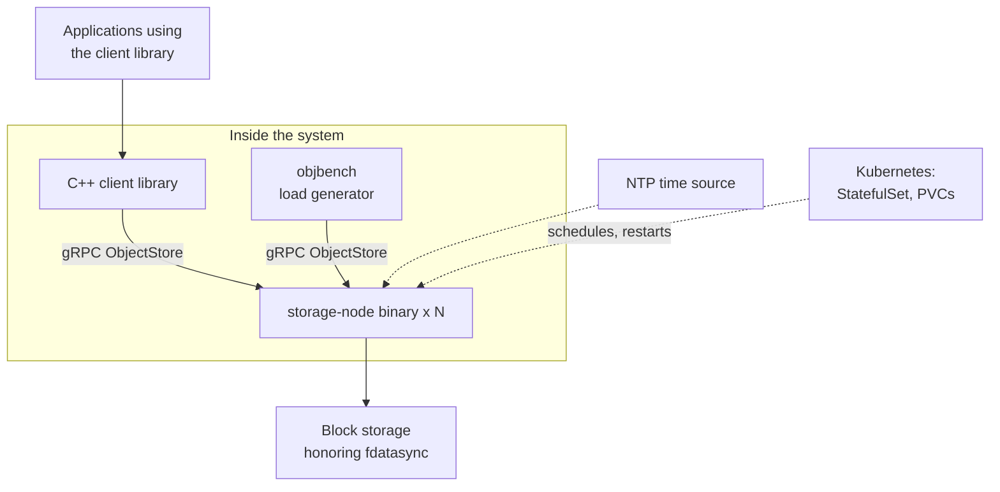

Everything outside the "Inside the system" box (applications, disks, NTP, Kubernetes) is depended on, not built.

The system places, replicates, stores, verifies, recovers, and repairs objects. It does **not** authenticate end users with an identity provider, encrypt data at rest, guarantee linearizable reads, provide cross-key transactions, or rebalance automatically at scale.

### 3.4 Assumptions

- Cluster size 3–8 nodes; default benchmark cluster is 5 nodes, N=3, W=2, R=2.
- Linux nodes with local or network block storage that **honors `fdatasync`**.
- Clocks are NTP-synchronized to within tens of milliseconds; HLC versions order causally related writes even with small skew.
- Topology changes rarely and only by operator action; no autoscaling.
- Buckets are namespaces only (no lifecycle API).
- Objects are immutable per version; an overwrite creates a new version.

### 3.5 In scope and out of scope

| In scope | Out of scope |
| --- | --- |
| Storage-node binary; client and node-to-node gRPC services | S3 HTTP compatibility, multipart upload |
| Ring and membership, quorum replication | User-visible object versioning, bucket policies, IAM |
| WAL, segment-file data store, RocksDB metadata | Encryption at rest, erasure coding |
| Hints, read repair, anti-entropy, scrubber, compaction | Cross-region replication |
| Docker image, Kubernetes StatefulSet | Automatic elastic rebalancing at scale |
| A C++ load generator (`objbench`) | Strong (linearizable) consistency, cross-key transactions |

### 3.6 Main engineering challenges

| Challenge | Why it is hard | Solution | Where in this booklet |
| --- | --- | --- | --- |
| Placement without a directory | Clients must find replicas with no metadata service | Consistent hashing with vnodes | 9.1 |
| Availability during failure | "All replicas" writes stop when one node dies | Quorum writes + hints | 9.2, 12 |
| Divergent replicas | Failures leave some replicas behind | Hints, read repair, anti-entropy | 9.7 |
| Concurrent writes to one key | Replicas may apply versions in different orders | HLC versions, deterministic LWW | 9.3 |
| Crash consistency | A crash can interrupt a write between data and metadata | Data fsync → WAL fsync → RocksDB apply; replay | 9.4, 12 |
| Silent corruption | Disks and memory flip bits without errors | CRC32C end-to-end + scrubber | 9.6 |
| 1,000 concurrent clients | Thread-per-request explodes threads | Callback API, bounded I/O pool, admission control | 6.6 |
| CPU efficiency | Many small files and fsyncs burn kernel CPU | Segments, lock-free append, group commit | 13 |

<div style="page-break-before: always;"></div>

# Part 2: Understand the Architecture

## 4. Technology Stack

### 4.1 Summary table

| Layer | Choice | Version target | Why this, not something else |
| --- | --- | --- | --- |
| Language | C++20 | GCC 13 / Clang 17 | Explicit control of threads, buffers, syscalls; Go or Java would hide allocation and copying, which is exactly what the CPU claim measures |
| RPC | gRPC (C++ callback API) + Protocol Buffers | gRPC 1.6x | HTTP/2 multiplexing, streaming, deadlines, status codes, code generation |
| Metadata store | RocksDB | 9.x | Embedded LSM: point lookups, atomic `WriteBatch`, ordered iteration, column families, bloom filters |
| Checksums | CRC32C via Abseil (`absl::ComputeCrc32c`) | Abseil LTS | Hardware-accelerated, ~10+ GB/s per core, storage-industry standard |
| Ring hash | xxHash64 | 0.8 | Fast, well-distributed, non-cryptographic |
| Build | CMake + vcpkg or Conan | — | Reproducible dependency versions |
| Tests | GoogleTest, Google Benchmark | — | Unit and micro-benchmarks |
| Metrics | prometheus-cpp | — | `/metrics` endpoint (observability only) |
| Containers | Docker multi-stage build | — | Small runtime image |
| Orchestration | Kubernetes StatefulSet + PVCs | 1.31 | Stable identities and per-pod disks |

AWS is not part of this project; the cluster can run on kind/minikube or any managed Kubernetes with SSD-backed volumes.

### 4.2 Each technology in context

**C++20.**
- *Solves:* explicit, measurable control of I/O (`pread`, `pwrite`, `fdatasync`), memory copies, and threads; features such as `std::atomic<std::shared_ptr>`, `std::span`, `std::jthread`.
- *Alternatives:* Go or Java. Rejected because their runtimes hide allocation and copying.
- *Trade-off:* harder, more error-prone code; ThreadSanitizer and AddressSanitizer builds are part of the test plan.

**gRPC + Protocol Buffers.**
- *Solves:* framing, streaming RPCs for chunked transfer, flow control (backpressure), deadline propagation, standard status codes. One port (7000) hosts both the client service and the internal service.
- *Alternative:* raw TCP. Rejected because framing, flow control, and deadline propagation would have to be built by hand.
- *Trade-off:* the callback (reactor) API is harder to write than synchronous handlers.

**RocksDB.**
- *Solves:* per-node metadata with fast point lookups, atomic batches across column families, ordered iteration (for listing and anti-entropy range digests).
- *Alternatives:* SQLite (serializes writers); a remote database (adds a network hop and a failure domain).
- *Trade-off:* must be kept consistent with segment data by the project's own WAL.

**CRC32C (Abseil).** Hardware-fast integrity checking. SHA-256 is ~10–20× slower without SHA CPU extensions and gives tamper resistance the project does not require.

**xxHash64.** Placement needs uniform distribution, not resistance against attackers, so a fast non-cryptographic hash is right.

**Kubernetes StatefulSet + PVCs.** Storage nodes need stable names (which map to node ids and ring tokens) and their own disks that follow them when rescheduled. A Deployment with ephemeral storage would lose data on every reschedule.

### 4.3 How the technologies fit together

**Figure 4.1 — Technology layers inside one storage node**

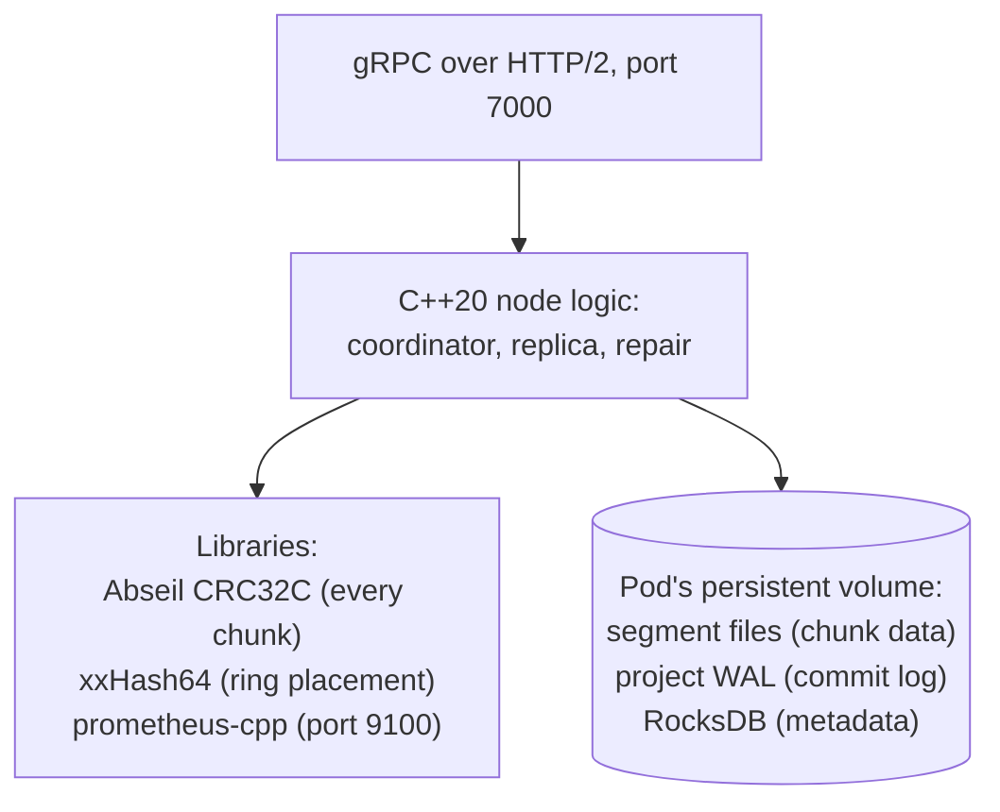

<div style="page-break-before: always;"></div>

## 5. High-Level Design (HLD)

### 5.1 Beginner view

**Figure 5.1 — Simplified conceptual architecture**

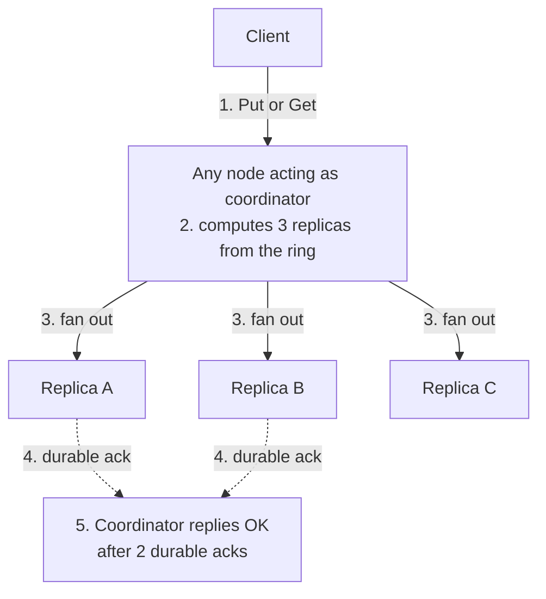

The third replica (C) finishes in the background; its ack is not needed for the reply.

There is no central server. The node that receives a request computes which three nodes own the key, sends the request to all three, and answers the client once two have finished. The same binary runs everywhere, so any node can play any role.

### 5.2 Detailed architecture

**Figure 5.2 — Cluster and node internals**

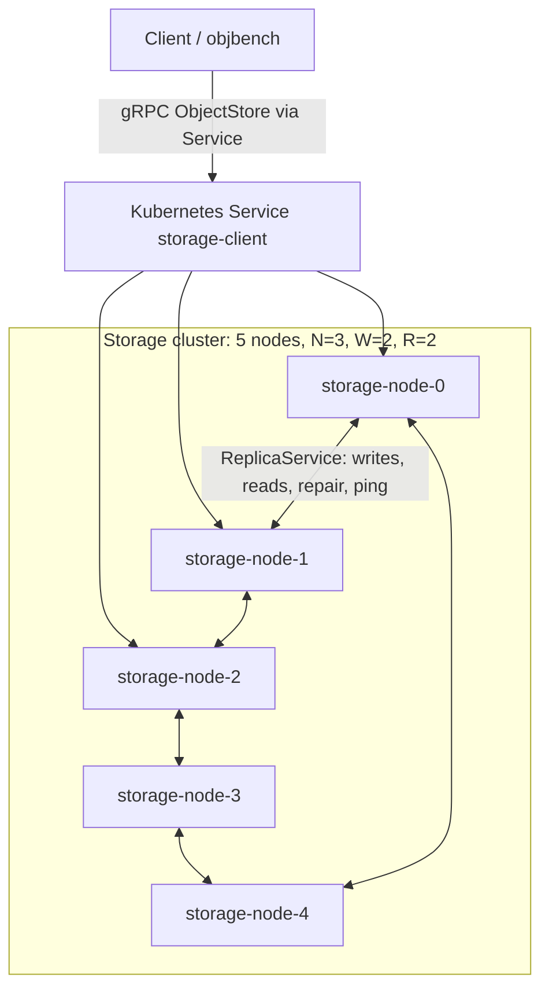

The peer edges are drawn as a cycle for readability; in reality every node can call every other node (a full mesh, which is fine for 8 nodes or fewer).

**Figure 5.3 — Components inside one node**

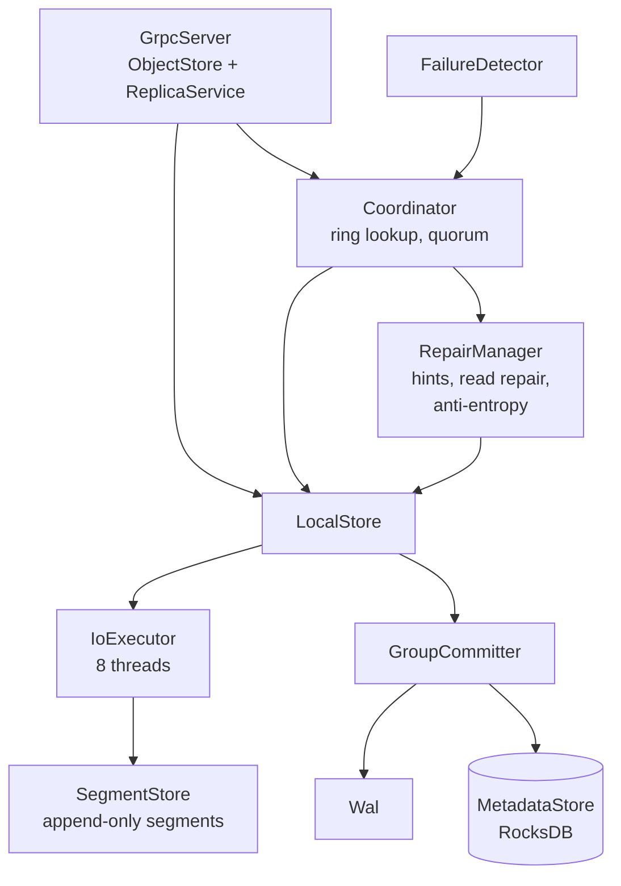

### 5.3 Data flow

**Figure 5.4a — Put path**

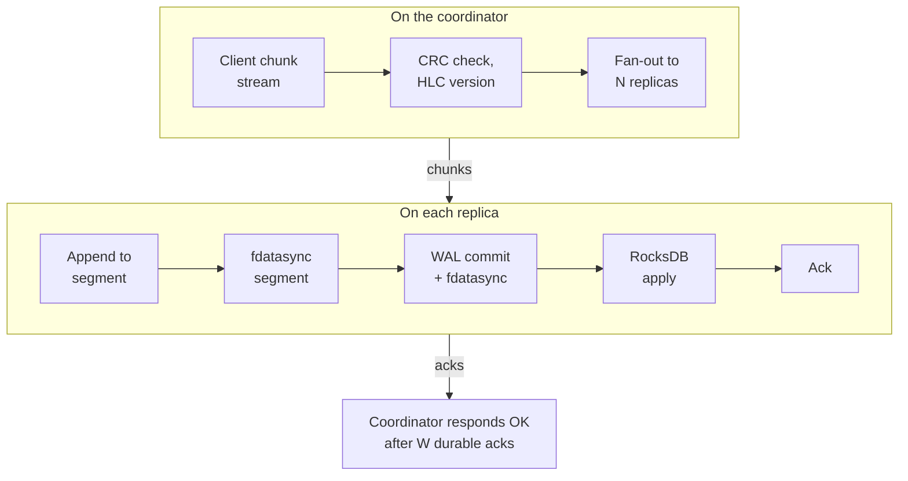

**Figure 5.4b — Get path and repair path**

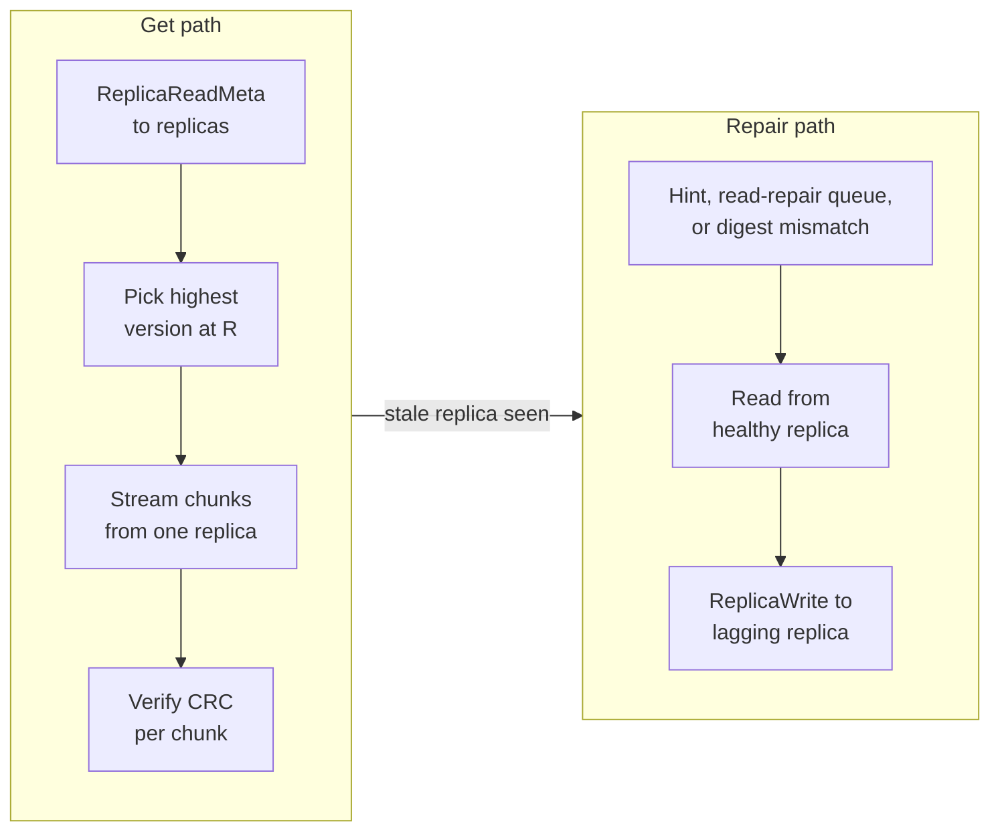

### 5.4 Component responsibilities

**GrpcServer (`ObjectStore` + `ReplicaService`)**
1. *Responsibility:* host the client-facing and internal gRPC services on port 7000 using callback reactors.
2. *Input:* client RPCs (bearer token) and peer RPCs (internal token).
3. *Processing:* authentication, admission control (512 in flight), validation; never blocks callback threads.
4. *Output:* calls into `Coordinator` (client RPCs) or `LocalStore` (replica RPCs).
5. *Next:* `Coordinator` / `LocalStore`.
6. *If it fails:* the node is down; peers detect it within ~5 s and route around it.

**Coordinator**
1. *Responsibility:* version assignment (HLC), preference list, quorum fan-out, read resolution, hint creation, read-repair scheduling. Holds nothing persistent.
2. *Input:* a client Put/Get/Delete/Head/List.
3. *Processing:* ring lookup, skip `DOWN` nodes (and hint them), forward chunks, track acks with `QuorumTracker`.
4. *Output:* `OK(version)` or an error (`UNAVAILABLE`, `DEADLINE_EXCEEDED`, …).
5. *Next:* replicas via `ReplicaEndpoint` (local or remote).
6. *If it fails mid-request:* the client's stream breaks; the client retries on another node; outcome of an in-flight Put is unknown.

**RingManager**
1. *Responsibility:* build and publish an immutable `Ring` snapshot from the node list, vnode count, and epoch.
2. *Output:* `shared_ptr<const Ring>` read lock-free by every request.
3. *If misconfigured:* nodes with different ring configs would choose different replicas; prevented by the ring epoch in every write header (mismatches get `ABORTED`).

**FailureDetector**
1. *Responsibility:* ping peers every 1 s; `SUSPECT` after 3 s, `DOWN` after 5 s.
2. *Output:* liveness table used by the coordinator.
3. *If wrong:* a false positive only creates extra hints; placement never changes.

**LocalStore (with SegmentStore, Wal + GroupCommitter, MetadataStore)**
1. *Responsibility:* local persistence: chunk writes, commit, reads, tombstones.
2. *Input:* chunks with CRCs, commit requests, read requests.
3. *Processing:* verify CRC, append to segment, group-commit (sync data, WAL, apply RocksDB), verify CRC on every read.
4. *Output:* durable versions; chunk data on reads.
5. *Next:* back to the coordinator (ack) or to the read stream.
6. *If the node crashes:* WAL replay restores metadata on restart.

**RepairManager, Scrubber, Compactor**
1. *Responsibility:* hint replay (every 10 s), read repair, anti-entropy (every 10 min per range), background CRC scrubbing, segment compaction.
2. *Constraints:* rate-limited (repair 50 MiB/s token bucket) and flagged `is_repair` so foreground latency is protected.

**AdmissionController and IoExecutor**
- Cap in-flight client requests per node (default 512) and run blocking `pread`/`pwrite` on a bounded 8-thread pool. Full queues produce fast `RESOURCE_EXHAUSTED` errors.

### 5.5 Communication

| From → To | Mechanism | Sync / async | Notes |
| --- | --- | --- | --- |
| Client → any node | gRPC `ObjectStore` over HTTP/2 | Sync (client waits for quorum) | Client streams chunks for Put; server streams for Get |
| Coordinator → replica | gRPC `ReplicaService` | Sync for the quorum, async for the remainder | Responds after W acks |
| Node → peer heartbeat | `Ping`, 1 s period, 500 ms deadline | Async | Drives `FailureDetector`; carries HLC and epoch |
| Node → peer repair | `ReplicaReadChunks`, `ReplicaWrite`, `RangeDigest`, `RangeKeys` | Async background | Rate-limited |
| Node → local disk | `pwrite` / `pread` / `fdatasync`; RocksDB API | Sync on I/O threads | Never on gRPC callback threads |

### 5.6 Data ownership

- **Chunk data:** owned by the N replicas in the key's preference list; each stores a full copy.
- **Object metadata** (latest version, size, chunk list, checksums): also stored by each replica in its own RocksDB. **No global metadata store**; metadata is replicated with the data by the same quorum write.
- **Hints:** owned by the coordinator that observed the missed write.
- **Ring and membership:** derived state; every node computes the same ring from the same configuration.

### 5.7 Synchronous vs asynchronous work

| Operation | Synchronous part | Asynchronous part |
| --- | --- | --- |
| Put | Stream to N replicas; wait for W durable acks | Remaining acks; hints for failures |
| Get | Metadata from R replicas; stream chunks from one | Read repair of stale replicas |
| Delete | Tombstone to W replicas | Chunk GC after the 24 h grace period |
| Repair | — | Hint replay (10 s), anti-entropy (10 min per range), scrubber, compaction |

### 5.8 Fault tolerance summary

| Failure | Effect with N=3, W=2, R=2 |
| --- | --- |
| 1 replica of a key down | Reads and writes succeed; hints queue for the down node |
| 2 replicas of a key down | Quorum operations fail with `UNAVAILABLE`; `consistency=ONE` reads still work |
| Node crash and restart | WAL replay restores metadata; hints and anti-entropy fill gaps |
| Chunk corruption on disk | CRC mismatch → read from another replica → repair rewrites the bad copy |
| Permanent node loss | Replace pod + PVC; anti-entropy rebuilds its ranges from peers |

### 5.9 Scaling strategy

- **Capacity:** each node owns ~`N / nodes` of the keyspace (with 5 nodes and N=3, ~60% of keys per node). Adding a node bumps the ring epoch; anti-entropy streams keys to the new owner; old owners drop keys only after confirming N copies.
- **Throughput:** client requests spread over all nodes through the Service; per-node concurrency is bounded by the I/O pool and admission control.
- **Hot keys:** served by their N replicas only; reads can use `consistency=ONE` to spread load.

<div style="page-break-before: always;"></div>

## 6. Low-Level Design (LLD)

### 6.1 Module structure

This is the intended layout; no code exists yet.

```text
objstore/
├── CMakeLists.txt
├── proto/
│   ├── object_store.proto          # client-facing service
│   └── replica.proto               # node-to-node service
├── src/
│   ├── main.cc                     # flags, config, wiring, signal handling
│   ├── config/NodeConfig.{h,cc}
│   ├── server/
│   │   ├── GrpcServer.{h,cc}
│   │   ├── ObjectStoreServiceImpl.{h,cc}   # callback reactors for client RPCs
│   │   ├── ReplicaServiceImpl.{h,cc}       # callback reactors for internal RPCs
│   │   └── AdmissionController.{h,cc}
│   ├── cluster/
│   │   ├── Ring.{h,cc}                     # immutable ring snapshot
│   │   ├── RingManager.{h,cc}
│   │   ├── FailureDetector.{h,cc}
│   │   ├── PeerClientPool.{h,cc}
│   │   └── HybridLogicalClock.{h,cc}
│   ├── coord/
│   │   ├── Coordinator.{h,cc}
│   │   ├── QuorumTracker.{h,cc}
│   │   ├── ReplicaEndpoint.h               # interface: local or remote replica
│   │   ├── LocalReplicaEndpoint.{h,cc}
│   │   └── RemoteReplicaEndpoint.{h,cc}
│   ├── storage/
│   │   ├── LocalStore.{h,cc}
│   │   ├── SegmentStore.{h,cc}
│   │   ├── Segment.{h,cc}
│   │   ├── Wal.{h,cc}
│   │   ├── WalRecord.{h,cc}
│   │   ├── GroupCommitter.{h,cc}
│   │   ├── MetadataStore.{h,cc}            # RocksDB wrapper
│   │   ├── Recovery.{h,cc}
│   │   └── StripedMutex.h
│   ├── repair/
│   │   ├── RepairManager.{h,cc}
│   │   ├── AntiEntropy.{h,cc}
│   │   ├── Scrubber.{h,cc}
│   │   └── Compactor.{h,cc}
│   ├── util/
│   │   ├── IoExecutor.{h,cc}
│   │   ├── BufferPool.{h,cc}
│   │   ├── Crc32c.h                        # wraps absl::ComputeCrc32c
│   │   ├── TokenBucket.h
│   │   └── Status.h                        # absl::Status helpers
│   └── metrics/Metrics.{h,cc}
├── client/ObjectStoreClient.{h,cc}         # retries, endpoint rotation, CRC verification
├── bench/objbench.cc                       # load generator
├── bench/micro/*.cc                        # Google Benchmark
├── test/                                   # GoogleTest unit + integration
├── docker/Dockerfile
└── k8s/                                    # manifests (documented below, not created here)
```

**Mapping LLD to HLD:**

| HLD component | LLD module |
| --- | --- |
| GrpcServer, admission | `server/` |
| Coordinator, quorum | `coord/` (`Coordinator`, `QuorumTracker`, `ReplicaEndpoint`, local/remote endpoints) |
| Ring, membership, clocks | `cluster/` (`Ring`, `RingManager`, `FailureDetector`, `PeerClientPool`, `HybridLogicalClock`) |
| Local persistence | `storage/` (`LocalStore`, `SegmentStore`, `Wal`, `GroupCommitter`, `MetadataStore`, `Recovery`, `StripedMutex`) |
| Repair | `repair/` (`RepairManager`, `AntiEntropy`, `Scrubber`, `Compactor`) |
| Utilities | `util/` (`IoExecutor`, `BufferPool`, `Crc32c`, `TokenBucket`) |
| Client and benchmark | `client/ObjectStoreClient`, `bench/objbench` |

### 6.2 Class diagram

**Figure 6.1a — Coordinator-side classes**

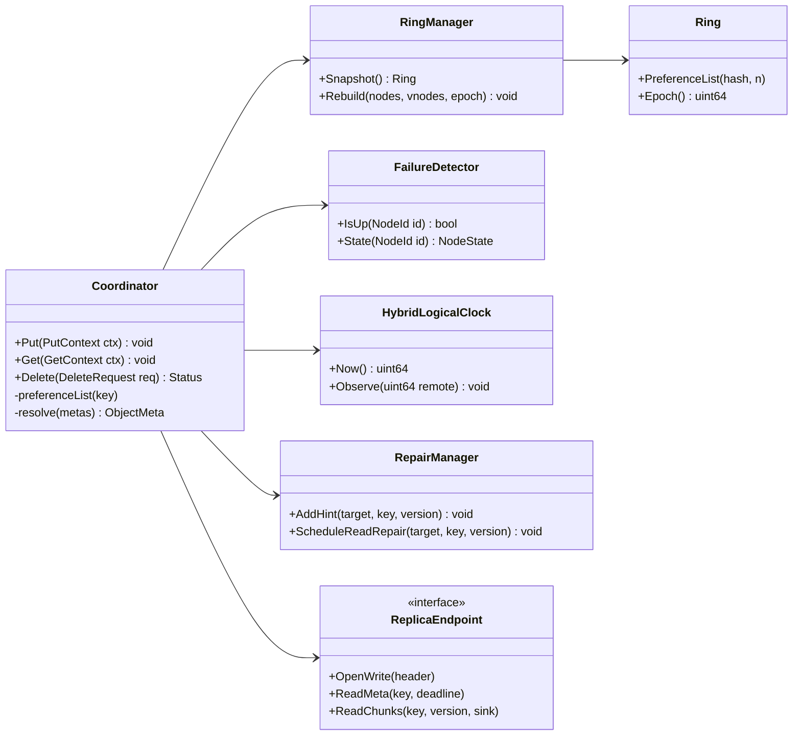

**Figure 6.1b — Replica-side (local storage) classes**

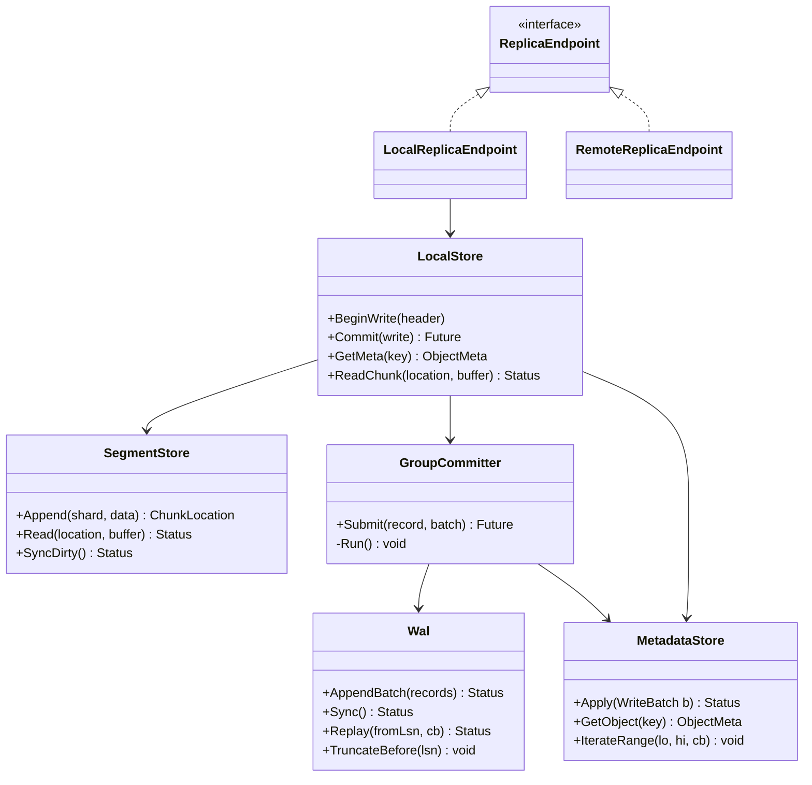

`RepairManager` (Figure 6.1a) also calls `LocalStore` to apply repaired versions.

### 6.3 Important classes

**Coordinator**
- Responsibility: run client operations across replicas.
- Important methods: `Put(PutContext)`, `Get(GetContext)`, `Delete(DeleteRequest)`, `preferenceList(key)`, `resolve(metas)`.
- Input: client request context. Output: response or error status.
- Dependencies: `RingManager`, `FailureDetector`, `ReplicaEndpoint`, `RepairManager`, `HybridLogicalClock`.
- Why it exists: separates distributed logic from local storage.

**ReplicaEndpoint (interface) with LocalReplicaEndpoint and RemoteReplicaEndpoint**
- Responsibility: one interface for "talk to a replica", whether local or remote.
- Important methods: `OpenWrite(header, deadline)`, `ReadMeta(key, deadline)`, `ReadChunks(key, version, from_chunk, sink, deadline)`.
- Why it exists: the coordinator's logic is identical for local and remote replicas (Strategy pattern); the local version skips serialization; tests can inject fake slow or failing replicas.

**Ring / RingManager**
- Responsibility: immutable sorted token vector; `PreferenceList(hash, n)`; `Rebuild(nodes, vnodes, epoch)`; `Snapshot()`.
- Why it exists: lock-free placement lookups with rare, atomic updates.

**FailureDetector**
- Important methods: `IsUp(node)`, `State(node)`.
- Why it exists: decides which replicas to contact right now.

**LocalStore**
- Responsibility: facade for local persistence.
- Important methods: `BeginWrite(header)`, `AppendChunk(write, data, crc)`, `Commit(write)` (future resolves after WAL + RocksDB), `GetMeta(key)`, `ReadChunk(location, buffer)` (verifies CRC), `ApplyTombstone(key, version)`.
- Why it exists: hides segment / WAL / RocksDB coordination (Facade pattern).

**SegmentStore**
- Important methods: `Append(shard, data)` → `ChunkLocation`; `Read(location, buffer)`; `SyncDirty()`.
- Why it exists: append-only data files with lock-free offset reservation.

**GroupCommitter and Wal**
- Important methods: `GroupCommitter::Submit(record, batch)`, `Run()`; `Wal::AppendBatch`, `Sync`, `Replay(fromLsn, cb)`, `TruncateBefore(lsn)`.
- Why they exist: one durable commit point, amortized fsync.

**MetadataStore**
- Important methods: `Apply(WriteBatch)`, `GetObject(key)`, `IterateRange(lo, hi, cb)`.
- Why it exists: wraps RocksDB column families and atomic batches.

**RepairManager**
- Important methods: `AddHint(target, key, version)`, `ScheduleReadRepair(target, key, version)`.
- Why it exists: converges replicas in the background, rate-limited.

**HybridLogicalClock**
- Important methods: `Now()`, `Observe(remote)`.

### 6.4 Key interfaces and data types

```cpp
// Identifies an object. The ring hashes "bucket/key".
struct ObjectKey {
  std::string bucket;
  std::string key;
  std::string Encoded() const;          // bucket + '\0' + key, used as RocksDB key suffix
  uint64_t RingHash() const;            // XXH64(bucket + "/" + key, seed=0)
};

// Totally ordered version: HLC timestamp first, coordinator node id as tie-breaker.
struct VersionId {
  uint64_t hlc;       // (physical_ms << 16) | logical_counter
  uint32_t node_id;
  auto operator<=>(const VersionId&) const = default;
};

struct ChunkLocation {
  uint32_t segment_id;
  uint64_t offset;    // offset of the record header in the segment file
  uint32_t length;    // payload length
  uint32_t crc32c;    // checksum of the payload
};

struct ObjectMeta {
  VersionId version;
  uint64_t size_bytes;
  uint32_t chunk_count;
  uint32_t object_crc32c;               // CRC32C of the whole object (combined)
  std::string content_type;
  bool tombstone;
  int64_t created_at_ms;
  std::vector<ChunkLocation> chunks;    // local to this replica; not sent to peers
};

class ReplicaEndpoint {                  // implemented locally and remotely
 public:
  virtual ~ReplicaEndpoint() = default;
  virtual std::unique_ptr<ReplicaWriter> OpenWrite(const WriteHeader& h, Deadline d) = 0;
  virtual Future<MetaResult> ReadMeta(const ObjectKey& k, Deadline d) = 0;
  virtual void ReadChunks(const ObjectKey& k, VersionId v, uint32_t from_chunk,
                          ChunkSink* sink, Deadline d) = 0;
};

class ReplicaWriter {                    // one in-flight replicated write
 public:
  virtual bool SendChunk(const ChunkMsg& c) = 0;      // false when the stream failed
  virtual Future<Status> Finish() = 0;                 // resolves after durable commit on the replica
  virtual void Cancel() = 0;
};

class LocalStore {
 public:
  std::unique_ptr<LocalWrite> BeginWrite(const WriteHeader& h);
  absl::Status AppendChunk(LocalWrite& w, std::span<const std::byte> data, uint32_t crc);
  Future<absl::Status> Commit(std::unique_ptr<LocalWrite> w);   // WAL + RocksDB, group-committed
  std::optional<ObjectMeta> GetMeta(const ObjectKey& k) const;
  absl::Status ReadChunk(const ChunkLocation& loc, Buffer& out) const;   // verifies CRC32C
  Future<absl::Status> ApplyTombstone(const ObjectKey& k, VersionId v);
};
```

Two details worth memorizing: `VersionId` is totally ordered (`hlc` first, then `node_id`) using C++20's defaulted `<=>`; and `ChunkLocation` is local to each replica (segment, offset, length, CRC), never sent to peers.

### 6.5 Important data structures

| Structure | Type | Purpose | Complexity |
| --- | --- | --- | --- |
| Ring tokens | Sorted `std::vector<VNode{token, node_idx}>` | Consistent hash ring | Lookup `O(log V)`, V = 640 |
| Ring snapshot | `std::atomic<std::shared_ptr<const Ring>>` | Lock-free reads, copy-on-write updates | `O(1)` read |
| Liveness table | Array of atomic states + last-seen times | Failure detection | `O(1)` |
| Striped mutex | `std::array<std::mutex, 1024>` indexed by `hash(key) & 1023`, `alignas(64)` | Per-key compare-and-apply | `O(1)` |
| Segment tail | `std::atomic<uint64_t>` per active segment | Lock-free offset reservation | `O(1)` |
| Group-commit queue | `std::deque` + mutex + condition variable | Batch commits for one fsync | Amortized `O(1)` |
| Quorum tracker | Counters + atomic + one-shot promise | Complete at W (or R) responses | `O(1)` per response |
| Buffer pool | Free list of aligned 1 MiB buffers | Avoid malloc/free per chunk | `O(1)` |
| Hint queue | RocksDB `hints` CF keyed `target / due_time / key` | Durable repair work | `O(log n)` |
| Read-repair queue | Bounded in-memory MPSC queue | Best-effort repairs | `O(1)`; drops when full |

### 6.6 Threading model

| Threads | Count (starting point) | Work | May block? |
| --- | --- | --- | --- |
| gRPC callback threads | ~cores (gRPC-managed) | Parse messages, CRC checks, quorum bookkeeping, schedule I/O | **No** |
| `IoExecutor` | 8 per node | `pwrite` / `pread` on segment files | Yes (disk) |
| `GroupCommitter` | 1 | Sync segments → append WAL → sync WAL → RocksDB write → complete futures | Yes (fsync) |
| `FailureDetector` | 1 timer thread | Pings, liveness table | No |
| `RepairManager` | 2 | Hints, read repair, anti-entropy | Yes; token bucket 50 MiB/s |
| `Scrubber`, `Compactor` | 1 each, low priority | Verification and space reclamation | Yes; rate-limited |
| RocksDB background | `max_background_jobs = 4` | Flush and compaction | Internal |

**Rules that keep it correct:**
1. Callback threads never call `pread`, `pwrite`, `fdatasync`, or RocksDB writes; they enqueue work and resume the reactor from a completion callback. Blocking a callback thread would stall every stream on the node.
2. The only shared mutable state on the write path is the segment tail (atomic), the group-commit queue (mutex), and per-key metadata application (striped mutex).
3. Every queue is bounded; a full I/O queue makes new requests fail fast with `RESOURCE_EXHAUSTED`.

### 6.7 Synchronisation details

| Shared state | Mechanism | Why |
| --- | --- | --- |
| Ring snapshot | Atomic `shared_ptr` load/store | Read-mostly; readers never block |
| Segment append offset | `tail.fetch_add(size, memory_order_relaxed)` | Disjoint ranges, parallel `pwrite`; ordering comes later from fsync + WAL |
| Segment sealing | Per-shard mutex when crossing the 1 GiB boundary | Rare event |
| Per-key latest version | Striped mutex across read → compare → write batch | Prevents two versions of one key racing |
| Segment lifetime | `shared_ptr<Segment>`; file unlinked when the last reader releases | No use-after-free |
| Group-commit queue | Mutex + condition variable | One consumer; low contention |
| Metrics | Atomics / prometheus-cpp | Lock-free increments |

**No lock is ever held across a network call or an `fdatasync`.**

### 6.8 Design patterns

| Pattern | Where | Why |
| --- | --- | --- |
| Strategy / interface | `ReplicaEndpoint` | Same coordinator logic for local and remote replicas |
| Reactor | gRPC callback API | Non-blocking streaming without a thread per stream |
| Facade | `LocalStore` | Hides segment / WAL / RocksDB coordination |
| Producer–consumer | `GroupCommitter`, `IoExecutor`, repair queues | Decouple request threads from slow I/O |
| Copy-on-write snapshot | `Ring` | Readers never lock |
| Object pool | `BufferPool` | Reuse 1 MiB buffers |
| RAII | `SegmentRef`, `InflightGuard`, lock guards | Exception-safe resource release |

### 6.9 Error handling

- Functions return `absl::Status` / `absl::StatusOr<T>`; no exceptions across thread or RPC boundaries. Status codes map 1:1 to gRPC codes.
- Disk errors (`EIO`, `ENOSPC`) fail the replica write; repeated `EIO` flips the node to read-only and not-ready.
- CRC mismatch on read returns `DATA_LOSS` and enqueues repair; the coordinator retries the read on another replica.
- A bad WAL CRC **at the tail** is a torn write and is truncated; a bad CRC **in the middle** is fatal and stops startup (the node is rebuilt from peers).

<div style="page-break-before: always;"></div>

# Part 3: Understand the Implementation

## 7. API Design

The system exposes **gRPC only** (there is no REST API). Two services share port 7000 on every node:

- `objstore.v1.ObjectStore`: client-facing.
- `objstore.v1.ReplicaService`: node-to-node; rejected without the internal token.

### 7.1 Client-facing service definition

```protobuf
syntax = "proto3";
package objstore.v1;

enum Consistency {
  CONSISTENCY_UNSPECIFIED = 0;   // server default: QUORUM
  ONE = 1;
  QUORUM = 2;
  ALL = 3;
}

service ObjectStore {
  // Client streaming: first message is the header, then data chunks in order.
  rpc PutObject(stream PutObjectRequest) returns (PutObjectResponse);
  // Server streaming: first message carries metadata, then data chunks in order.
  rpc GetObject(GetObjectRequest) returns (stream GetObjectResponse);
  rpc HeadObject(HeadObjectRequest) returns (ObjectMetadata);
  rpc DeleteObject(DeleteObjectRequest) returns (DeleteObjectResponse);
  rpc ListObjects(ListObjectsRequest) returns (ListObjectsResponse);
}

message PutObjectRequest {
  oneof part {
    PutHeader header = 1;
    Chunk chunk = 2;
  }
}

message PutHeader {
  string bucket = 1;              // [a-z0-9-], 3..63 chars
  string key = 2;                 // UTF-8, 1..1024 bytes
  uint64 size_bytes = 3;          // total object size, <= 64 MiB
  uint32 object_crc32c = 4;       // CRC32C of the whole object
  string content_type = 5;
  Consistency consistency = 6;    // write quorum level
  string request_id = 7;          // client-generated UUID, for logs and dedup of retries
}

message Chunk {
  uint32 index = 1;               // 0-based, contiguous
  bytes data = 2;                 // exactly 1 MiB except the last chunk
  uint32 crc32c = 3;              // CRC32C of data
}

message PutObjectResponse {
  string version = 1;             // opaque, e.g. "0000018f3a2b4c5d0001-3"
  uint32 object_crc32c = 2;
  uint32 replicas_acked = 3;      // >= W at response time
}

message GetObjectRequest {
  string bucket = 1;
  string key = 2;
  Consistency consistency = 3;    // read quorum level
  uint32 from_chunk = 4;          // resume a broken download
}

message GetObjectResponse {
  oneof part {
    ObjectMetadata metadata = 1;  // always the first message
    Chunk chunk = 2;
  }
}

message ObjectMetadata {
  string bucket = 1;
  string key = 2;
  string version = 3;
  uint64 size_bytes = 4;
  uint32 chunk_count = 5;
  uint32 object_crc32c = 6;
  string content_type = 7;
  int64 created_at_ms = 8;
}

message HeadObjectRequest   { string bucket = 1; string key = 2; Consistency consistency = 3; }
message DeleteObjectRequest { string bucket = 1; string key = 2; Consistency consistency = 3; string request_id = 4; }
message DeleteObjectResponse { string version = 1; }   // version of the tombstone

message ListObjectsRequest {
  string bucket = 1;
  string prefix = 2;
  uint32 page_size = 3;           // 1..1000, default 100
  string page_token = 4;          // opaque: last key returned
}
message ListObjectsResponse {
  repeated ObjectMetadata objects = 1;
  string next_page_token = 2;     // empty when done
}
```

**Reading the contract:**
- `PutObject` is **client-streaming**: the first message is a `PutHeader` (bucket, key, size, object CRC, content type, consistency, request id), followed by `Chunk` messages in order.
- `GetObject` is **server-streaming**: the first message is `ObjectMetadata`, then chunks. `from_chunk` resumes a broken download.
- The version is returned as an opaque string, for example `"0000018f3a2b4c5d0001-3"` (HLC then node id).
- `replicas_acked` is at least W when the response is sent.

### 7.2 Internal service definition

```protobuf
service ReplicaService {
  rpc ReplicaWrite(stream ReplicaWriteRequest) returns (ReplicaWriteResponse);
  rpc ReplicaReadMeta(ReplicaReadMetaRequest) returns (ReplicaReadMetaResponse);
  rpc ReplicaReadChunks(ReplicaReadChunksRequest) returns (stream Chunk);
  rpc RangeDigest(RangeDigestRequest) returns (RangeDigestResponse);
  rpc RangeKeys(RangeKeysRequest) returns (stream KeyVersion);
  rpc Ping(PingRequest) returns (PingResponse);
}

message VersionId { uint64 hlc = 1; uint32 node_id = 2; }

message ReplicaWriteHeader {
  string bucket = 1;
  string key = 2;
  VersionId version = 3;
  uint64 size_bytes = 4;
  uint32 chunk_count = 5;
  uint32 object_crc32c = 6;
  string content_type = 7;
  bool tombstone = 8;             // deletes travel as tombstone writes with no chunks
  uint64 ring_epoch = 9;          // replica rejects writes from a different epoch
  bool is_repair = 10;            // repair writes are lower priority and rate-limited
}
message ReplicaWriteRequest { oneof part { ReplicaWriteHeader header = 1; Chunk chunk = 2; } }
message ReplicaWriteResponse { VersionId applied = 1; bool superseded = 2; }   // superseded: a newer version already existed

message ReplicaReadMetaRequest  { string bucket = 1; string key = 2; }
message ReplicaReadMetaResponse { bool found = 1; ObjectMetadata meta = 2; VersionId version = 3; bool tombstone = 4; }

message ReplicaReadChunksRequest { string bucket = 1; string key = 2; VersionId version = 3; uint32 from_chunk = 4; }

message RangeDigestRequest  { uint64 range_start = 1; uint64 range_end = 2; uint32 buckets = 3; }
message RangeDigestResponse { repeated fixed64 bucket_digests = 1; uint64 key_count = 2; }
message RangeKeysRequest    { uint64 range_start = 1; uint64 range_end = 2; }
message KeyVersion          { string bucket = 1; string key = 2; VersionId version = 3; bool tombstone = 4; }

message PingRequest  { uint32 from_node = 1; uint64 ring_epoch = 2; uint64 hlc = 3; }
message PingResponse { uint32 node_id = 1; uint64 ring_epoch = 2; uint64 hlc = 3; bool ready = 4; }
```

Notable fields: `ring_epoch` (a replica rejects writes stamped with a different epoch), `tombstone` (deletes travel as tombstone writes with no chunks), `is_repair` (repair writes are lower priority and rate-limited), and `superseded` in the response (a newer version already existed, which is still a success for idempotency).

### 7.3 RPC reference

| RPC | Type | Purpose | Default deadline | Idempotent? |
| --- | --- | --- | --- | --- |
| `PutObject` | Client stream | Store a new version | `2 s + 0.5 s per MiB` (client-set) | Retry-safe: a retry creates a newer version with the same content |
| `GetObject` | Server stream | Read latest version | `2 s + 0.5 s per MiB` | Yes |
| `HeadObject` | Unary | Metadata only | 500 ms | Yes |
| `DeleteObject` | Unary | Write a tombstone | 1 s | Yes (newer tombstone wins) |
| `ListObjects` | Unary | Scatter-gather listing | 2 s | Yes |
| `ReplicaWrite` | Client stream | Persist one version locally | Coordinator's remaining deadline − 50 ms | Yes (LWW apply) |
| `ReplicaReadMeta` | Unary | Local metadata | Remaining deadline | Yes |
| `ReplicaReadChunks` | Server stream | Local chunk data | Remaining deadline | Yes |
| `RangeDigest` / `RangeKeys` | Unary / stream | Anti-entropy | 10 s / 60 s | Yes |
| `Ping` | Unary | Heartbeat + HLC/epoch gossip | 500 ms | Yes |

### 7.4 Validation

| Field | Rule | Error |
| --- | --- | --- |
| `bucket` | `^[a-z0-9-]{3,63}$` | `INVALID_ARGUMENT` |
| `key` | 1–1024 bytes UTF-8, no `\0` | `INVALID_ARGUMENT` |
| `size_bytes` | ≤ 64 MiB; equals the sum of chunk lengths | `INVALID_ARGUMENT` / `OUT_OF_RANGE` |
| Chunks | Contiguous indexes from 0; every chunk 1 MiB except the last | `INVALID_ARGUMENT` |
| `crc32c` | Matches the data | `DATA_LOSS` |
| `object_crc32c` | Matches the combined CRC after the last chunk | `DATA_LOSS` |
| First stream message | Must be a header | `INVALID_ARGUMENT` |

### 7.5 Status codes and client actions

| Code | When | Client action |
| --- | --- | --- |
| `OK` | Success | — |
| `INVALID_ARGUMENT` | Validation failure | Fix the request |
| `UNAUTHENTICATED` | Missing or bad token | Fix credentials |
| `NOT_FOUND` | No version, or latest is a tombstone | — |
| `DATA_LOSS` | Checksum mismatch in the request, or every replica's copy failed verification | Retry upload; for reads, alert |
| `UNAVAILABLE` | Fewer than W (or R) live replicas; node draining | Retry with backoff, preferably on another node |
| `DEADLINE_EXCEEDED` | Quorum not reached in time | Retry (Put outcome is unknown) |
| `RESOURCE_EXHAUSTED` | Admission limit, I/O queue full, disk full | Back off and retry |
| `ABORTED` | Ring epoch mismatch | Retry; the client refreshes its endpoint |
| `INTERNAL` | Unexpected error | Retry with backoff |

### 7.6 Serialization, authentication, deadlines

- **Serialization:** proto3 over HTTP/2. `grpc.max_receive_message_length` is 2 MiB (tight bounds on memory per stream). The optimized path forwards received serialized chunk bytes to replicas as a `grpc::ByteBuffer` instead of re-serializing per replica.
- **Authentication:** clients send a static bearer token in metadata (`authorization: Bearer <token>`), compared in constant time; nodes send a separate internal token (`x-objstore-internal`). TLS/mTLS is supported but **off in the default benchmark** to keep CPU comparisons simple, which must be reported. Per-bucket authorization is out of scope.
- **Deadlines:** clients must set one. The coordinator gives replicas `remaining − 50 ms`, so replicas time out first and the coordinator can still return a precise status. If the deadline expires after quorum, the response is already sent and late replicas continue in the background. Peer channels use gRPC keepalive (10 s time, 3 s timeout).

### 7.7 Client library behaviour

The C++ `ObjectStoreClient` (part of the project):
- Splits uploads into 1 MiB chunks; computes per-chunk CRC32C and the combined object CRC.
- Rotates across node endpoints (or uses the Service VIP); retries `UNAVAILABLE`, `RESOURCE_EXHAUSTED`, `ABORTED`, `DEADLINE_EXCEEDED` with exponential backoff and jitter (50 ms base, ×2, max 1 s, 3 attempts), each attempt on a different node when possible.
- Verifies every chunk on download and the object CRC at the end; on a mismatch it resumes from the failed chunk with `from_chunk`.

### 7.8 What happens internally per RPC

| RPC | Internal steps |
| --- | --- |
| `PutObject` | Admission → auth → header validation → HLC version → preference list → open N writers (skip `DOWN` nodes, hint them) → per chunk: verify CRC, forward → after last chunk: `Finish()` all → respond at W acks → background: remaining acks, hints |
| `GetObject` | Admission → auth → preference list → `ReplicaReadMeta` to all live replicas → at R responses choose max version (tombstone → `NOT_FOUND`) → stream chunks from the best replica (local first) → on `DATA_LOSS` or stream failure resume from the failed chunk elsewhere → schedule read repair |
| `HeadObject` | Same as Get without chunks |
| `DeleteObject` | Same as Put with `tombstone=true` and no chunks |
| `ListObjects` | Fan out to all live nodes; each returns up to `page_size` local keys after `page_token` with the prefix; merge, de-duplicate, drop tombstones; best-effort (keys whose replicas are all down are missing from that page) |

<div style="page-break-before: always;"></div>

## 8. Database and Storage Design

There is no central database. Each node has three on-disk areas on its own persistent volume.

**Figure 8.1 — Per-node storage layout**

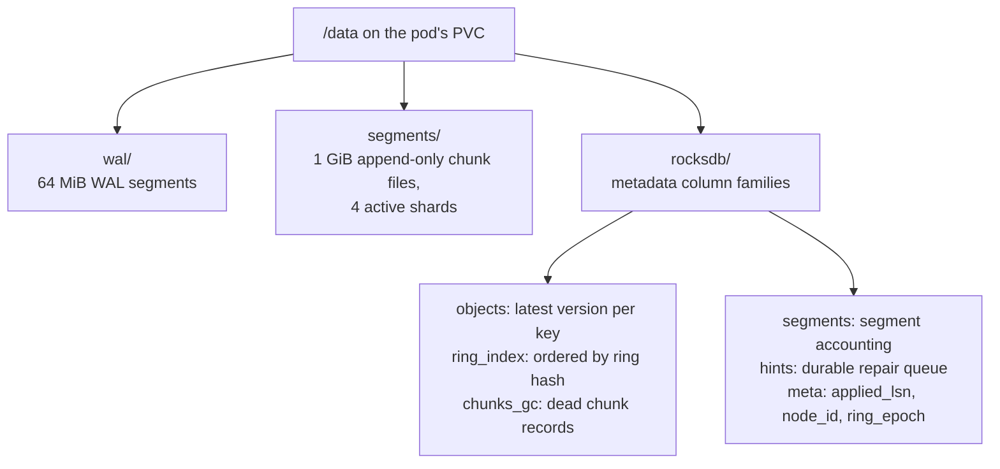

### 8.1 Why data and metadata are separated

Metadata is small, read on every request, needs atomic multi-key updates and ordered iteration: RocksDB. Chunk data is large and immutable and read sequentially: append-only segment files referenced by `(segment_id, offset, length)`. Putting multi-MB values into an LSM tree would rewrite them repeatedly during compaction (write amplification of 10× or more).

### 8.2 Objects, chunks, and versions

```text
Object "photos/cat.jpg", 2.5 MiB, version v = (hlc=0x18f3a2b4c5d0001, node=3)
├── chunk 0: 1 MiB    crc32c=0x8a1f...   chunk_id = v:0
├── chunk 1: 1 MiB    crc32c=0x11c4...   chunk_id = v:1
└── chunk 2: 0.5 MiB  crc32c=0x93de...   chunk_id = v:2
object_crc32c = crc32c_combine(c0, c1, c2)
```

- A **chunk** is the unit of transfer, checksum, and storage: 1 MiB except the last.
- A **version** is immutable. An overwrite creates a new version with new chunks; old chunks become garbage once the new version is applied.
- Chunk ids derive from `(version, index)`, so nothing is ever overwritten in place.

### 8.3 Segment file layout

```text
Segment file seg-00000007.dat
┌───────────────────────── record ─────────────────────────┐
│ magic u32 = 0x4F424A43 ("OBJC")                          │
│ header_crc u32   (CRC32C of the next 5 fields)           │
│ chunk_index u32                                          │
│ version_hlc u64 | version_node u32                       │
│ key_hash u64                                             │
│ payload_len u32                                          │
│ payload_crc u32  (CRC32C of payload)                     │
│ payload bytes [payload_len]                              │
│ padding to 4 KiB alignment                               │
└──────────────────────────────────────────────────────────┘
... next record ...
```

- Segments are 1 GiB, preallocated with `fallocate`. Each node has **4 I/O shards**, each with one active segment; a write picks a shard by `hash(key) % 4`.
- The record header is **self-describing**, so the scrubber and compactor can walk a segment without RocksDB, and recovery can verify that a location really holds the expected chunk.
- Records are padded to **4 KiB** for aligned I/O. Cost: a 4 KiB object uses 8 KiB. Alignment is configurable (512 B for small-object workloads).
- Full segments are **sealed** (read-only), and become eligible for scrubbing and compaction.

### 8.4 RocksDB metadata model

| Column family | Key | Value | Purpose |
| --- | --- | --- | --- |
| `objects` | `bucket \0 key` | `ObjectMeta` (version, size, chunk count, object CRC, content type, tombstone, created_at, chunk locations) | Latest version per key on this replica |
| `ring_index` | `ring_hash (8 B big-endian) bucket \0 key` | `VersionId` + tombstone | Ordered by ring position for range digests |
| `chunks_gc` | `segment_id (4 B) offset (8 B)` | length | Dead chunks; drives compaction |
| `segments` | `segment_id` | `{state, size, live_bytes, dead_bytes}` | Segment accounting |
| `hints` | `target_node (4 B) due_ms (8 B) bucket \0 key` | `VersionId`, attempts | Durable repair queue |
| `meta` | Fixed keys | `applied_lsn`, `node_id`, `ring_epoch`, `format_version` | Node state |

Example `objects` value (shown as JSON; stored as protobuf):

```json
{
  "objects/photos\u0000cat.jpg": {
    "version": { "hlc": "0x018f3a2b4c5d0001", "node": 3 },
    "size": 2621440, "chunkCount": 3, "objectCrc32c": "0x5e2b91c0",
    "contentType": "image/jpeg", "tombstone": false, "createdAtMs": 1739001234567,
    "chunks": [
      { "segment": 7, "offset": 104857600, "len": 1048576, "crc32c": "0x8a1f03b2" },
      { "segment": 7, "offset": 105910272, "len": 1048576, "crc32c": "0x11c4aa09" },
      { "segment": 7, "offset": 106962944, "len": 524288,  "crc32c": "0x93de7711" }
    ]
  }
}
```

| RocksDB option | Value | Reason |
| --- | --- | --- |
| `disableWAL` (per write) | `true` | The project's WAL is the commit log |
| `atomic_flush` | `true` | All column families flush together, keeping `applied_lsn` consistent |
| Bloom filter | 10 bits/key on `objects` | Lookups of absent keys skip SST reads |
| Block cache | 256 MiB shared | Metadata working set in memory |
| `max_background_jobs` | 4 | Flush/compaction parallelism |
| Compression | LZ4 upper levels, ZSTD bottommost | Cheap for small metadata |

### 8.5 The write-ahead log

```text
wal/wal-<first_lsn, 16 hex>.log      64 MiB segments, preallocated

Record:
┌────────────────────────────────────────────┐
│ magic u32 = 0x57414C31 ("WAL1")            │
│ lsn u64          (monotonic per node)      │
│ type u8          PUT_COMMIT | TOMBSTONE |  │
│                  GC_CHUNKS | CHUNK_MOVE    │
│ payload_len u32                            │
│ payload bytes    (protobuf)                │
│ crc32c u32       (over lsn..payload)       │
└────────────────────────────────────────────┘
```

| Record type | Payload | Replay action |
| --- | --- | --- |
| `PUT_COMMIT` | Key, version, size, object CRC, content type, chunk locations | LWW apply: write `objects` + `ring_index` if newer; else mark chunks garbage |
| `TOMBSTONE` | Key, version | LWW tombstone |
| `GC_CHUNKS` | Freed `(segment, offset, len)` | Update `chunks_gc` and segment accounting |
| `CHUNK_MOVE` | Key, version, old → new location | Compaction moved a live chunk; update `objects` |

**Keeping RocksDB consistent without its own WAL:**
1. Every RocksDB batch includes `meta/applied_lsn = max LSN in the batch`.
2. After a crash, RocksDB recovers to its last flush (consistent across column families thanks to `atomic_flush`); `applied_lsn` says how far that goes.
3. The node replays its WAL from `applied_lsn + 1`.

**WAL truncation:** every 5 minutes (or when the WAL exceeds 512 MiB), the node flushes RocksDB, reads back `applied_lsn`, and deletes WAL segments whose last LSN ≤ it. This bounds recovery time.

### 8.6 Checksums

| Checksum | Computed by | Verified by | Detects |
| --- | --- | --- | --- |
| Chunk CRC32C | Client | Coordinator, replica on receive, replica on every read, client on download, scrubber | Network/memory corruption, bit rot, misdirected reads |
| Object CRC32C | Client | Coordinator and replicas after the last chunk; client after download | Missing, duplicated, or reordered chunks |
| Segment header CRC | Replica | Reader, scrubber, compactor | Torn or misdirected headers |
| WAL record CRC32C | Replica | Recovery | Torn writes at the tail; corruption |

### 8.7 Replication and recovery metadata

- There is **no "which replicas have it" table**: placement is computed from the ring. Stored repair state is the **hints** ("node X should have key K at version ≥ v") and the **ring epoch** in every write header and ping.
- Recovery uses `applied_lsn` (where replay starts), WAL segments (re-apply), segment states and sizes (find the active segment's valid tail), hints (resume repair), and `ring_epoch` (reject stale-epoch writes).

### 8.8 Garbage collection, tombstones, and compaction

1. When a newer version or tombstone is applied, the old chunks go to `chunks_gc` and the segment's `dead_bytes` grows.
2. **Tombstones are kept for a 24-hour grace period**, longer than the maximum time a replica can be down and still be repaired by hints. Removing them sooner could let a replica that missed the delete **resurrect** the object through anti-entropy.
3. The compactor picks sealed segments with `live_ratio < 50%`, copies live records into an active segment, writes `CHUNK_MOVE` WAL records, waits for them to commit, and deletes the old file once no reader holds it. Write amplification is bounded at ≤ 2×.

<div style="page-break-before: always;"></div>

## 9. Core Algorithms and Data Structures

### 9.1 Consistent hashing with virtual nodes (preference list lookup)

1. **Problem:** map keys to nodes so that membership changes move only a small fraction of keys.
2. **Why needed:** `hash(key) % nodes` remaps almost every key when the node count changes.
3. **Concept:** nodes (128 tokens each, `XXH64(node_name + "#" + i)`) and keys (`XXH64("bucket/key")`) share a 64-bit ring; a key's replicas are the first N **distinct physical** nodes clockwise.
4. **Pseudocode:**

```cpp
std::vector<NodeId> Ring::PreferenceList(uint64_t h, int n) const {
  std::vector<NodeId> out;
  out.reserve(n);
  auto it = std::upper_bound(tokens_.begin(), tokens_.end(), h,
                             [](uint64_t v, const VNode& t) { return v < t.token; });
  for (size_t step = 0; step < tokens_.size() && (int)out.size() < n; ++step, ++it) {
    if (it == tokens_.end()) it = tokens_.begin();              // wrap around the ring
    NodeId node = nodes_[it->node_idx];
    if (std::find(out.begin(), out.end(), node) == out.end())   // skip duplicate physical nodes
      out.push_back(node);
  }
  return out;
}
```

**Figure 9.1 — Preference-list lookup**

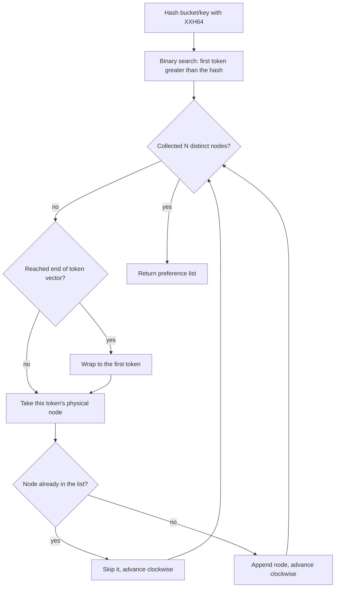

5. **Worked example (ILLUSTRATIVE):** a key hashes just before a token owned by node 2; walking clockwise the next tokens belong to nodes 2 (skip), 4, 2 (skip), 0. The preference list is `[2, 4, 0]`.
6. **Complexity:** `O(log V)` binary search (V = 640 → about 10 comparisons) plus a short walk (typically < 2N vnodes); building the ring `O(V log V)`; space `O(V)` (~640 × 10 bytes).
7. **Liveness:** the list is computed **independently of liveness**; the coordinator skips `DOWN` nodes and hints them (strict quorum).
8. **Data movement:** adding a sixth node moves about 1/6 of primary ownership; with N=3, roughly half the keys' preference lists change in one position.
9. **Alternatives:** modulo hashing; rendezvous (HRW) hashing (`O(nodes)` per lookup, no vnodes); jump consistent hash (no arbitrary removal); central directory.
10. **Trade-offs:** balance is only statistical (deviation shrinks roughly with `1/sqrt(vnodes)`); ring config must match everywhere (guarded by the epoch); hot keys are not addressed.

### 9.2 Quorum replication with tunable N, W, R

1. **Problem:** keep N copies and stay available with some replicas down, while reads still see recent writes.
2. **Concept:** write succeeds after W durable acks; read consults R replicas and takes the highest `VersionId`. `R + W > N` guarantees overlap.
3. **Coordinator write pseudocode:**

```cpp
void Coordinator::Put(PutContext& ctx) {
  auto ring = ring_mgr_.Snapshot();
  auto replicas = ring->PreferenceList(ctx.key.RingHash(), cfg_.n);
  VersionId v{hlc_.Now(), cfg_.node_id};
  int w = RequiredAcks(ctx.consistency, cfg_.n);                    // ONE=1, QUORUM=n/2+1, ALL=n

  auto tracker = std::make_shared<QuorumTracker>(w, replicas.size());
  for (NodeId r : replicas) {
    if (!fd_.IsUp(r)) { tracker->Fail(r); repair_.AddHint(r, ctx.key, v); continue; }
    ctx.writers.push_back(Endpoint(r)->OpenWrite(WriteHeader{ctx.key, v, ctx.header}, ctx.deadline));
  }
  if (tracker->Impossible()) return ctx.Finish(absl::UnavailableError("not enough live replicas"));

  // As each client chunk arrives (reactor callback): verify CRC, forward to every writer.
  // gRPC flow control throttles the client when the slowest needed replica falls behind.

  for (auto& wr : ctx.writers) {
    wr->Finish().Then([=](absl::Status s) {
      if (s.ok()) tracker->Ack(wr->node());
      else { tracker->Fail(wr->node()); repair_.AddHint(wr->node(), ctx.key, v); }
    });
  }
  tracker->OnQuorum([&ctx, v] { ctx.Finish(OkWithVersion(v)); });
  tracker->OnImpossible([&ctx] { ctx.Finish(absl::UnavailableError("quorum not reached")); });
  // Deadline expiry before quorum → DEADLINE_EXCEEDED; outstanding replica writes continue
  // in the background and either commit or produce hints.
}
```

4. **Settings:**

| Setting | Guarantees | Use when |
| --- | --- | --- |
| N=3, W=2, R=2 (default) | Read-your-write after success; tolerates 1 replica down | General purpose |
| N=3, W=3, R=1 | Fast reads; any replica failure blocks writes | Read-heavy, rare writes |
| N=3, W=1, R=3 | Fast writes; reads block on failure; loss risk before repair | Rarely sensible |
| N=3, W=1, R=1 | Highest availability; eventual consistency only | Caches, regenerable data |

5. **Complexity:** latency = W-th fastest replica (writes) / R-th fastest (reads); `O(N)` messages per operation; N × object size of storage.
6. **Failure case (unknown outcome):** a write reaches only one replica before timing out. The client sees an error, but a later read whose quorum includes that replica may return it, and repair spreads it.
7. **Alternatives:** primary-backup (needs failover), Raft/Paxos per shard (linearizable, needs a leader and a log), chain replication.

### 9.3 Hybrid logical clock versions and last-writer-wins

1. **Problem:** replicas must agree which version is newest without coordination.
2. **Steps:**
   - `Now()`: `pt = wall_ms(); if (pt > l) { l = pt; c = 0; } else { c++; } return (l << 16) | c;`
   - `Observe(remote)`: `l = max(l, remote.l, pt)`, adjusting `c`.
   - Every replica applies a version only if it is greater than the stored one, holding the key's stripe lock.
3. **Apply logic** (inside the group committer):

```cpp
auto lock = stripes_.Lock(rec.key());
auto current = meta_.GetObject(rec.key());
if (!current || current->version < rec.version())   // last-writer-wins, idempotent
  meta_.PutObject(wb, rec.key(), rec.meta());
else
  meta_.MarkChunksGarbage(wb, rec);                  // older version lost the race
```

4. **Worked example (ILLUSTRATIVE clock skew):** node A's clock is 300 ms ahead. Client 1 writes via A at t = 0; client 2 writes via B at t = 100 ms. A's version is larger, so client 1's earlier write wins. This is documented LWW behaviour, mitigated by NTP and by avoiding concurrent writers per key.
5. **Complexity:** `O(1)`; 12 bytes per version.
6. **Alternatives:** vector clocks with sibling versions (Dynamo, Riak); a central timestamp oracle; per-key leader ordering.
7. **Trade-off:** deterministic convergence and tiny metadata, but concurrent writes silently lose one, and skew can favour a fast clock.

### 9.4 Write-ahead logging with group commit (replica write and commit)

**Figure 9.2 — State machine of one replica write**

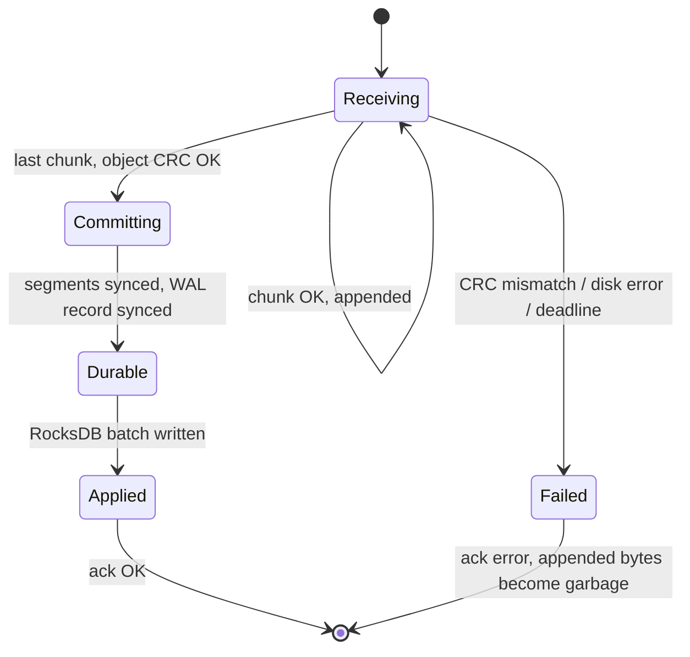

**The code:**

```cpp
// On an IoExecutor thread, per chunk:
absl::Status LocalStore::AppendChunk(LocalWrite& w, std::span<const std::byte> data, uint32_t crc) {
  if (Crc32c(data) != crc) return absl::DataLossError("chunk crc mismatch");
  ChunkLocation loc = segments_.Append(w.shard, data, crc);    // fetch_add + pwrite
  w.locations.push_back(loc);
  w.running_crc = Crc32cExtend(w.running_crc, data);
  return absl::OkStatus();
}

// After the last chunk:
Future<absl::Status> LocalStore::Commit(std::unique_ptr<LocalWrite> w) {
  if (w->running_crc != w->header.object_crc32c) return MakeReady(absl::DataLossError("object crc"));
  WalRecord rec = WalRecord::PutCommit(w->header, w->locations);
  return committer_.Submit(std::move(rec), w->segments_touched);   // resolves after RocksDB apply
}

// GroupCommitter thread loop:
void GroupCommitter::Run() {
  while (running_) {
    auto batch = queue_.PopBatch(/*max_records=*/256, /*max_wait=*/std::chrono::milliseconds(2));
    Status s = segments_.SyncDirty(batch.segments_touched());        // 1) data durable first
    if (s.ok()) s = wal_.AppendBatch(batch.records());               // 2) commit records
    if (s.ok()) s = wal_.Sync();                                     // 3) fdatasync WAL: commit point
    if (s.ok()) s = ApplyToRocksDb(batch);                           // 4) apply with striped locks
    batch.CompleteAll(s);                                            // 5) resolve futures
  }
}

Status GroupCommitter::ApplyToRocksDb(Batch& batch) {
  rocksdb::WriteBatch wb;
  for (auto& rec : batch.records()) {
    auto lock = stripes_.Lock(rec.key());
    auto current = meta_.GetObject(rec.key());
    if (!current || current->version < rec.version())              // last-writer-wins, idempotent
      meta_.PutObject(wb, rec.key(), rec.meta());
    else
      meta_.MarkChunksGarbage(wb, rec);                            // older version lost the race
  }
  meta_.PutAppliedLsn(wb, batch.max_lsn());
  return meta_.Write(wb);   // RocksDB WAL disabled; our WAL is authoritative (see Section 5.6)
}
```

**Why the order matters:** data must be durable **before** the WAL commit record that references it. If the commit record were durable but the data were not, recovery would install metadata pointing at garbage.

**Crash outcomes:**

| Crash point | Result |
| --- | --- |
| Before the WAL sync (step 3) | No commit record: the version never happened on this replica; appended bytes are garbage |
| After the WAL sync, before RocksDB apply | Replay re-applies the record on restart |

**Group commit, worked (ILLUSTRATIVE):** with a 4 ms fsync, one fsync per write caps a disk at ~250 commits/s. With batches of 20, the same disk handles ~5,000 commits/s, and each write still waits about one fsync plus the batching delay.

**Complexity:** `O(S)` CRC over S bytes; `O(log n)` RocksDB operations per commit; one fsync pair **per batch**. Space: one 1 MiB buffer per in-flight chunk; batches ≤ 256 records.

**Trade-offs:** up to 2 ms extra latency at low load (could be adaptive); the single committer thread is a serialization point (fine at hundreds of commits/s; shard the WAL at much higher rates); correctness depends on the project's own replay code.

### 9.5 Lock-free append with offset reservation

1. **Problem:** many concurrent writers appending to the same segment file.
2. **Concept:** `offset = tail.fetch_add(record_size)` reserves a unique byte range atomically; each writer calls `pwrite(fd, buf, len, offset)`. Positional writes don't share a file offset, so they are safe in parallel.
3. **Steps:** compute aligned size → `fetch_add` → if the reservation crosses the segment end, seal and retry on a new segment under the shard mutex → `pwrite` → record the location.
4. **Complexity:** `O(1)`.
5. **Failure case:** a crash after `pwrite` but before commit leaves a hole; nothing references it; compaction reclaims it.
6. **Alternatives:** mutex + `write` (serializes the disk); one writer thread per segment with a queue (extra hop).

### 9.6 Checksum validation pipeline

- The CRC is born at the client and checked wherever bytes move or rest: client → coordinator → replica (before write) → replica (every read) → client → scrubber (sealed segments, low rate). It is never recomputed and trusted without comparison.
- **Complexity:** `O(bytes)` at ~10+ GB/s per core.
- **Failure case:** a replica's disk flips a bit in a sealed segment. The next read or scrub detects it; the replica returns `DATA_LOSS` for that chunk; the coordinator reads from another replica; repair rewrites a fresh copy; the bad record is marked dead.
- **Alternatives:** SHA-256 (slower, cryptographic), xxHash64 (fast, not the storage standard), none (TCP and disk ECC miss real-world corruption).

### 9.7 Hinted repair, read repair, and anti-entropy

| Mechanism | Trigger | Finds | Repair latency | Cost |
| --- | --- | --- | --- | --- |
| Hinted repair | A replica missed a write | Exactly the missed versions | Seconds after the node returns | One hint per missed write |
| Read repair | A read sees a stale replica | Stale keys that are read | Right after the read | One extra write per stale read |
| Anti-entropy | Every 10 min per vnode range | Anything: lost hints, replaced disks, missed deletes | Up to one cycle | Digests + key lists for mismatched buckets |

**Hint replay:**

```cpp
void RepairManager::ReplayHints() {                        // every 10 s
  for (NodeId target : fd_.UpNodes()) {
    for (auto& h : meta_.HintsFor(target, now_ms(), /*limit=*/100)) {
      if (!rate_.TryAcquire(h.size_bytes)) return;         // 50 MiB/s budget
      auto src = FindHealthyReplicaWithVersion(h.key, h.version);   // may be local
      Status s = CopyVersion(src, target, h.key, h.version, /*is_repair=*/true);
      if (s.ok() || IsSuperseded(s)) meta_.DeleteHint(h);
      else meta_.RescheduleHint(h, Backoff(h.attempts));
    }
  }
}
```

**Anti-entropy with bucketed range digests:**
1. For each vnode range a node owns, pick one other replica of that range.
2. Both iterate `ring_index` over the range and split it into **B = 64** buckets; per bucket `digest = XOR over keys of XXH64(key || version || tombstone)`.
3. Exchange digests (`RangeDigest`); equal buckets are in sync.
4. For each mismatched bucket, stream `(key, version)` lists (`RangeKeys`), diff, and pull or push the newer versions.

**Figure 9.3 — Anti-entropy round between two replicas**

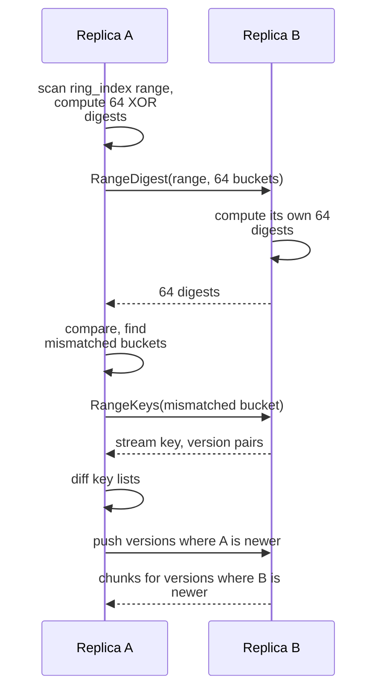

- **Complexity:** `O(k)` local scan per range + `O(B)` digest exchange + `O(k_b)` per mismatched bucket.
- **Alternative:** Merkle trees (Dynamo, Cassandra) find differences in `O(log k)` exchanges but must be built and maintained. At a few million keys per node, a full scan every 10 minutes is affordable and simpler.

### 9.8 Failure detection

- Heartbeat every 1 s; `UP → SUSPECT` after 3 s; `SUSPECT → DOWN` after 5 s; any successful RPC or ping marks it `UP` again.
- **Complexity:** `O(nodes)` pings per second per node, `O(nodes²)` cluster-wide.
- **Alternatives:** phi-accrual detector (adapts to latency variance), SWIM gossip (scales to hundreds of nodes), Kubernetes readiness alone (too slow and indirect).
- **False positive:** a pause > 5 s marks a healthy node `DOWN`; writes skip it and create hints; when it answers, hints replay. Costs repair work, never correctness.

### 9.9 Segment compaction

- Copy live records from sealed segments under 50% live into the active segment, log `CHUNK_MOVE`, delete the old file when no reader holds it.
- **Complexity:** `O(live bytes)` per compacted segment; write amplification ≤ 2×.
- **Crash mid-compaction:** committed moves are replayed; uncommitted copies are garbage; the old segment is deleted only after all moves commit.

<div style="page-break-before: always;"></div>

## 10. Complete End-to-End Execution Flows

### 10.1 PutObject lifecycle (primary flow)

**Figure 10.1 — PutObject end to end**

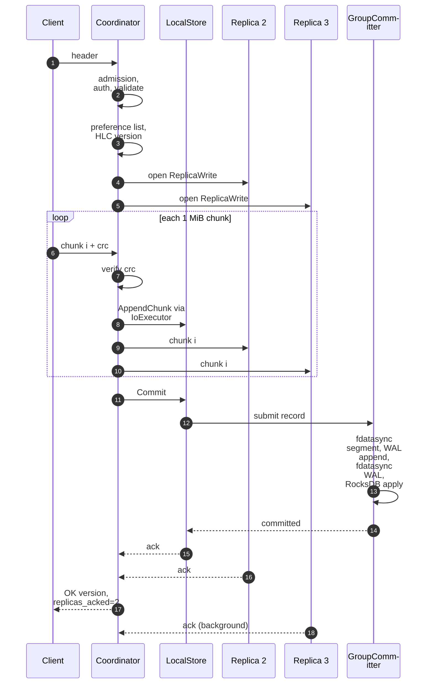

Here the coordinator is itself replica 1, so its own copy goes straight to `LocalStore`; the gRPC reactor that receives the stream is folded into the coordinator for readability.

1. **Arrival:** the client opens a `PutObject` stream to a node chosen by the Service VIP or endpoint list.
2. **Admission:** in-flight count incremented; over 512 → `RESOURCE_EXHAUSTED`.
3. **Authentication:** bearer token checked.
4. **Validation:** the first message must be a valid header.
5. **Routing:** preference list (3 nodes) from the ring snapshot; `VersionId` from the HLC.
6. **Replica selection:** `DOWN` replicas get hints immediately; fewer than W live → `UNAVAILABLE` (fail fast, nothing written).
7. **Streaming:** per chunk, verify CRC, forward to each writer (local writes go to the I/O pool). Flow control throttles the client if replicas are slow.
8. **Replica processing:** verify CRC, reserve segment space, `pwrite`; after the last chunk verify the object CRC and submit a commit.
9. **Durability:** group commit: sync segments → WAL append → sync WAL → RocksDB apply under the stripe lock.
10. **Quorum:** respond `OK(version)` after W acks.
11. **Async completion:** the third ack arrives later; a failure becomes a hint.
12. **Completion:** in-flight counter decremented; metrics recorded.

### 10.2 GetObject lifecycle

**Figure 10.2 — Quorum Get with read repair**

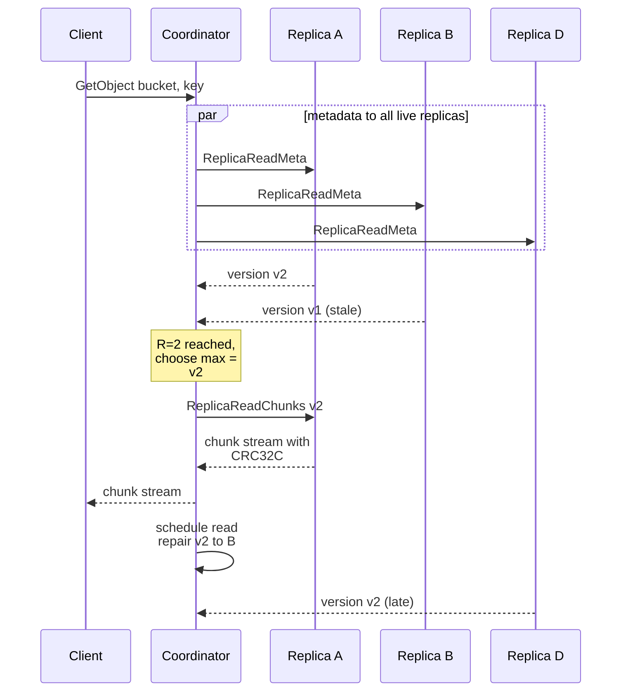

1. Admission, auth, validation.
2. `ReplicaReadMeta` to all live replicas in parallel.
3. At R responses, resolve: highest `VersionId`; tombstone or not found → `NOT_FOUND`.
4. Send metadata to the client first.
5. Stream chunks from the preferred replica holding the winning version (local if possible); each chunk is read on an I/O thread, CRC-verified, and sent.
6. On `DATA_LOSS` or a stream error, continue from the failed chunk on another replica with the same version and enqueue repair.
7. Stale replicas seen in step 3 go to the read-repair queue.
8. The client verifies each chunk and the object CRC.

### 10.3 One replica down during Put

**Figure 10.3 — Hinted write when a replica is down**

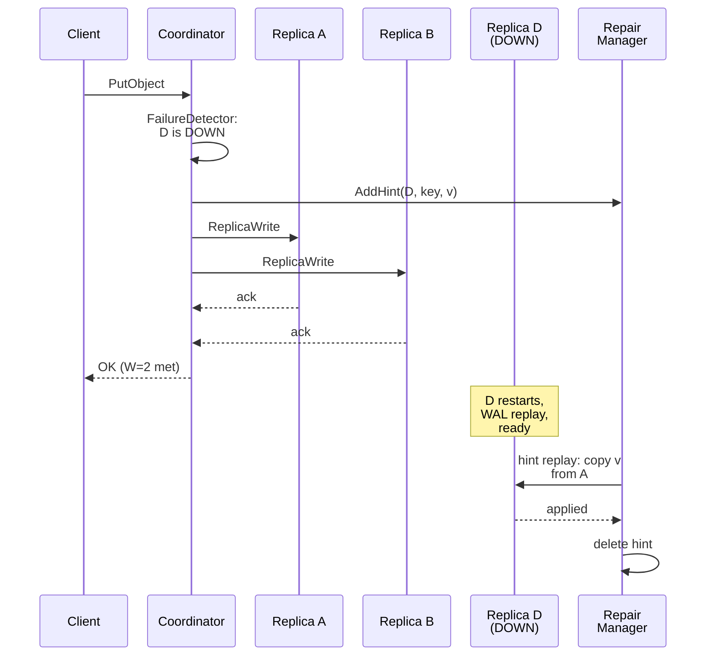

### 10.4 Quorum not reached (two replicas unavailable)

1. The coordinator finds only one live replica.
2. With `QUORUM`, the tracker is impossible **before any data is sent** → `UNAVAILABLE` immediately.
3. If replicas fail **during** the stream, the tracker becomes impossible mid-flight → `UNAVAILABLE`; any replica that committed keeps the version (unknown outcome). Hints are recorded for failed ones.
4. The client retries, creating a newer version (same content) that supersedes it.

### 10.5 Duplicate / retried Put after a timeout

1. The coordinator reaches W=2 but the response is lost; the client sees `DEADLINE_EXCEEDED`.
2. The client retries the same bytes; a new coordinator assigns v′ > v.
3. Replicas apply v′ (LWW); v's chunks become garbage.
4. Net effect: identical content, one extra version later compacted. Puts are **effectively idempotent for identical content**, so no dedup table is needed; `request_id` correlates the attempts in logs.

### 10.6 Corrupt chunk on read

**Figure 10.4 — Read continues on another replica after a CRC failure**

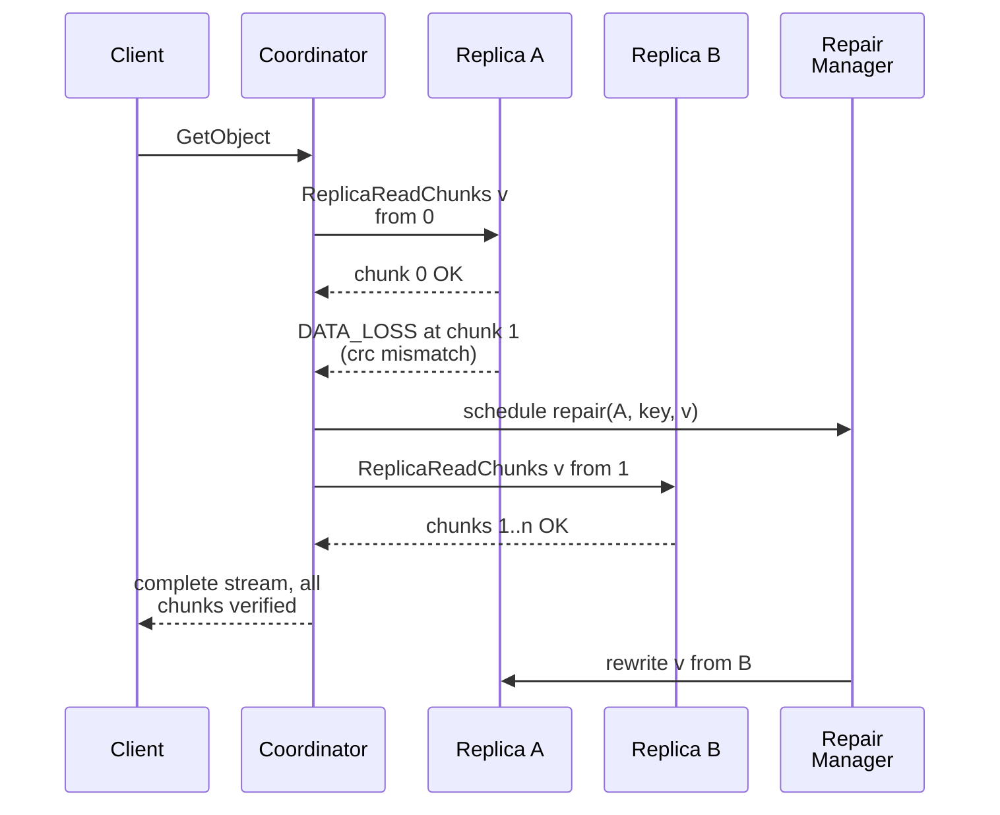

### 10.7 Node crash and WAL recovery

1. `storage-node-2` is killed; peers mark it `DOWN` within ~5 s; writes create hints.
2. Kubernetes restarts the pod with the same PVC.
3. `Recovery::Run()`: open RocksDB (`applied_lsn = A`); replay WAL records with `lsn > A` (verify CRC and referenced segment records, apply with LWW); truncate a torn tail record; find each active segment's valid tail; flush RocksDB; delete replayed WAL segments.
4. The node reports `SERVING`; peers mark it `UP`.
5. Peers replay hints; anti-entropy catches the rest.

Recovery time ≈ RocksDB open + replay of the WAL tail since the last flush (≤ 512 MiB) + segment tail scan; ILLUSTRATIVE: a few seconds for ~100K records.

### 10.8 Timeout while waiting for quorum

1. Client deadline 2 s; one replica stalls (disk), another fails.
2. At `deadline − 50 ms`, replica RPCs are cancelled by their own deadline.
3. The coordinator returns `DEADLINE_EXCEEDED` if W was not reached.
4. Background: replicas that committed keep the version; failed ones get hints. A client retry produces a newer version.

### 10.9 Delete

1. The coordinator assigns a tombstone version `vt`.
2. `ReplicaWrite(tombstone=true, no chunks)` to the preference list; W acks → `OK`.
3. Replicas apply LWW: if `vt` > stored, store the tombstone and mark old chunks garbage.
4. Reads return `NOT_FOUND`; after 24 h the tombstone is purged.

<div style="page-break-before: always;"></div>

## 11. Concurrency and Distributed Systems

### 11.1 Race conditions inside one node

| Race | Scenario | Prevention |
| --- | --- | --- |
| Two writers append to one segment | Both compute the same offset | `fetch_add` on the tail gives disjoint ranges |
| Two versions of one key applied concurrently | Both read "no current version" and both write | Stripe lock across read-compare-write; larger version wins regardless of arrival order |
| Read during compaction | Compactor deletes a segment mid-`pread` | Reader holds `shared_ptr<Segment>`; file unlinked when the last ref drops |
| Ring update during lookup | Reader sees a half-built ring | Immutable snapshot published atomically |
| Read sees uncommitted data | Chunks written but not committed | Metadata, the only way to find chunks, is written after commit |

### 11.2 Locking summary

| Lock | Scope | Held during | Contention |
| --- | --- | --- | --- |
| Stripe mutex (1024) | Keys hashing to that stripe | One apply's read-compare-write | Very low |
| Shard mutex | One I/O shard | Sealing a full segment | Once per 1 GiB written |
| Group-commit queue mutex | Node | Push/pop of pending commits | Low |
| None | Chunk `pwrite` / `pread` | — | Lock-free |

### 11.3 Atomicity

- **Per replica:** a version becomes visible atomically: one RocksDB `WriteBatch` (objects + ring_index + gc + applied_lsn), with the WAL record as the commit point.
- **Across replicas:** **no atomicity**. A write can succeed on some replicas and fail on others; repair converges them.

### 11.4 Ordering

- Versions are totally ordered by `(hlc, node_id)`.
- The precise guarantee: concurrent writes are ordered deterministically; causally related writes through the same coordinator are ordered correctly; causally related writes through **different** coordinators are ordered correctly **when clock skew is smaller than the time between the writes**.

### 11.5 Consistency guarantees

| Guarantee | Holds? | Condition |
| --- | --- | --- |
| Read-your-writes | Yes | Same key, `R + W > N`, no concurrent writer, write returned `OK` |
| Monotonic reads | No (in general) | Two reads through different coordinators can hit different quorums |
| Linearizability | No | Leaderless quorums with LWW are not linearizable |
| Eventual consistency | Yes | Replicas converge after repair, given no new writes |
| Durability of acknowledged writes | Yes | Up to `W − 1` replica disk losses before repair; any number of process crashes |
| Failed write has no effect | **No** | Unknown outcome: it may have committed on fewer than W replicas |

**Figure 11.1 — How two reads can see new then old (not linearizable)**

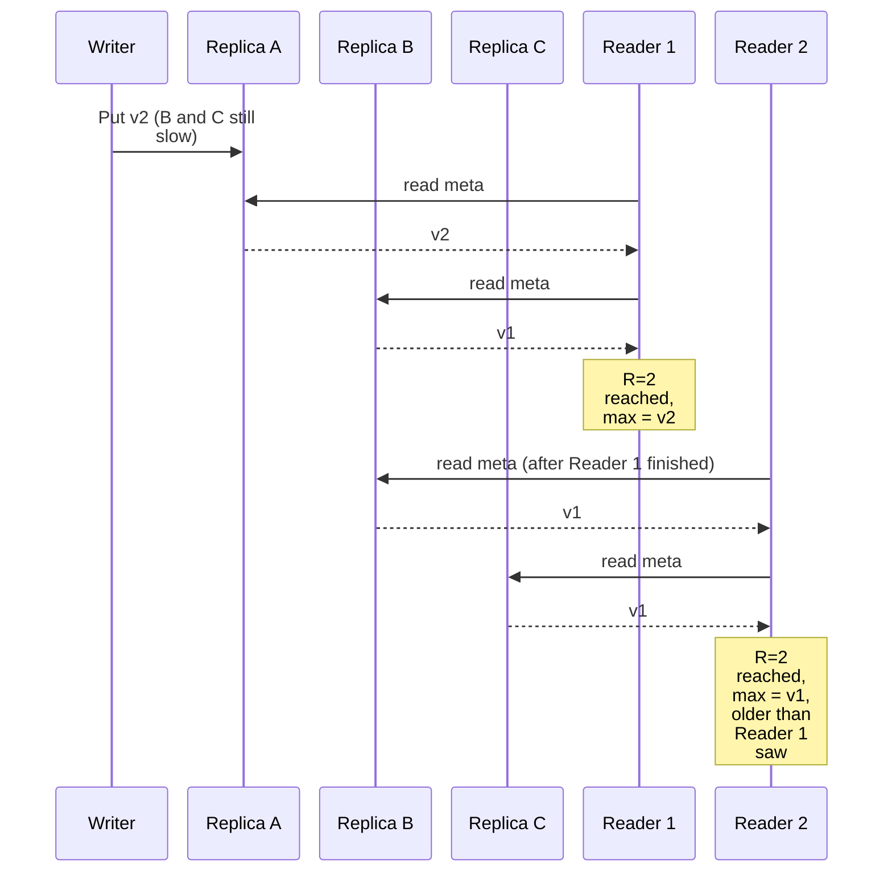

### 11.6 Replication model

- Synchronous to W replicas, asynchronous to the remaining `N − W`.
- **Strict quorum:** only preference-list nodes count; no sloppy substitutes. With two of three replicas down, quorum writes to that key fail, but data never lands on a node that doesn't own it, which keeps repair simple.

### 11.7 Duplicate delivery and idempotency

| Duplicate source | Effect | Handling |
| --- | --- | --- |
| Client retries a Put | New version, same content | LWW supersedes; old chunks collected |
| Coordinator retries a replica write | Same version applied twice | `if (stored >= v) skip`, response says `superseded` |
| Hint replay after the write already arrived | Same version | Same idempotent apply |
| WAL replay of an applied record | Same version | Same idempotent apply |

Every path converges on one rule: **apply version v only if it is greater than the stored version.**

### 11.8 Concurrency control across the cluster

There is no distributed lock and no consensus. Coordination is replaced by: (1) deterministic placement (same ring everywhere, guarded by the epoch); (2) deterministic conflict resolution (total order on versions); (3) idempotent, commutative apply. Together these make each key a **CRDT-like last-writer-wins register**.

### 11.9 Backpressure

1. A slow replica's gRPC flow-control window fills.
2. `ReplicaWriter::SendChunk` cannot send; the coordinator reads the next client chunk only after forwarding the previous one, so it stops reading.
3. The client's window fills and its writes block.

Memory per Put is bounded by flow-control windows, not object size. Admission control (512 in flight) and bounded I/O queues turn overload into fast `RESOURCE_EXHAUSTED` errors; repair traffic is rate-limited and flagged `is_repair`.

### 11.10 One node becomes unavailable: the full walkthrough

Assume 5 nodes, N=3, W=2, R=2, and `storage-node-2` dies.

1. **Detection (0–5 s):** `SUSPECT` at 3 s, `DOWN` at 5 s; failed RPCs or keepalive may detect it sooner; readiness removes it from the client Service.
2. **Requests it was coordinating:** streams break (`UNAVAILABLE`); the client library retries elsewhere; in-flight Puts have unknown outcome.
3. **Requests where it was a replica:** its writer fails; if the other two ack, the client still gets `OK`; a hint is stored.
4. **New writes to its keys (~60% of keys):** go to the other two replicas; hints accumulate.
5. **Reads:** R=2 from the two live replicas.
6. **Durability during the outage:** affected keys have 2 copies; a second failure among the same replicas makes them unwritable and readable only with `ONE`.
7. **Node returns (same disk):** WAL recovery → ready → hints replay (rate-limited) → anti-entropy confirms.
8. **Node never returns:** replace the PVC and pod; the empty node rebuilds its ranges via anti-entropy at ≤ 50 MiB/s (ILLUSTRATIVE: 200 GiB ≈ 68 minutes).

<div style="page-break-before: always;"></div>

# Part 4: Engineering and Reliability

## 12. Failure Handling and Recovery

### 12.1 Failure-scenario table

| Failure scenario | Why it happens | System behaviour | Recovery mechanism | Remaining risk |
| --- | --- | --- | --- | --- |
| Storage node crash | OOM, node failure, kill | Writes go to remaining replicas + hints; reads use remaining replicas | Pod restart → WAL replay → hints → anti-entropy | Reduced redundancy until repaired |
| Two replicas of a key down | Correlated failures | `UNAVAILABLE` for `QUORUM` ops on those keys | Restore a node | Availability loss (no consistency loss) |
| Network partition | Isolated node | Isolated node cannot reach W; others treat it as down | Partition heals; hints replay | None with strict quorum and W > N/2 |
| Slow replica (disk stall) | Cloud volume hiccup | Quorum met by faster replicas; slow one finishes or times out → hint | Hint replay | Tail latency if two replicas are slow |
| Partial write across replicas | Failures mid-Put | Error to client (unknown outcome) | Client retry; repair spreads whatever committed | A failed write may become visible later |
| Partial write on one replica | Crash mid-Put | No WAL commit record → version never applied there | Hint replay from another replica | None |
| Torn WAL tail | Crash during WAL append | Truncate the last record | Normal startup | None (never acknowledged) |
| WAL corruption mid-log | Media corruption | Refuse to start; alert | Wipe node; rebuild from peers | None if peers are healthy |
| Chunk corruption at rest | Bit rot | Read served from another replica; chunk marked bad | Repair rewrites from a healthy replica | Loss only if all copies are corrupt |
| Disk full | `ENOSPC` | Writes fail `RESOURCE_EXHAUSTED`; node read-only but serves reads | Compaction, add capacity | Writes rely on other two replicas |
| Client deadline | Slow quorum | `DEADLINE_EXCEEDED`; background work continues | Client retry | Unknown outcome for Puts |
| gRPC channel failure | Connection reset | Reconnect with backoff; fail over to other replicas | Automatic | None |
| Ring epoch mismatch | Config rollout in progress | Replica returns `ABORTED` | Client retries; rollout completes | Brief unavailability (by design) |
| Repair overloads foreground | Large rebuild | Token bucket caps repair bandwidth | Tune the rate | Slower repair |

There is no database server, Kafka, or Redis in this system; "checkpoint recovery" here means WAL replay plus RocksDB flush points.

### 12.2 Crash recovery procedure, step by step

**Figure 12.1 — WAL recovery on restart**

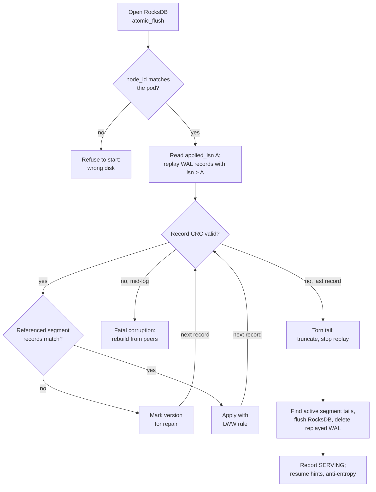

1. Open RocksDB; read `applied_lsn = A`, `ring_epoch`, `node_id`. Refuse to start if `node_id` differs from the pod's identity (wrong disk attached).
2. List WAL segments by first LSN; skip those entirely ≤ A.
3. Replay records with `lsn > A`: verify CRC; for `PUT_COMMIT` verify every referenced segment record (magic, header CRC, key hash, version, index); apply with the same idempotent LWW logic as live traffic.
4. A bad CRC on the last record in the last segment is a torn write → truncate. A bad CRC elsewhere → fatal.
5. Because data is synced before commit, a referenced-record mismatch indicates media corruption: mark the version for repair instead of applying.
6. Set each active segment's append offset past its highest committed record; bytes beyond are garbage.
7. Flush RocksDB (new `applied_lsn`), delete replayed WAL segments.
8. Start serving; peers replay hints; read repair and anti-entropy handle the rest.

### 12.3 Replica rebuild (empty disk)

1. Start the new pod with an empty disk (`applied_lsn = 0`).
2. For each vnode range it owns, anti-entropy compares digests with another replica: every bucket mismatches.
3. It pulls `(key, version)` lists and copies each version via `ReplicaReadChunks` plus a local write marked `is_repair`.
4. Repair bandwidth is capped (default 50 MiB/s) to protect foreground p95.
5. Done when all range digests match on two consecutive cycles.

### 12.4 Graceful shutdown

On `SIGTERM` (after a 5 s `preStop` sleep): report `NOT_SERVING`; wait up to 20 s for in-flight requests (new ones get `UNAVAILABLE`); drain the group-commit queue (final fsyncs); flush RocksDB; close the WAL and RocksDB; exit. `terminationGracePeriodSeconds` is 30.

### 12.5 Guarantees and non-guarantees

- **Guaranteed:** acknowledged writes survive any number of process crashes and up to `W − 1` disk losses among their replicas before repair; no corrupt chunk is returned without an error; replicas converge.
- **Not guaranteed:** linearizability, monotonic reads, that a failed write has no effect, or that concurrent writes both survive.

<div style="page-break-before: always;"></div>

## 13. Performance Engineering

### 13.1 Where time and CPU go (ILLUSTRATIVE)

**64 KiB Put, N=3, W=2, same availability zone:**

| Step | Latency | CPU | Notes |
| --- | --- | --- | --- |
| Client → coordinator transfer | ~0.5 ms | gRPC framing, protobuf parse | One copy into the protobuf `bytes` field |
| CRC32C verify at coordinator | ~6 µs | 64 KiB at ~10 GB/s | Negligible |
| Forward to 2–3 replicas | ~0.5–1 ms | Serialization per replica (baseline) | Byte forwarding removes it |
| Replica `pwrite` | ~0.1 ms (page cache) | Syscall + memcpy | |
| Group commit `fdatasync` (segment + WAL) | **1–10 ms** | Mostly waiting | Dominant term; depends on the disk |
| RocksDB apply | ~50 µs | Memtable insert | |
| Total (typical) | ~5–20 ms | | |

**64 KiB Get, R=2:** metadata fan-out ~1 ms + `pread` (page cache ~50 µs, SSD miss ~0.1–0.3 ms) + CRC + stream ~1 ms → ~2–5 ms.

**1 MiB objects** move ~16× the bytes: transfer and CRC/copy CPU scale linearly; fsync cost does not.

A 200 ms p95 budget is therefore generous; the risk is **queueing**: I/O pool saturation, fsync stalls on cloud volumes (which can spike to 50–100 ms), and repair traffic competing with foreground I/O.

### 13.2 Bottlenecks and complexity

| Path | Algorithmic cost | Practical bottleneck |
| --- | --- | --- |
| Ring lookup | `O(log V)` | Never (microseconds) |
| Checksums | `O(bytes)` | Negligible with hardware CRC32C |
| Data copies | `O(bytes × copies)` | memcpy CPU on large objects (main user-space term) |
| Small-file I/O (baseline) | `O(chunks)` syscalls + filesystem metadata | Kernel CPU and IOPS |
| fsync | `O(commits)` baseline vs `O(batches)` optimized | Disk flush latency |
| RocksDB | `O(log n)` per op | Compaction CPU at high write rates (not at this load) |
| Threads | Baseline: one thread per active RPC | Context switches at 1,000 sessions |

### 13.3 The optimizations (baseline → optimized)

**OPT-1: Append-only segments instead of one file per chunk.**
- *Bottleneck:* `open(O_CREAT)` + `write` + `fsync` + `close` + parent-directory `fsync` per chunk: ≥ 5 syscalls and filesystem journaling per chunk.
- *Change:* append records to 4 preallocated 1 GiB segment files per node; locations in RocksDB; `fetch_add` + one `pwrite` per chunk; files stay open.
- *Effect:* removes per-chunk inode creation, directory updates, and journal commits (kernel CPU); near-sequential appends. Largest share of the sys-CPU reduction.
- *Cost:* compaction needed; recovery must find valid segment tails; one corrupt segment affects many chunks (mitigated by per-record CRCs).
- *Measure:* syscall counts per Put (`perf stat`, `strace -c`), user vs sys CPU (`pidstat -u`), flame-graph share of ext4/xfs functions.

**OPT-2: Group commit and a single authoritative WAL.**
- *Bottleneck:* fsync per Put on data plus a synchronous RocksDB write with its own WAL fsync: 2–3 flushes per replica write, two logs.
- *Change:* one committer batches ≤ 256 commits or 2 ms; one fdatasync for touched segments and one for the WAL per batch; RocksDB `disableWAL=true` + `atomic_flush`.
- *Effect:* flushes drop from `O(writes)` to `O(batches)`; no second log write.
- *Cost:* batching delay at low load; single committer; replay correctness now the project's responsibility.
- *Measure:* `objstore_group_commit_batch_size`, fdatasyncs per second, CPU per op.

**OPT-3: Pooled, zero-copy read buffers.**
- *Bottleneck:* a new `std::vector<char>` per chunk read, `pread` into it, copy into protobuf, gRPC copies again: two user-space copies and a malloc/free per MiB.
- *Change:* `pread` into a pooled 1 MiB buffer wrapped in a `grpc::Slice` whose destroy callback returns it to the pool; send via `grpc::ByteBuffer`.
- *Cost:* more complex lifetime management; pool sizing.
- *Measure:* flame-graph share of memcpy and malloc/free; CPU per GiB served.

**OPT-4: Forward serialized chunks to replicas.**
- *Bottleneck:* parse each chunk, then serialize a new request per replica (2–3 times).
- *Change:* forward the received bytes through a generic stub (identical wire format).
- *Cost:* both services must keep the chunk message wire-compatible.

**OPT-5: Callback gRPC server with a bounded I/O pool (measured separately).**
- *Bottleneck:* the sync server dedicates a thread to each active RPC; bursts at 1,000 sessions create hundreds of threads.
- *Change:* reactors + fixed 8-thread `IoExecutor` + admission control (512).
- *Why separate:* it changes the concurrency model, not the I/O path, so it is reported as its own row to avoid inflating the "I/O optimization" claim.

**OPT-6: RocksDB tuning.** Bloom filters, 256 MiB block cache, LZ4. Small impact at this load.

### 13.4 Memory and network

| Consumer | Bound |
| --- | --- |
| In-flight chunk buffers | Bounded by the pool (e.g., 256 × 1 MiB = 256 MiB) |
| RocksDB block cache + memtables | 256 MiB + 3 × 64 MiB |
| gRPC per-stream buffers | Flow-control window |
| Page cache | Whatever the container limit allows; serves hot Gets |

| Operation (object size S, N=3) | Bytes on the network |
| --- | --- |
| Put, coordinator is a replica (probability 3/5 with 5 nodes) | S + 2S |
| Put, coordinator is not a replica | S + 3S |
| Get | R small metadata responses + S (replica → coordinator, if remote) + S (to client) |

Average Put amplification ≈ `1 + (0.6 × 2 + 0.4 × 3) = 3.4×` (ILLUSTRATIVE). A replica-aware client would remove the extra hop (future improvement).

### 13.5 Horizontal scaling

Throughput scales with nodes while keys are uniform; each node does ~`N / nodes` of the replica work. Limits: full-mesh heartbeats (`O(nodes²)`), anti-entropy cost per node, manual topology changes.

<div style="page-break-before: always;"></div>

## 14. Benchmarking and Testing

> **Status:** this is the intended plan. None of these tests or benchmarks has been run, and the result tables are blank. No number here is a measurement.

### 14.1 Test plan

| Test | Objective | Execution | Expected / assertion |
| --- | --- | --- | --- |
| Unit: ring placement | Correct, balanced lists | 1M random keys, 5 nodes × 128 vnodes | 3 distinct nodes per list; share within ±10% of 60%; a 6th node moves ≈ 1/6 of ownership |
| Unit: HLC | Monotonic, causal | Fake wall clock that goes backward | Strictly increasing; `Observe(x)` then `Now()` > x |
| Unit: WAL codec | Encode/decode, torn-tail detection | 10,000 records, truncate at a random byte | Complete records returned; replay stops cleanly at the torn record |
| Unit: LWW apply | Idempotent, order-independent | v1 < v2 < v3 in all 6 orders, each twice | Final version always v3; superseded chunks garbage |
| Integration: single node | Real RocksDB and segments | Objects of 0 B, 1 B, 1 MiB, 1 MiB + 1 B, 64 MiB | Bytes and CRCs identical; `NOT_FOUND` after delete |
| API validation | Contract enforcement | Bad bucket, out-of-order chunk, wrong CRCs, missing header | `INVALID_ARGUMENT` / `DATA_LOSS`; nothing committed |
| **Crash consistency** | No acknowledged write lost | `_exit(1)` after `pwrite`, segment sync, WAL append, WAL sync, RocksDB apply; 50× per point | Every acknowledged Put readable with correct CRC; unacknowledged Puts absent or complete, never partial |
| Concurrency: same-key writers | Convergence | 50 threads overwrite one key | All 3 replicas hold the same version, byte-identical to one writer |
| Concurrency: read during write | No torn reads | Overwrite 16 MiB in a loop while reading | Every read's CRC matches a written version |
| Sanitizers | No races or memory errors | TSan and ASan builds of concurrency tests | Zero reports |
| Failure: node kill | Availability | Delete a pod during the S1 workload | Quorum ops keep succeeding; errors limited to the detection window |
| Failure: partition | No acknowledged divergence | NetworkPolicy isolates one node for 2 min | Isolated node's writes fail; replicas converge after heal |
| Failure: corruption | Integrity pipeline | Flip a byte in a sealed segment | Correct bytes returned; repair rewrites; scrubber reports |
| Recovery: hints | Hinted repair | Stop node C, write 1,000 objects, start C | C holds all 1,000; hints CF empty |
| Recovery: empty-disk rebuild | Anti-entropy | Replace C's PVC with an empty one | Digests match within the expected time |
| Stress / soak | Graceful overload; no leaks | Ramp to 2,000 ops/s; 8 h overwrite-heavy | Retryable errors only; flat RSS, disk, WAL size, p99 |

The test that best proves the WAL claim is the **crash-consistency test with named crash points**.

### 14.2 Benchmark workload and tools

| Parameter | Primary workload (W-MIX) |
| --- | --- |
| Operation mix | 70% `GetObject`, 30% `PutObject` |
| Object sizes | 4 KiB (40%), 64 KiB (50%), 1 MiB (10%); mean ≈ 136 KiB |
| Keys | Uniform over 100,000 preloaded keys; Puts overwrite uniformly chosen keys |
| Concurrency | 1,000 logical client sessions over 64 gRPC channels |
| Arrivals | Aggregate open-loop Poisson at 167 ops/s; ≤ 1 request in flight per session |
| Consistency | `QUORUM` (N=3, W=2, R=2) |
| Warm-up / steady / runs | 3 min (discarded) / 10 min / 3 runs per configuration |

Tools: the custom C++ load generator `objbench` (streaming gRPC, open-loop arrivals, HdrHistogram, latency from the **intended** send time); `ghz` for unary `HeadObject` checks; `fio` for the disk's fsync floor; Google Benchmark for micro-benchmarks; cgroup `cpu.stat`, `pidstat`, `perf` for CPU; Prometheus and Grafana for server-side series. k6, JMeter, and wrk are not used because they lack first-class streaming-gRPC support.

### 14.3 Scenarios

| # | Scenario | Purpose |
| --- | --- | --- |
| S1 | Claim run: W-MIX, 1,000 sessions, 167 ops/s, 10 min | 10K ops/min, p95 < 200 ms, errors < 0.1%, zero CRC failures |
| S2 | CPU A/B: baseline vs optimized builds | ~25% CPU per op reduction |
| S3 | Ablation: optimized minus one OPT at a time | Attribution |
| S4 | Node failure: kill node 2 at minute 4, restart at 7 | Availability and repair |
| S5 | Saturation ramp 100 → 2,000 ops/s | Find the knee |
| S6 | Write-heavy: 100% Put, 64 KiB | Group commit effectiveness |
| S7 | Large objects: 16 MiB | Streaming and backpressure |
| S8 | Replication sweep: (1,1,1), (3,1,1), (3,2,2), (3,3,1) | Cost of replication and quorum |
| S9 | Hot keys: Zipf(0.99) | Stripe-lock and replica hotspots |
| S10 | Burst: 1,000 requests at once | Spike handling (literal simultaneity) |
| S11 | Corruption injection | Zero corrupt bytes returned |

### 14.4 Baseline vs optimized

| Aspect | Baseline | Optimized |
| --- | --- | --- |
| Data layout | File per chunk + directory fsync | Append-only segments (OPT-1) |
| Commit | fsync per write; RocksDB WAL `sync=true` | Group commit; single WAL (OPT-2) |
| Read buffers | New vector + copy | Pooled buffers, zero-copy (OPT-3) |
| Replica forwarding | Re-serialize per replica | Forward bytes (OPT-4) |
| Server model | Sync gRPC | Callback + `IoExecutor` + admission (OPT-5, separate row) |
| Checksums, replication, workload, hardware | Identical | Identical |

Rules: same offered load (167 ops/s) in both; fresh volume and identical preload; three runs, median and min–max; identical CPU limits with Guaranteed QoS and near-zero throttling; the headline I/O figure uses OPT-1 to OPT-4 with the server model held constant.

### 14.5 Metrics

Throughput (successful ops/min), p50/p95/p99 per operation and size class (Get = time to last byte), error rate by code, CPU per op (Δ cgroup CPU-µs / Δ successful ops), user vs sys CPU, memory, disk IOPS, fsyncs/s and batch size, network throughput, hints pending and repair bytes/s, recovery time.

<div style="page-break-before: always;"></div>

## 15. Deployment and Infrastructure

### 15.1 Deployment architecture

**Figure 15.1 — Kubernetes deployment**

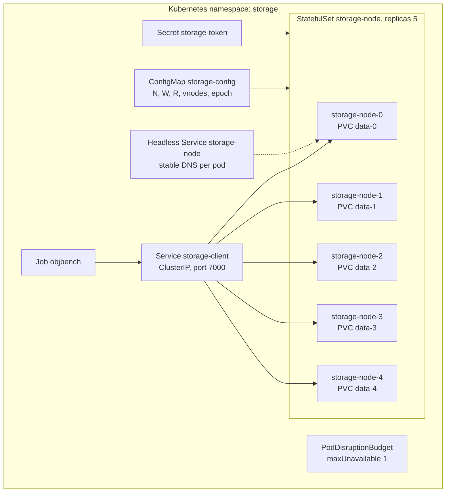

Each pod has its own PersistentVolumeClaim, so a rescheduled `storage-node-2` gets its old disk back. Pod anti-affinity spreads pods across Kubernetes nodes, so one machine failure takes out at most one replica.

### 15.2 Docker

```dockerfile
# Representative only; not created in this repository.
FROM ubuntu:24.04 AS build
RUN apt-get update && apt-get install -y build-essential cmake ninja-build git pkg-config
WORKDIR /src
COPY . .
RUN cmake -B build -G Ninja -DCMAKE_BUILD_TYPE=Release -DOBJSTORE_IO_MODE=optimized \
 && cmake --build build --target storage-node

FROM ubuntu:24.04
RUN useradd -u 10001 objstore && mkdir /data && chown objstore /data
COPY --from=build /src/build/storage-node /usr/local/bin/storage-node
USER objstore
EXPOSE 7000 9100
ENTRYPOINT ["/usr/local/bin/storage-node"]
```

Port 7000 serves gRPC (both services); 9100 serves `/metrics`.

### 15.3 Kubernetes objects

| Object | Purpose |
| --- | --- |
| `StatefulSet storage-node` (replicas 5) | Stable pod names → stable node ids and ring tokens |
| `volumeClaimTemplates: data` | One PVC per pod, reattached on reschedule |
| Headless `Service storage-node` | DNS per pod for peer channels |
| `Service storage-client` (ClusterIP) | Client entry point across ready pods |
| `ConfigMap storage-config` | N, W/R defaults, vnodes, ring epoch, node list, limits |
| `Secret storage-token` | Client and internal tokens |
| `PodDisruptionBudget` | `maxUnavailable: 1` |
| Pod anti-affinity | Prefer one storage pod per Kubernetes node |

Representative StatefulSet (documentation only):

```yaml
apiVersion: apps/v1
kind: StatefulSet
metadata:
  name: storage-node
  namespace: storage
spec:
  serviceName: storage-node
  replicas: 5
  podManagementPolicy: Parallel
  selector:
    matchLabels: { app: storage-node }
  template:
    metadata:
      labels: { app: storage-node }
    spec:
      terminationGracePeriodSeconds: 30
      affinity:
        podAntiAffinity:
          preferredDuringSchedulingIgnoredDuringExecution:
            - weight: 100
              podAffinityTerm:
                topologyKey: kubernetes.io/hostname
                labelSelector: { matchLabels: { app: storage-node } }
      containers:
        - name: node
          image: objstore:opt
          args: ["--config=/etc/objstore/config.yaml", "--data=/data"]
          env:
            - name: POD_NAME
              valueFrom: { fieldRef: { fieldPath: metadata.name } }
            - name: CLIENT_TOKEN
              valueFrom: { secretKeyRef: { name: storage-token, key: client } }
          ports:
            - { name: grpc, containerPort: 7000 }
            - { name: metrics, containerPort: 9100 }
          readinessProbe:
            grpc: { port: 7000 }
            periodSeconds: 5
          livenessProbe:
            grpc: { port: 7000, service: liveness }
            periodSeconds: 10
            failureThreshold: 6
          startupProbe:
            grpc: { port: 7000, service: liveness }
            periodSeconds: 5
            failureThreshold: 60
          resources:
            requests: { cpu: "2", memory: 4Gi }
            limits:   { cpu: "2", memory: 4Gi }
          volumeMounts:
            - { name: data, mountPath: /data }
            - { name: config, mountPath: /etc/objstore }
      volumes:
        - name: config
          configMap: { name: storage-config }
  volumeClaimTemplates:
    - metadata: { name: data }
      spec:
        accessModes: ["ReadWriteOnce"]
        resources: { requests: { storage: 50Gi } }
```

Representative configuration:

```yaml
replication_factor: 3
default_write_consistency: QUORUM
default_read_consistency: QUORUM
vnodes_per_node: 128
ring_epoch: 1
nodes: [storage-node-0, storage-node-1, storage-node-2, storage-node-3, storage-node-4]
io_threads: 8
io_shards: 4
max_inflight_requests: 512
group_commit_max_records: 256
group_commit_max_wait_ms: 2
repair_rate_mib_per_s: 50
tombstone_grace_hours: 24
heartbeat_interval_ms: 1000
suspect_after_ms: 3000
down_after_ms: 5000
```

### 15.4 Health checks, resources, scaling, environment

| Probe | Meaning |
| --- | --- |
| Startup | gRPC health `liveness`; gives WAL recovery up to 5 minutes |
| Readiness | `SERVING` only after recovery completes, disk is writable, and the node is not draining |
| Liveness | Event loop responsive; **does not** depend on peers (a cluster-wide problem must not restart every pod) |

- **Resources:** CPU request = limit (Guaranteed QoS) for predictable benchmarks; 4 GiB memory = RocksDB (~450 MiB) + buffer pool (256 MiB) + gRPC buffers + headroom; the rest is page cache.
- **Scaling:** no HPA. Adding a node moves data, so it is an operator decision: bump `replicas`, add the node to the ConfigMap list, bump `ring_epoch`, roll the StatefulSet, let anti-entropy move data.
- **Environment variables:** `POD_NAME` (derives node id and ring tokens), `CLIENT_TOKEN` and `INTERNAL_TOKEN` (from the Secret), `OBJSTORE_LOG_LEVEL`.

<div style="page-break-before: always;"></div>

## 16. Observability

### 16.1 Logs

One JSON line per request at `info` (sampled for Gets under load) and one per repair action. Keys are logged as **hashes** (object names can be sensitive). `request_id` is generated by the client, propagated by the coordinator in replica RPC metadata, and logged on every node.

```json
{"ts":"2026-03-18T10:21:07.412Z","level":"info","node":3,"rpc":"PutObject","request_id":"9b1f...","bucket":"photos","key_hash":"0x5d1c...","version":"0000018f3a2b4c5d0001-3","size":65536,"replicas":[2,3,4],"acked":2,"status":"OK","latency_ms":11.8}
```

### 16.2 Metrics (prometheus-cpp, port 9100)

| Metric | Type | Use |
| --- | --- | --- |
| `objstore_requests_total{rpc,code}` | Counter | Throughput and errors |
| `objstore_request_duration_seconds{rpc,size_class}` | Histogram | Server-side p50/p95/p99 |
| `objstore_replica_write_duration_seconds{peer}` | Histogram | Slow replica detection |
| `objstore_quorum_failures_total{rpc,reason}` | Counter | Availability problems |
| `objstore_inflight_requests`, `objstore_admission_rejected_total` | Gauge / Counter | Admission headroom, overload |
| `objstore_io_queue_depth` | Gauge | I/O pool saturation |
| `objstore_group_commit_batch_size` | Histogram | Group commit effectiveness |
| `objstore_fsync_duration_seconds{target}` | Histogram | Disk health |
| `objstore_crc_failures_total{where}` | Counter | Integrity (ingest, read, scrub) |
| `objstore_hints_pending{target}`, `objstore_repair_bytes_total{kind}` | Gauge / Counter | Repair backlog and activity |
| `objstore_antientropy_mismatched_buckets` | Gauge | Replica divergence |
| `objstore_peer_state{peer}` | Gauge | Membership view |
| `objstore_wal_bytes`, `objstore_segment_live_ratio` | Gauge | Space and recovery-time health |

```promql
# Overall p95 by RPC
histogram_quantile(0.95, sum by (le, rpc) (rate(objstore_request_duration_seconds_bucket[5m])))

# Operations per minute (client-visible, successful)
sum(rate(objstore_requests_total{rpc=~"PutObject|GetObject",code="OK"}[1m])) * 60

# CPU seconds per operation across the cluster
sum(rate(process_cpu_seconds_total{job="storage-node"}[5m]))
  / sum(rate(objstore_requests_total{rpc=~"PutObject|GetObject",code="OK"}[5m]))
```

### 16.3 Dashboards and alerts

Dashboards: overview (ops/min, errors, p95/p99 by RPC and size class, in-flight), storage (fsync latency, batch size, queue depth, WAL size, live ratio), cluster health (peer matrix, quorum failures, hints, repair), integrity (CRC failures, scrubber progress).

| Alert | Condition | Why |
| --- | --- | --- |
| NodeDown | `objstore_peer_state == 0` from ≥ 2 peers for 1 min | Reduced redundancy |
| QuorumFailures | quorum failure rate > 0.01/s for 5 min | Availability impact |
| CRCFailure | any increase outside ingest | Corruption at rest or in memory |
| HintsBacklog | `objstore_hints_pending > 10000` for 15 min | Repair not keeping up |
| FsyncSlow | fsync p99 > 100 ms for 10 min | Disk degradation |
| LatencySLO | p95 > 200 ms for 10 min | SLO breach |
| DiskFull | free space < 15% | Writes will fail |

### 16.4 Debugging a production issue

A reasoning procedure built from the documented signals:

| Symptom | First check | Likely cause | Action |
| --- | --- | --- | --- |
| Put p95 rising | `objstore_fsync_duration_seconds`, batch size | Disk stall on a replica | Check `objstore_replica_write_duration_seconds{peer}`; replace the volume if one peer is slow |
| `UNAVAILABLE` errors | `objstore_peer_state`, quorum failures | Two replicas of some keys down | Restore a node; check PDB and anti-affinity |
| `RESOURCE_EXHAUSTED` | In-flight, admission rejections, I/O queue depth | Overload | Back off clients; investigate slow disk; consider capacity |
| Hints backlog growing | Hints pending per target | A node down or repair rate too low | Bring node back; tune the 50 MiB/s cap |
| CRC failure alert | `where` label | Disk or memory corruption | Confirm repair rewrote the chunk; inspect hardware |
| A key reads stale | Anti-entropy mismatches; read repair | Divergence not yet repaired | Wait one cycle or trigger repair; recall monotonic reads are not guaranteed |

Trace a single request across nodes by its `request_id`.

<div style="page-break-before: always;"></div>

# Part 5: Interview Preparation

## 17. Complete 30-Minute Project Explanation

This is a speaking script for explaining the whole project continuously in about 30 minutes. Each segment has what to say (written to be spoken aloud), the technical details behind the words, the diagram to draw, the points you must not forget, the most likely interruption, and a transition into the next segment.

**Honesty rule for the whole talk:** the four resume figures (1,000 concurrent requests, 10K operations/min, < 200 ms p95, ~25% CPU reduction) are **benchmark targets**, not measured results, and no code, test, or benchmark has been run. Say so the first time you mention a number.

| Time | Segment |
| --- | --- |
| 0–2 min | 1. Problem statement and motivation |
| 2–5 min | 2. Requirements, scope, and technology stack |
| 5–10 min | 3. High-level design and architecture |
| 10–15 min | 4. Low-level design: inside one storage node |
| 15–19 min | 5. Core algorithms and data structures |
| 19–23 min | 6. APIs, storage layout, concurrency, and consistency |
| 23–26 min | 7. Failure handling and recovery |
| 26–28 min | 8. Performance engineering and benchmarking |
| 28–30 min | 9. Trade-offs, limitations, and future improvements |

### Segment 1 (0–2 min): Problem statement and motivation

**What to say:**

> "This project is a distributed object store, a small version of the data plane behind systems like Amazon S3, built in the style of Amazon's Dynamo paper. Applications store opaque blobs, things like images, model files, or backups, from a few kilobytes up to 64 MiB, and read them back by bucket and key.
>
> One disk is a single point of failure, and copying files around by hand gives no integrity guarantee and no automatic recovery. So the system has to do six things: spread objects across nodes without a central lookup table; keep N copies and keep working when a node is down; detect silent corruption like bit rot with checksums; survive a crash without losing acknowledged writes; bring lagging or replaced replicas back to N copies automatically; and handle many concurrent clients, including concurrent writes to the same key.
>
> I built it in C++ because the point was to make I/O, memory copies, and threading explicit and measurable. In one project it covers consistent hashing, quorum replication, hinted repair, anti-entropy, write-ahead logging, crash recovery, checksums, and high-concurrency I/O."

**Technical details to understand:**
- *Object store* = key → blob storage with no in-place edits. Each overwrite creates a new immutable **version**.
- *Leaderless* (Dynamo-style) means no master node; any node can coordinate any request.
- An *acknowledged write* is one the client got `OK` for; it must survive crashes.

**Diagram to draw:** one box "client" and five boxes "node 0–4" in a ring, to set up the next segment.

**Key points to remember:**
- Dynamo-style, leaderless, C++20, gRPC.
- Six requirements: placement without a directory, availability, integrity, crash durability, repair, concurrency.

**Likely interruption:** *"Is this S3-compatible?"* No. S3 HTTP compatibility, multipart upload, user-visible versioning, IAM, encryption at rest, erasure coding, cross-region replication, linearizability, and automatic rebalancing are all out of scope.

**Transition:** "Let me make the requirements precise and then explain the tools I chose."

### Segment 2 (2–5 min): Requirements, scope, and technology stack

**What to say:**

> "Functionally: `PutObject` streams an object up to 64 MiB in 1 MiB chunks. `GetObject` streams the latest version back, verifying checksums. `HeadObject` returns metadata only. `DeleteObject` writes a tombstone that is garbage-collected later. `ListObjects` is a best-effort scatter-gather. The replication factor N defaults to 3, and every request can choose a consistency level: `ONE`, `QUORUM`, or `ALL`. Every chunk has a CRC32C checksum. Each node recovers by replaying its write-ahead log. Lagging replicas are repaired asynchronously. And any node can coordinate any request.
>
> Non-functionally: an acknowledged write survives any single node crash; with N=3, W=2, R=2 reads and writes continue with one replica down; no corrupt chunk is ever returned without an error. The performance numbers, 1,000 concurrent client sessions, 10,000 operations per minute, which is about 167 per second, under 200 milliseconds p95, and about 25% lower CPU per operation, are benchmark targets.
>
> The stack: C++20, because the CPU optimization is literally about syscalls, copies, and allocations, which a garbage-collected runtime would hide. gRPC with Protocol Buffers for both client and node-to-node traffic, because I get HTTP/2 streaming, flow control, and deadlines for free. RocksDB as an embedded metadata store, because I need fast point lookups, atomic batches, and ordered iteration. CRC32C via Abseil, which is hardware-accelerated. xxHash64 for ring placement. And Kubernetes StatefulSets with persistent volumes, because storage nodes need stable identities and their own disks."

**Technical details to understand:**
- Default benchmark cluster: **5 nodes, N=3, W=2, R=2**. Cluster size 3–8.
- Clocks are NTP-synchronized; versions use a **hybrid logical clock** (HLC).
- Topology changes are rare, manual operator actions; no autoscaling.

**Diagram to draw:** a two-column "in scope / out of scope" list, or skip.

**Key points to remember:**
- 64 MiB max object, 1 MiB chunks, CRC32C per chunk.
- 10K ops/min ≈ 167 ops/s; "1,000 concurrent" means sessions, not in-flight RPCs (Segment 8).

**Likely interruption:** *"Why not Go or Java?"* They'd hide allocation and copying behind a runtime, and the CPU claim is precisely about removing copies and syscalls, so the language needed to make them explicit.

**Transition:** "Here's how the pieces fit together across the cluster."

### Segment 3 (5–10 min): High-level design and architecture

**What to say:**

> "Every node runs the same binary and plays two roles. As a **coordinator**, for requests it receives, it computes which nodes should hold the key, fans the request out, waits for a quorum, and responds. As a **replica**, for keys it owns, it persists chunks and metadata locally and takes part in repair. There is no master, no metadata server, and no ZooKeeper.
>
> Placement uses **consistent hashing**. Picture a 64-bit ring. Each physical node gets 128 points on it, called virtual nodes, so 640 points for five nodes. A key is hashed onto the ring, and its replicas are the first three distinct physical nodes clockwise. That list is the **preference list**. Every node computes the same ring from the same node list plus a ring epoch number, so no lookup service is needed.
>
> For a Put, the client streams to any node through a Kubernetes Service. That coordinator stamps a version, forwards each chunk to all three replicas in parallel, and responds once **two** of them have durably stored it. The third finishes in the background. For a Get, the coordinator asks all live replicas for metadata, proceeds at the first two answers, picks the highest version, and streams the chunks from one replica, preferably itself.
>
> Inside each node there's a gRPC server hosting two services on one port: the client-facing `ObjectStore` and the internal `ReplicaService`; a coordinator; a `LocalStore` that writes chunk data to append-only segment files, logs commits in a write-ahead log, and keeps metadata in RocksDB; a `RepairManager` for hints, read repair, and anti-entropy; and a `FailureDetector` that pings peers every second.
>
> Data ownership: chunk data and metadata both live on the N replicas, replicated by the same quorum write. There is no global metadata store. Hints are owned by the coordinator that saw a replica miss a write. The ring is derived state."

**Technical details to understand:**
- Metadata is fanned out to *all* live replicas but the read proceeds at the first R responses: this cuts tail latency at the cost of extra metadata RPCs.
- When the coordinator is itself a replica, it calls `LocalStore` directly through the same `ReplicaEndpoint` interface, with no network hop.
- Deployment: StatefulSet of 5 pods, each with its own PVC, pod anti-affinity, PodDisruptionBudget `maxUnavailable 1`.

**Diagram to draw:** the ring with five nodes and a key's three replicas highlighted; then a client → coordinator → three replicas fan-out with "respond at 2 acks".

**Key points to remember:**
- Every node = coordinator + replica; no master.
- 128 vnodes per node; preference list = first 3 distinct nodes clockwise.
- Put responds at W=2 durable acks; Get resolves at R=2 metadata responses.

**Likely interruption:** *"How does a client find the right node?"* It doesn't need to: any node can coordinate. The client uses the Service VIP or rotates over endpoints; the receiving node computes the preference list. The cost is an extra hop when the coordinator isn't a replica, about 3.4× network amplification per Put on average (ILLUSTRATIVE).

**Transition:** "The interesting engineering is inside a single node, in how a replica makes a write durable."

### Segment 4 (10–15 min): Low-level design: inside one storage node

**What to say:**

> "The coordinator talks to replicas through a `ReplicaEndpoint` interface with a local and a remote implementation, so its logic is identical either way. `LocalStore` is a facade over three things: the segment store, the write-ahead log with its group committer, and the RocksDB metadata store.
>
> Why separate data from metadata? Metadata is small, read on every request, needs atomic multi-key updates and ordered iteration, so RocksDB fits. Chunk data is large and immutable; putting multi-megabyte values into an LSM tree would rewrite them over and over during compaction. So data goes into 1 GiB append-only segment files, and metadata stores `(segment, offset, length, checksum)` for each chunk.
>
> The replica write path: for each chunk, verify the CRC, reserve space in the segment with an atomic `fetch_add` on the segment's tail offset, and `pwrite` at that offset. After the last chunk, verify the combined object CRC and submit a commit to the **group committer**. That single thread takes a batch of up to 256 commits or waits up to 2 milliseconds, then: fdatasyncs the touched segments, appends the commit records to the WAL, fdatasyncs the WAL, which is the commit point, applies the metadata to RocksDB, and only then acknowledges.
>
> The ordering is the crucial part: data must be durable **before** the commit record that references it. Otherwise a crash could leave a committed record pointing at garbage.
>
> Threading: gRPC uses its callback API, so a small pool of callback threads handles every stream and **never blocks**. All disk I/O goes to an 8-thread I/O pool; fsyncs go to the single committer thread. Admission control caps each node at 512 in-flight client requests, and every queue is bounded, so overload becomes a fast `RESOURCE_EXHAUSTED` error instead of unbounded memory growth."

**Technical details to understand:**
- RocksDB's own WAL is disabled (`disableWAL=true`); consistency after a crash comes from `atomic_flush` plus an `applied_lsn` written into every batch.
- Per-key version comparison during apply is protected by a **striped mutex** (1024 stripes indexed by key hash).
- The ring snapshot is an immutable object behind `std::atomic<std::shared_ptr<const Ring>>`: lock-free reads, copy-on-write updates.
- Segments are reference-counted (`shared_ptr<Segment>`), so the compactor can't delete a file a reader is using.

**Diagram to draw:** inside one node: gRPC reactor → coordinator → `LocalStore` → (IoExecutor → segment files) and (GroupCommitter → WAL → RocksDB). Then the five-step group-commit loop.

**Key points to remember:**
- Data fsync → WAL append → WAL fsync (commit point) → RocksDB apply → ack.
- Callback threads never block; 8 I/O threads; 1 committer; 512 admission cap.

**Likely interruption:** *"Why your own WAL when RocksDB has one?"* A Put touches two stores, segment files and RocksDB, and RocksDB's WAL only covers RocksDB. I need one commit point across both. Since my WAL is authoritative, RocksDB's would log every change twice.

**Transition:** "Several algorithms make this correct and fast; let me go through the core ones."

### Segment 5 (15–19 min): Core algorithms and data structures

**What to say:**

> "First, **consistent hashing with virtual nodes**. Tokens are kept in a sorted vector; a lookup is a binary search for the first token after the key's hash, then a short clockwise walk skipping vnodes of physical nodes already chosen, until I have three distinct nodes. That's `O(log V)` with V = 640, about ten comparisons. Virtual nodes smooth the load to within a few percent and spread a failed node's load over all survivors. When a sixth node joins, it takes over about one sixth of primary ownership, not almost everything as modulo hashing would.
>
> Second, **quorum replication**. With N=3, W=2, R=2, R plus W is greater than N, so every read quorum overlaps every write quorum in at least one replica. A read after a successful write sees it, as long as no concurrent write interferes.
>
> Third, **versions and last-writer-wins**. Each coordinator stamps a version made of a hybrid logical clock value and its node id. The HLC is wall-clock milliseconds shifted left 16 bits plus a logical counter. It stays close to real time but never goes backwards, and it advances when nodes exchange timestamps in pings and write headers. Every replica applies a version only if it is greater than the stored one, under the key's stripe lock. That single rule makes apply idempotent and order-independent, so retries, hint replays, and WAL replays are all safe without dedup tables. The honest downside: two concurrent writes to the same key, one silently loses.
>
> Fourth, **group commit**. fsync has a mostly fixed cost; if 50 writers share one fsync, each pays one fiftieth. Throughput scales with batch size, and each write still waits about one fsync plus the batching delay.
>
> Fifth, **lock-free append**: `fetch_add` reserves a disjoint byte range and `pwrite` writes at that offset, so concurrent writers never need a lock. A crashed writer just leaves an unreferenced hole.
>
> And finally **anti-entropy with bucketed digests**: for each range, both replicas split their keys into 64 buckets and compute an XOR of hashes of key, version, and tombstone flag per bucket. They exchange digests; only mismatched buckets exchange key lists."

**Technical details to understand:**
- HLC `Now()`: if wall time > last, use it with counter 0; otherwise increment the counter. `Observe(remote)` takes the max.
- XOR is order-independent and computable in one pass; Merkle trees find differences in fewer exchanges but must be maintained on every write.
- Group commit's cost: up to 2 ms extra latency at low load; the single committer is a serialization point.

**Diagram to draw:** the ring with a key's hash and the clockwise walk; then a small timeline "writers W1…W50 → one fsync → all acked".

**Key points to remember:**
- Lookup `O(log V)`; R + W > N; LWW on `(hlc, node_id)`; apply only if newer.
- Group commit amortizes fsync; `fetch_add` + `pwrite` needs no lock.

**Likely interruption:** *"Is R + W > N strong consistency?"* No. It gives read-your-writes for a completed write without concurrent writers. It is not linearizable: during an in-flight write, two reads through different coordinators can see new then old.

**Transition:** "Now the contracts: the API, the on-disk formats, and the exact consistency guarantees."

### Segment 6 (19–23 min): APIs, storage layout, concurrency, and consistency

**What to say:**

> "The API is gRPC only. `PutObject` is client-streaming: a header message first, then chunks in order, each with its CRC. `GetObject` is server-streaming: a metadata message, then chunks, and it supports `from_chunk` to resume a broken download. Status codes are precise: `DATA_LOSS` for checksum failures, `UNAVAILABLE` when a quorum is impossible, `DEADLINE_EXCEEDED` when the quorum isn't reached in time, `RESOURCE_EXHAUSTED` for overload, and `ABORTED` for a ring-epoch mismatch. Clients must set a deadline; the coordinator gives replicas the remaining time minus 50 milliseconds so they time out first.
>
> On disk: segment records have a self-describing header with magic number, header CRC, chunk index, version, key hash, payload length, and payload CRC, padded to 4 KiB. RocksDB has column families for latest-version object metadata, a ring-ordered index for anti-entropy, dead chunks for compaction, segment accounting, durable hints, and node state like `applied_lsn` and `ring_epoch`. WAL records carry an LSN, a type, and a CRC.
>
> Inside a node, races are handled with the atomic tail for appends, the stripe lock for version comparison, reference-counted segments for compaction, and the immutable ring snapshot. No lock is ever held across a network call or an fsync.
>
> Across the cluster there is no distributed lock and no consensus. Coordination is replaced by three properties: deterministic placement, deterministic conflict resolution, and idempotent, commutative apply. That makes each key behave like a last-writer-wins register CRDT.
>
> The guarantees, stated precisely: read-your-writes yes; durability of acknowledged writes yes; eventual consistency yes. Monotonic reads no; linearizability no; and a failed write is **not** guaranteed to have no effect. If a Put returns `UNAVAILABLE` or `DEADLINE_EXCEEDED`, the outcome is unknown; it may have committed on one replica and become visible later. The client retries, which writes a newer version with the same content, so the end state is correct."

**Technical details to understand:**
- Validation: bucket `^[a-z0-9-]{3,63}$`, key 1–1024 bytes, size ≤ 64 MiB, contiguous chunk indexes.
- Auth: static bearer token for clients; a separate internal token for `ReplicaService`; TLS off by default in benchmarks (must be disclosed).
- Deletes are tombstones kept for a 24-hour grace period to prevent resurrection.

**Diagram to draw:** the segment record layout box, and a small table of guarantees (yes/no).

**Key points to remember:**
- Client-streaming Put, server-streaming Get, `from_chunk` resume.
- "Apply only if newer" is the rule behind every idempotency claim.
- Unknown outcome on failed Puts.

**Likely interruption:** *"Two clients write the same key at once through different nodes. Who wins?"* The larger `(hlc, node_id)`. All replicas pick the same winner, and the other write is lost. With close clocks the winner is effectively arbitrary; that's documented LWW behaviour.

**Transition:** "Let me now walk through failures, because that's where the WAL and the repair mechanisms earn their place."

### Segment 7 (23–26 min): Failure handling and recovery

**What to say:**

> "Take one node dying in a five-node cluster. Peers stop getting ping replies; it's `SUSPECT` after 3 seconds and `DOWN` after 5. Requests it was coordinating break, and the client library retries on another node. For keys it owns, about 60% of all keys, writes go to the other two replicas, W=2 is still met, and the coordinator stores a **hint**: 'node X should have key K at version v'. Reads use the two live replicas. During the outage those keys have two copies, so a second failure among the same replicas would block quorum writes for them.
>
> When the node restarts with its disk, it runs **WAL recovery**: open RocksDB and read `applied_lsn`; replay WAL records after it, verifying each record's CRC and that the referenced segment records really hold the expected key, version, and chunk; apply them with the same idempotent rule as live traffic; truncate a torn record at the very tail, because it was never acknowledged; refuse to start if there's a bad record in the middle of the log; find each active segment's valid tail; flush; and only then report ready. Then peers replay hints at a rate-limited 50 MiB/s, and anti-entropy confirms convergence.
>
> If the disk is gone, the operator replaces the volume, the empty node finds every anti-entropy bucket mismatched, and it streams its ranges back from peers, rate-limited. ILLUSTRATIVE: 200 GiB at 50 MiB/s is about 68 minutes.
>
> Corruption: a bit flip in a sealed segment is caught by the CRC on read or by the background scrubber. The replica returns `DATA_LOSS` for that chunk, the coordinator continues from that chunk on another replica, and repair rewrites a fresh copy.
>
> There are three repair layers because each is a safety net for the one before: hints fix what we know was missed, read repair fixes what readers notice, anti-entropy fixes everything else. A failure-detector false positive only costs extra hints, never correctness, because liveness never changes placement."

**Technical details to understand:**
- Strict quorum: only preference-list nodes count; no sloppy substitutes. Two of three replicas down → `UNAVAILABLE` for those keys.
- Network partition: with W > N/2, two disjoint sides can't both form a write quorum for the same key.
- Graceful shutdown: report `NOT_SERVING`, drain up to 20 s, final fsyncs, flush RocksDB.

**Diagram to draw:** a timeline: node dies → hints accumulate → node restarts → WAL replay → ready → hint replay → anti-entropy.

**Key points to remember:**
- Detection 3 s / 5 s; hints; WAL replay; torn tail truncated, mid-log corruption fatal.
- Three repair layers; repair capped at 50 MiB/s.

**Likely interruption:** *"Can an acknowledged write be lost?"* Not by crashes, because it's fsynced on two replicas. It can be lost if both acknowledging disks die before repair copies it to the third, which is why zone-aware placement and faster repair matter.

**Transition:** "With correctness established, here's where the time and CPU go, and how I'd prove the numbers."

### Segment 8 (26–28 min): Performance engineering and benchmarking

**What to say:**

> "For a 64 KiB Put, the dominant cost is the group-commit fsync on the second-fastest replica, roughly 1 to 10 milliseconds depending on the disk; the total is typically 5 to 20 milliseconds. Those are illustrative estimates. So a 200 millisecond p95 is generous; the risk is queueing and fsync stalls on cloud volumes.
>
> The CPU optimizations, which make up the 25% target, are four. Append-only segments instead of one file per chunk, which removes per-chunk file creation, fsync, and directory fsync. Group commit and a single WAL, which turns flushes from one per write into one per batch. Pooled, zero-copy read buffers handed straight to gRPC. And forwarding the already-serialized chunk bytes to replicas instead of re-serializing per replica. The callback server with a bounded I/O pool is a fifth change, but it changes the concurrency model, so I measure it separately to avoid inflating the I/O claim.
>
> On the numbers: 10,000 operations per minute is about 167 client operations per second, 70% reads, with object sizes of 4 KiB, 64 KiB, and 1 MiB. '1,000 concurrent' means 1,000 client sessions. By Little's law, 167 per second at about 30 milliseconds is only about five requests in flight, so I'd never claim 1,000 simultaneous RPCs; a separate burst test does that. I'd measure latency from the intended send time to avoid coordinated omission, report it per size class, and compute CPU per operation from cgroup counters at the same offered load, with an ablation."

**Technical details to understand:**
- CPU per op = Σ over nodes of Δ cgroup `cpu.stat` usage / Δ successful ops. ILLUSTRATIVE: 1,600 → 1,200 µs = 25%.
- A `fio` fsync test of the data volume establishes the latency floor.
- Internal replica RPCs are not counted as operations.

**Diagram to draw:** a latency bar for a 64 KiB Put with "fsync batch" as the widest segment.

**Key points to remember:**
- fsync on the 2nd-fastest replica dominates Put latency.
- Four I/O optimizations; OPT-5 measured separately.
- 1,000 sessions ≠ 1,000 in-flight RPCs.

**Likely interruption:** *"10K ops/min is low for storage."* It's a durability-first configuration: every write fsynced on two of three replicas with end-to-end checksums. The saturation ramp would show the real ceiling, reported separately.

**Transition:** "Let me close with the trade-offs I made and what I'd change."

### Segment 9 (28–30 min): Trade-offs, limitations, and future improvements

**What to say:**

> "The main trade-off is leaderless quorums with last-writer-wins instead of Raft. I gain availability with a replica down and no leader election, but I lose linearizability, concurrent writes can silently drop one, and failed writes have unknown outcomes. For immutable blobs with rare concurrent writers that's acceptable; for conditional writes or exact metadata I'd use Raft-replicated metadata per shard.
>
> Other limitations: strict quorum means two replicas down blocks writes for those keys; full-mesh heartbeats and full-range anti-entropy scans don't scale past a handful of nodes; topology changes are manual; there's no zone-aware placement; tokens are static, TLS is off by default, and there's no encryption at rest; non-replica coordinators add a hop; 4 KiB alignment wastes space for tiny objects; and 3× replication costs storage compared with erasure coding.
>
> Future improvements, none implemented: SWIM gossip and Merkle trees for scale, a ring-change planner, rack-aware placement, mTLS and envelope encryption, a replica-aware client, smaller alignment for small objects, and Reed-Solomon erasure coding for cold data.
>
> In one sentence: every node can place, store, verify, and repair data on its own, using deterministic placement, deterministic conflict resolution, and an idempotent apply rule, with a write-ahead log making every acknowledged write crash-safe."

**Technical details to understand:**
- Conditional writes (CAS) via per-replica checks are not safe without consensus; quorums give overlap, not agreement.
- A node offline longer than the 24 h tombstone grace period can resurrect deleted objects, so it should be rebuilt, not rejoined.

**Diagram to draw:** none; point back at the ring.

**Key points to remember:**
- Leaderless + LWW vs Raft is the defining trade-off.
- Limitations are documented; improvements are future work.

**Likely interruption:** *"Why not Raft?"* Raft needs a leader per shard, elections, log replication, membership changes, and snapshots, which is a project in itself. For immutable blobs, leaderless quorums give the needed durability and availability with much less machinery.

**Closing:** "That's the whole system. I'm happy to go deeper on the write path, crash recovery, or the consistency guarantees."

**How to practise:** read each "What to say" block aloud with a timer, then redraw the segment's diagram from memory while speaking. If you overrun, shorten Segments 2 and 8 first; never cut Segments 4 (replica write path) and 7 (failures).

<div style="page-break-before: always;"></div>

## 18. Existing Interview Question Bank

These are the project's 45 existing questions and answers (15 easy, 15 medium, 15 hard), reproduced in full. "Hard Q8" and similar references point to questions in this section. Section numbers mentioned inside answers refer to the original project document; the same material is in this booklet (storage in Section 8, algorithms in Section 9, failures in Section 12).

**Ground rules for answering:** the four resume figures are **BENCHMARK TARGET / UNVERIFIED**; configuration values are starting points; no code, test, or benchmark has been run.

### Easy Questions (Top 15)

#### Q1. Give me a quick overview of this project.

**Answer:**
- **What it is:** a **Dynamo-style, leaderless distributed object store** written in C++20. Every node runs the same gRPC binary and acts as both **coordinator** (for requests it receives) and **replica** (for keys it owns).
- **The main ideas:**
  - Placement uses **consistent hashing** with 128 virtual nodes per server. There is no metadata server.
  - Each object gets **N=3 replicas**, with per-request write and read quorums (default W=2, R=2).
  - **CRC32C** checksums go end-to-end on every 1 MiB chunk.
  - Each node has a **WAL with group commit**, metadata in **RocksDB**, and data in **append-only segment files**.
  - Missed writes are repaired by **hints, read repair, and anti-entropy**.
- **Default cluster:** 5 nodes on a Kubernetes StatefulSet.
- **Out of scope:** S3 compatibility, multipart upload, erasure coding, linearizability, cross-region replication, and automatic rebalancing.
- **Honesty line:** "It's a reference design. The 10K ops/min and p95 numbers are targets with a documented method to verify them."

#### Q2. What is consistent hashing, and why not just `hash(key) % nodes`?

**Answer:**
- **The modulo problem:** when the node count changes from 5 to 6, `hash % nodes` changes for about 5/6 of all keys. That means copying almost all the data.
- **Consistent hashing:** nodes and keys are hashed onto the same 64-bit ring (xxHash64). A key belongs to the **first N distinct nodes clockwise** from its position.
- **On a join:** the new node takes over only the arcs just before its tokens, which is about **1/(nodes+1)** of primary ownership. Everything else stays put.
- **Lookup:** binary search over a sorted token vector, `O(log V)`. With V = 640 tokens, that is about 10 comparisons.
- **Alternatives:**
  - Rendezvous (HRW) hashing: `O(nodes)` per lookup, no vnodes needed.
  - Jump consistent hash: can't remove arbitrary nodes.
  - A central directory: a single point of failure, and it needs its own replication.
- **Why xxHash64 and not SHA:** placement needs a uniform spread, not protection against an attacker, so a fast hash is the right tool.

#### Q3. What are virtual nodes, and why 128 per server?

**Answer:**
- Each physical node owns **128 tokens** on the ring (`XXH64(node_name + "#" + i)`), giving 640 tokens for 5 nodes.
- **Why:**
  1. **Balance:** with one token per node, arc lengths are random and one node could own a large share. Load deviation shrinks roughly with `1/sqrt(vnodes)`, so with 128 it is a few percent.
  2. **Spreading failure load:** when a node dies, its 128 arcs are spread around the ring, so **all** survivors share the extra work instead of a single neighbor.
  3. **Smoother joins:** a new node takes small slices from everyone.
- **Cost:** a slightly larger ring (about 640 × 10 bytes, which is trivial). The preference-list walk must skip vnodes that belong to the same physical node.
- **Test (proposed):** 1M random keys, every list has 3 distinct nodes, and each node's share is within ±10% of the expected 60%.

#### Q4. What do N, W, and R mean? Why N=3, W=2, R=2?

**Answer:**
- **N** is the number of replicas. **W** is how many durable acks before a write succeeds. **R** is how many replicas answer before a read resolves.
- **The overlap rule:** `R + W > N` means every read quorum shares at least one node with every write quorum. A read after a **successful** write sees it, as long as no concurrent writer interferes.
- **Why 3/2/2:** it tolerates **one replica down for both reads and writes**. Latency is the **2nd-fastest** replica, so one slow disk doesn't hurt the tail.
- **Per-request levels:** `ONE`, `QUORUM`, `ALL`.
  - `W=3` (ALL) gives the strongest durability, but any single failure blocks writes.
  - `R=1/W=1` (ONE) gives the most availability, but only eventual consistency.
- **Caveat:** `R + W > N` is **not** linearizability (Hard Q1).

#### Q5. Why is there no master node? What does a coordinator do?

**Answer:**
- A master that holds placement or metadata would be a **single point of failure and a bottleneck**, and would need its own replication, leader election, and failover.
- **This design instead:** every node computes the same ring from the same configuration (guarded by a **ring epoch**). Metadata is stored **alongside the data** on the same N replicas.
- **The coordinator role** (whichever node received the request):
  1. Admission and auth.
  2. Compute the preference list and assign an HLC version.
  3. Fan out to the N replicas and wait for W (or R).
  4. Respond, then handle hints or read repair in the background.
- **Cost:** if the coordinator isn't a replica of the key, there is an extra network hop. Average Put network amplification is about **3.4× the object size** (ILLUSTRATIVE, 5 nodes). A replica-aware client is listed as a future improvement.

#### Q6. Why keep metadata in RocksDB but object data in segment files?

**Answer:**

| | Metadata | Chunk data |
| --- | --- | --- |
| Size | Small (version, size, CRCs, chunk locations) | Large (up to 64 MiB per object) |
| Access | Read on every request; atomic multi-key updates; ordered iteration (listing, range digests) | Written once, read sequentially, immutable |
| Best store | **RocksDB** (LSM: point lookups, `WriteBatch`, iterators, bloom filters) | **Append-only 1 GiB segment files** |

- **Why not blobs in RocksDB:** LSM compaction rewrites values again and again, which is **10× or more write amplification** for multi-MB values.
- **Why not a file per chunk:** `open` + `write` + `fsync` + `close` + directory `fsync` per chunk burns kernel CPU and inodes.
- **The link between them:** the metadata stores `(segment_id, offset, length, crc32c)` for each chunk.
- **Cost:** two stores have to be kept consistent, which is exactly the WAL's job (Easy Q7).

#### Q7. What is a write-ahead log, and why does this system need its own?

**Answer:**
- **The concept:** before you call a change done, durably record it in an append-only log. After a crash, replay the log to rebuild state.
- **Why its own WAL:** a Put touches **two** stores, the segment files and RocksDB. RocksDB's WAL only covers RocksDB. This system needs **one commit point** that spans both.
- **The rule:** a Put is acknowledged only after its `PUT_COMMIT` record is fsynced, and the chunk data it points to was fsynced **before** that.
- **On restart:** open RocksDB, read `applied_lsn`, and replay WAL records after it.
- **Bonus:** RocksDB's own WAL can be turned off (`disableWAL=true`) because this WAL is authoritative, so nothing is logged twice.

#### Q8. What is CRC32C, where is it checked, and why not SHA-256?

**Answer:**
- **CRC32C** is a 32-bit checksum. It detects all single-bit errors and all bursts up to 32 bits, and catches random corruption with probability `1 − 2^-32`.
- **End-to-end pipeline:** the **client** computes it per chunk (plus a combined object CRC). It is verified at the **coordinator**, at the **replica before writing**, on **every replica read**, by the **client on download**, and by a background **scrubber** on sealed segments.
- **Object CRC** catches missing, duplicated, or reordered chunks. **Segment header and WAL record CRCs** catch torn writes.
- **Why not SHA-256:** CRC32C has hardware support (SSE4.2 / ARMv8) and runs at about 10+ GB/s per core. SHA-256 is roughly 10–20× slower without SHA extensions. The goal here is **integrity, not security**.
- **Limitation:** CRC is **not tamper-proof**. Someone who can rewrite the data can rewrite the CRC too.

#### Q9. Why gRPC, and why stream objects in 1 MiB chunks?

**Answer:**
- **gRPC gives you:** HTTP/2 multiplexing, **streaming RPCs**, built-in **deadlines** and status codes, flow control, and code generation for both services. Raw TCP would mean building framing, flow control, and deadline propagation by hand.
- **Why chunks:** a gRPC message is held in memory whole (default limit 4 MiB). Streaming 1 MiB chunks gives you:
  - Memory bounded by flow-control windows, not object size.
  - A checksum per chunk, so corruption is pinned to one chunk.
  - **Resumable downloads** via `from_chunk`.
  - Natural **backpressure**.
- **Shapes:** `PutObject` is client-streaming (header, then chunks). `GetObject` is server-streaming (metadata, then chunks).
- Two services share port 7000: `ObjectStore` for clients, and `ReplicaService` for internal traffic, guarded by an internal token.

#### Q10. Walk me through a Put at a high level.

**Answer:**
1. The client opens a `PutObject` stream to any node (through the Service VIP).
2. **Admission** (at most 512 in flight per node), auth, and header validation.
3. The coordinator computes the **preference list** (3 nodes) and stamps a version `(HLC, node_id)`.
4. Replicas already marked `DOWN` get a **hint**. If fewer than W are live, it fails fast with `UNAVAILABLE`.
5. For each chunk: verify the CRC and forward it to all replica writers in parallel.
6. Each replica appends to a segment file, then **group commit** runs: fsync the segment, append to the WAL, fsync the WAL, apply to RocksDB.
7. After **W=2 durable acks**, the coordinator responds `OK(version)`. The third ack finishes in the background, or becomes a hint if it fails.
- **Typical latency (ILLUSTRATIVE):** about 5–20 ms for 64 KiB, dominated by the **group-commit fsync on the 2nd-fastest replica**.

#### Q11. Walk me through a Get at a high level.

**Answer:**
1. Admission, auth, and preference list.
2. Send `ReplicaReadMeta` to **all live replicas** in parallel, and resolve on the **first R=2** responses.
3. Pick the **highest `VersionId`**. If it is a tombstone, return `NOT_FOUND`.
4. Stream chunks from **one** replica holding that version (the local one if possible), verifying each CRC.
5. On `DATA_LOSS` or a broken stream, **resume from the failed chunk** on another replica.
6. Any stale replica seen in step 2 goes into the **read-repair** queue.
- **Why ask all replicas but wait for R:** it cuts tail latency, because one slow replica doesn't block the read. The cost is extra metadata RPCs.
- **Typical latency (ILLUSTRATIVE):** about 2–5 ms for 64 KiB on a page-cache hit.

#### Q12. What happens when one storage node goes down?

**Answer:**
- **Detection:** heartbeats every 1 s. A peer is marked `SUSPECT` after 3 s and `DOWN` after 5 s. Kubernetes readiness also removes it from the client Service.
- **Writes** to keys it owns (about 60% of keys with 5 nodes and N=3) go to the other two replicas. W=2 is still met, and **hints** pile up for the dead node.
- **Reads:** R=2 from the two live replicas, still correct.
- **In-flight requests** it was coordinating break. The client library retries on another node (Puts become newer versions).
- **During the outage:** affected keys have **2 copies instead of 3**. A second failure among the same keys' replicas makes them unwritable (only `consistency=ONE` reads still work).
- **Recovery:**
  - Same disk: WAL replay, then ready, then hint replay, then anti-entropy confirms.
  - Empty disk: anti-entropy rebuilds the node's ranges from peers at up to 50 MiB/s.

#### Q13. What are the three repair mechanisms, and why do you need all three?

**Answer:**

| Mechanism | Trigger | Fixes | Speed |
| --- | --- | --- | --- |
| **Hinted repair** | The coordinator saw a replica miss a write | Exactly the versions it knows were missed | Seconds after the node returns (replay every 10 s) |
| **Read repair** | A read sees a stale replica | Keys that are actually being read | Right after the read |
| **Anti-entropy** | Every 10 min per vnode range | Anything: lost hints, replaced disks, missed deletes | Up to one cycle |

- **Each one is a safety net for the one before it:**
  - Hints can be lost (the coordinator dies).
  - Read repair only covers hot keys, and its queue drops entries when full.
  - Anti-entropy is the exhaustive backstop.
- All repair traffic is **rate-limited** (50 MiB/s token bucket) and flagged `is_repair` so it doesn't hurt foreground p95.

#### Q14. Why C++ and a Kubernetes StatefulSet?

**Answer:**
- **C++20:** the CPU optimization is about syscalls, memory copies, and allocations. C++ makes those **explicit and measurable** (`pwrite`, pooled buffers, `std::atomic`, `std::span`). Go or Java would hide allocation and copying behind a runtime, which is exactly what is being measured.
- **StatefulSet + PVCs**, not a Deployment:
  - **Stable identity:** `storage-node-0..4` map to node ids and ring tokens.
  - **Stable disks:** a rescheduled pod gets **its own** PVC back, so it recovers from its WAL instead of rebuilding from peers.
  - Pod **anti-affinity** means one machine failure takes out at most one replica, and a **PDB** with `maxUnavailable 1`.
- **No HPA:** adding a node moves data, so it is an operator decision (bump replicas, update the node list, bump `ring_epoch`).

#### Q15. Your resume says 1,000 concurrent requests and 10K ops/min at < 200 ms p95. Are those measured?

**Answer:**
- **No. They are benchmark targets**, marked UNVERIFIED, with a documented procedure and blank result tables.
- **What they mean precisely:**
  - **10K ops/min** is about **167 successful client Get and Put calls per second** (70/30 mix; sizes 4 KiB / 64 KiB / 1 MiB at 40/50/10). Internal replica RPCs are not counted.
  - **1,000 concurrent** means **1,000 client sessions**, not 1,000 RPCs executing at once. By Little's law, 167 ops/s × about 30 ms is only about **5 in flight** on average (ILLUSTRATIVE). A separate burst test fires 1,000 at once.
  - **< 200 ms p95** is measured at the client, from the **intended** send time to the last byte, reported per operation type and size class.
- **Perspective:** 167 ops/s is modest. The point is durability-first writes (fsync on 2 of 3 replicas) and checksums at every hop.

### Medium Questions (Top 15)

#### Q1. Walk me through the replica write path in detail. Why must data be fsynced before the WAL commit record?

**Answer:**
```text
per chunk (IoExecutor thread):
  verify CRC → offset = tail.fetch_add(size) → pwrite(seg, chunk, offset) → record location
after last chunk:
  verify combined object CRC → submit PUT_COMMIT to GroupCommitter
GroupCommitter loop (batch ≤ 256 records or 2 ms):
  1. fdatasync touched segments        -- data durable
  2. append WAL records
  3. fdatasync WAL                     -- COMMIT POINT
  4. RocksDB WriteBatch under stripe locks (LWW) + applied_lsn
  5. resolve futures → replica acks coordinator
```
- **Why this order:** if the commit record were durable but the data weren't, a crash would leave the WAL pointing at garbage, and recovery would install metadata for bytes that don't exist. With data first, **every committed record references bytes that are on disk**.
- **Crash outcomes:**
  - Before step 3: no commit, the version never existed here, and the appended bytes are unreferenced garbage.
  - Between steps 3 and 4: replay re-applies the record.
- **Visibility:** readers find chunks only through metadata, and metadata appears in one atomic `WriteBatch` **after** commit. So no reader ever sees a half-written object.

#### Q2. How does group commit improve throughput, and what does it cost?

**Answer:**
- **The concept:** fsync has a mostly **fixed cost per call**. If 50 concurrent writers share one fsync, each pays about 1/50 of it.
- **Implementation:** a single committer thread pops up to **256 records or waits 2 ms**, then does one `fdatasync` for all touched segments and one for the WAL.
- **Flush count** drops from `O(writes)` to `O(batches)`. The baseline had 2–3 flushes per replica write, including RocksDB's own WAL.
- **Example (ILLUSTRATIVE):** with a 4 ms fsync, per-write fsync caps one disk at about 250 commits/s. With batches of 20, the same disk handles about 5,000 commits/s, and each write still waits about one fsync plus the batching delay.
- **Costs:**
  - Up to **2 ms extra latency at low load**. It can be made adaptive (commit immediately when the queue is empty).
  - The **single committer thread** is a serialization point. That is fine at hundreds of commits per second; at much higher rates you'd shard the WAL.
  - Correctness now depends on **your own replay code**.

> **Likely follow-up:** *"What happens to p95 if fsync spikes to 100 ms on a cloud volume?"* Every write in that batch waits for it. W=2 hides **one** slow replica, but not two. That is why `objstore_fsync_duration_seconds` has its own alert (p99 > 100 ms), and why a `fio` fsync baseline is part of the benchmark environment.

#### Q3. How do multiple threads append to the same segment file without a lock?

**Answer:**
- `offset = tail.fetch_add(record_size, memory_order_relaxed)` atomically reserves a **disjoint byte range**. Each writer then calls `pwrite(fd, buf, len, offset)`.
- **Why this is safe:** `pwrite` is positional and **doesn't share the file offset**, so parallel writers don't interfere. `fallocate` preallocates the 1 GiB file, so there is no extent allocation on the hot path.
- **Ordering and durability** come later from group commit. That is why `relaxed` memory ordering is enough for the reservation.
- **Edge cases:**
  - **Crossing the 1 GiB boundary:** that writer seals the segment under a per-shard mutex and opens the next one (rare, once per GiB).
  - **A writer fails after reserving:** it leaves a **hole**. That is harmless because no committed metadata points at it, and compaction reclaims it.
- **Parallelism:** 4 I/O shards (`hash(key) % 4`), each with one active segment, plus 8 I/O threads.
- **Alternatives:** a mutex around `write` (serializes the disk), or a single writer thread per segment (adds a queue hop).

#### Q4. Why disable RocksDB's WAL? How do you keep RocksDB consistent after a crash?

**Answer:**
- **Why disable it:** this system's WAL already logs every metadata change and is fsynced before the ack. Keeping RocksDB's WAL would log every change **twice** (an extra write and fsync per operation).
- **How consistency is kept:**
  1. Every RocksDB batch includes `meta/applied_lsn = max LSN in the batch`.
  2. `atomic_flush = true`: all column families flush **together**, so `applied_lsn` is consistent with every CF after a crash.
  3. After a crash, RocksDB recovers to its last flush, and replay starts at `applied_lsn + 1`.
- **WAL truncation:** every 5 minutes, or when the WAL passes 512 MiB, call `Flush()`, read back `applied_lsn`, and delete WAL segments whose last LSN is ≤ that. This **bounds recovery time** to the tail since the last flush.
- **Why replay is safe:** apply is idempotent (only "newer version wins"), so re-applying records that were already flushed changes nothing.

#### Q5. Walk me through crash recovery step by step. How do you tell a torn tail from real corruption?

**Answer:**
1. Open RocksDB and read `applied_lsn = A`, `ring_epoch`, and `node_id`. **Refuse to start if `node_id` doesn't match the pod**, which means the wrong disk is attached.
2. List WAL segments, skipping those entirely ≤ A.
3. Replay records with `lsn > A`:
   - Verify the record CRC.
   - For `PUT_COMMIT`, verify every referenced segment record: magic, header CRC, key hash, version, and chunk index.
   - Apply using the same idempotent LWW logic as live traffic.
4. **Bad CRC on the very last record:** that is a **torn write**, never acknowledged. Truncate and continue.
5. **Bad CRC in the middle with valid records after it:** that is **real corruption**. Refuse to start, alert, and rebuild the node from peers.
6. A referenced segment record doesn't match: media corruption, because data is synced before commit, so this shouldn't happen otherwise. **Don't install that version; mark it for repair.**
7. Find each active segment's **valid tail** (the end of the highest committed record) and set the append offset past it.
8. `Flush()`, delete replayed WAL segments, report `SERVING`, and resume hints and anti-entropy.
- **Recovery time (ILLUSTRATIVE):** a few seconds for about 100K records. The startup probe allows up to 5 minutes.

#### Q6. How does the hybrid logical clock work, and why not plain wall-clock timestamps or a Lamport clock?

**Answer:**
- **The version** is `VersionId{hlc, node_id}`, where `hlc = (physical_ms << 16) | logical_counter`, totally ordered with `node_id` as the tie-breaker.
- **`Now()`:** `pt = wall_ms(); if pt > l { l = pt; c = 0 } else { c++ }; return (l<<16)|c`.
- **`Observe(remote)`:** `l = max(l, remote.l, pt)`, adjusting `c`. Pings and write headers carry HLCs, so clocks get pulled forward across nodes.
- **Why not wall clock:** it can go **backwards** (NTP step), and two writes in the same millisecond tie.
- **Why not Lamport:** a pure counter has **no relation to real time**, which makes LWW arbitrary and debugging hard. HLC stays close to wall time but **never goes backwards** and respects causality whenever timestamps have been exchanged.
- **Size:** 12 bytes per version, `O(1)`.
- **Guarantee, stated carefully:** causally related writes through **different** coordinators are ordered correctly **only when clock skew is smaller than the gap between the writes** (Hard Q2).

#### Q7. How are concurrent versions of the same key applied on one replica? Why striped locks?

**Answer:**
- **The race:** v1 and v2 for one key arrive at a replica from different coordinators. Both read "no current version" and both write.
- **The fix:** inside `ApplyToRocksDb`, hold the key's **stripe lock** across the read-compare-write:
  ```cpp
  auto lock = stripes_.Lock(key);                      // 1024 stripes, hash(key) & 1023
  if (!current || current->version < rec.version()) PutObject(...);
  else MarkChunksGarbage(...);                         // older version lost
  ```
- **The rule that makes everything safe:** *apply v only if v > stored*. That makes apply **idempotent** (replay, hints, and retries are harmless) and **commutative** (arrival order doesn't matter). Each key is effectively a **last-writer-wins register CRDT**.
- **Why stripes, not one lock per key:** a per-key lock map needs allocation and cleanup. 1024 fixed, `alignas(64)` mutexes give near-per-key concurrency with **constant memory**. The cost is that unrelated keys on the same stripe occasionally contend.
- **No lock is ever held across a network call or an fsync.**

#### Q8. Explain the preference-list algorithm and its complexity. What happens when a preference-list node is down?

**Answer:**
```cpp
it = upper_bound(tokens, h);               // O(log V)
while (out.size() < N) {                   // walk clockwise, wrap around
  node = owner(it); if (node not in out) out.push_back(node); ++it;
}
```
- **Complexity:** `O(log V)` binary search plus a short walk of `k` vnodes (usually < 2N) to find N **distinct physical** nodes. Space is `O(V)`.
- **Concurrency:** it reads an **immutable ring snapshot** (`std::atomic<std::shared_ptr<const Ring>>`), so there are no locks. An update builds a new ring and swaps it atomically, which is RCU-style.
- **When a node is down:** the list is computed **regardless of liveness**. The coordinator skips `DOWN` nodes and **hints** them. That is a **strict quorum**: no substitute node takes the write.
- **Why strict:** data only ever lives on its owners, so repair stays simple.
- **Trade-off:** with two of three replicas down, quorum writes to those keys fail. Sloppy quorum is listed as an optional future improvement.

#### Q9. How does the coordinator implement the quorum write, and how are deadlines handled?

**Answer:**
- A `QuorumTracker(W, replicas)` counts acks and failures with atomics and fires a one-shot callback when **W acks** arrive (`OnQuorum`) or when W becomes impossible (`OnImpossible`).
- **Fail fast:** if too few replicas are live **before** any data is sent, return `UNAVAILABLE` immediately, with no partial write.
- Each `ReplicaWriter::Finish()` resolves after a **durable commit** on that replica. A failure records a hint.
- **Deadlines:** the client must set one (default `2 s + 0.5 s per MiB`). The coordinator gives replicas `remaining − 50 ms`, so **replicas time out first** and the coordinator can still return a precise status.
- **After quorum:** the response has been sent. Late replicas keep running in the background and either commit or produce hints.
- **Latency** is the **W-th fastest** replica, not the slowest of N.
- **Important caveat:** fewer than W acks returns an error, **but some replicas may have committed**. That is the unknown-outcome rule (Hard Q2).

#### Q10. Explain the threading model. Why must gRPC callback threads never block?

**Answer:**

| Threads | Count | Work |
| --- | --- | --- |
| gRPC callback | ~cores | Parse, CRC, quorum bookkeeping, schedule I/O. **Never blocks** |
| `IoExecutor` | 8 | `pread`/`pwrite` |
| `GroupCommitter` | 1 | fsyncs, WAL, RocksDB apply |
| `RepairManager` | 2 | Hints, read repair, anti-entropy (rate-limited) |
| Scrubber, Compactor | 1 each | Low-priority background work |

- **Why no blocking:** gRPC multiplexes many streams onto a few callback threads. A blocking `pread` or fsync stalls **unrelated streams** and can deadlock the server under load. So disk work is enqueued, and the reactor resumes from a completion callback.
- **Why this matters for "1,000 concurrent":** the baseline sync server uses one thread per active RPC, so bursts create hundreds of threads (context switches, stack memory). With reactors, **thread count doesn't depend on client count**.
- **Admission control:** at most 512 in flight per node plus a bounded I/O queue. Overload becomes a fast `RESOURCE_EXHAUSTED` instead of unbounded queueing.
- **Shared mutable state on the write path** is just the segment tail (atomic), the commit queue (mutex), and the stripe locks.

#### Q11. How does backpressure work end to end on a Put?

**Answer:**
1. A slow replica's gRPC **flow-control window** fills.
2. `ReplicaWriter::SendChunk` can't send. The coordinator **reads the next client chunk only after forwarding the previous one**, so it stops reading.
3. The client's flow-control window fills, so its `Write()` blocks or completes later.
- **Result:** memory per Put is bounded by **flow-control windows**, not object size. A 64 MiB upload never sits fully in RAM.
- **Other layers:** admission cap (512), a bounded `IoExecutor` queue (full returns `RESOURCE_EXHAUSTED`), a bounded `BufferPool` (for example 256 × 1 MiB), and the client retrying with exponential backoff and jitter (50 ms base, ×2, max 1 s, 3 attempts).
- **Trade-off:** one slow replica that is still *needed* for the quorum slows the client. Forwarding to all N in lock-step means the slowest replica's window governs the stream. The design accepts this for bounded memory instead of buffering for lagging replicas.

#### Q12. How does anti-entropy find differences between replicas? Why not Merkle trees?

**Answer:**
- **Per vnode range, against one other replica:**
  1. Both sides iterate `ring_index` (a RocksDB CF ordered by ring hash) over the range and split it into **B = 64 buckets**.
  2. Per bucket: `digest = XOR over keys of XXH64(key || version || tombstone)`.
  3. Exchange the 64 digests (`RangeDigest`). Equal means in sync.
  4. For each mismatched bucket, stream `(key, version)` lists (`RangeKeys`), diff them, and pull or push the newer versions.
- **Why XOR:** it is **order-independent** and computed in one pass. The collision risk with 64-bit item hashes is negligible for this purpose.
- **Complexity:** `O(k)` local scan per range, `O(B)` digest exchange, and `O(k_b)` per mismatched bucket.
- **Merkle trees** (Dynamo, Cassandra) find differences in `O(log k)` exchanges without a full scan, **but** the trees must be built and maintained on every write.
- **The trade-off:** at a few million keys per node, a full range scan every 10 minutes is a few seconds of sequential iteration. That is simpler and good enough. At hundreds of millions of keys, switch to Merkle trees or digests maintained incrementally on write.

#### Q13. How do deletes work? Why keep tombstones for 24 hours?

**Answer:**
- **Delete is a write:** the coordinator assigns a tombstone version `vt` from the HLC and sends `ReplicaWrite(tombstone=true)` to the preference list. After W acks it returns `OK`. Replicas apply with LWW (if `vt > stored`, store the tombstone and mark old chunks garbage). Reads then return `NOT_FOUND`.
- **Why not delete immediately:** suppose replica C missed the delete and still has v1. If A and B purged their tombstones right away, anti-entropy would compare "C has v1" with "A has nothing" and **copy v1 back**. The deleted object comes back to life.
- **The grace period (24 h)** must exceed the longest time a replica can be out of date and still be repaired by hints. After it, the tombstone is purged and chunk space is reclaimed by compaction.
- **Follow-on risk:** a node offline for **longer** than the grace period can still resurrect deletes (Hard Q11).

#### Q14. How is disk space reclaimed in append-only segments?

**Answer:**
- When a newer version or a tombstone is applied, the old chunks' locations go into the `chunks_gc` CF and the segment's `dead_bytes` grows.
- **The compactor** picks **sealed** segments with `live_ratio < 50%`:
  1. Copy live records into the active segment.
  2. Write `CHUNK_MOVE` WAL records (key, version, old → new location) and wait for them to commit.
  3. Delete the old file **only when no reader holds a reference**.
- **Reader safety:** readers hold a `shared_ptr<Segment>`, and Linux keeps an unlinked file readable while an fd is open. So there is no use-after-free.
- **Crash mid-compaction:** committed moves are replayed, uncommitted copies are garbage, and the old segment still exists.
- **Trade-off:** the 50% threshold bounds **write amplification at ≤ 2×**. A lower threshold saves I/O but wastes disk.
- **Small-object waste:** 4 KiB record alignment means a 4 KiB object uses about 8 KiB. That alignment is configurable (512 B for small-object workloads).

#### Q15. What specifically cuts CPU per operation by the targeted ~25%, and how would you attribute it?

**Answer:**

| Optimization | What it removes | CPU type |
| --- | --- | --- |
| OPT-1: append-only segments | Per-chunk `open/fsync/close` plus directory fsync, inode creation, FS journaling | Kernel (sys) |
| OPT-2: group commit + single WAL | `O(writes)` flushes become `O(batches)`; RocksDB's duplicate WAL is gone | Kernel |
| OPT-3: pooled zero-copy reads | A malloc/free and one memcpy per MiB (`pread` into a pooled buffer, wrapped as a `grpc::Slice`) | User |
| OPT-4: forward serialized bytes | Re-serializing each chunk for every replica | User |

- **The metric:** `cpu_per_op = Σ Δ cgroup cpu.stat usage / Δ successful ops` at the **same offered load**. ILLUSTRATIVE: 1,600 → 1,200 µs is 25%.
- **Attribution:**
  - Same commit with a build flag, Guaranteed QoS (no CFS throttling), three runs each.
  - An **ablation** that adds one optimization at a time.
  - **Flame graphs** showing ext4/xfs, memcpy, and malloc frames shrinking.
- **Honesty point:** OPT-5 (callback server) changes the concurrency model, not the I/O path. It is **measured separately** so it doesn't inflate the "I/O optimization" claim. TLS is off in the benchmark, which must be disclosed.
- **Caveat:** the percentage depends on the size mix. Small objects are syscall-dominated; large ones are copy-dominated.

### Hard Questions (Top 15)

#### Q1. `R + W > N` is satisfied. Show me a concrete anomaly anyway. What would linearizability require?

**Answer:**
- **New-then-old reads (no monotonic reads):**
  1. A Put of v2 reaches replica A only (B and C are slow), and the write is still in flight.
  2. Reader 1's quorum is {A, B}, so it sees v2.
  3. Reader 2's quorum is {B, C}, so it sees v1.
  4. Reader 2 started *after* Reader 1 finished, so real-time order is violated. That is **not linearizable**.
- **A failed write that appears later:** a Put commits on one replica and the coordinator returns an error. A later read whose quorum includes that replica returns it, and repair spreads it.
- **Concurrent writes:** LWW silently drops one.
- **What would fix the reads (ABD-style):** a read must **write back** the max version it saw to a quorum **before returning**. Then no later read can see an older version. The cost is an extra round trip on reads that find divergence.
- **What would still be missing:** writes are ordered by HLC timestamps, not by first reading the max timestamp from a quorum. Under clock skew, a write that happened later in real time can get a *smaller* version. Full linearizability needs either a quorum read of the max version before each write (multi-writer ABD) or a **consensus log** (Raft per shard).
- **Why I accept it:** objects are immutable blobs with rare concurrent writers. The doc states this explicitly: read-your-writes yes, monotonic reads no, linearizable no.

#### Q2. A Put returns `DEADLINE_EXCEEDED`. The client then writes *different* content to the same key, and that succeeds. Can the "failed" write still win?

**Answer:**
- **Yes, under clock skew.** This is the sharpest consequence of the unknown-outcome rule combined with LWW.
  1. Put A goes through coordinator X (clock ahead), gets version `vA`, commits on **one** replica, and times out. The client sees an error.
  2. The client writes B through coordinator Y (clock behind, and it hasn't observed X's HLC). B gets `vB < vA` even though it happened later, and **succeeds** on two replicas.
  3. Read repair or anti-entropy finds `vA` on the first replica. LWW picks the larger version, so **A overwrites B everywhere**.
- **Why the normal retry story doesn't cover this:** retrying the *same* content is safe, because whichever version wins holds identical bytes. The problem is writing *different* content after an unknown outcome.
- **What the doc guarantees:** causally related writes through different coordinators are ordered correctly **only when skew is smaller than the gap between the writes**. This scenario breaks that condition.
- **Mitigations:**
  - Have the client pass the highest version it has seen (an HLC token) so the coordinator calls `Observe()` before stamping. That gives causal ordering across coordinators. This is not implemented; it is a design extension.
  - Reject writes when a node's clock is too far ahead of peers' HLCs (a max-offset check, like CockroachDB).
  - At the application level, re-read and verify after any error before writing new content.
- **Interview line:** "Unknown outcome plus LWW means a failure isn't a no-op. It's a write that might happen later."

#### Q3. How would you add conditional writes (compare-and-swap), and why is it still unsafe without consensus?

**Answer:**
- **Proposed in the doc:** `if_version_match` on Put, checked under the stripe lock on each replica.
- **Why it isn't safe:** take two concurrent CAS writes, C1 and C2, both expecting v0, on replicas {A, B, C}.
  - A accepts C1. C accepts C2. B accepts whichever arrives first, say C1.
  - C1 gets 2 acks and **succeeds**. C2 gets 1 ack and **fails**, but it **committed on C** (unknown outcome).
  - Repair later compares A/B (C1's version) with C (C2's version) and picks the **larger HLC**. If C2's HLC is higher, **the CAS that failed wins** and the one that succeeded is lost.
- **Why:** per-replica checks don't make a **cluster-wide** decision. Agreement on a single order of operations is consensus.
- **The correct fix:** Raft-replicated metadata per shard (or Paxos), so each key's version history is one ordered log. The leader checks the precondition and commits through the log. The doc lists this for keys that need it.
- **Takeaway:** "Quorums give overlap, not agreement. CAS needs agreement."

#### Q4. Walk me through a network partition, including the case where your guarantee would break.

**Answer:**
- **One node isolated (1 | 4 split):** it can reach only itself, so at most 1 ack and its coordinated writes fail. The majority side treats it as `DOWN`, writes via the other two replicas, and stores hints.
- **A 2 | 3 split:** for a key with replicas {a, b} on side 1 and {c} on side 2:
  - Side 1 *can* reach W=2 and accepts writes.
  - Side 2 has only c, so its writes to that key **fail**.
  - Since **W > N/2** (2 > 1.5), **two disjoint sides can't both form a write quorum for the same key**. This is the real reason "no divergent acknowledged writes" holds.
- **Where it breaks:**
  - **`consistency=ONE` writes:** both sides accept, and after healing LWW silently drops one side's writes.
  - **Sloppy quorums** would break it too, which is one reason they are not used.
- **Reads during the partition:** a `QUORUM` read on a side without R replicas fails. A `ONE` read returns whatever that side has, which may be stale.
- **After healing:** hints replay, and anti-entropy converges, deterministically by `(hlc, node_id)`.
- **Validation (proposed):** a NetworkPolicy isolates one node for 2 minutes. Assert that no acknowledged write later disappears.

#### Q5. When can an acknowledged write actually be lost?

**Answer:**
- **Not by process crashes:** the ack comes after an fsync on **W=2** replicas.
- **Real loss scenarios:**
  1. **Both acking disks die** before repair copies the data to the third replica. With N=3 and W=2, the third replica gets the data asynchronously (milliseconds normally, but **hours** if it was down and only a hint exists).
  2. **Correlated failures:** the two replicas share a rack or availability zone. Pod anti-affinity spreads pods across Kubernetes nodes, but there is **no zone-aware placement** (a listed limitation). Fix: skip same-zone vnodes when building the preference list.
  3. **Disks that lie about fsync:** volatile write caches without power-loss protection. This is an **assumption** in the doc ("block storage that honors `fdatasync`").
  4. **Mid-log WAL corruption** on one node: it refuses to start and is rebuilt from peers. That is fine unless the peers are also damaged.
  5. **Operator error**, such as deleting the wrong PVC during replacement. The `node_id` check catches the wrong-disk case.
- **Window of vulnerability:** from the ack until hint replay or anti-entropy (up to about a 10-minute cycle) restores the third copy, longer if the third node is down.
- **Levers:** `W=3` for critical data (at the cost of availability), zone-aware placement, faster repair (raise the 50 MiB/s cap), and an alert on `objstore_hints_pending`.

#### Q6. Critique the failure detector. What about GC pauses, asymmetric partitions, and slow-but-alive nodes?

**Answer:**
- **The design:** fixed timeouts, heartbeat every 1 s, `SUSPECT` at 3 s, `DOWN` at 5 s, full mesh (`O(n²)` messages, fine for 8 nodes or fewer).
- **False positives** (pause or network blip over 5 s): writes skip the node and hint it. It comes back `UP` and hints replay. **The only cost is extra repair work**, because liveness never changes placement. No split-brain, no data moved.
- **Asymmetric views** (A thinks B is down, C thinks B is up): fine. Each coordinator decides independently whom to send to, and LWW plus repair converge the replicas regardless.
- **Gray failure (slow but alive)** is the real weakness. The node answers pings, so it is `UP`, but its disk stalls.
  - **Writes:** W=2 is usually met by the two faster replicas, so p95 holds unless another replica is also slow.
  - **Reads:** if the slow node is the chosen chunk-streaming replica (the "local first" preference), the Get is slow even though healthy copies exist.
  - **Backpressure:** forwarding in lock-step means a slow *needed* replica slows the client stream.
- **Improvements:**
  - Pick read replicas by **observed latency** (`objstore_replica_write_duration_seconds{peer}`).
  - **Hedged reads:** after a p95-based delay, request the chunk stream from a second replica.
  - A **phi-accrual** detector that adapts to latency variance, or SWIM gossip at larger scale.

#### Q7. Walk me through safely adding a sixth node. What can go wrong between ring epochs?

**Answer:**
- **The procedure:** bump StatefulSet `replicas`, add the node to the ConfigMap list, **bump `ring_epoch`**, roll the StatefulSet, and let anti-entropy stream ranges to the new owner. Old owners **drop** keys only after confirming N copies.
- **Data movement:** the new node takes about **1/6 of primary ownership**. With N=3, roughly half the keys' preference lists change in one position, so a comparable fraction of replica copies move. That is far less than modulo hashing.
- **The danger during the rollout:** nodes on different configs compute **different preference lists**, so writes could land on the wrong replica set. **Guard:** every write header carries the coordinator's epoch, and a replica with a different epoch returns **`ABORTED`**. The client retries, which trades brief unavailability for never writing to the wrong place.
- **Other risks:**
  - **Dropping old copies too early:** if an old owner deletes a range before the new owner holds all of it, durability temporarily falls below N. The rule is to verify digests before releasing.
  - **Repair competes with foreground I/O:** it is capped at 50 MiB/s, and the cap is an operator knob.
  - **Reads during movement:** the new owner is empty for some keys. R=2 still includes at least one old owner, and read repair fills the gaps.
- **Admit the limitation:** there is no automatic rebalancing or ring-change planner. This is a manual operator procedure.

#### Q8. Leaderless quorum vs Raft vs primary-backup: when is your design the wrong choice?

**Answer:**

| Model | Gives | Costs |
| --- | --- | --- |
| **Leaderless quorum + LWW** (chosen) | Availability with a replica down, no leader election, tunable per request | Not linearizable; silent lost updates; unknown outcomes |
| **Raft / Multi-Paxos per shard** | Linearizable per-key order, safe CAS | Leader election, log replication, membership changes, snapshots; brief unavailability on leader failover |
| **Primary-backup** | Simple ordering through one primary | Failover logic; split-brain risk without fencing |

- **This design is wrong when:**
  - You need **conditional writes, read-modify-write, or uniqueness** (CAS breaks, see Hard Q3).
  - You need **linearizable reads**, for example a coordination service or locks.
  - **Concurrent writers to the same key** are common, so LWW would drop real data. Vector clocks with siblings (Dynamo/Riak) would surface conflicts instead.
  - It is **metadata** for a bucket index or listing that must be exact (listing here is best-effort scatter-gather).
- **This design is right for:** immutable blobs, rare overwrites, and availability over strict ordering. That matches the problem statement.
- **Common hybrid:** data on leaderless replicas plus **Raft-replicated metadata**. Many production object stores split the control plane and data plane this way.

#### Q9. One object is extremely hot. What happens, and what would you do?

**Answer:**
- **What happens:** consistent hashing spreads **keys**, not **load per key**. A hot key is served by only its **3 replicas**.
  - Every `QUORUM` Get sends metadata RPCs to all 3 and streams from one (local first).
  - Those 3 nodes see high `pread`, CRC, and egress CPU. The page cache helps, but network and CPU become the limits.
  - Hot **writes** to one key also contend on one stripe lock per replica, and LWW means concurrent overwriters lose data.
- **Mitigations available today:** use `consistency=ONE` reads for that key to spread load across all 3 replicas and skip the metadata quorum. The cost is possibly stale reads.
- **Design extensions:**
  - **Hedged or spread chunk reads:** choose the streaming replica round-robin among those holding the winning version, not always local-first.
  - **Caching:** a coordinator-side LRU of immutable `(key, version)` chunks is safe because versions are immutable. Only a metadata check is needed.
  - **Hot-key replication:** temporarily raise the replica count for flagged keys, which requires placement changes.
  - **A CDN or edge cache** in front for public objects.
- **Admit it:** hot keys are explicitly listed as not addressed by the ring.

#### Q10. What can go wrong during a Get, beyond a corrupt chunk?

**Answer:**
- **Read amplification:** metadata goes to **all** live replicas even though only R are needed. That is great for the tail, but it is **3 metadata RPCs per Get** plus a remote chunk stream when the coordinator isn't a replica.
- **Resuming on a stale replica:** the chosen replica fails mid-stream, but the only other replica holding the **winning version** may not exist yet (the write reached just W=2, and one of those is the failed node). The coordinator **can't resume** and returns an error. The client retries, ideally after read repair.
- **Superseded mid-read:** a newer version is applied while a 64 MiB read is streaming the old one. The old chunks are marked garbage, but **compaction won't delete the file while a reader holds a segment reference**. The reader finishes the old version consistently, and the object CRC still matches because it is one version.
- **New-then-old across reads:** two Gets through different coordinators can disagree during an in-flight write (Hard Q1).
- **Time-to-first-byte vs time-to-last-byte:** a slow 1 MiB+ stream inflates p95. The claim measures **TTLB per size class**.
- **Read-repair queue overflow:** it is a bounded in-memory MPSC queue that **drops when full**. Anti-entropy is the backstop, so staleness lasts up to about 10 minutes for keys that aren't read again.

#### Q11. A node was offline for three days and comes back with its old disk. What is the danger, and what should happen?

**Answer:**
- **The danger is resurrecting deleted objects.**
  1. While it was offline, a client deleted key K. A and B stored tombstones.
  2. After the **24 h grace period**, A and B **purged** their tombstones.
  3. The returning node still has K at v1. Anti-entropy compares "returning node has v1" with "peer has nothing" and treats v1 as newer, so it **pushes v1 back**. K comes back from the dead.
- **Other effects:**
  - Stale versions: fine, because quorum reads pick the max version and repair overwrites them.
  - Hints for it may have been retried for days (the `objstore_hints_pending` alert should have fired).
- **The operational rule** (like Cassandra's `gc_grace_seconds`): **a replica out of date longer than the tombstone grace period must not rejoin as-is.** Wipe it and rebuild it from peers via anti-entropy.
- **How to enforce it** (a design extension; the doc states the grace-period rule): persist a "last healthy" timestamp. On startup, if it is older than the grace period, refuse to serve and start in **rebuild mode**.
- **Trade-off:** a longer grace period is safer but keeps tombstones and dead chunks around longer (disk space).

#### Q12. Go deeper on crash consistency. What subtle filesystem behaviors does this design depend on?

**Answer:**
- **The `fdatasync` contract:** it flushes the file's data **and the metadata needed to read it back**, including a size change or unwritten-to-written extent conversion on `fallocate`d files. It does not flush unrelated metadata like mtime, which is why it is cheaper than `fsync`.
- **New files need a directory fsync:** when a **new** segment or WAL file is created, its directory entry is durable only after the **parent directory** is fsynced. Without that, a crash could lose the whole file even though its contents were synced. This happens rarely (once per GiB of segments, once per 64 MiB of WAL), but it must be done. The baseline pays it **per chunk file**, which is part of the CPU problem.
- **Torn writes:** a crash can persist part of a record. Defenses:
  - **WAL record CRC**: a torn tail is truncated.
  - **Segment header CRC plus payload CRC**: a torn data record is detected.
  - **Data-before-commit ordering**: a torn data record is never referenced by a committed WAL record.
- **Write reordering by the device:** fsync is the barrier. Nothing after it can be durable before it, which is exactly why the two fsyncs (segment, then WAL) are separate steps.
- **Verification on replay:** each `PUT_COMMIT` re-checks the referenced segment headers (key hash, version, index). That catches misdirected writes and media corruption.
- **Proof strategy (proposed):** crash-point tests with `_exit(1)` after `pwrite`, after segment sync, after WAL append, after WAL sync, and after apply, 50× each. Every **acknowledged** Put must be readable with the right CRC, and nothing partial may be visible.

#### Q13. The coordinator crashes in the middle of a Put. What state are the replicas left in, and how does it heal?

**Answer:**
- **Crash before the last chunk was forwarded:** each replica's stream is cancelled. **No commit record means the version never existed**, and the appended bytes are unreferenced garbage that compaction reclaims. The client sees a broken stream and retries on another node with a new version.
- **Crash after the last chunk, with some replicas committing:**
  - Replicas that finished group commit **hold version v**. The others don't.
  - The client got no response, so this is an **unknown outcome**, and it retries (version v′, same content).
  - **Hints** for the replicas that failed were supposed to live in the coordinator's RocksDB. If the coordinator crashed **before recording them**, there are **no hints**.
- **How it still heals:**
  - **Read repair:** a Get that sees v on one replica and nothing on another schedules a repair.
  - **Anti-entropy:** the digest mismatch for that bucket gets fixed within one cycle.
  - If the client retried, v′ > v supersedes v everywhere anyway.
- **The lesson:** this is why there are **three layers** of repair. Hints are an optimization, not the correctness mechanism. Anti-entropy is what guarantees convergence.

#### Q14. What are the security limitations?

**Answer:**
- **Static bearer tokens** in gRPC metadata (compared in constant time). There is no per-bucket authorization, no identity provider, and no rotation story.
- **TLS is off by default** in the benchmark to keep CPU comparisons clean. That means tokens and object bytes **travel in plaintext** inside the cluster. It must be disclosed with results and turned on (mTLS) outside a trusted network.
- **`ReplicaService` is protected only by `x-objstore-internal`**. Anyone with that token can write any version to any replica, bypassing the quorum logic. mTLS between nodes would bind it to node identity.
- **No encryption at rest:** a stolen PVC exposes everything. The fix is envelope encryption of segments.
- **CRC32C is not tamper-proof:** an attacker who can write to disk can recompute it. For tamper evidence you'd need an HMAC or SHA-256 with signed manifests.
- **HLC abuse:** a compromised node with its clock far ahead mints versions that **always win LWW**, which could silently override legitimate writes. A max clock-offset check would help.
- **What is done right:** keys are logged as hashes (object names can be sensitive), `request_id` correlation exists, the internal and client tokens are separate Kubernetes Secrets, and admission control limits resource-exhaustion abuse.

#### Q15. A skeptical interviewer attacks your benchmark claims. Defend them.

**Answer:**
- **First, the status:** all four figures are **targets**, with a defined method and blank result tables.
- **Likely attacks, and honest responses:**
  - *"1,000 concurrent, but Little's law says about 5 are in flight."* Correct. It means **1,000 sessions** over 64 HTTP/2 channels. The number stresses connection handling, memory per session, and burst absorption. The **burst scenario** is where 1,000 are literally in flight, and that is a stress test, not the p95 claim.
  - *"10K ops/min is tiny for storage."* It is a durability-first configuration: fsync on 2 of 3 replicas before ack, and checksums at every hop. In bytes it is single-digit MiB/s per node (ILLUSTRATIVE). The **saturation ramp** gives the real ceiling, reported separately.
  - *"Your p95 hides 1 MiB objects."* Report **per size class** and per operation. The overall p95 on a mixed workload can sit inside the 1 MiB class.
  - *"Coordinated omission?"* Open-loop Poisson arrivals, with latency measured from the **intended** send time (HdrHistogram).
  - *"Is the 25% CPU just the threading change?"* OPT-5 is ablated **separately**. The headline uses OPT-1 to OPT-4 at equal offered load, with flame-graph evidence.
  - *"Environment?"* A `fio` fsync baseline for the data volume, Guaranteed QoS, TLS state disclosed, page cache warmed identically, and three runs with medians.
- **Closing line:** "I'd present the method and the mechanism, not the number, until a recorded run exists."

### Follow-Up Drill

| Question | Likely follow-up | Where answered |
| --- | --- | --- |
| Easy Q1 | "Is it S3-compatible?" | Easy Q1 (out of scope) |
| Easy Q2 | "How many keys move when a node joins?" | Section 9.1, Medium Q8 |
| Easy Q3 | "Why 128 and not 1,000 vnodes?" | Easy Q3 (cost vs balance) |
| Easy Q4 | "Is R + W > N strongly consistent?" | Hard Q1 |
| Easy Q5 | "What if the coordinator isn't a replica?" | Easy Q5 (3.4× amplification) |
| Easy Q6 | "Why not blobs in RocksDB?" | Easy Q6 |
| Easy Q7 | "Why not use RocksDB's WAL?" | Medium Q4 |
| Easy Q8 | "Is CRC32C tamper-proof?" | Easy Q8, Hard Q14 |
| Easy Q9 | "How does backpressure work?" | Medium Q11 |
| Easy Q10 | "What if a replica is down during the Put?" | Section 10.3 |
| Easy Q11 | "Why ask all replicas but wait for R?" | Easy Q11 |
| Easy Q12 | "Can an acknowledged write be lost?" | Hard Q5 |
| Easy Q13 | "Why do you need all three repair mechanisms?" | Easy Q13, Hard Q13 |
| Easy Q14 | "Why no HPA?" | Easy Q14 |
| Easy Q15 | "1,000 at the same time?" | Section 21 (Little's law) |
| Medium Q1 | "What happens if you crash between WAL sync and apply?" | Medium Q1 |
| Medium Q2 | "What if fsync spikes to 100 ms?" | Medium Q2 follow-up |
| Medium Q3 | "What happens to a reserved range if the writer dies?" | Medium Q3 |
| Medium Q4 | "How is WAL size bounded?" | Medium Q4 |
| Medium Q5 | "Torn tail vs mid-log corruption?" | Medium Q5 |
| Medium Q6 | "Why not wall clocks?" | Medium Q6 |
| Medium Q7 | "Why stripes instead of per-key locks?" | Medium Q7 |
| Medium Q8 | "What about sloppy quorum?" | Medium Q8, Hard Q4 |
| Medium Q9 | "Why give replicas remaining − 50 ms?" | Medium Q9 |
| Medium Q10 | "What happens if a callback thread blocks?" | Medium Q10 |
| Medium Q11 | "Does one slow replica slow the client?" | Medium Q11 |
| Medium Q12 | "When would you switch to Merkle trees?" | Medium Q12 |
| Medium Q13 | "What if a node is offline longer than 24 h?" | Hard Q11 |
| Medium Q14 | "What is the write amplification of compaction?" | Medium Q14 |
| Medium Q15 | "Which optimization matters most?" | Section 21 (Claim D4) |
| Hard Q1 | "What would linearizability require?" | Hard Q1 |
| Hard Q2 | "How would you stop a failed write from winning?" | Hard Q2 |
| Hard Q3 | "Why do quorums not give agreement?" | Hard Q3 |
| Hard Q4 | "What breaks with consistency=ONE writes?" | Hard Q4 |
| Hard Q5 | "How do you reduce the vulnerability window?" | Hard Q5 |
| Hard Q6 | "How would you handle gray failure?" | Hard Q6 |
| Hard Q7 | "What protects against writes to the wrong replicas?" | Hard Q7 |
| Hard Q8 | "When is this design the wrong choice?" | Hard Q8 |
| Hard Q9 | "Can you cache immutable versions?" | Hard Q9 |
| Hard Q10 | "What if the other replica lacks the winning version?" | Hard Q10 |
| Hard Q11 | "How do you enforce the grace-period rule?" | Hard Q11 |
| Hard Q12 | "Why fsync the directory when creating a file?" | Hard Q12 |
| Hard Q13 | "What if the coordinator dies before storing hints?" | Hard Q13 |
| Hard Q14 | "What would you harden first?" | Hard Q14 |
| Hard Q15 | "Why should I believe the CPU claim?" | Hard Q15, Section 21 |

<div style="page-break-before: always;"></div>

## 19. Architecture Decisions and Trade-offs

### 19.1 Decision-comparison table

| Decision | Chosen | Alternative | Why chosen | Disadvantage | When the alternative wins |
| --- | --- | --- | --- | --- | --- |
| Replication model | Leaderless quorum (N, W, R) | Primary-backup; Raft per shard | No leader election; available with a replica down; tunable per request | Not linearizable; unknown outcome on failed writes | Conditional writes, exact metadata |
| Conflict resolution | LWW with HLC versions | Vector clocks with siblings | Tiny metadata; deterministic convergence | Concurrent writes silently drop one; skew favours a fast clock | Frequent concurrent writers |
| Placement | Consistent hashing, 128 vnodes | Modulo; rendezvous; central directory | Minimal movement; no metadata service | Statistical balance only; config must match (epoch) | Very small, static clusters |
| Quorum type | Strict quorum | Sloppy quorum with handoff | Data only on owners; simpler repair | Two replicas down blocks writes for those keys | Availability over everything |
| Metadata store | RocksDB per node | Central SQL DB; files | Embedded, atomic batches, ordered iteration | Must be kept consistent with segments by the WAL | — |
| Data layout | Append-only segments | File per chunk; blobs in RocksDB | Fewer syscalls and fsyncs; no LSM write amplification | Needs compaction; recovery must find tails | — |
| Durability point | Project WAL with group commit; RocksDB WAL off | fsync per write; RocksDB WAL as commit point | One commit point across data and metadata; amortized fsync | Custom replay must be correct | — |
| Checksum | CRC32C per chunk end to end | SHA-256; none | Hardware-fast; storage standard | Not tamper-proof | Adversarial threat model |
| RPC | gRPC callback API, streaming | Sync gRPC; raw TCP | Streaming, flow control, deadlines; non-blocking threads | Reactor code is harder | — |
| Repair | Hints + read repair + bucketed digests | Merkle trees | Simple and sufficient at millions of keys | Full range scan each cycle | Hundreds of millions of keys |
| Failure detector | Fixed-timeout heartbeats, full mesh | Phi-accrual; SWIM | Simple, fine for ≤ 8 nodes | `O(n²)`; false positives under long pauses | Larger clusters |
| Deployment | StatefulSet + PVC, no autoscaling | Deployment + emptyDir; HPA | Stable identity and disks required | Manual capacity changes | — |

### 19.2 The most probed decisions

**Leaderless quorums instead of Raft.** Raft gives linearizable per-shard logs but needs a leader per shard, elections, log replication, membership changes, and snapshots. For immutable blobs with rare concurrent writers, leaderless quorums give the needed durability and availability with much less machinery. A common hybrid would keep data leaderless and put metadata that needs conditional writes on Raft.

**LWW instead of vector clocks.** Vector clocks would surface concurrent writes as siblings for the client to resolve, which is more correct but adds metadata and client complexity. LWW is deterministic and small; its cost is silently dropping one of two concurrent writes, which must be stated.

**Strict quorum instead of sloppy quorum.** Sloppy quorums keep accepting writes by sending them to substitute nodes, raising availability but complicating repair and weakening overlap guarantees. Strict quorum keeps data only on owners.

**Own WAL instead of RocksDB's WAL.** A Put spans segment files and RocksDB; only the project's WAL covers both. Disabling RocksDB's WAL avoids logging every change twice; `atomic_flush` plus `applied_lsn` keep RocksDB consistent.

<div style="page-break-before: always;"></div>

## 20. Limitations and Future Improvements

| Category | Limitation | Future improvement (not implemented) |
| --- | --- | --- |
| Functional | No multipart upload; 64 MiB object limit | Upload parts as independent versions, commit a manifest |
| Functional | No conditional writes (CAS / if-match) | `if_version_match` under the stripe lock on a quorum (still not linearizable without consensus) |
| Functional | Listing is best-effort scatter-gather | Per-bucket key index with its own replication |
| Consistency | Not linearizable; LWW loses concurrent writes | Raft-replicated metadata per shard for keys that need it |
| Scalability | Full-mesh heartbeats and full-range anti-entropy scans | SWIM gossip; Merkle trees; incremental digests maintained on write |
| Scalability | Manual topology changes; no automatic rebalancing | Ring-change planner that streams only moved ranges and verifies before releasing old copies |
| Reliability | Strict quorum: two replicas down blocks writes for affected keys | Optional sloppy quorum with handoff |
| Reliability | No rack/zone-aware placement | Skip same-zone vnodes when building preference lists |
| Security | Static tokens; TLS off by default; no encryption at rest | mTLS between nodes; per-bucket tokens; envelope encryption of segments |
| Performance | Extra coordinator hop for non-replica coordinators | Replica-aware client routing |
| Performance | 4 KiB alignment wastes space for tiny objects | Size-class segments; inline tiny objects in RocksDB |
| Performance | No erasure coding (3× storage overhead) | Reed-Solomon (e.g., 4+2) for cold data |

<div style="page-break-before: always;"></div>

## 21. Numerical Claims Defence

> All four figures are **UNVERIFIED** and are **BENCHMARK TARGETS**. Arithmetic examples are **ILLUSTRATIVE**.

### 21.1 Claim D1: "Benchmarked 1,000 concurrent requests"

| Item | Detail |
| --- | --- |
| What it means | The load generator maintains **1,000 concurrent client sessions** (each with ≤ 1 request in flight) during the 10K ops/min run |
| Measurement | Sessions active in the steady window; separately, time-averaged in-flight requests |
| Formula | Little's law: `in_flight_avg = throughput × mean_latency` |
| Conditions | 1,000 sessions over 64 HTTP/2 channels; open-loop Poisson at 167 ops/s; 3 min warm-up; 10 min steady |
| Key subtlety | At 167 ops/s × ~30 ms (ILLUSTRATIVE), only ~5 requests are in flight. 1,000 continuously in flight at 167 ops/s would imply ~6 s mean latency, contradicting p95 < 200 ms |
| Literal simultaneity | Tested separately in the burst scenario S10 (a stress test, not the p95 claim) |
| Status | BENCHMARK TARGET / UNVERIFIED |

**20-second answer:** "It means 1,000 concurrent client sessions while the cluster sustains about 167 operations per second. By Little's law only a handful are in flight at any instant, which I'd state openly. A separate burst test sends 1,000 at once."

### 21.2 Claim D2: "10K operations/min"

| Item | Detail |
| --- | --- |
| What it means | ≥ 10,000 successful client-visible Get + Put operations per minute (≈ 167/s) on W-MIX |
| Boundary | Client-visible RPCs only; internal replica RPCs are **not** counted |
| Workload | 70/30 Get/Put; sizes 4 KiB / 64 KiB / 1 MiB at 40 / 50 / 10% |
| Status | BENCHMARK TARGET / UNVERIFIED |

What it means in bytes (ILLUSTRATIVE):

```text
Put rate   = 167 × 0.30 ≈ 50 ops/s,  Get rate ≈ 117 ops/s
Mean size  = 0.4×4 KiB + 0.5×64 KiB + 0.1×1024 KiB ≈ 136 KiB
Client ingress (Put)     ≈ 50 × 136 KiB ≈ 6.6 MiB/s
Replica writes (N=3)     ≈ 20 MiB/s cluster-wide ≈ 4 MiB/s per node (5 nodes)
Client egress (Get)      ≈ 117 × 136 KiB ≈ 15.5 MiB/s
Replica writes per node  ≈ 50 × 3 / 5 = 30 durable writes/s per node
```

The claim is far below hardware limits; the meaningful bottleneck at this rate is fsync latency, and the real capacity comes from the saturation ramp (S5).

### 21.3 Claim D3: "< 200 ms p95 latency"

| Item | Detail |
| --- | --- |
| What it means | 95% of client operations in the steady window complete in < 200 ms |
| Definition | From the **intended** send time to completion (Put = response; Get = last chunk) |
| Formula | p95 = value at rank `ceil(0.95 × N)` in HdrHistogram samples |
| Worked example (ILLUSTRATIVE) | 10 min at 167 ops/s ≈ 100,200 samples; p95 is the 95,190th smallest |
| Caveat | Overall p95 on a mixed workload can hide a much worse p95 for 1 MiB objects: report per size class |
| Status | BENCHMARK TARGET / UNVERIFIED |

### 21.4 Claim D4: "Optimized I/O to reduce CPU overhead ~25%"

| Item | Detail |
| --- | --- |
| What it means | At the same workload and offered load, total storage-node CPU time per operation is ~25% lower |
| Formula | `cpu_per_op = Σ nodes Δ cpu.stat usage_usec / Δ successful ops`; reduction = (base − opt) / base; ILLUSTRATIVE: 1,600 → 1,200 µs = 25% |
| Boundary | 5 storage-node containers, user + system CPU; excludes the load generator |
| Responsible changes | OPT-1 to OPT-4 (segments, group commit + single WAL, zero-copy buffers, byte forwarding) |
| Excluded | OPT-5 (callback server) reported separately |
| Confounders | Different throughput between runs; CPU throttling; warm page cache in one run only; TLS on in one run |
| Status | BENCHMARK TARGET / UNVERIFIED |

**60-second answer:** "The baseline writes each chunk to its own file with an fsync and a directory fsync, runs RocksDB's WAL alongside ours, copies buffers per chunk, and re-serializes per replica. The optimized path removes each of those. I compare CPU per operation at the same offered load with Guaranteed-QoS pods, three runs each, an ablation, and flame graphs showing filesystem, memcpy, and malloc frames shrinking. I keep the threading change separate so the I/O number isn't inflated."

### 21.5 How factors move the numbers

| Factor | Throughput | p95 | CPU per op |
| --- | --- | --- | --- |
| More writes in the mix | Lower (fsync-bound) | Higher | Higher |
| Larger objects | Lower ops/s, higher MiB/s | Higher | Higher per op, lower per byte |
| N=3 vs N=1 | ~3× replica work | Put waits for the W-th replica | ~2–3× for Puts |
| W=2 vs W=3 | — | Lower (ignores slowest replica) | Same |
| gRPC overhead | Framing per message | ~0.1–0.5 ms per hop | Noticeable for small objects |
| Disk fsync latency | Caps Puts per batch | Floor on Put latency | Small |

<div style="page-break-before: always;"></div>

## 22. Final Revision Sheets

### A. One-Page Project Summary

- **What:** a Dynamo-style, leaderless distributed object store in C++20; every node runs the same gRPC binary as coordinator and replica.
- **Placement:** consistent hashing, 128 vnodes per node, `XXH64("bucket/key")`, preference list = first 3 distinct nodes clockwise, `O(log V)`.
- **Replication:** N=3, W=2, R=2 by default; per-request `ONE` / `QUORUM` / `ALL`; strict quorum.
- **Versions:** `(hlc, node_id)`, HLC = `(physical_ms << 16) | counter`; apply only if newer (LWW, idempotent, commutative).
- **Replica write:** CRC check → `fetch_add` + `pwrite` to a segment → group commit (sync data → WAL append → sync WAL = commit point → RocksDB apply) → ack.
- **Storage:** 1 GiB append-only segments (4 shards), 64 MiB WAL segments, RocksDB metadata with `disableWAL` + `atomic_flush` + `applied_lsn`.
- **Integrity:** CRC32C per chunk + object CRC, checked everywhere, plus a scrubber.
- **Repair:** hints (10 s), read repair, anti-entropy (10 min, 64 XOR buckets), 50 MiB/s cap.
- **Guarantees:** read-your-writes, durability of acked writes, eventual consistency. **Not:** linearizability, monotonic reads, "failed write has no effect".
- **Numbers (all targets):** 1,000 sessions, 10K ops/min, p95 < 200 ms, ~25% CPU per op reduction.

### B. Architecture at a Glance

**Figure 22.1 — The whole system on one page**

```mermaid
flowchart TB
  C["Client library<br/>1 MiB chunks + CRC32C"] -->|"gRPC via Service"| CO["Any node as coordinator<br/>ring lookup, HLC version, quorum"]
  CO -->|"ReplicaWrite"| A["Replica A"]
  CO -->|"ReplicaWrite"| B["Replica B"]
  CO -->|"ReplicaWrite"| D["Replica C"]
  CO -.->|"hints, read repair"| RM["RepairManager<br/>+ anti-entropy"]
  A --> S["Inside each replica:<br/>fetch_add + pwrite to segment<br/>group commit: sync data, WAL, sync WAL<br/>RocksDB apply, LWW"]
  B --> S
  D --> S
```

### C. Important Technologies

| Technology | Role |
| --- | --- |
| C++20 | Explicit I/O, copies, threads |
| gRPC + Protobuf | Streaming Put/Get, flow control, deadlines; port 7000 |
| RocksDB | Per-node metadata; atomic batches; ordered iteration |
| CRC32C (Abseil) | End-to-end integrity |
| xxHash64 | Ring placement |
| Kubernetes StatefulSet + PVC | Stable identity and disks; 5 pods |
| prometheus-cpp | Metrics on port 9100 |

### D. Important Algorithms

| Algorithm | Purpose | Complexity |
| --- | --- | --- |
| Consistent hashing + vnodes | Placement without a directory | `O(log V)` lookup, `O(V)` space |
| Quorum replication | Availability + overlap | Latency = W-th / R-th fastest; `O(N)` messages |
| HLC + LWW apply | Deterministic convergence | `O(1)` |
| WAL + group commit | Crash-safe, amortized fsync | One fsync pair per batch |
| Lock-free append | Parallel segment writes | `O(1)` reservation |
| CRC pipeline | Detect corruption | `O(bytes)` |
| Hints / read repair / anti-entropy | Convergence | Anti-entropy `O(k)` scan + `O(B)` digests |
| Heartbeat failure detection | Liveness | `O(n²)` messages cluster-wide |
| Segment compaction | Reclaim space | `O(live bytes)`; ≤ 2× amplification |

### E. Important APIs and Storage Concepts

| API / concept | Key fact |
| --- | --- |
| `PutObject` | Client-streaming: header then chunks; responds at W acks |
| `GetObject` | Server-streaming: metadata then chunks; `from_chunk` resume |
| `DeleteObject` | Tombstone; 24 h grace |
| `DATA_LOSS` / `UNAVAILABLE` / `DEADLINE_EXCEEDED` / `ABORTED` | Corruption / no quorum / timeout (unknown outcome) / epoch mismatch |
| Replica deadline | Remaining − 50 ms |
| Segment record | Magic, header CRC, index, version, key hash, length, payload CRC, 4 KiB padding |
| RocksDB CFs | objects, ring_index, chunks_gc, segments, hints, meta |
| `applied_lsn` | Where WAL replay starts |

### F. Top 20 Things I Must Remember

1. Leaderless: every node is coordinator and replica; no master, no ZooKeeper.
2. 128 vnodes per node; 640 tokens for 5 nodes; lookup `O(log V)`.
3. Preference list = first 3 distinct physical nodes clockwise; computed regardless of liveness.
4. N=3, W=2, R=2; `R + W > N` gives overlap, not linearizability.
5. Put responds at 2 durable acks; Get resolves at the first 2 metadata answers.
6. Version = `(hlc, node_id)`; apply only if newer.
7. LWW silently drops one of two concurrent writes.
8. Failed Puts have unknown outcome; retries write a newer version with the same content.
9. Replica write order: sync data → append WAL → sync WAL (commit) → RocksDB apply.
10. Group commit: ≤ 256 records or 2 ms per batch.
11. `fetch_add` + `pwrite` = lock-free appends; holes are harmless.
12. RocksDB WAL disabled; `atomic_flush` + `applied_lsn`; WAL truncated every 5 min or 512 MiB.
13. Torn WAL tail is truncated; mid-log corruption is fatal → rebuild from peers.
14. CRC32C per chunk, verified at every hop and by the scrubber.
15. Callback threads never block; 8 I/O threads; 1 committer; 512 admission cap.
16. Failure detector: ping 1 s, SUSPECT 3 s, DOWN 5 s; false positives only cost hints.
17. Three repair layers: hints, read repair, anti-entropy (64 XOR buckets, every 10 min).
18. Tombstones kept 24 h to prevent resurrection.
19. Strict quorum: two replicas down → `UNAVAILABLE` for those keys.
20. All four resume numbers are targets; "1,000 concurrent" means sessions.

### G. Interview-Day Checklist

Without looking at this booklet, I can:

- [ ] Draw the ring and compute a preference list.
- [ ] Explain N, W, R and what `R + W > N` does and does not guarantee.
- [ ] Walk through a Put from client to the second durable ack.
- [ ] Explain the group-commit loop and why data is synced before the commit record.
- [ ] Explain WAL recovery, including torn tail vs mid-log corruption.
- [ ] Explain HLC versions, LWW, and the clock-skew failure case.
- [ ] Explain hints, read repair, and anti-entropy and why all three exist.
- [ ] Explain the unknown-outcome rule.
- [ ] Walk through one node failing and recovering.
- [ ] Defend "1,000 concurrent" with Little's law.
- [ ] Name the four I/O optimizations and why OPT-5 is separate.
- [ ] Explain when Raft would be the better choice.
- [ ] Deliver the 30-minute explanation within time.
