# Real-Time Event Processing Platform — Study Guide

*A self-contained learning booklet that takes you from zero knowledge of this project to explaining and defending it in an SDE interview.*

---

## How to Use This Booklet

Read it front to back the first time; each part builds on the previous one.

| Part | What you learn | Sections |
| --- | --- | --- |
| Part 1 | What the project is and the background concepts you need | 1–3 |
| Part 2 | The architecture: technologies, high-level and low-level design | 4–6 |
| Part 3 | The implementation: message contracts, storage, algorithms, flows, concurrency | 7–11 |
| Part 4 | Reliability: failures, performance, testing, deployment, monitoring | 12–16 |
| Part 5 | Interview preparation: 30-minute script, 45 questions, trade-offs, numbers, revision | 17–22 |

**How to read the labels.** This project is a *reference architecture*: a detailed, intended design. No source repository, deployment, test, or benchmark has been independently verified.

| Label | Meaning |
| --- | --- |
| **Project fact** | Documented in the project's design (the default) |
| **Background** | General knowledge added for understanding |
| **ILLUSTRATIVE** | Example arithmetic or scenario used to explain a mechanism |
| **BENCHMARK TARGET / UNVERIFIED** | A number the design is sized for; nothing has been measured |

> **Honesty rule:** the four resume figures (10K+ events/sec, < 1 s p95 latency, < 30 s recovery, ~2× throughput) are **targets**, never measured results.

## Table of Contents

**Part 1: Understand the Project**
1. [Project Introduction](#1-project-introduction)
2. [Fundamentals Required to Understand the Project](#2-fundamentals-required-to-understand-the-project)
3. [Requirements and Scope](#3-requirements-and-scope)

**Part 2: Understand the Architecture**
4. [Technology Stack](#4-technology-stack)
5. [High-Level Design (HLD)](#5-high-level-design-hld)
6. [Low-Level Design (LLD)](#6-low-level-design-lld)

**Part 3: Understand the Implementation**
7. [API Design](#7-api-design)
8. [Database and Storage Design](#8-database-and-storage-design)
9. [Core Algorithms and Data Structures](#9-core-algorithms-and-data-structures)
10. [Complete End-to-End Execution Flows](#10-complete-end-to-end-execution-flows)
11. [Concurrency and Distributed Systems](#11-concurrency-and-distributed-systems)

**Part 4: Engineering and Reliability**
12. [Failure Handling and Recovery](#12-failure-handling-and-recovery)
13. [Performance Engineering](#13-performance-engineering)
14. [Benchmarking and Testing](#14-benchmarking-and-testing)
15. [Deployment and Infrastructure](#15-deployment-and-infrastructure)
16. [Observability](#16-observability)

**Part 5: Interview Preparation**
17. [Complete 30-Minute Project Explanation](#17-complete-30-minute-project-explanation)
18. [Existing Interview Question Bank](#18-existing-interview-question-bank)
19. [Architecture Decisions and Trade-offs](#19-architecture-decisions-and-trade-offs)
20. [Limitations and Future Improvements](#20-limitations-and-future-improvements)
21. [Numerical Claims Defence](#21-numerical-claims-defence)
22. [Final Revision Sheets](#22-final-revision-sheets)

<div style="page-break-before: always;"></div>

# Part 1: Understand the Project

## 1. Project Introduction

### 1.1 What is this project?

It is a **real-time streaming platform** for an e-commerce application. The app emits a continuous stream of **user-activity events**: product views, clicks, add-to-cart actions, and purchases. The platform processes those events within about a second and produces two kinds of results:

1. **Online features for machine-learning (ML) models**, stored in **Redis**. A *feature* is a number a model uses as input, such as "how many products has this user viewed in the last 5 minutes?" or "how much has this user spent in the last hour?".
2. **Real-time product analytics**, stored in **PostgreSQL**: views, clicks, cart-adds, purchases, and revenue per product per minute, queryable with SQL by dashboards.

The building blocks are **Apache Kafka** (a durable event log), **Apache Flink** (a stream processor), a small Java application called `result-writer`, Redis, PostgreSQL, and Amazon S3, all on AWS with Kubernetes (EKS).

### 1.2 What problem does it solve?

Turning a raw event stream into correct numbers is harder than it sounds because real streams are messy:

- **Out of order:** a phone records a view at 12:00:59 but is briefly offline, so the event reaches the server at 12:01:03. Counting it in the 12:01 minute would be wrong.
- **Duplicated:** producers retry when they don't get an acknowledgement, so the same event can arrive twice.
- **Bursty:** traffic spikes.
- **Failures:** machines die mid-computation; restarting must neither lose events nor count them twice.

The platform keeps results correct under all four, at a target of 10,000+ events per second.

### 1.3 Why is this problem important?

ML models make decisions (recommendations, fraud checks, ranking) on these features in real time. Stale or double-counted features mean wrong decisions. Dashboards drive business actions, so their numbers must be trustworthy and reproducible.

### 1.4 What would happen without such a system?

| Without the design | What goes wrong |
| --- | --- |
| Counting by arrival time | Late events land in the wrong minute; replaying gives different results |
| No deduplication | Producer retries inflate counts |
| No checkpoints | A crash either loses events or recounts them |
| Writing directly from the processor to databases | A slow database stalls the whole pipeline |
| Non-idempotent writes | Re-delivered results double-count |

### 1.5 A real-world analogy

Think of a **post office sorting room**.

- **The conveyor belt** is Kafka: letters (events) arrive and stay on a recorded belt for 7 days, so anything can be re-sorted later.
- **Each letter has a postmark** (event time) that can differ from when it arrived (processing time). Sorters file letters by postmark.
- **The supervisor periodically announces** "no more letters older than 12:01 should arrive" (a **watermark**). Only then is the 12:00 tray closed and counted. A few letters still trickle in late; for 2 minutes the count is corrected; after that, they go to a "late" tray.
- **Each sorter handles all mail for a set of addresses** (keyed state), so two sorters never edit the same address's records.
- **Every 10 seconds, everyone photographs their desk and notes the belt position** (a **checkpoint**). If a sorter collapses, everyone restores from the last photos and re-reads the belt from the noted position.
- **Couriers deliver results** to two offices (Redis and PostgreSQL). They write in pencil with a timestamp; a courier carrying an older note never overwrites a newer one (idempotent, monotonic writes).

**Where the analogy breaks:** in the real system every letter is processed by machines in parallel at 10,000+ per second.

### 1.6 A concrete example

User `u-1029384` adds product `p-55310` to their cart at 12:00:01.234.

1. The app backend sends `{eventId, eventType: ADD_TO_CART, userId, productId, priceMinor: 2599, eventTime: ...}` to Kafka topic `user-events`, keyed by `u-1029384`. The broker stamps its own arrival time (`LogAppendTime`).
2. Flink reads it, parses it, and uses `eventTime` as its timestamp.
3. Flink routes it to the subtask that owns that user. The dedup operator checks "have I seen this `eventId` in the last 15 minutes?" — no — and passes it on.
4. The feature function increments the user's "carts in the last 5 minutes" counter and emits a `FeatureUpdate` (for example `carts_5m: 2`) to Kafka topic `user-features`.
5. A writer reads it and updates Redis key `feat:u:u-1029384` with an atomic script, but only if the update is not older than what is stored.
6. In parallel, the event is routed by product to the 12:00–12:01 window for `p-55310`. When the watermark passes 12:01, the window emits that minute's totals to `product-metrics`, and another writer upserts them into PostgreSQL.

A model reading Redis sees the new feature within roughly a few hundred milliseconds (ILLUSTRATIVE); the dashboard sees the minute row shortly after the minute closes.

<div style="page-break-before: always;"></div>

## 2. Fundamentals Required to Understand the Project

Each concept: simple explanation, technical explanation (both **Background**), why the project needs it, and how it is used (**Project facts**).

### 2.1 Events and event streams

- **Simple:** an event is a record that "something happened". A stream is an endless sequence of events.
- **Technical:** events are immutable facts with a timestamp and identifiers. Stream processing computes results continuously as events arrive, instead of in periodic batches.
- **Why needed:** features must be fresh within about a second.
- **How used:** JSON events with `eventId`, `eventType` (VIEW, CLICK, ADD_TO_CART, PURCHASE), `userId`, `productId`, `priceMinor`, `eventTime`.

### 2.2 Kafka: topics, partitions, keys, offsets, consumer groups

- **Simple:** Kafka is a durable, replayable conveyor belt for events.
- **Technical:** a **topic** is split into **partitions**, each an ordered, append-only log. A message's **key** decides its partition (`murmur2(key) % partitions`), so same-key messages stay in order. Each message has an **offset** (position). **Consumers** in a **consumer group** share partitions, one consumer per partition at a time, and track progress by committing offsets. **Retention** keeps messages for a configured time. **Replication factor (RF)** copies each partition to several brokers; `acks=all` with `min.insync.replicas=2` means a write is acknowledged only once two replicas have it.
- **Why needed:** durability, per-user ordering, horizontal scaling, and replay.
- **How used:** `user-events` (24 partitions, RF 3, 7-day retention, key `userId`); outputs `user-features` and `product-metrics` (12 partitions each); writer consumer groups.

### 2.3 Event time vs processing time

- **Simple:** *event time* is when something happened; *processing time* is when the system sees it.
- **Technical:** results computed by processing time change depending on delays and when you run them. Results computed by event time are **deterministic and replayable**: the same events give the same answer.
- **How used:** windows use the payload's `eventTime`. Kafka's broker timestamp (`LogAppendTime`) is used only to measure processing latency.

### 2.4 Watermarks and allowed lateness

- **Simple:** a watermark is a "the clock has moved past T" announcement inside the stream.
- **Technical:** a watermark W(t) asserts "no more events with timestamp ≤ t are expected". With **bounded out-of-orderness** B, `watermark = max event time seen − B − 1 ms`. An operator's watermark is the **minimum** of its inputs. Windows fire when the watermark passes their end. **Allowed lateness** keeps a window's state a little longer so late events can correct it.
- **How used:** B = 5 s; idle partitions excluded after 30 s; watermark alignment pauses partitions running more than 30 s ahead; allowed lateness 2 min; later events go to `user-events.late`.

### 2.5 Windows: tumbling and sliding

- **Simple:** a window groups events by time.
- **Technical:** **tumbling** windows are fixed and non-overlapping (12:00–12:01, 12:01–12:02). **Sliding** windows overlap ("the last 5 minutes", evaluated repeatedly).
- **How used:** 1-minute tumbling windows for product metrics; a custom **pane ring** for per-user sliding features updated on every event.

### 2.6 Stream processors and Apache Flink

- **Simple:** Flink is an engine that runs your processing logic in parallel across machines, continuously.
- **Technical:** a Flink **job** is a graph of operators. The **JobManager** coordinates; **TaskManagers** run work in **slots**. Each operator runs as several parallel **subtasks**. Operators can be **chained** into one task (no serialization between them). `keyBy` **shuffles** records over the network so all records with the same key reach the same subtask. **Keyed state** is per-key storage owned by exactly one subtask.
- **How used:** one job, `activity-pipeline`, parallelism 12 on 3 TaskManagers × 4 slots, plus a spare TaskManager.

### 2.7 Keyed state, key groups, and max parallelism

- **Simple:** each key's data lives with exactly one worker.
- **Technical:** Flink hashes keys into a fixed number of **key groups** (`murmurHash(key.hashCode()) % maxParallelism`) and assigns contiguous key-group ranges to subtasks. **Max parallelism** fixes the number of key groups for the life of the state. State can be held on the heap or in **RocksDB** (an embedded on-disk store that handles state larger than memory).
- **How used:** max parallelism 256; RocksDB state backend; 256 / 12 means subtasks own 21 or 22 key groups (~5% imbalance).

### 2.8 Checkpoints and exactly-once state

- **Simple:** periodically save everyone's progress at the same moment so you can resume after a crash.
- **Technical:** Flink uses a variant of the **Chandy-Lamport** snapshot algorithm. The JobManager injects **barriers** into the sources; barriers flow with the data; an operator snapshots its state when a barrier has arrived on all inputs (**aligned**), or snapshots in-flight buffers too (**unaligned**). A completed checkpoint holds source offsets and all operator state at one consistent cut. On failure, Flink restores state and rewinds sources, so each event affects state **exactly once**. A **savepoint** is a manually triggered, self-contained checkpoint for upgrades.
- **How used:** every 10 s to S3, incremental RocksDB snapshots, unaligned fallback after 5 s of alignment.

### 2.9 Delivery semantics and idempotent sinks

- **Simple:** "at least once" means duplicates are possible; "idempotent" means duplicates don't matter.
- **Technical:** exactly-once state does not automatically mean exactly-once output: records emitted after the last checkpoint are emitted again after recovery. Either use transactional outputs (visible only after each checkpoint commits) or make the receivers **idempotent** (applying a record twice has no extra effect) and **monotonic** (an older record never overwrites a newer one).
- **How used:** an at-least-once Kafka sink; a Redis compare-and-set on `as_of_event_time_ms`; a PostgreSQL upsert of **absolute** totals guarded by `fire_seq`.

### 2.10 Deduplication

- **Simple:** drop an event you have already seen.
- **Technical:** remember recently seen ids in state with a **TTL** (time to live). Exact within the TTL; beyond it, duplicates pass through.
- **How used:** per-user `MapState<eventId, eventTime>` with a 15-minute TTL.

### 2.11 Backpressure

- **Simple:** if the downstream is slow, the upstream slows down instead of overflowing.
- **Technical:** Flink uses **credit-based flow control**: a receiver grants credits (free buffers); senders send only with credit; pressure propagates back to the source, which reads Kafka more slowly. Kafka absorbs the difference as **consumer lag**.
- **How used:** Flink outputs go to Kafka, so slow databases show up as **writer lag**, not Flink backpressure.

### 2.12 Latency percentiles and lag

- **Simple:** p95 is the time 95% of events beat; lag is how far behind the consumer is.
- **Technical:** throughput only means "keeping up" if lag is stable. Percentiles must be computed from merged histograms, not averaged.
- **How used:** p95 < 1 s from Kafka append to Redis acknowledgement (BENCHMARK TARGET); throughput counted only at stable lag.

### 2.13 Kubernetes and the Flink Kubernetes Operator

- **Simple:** Kubernetes runs containers; an *operator* is a controller that knows how to run a specific system.
- **Technical:** the **Flink Kubernetes Operator** manages a `FlinkDeployment` custom resource: it deploys the JobManager and TaskManagers, triggers savepoints, and performs stateful upgrades. Flink **high availability** on Kubernetes stores leader information in ConfigMaps and checkpoint pointers in durable storage.
- **How used:** EKS with the operator; IRSA (IAM roles for service accounts) gives TaskManagers S3 access without static keys.

<div style="page-break-before: always;"></div>

## 3. Requirements and Scope

### 3.1 Functional requirements

| ID | Requirement | Why it matters |
| --- | --- | --- |
| F1 | Ingest JSON events into `user-events`, keyed by `userId` | Per-user order; duplicates share a partition |
| F2 | Validate and parse; route malformed events to a DLQ without stopping | One bad record must not halt the pipeline |
| F3 | Event time from `eventTime`; watermarks tolerating 5 s of disorder | Correct, replayable windows |
| F4 | Deduplicate by `eventId` within 15 minutes | Producer retries must not inflate counts |
| F5 | Per-user sliding features (5-min counts by type, 1-hour purchase amount, last activity) updated on every event | Fresh online features |
| F6 | 1-minute tumbling product metrics with 2 min allowed lateness; later events to a late topic | Accurate analytics; nothing silently dropped |
| F7 | Serve features from Redis with monotonic updates | Features never move backward |
| F8 | Store metrics in PostgreSQL idempotently | Re-emitted windows overwrite, never double count |
| F9 | Recover automatically from TaskManager and JobManager failures | Availability |
| F10 | Operator-triggered replay from a timestamp | Bug fixes and backfills |
| F11 | Scale sink writers through Kafka consumer groups | Independent sink scaling |

### 3.2 Non-functional requirements

| Area | Goal | Status |
| --- | --- | --- |
| Throughput | ≥ 10,000 events/s with bounded consumer lag | **BENCHMARK TARGET** |
| Latency | p95 < 1 s from Kafka append to feature visible in Redis | **BENCHMARK TARGET** |
| Recovery | < 30 s from TaskManager failure to caught-up processing | **BENCHMARK TARGET** |
| Efficiency | ~2× max sustainable throughput vs the unoptimized partitioning/parallelism baseline | **BENCHMARK TARGET** |
| Correctness | Exactly-once state; effectively-once results in Redis and PostgreSQL | Design requirement |
| Durability | No acknowledged event lost: RF=3, `acks=all`, `min.insync.replicas=2` | Design requirement |
| Replay horizon | 7 days (Kafka retention) | Design requirement |

### 3.3 System boundaries

**Figure 3.1 — Inside and outside the platform**

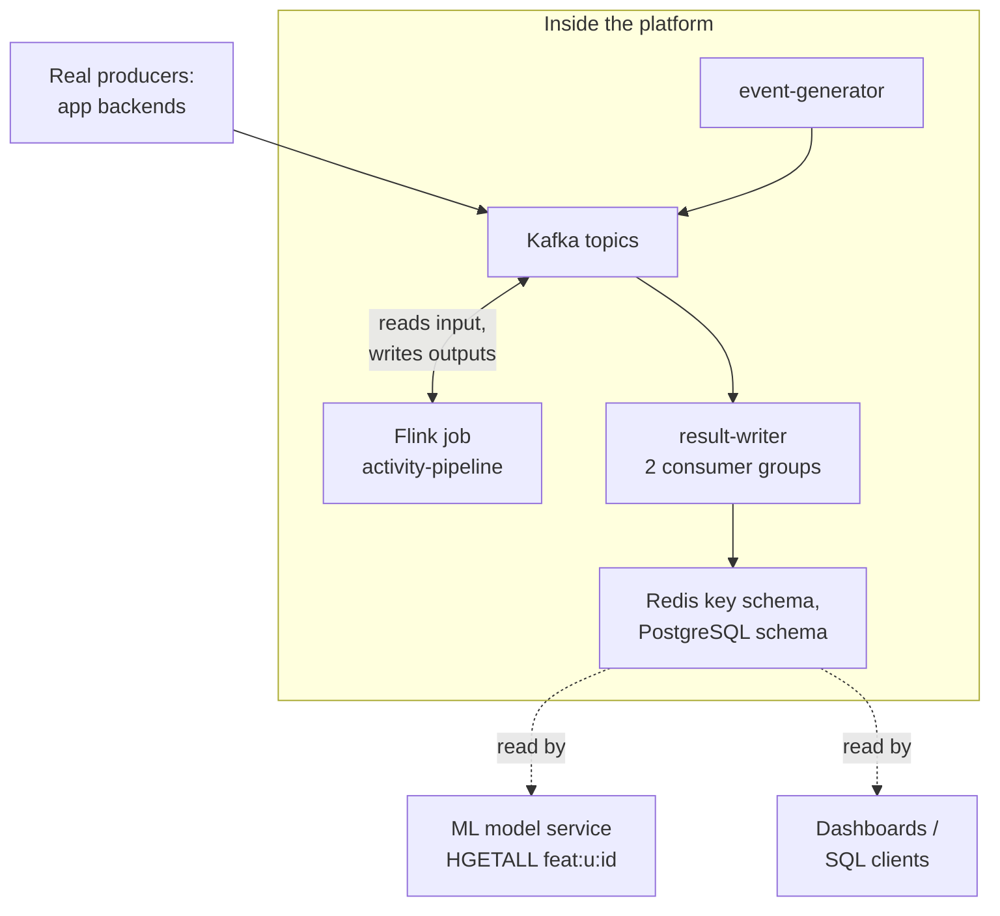

AWS managed services (MSK, EKS, ElastiCache, RDS, S3) host everything inside the box; they are depended on, not built.

The platform starts at the `user-events` topic and ends at the Redis keys and PostgreSQL rows it writes.

### 3.4 Assumptions

- Producers use the Kafka Java client with `acks=all` and idempotence enabled.
- `eventTime` is set by the client and may be skewed or late; the broker's `LogAppendTime` is trusted for latency measurement.
- ~500K active users per hour and ~50K products (ILLUSTRATIVE, for state sizing); ~300-byte events.
- One AWS region, three availability zones; clocks synchronized by AWS Time Sync.

### 3.5 In scope and out of scope

| In scope | Out of scope |
| --- | --- |
| Event generator, Kafka topics | A public HTTP ingestion API (producers write to Kafka directly) |
| One Flink job, one writer app in two consumer groups | The ML model and its serving service |
| Redis and PostgreSQL schemas | Offline feature store and training data |
| Replay procedure | Dashboard UI |
| Kubernetes manifests, AWS topology, benchmark plan | Schema registry, multi-region, Flink SQL |

### 3.6 Main engineering challenges

| Challenge | Why it is hard | Solution | Section |
| --- | --- | --- | --- |
| Out-of-order events | Results must reflect when events happened | Event time, watermarks, allowed lateness | 9.1, 9.2 |
| Duplicates | Producers retry; replays re-deliver | Keyed dedup with TTL; idempotent sinks | 9.4, 9.6 |
| Exactly-once with external sinks | Redis and PostgreSQL are outside Flink's checkpoint | Deterministic recomputation + idempotent, monotonic writes | 9.6 |
| Latency vs exactly-once | Transactional sinks expose output only after a checkpoint | At-least-once sink + idempotent writes | 7.4 |
| Backpressure | A slow sink must not crash the job or lose data | Credit-based flow control; Kafka as buffer | 11.7 |
| Recovery speed | Restore state, replay, catch up | Incremental checkpoints, spare TaskManager, headroom | 12 |
| Partitioning vs parallelism | Partitions cap source parallelism; skew wastes slots | 24 partitions, parallelism 12, max parallelism 256 | 9.7 |

<div style="page-break-before: always;"></div>

# Part 2: Understand the Architecture

## 4. Technology Stack

### 4.1 Summary table

| Layer | Choice | Version target | Why this, not something else |
| --- | --- | --- | --- |
| Language | Java 17 | 17 LTS | First-class Flink and Kafka APIs |
| Log / transport | Apache Kafka (Amazon MSK) | 3.7+ | Durable, partitioned, replayable log; consumer groups; replay from retention. RabbitMQ deletes on ack and has no partitioned replay |
| Stream processor | Apache Flink | 1.20 (LTS line) | True event time, watermarks, RocksDB keyed state, exactly-once barrier checkpoints, credit-based backpressure |
| Connector | `flink-connector-kafka` | 3.3.x | `KafkaSource` / `KafkaSink` with checkpointed offsets |
| State backend | RocksDB + incremental checkpoints to S3 | Flink-bundled | State larger than heap; small incremental uploads |
| Online serving | Redis (Amazon ElastiCache) | 7.x | Sub-millisecond hash reads; TTL; Lua compare-and-set |
| Analytics store | PostgreSQL (Amazon RDS) | 16 | SQL, `ON CONFLICT` upserts, partitioning |
| Orchestration | Kubernetes (Amazon EKS) + Flink Kubernetes Operator | 1.31 / 1.10+ | Declarative `FlinkDeployment`, savepoints, HA |
| Checkpoint storage | Amazon S3 | — | Durable, cheap, reachable from every TaskManager |
| Observability | Prometheus + Grafana, Flink Prometheus reporter | — | Flink and Kafka metrics in one place |

### 4.2 Each technology in context

**Apache Kafka (MSK).**
- *Solves:* durable storage of every event for 7 days (the replay horizon), per-key ordering, and decoupling between stages.
- *Interacts with:* producers write `user-events`; Flink reads it and writes the output topics; writers consume outputs.
- *Alternative:* RabbitMQ (no partitioned replay).
- *Trade-off:* partitions must be planned up front; more partitions mean more broker overhead.

**Apache Flink 1.20.**
- *Solves:* event-time windows with watermarks and lateness, large keyed state, exactly-once state via checkpoints, lossless backpressure.
- *Alternatives:* **Kafka Streams** (a library, no cluster, but parallelism tied to partitions and state stored in changelog topics); **Spark Structured Streaming** (micro-batch, higher latency floor).
- *Trade-off:* operational complexity: JobManager, TaskManagers, operator, checkpoint storage.

**RocksDB state backend.**
- *Solves:* state larger than memory (~1 GB estimated), incremental checkpoints that upload only new SST files.
- *Alternative:* heap (`HashMap`) backend: faster per access but limited by memory and with full snapshots.

**Redis (ElastiCache).**
- *Solves:* single-digit-millisecond feature reads, TTL-based expiry of inactive users, atomic Lua scripts for monotonic updates.
- *Alternatives:* DynamoDB, PostgreSQL.
- *Trade-off:* memory-bound; asynchronous replication can lose recent writes on failover (re-sent on the user's next update).

**PostgreSQL (RDS).**
- *Solves:* SQL analytics, idempotent upserts with `ON CONFLICT`, daily partitions for retention.
- *Alternatives:* ClickHouse or Druid (columnar OLAP), Redis only.
- *Trade-off:* not a columnar engine; heavy scans at large scale would need one.

**Kubernetes (EKS) + Flink Kubernetes Operator + S3.** Declarative job deployment, savepoint-based upgrades, Kubernetes-native HA, and durable checkpoint storage accessed through IRSA.

### 4.3 How the technologies interact

**Figure 4.1 — Technology interaction**

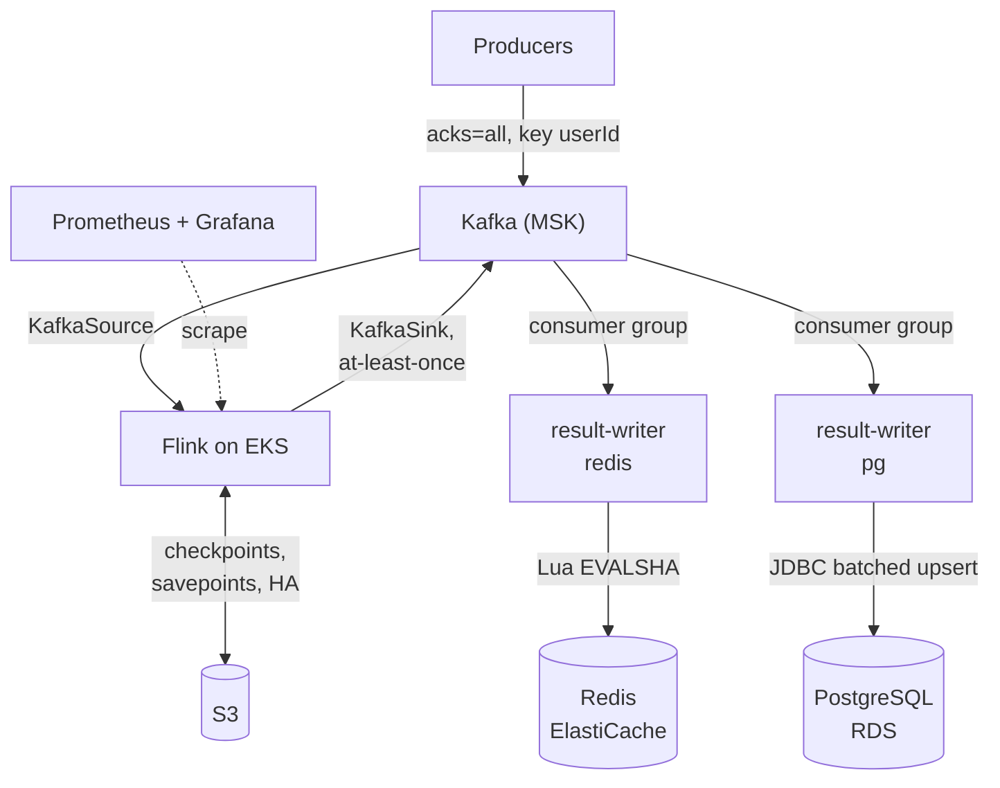

Prometheus also scrapes the writers (edge omitted).

<div style="page-break-before: always;"></div>

## 5. High-Level Design (HLD)

### 5.1 Beginner view

**Figure 5.1 — Simplified conceptual architecture**

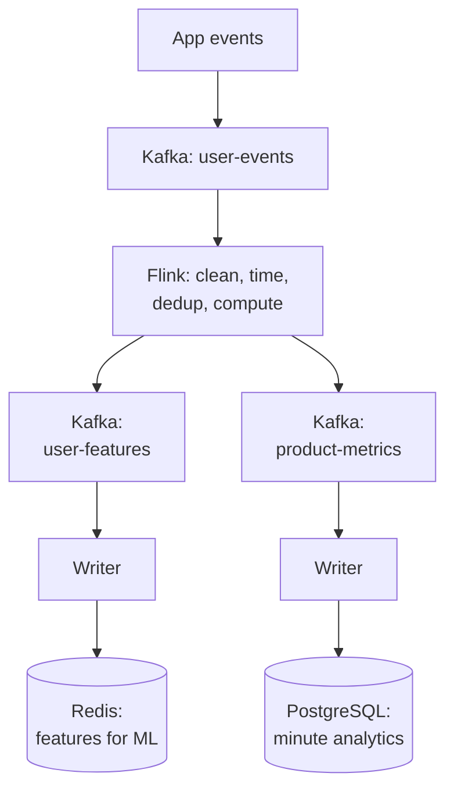

Events enter one Kafka topic. One Flink job computes two outputs and writes them to two Kafka topics. Two groups of writers copy those outputs into Redis and PostgreSQL.

### 5.2 Detailed architecture

**Figure 5.2a — Input and the Flink job**

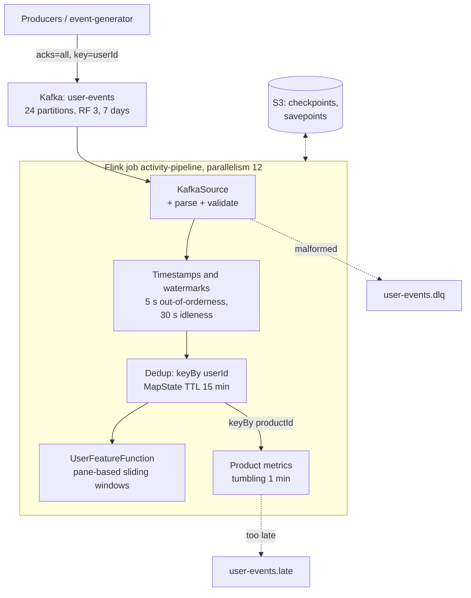

**Figure 5.2b — Outputs, writers, and stores**

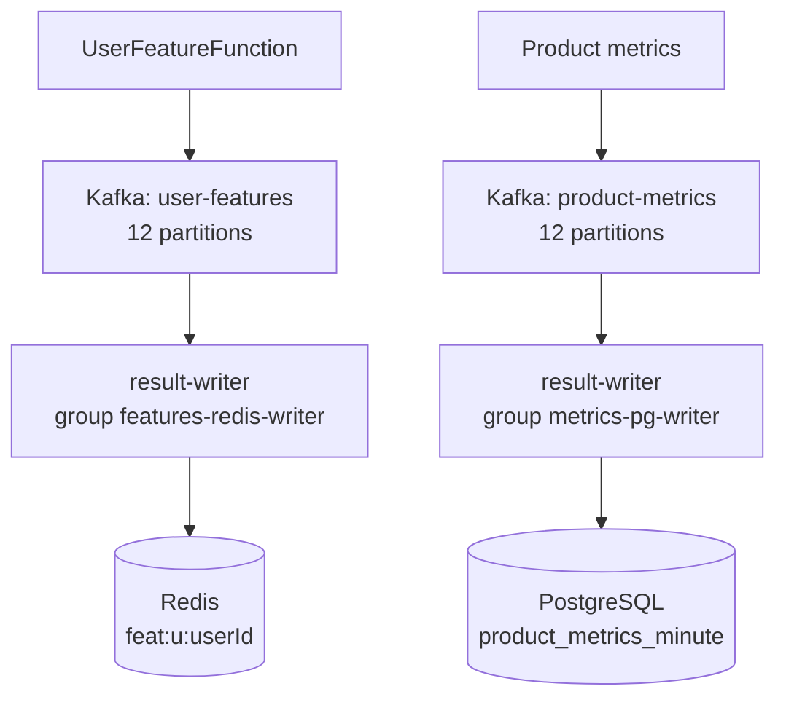

### 5.3 Why a Kafka hop between Flink and the stores?

| Option | Pros | Cons |
| --- | --- | --- |
| **Flink → Kafka output topics → result-writer → stores (chosen)** | Sink slowness becomes Kafka lag, not Flink backpressure; writers scale independently; stores can be rebuilt by re-consuming outputs without rerunning Flink; store failures don't fail Flink checkpoints | One extra hop (~5–50 ms); one more deployable |
| Flink sinks directly to Redis and PostgreSQL | Fewer components, lower latency | A slow database backpressures the job and delays checkpoints; scaling sinks means rescaling Flink; idempotency still needed |

### 5.4 Component responsibilities

**Kafka `user-events`**
1. *Responsibility:* durable, per-user-ordered input log; the replay source.
2. *Input:* JSON events from producers (`acks=all`, idempotent).
3. *Processing:* replication (RF 3, ISR 2), retention 7 days, `LogAppendTime` stamping.
4. *Output:* records to the Flink source.
5. *Next:* Flink `KafkaSource`.
6. *If it fails:* ingestion and processing stop; producers buffer and retry; Flink restarts from its checkpoint when Kafka returns.

**Flink job `activity-pipeline`**
1. *Responsibility:* parse, validate, event time, dedup, features, windows, late handling.
2. *Input:* `user-events` records.
3. *Processing:* chained source/parse/watermarks → `keyBy(userId)` → dedup → features; dedup → `keyBy(productId)` → 1-min windows.
4. *Output:* `FeatureUpdate` records, `ProductMetric` records, DLQ and late records.
5. *Next:* Kafka output topics.
6. *If it fails:* restore from the last checkpoint in S3; rewind Kafka; re-emit outputs (idempotent downstream).

**Kafka output topics (`user-features`, `product-metrics`)**
1. *Responsibility:* durable outputs; decouple processing from serving.
2. *If writers are slow:* lag grows here; Flink is unaffected.

**`result-writer` (two consumer groups)**
1. *Responsibility:* `features-redis-writer` writes features with a Lua compare-and-set; `metrics-pg-writer` batch-upserts window results.
2. *Input:* output-topic records.
3. *Processing:* poll ≤ 500 → batch write → `commitSync`.
4. *Output:* Redis hashes and PostgreSQL rows.
5. *Next:* consumed by model services and dashboards (outside the platform).
6. *If it fails:* rebalance; redelivery from the last committed offset; idempotent rewrite.

**Redis and PostgreSQL**
- Derived, rebuildable read models. Redis: `feat:u:{userId}` with a 2 h TTL. PostgreSQL: `product_metrics_minute`, daily partitions.
- *If unavailable:* writers retry without committing; lag grows; reads are stale; nothing is lost.

**S3**
- Checkpoints, savepoints, and HA metadata. *If unavailable:* checkpoints fail; the job keeps running until 3 consecutive failures, then restarts from the last good checkpoint.

**Flink Kubernetes Operator**
- Deploys the job, triggers savepoints, performs upgrades.

### 5.5 Communication mechanisms

| From → To | Mechanism | Sync / async | Delivery |
| --- | --- | --- | --- |
| Producer → `user-events` | Kafka producer | Async with acks | At-least-once (idempotent producer removes broker-level duplicates within a session) |
| `user-events` → Flink | `KafkaSource` (Flink assigns splits; offsets in checkpoints) | Async pull | Exactly-once **state** |
| Flink internal | Network shuffles, credit-based flow control | Async | Exactly-once within the job |
| Flink → output topics | `KafkaSink`, `AT_LEAST_ONCE` | Async | At-least-once |
| Output topics → writers | Consumer groups, manual commit after write | Async pull | At-least-once, idempotent writes |
| Writers → Redis | Pipelined Lua `EVALSHA` | Sync per batch | Idempotent, monotonic |
| Writers → PostgreSQL | JDBC batched `INSERT ... ON CONFLICT DO UPDATE` | Sync per batch | Idempotent |
| Model service → Redis | `HGETALL` | Sync | Read-only (outside) |

### 5.6 Data ownership

| Data | Owner | Authority |
| --- | --- | --- |
| Raw events | Kafka `user-events` | Source of truth for replay (7 days) |
| Dedup and feature state | Flink keyed state (checkpointed to S3) | Authoritative intermediate state |
| Window aggregates in flight | Flink window state | Authoritative until emitted |
| User features (serving copy) | Redis | Derived; rebuildable from `user-features` or by replay |
| Product metrics | PostgreSQL | Derived; rebuildable by replay |

### 5.7 Scaling and fault tolerance overview

| Layer | How to scale | Limit |
| --- | --- | --- |
| Kafka | More partitions (planned up front) | Brokers; changing partitions changes key placement |
| Flink | New parallelism from a savepoint (or the operator autoscaler) | Source parallelism ≤ partitions; keyed parallelism ≤ max parallelism (256) |
| result-writer | Add consumer-group replicas | Replicas ≤ output partitions (12) |
| Redis / PostgreSQL | Vertical; Redis cluster mode if needed | Write batch efficiency |

Fault tolerance in one paragraph: Kafka keeps every event for 7 days with RF=3; Flink checkpoints offsets and state every 10 s to S3 and restarts from the last completed checkpoint; writers commit offsets only after successful idempotent writes.

### 5.8 Deployment architecture (AWS)

**Figure 5.3 — AWS deployment**

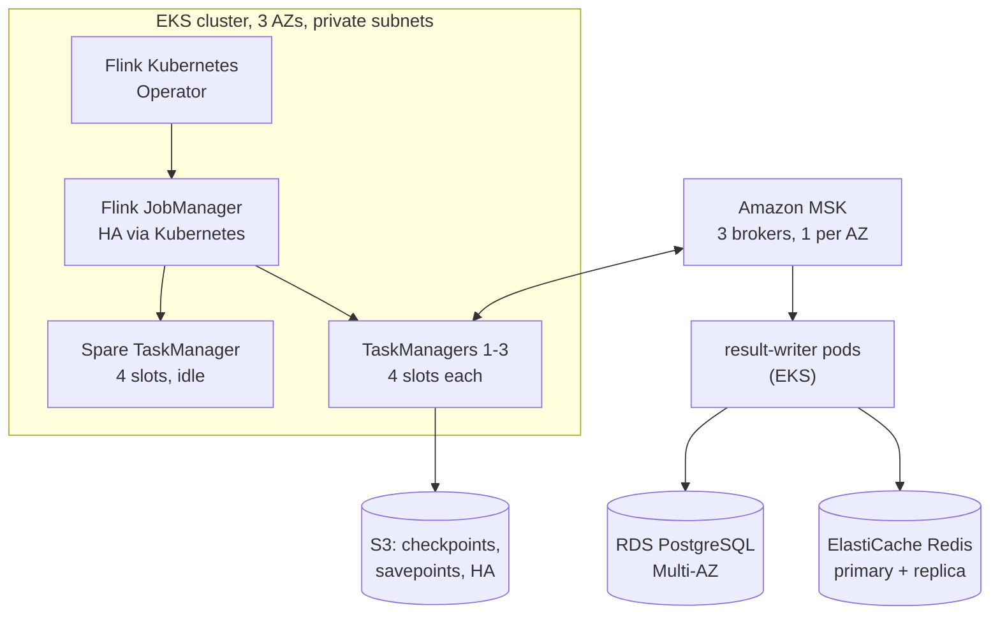

The `event-generator` Job and Prometheus/Grafana also run in EKS; the generator writes to MSK. The JobManager writes HA metadata to S3. Images come from ECR, and TaskManagers reach S3 through IRSA roles rather than static keys.

The spare TaskManager exists so a failed TaskManager's slots are replaced immediately rather than waiting for a new pod; it is the most important ingredient of the < 30 s recovery target.

<div style="page-break-before: always;"></div>

## 6. Low-Level Design (LLD)

### 6.1 Module structure

```text
stream-platform/
├── pom.xml                                   # parent: Java 17, Flink 1.20, Kafka clients
├── common/
│   └── src/main/java/com/acme/stream/common/
│       ├── model/UserEvent.java              # POJO (Flink POJO rules: public no-arg ctor, public fields or getters/setters)
│       ├── model/EventType.java
│       ├── model/FeatureUpdate.java
│       ├── model/ProductMetric.java
│       ├── serde/JsonSerde.java              # shared Jackson ObjectMapper config
│       └── time/Clocks.java
├── activity-pipeline/                        # Flink job
│   └── src/main/java/com/acme/stream/pipeline/
│       ├── ActivityPipelineJob.java          # topology wiring, config
│       ├── source/UserEventDeserializer.java # KafkaRecordDeserializationSchema → ParseResult
│       ├── source/ParseAndValidate.java      # ProcessFunction with DLQ side output
│       ├── time/EventTimeAssigner.java       # WatermarkStrategy factory
│       ├── dedup/DedupFunction.java          # KeyedProcessFunction<String, UserEvent, UserEvent>
│       ├── features/UserFeatureFunction.java # KeyedProcessFunction<String, UserEvent, FeatureUpdate>
│       ├── features/PaneRing.java            # fixed-size circular pane buffer
│       ├── metrics/ProductAggregate.java     # AggregateFunction<UserEvent, Acc, Acc>
│       ├── metrics/ProductWindowFunction.java# ProcessWindowFunction adds window bounds + fire_seq
│       ├── sink/Sinks.java                   # KafkaSink builders
│       └── config/PipelineConfig.java
├── result-writer/                            # plain Java Kafka consumer application
│   └── src/main/java/com/acme/stream/writer/
│       ├── WriterMain.java                   # mode=redis|postgres
│       ├── ConsumerLoop.java                 # poll → batch → write → commit
│       ├── RedisFeatureWriter.java           # Lettuce, pipelined EVALSHA
│       ├── PostgresMetricWriter.java         # HikariCP + batched upserts
│       ├── LatencyRecorder.java              # Prometheus histogram
│       └── HealthServer.java                 # /health/live, /health/ready, /metrics
├── event-generator/
│   └── src/main/java/com/acme/stream/gen/
│       ├── GeneratorMain.java                # rate, users, products, dupes, jitter, late %
│       └── SessionModel.java
├── sql/V1__schema.sql                        # documented below; not created here
├── k8s/                                      # documented below; not created here
└── bench/                                    # proposed scripts, documented below
```

**Mapping LLD to HLD:**

| HLD component | LLD module / classes |
| --- | --- |
| Flink job | `activity-pipeline/`: `ActivityPipelineJob`, `UserEventDeserializer`, `ParseAndValidate`, `EventTimeAssigner`, `DedupFunction`, `UserFeatureFunction`, `PaneRing`, `ProductAggregate`, `ProductWindowFunction`, `Sinks` |
| Shared model | `common/`: `UserEvent`, `EventType`, `FeatureUpdate`, `ProductMetric`, `JsonSerde` |
| result-writer | `result-writer/`: `WriterMain`, `ConsumerLoop`, `RedisFeatureWriter`, `PostgresMetricWriter`, `LatencyRecorder`, `HealthServer` |
| Load / test data | `event-generator/`: `GeneratorMain`, `SessionModel` |

### 6.2 Class diagram

**Figure 6.1a — Flink job classes: parsing, dedup, and features**

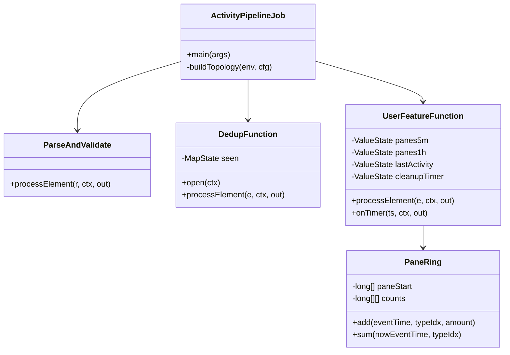

**Figure 6.1b — Flink job classes: product windows**

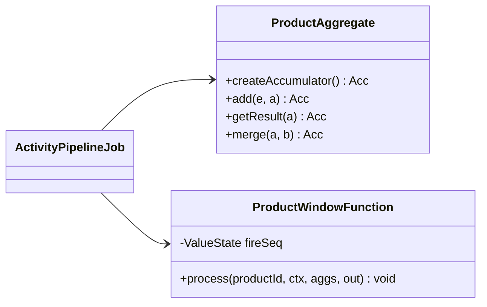

**Figure 6.1c — result-writer classes**

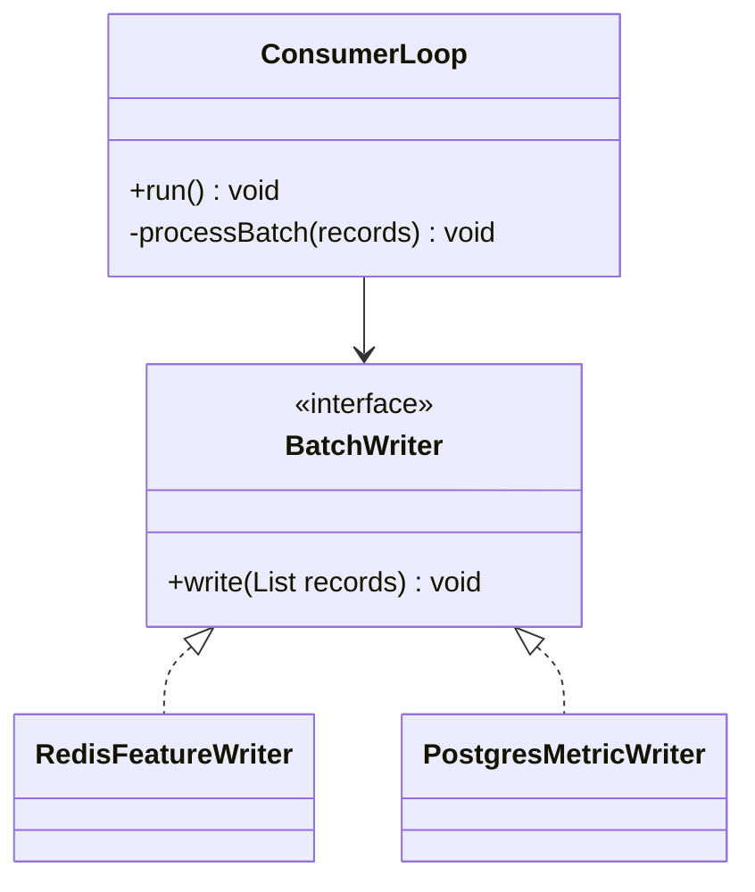

### 6.3 Important classes

**ActivityPipelineJob**
- Responsibility: wire the topology and configuration.
- Important methods: `main`, `buildTopology(env, cfg)`.
- Why it exists: one place defines parallelism (12), max parallelism (256), `disableGenericTypes()`, buffer timeout (20 ms), sources, sinks, and operator uids.

**UserEventDeserializer + ParseAndValidate**
- Responsibility: turn bytes into `UserEvent`, or into an invalid `ParseResult` routed to the DLQ side output.
- Input: Kafka record. Output: valid event or `DlqRecord` (raw bytes, error code, partition, offset).
- Why it exists: the deserializer **never throws**; a throw would fail the task, restart from the checkpoint, re-read the same record, and loop forever. Events with `eventTime` more than 10 minutes ahead of Kafka time are rejected (`FUTURE_TIMESTAMP`).

**DedupFunction (`KeyedProcessFunction<String, UserEvent, UserEvent>`)**
- Responsibility: drop events whose `eventId` was seen for this user in the last 15 minutes.
- State: `MapState<String, Long>` with TTL.
- Why it exists: producer retries reuse `eventId`.

**UserFeatureFunction (`KeyedProcessFunction<String, UserEvent, FeatureUpdate>`)**
- Responsibility: per-user sliding features updated on every event.
- State: `panes5m`, `panes1h` (`PaneRing`), `lastActivity`, `cleanupTimer`.
- Methods: `processElement`, `onTimer` (clears state 65 min after the user's last event).
- Output: `FeatureUpdate{userId, features, asOfEventTime, sourceIngestTs}`.

**PaneRing**
- Responsibility: fixed-size circular pane buffer.
- Methods: `add(eventTime, maxSeen, metric, amount)` → boolean, `sum(now, metric)`.
- Why it exists: constant memory and work per user regardless of event rate.

**ProductAggregate (`AggregateFunction`) + ProductWindowFunction (`ProcessWindowFunction`)**
- Responsibility: incremental per-window counts and revenue; attach window bounds and `fire_seq`.
- Why both: the aggregate keeps one small accumulator per window (`O(1)` per event); the window function adds metadata at firing time.

**ConsumerLoop + BatchWriter (RedisFeatureWriter, PostgresMetricWriter)**
- Responsibility: poll → batch → write → commit; Strategy pattern selects Redis or PostgreSQL mode.
- Why it exists: simple, predictable sink scaling by replicas.

### 6.4 Topology wiring

```java
StreamExecutionEnvironment env = StreamExecutionEnvironment.getExecutionEnvironment();
env.setParallelism(12);
env.setMaxParallelism(256);                       // fixed for the life of the job's state
env.getConfig().disableGenericTypes();            // fail fast if any type falls back to Kryo
env.setBufferTimeout(20);                         // ms; default 100 ms trades latency for throughput

KafkaSource<ParseResult> source = KafkaSource.<ParseResult>builder()
    .setBootstrapServers(cfg.bootstrap())
    .setTopics("user-events")
    .setGroupId("activity-pipeline")              // used only for committing offsets for monitoring
    .setStartingOffsets(OffsetsInitializer.committedOffsets(OffsetResetStrategy.EARLIEST))
    .setDeserializer(new UserEventDeserializer()) // never throws; wraps failures in ParseResult
    .setProperty("partition.discovery.interval.ms", "60000")
    .build();

WatermarkStrategy<ParseResult> wm = WatermarkStrategy
    .<ParseResult>forBoundedOutOfOrderness(Duration.ofSeconds(5))
    .withTimestampAssigner((r, kafkaTs) -> r.isValid() ? r.event().eventTimeMs : kafkaTs)
    .withIdleness(Duration.ofSeconds(30))
    .withWatermarkAlignment("user-events", Duration.ofSeconds(30), Duration.ofSeconds(1));

SingleOutputStreamOperator<UserEvent> parsed = env
    .fromSource(source, wm, "user-events-source")
    .process(new ParseAndValidate()).name("parse-validate").uid("parse-validate");

parsed.getSideOutput(ParseAndValidate.DLQ).sinkTo(Sinks.dlq(cfg)).uid("dlq-sink");

SingleOutputStreamOperator<UserEvent> deduped = parsed
    .keyBy(e -> e.userId)
    .process(new DedupFunction(Duration.ofMinutes(15))).name("dedup").uid("dedup");

// Same key as dedup: no second shuffle
DataStreamUtils.reinterpretAsKeyedStream(deduped, e -> e.userId)
    .process(new UserFeatureFunction()).name("user-features").uid("user-features")
    .sinkTo(Sinks.features(cfg)).uid("features-sink");

SingleOutputStreamOperator<ProductMetric> metrics = deduped
    .keyBy(e -> e.productId)
    .window(TumblingEventTimeWindows.of(Duration.ofMinutes(1)))
    .allowedLateness(Duration.ofMinutes(2))
    .sideOutputLateData(LATE)
    .aggregate(new ProductAggregate(), new ProductWindowFunction())
    .name("product-metrics").uid("product-metrics");

metrics.sinkTo(Sinks.productMetrics(cfg)).uid("metrics-sink");
metrics.getSideOutput(LATE).sinkTo(Sinks.late(cfg)).uid("late-sink");

env.execute("activity-pipeline");
```

**Why every operator has a `uid`:** savepoint state is matched to operators by uid. Without explicit uids, adding an operator can change auto-generated ids and make state unrestorable.

### 6.5 Operator interaction inside the job

**Figure 6.2 — Chaining and shuffles inside the job**

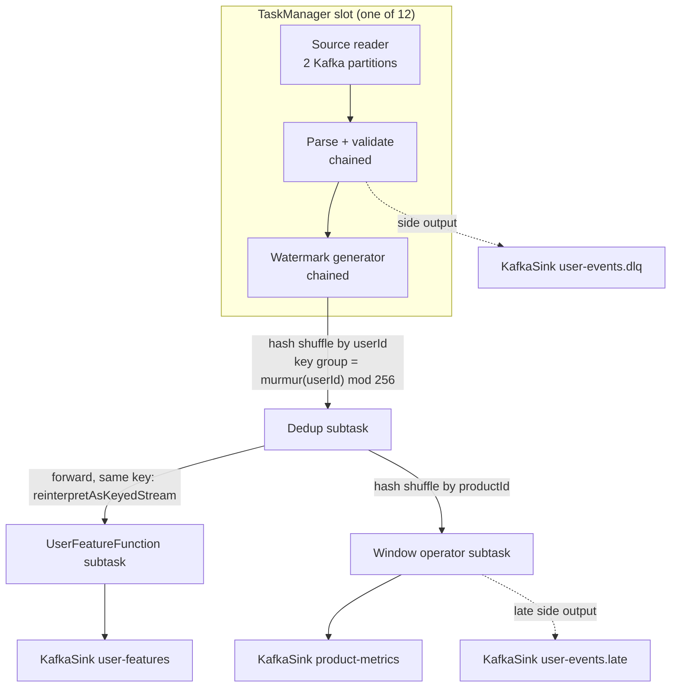

- Source, parse, and watermark assignment are **chained** (no serialization between them).
- `keyBy(userId)` shuffles so all events of one user reach the same dedup subtask. Kafka is already keyed by user, but Flink's key-group hashing is independent of Kafka's partitioner, so the shuffle is still required.
- Dedup and features share the key, so the stream is reinterpreted as keyed without a second shuffle.
- Product metrics need `keyBy(productId)`: a genuine second shuffle.

### 6.6 State inventory

| State | Operator | Type | Per-key size (ILLUSTRATIVE) | Cleanup |
| --- | --- | --- | --- | --- |
| Seen event ids | `DedupFunction` | `MapState<String, Long>` | ~1.2 KB per active user | TTL 15 min, RocksDB compaction filter |
| 5-minute panes | `UserFeatureFunction` | `ValueState<PaneRing>` 10 × 30 s × 4 counters | ~400 B | Timer 65 min after last event |
| 1-hour purchase panes | `UserFeatureFunction` | `ValueState<PaneRing>` 12 × 5 min | ~200 B | Same timer |
| Last activity | `UserFeatureFunction` | `ValueState<LastActivity>` | ~80 B | Same timer |
| Window accumulators | Window operator | `Acc{views, clicks, carts, purchases, revenueMinor, maxIngestTs}` | ~64 B | Purged at window end + lateness |
| Fire sequence | `ProductWindowFunction` | Per-window `ValueState<Integer>` | 4 B | Cleared with the window |
| Kafka offsets | Source | Per split | — | In every checkpoint |

Total (ILLUSTRATIVE): 500K users × ~1.9 KB ≈ 0.95 GB, plus ~10 MB of window state.

### 6.7 Threading model

| Process | Threads | Notes |
| --- | --- | --- |
| TaskManager | One task thread per subtask; Netty network threads; RocksDB background threads; async checkpoint upload threads | User functions run single-threaded per subtask: keyed state needs no locks |
| JobManager | Dispatcher, ResourceManager, JobMaster (checkpoint coordinator) | Coordinates checkpoints and restarts |
| `result-writer` | One consumer thread per replica; Lettuce event loop for Redis; HikariCP for PostgreSQL | Scale by replicas, not threads |
| `event-generator` | N sender threads sharing one thread-safe `KafkaProducer` | Producer batches internally |

**Rule:** never block a Flink task thread on external I/O. If enrichment were added later, it would use Flink's async I/O (`AsyncDataStream.unorderedWait`).

### 6.8 Synchronisation

| Concern | Mechanism |
| --- | --- |
| Keyed state | Each key group owned by exactly one subtask; no shared mutable state |
| Consistent snapshots | Barriers flow with data; snapshot when the barrier arrives on all inputs (aligned) or including in-flight buffers (unaligned) |
| Writer offsets vs writes | `commitSync` only after Redis/PostgreSQL acknowledge |
| Writer rebalances | `onPartitionsRevoked` flushes and commits; cooperative-sticky assignor |

### 6.9 Error handling and design patterns

| Error | Handling |
| --- | --- |
| Malformed JSON, missing fields, unknown type | DLQ side output with reason; never throw |
| Future event time (> 10 min ahead) | DLQ `FUTURE_TIMESTAMP` |
| Late beyond allowed lateness | Late side-output topic |
| Exception in user functions | Task failure → exponential-delay restart (max 10 per 10 min) → restore from checkpoint |
| Checkpoint failure | Tolerate 3 consecutive, then fail the job (forces recovery) |
| Redis/PostgreSQL write failure | Retry with backoff 100 ms → 5 s; don't commit; after N failures mark not-ready |
| Poison output record | Bisect batch; after 3 attempts send to `<topic>.writer-dlq` |

| Pattern | Where |
| --- | --- |
| Pipes and filters | The Flink topology |
| Side outputs (content-based router) | DLQ and late events |
| Idempotent receiver | Redis CAS script, PostgreSQL guarded upsert |
| Event sourcing / log as source of truth | `user-events` + replay |
| Strategy | `BatchWriter` |
| Competing consumers | Writer consumer groups |

<div style="page-break-before: always;"></div>

# Part 3: Understand the Implementation

## 7. API Design

This platform has **no public REST API**. Its contracts are Kafka topics and message schemas, the Redis serving schema, the PostgreSQL query surface, and a few operational HTTP endpoints. A thin query API was deliberately left out: model services read Redis directly with a documented key contract, and dashboards query PostgreSQL. A service would add a hop and a deployment without adding capability.

### 7.1 Kafka topics

| Topic | Partitions | RF | min ISR | Key | Retention | Timestamp | Producer | Consumers |
| --- | --- | --- | --- | --- | --- | --- | --- | --- |
| `user-events` | 24 | 3 | 2 | `userId` | 7 days | `LogAppendTime` | App producers, generator | Flink |
| `user-events.dlq` | 6 | 3 | 2 | `userId` or null | 14 days | `CreateTime` | Flink | Operators, replay tool |
| `user-events.late` | 6 | 3 | 2 | `productId` | 7 days | `CreateTime` | Flink | Optional correction job (out of scope) |
| `user-features` | 12 | 3 | 2 | `userId` | 3 days | `CreateTime` | Flink | `features-redis-writer` |
| `product-metrics` | 12 | 3 | 2 | `productId` | 3 days | `CreateTime` | Flink | `metrics-pg-writer` |

**Why `LogAppendTime` on `user-events`:** the broker stamps each record when it is appended, giving a trustworthy ingest timestamp for measuring processing latency independent of client clocks. Event time comes from the payload.

### 7.2 Input event schema (`user-events`)

```json
{
  "schemaVersion": 1,
  "eventId": "6f1d2c3b-8a9e-4b7c-9d10-2e3f4a5b6c7d",
  "eventType": "ADD_TO_CART",
  "userId": "u-1029384",
  "sessionId": "s-77a1c9",
  "productId": "p-55310",
  "priceMinor": 2599,
  "currency": "USD",
  "eventTime": "2026-02-10T12:00:01.234Z",
  "platform": "ios",
  "appVersion": "5.12.0"
}
```

| Field | Type | Required | Validation |
| --- | --- | --- | --- |
| `schemaVersion` | int | yes | Supported: 1 |
| `eventId` | UUID string | yes | Dedup key; generated once per logical event and reused on retries |
| `eventType` | enum | yes | `VIEW`, `CLICK`, `ADD_TO_CART`, `PURCHASE` |
| `userId` | string ≤ 64 | yes | Partition key |
| `productId` | string ≤ 64 | yes | Window key |
| `priceMinor` | long | for `PURCHASE` | ≥ 0 |
| `currency` | ISO-4217 | for `PURCHASE` | Single currency assumed |
| `eventTime` | ISO-8601 UTC | yes | ≤ 10 min ahead of the Kafka timestamp; ≤ 7 days old |

**Schema evolution:** additive optional fields within version 1; a breaking change gets `schemaVersion: 2` and the parser supports both during migration. A schema registry is a future improvement.

### 7.3 Partitioning strategy

| Topic | Key | Why |
| --- | --- | --- |
| `user-events` | `userId` | Per-user order in Kafka; all duplicates of an event share a partition |
| `user-features` | `userId` | Per-user order of feature updates (the CAS guard handles the rest) |
| `product-metrics` | `productId` | A re-fired window is written after the original |

Default partitioner `murmur2(keyBytes) % partitions`. Partition counts are chosen **up front**: adding partitions later changes key placement and breaks per-key ordering across the change. Kafka's partitioning and Flink's key-group hashing are independent.

### 7.4 Output schemas

`user-features` value:

```json
{
  "userId": "u-1029384",
  "asOfEventTime": "2026-02-10T12:00:01.234Z",
  "features": {
    "views_5m": 14,
    "clicks_5m": 6,
    "carts_5m": 2,
    "purchases_5m": 0,
    "purchase_amount_1h_minor": 7598,
    "last_event_type": "ADD_TO_CART",
    "last_product_id": "p-55310"
  },
  "sourceIngestTs": 1739188801301,
  "emittedAt": 1739188801455,
  "pipelineVersion": "1.4.0"
}
```

`product-metrics` value:

```json
{
  "productId": "p-55310",
  "windowStart": "2026-02-10T12:00:00Z",
  "windowEnd": "2026-02-10T12:01:00Z",
  "views": 1840,
  "clicks": 412,
  "cartAdds": 97,
  "purchases": 31,
  "revenueMinor": 80569,
  "fireSeq": 1,
  "maxIngestTs": 1739188864012,
  "emittedAt": 1739188866120
}
```

DLQ records carry the original raw bytes (base64) plus `errorCode`, `errorMessage`, `sourcePartition`, `sourceOffset`, `detectedAt`.

### 7.5 Producers and consumers

| Client | Key settings | Delivery semantics |
| --- | --- | --- |
| Event producers / generator | `acks=all`, `enable.idempotence=true`, `linger.ms=5`, `batch.size=65536`, `lz4`, `max.in.flight.requests.per.connection=5` | At-least-once; idempotence removes internal-retry duplicates within a session; app retries reuse `eventId` and are deduplicated by Flink |
| Flink `KafkaSource` | Offsets in checkpoints; commits to Kafka on checkpoint completion (for lag monitoring only) | Exactly-once state |
| Flink `KafkaSink` | `AT_LEAST_ONCE`, `linger.ms=10`, `lz4`, `acks=all` | Duplicates possible after recovery |
| `result-writer` | `enable.auto.commit=false`, `max.poll.records=500`, `CooperativeStickyAssignor`, `isolation.level=read_uncommitted` | At-least-once consumption; idempotent writes |

**Why not an exactly-once (transactional) Kafka sink?** It writes in Kafka transactions that commit only when a checkpoint completes, so `read_committed` consumers see output at least every 10 s (typically ~1.5× that). That violates the < 1 s target. Because every downstream write is idempotent and monotonic, at-least-once delivery gives the same final state.

### 7.6 Redis serving contract

| Key | Type | Fields | TTL |
| --- | --- | --- | --- |
| `feat:u:{userId}` | Hash | `views_5m`, `clicks_5m`, `carts_5m`, `purchases_5m`, `purchase_amount_1h_minor`, `last_event_type`, `last_product_id`, `as_of_event_time_ms`, `updated_at_ms`, `pipeline_version` | 2 hours, refreshed on every write |

Read contract for model services:
- `HGETALL feat:u:{userId}`. A missing key means no activity in ~2 hours: treat counts as 0.
- Values are **as of `as_of_event_time_ms`** (the user's latest processed event time), not as of the read time. If `now − as_of_event_time_ms > 5 min`, treat the 5-minute counts as stale.
- Writes are monotonic in `as_of_event_time_ms`: features never move backward in event time.

Compare-and-set script:

```lua
-- KEYS[1] = feat:u:{userId}
-- ARGV[1] = as_of_event_time_ms, ARGV[2] = ttl_seconds, ARGV[3..] = field, value pairs
local current = tonumber(redis.call('HGET', KEYS[1], 'as_of_event_time_ms') or '-1')
local incoming = tonumber(ARGV[1])
if incoming < current then
  return 0                                   -- stale update (replay or reordering): ignore
end
redis.call('HSET', KEYS[1], 'as_of_event_time_ms', ARGV[1], unpack(ARGV, 3))
redis.call('EXPIRE', KEYS[1], tonumber(ARGV[2]))
return 1
```

`>=` semantics (equal is accepted) make a replayed update with the same event time a harmless overwrite.

### 7.7 PostgreSQL query surface

```sql
-- Top 20 products by views in the last 15 minutes
SELECT product_id, sum(views) AS views, sum(purchases) AS purchases, sum(revenue_minor) AS revenue_minor
  FROM product_metrics_minute
 WHERE window_start >= now() - interval '15 minutes'
 GROUP BY product_id
 ORDER BY views DESC
 LIMIT 20;

-- Minute-by-minute series for one product over the last 6 hours
SELECT window_start, views, clicks, cart_adds, purchases, revenue_minor
  FROM product_metrics_minute
 WHERE product_id = :product_id
   AND window_start >= now() - interval '6 hours'
 ORDER BY window_start;

-- Conversion rate by category for the last hour
SELECT p.category,
       sum(m.purchases)::numeric / NULLIF(sum(m.views), 0) AS view_to_purchase
  FROM product_metrics_minute m
  JOIN products p USING (product_id)
 WHERE m.window_start >= now() - interval '1 hour'
 GROUP BY p.category;
```

### 7.8 Operational HTTP endpoints

| Endpoint | Owner | Purpose |
| --- | --- | --- |
| `GET /jobs/overview`, `GET /jobs/{jobId}` | Flink REST (8081) | Job status, vertex metrics |
| `GET /jobs/{jobId}/checkpoints` | Flink REST | Checkpoint history, durations, sizes |
| `POST /jobs/{jobId}/savepoints` | Flink REST (normally via the operator) | Savepoint for upgrades, rescaling, replay |
| `GET /jobs/{jobId}/vertices/{vertexId}/backpressure` | Flink REST | Backpressure ratio per subtask |
| `GET /health/live`, `GET /health/ready` | `result-writer` (8080) | Loop alive / assigned partitions and a successful write within 60 s |
| `GET /metrics` | Writer, generator, Flink reporter (9249) | Prometheus scrape |

Savepoint trigger response, then status poll:

```json
{ "request-id": "2a4f6c9e1b7d8a3c5e0f1a2b3c4d5e6f" }
```

```json
{ "status": { "id": "COMPLETED" },
  "operation": { "location": "s3://stream-platform/savepoints/savepoint-7c1e2a-4b5d6f7a8b9c" } }
```

These endpoints are internal (ClusterIP only) and protected by network policy.

<div style="page-break-before: always;"></div>

## 8. Database and Storage Design

### 8.1 Storage roles

| Store | Holds | Access pattern | Why |
| --- | --- | --- | --- |
| Kafka | Raw events (7 days), outputs (3 days) | Sequential append/read | Durable, replayable log |
| Flink RocksDB (local SSD) + S3 checkpoints | Dedup sets, panes, open windows, offsets | Keyed point reads/writes | Large state, incremental snapshots |
| Redis | Latest features per user | Point read by `userId` | Sub-millisecond serving |
| PostgreSQL | Per-minute product metrics, product dimension, replay audit | Time-range scans, aggregations | SQL analytics, upserts |

### 8.2 ER diagram

**Figure 8.1 — PostgreSQL tables**

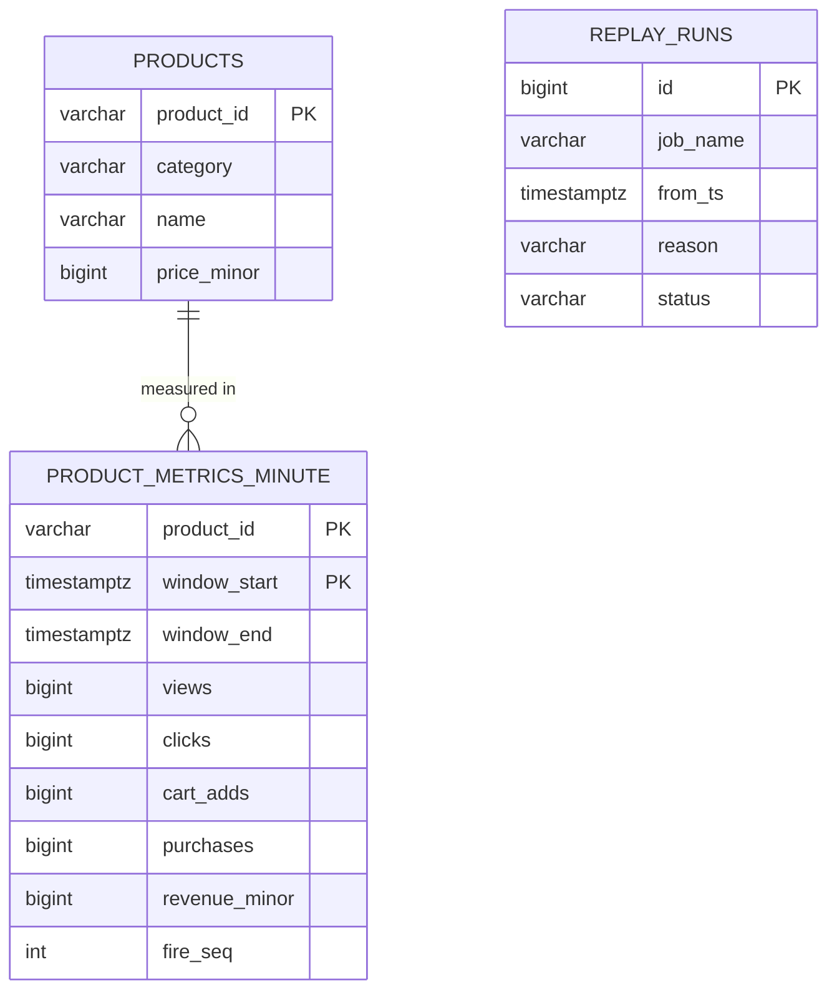

The relationship to `products` is **logical only**: `product_metrics_minute.product_id` is not a foreign key, because metrics can arrive for products not yet loaded by catalog sync, and an FK would make the writer fail on those rows. The join happens at query time.

### 8.3 Tables

```sql
CREATE TABLE products (
    product_id   VARCHAR(64) PRIMARY KEY,
    category     VARCHAR(64) NOT NULL,
    name         VARCHAR(255) NOT NULL,
    price_minor  BIGINT CHECK (price_minor >= 0),
    updated_at   TIMESTAMPTZ NOT NULL DEFAULT now()
);

CREATE TABLE product_metrics_minute (
    product_id     VARCHAR(64)  NOT NULL,
    window_start   TIMESTAMPTZ  NOT NULL,
    window_end     TIMESTAMPTZ  NOT NULL,
    views          BIGINT       NOT NULL DEFAULT 0,
    clicks         BIGINT       NOT NULL DEFAULT 0,
    cart_adds      BIGINT       NOT NULL DEFAULT 0,
    purchases      BIGINT       NOT NULL DEFAULT 0,
    revenue_minor  BIGINT       NOT NULL DEFAULT 0,
    fire_seq       INT          NOT NULL,
    max_ingest_ts  TIMESTAMPTZ  NOT NULL,
    emitted_at     TIMESTAMPTZ  NOT NULL,
    written_at     TIMESTAMPTZ  NOT NULL DEFAULT now(),
    PRIMARY KEY (product_id, window_start),
    CONSTRAINT chk_window_len CHECK (window_end = window_start + interval '1 minute'),
    CONSTRAINT chk_non_negative CHECK (views >= 0 AND clicks >= 0 AND cart_adds >= 0
                                       AND purchases >= 0 AND revenue_minor >= 0),
    CONSTRAINT chk_fire_seq CHECK (fire_seq >= 1)
) PARTITION BY RANGE (window_start);

-- One partition per day, created ahead of time by a scheduled job; old partitions dropped after 30 days
CREATE TABLE product_metrics_minute_20260210 PARTITION OF product_metrics_minute
    FOR VALUES FROM ('2026-02-10') TO ('2026-02-11');

-- "Top products in a time range": scan by time, then aggregate
CREATE INDEX idx_pmm_window_start ON product_metrics_minute (window_start);

CREATE TABLE replay_runs (
    id               BIGSERIAL PRIMARY KEY,
    job_name         VARCHAR(64)  NOT NULL,
    from_ts          TIMESTAMPTZ  NOT NULL,
    to_ts            TIMESTAMPTZ,
    reason           VARCHAR(255) NOT NULL,
    savepoint_path   TEXT,
    status           VARCHAR(16)  NOT NULL CHECK (status IN ('RUNNING','COMPLETED','FAILED','CANCELLED')),
    started_at       TIMESTAMPTZ  NOT NULL DEFAULT now(),
    finished_at      TIMESTAMPTZ,
    events_replayed  BIGINT
);
```

| Table | PK | Constraints | Indexes | Notes |
| --- | --- | --- | --- | --- |
| `products` | `product_id` | `price_minor >= 0` | PK | Dimension for queries |
| `product_metrics_minute` | `(product_id, window_start)` | Window length = 1 min; counts ≥ 0; `fire_seq ≥ 1` | PK per partition; `window_start` | Daily range partitions, dropped after 30 days |
| `replay_runs` | `id` | Status enum | PK | Audit of operator replays |

- The PK serves the per-product time series (equality on `product_id`, range on `window_start`); the `window_start` index serves "top products in a time range".
- A PK on a partitioned table must include the partition key, which it does.
- **Retention:** `DROP TABLE` on an old partition is instant and leaves no vacuum debt, unlike a huge `DELETE`.

### 8.4 The writer's only write: an idempotent upsert

```sql
INSERT INTO product_metrics_minute AS t
  (product_id, window_start, window_end, views, clicks, cart_adds, purchases, revenue_minor,
   fire_seq, max_ingest_ts, emitted_at)
VALUES ($1, $2, $3, $4, $5, $6, $7, $8, $9, $10, $11)
ON CONFLICT (product_id, window_start) DO UPDATE
   SET views = EXCLUDED.views,
       clicks = EXCLUDED.clicks,
       cart_adds = EXCLUDED.cart_adds,
       purchases = EXCLUDED.purchases,
       revenue_minor = EXCLUDED.revenue_minor,
       fire_seq = EXCLUDED.fire_seq,
       max_ingest_ts = EXCLUDED.max_ingest_ts,
       emitted_at = EXCLUDED.emitted_at,
       written_at = now()
 WHERE EXCLUDED.fire_seq >= t.fire_seq;
```

- Values are **absolute window totals**, never increments, so applying a row twice changes nothing.
- The `fire_seq` guard prevents an older firing delivered late from overwriting a newer re-firing.
- Batched with `reWriteBatchedInserts=true` (multi-row inserts), 500 rows per batch, one transaction per batch.

### 8.5 Transaction boundaries

| Writer | Transaction | Then |
| --- | --- | --- |
| `metrics-pg-writer` | One transaction per polled batch (≤ 500 upserts) | `commitSync` offsets |
| `features-redis-writer` | No transaction; one pipelined round trip of `EVALSHA` per batch; each script atomic per key | `commitSync` after all replies |
| Partition maintenance | One transaction per create/drop | — |

A crash between write and offset commit → redelivery → idempotent rewrite. That is the whole consistency argument for the sinks.

### 8.6 Normalization decisions

- `product_metrics_minute` is a 3NF fact table at minute grain.
- `window_end` is derivable but stored for convenience; a CHECK keeps it consistent.
- Category is **not** denormalized into metrics, so catalog changes don't rewrite history.

### 8.7 Flink state storage layout

```text
s3://stream-platform/
├── checkpoints/activity-pipeline/<job-id>/
│   ├── chk-1842/_metadata          # checkpoint metadata: operator states, file handles
│   ├── shared/                     # incremental RocksDB SST files shared across checkpoints
│   └── taskowned/
├── savepoints/                     # self-contained, user-triggered, used for upgrades and rescaling
└── ha/                             # JobManager HA metadata (pointers to latest checkpoint)
```

- Incremental checkpoints upload only SST files created since the previous checkpoint; unchanged files are referenced from `shared/`.
- The last 3 checkpoints are retained and externalized (kept on cancellation), so a job can restart from a checkpoint even after a manual cancel.

<div style="page-break-before: always;"></div>

## 9. Core Algorithms and Data Structures

### 9.1 Event time, watermarks, and allowed lateness

1. **Problem:** results must reflect when events happened, despite late and out-of-order arrival.
2. **Concept:** `watermark = max_event_time_seen − 5 s − 1 ms` per partition; an operator's watermark is the **minimum** of its inputs; windows fire when it passes their end.
3. **Steps:**
   - Each source split tracks its max event time and emits watermarks every 200 ms.
   - The operator watermark is the minimum over inputs.
   - Idle partitions (no data for 30 s) are excluded so they don't freeze progress.
   - Watermark alignment pauses partitions more than 30 s ahead of the slowest (important during replay).
   - When the watermark passes `window_end` the window fires; events within allowed lateness (2 min) re-fire it; later events go to the side output.

**Figure 9.1 — What happens to an event in the product-window path**

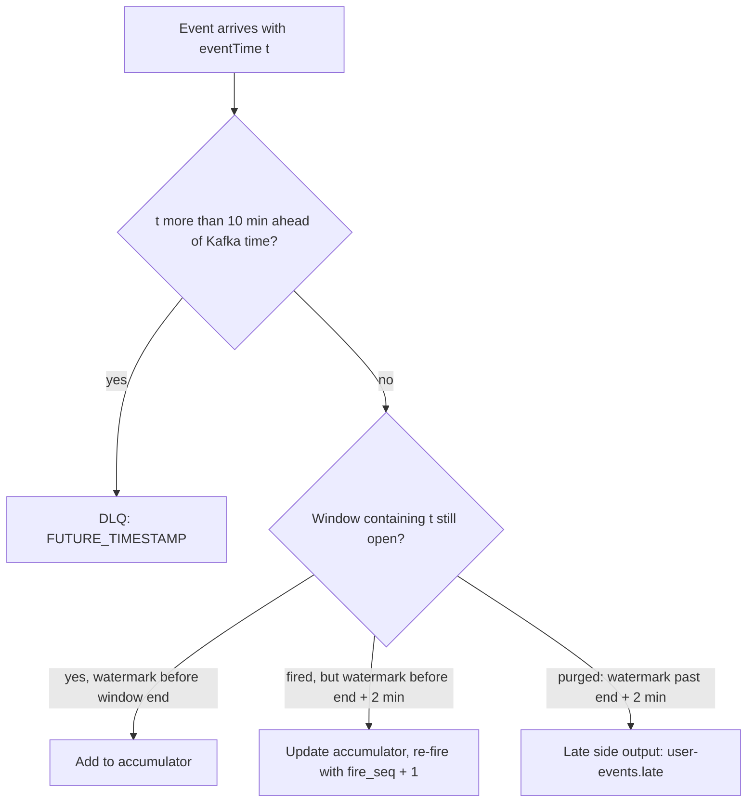

4. **Complexity:** `O(1)` per event to update the max; `O(partitions)` watermark trackers.
5. **Alternatives:** processing-time windows (simple, non-deterministic); ingestion-time windows; punctuated watermarks.
6. **Failure scenario:** a producer clock 1 hour ahead would push watermarks forward and make everything else late; the 10-minute validation rule and alignment defend against it.

### 9.2 Tumbling product windows with lateness

```java
public class ProductAggregate implements AggregateFunction<UserEvent, Acc, Acc> {
  public Acc createAccumulator() { return new Acc(); }
  public Acc add(UserEvent e, Acc a) {
    switch (e.eventType) {
      case VIEW -> a.views++;
      case CLICK -> a.clicks++;
      case ADD_TO_CART -> a.carts++;
      case PURCHASE -> { a.purchases++; a.revenueMinor += e.priceMinor; }
    }
    a.maxIngestTs = Math.max(a.maxIngestTs, e.kafkaTimestampMs);
    return a;
  }
  public Acc getResult(Acc a) { return a; }
  public Acc merge(Acc x, Acc y) { return x.plus(y); }   // used only by merging windows
}

public class ProductWindowFunction extends ProcessWindowFunction<Acc, ProductMetric, String, TimeWindow> {
  private static final ValueStateDescriptor<Integer> FIRE_SEQ =
      new ValueStateDescriptor<>("fireSeq", Types.INT);

  @Override public void process(String productId, Context ctx, Iterable<Acc> aggs, Collector<ProductMetric> out)
      throws Exception {
    ValueState<Integer> seq = ctx.windowState().getState(FIRE_SEQ);
    int next = (seq.value() == null ? 0 : seq.value()) + 1;   // 1 = on-time firing, >1 = late re-firing
    seq.update(next);
    Acc a = aggs.iterator().next();
    out.collect(ProductMetric.of(productId, ctx.window().getStart(), ctx.window().getEnd(), a, next,
                                 ctx.currentProcessingTime()));
  }

  @Override public void clear(Context ctx) { ctx.windowState().getState(FIRE_SEQ).clear(); }
}
```

**Figure 9.2 — Lifecycle of one window [12:00, 12:01)**

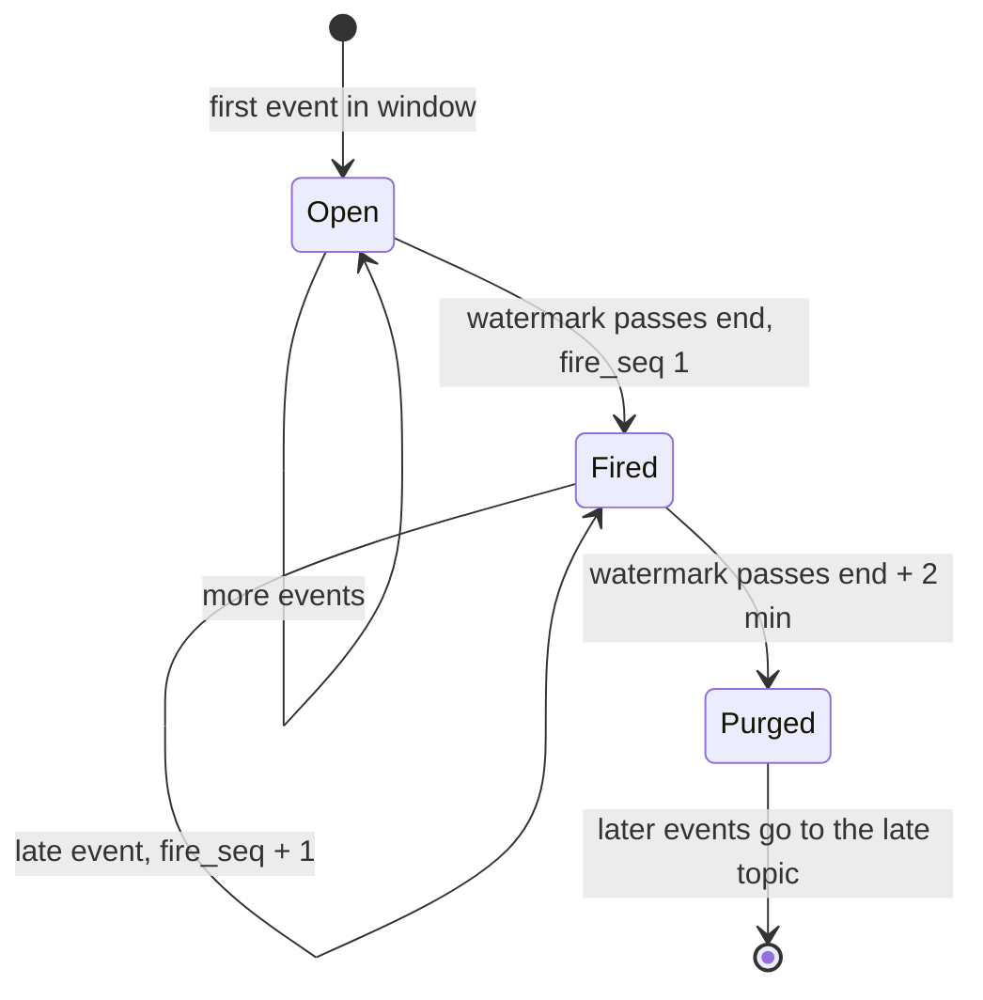

- **Complexity:** `O(1)` per event (incremental aggregate); one accumulator per (product, open window), at most ~3 open windows per product.
- **Output semantics:** each firing carries the **full** window aggregate, not a delta, so downstream upserts overwrite.
- **Failure behaviour:** after recovery, windows fire again from restored state; the `fire_seq >= stored` guard keeps the latest.

### 9.3 Pane-based sliding window features

1. **Problem:** "views in the last 5 minutes" must update on **every** event.
2. **Concept:** split the window into fixed panes (10 × 30 s for 5 minutes; 12 × 5 min for 1 hour). Each event increments its pane; the feature is the sum of panes within `[now − window, now]`, where "now" is the user's **latest event time**.

```java
final class PaneRing {
  private final long paneMs; private final int panes;      // e.g. 30_000 ms × 10
  private final long[] paneStart;                          // start time of each slot, -1 if empty
  private final long[][] counts;                           // [slot][metric]

  /** Returns false if the event is older than the window relative to maxSeen. */
  boolean add(long eventTime, long maxSeen, int metric, long amount) {
    if (eventTime <= maxSeen - paneMs * panes) return false;        // too old for this window
    long start = eventTime - Math.floorMod(eventTime, paneMs);
    int slot = (int) Math.floorMod(start / paneMs, (long) panes);
    if (paneStart[slot] != start) {                                 // slot holds an expired pane: reuse it
      if (paneStart[slot] > start) return false;                    // slot already holds a newer pane
      paneStart[slot] = start;
      Arrays.fill(counts[slot], 0L);
    }
    counts[slot][metric] += amount;
    return true;
  }

  long sum(long now, int metric) {
    long lower = now - paneMs * panes;
    long s = 0;
    for (int i = 0; i < panes; i++)
      if (paneStart[i] > lower && paneStart[i] <= now) s += counts[i][metric];
    return s;
  }
}
```

3. **`processElement` steps:**
   1. Read `panes5m`, `panes1h`, `lastActivity`.
   2. `maxSeen = max(lastActivity.maxEventTime, e.eventTimeMs)`.
   3. `panes5m.add(...)` for the event type; `panes1h.add(...)` for purchases with the amount. If `add` returns false the event is too old for that window: count it as a late feature event and skip (no correction).
   4. Compute `views_5m`, `clicks_5m`, `carts_5m`, `purchases_5m`, `purchase_amount_1h` at `now = maxSeen`.
   5. Update `lastActivity`.
   6. Re-register a cleanup timer at `maxSeen + 65 min`.
   7. Emit `FeatureUpdate{userId, features, asOfEventTime = maxSeen, sourceIngestTs}`.
4. **Worked example (ILLUSTRATIVE):** panes are 30 s. Events at 12:00:10 (pane 12:00:00) and 12:00:40 (pane 12:00:30) give `views_5m = 2`. An event at 12:05:20 moves `now` to 12:05:20; the lower bound becomes 12:00:20, so pane 12:00:00 drops out and pane 12:00:30 stays: `views_5m = 2` (12:00:40 and 12:05:20).
5. **Complexity:** `O(P)` per event (P = 10 or 12) + 3 state reads/writes; space `O(P × metrics)` per user, independent of event rate.
6. **Precision:** pane-aligned boundaries mean "last 5 minutes" is really 4.5–5 minutes (documented).
7. **Alternative:** `SlidingEventTimeWindows.of(5 min, 30 s)`: exact boundaries, but results only every 30 s and 10 accumulator updates per event.

### 9.4 Deduplication

```java
public class DedupFunction extends KeyedProcessFunction<String, UserEvent, UserEvent> {
  private transient MapState<String, Long> seen;
  private final Duration ttl;

  @Override public void open(OpenContext ctx) {
    StateTtlConfig ttlCfg = StateTtlConfig.newBuilder(ttl)
        .setUpdateType(StateTtlConfig.UpdateType.OnCreateAndWrite)
        .setStateVisibility(StateTtlConfig.StateVisibility.NeverReturnExpired)
        .cleanupInRocksdbCompactFilter(1000)
        .build();
    MapStateDescriptor<String, Long> d = new MapStateDescriptor<>("seen", Types.STRING, Types.LONG);
    d.enableTimeToLive(ttlCfg);
    seen = getRuntimeContext().getMapState(d);
  }

  @Override public void processElement(UserEvent e, Context ctx, Collector<UserEvent> out) throws Exception {
    if (seen.contains(e.eventId)) {
      duplicates.inc();                     // metric
      return;
    }
    seen.put(e.eventId, e.eventTimeMs);
    out.collect(e);
  }
}
```

| Aspect | Detail |
| --- | --- |
| Complexity | `O(1)` amortized: one RocksDB lookup + one put per event |
| Space | Unique events per user in 15 minutes |
| Concurrency | Keyed state accessed by one subtask thread; no locks |
| Failure | On restore, `seen` rolls back with the offsets, so replayed events behave exactly as on first processing |
| Boundary | Duplicates more than 15 minutes apart are **not** removed |

**Why key by `userId`, not `eventId`:** keying by `eventId` would need its own shuffle and spread state over many tiny keys; duplicates always carry the same `userId`.

| Option | Exactness | Cost | Chosen? |
| --- | --- | --- | --- |
| Keyed `MapState` by user, 15-min TTL | Exact within 15 min | ~1 KB per active user | Yes |
| `ValueState<Boolean>` keyed by `eventId` | Exact within TTL | Extra shuffle, many tiny keys | No |
| Bloom filter per user | Probabilistic: false positives drop real events | Smaller | No |
| Dedup in the sink only | Only for idempotent outputs | None | No: counts already inflated |

### 9.5 Checkpointing (asynchronous barrier snapshots)

1. **Problem:** after a failure, resume with input positions and state consistent with each other, without stopping the world.
2. **Steps:**
   1. The coordinator triggers checkpoint n every 10 s (min pause 5 s, timeout 60 s, 1 concurrent).
   2. Sources record their offsets and emit barrier n.
   3. Multi-input operators **align** (buffer inputs that already delivered barrier n), or with unaligned checkpoints snapshot in-flight buffers instead.
   4. Each operator takes a short synchronous snapshot (RocksDB: flush memtable, hard-link SSTs) and uploads asynchronously.
   5. When all acknowledge, `_metadata` is written; sources commit offsets to Kafka for monitoring.

**Figure 9.3 — Barrier flow for checkpoint n**

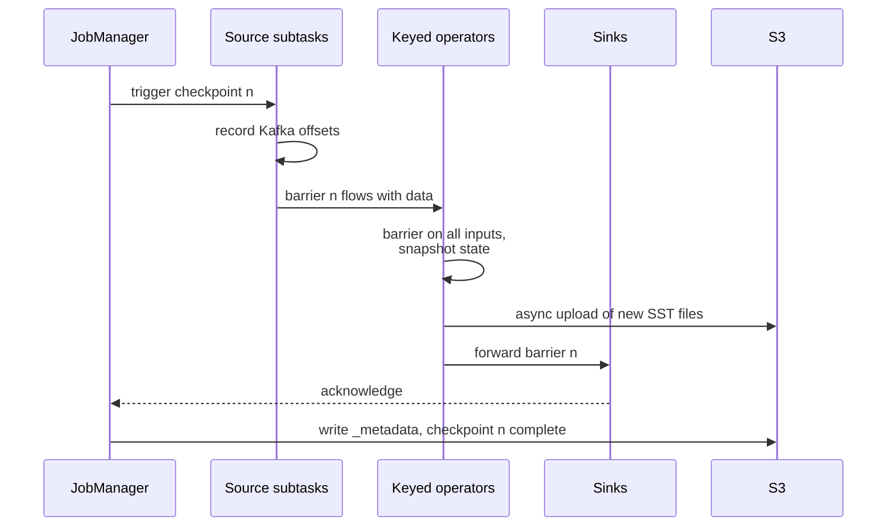

Configuration:

```yaml
execution.checkpointing.interval: 10s
execution.checkpointing.mode: EXACTLY_ONCE
execution.checkpointing.timeout: 60s
execution.checkpointing.min-pause: 5s
execution.checkpointing.max-concurrent-checkpoints: 1
execution.checkpointing.tolerable-failed-checkpoints: 3
execution.checkpointing.unaligned.enabled: true
execution.checkpointing.aligned-checkpoint-timeout: 5s      # switch to unaligned only when alignment is slow
execution.checkpointing.externalized-checkpoint-retention: RETAIN_ON_CANCELLATION
state.backend.type: rocksdb
state.backend.incremental: true
state.checkpoints.dir: s3://stream-platform/checkpoints/activity-pipeline
state.checkpoints.num-retained: 3
```

- **Complexity:** synchronous phase is milliseconds; async upload ∝ **new** state since the last checkpoint.
- **Alternatives:** Kafka Streams changelog topics; periodic external snapshots.
- **Trade-off:** aligned checkpoints slow under backpressure; sink side effects between checkpoints are replayed (hence idempotent sinks).

### 9.6 Exactly-once state vs effectively-once results

| Layer | Guarantee | Mechanism |
| --- | --- | --- |
| Kafka → Flink state | Exactly-once | Offsets and state in the same checkpoint |
| Flink → output topics | At-least-once | Records after the last checkpoint re-emitted after recovery |
| Output topics → Redis / PostgreSQL | **Effectively-once state** | Absolute values + monotonic guards (`as_of_event_time_ms`, `fire_seq`) |

Recomputation is deterministic: the same events in the same per-partition order produce the same state and outputs. Window *firing times* depend on cross-partition interleaving and can vary slightly, but because every output is the full current value of its key and writes are monotonic, stored state converges.

### 9.7 Kafka partitions × Flink parallelism

| Rule | Consequence |
| --- | --- |
| A partition is read by one source subtask at a time | Source parallelism > partitions → idle subtasks |
| Partitions are spread over source subtasks | 24 / 12 = 2 each (even); 6 / 4 = 2, 2, 1, 1 (uneven) |
| `keyBy` redistributes by key group | Keyed load depends on key distribution, not partitions |
| Max parallelism (256) fixes key groups forever | Keyed operators can rescale up to 256 |
| Key groups per subtask = 256 / parallelism | 256 / 12 → 21 or 22 (~5% imbalance) |

### 9.8 Backpressure handling (credit-based flow control)

1. A receiver grants credits (free network buffers) to senders; a sender transmits only with credit.
2. When a receiver is slow, credits run out, the sender's buffers fill, its task blocks, and pressure propagates upstream until the Kafka source reads more slowly. Kafka holds the difference as lag.
3. **Diagnosis:** the bottleneck is the **most downstream operator that is busy (near 1000 ms/s) but not itself backpressured**.
4. **Responses:** raise parallelism of the bottleneck (from a savepoint), fix skew, reduce per-record cost. Slow stores appear as writer lag, not Flink backpressure.
5. **Buffer debloating** keeps in-flight data near a target time.

### 9.9 Consumer-group scaling and event replay

- **Writers:** each output partition is assigned to one consumer in the group; scaling 1 → 2 → 4 → 6 replicas redistributes partitions (cooperative-sticky moves only what must move); replicas ≤ 12.
- **Recovery replay (automatic):** restore checkpoint, rewind sources, reprocess.
- **Operational replay (manual):** start the job from a savepoint or with fresh state from `OffsetsInitializer.timestamp(T)`, choosing T about 1 hour before the period of interest so dedup and feature state are warm; record the run in `replay_runs`; horizon 7 days.
- **Recovery time budget:** `detection + restart + state restore + backlog drain`, with `drain = backlog / (catch_up_rate − input_rate)` (Section 21.3).

<div style="page-break-before: always;"></div>

## 10. Complete End-to-End Execution Flows

### 10.1 One event to a feature in Redis

**Figure 10.1 — Event to feature, step by step**

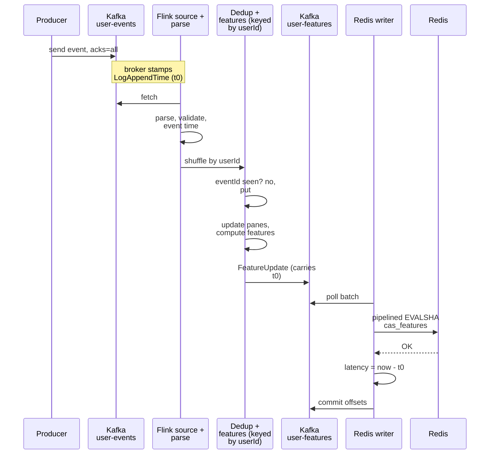

Dedup and the feature function run in the same subtask (the stream is reinterpreted as keyed, with no second shuffle), so they are drawn as one participant.

1. **Arrival:** the producer sends the event keyed by `userId` (`acks=all`). The broker appends it to partition `murmur2(userId) % 24`, stamps `LogAppendTime`, replicates to 2 in-sync followers, and acknowledges.
2. **Fetch:** the source subtask owning that partition fetches a batch (`fetch.max.wait.ms=50`).
3. **Validation:** shared `ObjectMapper` parses JSON; failures go to the DLQ side output.
4. **Event time:** timestamp = `eventTime`; the partition's watermark tracker updates.
5. **Routing:** `keyBy(userId)` sends the record to the subtask owning the user's key group.
6. **Dedup:** `MapState.contains(eventId)`; if new, `put` and forward.
7. **Features:** same subtask: update panes, compute features, emit `FeatureUpdate` to `user-features`.
8. **Analytics (in parallel):** the event is shuffled by `productId` to the window operator and added to the minute accumulator.
9. **Window firing:** when the operator watermark passes the window end, a `ProductMetric` with `fire_seq = 1` goes to `product-metrics`.
10. **Serving writes:** writers poll, write Redis (CAS) and PostgreSQL (guarded upsert), then commit offsets.
11. **Checkpointing (every 10 s, concurrently):** barriers capture offsets and state to S3.
12. **Completion:** the feature is visible within the latency budget; the PostgreSQL row appears after window length + watermark delay + processing latency.

### 10.2 Latency anatomy (ILLUSTRATIVE)

| Segment | Typical | Main knob |
| --- | --- | --- |
| Broker append + replication | 2–10 ms | Broker load, AZ latency |
| Source fetch wait | 0–50 ms | `fetch.max.wait.ms` |
| Parse + watermark (chained) | < 1 ms | — |
| Shuffle to dedup | 0–20 ms | `execution.buffer-timeout` (20 ms) |
| Dedup + feature state access | 0.05–0.5 ms | Block cache |
| Kafka sink batching | 0–10 ms | `linger.ms=10` |
| Broker append of output | 2–10 ms | — |
| Writer poll + batch | 0–100 ms | Poll wait, batch size |
| Redis pipelined write | 1–3 ms | Batch size |
| **Total (healthy)** | **~50–250 ms** | |
| During checkpoint alignment | + tens to hundreds of ms | Unaligned fallback |

### 10.3 Duplicate event

1. The producer retries; the application reuses the same `eventId`; both copies land on the same partition.
2. The first passes dedup; the second hits `seen.contains(eventId)` and is dropped; `duplicates_total` increments.
3. A duplicate arriving more than 15 minutes later is **not** dropped (documented limit).

### 10.4 Late event

**Figure 10.2 — Late event within and beyond allowed lateness**

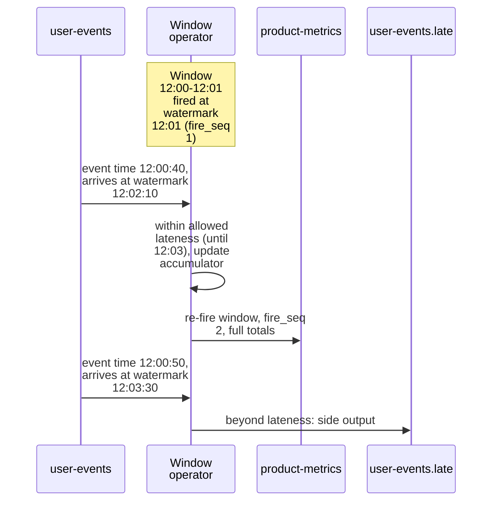

The feature path handles the same event independently: counted if it fits the user's pane range, otherwise counted as a late feature event and skipped.

### 10.5 TaskManager failure and checkpoint recovery

**Figure 10.3 — Recovery into the spare TaskManager**

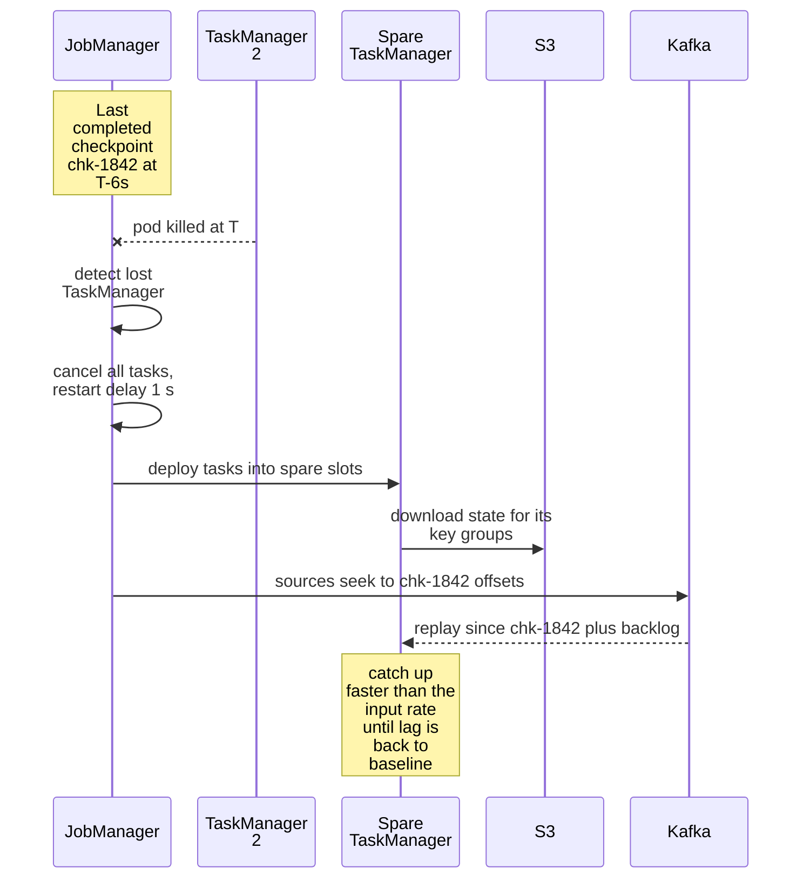

1. **Failure (T):** TaskManager 2 is killed; its 4 subtasks die.
2. **Detection (T + ~1–10 s):** broken RPC connection (fast) or heartbeat timeout (10 s, reduced from the 50 s default).
3. **Failover:** `keyBy` makes the graph all-to-all, so the failover region is the whole job; all tasks are cancelled.
4. **Restart delay:** exponential-delay strategy, initial 1 s.
5. **Slot allocation:** 8 slots from healthy TaskManagers + 4 from the spare. Without the spare, a new pod takes ~15–60 s.
6. **State restore:** each subtask restores its key groups from the checkpoint; local recovery where possible, S3 download otherwise.
7. **Source rewind** to the checkpointed offsets.
8. **Replay** of events since the checkpoint; re-emitted outputs absorbed by idempotent sinks.
9. **Catch-up** of the outage backlog at full speed.
10. **Recovered:** lag back in its pre-failure band; p95 back below 1 s.
11. **Afterwards:** Kubernetes brings a replacement, which becomes the new spare.

### 10.6 JobManager failure

1. Kubernetes HA keeps leader info in ConfigMaps and the latest checkpoint pointer in S3.
2. A new JobManager pod starts, gains leadership, reads the pointer.
3. TaskManagers re-register; restore proceeds as above.
4. The pod restart (~10–30 s) means this may exceed 30 s; the claim covers TaskManager failures only.

### 10.7 Redis unavailable

1. ElastiCache fails over (typically tens of seconds).
2. Writer batches fail; retry with backoff; offsets not committed.
3. `user-features` lag grows; **Flink is unaffected**.
4. Readiness turns false after 60 s without a successful write (alert, no restart loop).
5. Redis returns; writers drain; the CAS applies updates monotonically. Reads were stale; nothing was lost.

### 10.8 Malformed event, writer crash, operational replay

- **Malformed:** DLQ record with raw bytes, partition, offset, error code; pipeline continues; a fixed producer's corrected events can be republished (dedup prevents double counting).
- **Writer crash after PostgreSQL commit, before `commitSync`:** rebalance; another replica re-applies the batch; the upsert writes the same totals or is skipped by `fire_seq`.
- **Operational replay after a bug** (e.g., `ADD_TO_CART` undercounted for 3 hours): deploy the fixed job from T = bug start − 1 h; recomputed rows and features overwrite; record in `replay_runs`.

<div style="page-break-before: always;"></div>

## 11. Concurrency and Distributed Systems

### 11.1 Race conditions and how they are avoided

| Potential race | Where | Why it cannot happen (or is harmless) |
| --- | --- | --- |
| Two threads updating one user's state | Flink keyed operators | One key → one key group → one subtask → one thread |
| Two writers updating one Redis key | Redis writers | Same key → same partition → one consumer; rebalance overlap is safe because the Lua CAS is atomic and monotonic |
| Two writers upserting one PostgreSQL row | PG writers | Same partitioning argument; the upsert is atomic per row |
| Stale replayed output overwriting fresh output | Sinks after recovery or replay | Monotonic guards |
| Offsets committed before writes | Writers | Commit only after success |

### 11.2 Lost updates and locking

- A naive `HSET` of a replayed older feature would be a lost update; the CAS prevents it.
- An older window firing after a re-firing would be a lost update; the `fire_seq` guard prevents it.
- Flink user code takes **no locks**. PostgreSQL takes row locks inside the upsert for the batch transaction. Redis runs Lua atomically. The only coordination is **partition ownership** (Kafka group protocol for writers; key-group assignment for Flink).

### 11.3 Atomicity

| Operation | Atomic? |
| --- | --- |
| Checkpoint (offsets + all state) | Yes, as a consistent cut; completes or is discarded |
| A writer batch to PostgreSQL | Yes (one transaction) |
| A writer batch to Redis | No (independent scripts); each key's update is atomic; partial batches are re-applied on redelivery |
| Write + offset commit | No; safe because of idempotency |

### 11.4 Ordering

| Scope | Guaranteed? |
| --- | --- |
| One user's events within a Kafka partition | Yes (offset order) |
| One user's events through Flink after `keyBy` | Yes (one partition → one source subtask → one keyed subtask) |
| Across users or partitions | No |
| Event-time order | No (arrival ≠ event time; watermarks and panes handle it) |
| Feature updates per user in `user-features` | Yes, and the CAS enforces monotonicity anyway |
| Window results per product | Yes per key; `fire_seq` enforces it in the sink |

### 11.5 Consistency guarantees

| Guarantee | Holds? | Notes |
| --- | --- | --- |
| Each event affects Flink state exactly once | Yes | Checkpoints + rewind |
| No acknowledged event lost | Yes | RF=3, `acks=all`, ISR=2, 7-day retention |
| Output records delivered exactly once | **No** | At-least-once sink |
| Stored results equal exactly-once results | Yes, after convergence | Idempotent absolute writes + monotonic guards |
| Duplicates removed | Within 15 min | Not beyond |
| Window results final at first firing | **No** | Late re-firings within 2 min |
| Events later than allowed lateness counted | **No** | Routed to the late topic |
| Redis consistent with PostgreSQL | **No** | Independent outputs with different timing |
| Read-your-writes for producers | **No** | Asynchronous pipeline |

### 11.6 Duplicate sources and where each is removed

| Source | Removed by |
| --- | --- |
| Producer application retries (same `eventId`) | Flink dedup (15 min) |
| Producer internal retries | Kafka idempotent producer |
| Flink recovery replay | State rollback; re-emitted outputs absorbed by idempotent sinks |
| Writer redelivery | Idempotent writes |
| Operational replay | Overwrite semantics |

### 11.7 Replication and coordination

- **Kafka:** RF=3 across 3 AZs; `min.insync.replicas=2` survives one broker loss.
- **Flink state:** not replicated live; durability from S3 checkpoints plus replayable input.
- **Redis:** primary + replica, asynchronous replication (a failover can lose the last few writes; the next update for that user re-sends; TTL bounds staleness).
- **PostgreSQL:** RDS Multi-AZ synchronous standby.
- **Coordination:** Kafka KRaft controllers (managed by MSK), Flink leader election via Kubernetes HA, writer group coordinator. The platform implements no consensus itself.

### 11.8 Ingestion vs processing throughput; event-time vs processing-time latency

- **Ingestion throughput** (records appended per second) can be far higher than **processing throughput** (records Flink fully processes per second). A throughput claim is only meaningful at **stable lag**.
- **Event-time latency** (`t_visible − eventTime`) includes device and network delays outside the platform's control. **Processing-time latency** (`t_visible − t_kafka_append`) is the resume metric.
- ILLUSTRATIVE: a phone records a view at 12:00:00, uploads at 12:04:00; Kafka appends at 12:04:00.010; Redis shows it at 12:04:00.250. Processing latency = 240 ms; event-time latency = 4 minutes. For analytics, the 12:00 window has already closed lateness, so the event goes to the late topic.

<div style="page-break-before: always;"></div>

# Part 4: Engineering and Reliability

## 12. Failure Handling and Recovery

### 12.1 Failure-scenario table

| Failure scenario | Why it happens | System behaviour | Recovery mechanism | Remaining risk |
| --- | --- | --- | --- | --- |
| TaskManager crash | Pod/node failure | Cancel the job region; restart strategy | Restore from the last checkpoint into spare + surviving slots; replay from checkpointed offsets | Outputs since the checkpoint re-emitted (absorbed); RTO depends on spare and headroom |
| JobManager crash | Pod failure | New leader reads latest checkpoint pointer | Job restored from checkpoint | Pod restart may exceed 30 s |
| Checkpoint failures | S3 throttling, alignment timeouts | Continue up to 3 consecutive failures, then fail the job | Restart from last good checkpoint | More replay after recovery |
| Kafka broker failure | Broker loss | Leader election; clients fail over | Automatic | None (RF=3, ISR=2) |
| Kafka cluster unavailable | Outage | Source retries; job may fail; producers buffer then block/fail | Restart from checkpoint when Kafka returns | Producers must retry |
| Duplicate events | Producer retries | Dedup drops them | — | Not beyond 15 min |
| Late events | Device buffering, network | Re-fire (≤ 2 min) or late side output | Optional correction job (out of scope) | Analytics excludes very late events |
| Malformed events | Producer bug | DLQ | Fix producer; replay corrected events | Missing until replayed |
| Redis unavailable | Failover, outage | Writers retry, don't commit; lag grows | Drain when Redis returns | Stale features during outage |
| PostgreSQL unavailable | Failover, outage | Same | Same | Stale analytics |
| Writer crash | Pod failure | Group rebalance | Redelivery from committed offsets | None (idempotent) |
| TM–JM network partition | Network | Heartbeat timeout; TM considered lost | As a TaskManager crash | None |
| Partial Redis batch | Writer crash mid-batch | Some keys updated, offsets not committed | Redelivery re-applies all | None |
| Hot key / skew | Bots, flash sales | One subtask busy; backpressure; lag | Rescale, salting (future) | Latency |
| State too large / disk full | TTL not cleaning, growth | Task failures | Bigger volume; tune TTL | Recovery via checkpoint |
| Poison output record | Bad record | Bisect batch; writer DLQ after 3 attempts | Manual | That record missing from the store |

### 12.2 Checkpoint recovery procedure

**Figure 12.1 — Checkpoint recovery**

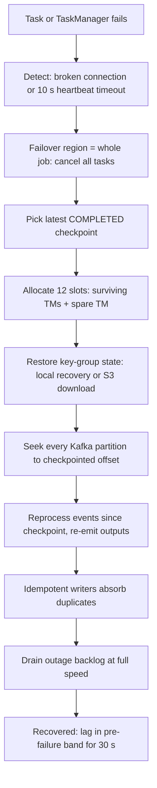

1. Detect the failed task or TaskManager.
2. The failover region is the whole pipeline (all-to-all `keyBy` connections); all tasks are cancelled.
3. Select the latest **completed** checkpoint (an in-progress one is discarded).
4. Allocate slots from surviving TaskManagers and the spare.
5. Restore each subtask's key-group ranges (local recovery when possible) and source split offsets.
6. Seek sources to the checkpointed offsets.
7. Reprocess in per-partition order; state evolves exactly as it would have.
8. Re-emit outputs; downstream idempotency absorbs them.
9. Catch up the backlog.
10. Declare recovered when lag is back within the pre-failure band for 30 s.

### 12.3 Operational replay and stateful upgrade

**Replay** (Section 9.9): precondition that the start is within Kafka retention and operator uids are stable (or state is intentionally fresh). Audit in `replay_runs`.

**Upgrade:**
1. Trigger a savepoint through the operator (`upgradeMode: savepoint`).
2. Deploy the new version with the same operator uids.
3. Start from the savepoint; Kafka offsets continue where they stopped.
4. For state schema changes, use Flink POJO schema evolution or the State Processor API.

### 12.4 Graceful shutdown

- Flink upgrades use stop-with-savepoint, so no unnecessary reprocessing beyond the idempotent tail.
- Writers on `SIGTERM`: stop polling, finish the in-flight batch, commit offsets, close the consumer (an immediate, clean rebalance instead of waiting for the session timeout).

### 12.5 What is and is not guaranteed

Guaranteed: exactly-once state; no acknowledged event lost; stored results converge to exactly-once results. Not guaranteed: exactly-once output delivery; dedup beyond 15 minutes; final results at first firing; inclusion of events beyond 2 minutes of lateness; cross-store consistency. See Section 11.5.

<div style="page-break-before: always;"></div>

## 13. Performance Engineering

### 13.1 Bottlenecks to expect

| Area | Bottleneck | Symptom |
| --- | --- | --- |
| Source | Too few partitions; uneven partitions per subtask | Some source subtasks busy, others idle |
| Serialization | Kryo fallback; JSON parsing | CPU in `KryoSerializer` / Jackson |
| Network shuffles | Buffers flushed too often or too rarely | Throughput vs latency trade-off |
| State access | RocksDB reads/writes; block cache misses | Busy keyed operators |
| Key skew | Hot users or products | One subtask at 1000 ms/s busy |
| Sinks | Synchronous per-record writes | Writer lag |
| Checkpoints | Large or slow uploads; alignment under backpressure | Duration near the interval; latency spikes |
| GC | Large heap objects | Latency spikes |

### 13.2 Algorithmic cost per event

| Operator | Cost |
| --- | --- |
| Parse | `O(event bytes)` |
| Dedup | `O(1)` RocksDB get + put |
| Features | `O(P)`, P ≤ 12, plus 3 RocksDB reads/writes |
| Window | `O(1)` accumulator update |
| Sinks | `O(1)` amortized with batching |

No superlinear algorithms exist; throughput is governed by constant factors (serialization, state, network) and parallelism.

### 13.3 Optimizations (baseline → optimized)

**OPT-1: Partition count aligned with parallelism.**
- *Bottleneck:* 6 partitions at parallelism 4 → 2, 2, 1, 1 per source subtask; two subtasks each carried 1/3 of the input and capped the pipeline.
- *Change:* 24 partitions, source parallelism 12 (2 each).
- *Effect:* removes the straggler; headroom to scale to 24. Major contributor to the ~2× target (BENCHMARK TARGET).
- *Cost:* more broker overhead and open files; partition count fixed up front.
- *Measure:* per-subtask `numRecordsInPerSecond`, `busyTimeMsPerSecond`; per-partition lag.

**OPT-2: Parallelism sized to the bottleneck, max parallelism set explicitly.**
- Parallelism 12 on 3 TaskManagers × 4 slots (+ spare); `maxParallelism = 256` before the first deployment. Cost: more resources; all-to-all channels grow as p²; ~5% key-group imbalance.

**OPT-3: Eliminate Kryo and reuse parsers.**
- Flat POJOs with primitive/String fields and `eventTimeMs` as `long`; `disableGenericTypes()` fails fast on Kryo; one shared thread-safe `ObjectMapper`.

**OPT-4: Avoid a redundant shuffle.**
- `reinterpretAsKeyedStream` after dedup instead of a second `keyBy(userId)`. Each shuffle costs serialization, buffers, and deserialization per record.

**OPT-5: Batching at the edges.**
- Kafka sink `linger.ms=10`, 64 KB batches, lz4; writers use pipelined Lua (500 per round trip) and JDBC batches of 500. Cost: up to `linger.ms` + poll interval of added latency.

**OPT-6: Latency-oriented network buffer timeout.**
- `execution.buffer-timeout: 20 ms` (default 100 ms) with buffer debloating. At moderate per-channel rates the default alone can add up to ~100 ms per shuffle hop. Cost: slightly lower max throughput.

**OPT-7: RocksDB tuning.**
- Managed memory fraction 0.4; `FLASH_SSD_OPTIMIZED`; local SSD for working directories; state latency tracking.

### 13.4 Skew, backpressure, memory, network, scaling

- **Hot users (bots):** filter upstream, or two-phase aggregation with salting (not in v1; scenario E8 measures impact).
- **Hot products:** the incremental aggregate absorbs high per-key rates; otherwise pre-aggregate per subtask for 1 s before the `keyBy`.
- **Backpressure:** sinks decoupled by Kafka, so the most common source (a slow database) never reaches Flink.
- **Memory:** TaskManager 8 GiB (task heap ~2.5 GiB, managed RocksDB ~3.2 GiB, network ~0.8 GiB); 20 GiB local RocksDB disk per TaskManager; JobManager 2 GiB; writer 512 MiB heap; Redis ~100 MB for 500K users (ILLUSTRATIVE).
- **Network (ILLUSTRATIVE):** 10K events/s × 300 B ≈ 3 MB/s ingress; outputs ≈ 3.5 MB/s; Kafka RF=3 triples broker traffic. Latency, not bandwidth, is the concern.
- **Scaling:** Flink via savepoint + new parallelism (or the operator autoscaler); partitions planned ahead; writers up to 12 replicas.

<div style="page-break-before: always;"></div>

## 14. Benchmarking and Testing

> **Status:** intended plan only. None of these tests or benchmarks has been executed; result tables are blank; no number here is a measurement.

### 14.1 Test plan

| Test | Objective | Expected / assertion |
| --- | --- | --- |
| Unit: `PaneRing` | Correct sliding sums and expiry | Sums equal a brute-force reference; too-old events rejected |
| Unit: dedup function | Duplicates dropped within TTL | Same `eventId` twice → 1 output; after advancing processing time 16 min → 2 |
| Unit: window function | `fire_seq` and late handling | Outputs fire_seq 1 then 2; beyond-lateness event on side output |
| Unit: parser | Never throws | Valid → event; others → DLQ with correct reason |
| Integration: MiniCluster pipeline | Topology correctness | 100K generated events match the reference aggregates |
| Integration: writers | Idempotent sinks | Same records twice, out of order → newest values, no double counts |
| Contract: schemas | Producers and consumers agree | JSON Schema validation in CI |
| Database | Constraints and upsert guard | CHECK violations rejected; lower `fire_seq` does not overwrite |
| Concurrency: writer rebalance | No lost or double writes when scaling 2 → 4 | Final store equals expected |
| **Failure injection: TaskManager kill** | Exactly-once state across failure | Final aggregates equal the no-failure run |
| Failure injection: S3 outage (2 min) | Tolerable failures then recovery | ≤ 3 failed checkpoints or restart from the last good one |
| Recovery timing | < 30 s RTO | 3 kills at random checkpoint offsets, each < 30 s |
| Replay correctness | Replay reproduces results | Shadow schema equals original |
| Stress / load / soak | 2× capacity; claim; 6 h stability | No crash; thresholds; checkpoint size plateaus |

The most persuasive test is the **failure-injection comparison**: identical deterministic input with and without a TaskManager kill must produce identical final aggregates.

### 14.2 Workload

| Parameter | Value |
| --- | --- |
| Event mix | 70% VIEW, 20% CLICK, 8% ADD_TO_CART, 2% PURCHASE |
| Users | 500K active in the hour; Zipf(0.8) activity |
| Products | 50K; Zipf(1.0) popularity |
| Payload | ~300 B JSON |
| Duplicates | 1% re-sent with the same `eventId` within 0–60 s |
| Out-of-order | Jitter 0–3 s for 95%; 0–60 s for 4.9% |
| Late | 0.1% with event time 3–10 min behind |
| Rate | Constant 10K events/s (claim run); step ramps for capacity |
| Warm-up / steady / runs | 5 min / 30 min / 3 |

Tools: custom `event-generator` (real event semantics), Kafka perf tools (prove Kafka is not the bottleneck), Flink metrics in Prometheus/Grafana, Kafka lag, the writer latency histogram, and a batch reference job for correctness. HTTP load tools are not used (no HTTP API).

### 14.3 Scenarios

| # | Scenario | Purpose |
| --- | --- | --- |
| E1 | 10K events/s, 30 min, optimized | Throughput + latency claims (stable lag, p95 < 1 s, zero restarts) |
| E2 | Step ramp 4K → 20K (+2K every 5 min), baseline and optimized | ~2× max sustainable throughput |
| E3 | Kill a TaskManager at minute 15 | < 30 s recovery; no lost or duplicated counts |
| E4 | Kill the JobManager | HA behaviour (not part of the claim) |
| E5 | Slow or paused Redis | Backpressure contained in writer lag |
| E6 | Replay 1 h with fresh state | Replay rate and correctness |
| E7 | Duplicates, jitter, late events | Metrics equal the batch reference for windows within lateness |
| E8 | 10 bot users at 5% of events; one product with 20% of views | Skew impact |
| E9 | Redis writers 1 → 2 → 4 → 6 at 15K updates/s | Consumer-group scaling |
| E10 | 8K events/s for 6 h | State growth, checkpoint size, drift |

### 14.4 Baseline vs optimized

| Aspect | Baseline | Optimized |
| --- | --- | --- |
| `user-events` partitions | 6 | 24 |
| Parallelism | 4 | 12 |
| Max parallelism | Default (128) | 256 |
| Serialization | Kryo fallback | POJO; generic types disabled |
| Dedup → features | Two shuffles | One + `reinterpretAsKeyedStream` |
| Kafka sink | `linger.ms=0`, no compression | `linger.ms=10`, lz4 |
| Writers | Per-record synchronous | Pipelined / batched |
| Buffer timeout | 100 ms | 20 ms |
| Held constant | Hardware, TaskManager count/size, workload, Flink version, state backend, checkpoint interval | |

Rules: same node group and MSK cluster (topics re-created per run); same generator seed; 3 runs, median and spread; ablation reverting one change at a time.

### 14.5 Metrics

Ingestion rate; processing throughput (source `numRecordsOutPerSecond`, valid only at stable lag); consumer lag; processing latency p50/p95/p99 (writer histogram: Redis-ack time − `sourceIngestTs`); window emission delay; busy/backpressured time; checkpoint duration/size/alignment; restart and recovery time; CPU/memory per TaskManager; duplicates/DLQ/late counts; sink health; writer error rate.

<div style="page-break-before: always;"></div>

## 15. Deployment and Infrastructure

### 15.1 Docker images

| Image | Base | Contents |
| --- | --- | --- |
| `activity-pipeline` | `flink:1.20-java17` | Job JAR in `/opt/flink/usrlib/`; S3 filesystem plugin |
| `result-writer` | `eclipse-temurin:17-jre` | Fat JAR; non-root user |
| `event-generator` | `eclipse-temurin:17-jre` | Fat JAR |

### 15.2 Kubernetes resources

| Resource | Purpose |
| --- | --- |
| Flink Kubernetes Operator (Helm) | Manages `FlinkDeployment` resources, savepoints, upgrades |
| `FlinkDeployment activity-pipeline` | Application-mode job: JobManager + TaskManagers |
| `Deployment result-writer-redis`, `result-writer-pg` | Writer consumer groups |
| `Job event-generator` | Benchmarks and tests |
| `ConfigMap pipeline-config`, `writer-config` | Topics, bootstrap servers, tuning |
| `Secret writer-secrets` | Redis auth token, PostgreSQL password |
| `ServiceAccount flink` with IRSA | S3 access without static keys |
| `PodDisruptionBudget` for writers | `minAvailable: 1` |
| `ServiceMonitor`s | Prometheus scraping |

Representative `FlinkDeployment`:

```yaml
apiVersion: flink.apache.org/v1beta1
kind: FlinkDeployment
metadata:
  name: activity-pipeline
  namespace: stream
spec:
  image: <account>.dkr.ecr.<region>.amazonaws.com/activity-pipeline:1.4.0
  flinkVersion: v1_20
  serviceAccount: flink
  flinkConfiguration:
    taskmanager.numberOfTaskSlots: "4"
    parallelism.default: "12"
    pipeline.max-parallelism: "256"
    execution.checkpointing.interval: "10s"
    execution.checkpointing.unaligned.enabled: "true"
    execution.checkpointing.aligned-checkpoint-timeout: "5s"
    state.backend.type: rocksdb
    state.backend.incremental: "true"
    state.backend.local-recovery: "true"
    state.checkpoints.dir: s3://stream-platform/checkpoints/activity-pipeline
    state.savepoints.dir: s3://stream-platform/savepoints
    high-availability.type: kubernetes
    high-availability.storageDir: s3://stream-platform/ha
    heartbeat.timeout: "10000"
    restart-strategy.type: exponential-delay
    restart-strategy.exponential-delay.initial-backoff: 1s
    restart-strategy.exponential-delay.max-backoff: 60s
    slotmanager.redundant-taskmanager-num: "1"
    execution.buffer-timeout: 20ms
    metrics.reporter.prom.factory.class: org.apache.flink.metrics.prometheus.PrometheusReporterFactory
    metrics.reporter.prom.port: "9249"
  jobManager:
    resource: { memory: "2048m", cpu: 1 }
  taskManager:
    resource: { memory: "8192m", cpu: 4 }
  job:
    jarURI: local:///opt/flink/usrlib/activity-pipeline.jar
    parallelism: 12
    upgradeMode: savepoint
    state: running
```

`slotmanager.redundant-taskmanager-num: 1` keeps one extra TaskManager's worth of slots allocated: the spare TaskManager of the recovery budget.

Representative writer Deployment:

```yaml
apiVersion: apps/v1
kind: Deployment
metadata: { name: result-writer-redis, namespace: stream }
spec:
  replicas: 3
  selector: { matchLabels: { app: result-writer, sink: redis } }
  template:
    metadata: { labels: { app: result-writer, sink: redis } }
    spec:
      terminationGracePeriodSeconds: 30
      containers:
        - name: writer
          image: <ecr>/result-writer:1.4.0
          args: ["--mode=redis", "--topic=user-features", "--group=features-redis-writer"]
          envFrom: [{ configMapRef: { name: writer-config } }, { secretRef: { name: writer-secrets } }]
          readinessProbe: { httpGet: { path: /health/ready, port: 8080 }, periodSeconds: 10 }
          livenessProbe:  { httpGet: { path: /health/live,  port: 8080 }, periodSeconds: 15 }
          resources:
            requests: { cpu: 500m, memory: 768Mi }
            limits:   { cpu: "1",  memory: 768Mi }
```

### 15.3 Configuration, health checks, resources, shutdown

| Setting | Where |
| --- | --- |
| Kafka bootstrap (MSK TLS endpoint), topic names | ConfigMap |
| Redis endpoint (TLS on) | ConfigMap |
| Redis AUTH token, PostgreSQL credentials | Secret (from AWS Secrets Manager via the deploy pipeline) |
| S3 access | IRSA role on the `flink` ServiceAccount |

| Component | Readiness | Liveness |
| --- | --- | --- |
| Flink JobManager | Operator-managed | Operator-managed |
| Flink job | Operator `job.state`; alerts on restarts and failed checkpoints | — |
| `result-writer` | Assigned partitions and a successful write within 60 s | Poll-loop heartbeat within 30 s (no dependency on Redis/PostgreSQL) |

Resources: TaskManagers 4 vCPU / 8 GiB with RocksDB on EBS gp3 or instance store; writers scaled manually or with a CPU HPA (lag-based autoscaling with KEDA is a future improvement). Graceful shutdown: stop-with-savepoint for Flink; clean commit-and-close for writers.

### 15.4 AWS architecture

| Service | Configuration | Reason |
| --- | --- | --- |
| EKS | Node groups `flink`, `apps`, `ops` | Isolate benchmark load from monitoring |
| MSK | 3 brokers across 3 AZs, TLS, IAM or SASL/SCRAM | RF=3 with AZ fault tolerance |
| ElastiCache Redis | Primary + replica, Multi-AZ failover, in-transit encryption | Serving availability |
| RDS PostgreSQL | Multi-AZ, gp3, Performance Insights | Durability; query visibility |
| S3 | Versioning off for checkpoints; lifecycle deletes old savepoints after 30 days | Cost |
| IAM | IRSA roles scoped to the bucket prefix | Least privilege |
| Cost control | Scale node groups to 0 and stop RDS outside test windows | Individual project budget |

<div style="page-break-before: always;"></div>

## 16. Observability

### 16.1 Logs

JSON logs with `job`, `operator`, `subtask`, `checkpointId` (Flink) and `topic`, `partition`, `offset`, `batchSize`, `latencyMs` (writers). DLQ records include source partition and offset as correlation ids. `eventId` is the end-to-end correlation key for a single event.

### 16.2 Key metrics

| Metric | Source | Why it matters |
| --- | --- | --- |
| `numRecordsInPerSecond` / `numRecordsOutPerSecond` per operator | Flink | Throughput; where records drop |
| `pendingRecords` (source backlog) | Flink Kafka source | **Lag: the primary health signal** |
| `busyTimeMsPerSecond`, `backPressuredTimeMsPerSecond`, `idleTimeMsPerSecond` | Flink | Bottleneck identification |
| `currentInputWatermark`, watermark lag | Flink | Event-time progress; stuck partitions |
| `lastCheckpointDuration`, `lastCheckpointSize`, `numberOfFailedCheckpoints`, `checkpointAlignmentTime` | Flink | Checkpoint health, recovery cost |
| `numRestarts`, `fullRestarts`, `uptime` | Flink | Stability |
| `duplicates_dropped_total`, `dlq_records_total{reason}`, `late_records_total{path}` | Custom | Data quality |
| `writer_processing_latency_seconds{sink}` | Writer | p50/p95/p99 processing latency |
| `writer_batch_size`, `writer_batch_duration_seconds`, `writer_failures_total` | Writer | Sink health |
| `kafka_consumergroup_lag` | Kafka exporter / MSK | Writer lag |
| Redis ops/latency; RDS CPU, `xact_commit` | CloudWatch / exporters | Dependency health |
| JVM GC pause, heap | Flink / writers | Latency spikes |

### 16.3 Dashboards and alerts

Dashboards: pipeline overview (ingest vs processing rate, lag, p95/p99, restarts, DLQ/late/duplicate rates); operator detail (busy/backpressure heatmap, watermarks); checkpoints; sinks; recovery view (status timeline, lag spike and drain).

| Alert | Condition | Action |
| --- | --- | --- |
| SourceLagGrowing | Lag derivative > 0 and lag > 100K for 10 min | Capacity or bottleneck investigation |
| LatencySLO | p95 > 1 s for 10 min | Check backpressure, checkpoints, writers |
| CheckpointFailing | ≥ 2 failed checkpoints in 15 min | Check S3, alignment, state size |
| JobRestarting | Any restart in 10 min | Inspect exceptions |
| WatermarkStalled | Watermark lag > 5 min | Idle/stuck partition or future timestamps |
| WriterLag | Writer lag > 50K for 10 min | Scale writers or check the store |
| DLQSpike | DLQ > 0.5% of input for 5 min | Producer bug |

### 16.4 Debugging a production issue

| Symptom | First check | Likely cause | Action |
| --- | --- | --- | --- |
| Source lag growing | Busy/backpressured per operator | Bottleneck operator or skew | Find the busy-but-not-backpressured operator; scale or fix skew |
| One subtask at 1000 ms/s | Key distribution | Hot user or product | Filter bots; pre-aggregate; plan salting |
| Latency spikes every ~10 s | Checkpoint alignment time | Alignment under backpressure | Check unaligned fallback; fix backpressure |
| Windows not firing | Watermark lag | Stalled partition or future timestamps | Check idleness, DLQ `FUTURE_TIMESTAMP` |
| Writer lag, Flink healthy | Redis/RDS health, writer failures | Store slow or down | Scale writers or fix the store; nothing is lost |
| Counts too high | Duplicates counter | Retries beyond 15 min | Confirm against dedup horizon |
| Job restart loop | Exceptions, DLQ | Throwing user code | Fix and redeploy from savepoint |

Trace one event by its `eventId` across logs, or a DLQ record back to its source partition and offset.

<div style="page-break-before: always;"></div>

# Part 5: Interview Preparation

## 17. Complete 30-Minute Project Explanation

This is a speaking script for explaining the whole project continuously in about 30 minutes. Each segment has what to say (written to be spoken aloud), the technical details behind the words, the diagram to draw, the points you must not forget, the most likely interruption, and a transition into the next segment.

**Honesty rule for the whole talk:** the four resume figures (10K+ events/sec, < 1 s p95 latency, < 30 s recovery, ~2× throughput) are **benchmark targets**, not measured results, and nothing in the design has been deployed or run. Say so the first time you mention a number.

| Time | Segment |
| --- | --- |
| 0–2 min | 1. Problem statement and motivation |
| 2–5 min | 2. Requirements, scope, and technology stack |
| 5–10 min | 3. High-level design and architecture |
| 10–15 min | 4. Low-level design: the Flink job and the writers |
| 15–19 min | 5. Core algorithms: time, windows, dedup, checkpoints |
| 19–23 min | 6. Message contracts, storage, concurrency, and consistency |
| 23–26 min | 7. Failure handling, recovery, and replay |
| 26–28 min | 8. Performance engineering and benchmarking |
| 28–30 min | 9. Trade-offs, limitations, and future improvements |

### Segment 1 (0–2 min): Problem statement and motivation

**What to say:**

> "This is a real-time streaming platform for an e-commerce application. The app emits user-activity events: product views, clicks, add-to-cart, and purchases. Two consumers need them processed within about a second.
>
> The first is **online features for ML models**, like recommendation or fraud. A model asks, per request, 'how many products has this user viewed in the last 5 minutes?' or 'how much has this user spent in the last hour?', and needs fresh answers in single-digit milliseconds. The second is **real-time product analytics**: views, clicks, cart-adds, purchases, and revenue per product per minute, queryable with SQL by dashboards.
>
> What makes it hard is that real event streams are messy. Events arrive **out of order**, because mobile clients buffer and networks delay. Some arrive **twice**, because producers retry. Volume is **bursty**. And machines fail. The platform has to keep results correct anyway: no losing events, no double-counting, and keep up at 10,000 or more events per second."

**Technical details to understand:**
- *Event time* (when it happened) differs from *processing time* (when the system sees it); correct results must use event time.
- Duplicates come from producer retries that reuse the same `eventId`.
- "Correct under failure" means exactly-once *state* inside the processor and idempotent *writes* outside it.

**Diagram to draw:** a timeline showing an event at 12:00:59 that arrives at 12:01:03, to make "out of order" concrete.

**Key points to remember:**
- Two outputs: per-user features (Redis) and per-product minute metrics (PostgreSQL).
- Three data problems: disorder, duplicates, bursts; plus machine failures.

**Likely interruption:** *"Do you build the ML model too?"* No. The model, its serving service, an offline feature store, and the dashboard UI are out of scope. The platform ends at the Redis keys and PostgreSQL rows it writes.

**Transition:** "Here is exactly what the platform must do and what I built it with."

### Segment 2 (2–5 min): Requirements, scope, and technology stack

**What to say:**

> "Functionally: ingest JSON events into a Kafka topic `user-events`, keyed by user id. Validate them and send malformed ones to a dead-letter topic without stopping. Assign event time from the event's own timestamp, with watermarks that tolerate 5 seconds of disorder. Deduplicate by event id within 15 minutes. Maintain per-user sliding-window features updated on **every** event. Compute 1-minute tumbling-window product metrics, with 2 minutes of allowed lateness, sending later events to a late topic. Serve features from Redis with updates that never go backwards. Store metrics in PostgreSQL idempotently, so re-emitted windows overwrite rather than double count. Recover automatically from failures. Support operator-triggered replay from a timestamp. And scale the sink writers through Kafka consumer groups.
>
> Non-functionally, the targets are 10,000 events per second with bounded lag, p95 under one second from Kafka append to the feature being visible in Redis, recovery under 30 seconds after a TaskManager failure, and about 2× the throughput of an unoptimized partitioning baseline. These are benchmark targets. The correctness requirements are design requirements: exactly-once state, effectively-once results, no acknowledged event lost, and a 7-day replay horizon.
>
> The stack: Kafka on Amazon MSK, because it's a durable, partitioned, replayable log. Apache Flink 1.20, because it does true event-time processing with watermarks, keyed state in RocksDB, exactly-once checkpoints, and credit-based backpressure. Redis on ElastiCache for sub-millisecond feature reads with Lua compare-and-set. PostgreSQL on RDS for SQL analytics with upserts. S3 for checkpoints. Kubernetes on EKS with the Flink Kubernetes Operator. Prometheus and Grafana for monitoring. All in Java 17."

**Technical details to understand:**
- Kafka durability settings: RF=3, `acks=all`, `min.insync.replicas=2`, 7-day retention on `user-events`.
- Flink alternatives: Kafka Streams ties parallelism to partitions and stores state in changelog topics; Spark Structured Streaming is micro-batch with a higher latency floor.
- Assumptions (ILLUSTRATIVE, for state sizing): ~500K active users per hour, ~50K products, ~300-byte events.

**Diagram to draw:** skip, or a list "inputs: user-events / outputs: Redis features, PostgreSQL metrics".

**Key points to remember:**
- 5 s out-of-orderness, 15 min dedup, 2 min allowed lateness, 7-day replay.
- Throughput claim is **processing** throughput at stable lag, not ingestion.

**Likely interruption:** *"Why not Kafka Streams?"* It's a good library, but parallelism is tied to partitions and recovery replays changelog topics. Flink gives richer event-time windows, independent parallelism, and fast incremental checkpoints to S3.

**Transition:** "Let me draw the architecture end to end."

### Segment 3 (5–10 min): High-level design and architecture

**What to say:**

> "Events enter one Kafka topic, `user-events`, with 24 partitions, keyed by user id, retained for 7 days. That topic is the source of truth: everything downstream can be recomputed from it.
>
> One Flink job, `activity-pipeline`, runs with parallelism 12 on three TaskManagers of four slots each, plus one spare TaskManager. Inside the job: a Kafka source parses and validates events, sending bad ones to `user-events.dlq`; a watermark generator assigns event time; a dedup operator keyed by user drops repeated event ids; a user-feature function updates sliding-window features on every event; and, after a second shuffle by product id, a tumbling window computes per-product minute metrics, sending too-late events to `user-events.late`.
>
> Flink writes its two outputs to Kafka topics, `user-features` and `product-metrics`, 12 partitions each. A small Java application, `result-writer`, consumes those topics in two consumer groups: one writes features to Redis, the other writes metrics to PostgreSQL.
>
> Why a Kafka hop between Flink and the databases? If Flink wrote directly to Redis and PostgreSQL, a slow database would backpressure the whole job and delay checkpoints, and scaling the sinks would mean rescaling Flink. With the hop, a slow database just becomes writer lag; writers scale independently up to the partition count; and the stores can be rebuilt by re-consuming the output topics without rerunning Flink. It costs one hop of a few tens of milliseconds against a one-second budget.
>
> Checkpoints of all Flink state plus Kafka offsets go to S3 every 10 seconds. On AWS, everything runs in one region across three availability zones: EKS for compute, MSK with one broker per zone, ElastiCache with a replica, RDS Multi-AZ, and S3 accessed through IAM roles for service accounts."

**Technical details to understand:**
- Data ownership: raw events → Kafka (authoritative for 7 days); dedup/feature/window state → Flink keyed state (authoritative intermediate); Redis and PostgreSQL → derived and rebuildable.
- Everything is asynchronous and pull-based; the only synchronous parts are inside a writer batch.
- The spare TaskManager is the single most important ingredient of the < 30 s recovery target.

**Diagram to draw:** producers → `user-events` (24p) → Flink [source+parse → watermarks → dedup (keyBy user) → features; → keyBy product → windows] → `user-features` / `product-metrics` → writer groups → Redis / PostgreSQL; DLQ and late topics as side arrows; S3 checkpoints below Flink.

**Key points to remember:**
- One input topic, one Flink job, two output topics, one writer app in two groups.
- The Kafka hop isolates sink slowness and enables cheap store rebuilds.

**Likely interruption:** *"What's the source of truth?"* Kafka `user-events` for 7 days. All Flink state and both stores are derived and can be recomputed by replay within that horizon.

**Transition:** "Let me go one level down into the job's operators and the writer."

### Segment 4 (10–15 min): Low-level design: the Flink job and the writers

**What to say:**

> "The job is wired in one class. Source, parse, and watermark assignment are **chained** into one task, so there's no serialization between them. The deserializer never throws: a throwing deserializer would fail the task, the job would restart from the checkpoint, re-read the same bad record, and fail forever. Instead, failures become an invalid parse result and go to the DLQ side output.
>
> Then `keyBy(userId)` shuffles events over the network so all events of one user reach the same subtask. Note that Kafka is already keyed by user, but Flink still has to shuffle, because Flink hashes keys into its own key groups, independently of Kafka's partitioner. The dedup operator and the feature operator use the same key, so after dedup I use `reinterpretAsKeyedStream` to avoid a second shuffle. Product metrics need `keyBy(productId)`, which is a genuine second shuffle.
>
> Every operator has an explicit `uid`. Savepoint state is matched to operators by uid, so without them, adding an operator could make state unrestorable during an upgrade.
>
> The state is all keyed and lives in RocksDB: a map of seen event ids per user with a 15-minute TTL; two pane rings per user for the 5-minute and 1-hour windows; last activity; a cleanup timer; and window accumulators per product. ILLUSTRATIVE total: about 1 GB.
>
> Threading in Flink is simple: one task thread per subtask, so keyed state is accessed single-threaded and needs no locks. The rule is never to block a task thread on external I/O; this job has no external lookups.
>
> The `result-writer` is a plain consumer loop: poll up to 500 records, write the batch, then commit offsets synchronously, only after the write succeeds. It's one thread per replica because `KafkaConsumer` isn't thread-safe; scaling is adding replicas up to 12. On rebalance it flushes and commits before giving up partitions, using the cooperative-sticky assignor. A record that keeps failing is isolated by bisecting the batch and sent to a writer DLQ after 3 attempts."

**Technical details to understand:**
- `env.setMaxParallelism(256)` is fixed for the life of the state; `disableGenericTypes()` fails fast on Kryo fallback; `setBufferTimeout(20)` trades a little throughput for latency.
- Watermark strategy: bounded out-of-orderness 5 s, idleness 30 s, alignment 30 s max drift.
- Writer readiness: assigned partitions and a successful write within 60 s; liveness does not depend on Redis or PostgreSQL.

**Diagram to draw:** inside one TaskManager slot: [source → parse → watermark] chained → network shuffle by user key group → [dedup → features] → KafkaSink; dedup → shuffle by product → window → KafkaSink; side outputs to DLQ and late.

**Key points to remember:**
- Chained source/parse/watermark; two shuffles (user, product); `reinterpretAsKeyedStream` removed the redundant one.
- Stable uids, no throwing deserializer, single-threaded keyed state.
- Writer: poll → write → commitSync.

**Likely interruption:** *"When is `reinterpretAsKeyedStream` safe?"* Only if the stream is partitioned exactly as `keyBy` on that key would partition it, which holds right after a keyed operator with the same key and a forward connection. Anywhere else it silently corrupts keyed state.

**Transition:** "Now the algorithms that give correct results despite disorder, duplicates, and failures."

### Segment 5 (15–19 min): Core algorithms: time, windows, dedup, checkpoints

**What to say:**

> "First, **event time and watermarks**. A watermark is the job saying 'I don't expect more events at or before time t'. Each Kafka partition tracks its maximum event time, and its watermark is that maximum minus 5 seconds. An operator's watermark is the **minimum** across its inputs, so one slow partition holds everything back; that's why idle partitions are excluded after 30 seconds. When the watermark passes a window's end, the window fires.
>
> Second, **tumbling windows with lateness** for product metrics. A minute window, say 12:00 to 12:01, fires when the watermark passes 12:01, emitting the full totals with `fire_seq` 1. A late event that arrives before the watermark passes 12:03 updates the accumulator and re-fires the window with `fire_seq` 2, again with full totals. After that, the window is purged and later events go to the late topic, so they're routed aside rather than silently dropped.
>
> Third, **pane-based sliding features**. The model wants a fresh 'views in the last 5 minutes' on every event. Flink's sliding windows would only emit every slide, say every 30 seconds, and each event would update 10 overlapping windows. Instead I keep a ring of 10 panes of 30 seconds each in keyed state. An event increments its pane; the feature is the sum of panes within the last 5 minutes of the user's latest event time. That's `O(panes)` per event and constant memory per user. The approximation is that 'last 5 minutes' is really between 4.5 and 5 minutes.
>
> Fourth, **dedup**: a keyed map of event id to event time with a 15-minute TTL, cleaned up by RocksDB's compaction filter. `O(1)` per event. Duplicates more than 15 minutes apart are not removed, which is documented.
>
> Fifth, **checkpointing**, a variant of the Chandy-Lamport snapshot algorithm. Every 10 seconds the JobManager injects a numbered barrier into every source. Barriers flow with the data; an operator snapshots its state when the barrier has arrived on all its inputs, then forwards it. The checkpoint contains the Kafka offsets and all state at the same logical point. RocksDB snapshots are incremental, uploading only new files to S3. Under backpressure, aligning barriers can be slow, so after 5 seconds the checkpoint switches to unaligned, which snapshots the in-flight buffers instead of waiting."

**Technical details to understand:**
- Exactly-once state: on failure, Flink restores state and rewinds Kafka to the checkpoint's offsets, so every event affects state once. Dedup state rolls back too, so replayed events aren't treated as duplicates.
- Checkpoint config: interval 10 s, timeout 60 s, min pause 5 s, 1 concurrent, 3 tolerable failures, 3 retained.
- A future-timestamp event (> 10 minutes ahead of Kafka time) goes to the DLQ, because it would push watermarks forward and make everything else late.

**Diagram to draw:** a timeline for one window: open → fires at watermark 12:01 (fire_seq 1) → late event re-fires (fire_seq 2) → purged at 12:03 → later events to the late topic. Then a barrier diagram: source → barrier n → operator snapshot → sink ack.

**Key points to remember:**
- Watermark = max event time − 5 s; operator watermark = min of inputs; idleness 30 s.
- Each firing carries full totals; `fire_seq` orders firings.
- Pane ring: 10 × 30 s and 12 × 5 min; `O(P)` per event.
- Checkpoint = offsets + state at one consistent cut.

**Likely interruption:** *"What's barrier alignment and why can it hurt latency?"* An operator with several inputs must buffer the faster ones until barrier n arrives on all of them. Under backpressure, barriers queue behind data, so alignment drags and buffered records wait. Unaligned checkpoints let barriers overtake the data.

**Transition:** "Exactly-once state is only half the story, because Redis and PostgreSQL are outside Flink. Here's how the outputs stay correct."

### Segment 6 (19–23 min): Message contracts, storage, concurrency, and consistency

**What to say:**

> "There's no public REST API. The contracts are Kafka topics, a Redis key schema, and a PostgreSQL table. Input events are JSON with schema version, event id, type, user id, product id, price in minor units, and an ISO event time. `user-events` uses broker-side `LogAppendTime`, so I have a trustworthy ingest timestamp for measuring latency that doesn't depend on client clocks.
>
> I deliberately use an **at-least-once** Kafka sink, not the exactly-once transactional sink. The transactional sink only commits output when a checkpoint completes, so consumers would see results every 10 seconds or so, which breaks the one-second target. So outputs can be duplicated, and every downstream write is made idempotent and monotonic instead.
>
> In Redis, each user has a hash `feat:u:{userId}` with a 2-hour TTL. The writer applies updates with a Lua compare-and-set: if the incoming `as_of_event_time_ms` is older than the stored one, ignore it; otherwise write. Lua runs atomically, so there's no race. Equal timestamps are accepted, which makes a replayed identical update a harmless overwrite.
>
> In PostgreSQL, `product_metrics_minute` has primary key product id plus window start, is range-partitioned by day and dropped after 30 days, and the writer does a batched upsert of **absolute** window totals, guarded by `WHERE EXCLUDED.fire_seq >= t.fire_seq`. Absolute totals mean applying twice changes nothing; the guard stops an older firing from overwriting a newer one.
>
> So the guarantee is: exactly-once state inside Flink, at-least-once delivery of outputs, and effectively-once results in the stores. Inside Flink there are no locks, because each key belongs to exactly one subtask. Between writer replicas, one partition belongs to one consumer at a time, and same key means same partition; during a brief rebalance overlap, the atomic monotonic writes prevent regressions.
>
> What's not guaranteed: duplicates beyond 15 minutes, events later than the 2-minute lateness, finality of the first window firing, and consistency between Redis and PostgreSQL, which are independent read models."

**Technical details to understand:**
- Partitioning: `user-events` and `user-features` by `userId`, `product-metrics` by `productId`; partition counts are chosen up front because adding partitions changes key placement.
- The PostgreSQL table has no foreign key to `products` (metrics can arrive before catalog sync); batches of 500 with `reWriteBatchedInserts=true`.
- Writer offset commit is not atomic with the write; idempotency makes redelivery harmless.

**Diagram to draw:** the guarantee ladder: Kafka → Flink state (exactly-once) → output topics (at-least-once) → stores (effectively-once via CAS and guarded upsert).

**Key points to remember:**
- At-least-once sink because the transactional sink adds checkpoint-interval latency.
- Redis CAS on `as_of_event_time_ms`; PostgreSQL absolute totals + `fire_seq` guard.

**Likely interruption:** *"Your sink is at-least-once. How can you claim exactly-once?"* I claim exactly-once state and effectively-once results. Output records can repeat, but every write is an idempotent, monotonic overwrite, so the stored state matches what an exactly-once pipeline would produce.

**Transition:** "Let me walk through what happens when things fail, and how replay works."

### Segment 7 (23–26 min): Failure handling, recovery, and replay

**What to say:**

> "The main failure is a TaskManager dying. The JobManager notices quickly through the broken connection, or within the 10-second heartbeat timeout. Because `keyBy` connects every task to every other, the failover region is the whole job, so all tasks are cancelled. After a 1-second restart delay, the scheduler needs 12 slots: two healthy TaskManagers give 8 and the spare gives 4 immediately. Without the spare, Flink would wait for a new pod to be scheduled and started, which alone can take 15 to 60 seconds. Each subtask restores its key groups from the last completed checkpoint, using local recovery where possible and downloading from S3 otherwise. Sources rewind to the checkpoint offsets, events since then are reprocessed, re-emitted outputs are absorbed by the idempotent writers, and the backlog drains at the job's full speed.
>
> Recovery time is detection, plus restart, plus restore, plus draining the backlog, where drain time is backlog divided by spare capacity. That's why throughput headroom is part of recovery engineering.
>
> A JobManager failure uses Kubernetes HA: leader information in ConfigMaps and the latest checkpoint pointer in S3. A new JobManager restores from it, but the pod restart alone takes 10 to 30 seconds, so my 30-second claim is defined for TaskManager failures only.
>
> If Redis fails over, writers retry without committing offsets; lag grows on `user-features` but Flink is untouched; when Redis returns, writers drain and the CAS applies updates monotonically. Malformed events go to the DLQ and can be republished after a fix. A writer crash between the database commit and the offset commit just leads to redelivery and an idempotent rewrite.
>
> Finally, **operational replay**, for example after a bug that undercounted add-to-cart for 3 hours: deploy the fixed job reading from a timestamp about an hour before the bug, so dedup and feature state are warm, with watermark alignment keeping partitions in step; recomputed window totals overwrite the old rows, the Redis CAS stops replayed older features from overwriting newer ones, and the run is recorded in a `replay_runs` audit table. The horizon is Kafka's 7-day retention."

**Technical details to understand:**
- Restart strategy: exponential delay, max 10 attempts per 10 minutes. After 3 consecutive failed checkpoints the job fails deliberately rather than running without checkpoints.
- Stateful upgrades use `upgradeMode: savepoint` with stable uids; schema changes via POJO evolution or the State Processor API.
- Redis replication is asynchronous; a failover can lose the last few writes, which the next update for that user re-sends.

**Diagram to draw:** the recovery timeline: kill → detect (≤ 10 s) → restart delay 1 s → slots from spare → restore from S3 → rewind offsets → drain backlog → lag back in band.

**Key points to remember:**
- Whole-job failover because of all-to-all `keyBy` edges.
- Spare TaskManager, 10 s checkpoints, local recovery, and 2× headroom make < 30 s plausible.
- JobManager failover is reported separately.

**Likely interruption:** *"Is recovery 'job RUNNING' or 'caught up'?"* Caught up: lag back within its pre-failure band for 30 consecutive seconds. RUNNING alone would hide the drain time.

**Transition:** "That recovery budget depends on throughput headroom, which brings me to performance."

### Segment 8 (26–28 min): Performance engineering and benchmarking

**What to say:**

> "The 2× target comes from partitioning and parallelism. The baseline had 6 partitions read by 4 source subtasks, so the split was 2, 2, 1, 1: two subtasks each carried a third of the input and capped the job, and the keyed operators at parallelism 4 were saturated. The optimized job has 24 partitions over 12 subtasks, exactly 2 each, and max parallelism 256 set before the first deployment. On top of that, I removed Kryo serialization by using flat POJOs and disabling generic types, removed the redundant shuffle, batched writes at the edges, lowered the network buffer timeout to 20 milliseconds for latency, and tuned RocksDB.
>
> I want to be honest that the baseline used 4 slots and the optimized job 12 on the same cluster, so part of the gain is simply using capacity the baseline couldn't. An ablation separates slot usage from per-record cost reductions; it's not a per-core efficiency claim.
>
> For latency, a healthy event takes roughly 50 to 250 milliseconds end to end: broker append, fetch wait, one shuffle, RocksDB state access, a Kafka hop with 10-millisecond linger, the writer's poll, and a pipelined Redis write. Those are illustrative estimates; the rest of the one-second budget absorbs checkpoint alignment, GC, and bursts.
>
> Measurement: throughput counts only when consumer lag stays flat over a 30-minute run after a 5-minute warm-up, because Kafka can ingest far more than Flink processes. Latency is measured from the broker's `LogAppendTime` to the Redis acknowledgement, merged across writer replicas from Prometheus histograms. Recovery is measured by killing a TaskManager at random points in the checkpoint interval, three times."

**Technical details to understand:**
- ILLUSTRATIVE model: at ~2,000 events/s per baseline subtask, a subtask carrying 1/3 caps the job at ~6,000 events/s.
- Find bottlenecks with `busyTimeMsPerSecond` and `backPressuredTimeMsPerSecond`: the bottleneck is the most downstream operator that is busy but not itself backpressured.
- 256 / 12 is not an integer, so key groups split 21/22 (~5% imbalance).

**Diagram to draw:** baseline 6 partitions → 4 subtasks (2,2,1,1) next to optimized 24 → 12 (2 each).

**Key points to remember:**
- Partition-to-subtask balance, more keyed subtasks, no Kryo, one fewer shuffle, batching.
- Throughput = processing at stable lag; latency from Kafka append to Redis ack.

**Likely interruption:** *"Isn't 2× just more slots?"* Partly, and I say so. The baseline couldn't use the cluster because of its partitioning. The ablation shows how much came from per-record cost reductions versus using more slots.

**Transition:** "I'll finish with the trade-offs I accepted and what I'd improve."

### Segment 9 (28–30 min): Trade-offs, limitations, and future improvements

**What to say:**

> "The defining trade-offs: event time gives deterministic, replayable results but results wait for watermarks and late events need a policy. Pane-based features give per-event freshness but approximate window boundaries. At-least-once output keeps latency under a second but forces every sink to be idempotent and monotonic. The Kafka hop isolates sinks at the cost of one more component. A spare TaskManager buys fast recovery at the cost of idle capacity. And PostgreSQL is fine at minute grain but isn't a columnar OLAP engine.
>
> Documented limitations: late events beyond 2 minutes are excluded from analytics; features are counts and sums only; there's no offline feature store; dedup covers 15 minutes; partition counts are fixed up front; hot keys concentrate on one subtask; JobManager failover may exceed 30 seconds; single region; no schema registry; JSON parsing cost; and manual rescaling.
>
> Future improvements, none implemented: a batch correction job for the late topic, HyperLogLog for distinct counts, sinking features to S3 for training, key salting for hot keys, a standby JobManager, cross-region replication, Avro or Protobuf with a schema registry, and the Flink operator's autoscaler plus KEDA for writers.
>
> To summarize: Kafka is the replayable source of truth, Flink computes event-time results with exactly-once state, and idempotent, monotonic writers turn at-least-once outputs into correct stored results."

**Technical details to understand:**
- Features are "as of the user's latest event time", not "as of now"; consumers must check `as_of_event_time_ms`.
- Redis and PostgreSQL can temporarily disagree; consumers must not assume cross-store consistency.

**Diagram to draw:** none; point back at the architecture.

**Key points to remember:**
- Trade-offs are explicit; limitations documented; improvements are future work.

**Likely interruption:** *"What breaks first at 100K events/s?"* Keyed RocksDB state access and JSON parsing, then shuffle network, then Redis writes for 100K feature updates per second. I'd scale parallelism and partitions, move to binary encoding, and throttle feature emissions per user.

**Closing:** "That's the full system. I'm happy to go deeper into watermarks, checkpoint recovery, or the sink idempotency."

**How to practise:** read each "What to say" block aloud with a timer, then redraw the diagram from memory while speaking. If you overrun, shorten Segments 2 and 8; never cut Segments 5 (time, windows, checkpoints) and 6 (sink idempotency).

<div style="page-break-before: always;"></div>

## 18. Existing Interview Question Bank

These are the project's 45 existing questions and answers (15 easy, 15 medium, 15 hard), reproduced in full. "Hard Q8" and similar references point to questions in this section. Section numbers mentioned inside answers refer to the original project document; the same material is in this booklet (contracts in Section 7, algorithms in Section 9, failures in Section 12).

**Ground rules for answering:** the four resume figures are **BENCHMARK TARGET / UNVERIFIED**; configuration values are starting points; nothing has been run.

### Easy Questions (Top 15)

#### Q1. Give me a quick overview of this project.

**Answer:**
- **What it is:** a real-time streaming platform for e-commerce activity events (views, clicks, add-to-cart, purchases) running on AWS.
- **The flow:**
  1. Producers write JSON events to Kafka topic `user-events` (24 partitions, keyed by `userId`, 7-day retention).
  2. One **Flink job** parses, assigns event time and watermarks, **deduplicates** by `eventId`, and computes two outputs:
     - **Per-user sliding-window features** (views in the last 5 minutes, purchase amount in the last hour), updated on **every event**.
     - **Per-product 1-minute tumbling-window metrics** with 2 minutes of allowed lateness.
  3. Both outputs go to Kafka topics, and a `result-writer` app (two consumer groups) writes **Redis** (online ML features) and **PostgreSQL** (analytics).
- **Correctness model:** checkpoints to S3 every 10 s give **exactly-once state**. Idempotent writes give **effectively-once results**.
- **Honesty line:** "It's a reference design. 10K events/s, sub-second p95, and under-30-second recovery are targets with a documented method to verify them."

#### Q2. Why Kafka and Flink, rather than RabbitMQ, Kafka Streams, or Spark?

**Answer:**
- **Kafka over RabbitMQ:** Kafka is a **durable, partitioned, replayable log**. Retention (7 days) gives replay for free, consumer groups give scaling, and per-partition order gives per-user order. RabbitMQ deletes messages on ack and has no partitioned replay.
- **Flink over Kafka Streams:**
  - True **event-time** windowing with watermarks and allowed lateness.
  - **Parallelism independent of partition count.**
  - **Incremental RocksDB checkpoints to S3.** Kafka Streams stores state in changelog topics and ties scaling to partitions.
- **Flink over Spark Structured Streaming:** Spark is micro-batch, so it has a higher latency floor. Flink processes record by record, which matters for a < 1 s target.
- **Cost of Flink:** operational complexity. You run a JobManager, TaskManagers, the Kubernetes operator, checkpoint storage, and savepoint management.

#### Q3. What is the difference between event time and processing time, and why use event time?

**Answer:**
- **Event time** is when the event *happened* (the payload's `eventTime`). **Processing time** is when the job *sees* it.
- **Why event time:** mobile clients buffer and networks delay. A view at 12:00:59 that arrives at 12:01:03 belongs in the **12:00 minute**. Processing-time windows would put it in the wrong bucket, and **results would change on every replay**.
- **Event time makes results deterministic and replayable.** Re-running the same events gives the same windows.
- **Cost:** you have to decide when a window is "done" (watermarks), and what to do with events that arrive after that (allowed lateness and the late topic).
- **Two timestamps in this design:**
  - `eventTime` drives windows.
  - Kafka **`LogAppendTime`** (stamped by the broker) is used only to **measure processing latency**, because client clocks can't be trusted.

#### Q4. What is a watermark?

**Answer:**
- A watermark W(t) is the job's assertion: **"I don't expect any more events with timestamp ≤ t."** It is how Flink decides that event time has moved forward.
- **In this project:** bounded out-of-orderness of **5 s**, so `watermark = max event time seen − 5 s − 1 ms`.
- **When it passes a window's end**, the window fires. For example, the window [12:00, 12:01) fires once the watermark passes 12:01, which is about 5 s after the latest events reach 12:01.
- **Trade-off:** a larger bound tolerates more disorder but delays results. A smaller bound gives faster results but makes more events late.
- Deeper mechanics (minimum across inputs, idleness, alignment) are in Medium Q1, and pitfalls are in Hard Q3.

#### Q5. Tumbling vs sliding windows: which did you use where, and why?

**Answer:**

| | Tumbling: product metrics | Sliding: user features |
| --- | --- | --- |
| Shape | Fixed, non-overlapping minutes | "Last 5 minutes" / "last hour", rolling |
| Implementation | Flink `TumblingEventTimeWindows` + incremental `AggregateFunction` | **Custom pane ring** in a `KeyedProcessFunction` |
| Output | Once at window end (plus late re-firings) | **On every event** |
| Cost per event | 1 accumulator update | 1 pane update + an `O(panes)` sum |

- **Why tumbling for analytics:** dashboards want exact minute buckets.
- **Why custom panes for features:** an ML model wants a *fresh* "last 5 minutes" on every request. Flink's `SlidingEventTimeWindows(5 min, 30 s)` would emit only every 30 s, and each event would update 10 overlapping windows.

#### Q6. What is a Flink checkpoint, and what does it contain?

**Answer:**
- A checkpoint is a **consistent snapshot** of the whole job: the **Kafka offset of every source split** plus **all operator state** (dedup sets, feature panes, open windows), all taken at the same logical point in the stream.
- It is taken every **10 s** to **S3**, using **incremental RocksDB** snapshots (only new SST files are uploaded).
- **Why it matters:** after a failure, Flink restores the state and **rewinds Kafka to the matching offsets**. Every event affects state **exactly once**: no loss (offsets ahead of state) and no double counting (state ahead of offsets).
- **Savepoints** are the manual, self-contained version, used for upgrades, rescaling, and replay.
- The barrier mechanics are in Medium Q4.

#### Q7. How does deduplication work?

**Answer:**
- **The problem:** producers retry and reuse the same `eventId`, so the same event can land in Kafka twice.
- **The mechanism:** after `keyBy(userId)`, a `DedupFunction` keeps `MapState<eventId, eventTime>` per user with a **15-minute TTL**:
  ```java
  if (seen.contains(e.eventId)) { duplicates.inc(); return; }
  seen.put(e.eventId, e.eventTimeMs); out.collect(e);
  ```
- **Complexity:** `O(1)`, one RocksDB lookup and one put per event. State is about 1.2 KB per active user (ILLUSTRATIVE).
- **Why key by `userId`:** duplicates of an event always share a `userId`, and the features operator needs that shuffle anyway.
- **Guarantee boundary:** duplicates more than **15 minutes apart are not removed**. That is documented.

#### Q8. What is backpressure, and how does this design handle it?

**Answer:**
- **Backpressure** means a downstream stage is slower than the input rate.
- **Flink's answer is credit-based flow control.** A receiver grants credits (free buffers) to senders. When it is slow, credits run out, the sender blocks, and the pressure walks back to the **Kafka source, which simply reads more slowly**. Kafka holds the backlog as **consumer lag**. Nothing is dropped, and memory doesn't grow.
- **The design's key move:** sinks go through **Kafka output topics**. A slow Redis or PostgreSQL therefore becomes **writer lag**, not Flink backpressure, so it can't slow the job or its checkpoints.
- **Fixing it:** find the bottleneck operator using busy and backpressured metrics, then scale or fix it (Medium Q11).

#### Q9. Why is there a Kafka hop between Flink and the databases?

**Answer:**
- **Isolation:** a slow or failing database shows up as **writer lag** instead of backpressuring Flink and delaying checkpoints.
- **Independent scaling:** writers scale as consumer groups (up to 12 replicas per topic) without rescaling Flink.
- **Cheap rebuild:** Redis or PostgreSQL can be **re-populated by re-consuming the output topics** (3-day retention) without rerunning Flink.
- **Cost:** one extra hop (about 5–50 ms, ILLUSTRATIVE) and one more deployable. That is small against a 1 s budget.
- **Alternative:** direct Flink sinks have fewer components, but a slow database stalls the whole job, and you still need idempotent writes for recovery.

#### Q10. What does `result-writer` do, and how does it scale?

**Answer:**
- It is a plain Java Kafka consumer app deployed as **two consumer groups**:
  - `features-redis-writer` reads `user-features` and writes Redis with a Lua compare-and-set.
  - `metrics-pg-writer` reads `product-metrics` and writes batched guarded upserts to PostgreSQL.
- **The loop:** `poll` (up to 500 records) → batch write → **`commitSync` only after the write succeeds**. A crash between write and commit means redelivery, and the idempotent rewrite makes it harmless.
- **Scaling:** add replicas. Kafka assigns each partition to one consumer, so the limit is **replicas ≤ partitions (12)**. The cooperative-sticky assignor moves only the partitions that need to move.
- **One thread per replica,** because `KafkaConsumer` isn't thread-safe and per-partition offset tracking stays simple.
- **Precision:** Flink's Kafka source does **not** use consumer-group rebalancing. It assigns partitions itself. "Consumer-group scaling" applies to the writers.

#### Q11. Why Redis for features and PostgreSQL for analytics?

**Answer:**
- **Redis (ElastiCache):** model services need features **per request in single-digit milliseconds**.
  - Hash `feat:u:{userId}` with a 2-hour TTL, refreshed on every write, so inactive users expire on their own.
  - **Lua** gives an atomic compare-and-set on `as_of_event_time_ms`.
  - About 100 MB for 500K users (ILLUSTRATIVE).
- **PostgreSQL (RDS):** dashboards need **SQL** (top products, time series, conversion rates).
  - `INSERT ... ON CONFLICT` makes upserts idempotent.
  - Daily range partitions make retention cheap.
- **Alternatives:**
  - DynamoDB for serving.
  - ClickHouse or Druid for analytics. A columnar OLAP store would be the next step at much larger scale or with heavy ad-hoc scans.
- **Trade-off:** they are **independent read models**. Redis and PostgreSQL can disagree temporarily.

#### Q12. What happens to malformed events and late events?

**Answer:**
- **Malformed** (bad JSON, missing fields, unknown type, or `eventTime` more than 10 minutes in the future):
  - The deserializer **never throws**. If it did, the job would restart from the checkpoint, re-read the same record, and fail forever.
  - The event goes to the **DLQ side output** (`user-events.dlq`, 14-day retention) with raw bytes, error code, partition, and offset.
  - The pipeline keeps running. After a producer fix, corrected events can be re-published, and dedup prevents double counting.
- **Late** (product windows):
  - Within **2 minutes** of allowed lateness, the window **re-fires** with updated full totals (`fire_seq + 1`).
  - Later than that, the event goes to `user-events.late`. It is excluded from analytics, but not silently dropped.
- **Late on the feature path:** if the event is too old for the user's pane ring, it is counted as a late feature event and skipped, with no correction.

#### Q13. Why key `user-events` by `userId`, and why 24 partitions?

**Answer:**
- **Key = `userId`:**
  - All of one user's events go to **one partition in order**, so there is less disorder within a user, which the features benefit from.
  - **All duplicates of an event share a partition.**
- **24 partitions with parallelism 12:** each source subtask reads exactly **2 partitions**, evenly, with headroom to scale to 24 subtasks.
- **The baseline problem:** 6 partitions over 4 subtasks splits as 2, 2, 1, 1, so two subtasks each carry a third of the input and cap the job.
- **Chosen up front:** adding partitions later changes `murmur2(key) % partitions`, which breaks per-key ordering across the change (Hard Q7).
- **Note:** Flink still shuffles after the source. Its key groups are independent of Kafka partitions (Medium Q9).

#### Q14. What is the source of truth, and what are the two kinds of replay?

**Answer:**
- **Source of truth:** Kafka `user-events` for **7 days**. Flink state, Redis, and PostgreSQL are all **derived** and can be recomputed.
- **Recovery replay (automatic):** after a TaskManager or JobManager failure, restore the last checkpoint and reprocess events since its offsets. Re-emitted outputs are idempotent overwrites.
- **Operational replay (manual):** after a bug fix or for a backfill:
  1. Start the new job version from a savepoint, or with fresh state from `OffsetsInitializer.timestamp(T)`.
  2. Pick T as **about 1 hour before** the period you care about, so dedup and feature state are warm.
  3. Watermark alignment keeps partitions in step while reading history fast.
  4. Audit the run in `replay_runs`.
- **Limit:** nothing older than 7 days can be replayed.

#### Q15. Your resume claims 10K+ events/s, < 1 s p95, and < 30 s recovery. Are those measured?

**Answer:**
- **No. They are benchmark targets**, marked UNVERIFIED, with defined methods and blank result tables.
- **What each means precisely:**
  - **10K+ events/s** is **processing** throughput (not Kafka ingestion), and only counts if **consumer lag stays flat** over a 30-minute run.
  - **< 1 s p95** is measured from the **Kafka append (`LogAppendTime`) to the feature being acknowledged in Redis**. It covers the feature path only, since minute windows can't be sub-second by design.
  - **< 30 s recovery** runs from **TaskManager kill to lag back in its normal band for 30 s**, not merely "job RUNNING", and assumes a spare TaskManager.
- **Perspective:** 10K/s is moderate for Flink. The substance is doing it with event time, dedup, exactly-once state, and two outputs.

### Medium Questions (Top 15)

#### Q1. Explain watermark mechanics in detail, with a concrete firing timeline.

**Answer:**
- **Per Kafka partition**, the source tracks the max event time and emits `max − 5 s − 1 ms` every **200 ms** (`auto-watermark-interval`).
- **An operator's watermark = the minimum over all its inputs.** One slow partition holds back everything downstream.
- **Idleness (30 s):** a partition with no data is excluded from the minimum, so it doesn't freeze progress.
- **Alignment (30 s max drift):** partitions whose watermark runs too far ahead of the slowest one are **paused**. This matters during replay, so window state doesn't explode.
- **Timeline for window [12:00, 12:01) (ILLUSTRATIVE):**
  - The slowest partition's max event time reaches 12:01:05, so the watermark is about 12:01:00 and **the window fires** with `fire_seq = 1`.
  - An event at 12:00:40 arrives when the watermark is 12:02:10. That is within lateness, so it **re-fires** with `fire_seq = 2` and full totals.
  - The watermark passes 12:03:00 (window end + 2 min), so the window state is **purged**, and any later event goes to `user-events.late`.
- **Analytics freshness** is at least window length + 5 s + processing latency. That is why the sub-second claim covers features only.

#### Q2. How do allowed lateness and `fire_seq` work together?

**Answer:**
- **Allowed lateness (2 min):** the window's state is kept after the first firing. Each late event updates the accumulator and **re-fires the full aggregate**.
- **`fire_seq`:** `ProductWindowFunction` keeps a per-window `ValueState<Integer>` via `context.windowState()`. 1 means on time and >1 means a late re-firing. It is cleared in `clear()` when the window is purged.
- **Why full totals, not deltas:** a redelivered delta would **double count**. A full total can be applied any number of times.
- **The sink guard:**
  ```sql
  ON CONFLICT (product_id, window_start) DO UPDATE SET ... WHERE EXCLUDED.fire_seq >= t.fire_seq;
  ```
  A duplicate of firing 1 that arrives after firing 2 is **rejected**, so a newer result is never overwritten by an older one.
- **State cost:** at most about 3 open windows per product (the current one plus those within lateness). That is about 10 MB for 50K products (ILLUSTRATIVE).
- **Edge case worth knowing:** the guard's interaction with operational replay (Hard Q9).

#### Q3. Walk me through the pane-ring algorithm for sliding features. What are its complexity and its approximation?

**Answer:**
- The 5-minute window is split into **10 panes × 30 s**, and the 1-hour purchase window into **12 panes × 5 min**, each in a fixed circular array.
- **`add(eventTime)`:**
  1. If the event is older than `maxSeen − window`, return false.
  2. Compute the pane start, then `slot = (start / paneMs) mod panes`.
  3. If the slot holds an **expired** pane, reset it. If it holds a **newer** pane, reject the event.
  4. Increment the counters.
- **`sum(now)`:** add up the panes whose start falls in `(now − window, now]`, where `now = maxSeen`, the user's latest **event time**, not wall clock.
- **Per event:** read state, `add`, compute features, update `lastActivity`, reset a cleanup **timer at maxSeen + 65 min**, and emit a `FeatureUpdate`.
- **Complexity:** `O(P)` per event (P = 10 or 12) plus 3 state reads and writes. Space is `O(P × metrics)` per user, **independent of event rate**, so bots can't blow up memory.
- **Approximation:** pane-aligned boundaries mean "last 5 minutes" actually covers **4.5–5 minutes**. Events too old for the ring are skipped with no correction.
- **Alternative:** a list of event timestamps is exact, but it grows with event rate and needs eviction work.

#### Q4. How do checkpoint barriers work? Aligned vs unaligned?

**Answer:**
- **Chandy-Lamport style:**
  1. The checkpoint coordinator injects **barrier n** into every source, and the sources record their offsets.
  2. Barriers flow **with the data**, splitting "before checkpoint n" from "after".
  3. An operator with several inputs **aligns**: it buffers the inputs that already delivered barrier n until all inputs have delivered it.
  4. It takes a **short synchronous snapshot** (for RocksDB: flush the memtable and hard-link SSTs), then **uploads asynchronously**, and forwards the barrier.
  5. When all sinks acknowledge, the coordinator writes `_metadata`, and checkpoint n is complete.
- **Aligned vs unaligned:**
  - Under backpressure, barriers queue behind data, so alignment drags on and adds latency.
  - **Unaligned** checkpoints let barriers overtake data by **snapshotting in-flight buffers**. The cost is larger checkpoints and slower restores.
  - **This design:** aligned by default, switching to unaligned after a **5 s alignment timeout**.
- **Config:** interval 10 s, timeout 60 s, min pause 5 s, max 1 concurrent, 3 tolerable failures, 3 retained, externalized on cancel.
- **Incremental:** only SST files created since the last checkpoint are uploaded, and unchanged ones are referenced from `shared/`.

#### Q5. Explain "exactly-once state" vs "effectively-once results". How do the Redis and PostgreSQL writes make duplicates harmless?

**Answer:**

| Layer | Guarantee |
| --- | --- |
| Kafka → Flink state | **Exactly-once** (offsets and state in one checkpoint) |
| Flink → output topics | **At-least-once** (records after the last checkpoint are re-emitted on recovery) |
| Output → stores | At-least-once delivery, **effectively-once state** |

- **Redis Lua CAS:**
  ```lua
  local current = tonumber(redis.call('HGET', KEYS[1], 'as_of_event_time_ms') or '-1')
  if tonumber(ARGV[1]) < current then return 0 end          -- stale: ignore
  redis.call('HSET', KEYS[1], 'as_of_event_time_ms', ARGV[1], unpack(ARGV, 3))
  redis.call('EXPIRE', KEYS[1], tonumber(ARGV[2])); return 1
  ```
  - Lua runs **atomically**, so there is no race between the check and the write.
  - `>=` semantics (equal is accepted) make an identical replayed update a harmless overwrite.
- **PostgreSQL:** **absolute totals** plus a `fire_seq` guard. 500 rows per batch, one transaction, then `commitSync`.
- **The idea:** every output is the **full current value of its key**, and writes are **monotonic**, so applying them twice, or old-then-new, converges to the exactly-once result.

#### Q6. Why not use Flink's exactly-once (transactional) Kafka sink?

**Answer:**
- **How it works:** the sink writes into Kafka **transactions that commit only when a checkpoint completes**. Consumers with `read_committed` see the output only after that commit.
- **The latency cost:** output becomes visible at least once per **checkpoint interval (10 s)**, typically about 1.5× that. That **breaks the < 1 s p95** target.
- **What you'd also take on:** transaction timeouts that must exceed the checkpoint interval and the recovery time, a producer per subtask, and in-doubt transactions after failures.
- **This design:** `DeliveryGuarantee.AT_LEAST_ONCE`, with writers using `read_uncommitted` because there are no transactions upstream. Idempotent, monotonic writes give **the same final state**.
- **When I'd choose transactional:** if a downstream consumer **can't be idempotent** (for example, it sends emails or charges money per record) and seconds of latency are acceptable.

#### Q7. What happens to dedup state on recovery? And why not dedup with a Bloom filter or by `eventId` keying?

**Answer:**
- **On recovery,** dedup state **rolls back to the checkpoint together with the offsets**. Events after the checkpoint are reprocessed and are **not** treated as duplicates, because their first processing was rolled back too. That is exactly-once state.
- **TTL details:**
  - `OnCreateAndWrite`: the TTL starts at insert.
  - `NeverReturnExpired`: expired entries are never visible.
  - Cleanup runs inside **RocksDB compaction** (`cleanupInRocksdbCompactFilter(1000)`), with no timers per entry.
  - Note that the TTL is **processing time**, so the 15-minute horizon is wall-clock, not event-time.
- **Alternatives rejected:**
  - Keying by `eventId`: an extra shuffle and many tiny keys.
  - A **Bloom filter**: false positives would **drop real events**. Losing a real purchase is worse than missing a rare duplicate.
  - Sink-only dedup: counts would already be inflated before they reach the sink.

#### Q8. How do Kafka partitions, Flink parallelism, and max parallelism relate?

**Answer:**
- **Partitions cap source parallelism.** Each partition is read by one source subtask. If there are more subtasks than partitions, some sit idle (and could stall watermarks without the idleness setting).
- **Uneven ratios create stragglers.** The baseline's 6 partitions over 4 subtasks splits as 2/2/1/1, so the pipeline runs at the speed of the slowest subtask.
- **After `keyBy`, partitions no longer matter. Key groups do.** `keyGroup = murmurHash(key.hashCode()) % maxParallelism`, and each subtask owns a contiguous range of key groups.
- **Max parallelism (256) is fixed for the life of the state.** You can rescale keyed operators up to 256, but changing it means state migration.
- **Imbalance:** 256 / 12 isn't an integer, so subtasks own 21 or 22 key groups, about 5% imbalance. Choosing parallelism that divides 256 (8 or 16), or a max parallelism like 720, avoids it.
- **The rule of thumb:** partitions = a multiple of source parallelism, with headroom (24 for 12), and max parallelism decided before the first deployment.

#### Q9. Kafka is already keyed by `userId`. Why does Flink still shuffle, and what does `reinterpretAsKeyedStream` save?

**Answer:**
- **Two independent hash functions:** Kafka uses `murmur2(keyBytes) % 24`, while Flink uses `murmurHash(hashCode) % 256` to key groups, which are then assigned to subtasks. A partition's users don't map onto one subtask's key groups, so **`keyBy(userId)` must shuffle** after the source.
- **Shuffles in the job:**
  1. Source → `keyBy(userId)` → dedup.
  2. Dedup → features: the **same key**, so `DataStreamUtils.reinterpretAsKeyedStream` uses keyed state **without a second shuffle** (OPT-4 removed this redundant `keyBy`).
  3. Dedup → `keyBy(productId)` → windows: a real second shuffle, because the key is different.
- **Why it matters:** each shuffle costs serialization, network buffers, and deserialization per record.
- **When `reinterpretAsKeyedStream` is safe:** only if the stream is partitioned **exactly** as `keyBy` would partition it. That holds right after a keyed operator with the same key and a forward (chained) connection. Using it anywhere else silently corrupts keyed state.

#### Q10. Walk me through the writer's consumer loop, including rebalances and poison records.

**Answer:**
```text
loop:
  records = poll(max 500)
  write batch (Redis: pipelined EVALSHA | PG: one TX, reWriteBatchedInserts)
  on failure: retry with backoff 100 ms → 5 s, DON'T commit; after N failures → not ready
  commitSync(offsets of this batch)
```
- **Rebalances:** a `ConsumerRebalanceListener.onPartitionsRevoked` **flushes and commits** before giving up partitions. The **cooperative-sticky** assignor avoids stop-the-world rebalances.
- **Clean shutdown** (`SIGTERM`): stop polling, finish the batch, commit, then close. The close triggers an immediate rebalance instead of waiting for the 45 s session timeout.
- **Poison record:** if a batch keeps failing, **bisect** it to isolate the bad record. After 3 attempts that record goes to `<topic>.writer-dlq`, and the rest proceed.
- **Health:** readiness requires assigned partitions and a successful write within 60 s. **Liveness doesn't depend on Redis or PostgreSQL**, so a sink outage doesn't cause restart loops.
- **Brief overlap during a rebalance** is harmless because the CAS and the guarded upsert are atomic and monotonic.

#### Q11. How do you find and fix the bottleneck operator?

**Answer:**
- **Metrics per subtask:** `busyTimeMsPerSecond`, `backPressuredTimeMsPerSecond`, and `idleTimeMsPerSecond`.
- **The rule:** the bottleneck is **the most downstream operator that is busy (near 1000 ms/s) but not itself backpressured**. Operators upstream of it show high backpressured time.
- **Then ask:** are **all** its subtasks busy, or just one?
  - All busy: scale parallelism (savepoint, then redeploy) or reduce per-record cost (Kryo, JSON, RocksDB cache misses).
  - One busy: **skew**, such as a hot user or product (Hard Q4).
- **Typical culprits here:**
  - Keyed RocksDB access in dedup and features.
  - Kryo fallback, caught by `disableGenericTypes()`.
  - JSON parsing.
  - Checkpoint alignment under load.
- **Outside Flink:** a slow store shows up as `kafka_consumergroup_lag` on the writers, not as Flink backpressure.

#### Q12. Where does the sub-second latency budget go, and how is it measured?

**Answer:**

| Segment (ILLUSTRATIVE) | Typical | Knob |
| --- | --- | --- |
| Broker append + replication (`acks=all`) | 2–10 ms | — |
| Source fetch wait | 0–50 ms | `fetch.max.wait.ms=50` |
| Shuffle to dedup | 0–20 ms | `execution.buffer-timeout: 20ms` (default 100) |
| RocksDB state access | 0.05–0.5 ms | Block cache |
| Kafka sink batching | 0–10 ms | `linger.ms=10` |
| Writer poll + batch | 0–100 ms | Batch size, poll wait |
| Redis pipelined write | 1–3 ms | — |
| **Healthy total** | **~50–250 ms** | |

- **Measurement:** the broker stamps `LogAppendTime`, which travels in the `FeatureUpdate` as `sourceIngestTs`. The writer records `now − sourceIngestTs` **after Redis acks** into a Prometheus histogram with buckets at 100, 250, 500, 750, 1000, and 1500 ms. Replicas are merged with `histogram_quantile(0.95, sum by (le)(...))`.
- **Clock sync:** AWS Time Sync keeps broker and writer clocks within about a millisecond, which is negligible against 1 s.
- **Why not event time:** it includes device buffering the pipeline doesn't control.
- **Tail risks:** checkpoint alignment, GC, and bursts. The remaining headroom up to 1 s exists for these.

#### Q13. How do you upgrade a stateful Flink job without losing state? Why does every operator have a `uid`?

**Answer:**
- **The procedure:**
  1. Run `upgradeMode: savepoint` on the `FlinkDeployment`, which stops with a savepoint.
  2. Deploy the new version **with the same operator uids**.
  3. Start from the savepoint. Kafka offsets continue exactly where they stopped.
- **Why uids:** savepoint state is matched to operators **by uid**. Auto-generated ids change when the topology changes (for example, adding an operator), which would make state **unrestorable**.
- **State schema changes:** Flink POJO schema evolution handles adding or removing fields. Bigger changes use the **State Processor API** to rewrite the savepoint offline.
- **Rescaling** uses the same path: savepoint, then redeploy with new parallelism. Key groups are redistributed, up to max parallelism (256).
- **Why `disableGenericTypes()` helps here too:** Kryo-serialized state is fragile to evolve. POJO serializers support evolution.

#### Q14. Explain the PostgreSQL table design.

**Answer:**
- **`product_metrics_minute`:** a fact table at minute grain.
  - **PK `(product_id, window_start)`**, which serves the per-product time-series query (equality, then range).
  - **`PARTITION BY RANGE (window_start)`**, daily partitions created ahead of time, **dropped after 30 days**. `DROP TABLE` is instant and leaves no vacuum debt, unlike a giant `DELETE`. Time filters also prune partitions.
  - A PK on a partitioned table **must include the partition key**, which this one does.
  - Index on `window_start` for "top products in the last 15 minutes".
  - CHECKs: window length = 1 minute, counts ≥ 0, `fire_seq ≥ 1`.
- **No FK to `products`:** metrics can arrive before the catalog sync, and an FK would make the writer fail on those rows. The join happens at query time.
- **Category isn't denormalized,** so catalog changes don't rewrite history.
- **Writes:** absolute totals plus the `fire_seq` guard, 500-row batches with `reWriteBatchedInserts=true` (multi-row `INSERT`), one transaction per batch.
- **Scale check (ILLUSTRATIVE):** at most 72M rows/day worst case, far fewer in practice. That is fine for PostgreSQL. Heavy ad-hoc scans at larger scale would need a columnar store.

#### Q15. What specifically produces the targeted ~2× throughput improvement, and how would you attribute it?

**Answer:**

| Optimization | Effect |
| --- | --- |
| OPT-1: 24 partitions (from 6), even 2-per-subtask | Removes the straggler source subtasks |
| OPT-2: parallelism 12 (from 4), max parallelism 256 | More subtasks share keyed RocksDB work |
| OPT-3: flat POJOs, `disableGenericTypes()`, shared `ObjectMapper` | Removes Kryo fallback and mapper construction |
| OPT-4: `reinterpretAsKeyedStream` | One fewer network shuffle |
| OPT-5: batching at the edges | Kafka `linger`, 500-record Redis pipelines and JDBC batches |
| OPT-6: 20 ms buffer timeout | A latency lever (slightly *lowers* max throughput) |
| OPT-7: RocksDB tuning | Higher block-cache hit rate |

- **The ILLUSTRATIVE model:** in the baseline, two subtasks each carry 1/3 of the input. At about 2,000 events/s per subtask, the job caps at about 6,000 events/s. In the optimized job, each subtask carries 1/12 at lower per-record cost.
- **Metric:** **max sustainable throughput**, the highest ramp step with flat lag and p95 < 1 s for 5 minutes.
- **Honesty:** the baseline used **4 slots and the optimized job uses 12** on the same cluster, so part of the gain is just using idle capacity. An **ablation** separates "more slots" from "lower per-record cost". It is not a per-core efficiency claim.

### Hard Questions (Top 15)

#### Q1. Walk me through the < 30 s recovery budget. What makes it fragile?

**Answer:**
- **The formula:** `RTO = detect + restart delay + slot allocation + state restore + backlog drain`, where `drain = backlog / (catch_up_rate − input_rate)`.

| Phase (ILLUSTRATIVE) | Estimate |
| --- | --- |
| Detection | 2–5 s (connection loss) up to 10 s (`heartbeat.timeout: 10s`, down from the 50 s default) |
| Restart delay | 1 s |
| Slots | ~1 s **with a spare TaskManager** (15–60 s without one) |
| Restore | ~3–6 s: about a third of ~1 GB of state downloaded from S3; the rest via local recovery |
| Backlog | 15–20 s × 10K/s = 150K–200K events |
| Drain | 20K/s capacity vs 10K/s input means a net 10K/s, so 15–20 s |
| **Total** | **≈ 22–33 s**, achievable but **tight** |

- **What makes it fragile:**
  - **No spare TaskManager:** pod scheduling, image pull, and JVM start alone can exceed 30 s.
  - **Killed just before a checkpoint:** 10 s of replay instead of about 5 s.
  - **Less headroom:** at 1.5× capacity the drain doubles. That is why the 2× throughput work **is recovery engineering**.
  - **Bigger state** means a slower restore.
  - **JobManager failure** is excluded. The pod restart plus leader election take tens of seconds (Hard Q10).
- **Levers:** a 5 s checkpoint interval (less replay, more overhead), local recovery, and more headroom.
- **Measurement:** three kills at random points within the checkpoint interval, with "recovered" meaning lag back within the pre-failure p99 band (+10%) for 30 s.

#### Q2. After recovery, outputs are re-emitted. Is the final Redis state really identical, and can a reader see anything odd in the meantime?

**Answer:**
- **The final state converges.** One user's events come from one partition in order, so recomputation is **deterministic per key**, and the last update per user carries the same values.
- **But values can transiently regress.** The CAS is monotonic in **`as_of_event_time_ms`**, not in the feature values:
  1. Event A (t=100) gives `asOf=100, views=1`.
  2. Late event B (t=90) is still within the panes. `maxSeen` stays 100, so `asOf=100, views=2`. **Same asOf.**
  3. The writer has stored `views=2`. Then a failure happens, and the replay re-emits A's update (`asOf=100, views=1`). With `>=` it is **accepted**, so views drops to 1 until B's replayed update restores 2.
- **So the doc's guarantee is precise:** readers never see features go backwards **in event time**, but counts can briefly dip during a replay.
- **Fix if it matters:** add a per-user **emit sequence** (a counter kept in keyed state, which is restored deterministically) and compare `(asOf, seq)` lexicographically in Lua. That gives strictly monotonic updates.
- **Windows:** emission *timing* depends on cross-partition watermark interleaving, so it is not bit-for-bit deterministic. **Borderline-late events** may fall inside lateness in one run and outside in another. Final totals converge for all events within lateness.

#### Q3. What can go wrong with watermarks in production?

**Answer:**
- **A future timestamp from a skewed producer clock:** one event at +1 h jumps that partition's watermark forward, and **everything else becomes late**. Defense: send events more than 10 minutes ahead of their Kafka append time to the DLQ (`FUTURE_TIMESTAMP`).
- **A stalled partition** freezes the operator watermark, because it is a minimum, so no window fires. Defense: `withIdleness(30 s)`.
- **The idleness trap:** when an idle partition **resumes** with events stamped around the time it went quiet, the overall watermark has already moved on, so **those events are late**. They are re-fired within 2 minutes or sent to the late topic beyond that. This is a real trade-off between progress and completeness.
- **Replay skew:** reading history fast, one partition races ahead and window state for many open windows piles up. Defense: **watermark alignment** (30 s max drift) pauses partitions that are ahead.
- **Late *features* are silently skipped** (no correction is emitted), unlike windows. They are only counted.
- **Monitoring:** watermark lag (`now − watermark`) with a `WatermarkStalled` alert at more than 5 minutes, plus `late_records_total{path}`.
- **The 5 s bound itself:** too small means many late re-firings and late-topic traffic; too large delays analytics. It should be tuned from the observed disorder distribution, not guessed.

#### Q4. A bot generates thousands of events per second for one `userId`, or a flash sale hits one product. What happens, and how do you fix it?

**Answer:**
- **What happens:** one key lives in one key group, owned by **one subtask**. That subtask runs at about 1000 ms/s busy while the others idle. It backpressures upstream, lag grows, and latency rises for **every user on that subtask**.
- **Checkpoints suffer too:** barriers queue behind the hot subtask's backlog, so alignment drags and the job switches to unaligned checkpoints.
- **Adding parallelism doesn't help:** a single key can't be split across subtasks.
- **Fixes:**
  - **Hot users (bots):** detect and filter upstream, or apply per-key rate limiting or sampling before features. Bot traffic shouldn't feed ML features anyway.
  - **Hot products:** the window aggregate is cheap per event, so one subtask can absorb a lot. Beyond that, use **local pre-aggregation**: a per-subtask combine for 1 s **before** the `keyBy(productId)`, so the hot key receives pre-summed partials.
  - **General:** **two-phase aggregation with key salting**, `key#rand(0..k)`, aggregate, then merge by key. This only works for decomposable aggregates (counts and sums yes; the dedup set per user no).
- **Status:** not implemented in v1. The S8 benchmark scenario measures the impact, and it is listed as a limitation.

#### Q5. ElastiCache fails over and asynchronous replication loses the last second of feature writes. What happens, and how do you repair it?

**Answer:**
- **The impact:** the new primary holds **older** values for some users. The writer believes those writes succeeded (they were acked and the offsets committed), so it won't resend them.
- **Self-healing case:** an active user's **next** event produces a newer `asOf`, and the CAS accepts it, so the gap closes within seconds.
- **The real problem:** an **inactive** user's stale features stay until their next event or the 2-hour TTL. A model reads slightly wrong counts.
- **Repair with the Kafka hop** (this is why it exists):
  1. Find the failover time T from CloudWatch.
  2. **Rewind the `features-redis-writer` group's offsets** on `user-features` to T minus a margin (`kafka-consumer-groups --reset-offsets --to-datetime`). The topic has 3-day retention.
  3. Re-consume. The **CAS makes this safe**: updates older than what is stored are ignored, and the lost ones are re-applied.
- **No Flink rerun needed.**
- **Detection:** a failover event alert, plus a sampled comparison of Redis `as_of` against the latest offsets per user.
- **Trade-off acknowledged in the doc:** Redis's async replication can lose recent writes. The design chooses sub-millisecond reads over synchronous durability for a **derived, rebuildable** store.

#### Q6. Product wants duplicates removed over 24 hours instead of 15 minutes. How would you design it?

**Answer:**
- **Naive approach:** raise the `MapState` TTL to 24 h. State grows with **unique events per user in 24 h**, not 15 minutes. With an ILLUSTRATIVE 96× more retained ids per active user, dedup state could go from about 0.6 GB to tens of GB. That means slower restores, which **threatens the 30 s recovery target**, plus more RocksDB I/O.
- **Better options:**
  1. **Tiered:** exact `MapState` for 15 minutes (most retries happen fast), plus a **compact per-user structure** for the long tail (a set of 64-bit `eventId` hashes bucketed by hour, dropping whole buckets as they expire).
  2. **Probabilistic for the long tail only:** a per-hour Bloom or cuckoo filter. False positives drop real events, which the doc rejected for the main path. Only acceptable if the business accepts a tiny, quantified loss rate on late retries.
  3. **Fix the producer side:** if the long-delay duplicates come from client retries, make the client retry window match 15 minutes, or have producers keep their own outbox with stable ids.
  4. **Downstream exact dedup** for the subset that matters (purchases) via a unique `eventId` in an OLTP store.
- **Measure first:** the generator can measure how often retries exceed 15 minutes. If it is 0.001%, the extra state cost may not be worth it.
- **Remember:** the TTL is in **processing time**, so replays that read history quickly fit more event time into the same TTL.

#### Q7. You need to go from 24 to 48 partitions, or rescale Flink beyond 24 subtasks. What breaks?

**Answer:**
- **Adding Kafka partitions:**
  - `murmur2(userId) % 48` maps most users to **new partitions**. Around the change, a user's older events sit in the old partition and newer ones in the new partition, so **per-user order in Kafka breaks** temporarily.
  - **Flink keyed state is fine,** because it re-keys anyway. But the per-user order the features assumed, and `user-features` ordering, are briefly not guaranteed. The CAS guard limits the damage.
  - **A cleaner migration:** create `user-events-v2` with 48 partitions, dual-write from producers, start a job version on v2 from a savepoint (aligning offsets by timestamp), then cut over.
- **Rescaling Flink:**
  - **Source parallelism ≤ partitions:** beyond 24 subtasks, source subtasks sit idle.
  - **Keyed parallelism ≤ max parallelism (256):** that is fine up to 256. Going **beyond 256** means **migrating the state** (State Processor API) because the key-group count is baked in.
  - **The procedure:** savepoint, then redeploy with new parallelism. Key-group ranges are redistributed, and restore time grows with state size.
- **Output topics (12 partitions)** cap writer replicas at 12. The same repartitioning concerns apply.
- **The lesson:** "Partition count and max parallelism are one-way doors, so I chose them with headroom up front."

#### Q8. Checkpoints start failing or slowing down. What are the causes and the consequences?

**Answer:**
- **Causes:**
  - **S3 throttling** or latency: uploads time out (60 s).
  - **Backpressure:** aligned barriers wait behind full buffers. The unaligned fallback after 5 s makes checkpoints **larger** (in-flight buffers are included).
  - **State growth:** dedup TTL not cleaning up (compaction filter lag), or too many open windows during replay without alignment.
  - **RocksDB local disk full** (20 GiB per TaskManager): task failures.
- **Consequences:**
  - After **3 consecutive failures** the job **fails deliberately** and restarts from the last good checkpoint. Running indefinitely without checkpoints would make the eventual recovery replay unbounded.
  - Every failed checkpoint **lengthens the replay** after the next failure, which pushes recovery past 30 s.
  - Checkpoint duration close to the interval leaves **no pause** (min pause 5 s), so the job spends most of its time checkpointing.
- **Diagnosis:** `lastCheckpointDuration`, `checkpointAlignmentTime`, `lastCheckpointSize`, `numberOfFailedCheckpoints`, and S3 request errors.
- **Mitigations:** incremental checkpoints (already on), local recovery, S3 prefix sharding (entropy injection), fixing the backpressure root cause, a larger interval if recovery allows, and alerts (`CheckpointFailing`: 2 or more in 15 minutes).

#### Q9. During an operational replay, does the `fire_seq` guard always let corrected totals overwrite the old rows?

**Answer:**
- **Not always. This is an edge case I'd raise myself.** The guard is `WHERE EXCLUDED.fire_seq >= t.fire_seq`.
- **The scenario:** the original job produced window W with a late re-firing, so `fire_seq = 2` is stored. A replay with **fresh state** recomputes W. If its run sees no late arrival for W (different interleaving), it emits only `fire_seq = 1`, so **the corrected total is rejected** (1 < 2), and the bug-fixed value never lands.
- **A second hazard:** if the **old job is still running** during the replay, its own late re-firings for recent windows can overwrite the replay's corrections. Both are writing the same rows.
- **The README's claim** ("recomputed results overwrite") holds when the replay's `fire_seq` reaches at least the stored one, which covers the common case of windows that never re-fired.
- **Fixes:**
  1. Add a **`run_epoch`** (pipeline version or replay id) to the row and guard on `(run_epoch, fire_seq)` lexicographically, so a newer run always wins.
  2. Write the replay into a **staging table** or partition and swap partitions atomically.
  3. **Stop the old job** for the affected range, or start the replay from a **savepoint**, which preserves `fire_seq` state.
- **Redis is fine here:** the CAS rejecting older replayed features is *intended*. Features are current-state only, and correct values flow once the replay catches up.

#### Q10. What happens when the JobManager fails? Why does any TaskManager failure restart the whole job?

**Answer:**
- **JobManager failure:**
  1. Kubernetes HA (`high-availability.type: kubernetes`) keeps the leader lease in ConfigMaps and the **latest checkpoint pointer** in S3.
  2. A new JobManager pod starts, acquires leadership, and reads the pointer. TaskManagers re-register, and the job restores as for a TaskManager failure.
  3. **The JobManager pod restart alone is about 10–30 s,** so the **< 30 s claim is defined for TaskManager failures only**. The doc says so explicitly.
  4. Improvement: a **standby JobManager** for faster takeover.
- **Why it is whole-job failover:** Flink restarts the **failover region** containing the failed task. In a streaming job, a region is the set of tasks linked by pipelined data exchanges. With only pointwise (forward) edges, each parallel pipeline would be its own region. `keyBy` is an **all-to-all** connection, so every task is linked to every upstream task, and the region is the entire job.
- **Consequence:** a failure on one TaskManager makes **all 12 subtasks restore**. Local recovery saves the download for subtasks staying on surviving TaskManagers.
- **What would shrink it:** independent pipelines with no shuffle between them form separate regions, which is not possible with this topology. Splitting into two jobs is another option (Hard Q14).

#### Q11. Walk me through the durability chain from producer to Kafka. What if brokers fail?

**Answer:**
- **The chain:**
  - Producer: `acks=all` and `enable.idempotence=true` (no duplicates from internal retries, order preserved with `max.in.flight=5`).
  - Topic: **RF=3** across 3 AZs and **`min.insync.replicas=2`**. An acked write exists on at least 2 brokers, so it survives one broker or AZ loss.
- **One broker down:** leader election (MSK/KRaft) moves partition leadership. Producers and consumers fail over, and the ISR is still at least 2, so writes continue.
- **Two brokers down:** ISR < 2, so **`acks=all` writes are rejected** (`NotEnoughReplicas`). Producers buffer (`buffer.memory`), then **block or fail** (`max.block.ms`). This deliberately chooses **consistency over availability**: no write is acked that one more failure could lose.
- **Unclean leader election** must stay **disabled**. Enabling it would let an out-of-sync replica become leader and **drop acknowledged events**.
- **A whole-cluster outage:** the Flink source retries and the job may fail after timeouts. It restarts from the checkpoint when Kafka returns, and **processed state is unaffected**. Producers must retry with the same `eventId`, and dedup absorbs the duplicates.
- **Note:** the idempotent producer only removes duplicates **within a producer session**. Application-level retries after a restart rely on Flink dedup (15 minutes).

#### Q12. How would you *prove* the pipeline's results are correct after failures, not just claim it?

**Answer:**
1. **A deterministic generator:** a fixed seed with known duplicate %, out-of-order jitter, late %, and hot users. Export the raw events.
2. **A batch oracle:** compute the expected per-minute product totals from the raw events with the **same rules** (dedup within 15 minutes, 5 s bound, 2 min allowed lateness, late events excluded).
3. **Chaos runs:** kill TaskManagers at random points within the checkpoint interval, crash writers between write and commit, and fail Redis over.
4. **Compare:**
   - PostgreSQL rows against the oracle, **row by row**.
   - The chaos run against a **no-failure run**, with identical final totals for all events within lateness.
   - Redis: final `as_of` and values per user against the last expected update.
5. **Invariants:**
   - No negative counts (DB CHECK).
   - `fire_seq` monotonic per row.
   - `duplicates_dropped_total` matches the injected duplicates within 15 minutes.
   - DLQ count matches the injected malformed events.
6. **Report honestly:** borderline-late events can differ between runs (Hard Q2) and are listed as an expected deviation class.
- **Status:** this is the intended test plan. None of it has been executed. The single most convincing artifact would be "the final aggregates are identical to the no-failure run after a mid-stream TaskManager kill."

#### Q13. What are the semantic limitations of the features a model reads from Redis?

**Answer:**
- **"As of the user's latest event," not "as of now":** `views_5m = 14` written at 12:00 is **still 14 at 12:30** until the next event or the 2-hour TTL. The model must check `now − as_of_event_time_ms`. If it is more than 5 minutes, treat the value as stale or zero. **A model that ignores this gets a wrong signal.**
- **Pane approximation:** "last 5 minutes" is actually **4.5–5 minutes**.
- **Late feature events are dropped** (counted but not corrected), unlike windows, which re-fire.
- **Dedup horizon:** a duplicate after 15 minutes is double counted.
- **Counts and sums only:** no distinct counts (HyperLogLog is listed as a future improvement).
- **Training-serving skew:** no offline feature store. Training data would be computed differently from what is served unless features are also sunk to S3 with point-in-time correctness (listed as a future improvement).
- **Redis can lose recent writes on failover** (Hard Q5), and **Redis and PostgreSQL can disagree** because they are independent read models.
- **Interview framing:** "These are explicit contracts in the README's Redis serving section. The platform is honest about what 'fresh' means."

#### Q14. Why one Flink job computing both outputs? What would splitting it into two jobs buy and cost?

**Answer:**
- **One job (chosen):**
  - Gains: one Kafka read, **one parse and dedup** shared by both paths, one checkpoint, one deployment.
  - Costs: **failure coupling**. A bug or exception in the product-window path restarts the feature path too (whole-job failover region), and a slow window operator backpressures features. Upgrades are coupled as well: changing the window logic means redeploying the feature path.
- **Two jobs** (features job and metrics job, both reading `user-events`):
  - Gains: **independent failure domains**, independent scaling and upgrades, and smaller state per job, so faster recovery.
  - Costs: **double source reads and parsing**, and **dedup state duplicated** in both jobs (or a third job that dedups once and writes `user-events-deduped`, adding a Kafka hop and latency).
- **When I'd split:** if the feature path's SLO (sub-second, a model dependency) and the analytics path's (minutes are fine) diverge in criticality, or if one path's changes become frequent.
- **A middle ground:** a dedup job writing a deduplicated topic, with two downstream jobs. This trades one more hop (tens of ms) for isolation.

#### Q15. A skeptical interviewer attacks your benchmark claims. Defend them.

**Answer:**
- **First, the status:** all four figures are **targets**, with methods and blank result tables.
- **Likely attacks, and honest responses:**
  - *"Kafka can ingest 100K/s. 10K means nothing."* Correct, so the claim is **processing throughput at stable lag** (lag slope about 0 over 30 minutes), not ingestion. It works out to about 833 events/s per subtask through parse, dedup, RocksDB features, and windows.
  - *"Your latency excludes the producer."* Deliberately: it measures the platform from **Kafka append to Redis ack**. Event-time freshness is reported separately because it includes device delays.
  - *"Minute windows can't be sub-second."* Right. The claim covers the **feature path only**. Window freshness is at least 60 s + 5 s by design.
  - *"Recovery means RUNNING?"* No. **Lag back in band for 30 s**, with kills at random points in the checkpoint interval and JobManager failover reported separately. The budget (22–33 s) shows it is **tight**.
  - *"2× is just more slots."* Partly. The baseline couldn't use the cluster because of its partitioning. An **ablation** separates slot usage from per-record cost, and it isn't sold as per-core efficiency.
  - *"Clock skew across machines?"* AWS Time Sync is at the millisecond level against a 1 s threshold. Record chrony offsets with the results.
  - *"Latency spikes at checkpoints?"* Report the latency series around checkpoints, plus p99 and not just p95.
- **Closing line:** "I'd defend the definitions and the mechanisms, and I'd let a recorded run, not the resume, carry the numbers."

### Follow-Up Drill

| Question | Likely follow-up | Where answered |
| --- | --- | --- |
| Easy Q1 | "Do you build the model too?" | Section 3.5 |
| Easy Q2 | "Why not Kafka Streams?" | Easy Q2 |
| Easy Q3 | "Which timestamp measures latency?" | Easy Q3 (`LogAppendTime`) |
| Easy Q4 | "What if one partition stops?" | Hard Q3 |
| Easy Q5 | "Why not Flink's sliding windows?" | Easy Q5, Medium Q3 |
| Easy Q6 | "What is barrier alignment?" | Medium Q4 |
| Easy Q7 | "What happens to dedup state on recovery?" | Medium Q7 |
| Easy Q8 | "How do you find the bottleneck?" | Medium Q11 |
| Easy Q9 | "What does the extra hop cost?" | Easy Q9 |
| Easy Q10 | "Does Flink's source use consumer groups?" | Easy Q10 (precision note) |
| Easy Q11 | "Can Redis and PostgreSQL disagree?" | Easy Q11, Hard Q13 |
| Easy Q12 | "Why must the deserializer never throw?" | Easy Q12 |
| Easy Q13 | "What if you add partitions later?" | Hard Q7 |
| Easy Q14 | "How far back can you replay?" | Easy Q14 (7 days) |
| Easy Q15 | "Ingested or processed?" | Section 21 |
| Medium Q1 | "What does idleness cost you?" | Hard Q3 |
| Medium Q2 | "Why full totals, not deltas?" | Medium Q2 |
| Medium Q3 | "How precise is 'last 5 minutes'?" | Medium Q3 |
| Medium Q4 | "Downside of unaligned checkpoints?" | Medium Q4 |
| Medium Q5 | "Why accept equal timestamps in the CAS?" | Medium Q5, Hard Q2 |
| Medium Q6 | "When would you use the transactional sink?" | Medium Q6 |
| Medium Q7 | "Why not a Bloom filter?" | Medium Q7 |
| Medium Q8 | "Why 256 and not 128?" | Medium Q8 |
| Medium Q9 | "When is reinterpretAsKeyedStream unsafe?" | Medium Q9 |
| Medium Q10 | "What happens on a rebalance?" | Medium Q10 |
| Medium Q11 | "All subtasks busy vs one busy?" | Medium Q11, Hard Q4 |
| Medium Q12 | "How do you measure latency across machines?" | Medium Q12 |
| Medium Q13 | "Why do uids matter?" | Medium Q13 |
| Medium Q14 | "Why no foreign key to products?" | Medium Q14 |
| Medium Q15 | "Isn't 2× just more slots?" | Medium Q15, Section 21 |
| Hard Q1 | "What makes the recovery budget tight?" | Hard Q1 |
| Hard Q2 | "Can feature values regress?" | Hard Q2 |
| Hard Q3 | "What does a future timestamp do?" | Hard Q3 |
| Hard Q4 | "Why can't you just add parallelism for a hot key?" | Hard Q4 |
| Hard Q5 | "How do you repair lost Redis writes?" | Hard Q5 |
| Hard Q6 | "What does a 24 h dedup horizon cost?" | Hard Q6 |
| Hard Q7 | "How would you migrate to 48 partitions?" | Hard Q7 |
| Hard Q8 | "Why fail the job after 3 failed checkpoints?" | Hard Q8 |
| Hard Q9 | "How would you fix the fire_seq replay edge case?" | Hard Q9 |
| Hard Q10 | "Why is any TaskManager failure a full restart?" | Hard Q10 |
| Hard Q11 | "What if two brokers are down?" | Hard Q11 |
| Hard Q12 | "How would you prove exactly-once correctness?" | Hard Q12 |
| Hard Q13 | "What does as_of_event_time mean for a model?" | Hard Q13 |
| Hard Q14 | "When would you split the job?" | Hard Q14 |
| Hard Q15 | "Clock skew across machines?" | Hard Q15 |

<div style="page-break-before: always;"></div>

## 19. Architecture Decisions and Trade-offs

### 19.1 Decision-comparison table

| Decision | Chosen | Alternative | Why chosen | Disadvantage | When the alternative wins |
| --- | --- | --- | --- | --- | --- |
| Stream processor | Apache Flink | Kafka Streams; Spark Structured Streaming | True event time, RocksDB keyed state, barrier checkpoints, independent scaling | Operational complexity | Small teams with simple, partition-aligned stateless jobs (Kafka Streams) |
| Time semantics | Event time, 5 s bound, 2 min lateness | Processing time | Deterministic, replayable results | Results wait for watermarks; late-event policy needed | Approximate, freshness-only metrics |
| Feature windows | Pane-based sliding windows in a `KeyedProcessFunction` | `SlidingEventTimeWindows` | Per-event freshness, one pane update per event | Approximate boundaries; custom code | Exact window boundaries needed |
| Dedup | Keyed `MapState` by user, 15 min TTL | Keyed by `eventId`; Bloom filter | No extra shuffle; exact within TTL | Bounded horizon; state per active user | Longer horizons at a state cost |
| Flink → stores | Via Kafka topics + writer consumer groups | Direct Flink sinks | Isolates sink slowness, independent scaling, cheap rebuild | Extra hop and component | Very tight latency budgets |
| Output delivery | At-least-once sink + idempotent writes | Transactional exactly-once sink | Sub-second latency | Sinks must be idempotent and monotonic | Non-idempotent consumers; seconds of latency acceptable |
| State backend | RocksDB + incremental checkpoints | Heap backend | ~1 GB+ state; incremental uploads | Slower per access | Small state |
| Partitions / parallelism | 24 / 12, max parallelism 256 | 6 / 4 | Even assignment; headroom; rescalable state | More broker overhead; chosen up front | — |
| Checkpoint interval | 10 s, unaligned fallback after 5 s | 60 s; always aligned | Short replay for < 30 s recovery; no alignment spikes | More frequent uploads; larger unaligned checkpoints | Lower overhead when RTO is relaxed |
| Recovery capacity | One spare TaskManager | Pod rescheduling | Removes 15–60 s of scheduling from RTO | Idle capacity cost | Relaxed RTO |
| Analytics store | PostgreSQL, daily partitions | ClickHouse / Druid; Redis only | SQL, upserts, modest volume, on the stack | Not columnar OLAP | Heavy scans at large scale |
| Serving store | Redis hashes with Lua CAS and TTL | DynamoDB; PostgreSQL | Sub-ms reads, atomic monotonic updates, expiry | Memory-bound; async replication | Durable serving requirements |

### 19.2 The most probed decisions

**At-least-once sink instead of transactional.** The transactional sink exposes output only after each checkpoint (≥ 10 s), breaking sub-second latency. Idempotent absolute writes with monotonic guards produce the same final state. Choose transactional only when a consumer cannot be idempotent and seconds of latency are acceptable.

**Custom pane ring instead of Flink sliding windows.** Flink's sliding windows emit only every slide (30 s) and update 10 windows per event; the pane ring updates on every event with one pane update, at the cost of 4.5–5 minute approximate boundaries.

**Kafka hop between Flink and the stores.** Converts slow-database backpressure into writer lag, decouples scaling, and allows rebuilding stores from output topics; costs one hop of tens of milliseconds.

**Spare TaskManager.** Pays for idle capacity to remove pod scheduling from the recovery path, the largest single term that could break 30 s.

<div style="page-break-before: always;"></div>

## 20. Limitations and Future Improvements

| Category | Limitation | Future improvement (not implemented) |
| --- | --- | --- |
| Functional | Late events beyond 2 min are excluded from analytics | Periodic batch correction job reading `user-events.late` |
| Functional | Features are counts/sums only; no distinct counts | HyperLogLog sketches in keyed state |
| Functional | No offline feature store / training data | Sink features to S3 (Parquet) for point-in-time-correct training |
| Correctness | Dedup horizon 15 min | Longer TTL with a compact representation, at a state cost |
| Correctness | Pane-aligned sliding windows | Finer panes (more state) or exact event lists for small windows |
| Scalability | Partition count fixed up front | Plan for growth; migrate to a new topic via dual-write |
| Scalability | Hot keys concentrate on one subtask | Two-phase aggregation with key salting |
| Reliability | JobManager failover may exceed 30 s | Faster JobManager restart, standby JobManager |
| Reliability | Single region | MirrorMaker 2 replication and a standby job in a second region |
| Security | JSON without a schema registry; producers trusted | Avro/Protobuf + schema registry; per-producer MSK ACLs |
| Performance | JSON parsing cost | Binary encoding |
| Performance | Manual rescaling | Flink Operator autoscaler; KEDA for writers |

<div style="page-break-before: always;"></div>

## 21. Numerical Claims Defence

> All four figures are **UNVERIFIED** and are **BENCHMARK TARGETS**. Arithmetic examples are **ILLUSTRATIVE**.

### 21.1 Claim E1: "10K+ events/sec"

| Item | Detail |
| --- | --- |
| What it means | The Flink job processes ≥ 10,000 input events per second end to end while consumer lag stays bounded for the full steady window |
| Definition | Processing throughput = sum of source subtask records/s, **valid only with stable lag** |
| Formula | `Δ records consumed / Δt` over 30 min; stability: lag slope ≈ 0 (e.g., < 1% of input rate) |
| Conditions | Workload of Section 14.2; 24 partitions, parallelism 12; producers on separate nodes; 5 min warm-up; 30 min steady; 3 runs |
| Per-unit arithmetic | 10,000 / 24 ≈ 417 events/s per partition; ≈ 833 per source subtask |
| Confounders | Measuring ingestion instead of processing; measuring during catch-up; generator limits; unrealistically small state |
| Status | BENCHMARK TARGET / UNVERIFIED |

**20-second answer:** "The Flink job processes at least 10,000 events per second end to end with consumer lag staying flat over a 30-minute run, so it's real processing throughput, not just Kafka ingestion. It's a benchmark target with a defined method."

### 21.2 Claim E2: "under 1-second p95 latency"

| Item | Detail |
| --- | --- |
| What it means | 95% of feature updates are visible in Redis < 1 s after their triggering event was appended to Kafka |
| Definition | `t_redis_ack − sourceIngestTs` (the input's `LogAppendTime`, carried through) |
| Formula | p95 from a Prometheus histogram merged across writer replicas; buckets at 100, 250, 500, 750, 1000, 1500 ms |
| Boundary | Feature path only; excludes producer delays; window analytics excluded (they wait ≥ 60 s + 5 s by design) |
| Confounders | Using event time; broker–writer clock skew (AWS Time Sync keeps it at milliseconds); averaging percentiles |
| Status | BENCHMARK TARGET / UNVERIFIED |

| Possible interpretation | Consistent with the design? |
| --- | --- |
| Event occurrence → visible | No: includes device and network delays |
| Kafka append → feature in Redis | **Yes: the chosen definition** |
| Kafka append → PostgreSQL minute row | No: inherently ≥ 60 s + 5 s |
| Flink latency markers | Partial cross-check only |

### 21.3 Claim E3: "less than 30-second recovery"

| Item | Detail |
| --- | --- |
| What it means | After a TaskManager failure at 10K events/s, the pipeline is caught up in < 30 s |
| Definition | `RTO = T_recovered − T_fail`; recovered = lag within the pre-failure p99 band (+10%) for 30 consecutive seconds |
| Formula | `RTO ≈ t_detect + t_restart_delay + t_schedule + t_restore + t_drain`, `t_drain = backlog / (catch_up_rate − input_rate)` |
| Boundary | Single TaskManager failure with a spare; JobManager failure reported separately |
| Status | BENCHMARK TARGET / UNVERIFIED |

Recovery budget (ILLUSTRATIVE):

| Phase | Estimate | Driver |
| --- | --- | --- |
| Detection | 2–5 s (connection loss) up to 10 s | `heartbeat.timeout: 10s` |
| Restart delay | 1 s | Restart strategy |
| Slot allocation | ~1 s with spare (15–60 s without) | Spare capacity |
| State restore | ~3–6 s: ~330 MB of ~1 GB from S3 at 100–200 MB/s; rest local | Incremental checkpoints, local recovery |
| Backlog | 15–20 s × 10K/s = 150K–200K events | Checkpoint interval |
| Drain | 20K/s capacity vs 10K/s input → 15–20 s | Headroom |
| **Total** | **≈ 22–33 s** | Achievable but tight |

**Restart time vs replay time vs recovery completion:** restart (failure → job RUNNING) is ~5–12 s; replay is reprocessing since the checkpoint; recovery completion is lag back to baseline, the definition the claim uses.

### 21.4 Claim E4: "~2× throughput improvement"

| Item | Detail |
| --- | --- |
| What it means | Max sustainable processing throughput of the optimized configuration ≈ 2× the baseline's, same cluster |
| Definition | Highest ramp step with stable lag and p95 < 1 s for the full 5-minute step |
| Formula | `max_optimized / max_baseline`; ILLUSTRATIVE: 6,000 → 12,500 ≈ 2.1× |
| Baseline / optimized | 6 partitions, parallelism 4 / 24 partitions, parallelism 12 (+ Section 14.4 changes) |
| Confounders | Baseline uses only 4 slots of the same cluster (must be disclosed); generator or Kafka limits; different state sizes |
| Status | BENCHMARK TARGET / UNVERIFIED |

**ILLUSTRATIVE model:** in the baseline two of four source subtasks carry 1/3 of the input each; at ~2,000 events/s per subtask the source chain caps at `2,000 / (1/3) = 6,000` events/s. In the optimized job each subtask carries 1/12 at lower per-record cost, so the keyed operators become the limit at a higher rate. Partitioning removes a straggler and uses existing slots; serialization and shuffle changes lower per-record cost; the ablation separates the two.

### 21.5 How factors move the numbers

| Factor | Throughput | p95 latency | Recovery time |
| --- | --- | --- | --- |
| Partition count | Caps source parallelism; uneven ratios create stragglers | Indirect | More partitions → more parallel catch-up |
| Parallelism | More capacity (until skew or network) | Lower under load | More subtasks share restore and catch-up |
| Checkpoint interval | Slight overhead | Alignment spikes | Shorter interval → less replay |
| State size | RocksDB cost per access | — | Larger → slower restore |
| Replay | Temporarily higher rate | High until caught up | Drain dominates RTO |
| Spare TaskManager | None | None | Removes scheduling from RTO |

<div style="page-break-before: always;"></div>

## 22. Final Revision Sheets

### A. One-Page Project Summary

- **What:** a real-time streaming platform on AWS for e-commerce activity events, producing per-user ML features (Redis) and per-product minute metrics (PostgreSQL).
- **Flow:** producers → Kafka `user-events` (24 partitions, key `userId`, 7 days, `LogAppendTime`) → Flink `activity-pipeline` (parallelism 12, max 256) → `user-features` / `product-metrics` (12 partitions) → `result-writer` consumer groups → Redis / PostgreSQL.
- **Inside Flink:** chained source + parse + watermarks (5 s bound, 30 s idleness) → `keyBy(userId)` → dedup (MapState, TTL 15 min) → pane-ring features (10 × 30 s, 12 × 5 min) → `keyBy(productId)` → 1-min tumbling windows, 2 min lateness, `fire_seq`.
- **Correctness:** checkpoints every 10 s to S3 (incremental RocksDB, unaligned after 5 s) → exactly-once state; at-least-once sink; Redis Lua CAS on `as_of_event_time_ms`; PostgreSQL upsert of absolute totals guarded by `fire_seq` → effectively-once results.
- **Recovery:** spare TaskManager, local recovery, 10 s heartbeat timeout, whole-job failover; replay from a timestamp within 7 days.
- **Numbers (all targets):** 10K+ events/s at stable lag, p95 < 1 s (Kafka append → Redis ack), < 30 s recovery (TaskManager, to caught-up), ~2× throughput (6/4 → 24/12).

### B. Architecture at a Glance

**Figure 22.1 — The whole system on one page**

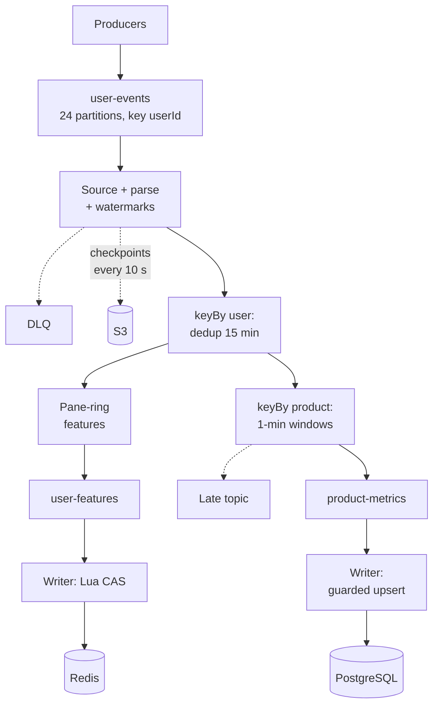

### C. Important Technologies

| Technology | Role |
| --- | --- |
| Kafka (MSK) | Durable, replayable log; source of truth for 7 days |
| Flink 1.20 | Event-time processing, keyed state, checkpoints |
| RocksDB | State backend; incremental checkpoints |
| S3 | Checkpoints, savepoints, HA metadata |
| Redis (ElastiCache) | Feature serving; Lua CAS; 2 h TTL |
| PostgreSQL (RDS) | Minute analytics; daily partitions |
| EKS + Flink Operator | Deployment, savepoints, HA |
| Prometheus + Grafana | Lag, latency, checkpoints, backpressure |

### D. Important Algorithms

| Algorithm | Purpose | Complexity |
| --- | --- | --- |
| Watermarks + allowed lateness | Event-time correctness | `O(1)` per event |
| Tumbling window with incremental aggregate | Minute metrics | `O(1)` per event |
| Pane ring | Per-event sliding features | `O(P)` per event, `O(P)` space per user |
| TTL dedup | Remove duplicates within 15 min | `O(1)` per event |
| Barrier checkpoints | Exactly-once state | Async upload ∝ new state |
| Credit-based flow control | Lossless backpressure | — |
| CAS / guarded upsert | Idempotent, monotonic sinks | `O(1)` per record |
| Consumer-group scaling | Sink throughput | Replicas ≤ partitions |

### E. Important Contracts and Storage Concepts

| Item | Key fact |
| --- | --- |
| `user-events` | 24 partitions, RF 3, ISR 2, key `userId`, 7 days, `LogAppendTime` |
| Output topics | 12 partitions, 3 days |
| `feat:u:{userId}` | Hash, 2 h TTL, monotonic in `as_of_event_time_ms` |
| `product_metrics_minute` | PK `(product_id, window_start)`, daily partitions, 30-day retention, no FK |
| Upsert guard | `WHERE EXCLUDED.fire_seq >= t.fire_seq`, absolute totals |
| Writer | poll ≤ 500 → write → `commitSync` |
| Checkpoint config | 10 s interval, 60 s timeout, 5 s min pause, 3 tolerable failures, 3 retained |

### F. Top 20 Things I Must Remember

1. Two outputs: features in Redis, minute metrics in PostgreSQL.
2. Kafka `user-events` is the source of truth for 7 days.
3. Event time from the payload; `LogAppendTime` only for latency.
4. Watermark = max event time − 5 s; operator watermark = minimum of inputs.
5. Idle partitions excluded after 30 s; alignment pauses partitions > 30 s ahead.
6. Allowed lateness 2 min; later events go to `user-events.late`.
7. Each window firing carries full totals; `fire_seq` orders firings.
8. Pane ring: 10 × 30 s and 12 × 5 min; "last 5 minutes" ≈ 4.5–5 min.
9. Dedup: per-user MapState, 15 min TTL, rolls back with offsets on recovery.
10. Kafka is keyed by user, but Flink still shuffles (independent key groups).
11. `reinterpretAsKeyedStream` removed the redundant second shuffle.
12. Every operator has a stable uid; the deserializer never throws.
13. Checkpoint = offsets + state at one consistent cut; every 10 s; unaligned after 5 s.
14. At-least-once sink because the transactional sink adds checkpoint-interval latency.
15. Redis Lua CAS on `as_of_event_time_ms`; PostgreSQL absolute totals + `fire_seq` guard.
16. Kafka hop: slow stores become writer lag, not Flink backpressure.
17. Spare TaskManager is the key to < 30 s recovery; JobManager failover excluded.
18. Recovery = detect + restart + restore + drain; drain needs headroom.
19. 6/4 → 24/12 removes stragglers; part of 2× is using idle slots.
20. All four resume numbers are targets.

### G. Interview-Day Checklist

Without looking at this booklet, I can:

- [ ] Explain event time vs processing time with an example.
- [ ] Explain watermarks, idleness, and allowed lateness.
- [ ] Draw the full pipeline including DLQ, late topic, and S3.
- [ ] Explain the pane-ring algorithm and its approximation.
- [ ] Explain dedup and why it is keyed by user.
- [ ] Explain barrier checkpoints, aligned vs unaligned.
- [ ] Explain exactly-once state vs effectively-once results, with the CAS and guarded upsert.
- [ ] Explain why the sink is at-least-once.
- [ ] Walk through a TaskManager failure and the recovery budget.
- [ ] Explain partitions × parallelism × max parallelism.
- [ ] Defend each resume number with its precise definition.
- [ ] Name three limitations and their future fixes.
- [ ] Deliver the 30-minute explanation within time.
