# Production LLM Gateway & Inference Router — Study Guide

*A self-contained learning booklet that takes you from zero knowledge of this project to explaining and defending it in an SDE interview.*

---

## How to Use This Booklet

Read it front to back the first time; each part builds on the previous one.

| Part | What you learn | Sections |
| --- | --- | --- |
| Part 1 | What the project is and the background concepts you need | 1–3 |
| Part 2 | The architecture: technologies, high-level and low-level design | 4–6 |
| Part 3 | The implementation: API, data, algorithms, flows, concurrency | 7–11 |
| Part 4 | Reliability: failures, performance, testing, deployment, monitoring | 12–16 |
| Part 5 | Interview preparation: 30-minute script, 45 questions, trade-offs, numbers, revision | 17–22 |

**How to read the labels.** This project is a *reference architecture*: a detailed, intended design. No source repository, deployment, test, or benchmark has been independently verified. Provider facts (request fields, headers, stream event names, error codes, model IDs) reflect the providers' public APIs as of late 2026 and must be re-checked when implementing. **All prices are placeholders.**

| Label | Meaning |
| --- | --- |
| **Project fact** | Documented in the project's design (the default) |
| **Background** | General knowledge added for understanding |
| **ILLUSTRATIVE** | Example arithmetic or scenario used to explain a mechanism |
| **BENCHMARK TARGET / UNVERIFIED** | A number the design is sized for; nothing has been measured |

> **Honesty rule:** the resume figures (50+ concurrent clients, ~2× throughput, ~25% p95 reduction, p99/error-rate benchmarking) are **targets** measured against **mock providers**, never recorded results.

## Table of Contents

**Part 1: Understand the Project**
1. [Project Introduction](#1-project-introduction)
2. [Fundamentals Required to Understand the Project](#2-fundamentals-required-to-understand-the-project)
3. [Requirements and Scope](#3-requirements-and-scope)

**Part 2: Understand the Architecture**
4. [Technology Stack](#4-technology-stack)
5. [High-Level Design (HLD)](#5-high-level-design-hld)
6. [Low-Level Design (LLD)](#6-low-level-design-lld)

**Part 3: Understand the Implementation**
7. [API Design](#7-api-design)
8. [Database and Storage Design](#8-database-and-storage-design)
9. [Core Algorithms and Data Structures](#9-core-algorithms-and-data-structures)
10. [Complete End-to-End Execution Flows](#10-complete-end-to-end-execution-flows)
11. [Concurrency and Distributed Systems](#11-concurrency-and-distributed-systems)

**Part 4: Engineering and Reliability**
12. [Failure Handling and Recovery](#12-failure-handling-and-recovery)
13. [Performance Engineering](#13-performance-engineering)
14. [Benchmarking and Testing](#14-benchmarking-and-testing)
15. [Deployment and Infrastructure](#15-deployment-and-infrastructure)
16. [Observability](#16-observability)

**Part 5: Interview Preparation**
17. [Complete 30-Minute Project Explanation](#17-complete-30-minute-project-explanation)
18. [Existing Interview Question Bank](#18-existing-interview-question-bank)
19. [Architecture Decisions and Trade-offs](#19-architecture-decisions-and-trade-offs)
20. [Limitations and Future Improvements](#20-limitations-and-future-improvements)
21. [Numerical Claims Defence](#21-numerical-claims-defence)
22. [Final Revision Sheets](#22-final-revision-sheets)

<div style="page-break-before: always;"></div>

# Part 1: Understand the Project

## 1. Project Introduction

### 1.1 What is this project?

It is an **LLM gateway**: one internal service that sits between a company's applications and several **large-language-model (LLM) providers**. Applications send chat requests to the gateway using one consistent API; the gateway decides which backend should answer, calls it, streams the answer back, protects backends from overload, and records how many tokens were used and what they cost.

The backends are **Anthropic's Messages API**, a **hosted OpenAI-compatible API**, and a **self-hosted vLLM server** (an open-source inference server running an open model on the company's own GPUs). The gateway is a **Java 21 / Spring Boot** service with **Redis**, **Kafka**, **S3**, **Prometheus/Grafana**, and **Kubernetes (EKS)**.

### 1.2 What problem does it solve?

Before the gateway, every team called providers directly:

- Each team re-implemented API keys, retries, timeouts, streaming parsers, and cost tracking.
- Nobody knew total spend per team.
- One team's burst exhausted a shared provider rate limit for everyone.
- A provider outage broke every application at once.
- Switching models meant code changes in every service.

The gateway centralizes: one API for all backends, per-application authentication with quotas, routing by logical model name to the healthiest backend with fallback, uniform streaming, protection of backends under load, exact token accounting with estimated cost per tenant, and metrics and dashboards.

### 1.3 Why is this problem important?

LLM traffic is unusual: requests last seconds to minutes, responses stream token by token, cost is **per token**, providers throttle on **tokens per minute**, and failures are frequent and often partial. Without central control, costs are invisible, one team can degrade service for all, and outages cascade.

### 1.4 What would happen without such a system?

| Without the gateway | What goes wrong |
| --- | --- |
| Provider keys in every service | Secrets sprawl; rotation is painful |
| No cross-team quotas | One tenant exhausts the shared provider limit |
| No central failover | A provider outage fails every application |
| No concurrency control | Backends are pushed into overload and return 429/529 errors |
| Unbounded retries | Retry storms multiply load during incidents |
| No usage accounting | Spend per team is unknown |

### 1.5 A real-world analogy

Think of a **taxi dispatch office** in front of several taxi companies.

- **Customers call one number** (one API) instead of each company separately.
- **The dispatcher checks your membership card** (API key) and how many rides you have used this minute (rate limits).
- **You ask for "a fast car"** (a model alias like `chat-fast`); the dispatcher picks which company and car, preferring companies whose cars are arriving quickly and are not overbooked (routing on time-to-first-token and load).
- **Each company has a maximum number of rides at once** (bulkhead). Extra customers wait in a fair line where no single big client can push everyone else to the back (fair queuing).
- **If a company stops answering, the dispatcher stops calling it for a while** and tries again later (circuit breaker), and sends you to another company if your car has not left yet (fallback before the first byte).
- **The dispatcher records every ride's distance and fare** (tokens and cost) in a ledger that is processed later (Kafka → aggregator).

**Where the analogy breaks:** an LLM answer streams in pieces; once some of the answer has been delivered, it cannot be quietly switched to another provider.

### 1.6 A concrete example

The billing team's support tool asks for a two-sentence ticket summary.

1. It sends `POST /v1/chat/completions` with `Authorization: Bearer gk_live_7QW_...`, `model: "chat-smart"`, the messages, `max_tokens: 300`, `temperature: 0`, `stream: true`.
2. The gateway verifies the key (hash compare), charges one request to the key's requests-per-minute bucket, and **reserves** an estimated 412 prompt tokens + 300 maximum completion tokens from its tokens-per-minute bucket.
3. The request is cache-eligible (temperature 0) but not cached yet.
4. The router picks the Anthropic deployment `anthropic-opus` (priority 1), with the hosted OpenAI-compatible deployment as fallback.
5. The scheduler admits the request under that deployment's concurrency limit.
6. The Anthropic adapter calls `POST /v1/messages` with `stream: true`. Anthropic returns 529 (overloaded) before any text, so the gateway **falls back** to the OpenAI-compatible deployment, which streams the answer.
7. The client receives SSE chunks, then a final chunk with `usage` (412 prompt, 48 completion tokens) and `cost` in micro-dollars, then `[DONE]`.
8. The gateway refunds the unused token reservation, publishes a usage event to Kafka, and stores the response in Redis for future identical requests.

<div style="page-break-before: always;"></div>

## 2. Fundamentals Required to Understand the Project

Each concept: simple explanation, technical explanation (both **Background**), why the project needs it, and how it is used (**Project facts**).

### 2.1 LLMs, inference, tokens, and providers

- **Simple:** an LLM is a model that reads text and writes text. *Inference* means running it to get an answer. A *provider* runs models and sells access through an API.
- **Technical:** models process **tokens** (word pieces, roughly 4 characters of English each). A request has **prompt (input) tokens** and **completion (output) tokens**. Providers bill per token and enforce limits in **requests per minute (RPM)** and **tokens per minute (TPM)**. Generation has two phases: reading the prompt (*prefill*) and producing tokens one at a time; **time to first token (TTFT)** measures queueing plus prefill.
- **Why needed:** cost, rate limits, and latency all depend on tokens.
- **How used:** usage is taken from provider-reported token counts; TTFT drives routing; TPM limits use token reservations.

### 2.2 Provider abstraction: canonical model and adapters

- **Simple:** translate every provider's format into one shared internal format.
- **Technical:** the **Adapter pattern** wraps each external API behind a common interface. A **canonical model** is the internal, provider-neutral data shape.
- **Why needed:** without it, routing, fallback, caching, and billing would need provider-specific branches everywhere.
- **How used:** `CanonicalRequest` / `CanonicalResponse` records; a `ProviderAdapter` interface with `complete` and `stream`; `AnthropicAdapter`, `OpenAiCompatibleAdapter` (hosted and vLLM), `MockAdapter`.

### 2.3 API gateways, authentication, and API keys

- **Simple:** a gateway is a single front door that checks who you are and forwards your request.
- **Technical:** API keys identify a client. Secure systems store only a **hash** of the key's secret and compare hashes in **constant time** (so response timing does not leak information). High-entropy random secrets do not need slow password hashes.
- **How used:** keys `gk_live_<keyId>_<secret>`; records loaded from a mounted Secret into memory; `SHA-256(secret)` compared with `MessageDigest.isEqual`; each key maps to a tenant, scopes, allowed aliases, and limits.

### 2.4 Rate limiting and token buckets

- **Simple:** allow a certain rate of requests, with some short bursts.
- **Technical:** a **token bucket** holds up to `capacity` tokens and refills at a fixed rate; each request spends tokens and is rejected if not enough remain. In a distributed system, the bucket must be updated **atomically** (here with a Redis **Lua script**, which Redis executes as one indivisible operation).
- **How used:** an RPM bucket per key; a TPM bucket per key using **reserve-and-settle**, because the real token count is known only after the response.

### 2.5 Concurrency limits, bulkheads, and fair queuing

- **Simple:** don't let any one backend take more work than it can handle efficiently, and let waiting customers take turns fairly.
- **Technical:** a **bulkhead** (named after ship compartments) caps concurrent calls to one dependency so it cannot consume all capacity. **Little's law**: a backend with service time S and concurrency C completes at most `C / S` requests per second; beyond its efficient concurrency (*the knee*), more concurrency only adds latency. **Deficit round-robin (DRR)** serves several queues in turns with per-queue quotas, so one heavy user cannot starve others.
- **How used:** one bulkhead per deployment per pod, bounded wait queue, DRR across tenants.

### 2.6 Circuit breakers, timeouts, retries, and fallback

- **Simple:** stop calling something that keeps failing; try somewhere else; don't wait forever.
- **Technical:** a **circuit breaker** has states CLOSED (normal), OPEN (fail fast), HALF_OPEN (let a few probes through). **Timeouts** bound waiting. **Retries** can multiply load during outages (*retry amplification*); a **retry budget** caps retries as a fraction of traffic.
- **How used:** Resilience4j breakers per deployment per pod; timeouts for connect, first byte, idle gap, and total; at most two attempts, to a different deployment, within a 10% retry budget.

### 2.7 Streaming with Server-Sent Events (SSE)

- **Simple:** the server sends the answer in pieces over one long HTTP response.
- **Technical:** SSE uses `Content-Type: text/event-stream`; each message is a `data:` line; comments (`: keep-alive`) keep idle connections open. Once the first byte is sent, the HTTP status (200) cannot change, so later errors must be sent **in-band** as events.
- **How used:** chunks in a Chat-Completions-like shape; a final chunk with usage and cost; `[DONE]`; keep-alive every 15 s; in-band `event: error` after the first byte.

### 2.8 Virtual threads (Java 21)

- **Simple:** extremely cheap threads, so each request can have its own.
- **Technical:** a virtual thread is scheduled by the JVM onto a few OS *carrier* threads. When it blocks on I/O it **parks**, freeing the carrier. In Java 21, blocking inside a `synchronized` block **pins** the carrier (it cannot be reused), so blocking paths should use `ReentrantLock`.
- **How used:** `spring.threads.virtual.enabled=true`; one virtual thread per request; `ReentrantLock` in the scheduler; pinning checked with `-Djdk.tracePinnedThreads=short`.

### 2.9 Load balancing: power of two choices

- **Simple:** instead of checking every server, check two at random and pick the better one.
- **Technical:** choosing the global best from stale information makes every router pick the same server simultaneously (**herding**). **Power of two choices (P2C)** samples two candidates and picks the less loaded, getting most of the benefit with far less herding, in `O(1)`. An **EWMA** (exponentially weighted moving average) smooths a noisy measurement such as latency.
- **How used:** within a priority tier, P2C on `EWMA(TTFT) × (inFlight + queued + 1) / maxConcurrent`.

### 2.10 Caching LLM responses

- **Simple:** if the exact same question was asked recently, reuse the answer.
- **Technical:** an **exact-match** cache keys on a hash of the complete request. LLM outputs are sampled and can depend on hidden context, so caching changes semantics unless used carefully. **Single-flight** makes concurrent identical requests share one backend call.
- **How used:** Redis cache, tenant-scoped keys, strict eligibility (temperature 0 or explicit opt-in, normal completion), 1 h default TTL, per-pod single-flight.

### 2.11 Asynchronous accounting with Kafka

- **Simple:** write a receipt to a queue and process receipts later, so the customer is not kept waiting.
- **Technical:** a Kafka producer sends events asynchronously; consumers process them with at-least-once delivery, so they must deduplicate. **Integer micro-dollar** arithmetic avoids floating-point drift.
- **How used:** `llm.usage.v1` topic; `usage-aggregator` consumer group; dedup by `requestId` in an atomic Lua script; S3 archive.

### 2.12 Percentiles and closed-loop load

- **Simple:** p95 is the time 95% of requests beat; p99 describes the worst 1%.
- **Technical:** in a **closed-loop** test, N virtual users each send a request and wait for the reply before sending the next; throughput `X = N / R̄` (Little's law), where R̄ is mean latency. Throughput therefore tracks the **mean**, not the tail.
- **How used:** 50 closed-loop k6 users, zero think time, against mock providers.

### 2.13 Kubernetes autoscaling

- **Simple:** add pods when busy, remove them when quiet.
- **Technical:** the **Horizontal Pod Autoscaler (HPA)** scales on metrics; custom metrics come from Prometheus via an adapter. Long-lived streams require graceful draining on scale-in.
- **How used:** HPA 3–12 replicas on in-flight requests per pod (target 300) plus CPU 70%; slow scale-down; graceful stream draining.

<div style="page-break-before: always;"></div>

## 3. Requirements and Scope

### 3.1 Functional requirements

| ID | Requirement | Why it matters |
| --- | --- | --- |
| F1 | `POST /v1/chat/completions`: one schema for all backends; streaming and non-streaming | One client integration |
| F2 | Authenticate every request with a gateway key mapped to a tenant, scopes, allowed models, limits | Identity and quotas |
| F3 | Per-key RPM and TPM limits | Fairness; protect provider quotas |
| F4 | Route an alias to deployments by priority, health, load, capability | Model swaps are config; resilience |
| F5 | Normalize content, finish reason, usage | Uniform client behaviour |
| F6 | Per-deployment timeouts, bounded retries, fallback, circuit breakers | Survive provider failures |
| F7 | Per-deployment concurrency limits and fair queuing across tenants | Keep backends efficient; no starvation |
| F8 | Cache eligible responses with tenant isolation and explicit bypass | Avoid repeated deterministic calls safely |
| F9 | Record prompt, completion, cached tokens and estimated cost; publish to Kafka | Spend visibility |
| F10 | `GET /v1/usage` per-tenant aggregates | Self-service usage view |
| F11 | Prometheus metrics, health endpoints, Grafana dashboards and alerts | Operability |
| F12 | Kubernetes with horizontal autoscaling and graceful draining of streams | Elasticity without cutting streams |

### 3.2 Non-functional requirements

| Area | Goal | Status |
| --- | --- | --- |
| Gateway overhead | p99 added latency < 20 ms on cache misses (excluding provider time) | BENCHMARK TARGET (not a resume claim) |
| Concurrency | Correct behaviour under 50+ concurrent clients and hundreds of open streams per pod | **BENCHMARK TARGET** |
| Throughput | ~2× vs a naive baseline gateway at 50 concurrent clients | **BENCHMARK TARGET** |
| Latency | ~25% lower p95 end-to-end vs the baseline at the same load | **BENCHMARK TARGET** |
| Availability | One provider's outage doesn't fail requests that can fall back | Design requirement |
| Accounting | Usage recorded for every completed request; loss only under documented Kafka-outage conditions | Design requirement |
| Security | Provider credentials never leave the gateway; tenants can't read each other's cache or usage | Design requirement |

### 3.3 System boundaries

**Figure 3.1 — Inside and outside the system (dashed border = external, not built)**

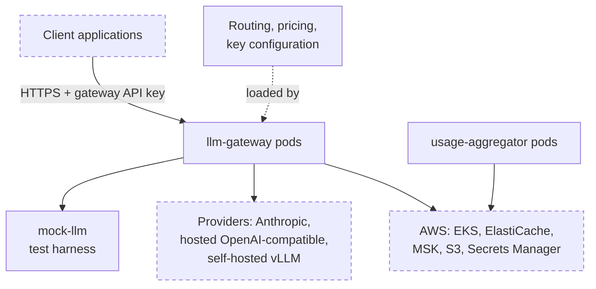

The gateway authenticates, limits, routes, normalizes, streams, protects, caches, accounts, and observes. It does **not** run models, execute tools, moderate content, guarantee deterministic outputs, or produce invoices.

### 3.4 Assumptions

- Clients are internal services calling over HTTPS inside the company network.
- Provider credentials live in AWS Secrets Manager and are injected as Kubernetes Secrets.
- Load tests use a **mock provider** with configurable latency and capacity, because real providers are rate limited, costly, and non-deterministic; real providers are used only for functional smoke tests.
- Prices change; they are configuration with effective dates.
- Provider-reported token counts are the source of truth; gateway estimates are only for admission control and incomplete streams.

### 3.5 In scope and out of scope

| In scope | Out of scope |
| --- | --- |
| Gateway service; adapters for Anthropic Messages and OpenAI-compatible APIs (hosted + vLLM) | Model training or hosting decisions |
| Routing, scheduling, resilience | Embeddings and image endpoints |
| Redis cache and rate limits | Executing tools (tool definitions are passed through) |
| Usage events, aggregation, S3 archive | Semantic (embedding-similarity) caching |
| EKS deployment, mock provider, k6 benchmarks | Prompt moderation, billing UI, multi-region |

### 3.6 Main engineering challenges

| Challenge | Why it is hard | Solution | Section |
| --- | --- | --- | --- |
| Provider differences | Different shapes, headers, stream events, usage fields, errors | Adapters + canonical model | 6, 9.1 |
| Long streaming requests | Thousands of open connections; partial responses can't be retried | Virtual threads, SSE relay, first-byte retry rule | 6.6, 9.8 |
| Shared provider capacity | One tenant can exhaust limits; overload slows all | Bulkheads + fair queuing + TPM limits | 9.3, 9.4 |
| Partial failures | 429/5xx/529 or mid-stream stalls | Timeouts, breakers, fallback, retry budget | 9.5 |
| Cache correctness | Outputs are non-deterministic and context-dependent | Strict eligibility, exact-match keys, tenant scoping, TTL | 9.6 |
| Accurate cost | Usage arrives at stream end; prices change | Provider usage, versioned prices, integer micro-dollars | 9.7 |
| Autoscaling streaming services | CPU is a poor signal; scale-in cuts streams | In-flight HPA metric; graceful drain | 15 |

<div style="page-break-before: always;"></div>

# Part 2: Understand the Architecture

## 4. Technology Stack

### 4.1 Summary table

| Layer | Choice | Version target | Why this, not something else |
| --- | --- | --- | --- |
| Language / runtime | Java 21 | 21 LTS | Virtual threads make thousands of long, I/O-bound requests cheap without reactive code |
| Framework | Spring Boot (Web MVC on virtual threads, Validation, Actuator) | 3.4.x | Mature HTTP stack, `SseEmitter`, Micrometer, config binding |
| Upstream HTTP | JDK `HttpClient` (HTTP/2, connection reuse, streaming body) | JDK 21 | Streams response lines; explicit timeouts; natural with virtual threads |
| Resilience | Resilience4j (CircuitBreaker, TimeLimiter) | 2.x | Standard, metric-exporting breakers per deployment |
| Cache / rate limits | Redis (ElastiCache) via Lettuce | 7.x | Atomic Lua scripts; sub-ms reads; TTLs |
| Usage events | Kafka (MSK) | 3.7+ | Durable, decoupled, replayable usage pipeline |
| Usage archive | Amazon S3 | — | Cheap, durable raw usage records (no database in the stack) |
| Metrics | Micrometer → Prometheus → Grafana | — | Histograms with percentiles; token and cost counters |
| Orchestration | Kubernetes (EKS), HPA, AWS Load Balancer Controller (ALB) | 1.31 | Autoscaling, rolling updates, configurable idle timeouts for SSE |
| Load testing | k6 (+ xk6-sse or a small JDK client for streaming) | Latest | Scriptable load with percentiles |

### 4.2 Each technology in context

**Java 21 virtual threads + Spring MVC.**
- *Solves:* each request can block on Redis, a queue, or a provider socket without holding an OS thread.
- *Alternative:* Spring WebFlux (reactive). Valid and has more built-in backpressure, but reactive code for stream parsing, scheduling, and timeouts is harder to read and debug.
- *Trade-off:* pinning on `synchronized` in Java 21; ThreadLocal-heavy libraries multiply memory.

**JDK `HttpClient`.**
- *Solves:* one HTTP, streaming, and timeout model for every provider; full control of connection pooling and cancellation (closing the stream aborts generation).
- *Alternative:* each provider's SDK. Rejected: different models per SDK, less control.
- *Trade-off:* provider API changes must be tracked manually.

**Resilience4j.** Per-deployment breakers with metrics; the gateway's own executor adds retry policy and the retry budget.

**Redis (ElastiCache).** Atomic Lua token buckets, the response cache, usage dedup keys and aggregates, admin flags. *Trade-off:* a dependency on the request path, mitigated by a local fallback limiter and cache bypass.

**Kafka (MSK) + S3.** Usage events leave the request path immediately; Kafka keeps 7 days for replay; S3 is the durable archive queryable with Athena. *Trade-off:* eventually consistent usage; a fallback is needed for Kafka outages.

**EKS, ALB, HPA.** Stateless pods scale on in-flight requests; the ALB's idle timeout is raised to 300 s for streams.

### 4.3 How the technologies fit together

**Figure 4.1 — Technology interaction**

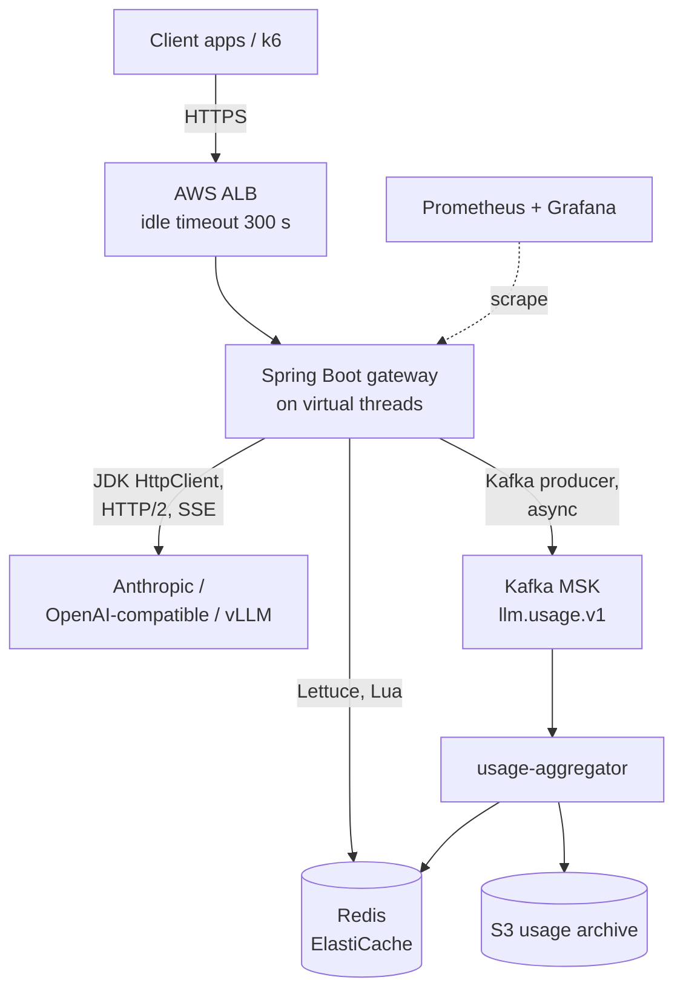

<div style="page-break-before: always;"></div>

## 5. High-Level Design (HLD)

### 5.1 Beginner view

**Figure 5.1 — Simplified conceptual architecture**

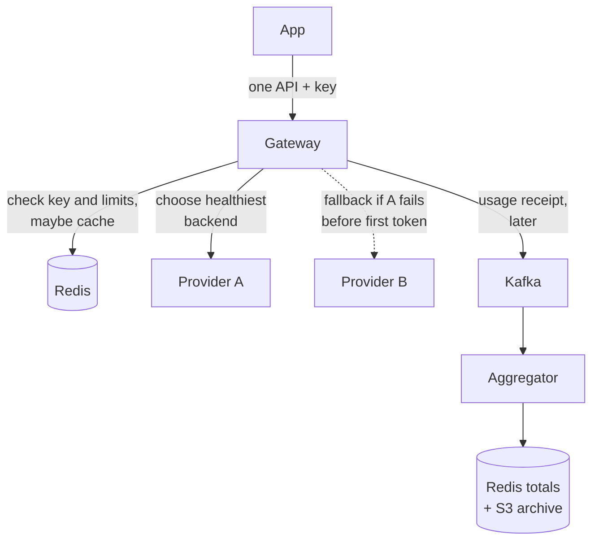

### 5.2 Detailed architecture

**Figure 5.2a — Inside one gateway pod**

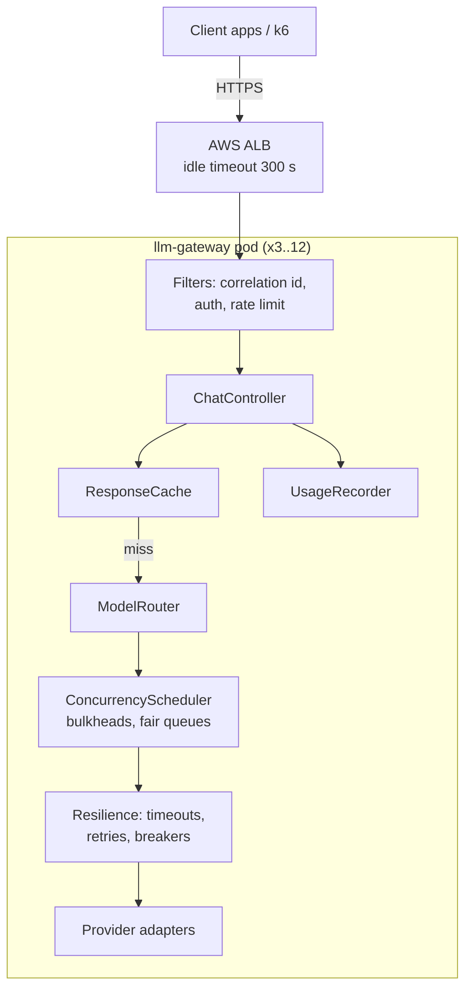

**Figure 5.2b — What the gateway talks to**

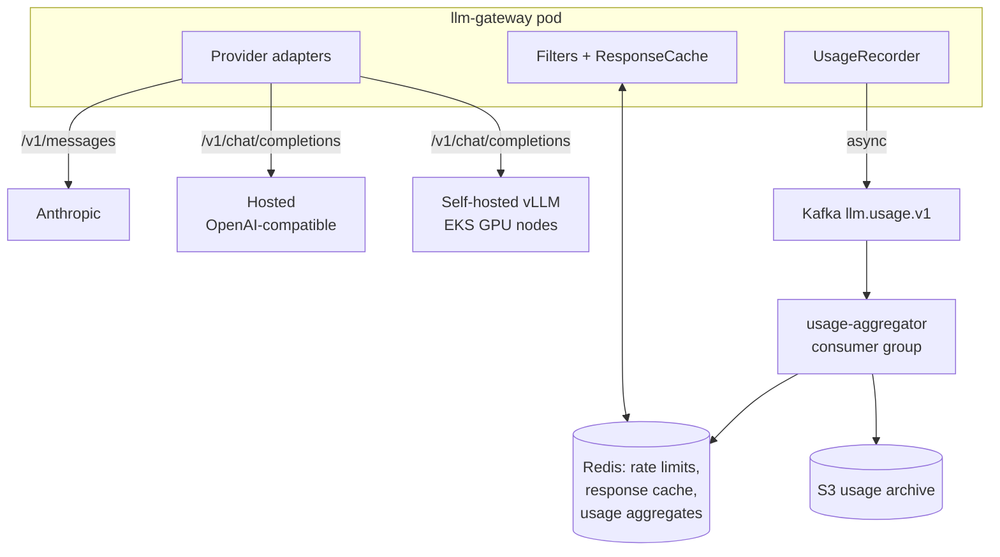

Prometheus scrapes `/actuator/prometheus` on every pod and feeds Grafana.

**Request path in one sentence:** a filter chain authenticates the key and charges the rate limiter; the controller checks the cache; the router picks a deployment; the scheduler admits the request under that deployment's concurrency limit; the resilience layer applies timeouts, retries, and the breaker; the adapter translates to and from the provider; and the usage recorder publishes token and cost data to Kafka after completion.

### 5.3 Component interaction (non-streaming cache miss)

**Figure 5.3 — Components involved in one request**

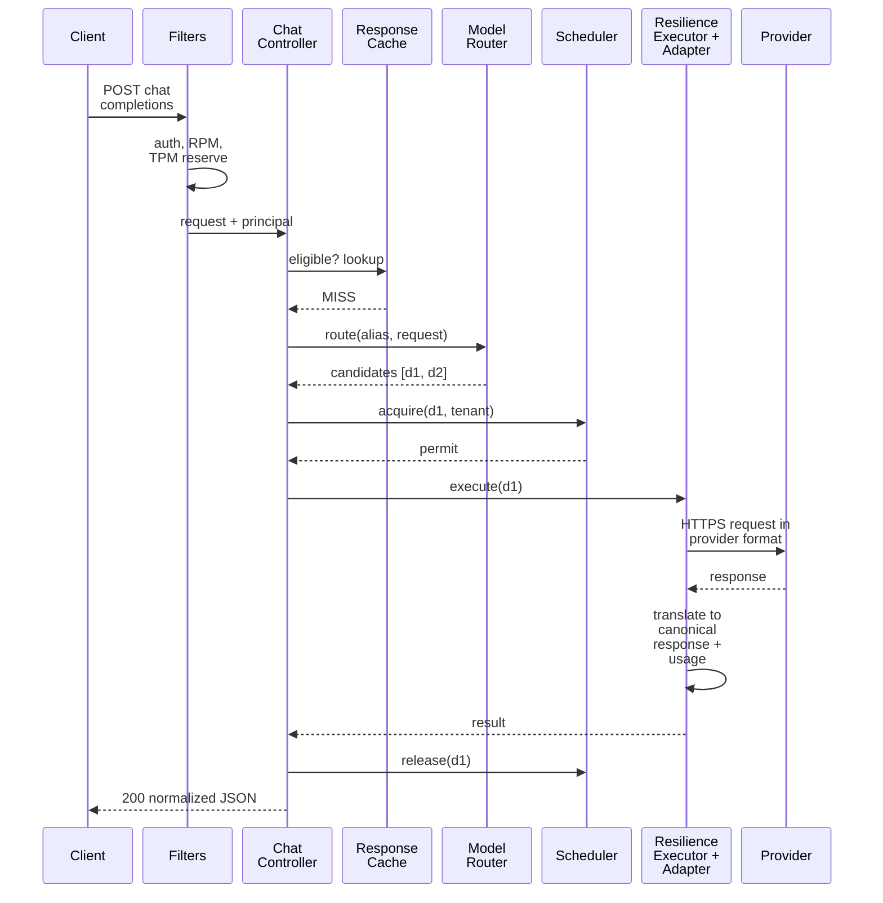

The resilience executor and the provider adapter are drawn as one participant (the executor calls the adapter in-process). After responding, the controller hands usage and cost to `UsageRecorder` and stores the response in the cache if it is eligible.

After responding, the controller hands usage and cost to `UsageRecorder` and stores the response in the cache if it is eligible.

### 5.4 Data flow

**Figure 5.4 — From unified request to aggregates**

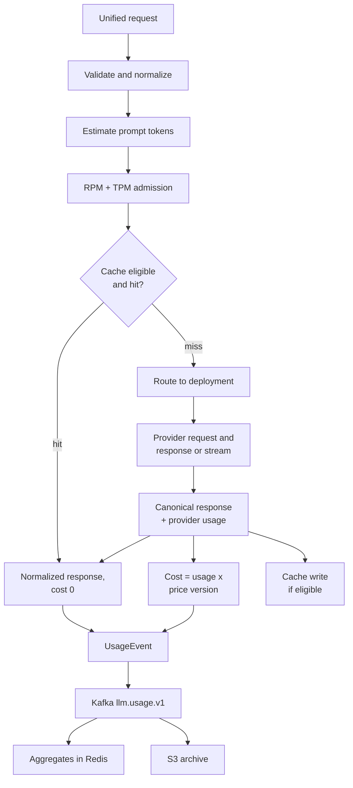

### 5.5 Component responsibilities

**Filters: `CorrelationFilter`, `ApiKeyAuthFilter`, `RateLimitFilter`**
1. *Responsibility:* request id; key verification; RPM bucket and TPM reservation.
2. *Input:* HTTP request with `Authorization: Bearer gk_live_<keyId>_<secret>`.
3. *Processing:* in-memory key lookup, constant-time hash compare, scope check; Redis Lua bucket scripts (pipelined).
4. *Output:* a `GatewayPrincipal` (tenant, scopes, limits, allowed aliases), or 401/429.
5. *Next:* `ChatController`.
6. *If Redis fails:* local fallback limiter (`limit / replicas`).

**`ChatController`**
1. *Responsibility:* validate, normalize to canonical, coordinate cache → route → schedule → execute → respond (JSON or SSE).
2. *Next:* `ResponseCache`, `ModelRouter`, `ConcurrencyScheduler`, `ResilienceExecutor`, `UsageRecorder`.

**`ResponseCache`**
1. *Responsibility:* eligibility, canonical key, Redis get/put, per-pod single-flight.
2. *Output:* hit (cost 0) or miss.
3. *If Redis fails:* bypass.

**`ModelRouter` + `HealthTracker`**
1. *Responsibility:* resolve alias → filter candidates → priority tier → P2C on TTFT × load → ordered fallbacks.
2. *Input:* alias, canonical request, principal; health snapshots (EWMA TTFT, in-flight, cooldowns).
3. *Output:* ordered candidate list, or `NO_HEALTHY_PROVIDER`.

**`ConcurrencyScheduler` / `DeploymentBulkhead` / `FairQueue`**
1. *Responsibility:* per-deployment permits (max concurrency) with a bounded wait queue served by DRR across tenants.
2. *Output:* a permit, or `SaturatedException` (queue full / wait timeout) → next candidate or `503 PROVIDER_SATURATED`.

**`ResilienceExecutor` + `RetryBudget`**
1. *Responsibility:* breaker per deployment; connect / first-byte / idle / total timeouts; fallback-first retry within a 10% budget.

**`ProviderAdapter`s**
1. *Responsibility:* translate canonical ↔ provider (request, headers, stream events, usage, finish reasons, errors). Stateless.
2. *If the provider fails:* `ProviderException` with status, retryable flag, retry-after.

**`TokenEstimator`, `CostCalculator`, `UsageRecorder`**
1. *Responsibility:* prompt-token estimates for admission; usage × versioned price → integer micro-USD; settle TPM; publish `UsageEvent` asynchronously.
2. *If Kafka fails:* bounded buffer, then a structured-log fallback record.

**`usage-aggregator` (separate deployment)**
1. *Responsibility:* consume events; dedup by `requestId`; update Redis aggregates; batch-archive to S3.

**`mock-llm`**
1. *Responsibility:* test-only provider with configurable latency, token rate, capacity, and fault injection.

### 5.6 Service boundaries and communication

Two deployables from one codebase plus a test harness: `llm-gateway` (synchronous, stateless), `usage-aggregator` (asynchronous; separated so slow S3 or Redis aggregate updates never touch request latency), and `mock-llm` (benchmarks only). Auth, rate limiting, and routing are modules, not services: each extra service would add a hop and a failure mode to every request.

| From → To | Protocol | Sync / async | Notes |
| --- | --- | --- | --- |
| Client → gateway | HTTPS (HTTP/1.1 or HTTP/2 via ALB), JSON or SSE | Sync | Long-lived for streams |
| Gateway → providers | HTTPS, HTTP/2 where supported, JSON or SSE | Sync | One `HttpClient` per provider; keep-alive |
| Gateway → Redis | RESP over TLS (Lettuce) | Sync, sub-ms | Degraded modes when down |
| Gateway → Kafka | Kafka producer | Async | After the response completes; never blocks |
| Kafka → aggregator | Consumer group | Async | At-least-once; dedup by `requestId` |
| Aggregator → Redis, S3 | RESP; S3 PUT | Async | Batched |
| Prometheus → pods | HTTP scrape | Async | 15 s interval |

### 5.7 Data ownership

| Data | Owner | Store | Authority |
| --- | --- | --- | --- |
| API key records | Platform team | Secrets Manager → K8s Secret → memory | Authoritative |
| Routing and pricing config | Platform team | ConfigMap (versioned in git) | Authoritative |
| Rate-limit buckets | Gateway | Redis | Ephemeral |
| Cached responses | Gateway | Redis (TTL) | Derived, disposable |
| Usage events | Gateway | Kafka (7 days), S3 (long-term) | S3 is the durable usage record |
| Usage aggregates | Aggregator | Redis hashes | Derived; rebuildable |
| Breaker / health state | Each pod | Memory | Local view per pod |

### 5.8 Synchronous vs asynchronous

| Step | Mode |
| --- | --- |
| Auth, RPM/TPM admission, validation | Sync, before any provider call |
| Cache lookup | Sync |
| Routing, scheduling, provider call, streaming | Sync |
| TPM settle | Sync but fire-and-forget after completion |
| Cache write, usage publish | Async after completion |
| Aggregation and archiving | Async, other deployment |

### 5.9 Scaling and fault tolerance

- Pods are stateless; the HPA scales on **in-flight requests per pod** plus CPU.
- **Per-deployment concurrency limits are per pod:** `maxConcurrentPerCluster / replicas`, recomputed when the replica count changes (Downward API or a ConfigMap updated by the deploy pipeline). Approximate, but no distributed semaphore per request.
- Rate limits and cache are cluster-wide (Redis). The aggregator scales as a consumer group (≤ 6 partitions).
- Provider failure → breaker opens per deployment per pod → fallback tier. Pod failure → ALB removes it; its streams are cut; no shared state lost. Redis failure → local limiting, no cache. Kafka failure → usage buffered, then logged.

### 5.10 Deployment architecture

**Figure 5.5 — AWS deployment**

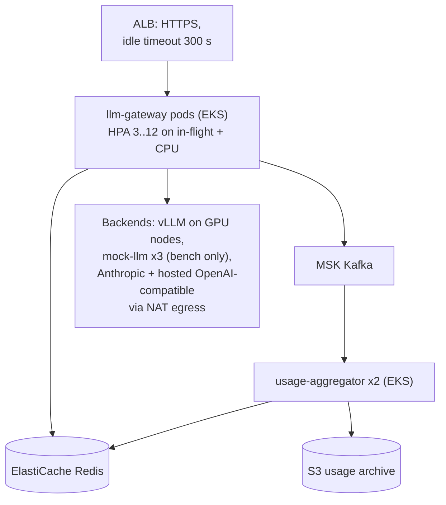

Secrets Manager syncs provider credentials and hashed gateway keys into Kubernetes Secrets; Prometheus and Grafana run in the cluster.

<div style="page-break-before: always;"></div>

## 6. Low-Level Design (LLD)

### 6.1 Package structure

```text
llm-gateway/
├── pom.xml                                     # Java 21, Spring Boot 3.4, Resilience4j, Lettuce, Kafka, Micrometer
└── src/main/java/com/acme/llmgw/
    ├── LlmGatewayApplication.java
    ├── api/
    │   ├── ChatController.java                 # POST /v1/chat/completions
    │   ├── ModelsController.java               # GET /v1/models
    │   ├── UsageController.java                # GET /v1/usage
    │   ├── AdminController.java                # /admin/v1/providers
    │   ├── dto/ChatRequest.java, ChatResponse.java, ChatChunk.java, Message.java, UsageDto.java, ErrorBody.java
    │   └── GlobalExceptionHandler.java
    ├── security/
    │   ├── ApiKeyAuthFilter.java
    │   ├── ApiKeyStore.java                    # loads hashed keys from mounted file; hot reload
    │   └── GatewayPrincipal.java
    ├── ratelimit/
    │   ├── RateLimitFilter.java
    │   ├── RedisTokenBucket.java               # Lua scripts: RPM bucket, TPM reserve/settle
    │   └── LocalFallbackLimiter.java
    ├── routing/
    │   ├── ModelRouter.java
    │   ├── RoutingConfig.java                  # aliases → deployments (from ConfigMap)
    │   ├── Deployment.java                     # id, provider, providerModel, priority, weight, limits, capabilities
    │   └── HealthTracker.java                  # EWMA TTFT, inflight, throttle cooldowns
    ├── scheduling/
    │   ├── ConcurrencyScheduler.java
    │   ├── DeploymentBulkhead.java             # permits + fair queue
    │   └── FairQueue.java                      # deficit round-robin across tenants
    ├── resilience/
    │   ├── ResilienceExecutor.java
    │   ├── RetryPolicy.java
    │   └── RetryBudget.java
    ├── provider/
    │   ├── ProviderAdapter.java                # interface
    │   ├── AnthropicAdapter.java
    │   ├── OpenAiCompatibleAdapter.java
    │   ├── MockAdapter.java
    │   ├── SseLineReader.java
    │   └── ProviderException.java              # carries status, retryable flag, retry-after
    ├── streaming/
    │   ├── StreamRelay.java                    # provider events → canonical chunks → SseEmitter
    │   └── StreamAccumulator.java              # assembles final text/usage for cache + accounting
    ├── cache/
    │   ├── ResponseCache.java
    │   ├── CacheKeyFactory.java                # canonical JSON + SHA-256
    │   └── SingleFlight.java
    ├── usage/
    │   ├── TokenEstimator.java
    │   ├── CostCalculator.java
    │   ├── PriceTable.java
    │   ├── UsageEvent.java
    │   └── UsageRecorder.java                  # Kafka producer + log fallback
    ├── aggregator/                             # active only with profile "aggregator"
    │   ├── UsageAggregatorListener.java
    │   ├── RedisUsageAggregates.java           # Lua: dedup + HINCRBY
    │   └── S3UsageArchiver.java
    └── observability/
        ├── GatewayMetrics.java
        └── CorrelationFilter.java
```

| HLD component | LLD package |
| --- | --- |
| Filters | `security/`, `ratelimit/`, `observability/CorrelationFilter` |
| Controller and API | `api/` |
| Router | `routing/` (`ModelRouter`, `RoutingConfig`, `Deployment`, `HealthTracker`) |
| Scheduler | `scheduling/` (`ConcurrencyScheduler`, `DeploymentBulkhead`, `FairQueue`) |
| Resilience | `resilience/` (`ResilienceExecutor`, `RetryPolicy`, `RetryBudget`) |
| Adapters | `provider/` (`ProviderAdapter`, `AnthropicAdapter`, `OpenAiCompatibleAdapter`, `MockAdapter`, `SseLineReader`) |
| Streaming | `streaming/` (`StreamRelay`, `StreamAccumulator`) |
| Cache | `cache/` (`ResponseCache`, `CacheKeyFactory`, `SingleFlight`) |
| Accounting | `usage/` (`TokenEstimator`, `CostCalculator`, `PriceTable`, `UsageRecorder`) |
| Aggregator | `aggregator/` (profile `aggregator`) |

### 6.2 Class diagram

**Figure 6.1a — Request orchestration classes**

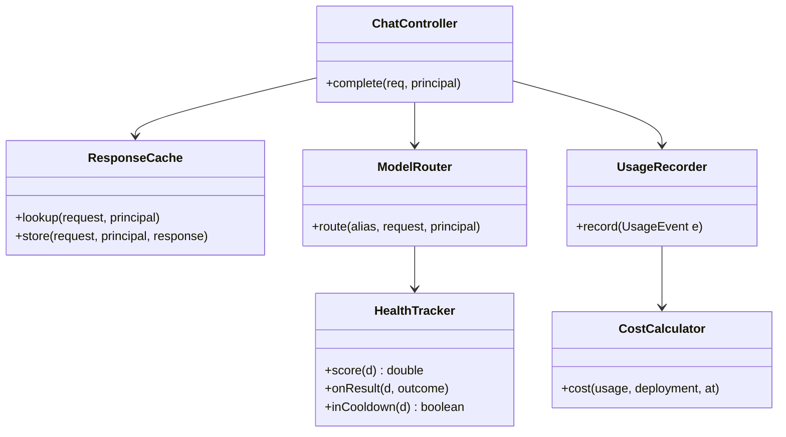

**Figure 6.1b — Scheduling classes**

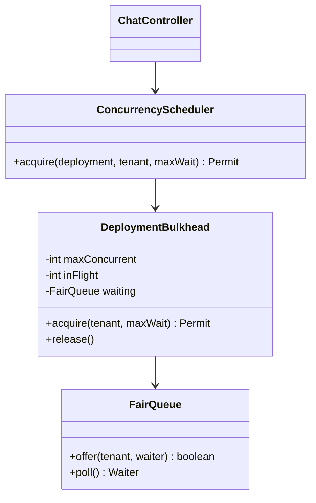

**Figure 6.1c — Resilience and provider classes**

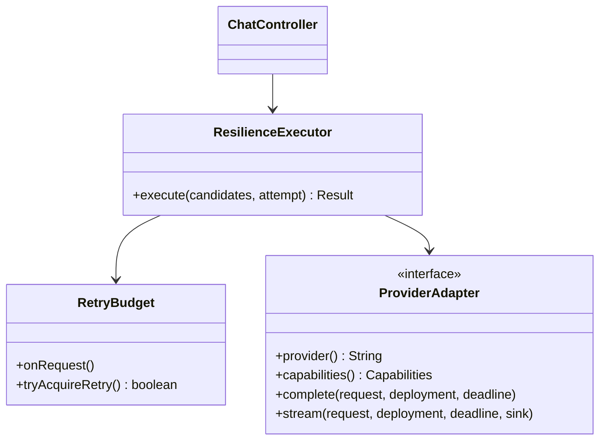

`ProviderAdapter` is implemented by `AnthropicAdapter`, `OpenAiCompatibleAdapter` (hosted and vLLM), and `MockAdapter`.

### 6.3 Important classes

**ChatController** — Responsibility: orchestrate one request. Method: `complete(ChatRequest, GatewayPrincipal)`. Dependencies: cache, router, scheduler, resilience executor, usage recorder. Why: the single place where the request lifecycle is visible.

**ProviderAdapter (interface)** — Methods: `provider()`, `capabilities(deployment)`, `complete(request, deployment, deadline)`, `stream(request, deployment, deadline, sink)`. Why: isolates provider formats so the rest of the system sees only canonical types.

**ModelRouter** — Method: `route(alias, request, principal)` → ordered `List<Deployment>`. Depends on `HealthTracker` (`score`, `onResult`, `inCooldown`). Why: health- and load-aware selection with fallbacks.

**ConcurrencyScheduler / DeploymentBulkhead / FairQueue** — Methods: `acquire(deployment, tenant, maxWait)` → `Permit`; `release()`; `offer`, `poll`. Why: keep each backend at its knee and share capacity fairly.

**ResilienceExecutor / RetryBudget** — Methods: `execute(candidates, attempt)`; `onRequest()`, `tryAcquireRetry()`. Why: breakers, timeouts, and bounded fallback-first retries.

**ResponseCache** — Methods: `lookup(request, principal)`, `store(request, principal, response)`. Why: safe exact-match reuse with single-flight.

**CostCalculator / UsageRecorder** — Methods: `cost(usage, deployment, at)`; `record(UsageEvent)`. Why: accurate, self-describing usage events off the request path.

### 6.4 Canonical model

```java
public record CanonicalRequest(
    String requestId, String tenantId, String alias,
    List<CanonicalMessage> messages,          // roles: system, user, assistant, tool
    Integer maxTokens,                         // required by some providers; defaulted per alias
    Double temperature, Double topP,           // optional; dropped for providers/models that reject them
    List<String> stop,
    List<ToolDefinition> tools,                // passed through, never executed by the gateway
    ResponseFormat responseFormat,             // e.g. JSON schema, where supported
    boolean stream,
    CacheMode cacheMode,                       // DEFAULT, BYPASS, PREFER
    Map<String, String> metadata) {}

public record CanonicalResponse(
    String id, String provider, String deploymentId, String providerModel,
    String content, List<ToolCall> toolCalls,
    FinishReason finishReason,                 // STOP, LENGTH, TOOL_CALLS, CONTENT_FILTER, ERROR
    Usage usage, Duration providerLatency, Duration ttft) {}

public record Usage(long promptTokens, long completionTokens,
                    long cacheReadTokens, long cacheWriteTokens, boolean estimated) {}
```

### 6.5 Provider abstraction and translation

```java
public interface ProviderAdapter {
  String provider();                                   // "anthropic", "openai-compatible", "mock"
  Capabilities capabilities(Deployment d);             // streaming, tools, json mode, sampling params, context window
  CanonicalResponse complete(CanonicalRequest r, Deployment d, Deadline deadline) throws ProviderException;
  StreamResult stream(CanonicalRequest r, Deployment d, Deadline deadline, StreamSink sink) throws ProviderException;
}

public interface StreamSink {
  void onFirstToken();                                 // marks "bytes committed to client"
  void onDelta(String text);
  void onToolCallDelta(ToolCallDelta d);
  void onUsage(Usage partialOrFinal);
}
```

**Translation table (verify against provider docs when implementing):**

| Concern | Anthropic Messages API | OpenAI-compatible (hosted / vLLM) |
| --- | --- | --- |
| Endpoint | `POST {base}/v1/messages` | `POST {base}/v1/chat/completions` |
| Auth | `x-api-key` + `anthropic-version` (pinned) | `Authorization: Bearer` (vLLM: optional) |
| System prompt | Top-level `system` field | Message with role `system` |
| Max tokens | `max_tokens` (required) | `max_tokens` / `max_completion_tokens` (optional) |
| Sampling | Rejected by current models under the newer API version; adapter drops per capability flags | Passed through |
| Streaming | `message_start`, `content_block_start`, `content_block_delta` (`text_delta`), `content_block_stop`, `message_delta`, `message_stop`, `ping`, `error` | `data:` chunks with `choices[].delta`, ending `data: [DONE]` |
| Usage (stream) | Input and cache tokens in `message_start`; cumulative `output_tokens` in `message_delta` | Final chunk `usage` with `stream_options.include_usage=true` |
| Finish reason | `end_turn`→STOP, `max_tokens`→LENGTH, `tool_use`→TOOL_CALLS, `refusal`→CONTENT_FILTER | `stop`, `length`, `tool_calls`, `content_filter` |
| Non-text blocks | `thinking` blocks skipped | n/a |
| Rate limited | 429 `rate_limit_error` + `retry-after` | 429 (+ `retry-after` if sent) |
| Overloaded | 529 `overloaded_error` | 503 |
| Client errors | 400, 401, 403, 404, 413 (non-retryable) | 400, 401, 403, 404 |

Example routing configuration (model IDs as of late 2026; OpenAI IDs left as placeholders):

```yaml
aliases:
  chat-smart:
    defaultMaxTokens: 1024
    deployments:
      - { id: anthropic-opus,   provider: anthropic,         model: claude-opus-5-5,       priority: 1, weight: 1, maxConcurrentPerCluster: 64 }
      - { id: oai-large,        provider: openai-compatible, model: "<openai-model-id>",   priority: 2, weight: 1, maxConcurrentPerCluster: 64 }
  chat-fast:
    defaultMaxTokens: 512
    deployments:
      - { id: anthropic-haiku,  provider: anthropic,         model: claude-haiku-5-5,      priority: 1, weight: 2, maxConcurrentPerCluster: 128 }
      - { id: vllm-local,       provider: openai-compatible, model: "llama-3.1-8b-instruct", baseUrl: "http://vllm.llm.svc:8000", priority: 1, weight: 1, maxConcurrentPerCluster: 48 }
  chat-bench:
    deployments:
      - { id: mock-a, provider: mock, priority: 1, weight: 1, maxConcurrentPerCluster: 96 }
      - { id: mock-b, provider: mock, priority: 1, weight: 1, maxConcurrentPerCluster: 48 }
```

### 6.6 Threading model

| Work | Thread type | Notes |
| --- | --- | --- |
| HTTP request handling | **Virtual thread per request** | Blocking parks the virtual thread, not a carrier |
| Upstream HTTP | JDK `HttpClient` selector threads; the request's virtual thread blocks reading the body stream | One client per provider |
| SSE writes | The request's virtual thread via `SseEmitter` | A slow client backpressures the upstream read |
| Scheduler waits | Virtual thread parks on a per-waiter `CompletableFuture` | No pool sized to queue length |
| Kafka producer | Producer I/O thread | `send()` async |
| Redis | Lettuce event loop (Netty) | Sync API from virtual threads |

**Pinning caveat (Java 21):** blocking inside `synchronized` pins the carrier thread; the gateway uses `ReentrantLock` on blocking paths and checks libraries with `-Djdk.tracePinnedThreads=short`.

### 6.7 The bulkhead implementation

```java
final class DeploymentBulkhead {
  private final ReentrantLock lock = new ReentrantLock();
  private volatile int maxConcurrent;          // per-pod share of the deployment's cluster limit
  private int inFlight;
  private final FairQueue waiting;             // DRR across tenants, bounded total size

  Permit acquire(String tenant, Duration maxWait) throws SaturatedException {
    CompletableFuture<Permit> grant;
    lock.lock();
    try {
      if (inFlight < maxConcurrent && waiting.isEmpty()) {   // fast path: no queue
        inFlight++;
        return new Permit(this);
      }
      grant = new CompletableFuture<>();
      if (!waiting.offer(tenant, new Waiter(grant))) throw new SaturatedException("queue full");
    } finally { lock.unlock(); }
    try {
      return grant.get(maxWait.toMillis(), TimeUnit.MILLISECONDS);   // parks the virtual thread
    } catch (TimeoutException e) {
      lock.lock();
      try {
        if (grant.isDone()) return grant.join();       // granted at the last moment: keep it
        grant.cancel(false);                            // mark cancelled; poll() skips cancelled waiters
      } finally { lock.unlock(); }
      throw new SaturatedException("queue wait timeout");
    }
  }

  void release() {
    lock.lock();
    try {
      Waiter next;
      while ((next = waiting.poll()) != null) {
        if (next.grant().complete(new Permit(this))) return;   // hand the slot over: inFlight unchanged
      }
      inFlight--;                                               // nobody waiting: free the slot
    } finally { lock.unlock(); }
  }
}
```

| Aspect | Detail |
| --- | --- |
| Time | `acquire` / `release` `O(1)` amortized (cancelled waiters skipped lazily) |
| Space | `O(queued)`, bounded (e.g., 200 per deployment per pod) |
| Concurrency | One lock per deployment, held only for counters and queue operations, never during I/O |
| Fairness | DRR alternates tenants; a 500-request tenant cannot starve a 1-request tenant |
| Failure | Queue full → next candidate; all saturated → `503 PROVIDER_SATURATED` + `Retry-After` |

**Why hand off instead of decrement-then-reacquire:** if `release()` freed the slot and signalled waiters to retry, a newly arriving request could take it first (barging), breaking fairness. Handing the permit directly keeps fairness and keeps `inFlight` exact. `CompletableFuture.complete` fails for a cancelled (timed-out) waiter, so permits never go to a waiter that gave up.

### 6.8 Controller pseudocode

```java
Object complete(ChatRequest dto, GatewayPrincipal p) {
  CanonicalRequest req = normalizer.toCanonical(dto, p);              // validate, defaults, alias check
  long estPrompt = tokenEstimator.estimate(req);
  Reservation tpm = rateLimiter.reserveTokens(p, estPrompt + req.maxTokens());   // 429 if insufficient

  Optional<CachedResponse> hit = cache.lookup(req, p);
  if (hit.isPresent()) {
    tpm.settle(0);                                                     // cache hits consume no provider tokens
    usage.record(UsageEvent.cacheHit(req, p, hit.get()));
    return req.stream() ? relay.replay(hit.get()) : hit.get().toResponse();
  }

  List<Deployment> candidates = router.route(req.alias(), req, p);     // ordered, filtered
  if (req.stream()) return relay.startStreaming(req, p, candidates, tpm);   // returns SseEmitter; continues on this virtual thread

  Result r = resilience.execute(candidates, (d, deadline) -> {
    try (Permit permit = scheduler.acquire(d, p.tenantId(), cfg.queueWait())) {
      return adapters.get(d.provider()).complete(req, d, deadline);
    }
  });
  tpm.settle(r.usage().promptTokens() + r.usage().completionTokens());
  usage.record(UsageEvent.of(req, p, r, costCalculator.cost(r.usage(), r.deployment(), Instant.now())));
  cache.storeAsync(req, p, r.response());
  return ChatResponse.from(r);
}
```

### 6.9 Streaming relay

```java
SseEmitter startStreaming(CanonicalRequest req, GatewayPrincipal p, List<Deployment> candidates, Reservation tpm) {
  SseEmitter emitter = new SseEmitter(cfg.maxStreamDuration().toMillis());
  StreamAccumulator acc = new StreamAccumulator();
  AtomicBoolean committed = new AtomicBoolean(false);           // true once any byte went to the client
  emitter.onCompletion(acc::markClientGone);
  emitter.onTimeout(acc::markClientGone);
  emitter.onError(t -> acc.markClientGone());

  Thread.startVirtualThread(() -> {
    try {
      Result r = resilience.executeStreaming(candidates, committed, (d, deadline) -> {
        try (Permit permit = scheduler.acquire(d, p.tenantId(), cfg.queueWait())) {
          return adapters.get(d.provider()).stream(req, d, deadline, new StreamSink() {
            public void onFirstToken() { committed.set(true); }
            public void onDelta(String text) {
              if (acc.clientGone()) throw new ClientDisconnected();   // cancels the upstream read
              acc.append(text);
              send(emitter, ChatChunk.delta(req, d, text));
            }
            public void onToolCallDelta(ToolCallDelta t) { acc.append(t); send(emitter, ChatChunk.tool(req, d, t)); }
            public void onUsage(Usage u) { acc.usage(u); }
          });
        }
      });
      Cost cost = costCalculator.cost(r.usage(), r.deployment(), Instant.now());
      send(emitter, ChatChunk.finalChunk(req, r, cost));
      sendRaw(emitter, "[DONE]");
      emitter.complete();
      finish(req, p, tpm, r, cost, acc);                        // settle TPM, usage event, cache store
    } catch (ProviderException e) {
      if (committed.get()) {                                    // mid-stream failure: cannot fall back
        send(emitter, ChatChunk.error(req, e.code(), acc.estimatedUsage()));
        emitter.complete();
        finishPartial(req, p, tpm, acc, e);                     // usage for tokens already streamed (estimated if needed)
      } else {
        emitter.completeWithError(e);                           // mapped to an HTTP error status by the handler
      }
    } catch (ClientDisconnected e) {
      finishPartial(req, p, tpm, acc, null);                    // stop billing beyond what was generated
    }
  });
  return emitter;
}
```

Before any byte is written, the status can still be an error (502, 503, 504) or a fallback can happen. After the first byte, the status is already 200, so failures go **in-band** as an SSE `error` event.

### 6.10 Design patterns and error mapping

| Pattern | Where | Why |
| --- | --- | --- |
| Adapter | `ProviderAdapter` implementations | Isolate provider formats |
| Strategy | Routing policies, cache eligibility | Swappable per alias |
| Bulkhead | `DeploymentBulkhead` | One slow provider can't consume all capacity |
| Circuit breaker | Resilience4j per deployment | Fail fast; recovery probes |
| Chain of responsibility | Servlet filters | Cross-cutting concerns first |
| Single-flight | `SingleFlight` | Coalesce identical concurrent misses |
| Producer–consumer | Usage via Kafka | Accounting off the request path |
| Template method | Adapter base for SSE parsing + error mapping | Shared streaming plumbing |

| Error source | Retryable | HTTP (before first byte) |
| --- | --- | --- |
| Validation | No | 400 `INVALID_REQUEST` |
| Unknown / disallowed alias | No | 404 `MODEL_NOT_FOUND` / 403 `MODEL_NOT_ALLOWED` |
| Auth failure | No | 401 `INVALID_API_KEY` |
| RPM / TPM exceeded | Yes (after `Retry-After`) | 429 `RATE_LIMITED` |
| All deployments saturated | Yes | 503 `PROVIDER_SATURATED` |
| All circuits open / no healthy candidate | Yes | 503 `NO_HEALTHY_PROVIDER` |
| Provider 4xx | No | 400 `PROVIDER_REJECTED` (sanitized) |
| Provider 429 / 529 / 5xx / connect failure after retries | Yes | 502 `PROVIDER_ERROR` |
| Timeout before first byte | Yes | 504 `PROVIDER_TIMEOUT` |
| Failure after first byte | — | In-band SSE `error` event |

<div style="page-break-before: always;"></div>

# Part 3: Understand the Implementation

## 7. API Design

Base URL `https://llm-gateway.internal.example.com`. All endpoints require `Authorization: Bearer <gateway key>` except health endpoints. The shape is intentionally close to the widely used Chat Completions format, so existing client libraries can point at the gateway with minimal changes, plus gateway extensions (`provider`, `cost`, `cached`, `routing`, `cache`).

### 7.1 Common headers

| Header | Direction | Rule |
| --- | --- | --- |
| `Authorization: Bearer gk_live_<keyId>_<secret>` | Request | Required |
| `Content-Type: application/json` | Request | Required on POST |
| `Accept: text/event-stream` | Request | Recommended when `stream=true` |
| `X-Request-Id` | Both | Optional UUID; generated if absent; echoed and logged |
| `X-Request-Timeout-Ms` | Request | Optional overall deadline (1,000–300,000); default per alias |
| `Cache-Control: no-store` | Request | Bypass the cache |
| `X-Gateway-Provider`, `X-Gateway-Deployment`, `X-Gateway-Model` | Response | Which backend served (also in the first SSE chunk) |
| `X-Gateway-Cache: HIT / MISS / BYPASS / INELIGIBLE` | Response | Cache outcome |
| `Server-Timing: gw;dur=..., queue;dur=..., upstream;dur=...` | Response | Gateway overhead, scheduler wait, provider time |
| `X-RateLimit-Limit-Requests`, `X-RateLimit-Remaining-Requests`, `X-RateLimit-Remaining-Tokens` | Response | Limit state |
| `Retry-After` | Response | With 429 and 503 |

### 7.2 `POST /v1/chat/completions`

- **Purpose:** generate a chat completion through a logical alias.
- **Auth:** scope `chat`; alias must be in the key's `allowedAliases`.
- **Rate limits:** RPM and TPM per key.
- **Idempotency:** **not idempotent** (each call can incur cost). A client-supplied idempotency key is a future improvement.
- **Timeouts:** connect 2 s; first byte 20 s (per alias); idle gap 30 s; total per `X-Request-Timeout-Ms` or alias default (120 s non-streaming, 600 s streaming).

Request:

```json
{
  "model": "chat-smart",
  "messages": [
    { "role": "system", "content": "You are a support assistant for ACME billing." },
    { "role": "user", "content": "Summarize this ticket in two sentences: ..." }
  ],
  "max_tokens": 300,
  "temperature": 0,
  "stop": ["\n\n###"],
  "stream": false,
  "response_format": { "type": "text" },
  "cache": { "mode": "default" },
  "routing": { "fallback": true },
  "metadata": { "feature": "ticket-summary", "end_user_hash": "u_93ac..." }
}
```

| Field | Type | Required | Validation |
| --- | --- | --- | --- |
| `model` | string | yes | A configured alias allowed for the key |
| `messages` | array | yes | 1–200 messages; roles system/user/assistant/tool; total ≤ 1 MB |
| `max_tokens` | int | no | 1 – alias max; default per alias |
| `temperature`, `top_p` | number | no | 0–2 / 0–1; dropped for deployments that reject them (reported in `X-Gateway-Dropped-Params`) |
| `stop` | string[] | no | ≤ 4 |
| `stream` | bool | no | Default false |
| `tools`, `tool_choice` | arrays/objects | no | Passed through when supported; otherwise that deployment is filtered out |
| `response_format` | object | no | `text` or `json_schema` where supported |
| `cache.mode` | enum | no | `default`, `bypass`, `prefer` (opt in even when temperature > 0) |
| `routing.fallback` | bool | no | Default true; false pins to the first healthy candidate |
| `metadata` | map | no | ≤ 16 string pairs; recorded in usage; never sent to providers |

Non-streaming response (the cost value is ILLUSTRATIVE, from placeholder prices):

```json
{
  "id": "gw-01J9Z8Q4K3W1T7N0V5B2C6D8E9",
  "object": "chat.completion",
  "created": 1785312000,
  "model": "chat-smart",
  "provider": "anthropic",
  "deployment": "anthropic-opus",
  "provider_model": "claude-opus-5-5",
  "choices": [
    {
      "index": 0,
      "message": { "role": "assistant", "content": "The customer was double-charged ... A refund was requested." },
      "finish_reason": "stop"
    }
  ],
  "usage": { "prompt_tokens": 412, "completion_tokens": 48, "cache_read_tokens": 0, "total_tokens": 460, "estimated": false },
  "cost": { "currency": "USD", "amount_micros": 2608, "price_version": "2026-07-01" },
  "cached": false,
  "latency_ms": { "total": 1816, "queue": 0, "provider": 1812, "ttft": null }
}
```

Streaming response (`text/event-stream`):

```text
data: {"id":"gw-01J9...","object":"chat.completion.chunk","model":"chat-smart","provider":"anthropic","deployment":"anthropic-opus","choices":[{"index":0,"delta":{"role":"assistant","content":""},"finish_reason":null}]}

data: {"id":"gw-01J9...","object":"chat.completion.chunk","choices":[{"index":0,"delta":{"content":"The customer"},"finish_reason":null}]}

: keep-alive

data: {"id":"gw-01J9...","object":"chat.completion.chunk","choices":[{"index":0,"delta":{"content":" was double-charged"},"finish_reason":null}]}

data: {"id":"gw-01J9...","object":"chat.completion.chunk","choices":[{"index":0,"delta":{},"finish_reason":"stop"}],"usage":{"prompt_tokens":412,"completion_tokens":48,"total_tokens":460,"estimated":false},"cost":{"currency":"USD","amount_micros":2608,"price_version":"2026-07-01"}}

data: [DONE]
```

A `: keep-alive` comment is sent every 15 s so the ALB and intermediaries don't close idle connections. A mid-stream failure is reported in-band:

```text
event: error
data: {"error":{"code":"PROVIDER_STREAM_INTERRUPTED","message":"Upstream stream ended unexpectedly","retriable":true},"usage":{"prompt_tokens":412,"completion_tokens":131,"estimated":true}}
```

Error body before any streamed byte:

```json
{
  "error": {
    "code": "RATE_LIMITED",
    "message": "Token-per-minute limit exceeded for key gk_live_7QW",
    "retriable": true,
    "request_id": "8f2c1e9a-3b7d-4c55-9e10-0a1b2c3d4e5f"
  }
}
```

| Status | Code | When |
| --- | --- | --- |
| 400 | `INVALID_REQUEST` | Schema or range violation |
| 400 | `CONTEXT_TOO_LONG` | Estimated prompt + `max_tokens` exceeds every candidate's context window |
| 400 | `PROVIDER_REJECTED` | Provider non-retryable 4xx (sanitized) |
| 401 | `INVALID_API_KEY` | Missing, malformed, unknown, revoked, or wrong secret |
| 403 | `MODEL_NOT_ALLOWED` | Alias not permitted |
| 404 | `MODEL_NOT_FOUND` | Unknown alias |
| 413 | `PAYLOAD_TOO_LARGE` | Body > 1 MB |
| 429 | `RATE_LIMITED` | RPM or TPM exceeded |
| 429 | `QUOTA_EXCEEDED` | Monthly budget exhausted (soft) |
| 502 | `PROVIDER_ERROR` | Retryable provider failures exhausted |
| 503 | `PROVIDER_SATURATED` | All candidate bulkheads full or queue wait timed out |
| 503 | `NO_HEALTHY_PROVIDER` | All candidates' circuits open or cooling down |
| 504 | `PROVIDER_TIMEOUT` | First-byte or total timeout before any streamed byte |

### 7.3 `GET /v1/models`

Lists aliases available to the caller with capabilities (no credentials or internal URLs). `max_context_tokens` is the minimum across the alias's deployments, so any request that fits can go to any of them.

```json
{
  "data": [
    { "id": "chat-smart", "streaming": true, "tools": true, "max_context_tokens": 200000, "default_max_tokens": 1024 },
    { "id": "chat-fast",  "streaming": true, "tools": false, "max_context_tokens": 32000,  "default_max_tokens": 512 }
  ]
}
```

### 7.4 `GET /v1/usage`

Scope `usage:read`; a key sees only its own tenant. `group_by` = `day`, `model`, or both; range ≤ 31 days (older data from the S3 archive). `freshness_seconds` reports aggregator lag; `complete: false` means usage-event loss was detected and not yet re-ingested. (`cost_micros: 0` below is a placeholder.)

```json
{
  "tenant": "billing-team",
  "from": "2026-08-01",
  "to": "2026-08-07",
  "rows": [
    { "day": "2026-08-01", "model": "chat-smart", "requests": 1820, "cache_hits": 410,
      "prompt_tokens": 931200, "completion_tokens": 120440, "cost_micros": 0, "price_versions": ["2026-07-01"] }
  ],
  "freshness_seconds": 4,
  "complete": true
}
```

### 7.5 Admin, health, and metrics endpoints

| Endpoint | Scope | Purpose |
| --- | --- | --- |
| `GET /admin/v1/providers` | `admin` | This pod's view per deployment: breaker state, in-flight, queue, EWMA TTFT, cooldown |
| `POST /admin/v1/providers/{deploymentId}/state` `{"enabled": false}` | `admin` | Drain a deployment cluster-wide via Redis `gw:flags` (pods poll every 5 s) |
| `/actuator/health/liveness` | — | Process alive (no dependency checks) |
| `/actuator/health/readiness` | — | Key table loaded, config valid, not draining. **Redis and providers are not readiness dependencies** |
| `/actuator/prometheus` | — | Metrics |

### 7.6 Kafka contract: `llm.usage.v1`

| Property | Value |
| --- | --- |
| Partitions / RF / ISR | 6 / 3 / 2 |
| Key | `tenantId` |
| Retention | 7 days |
| Producer | `acks=all`, idempotent, `linger.ms=20`, lz4, `buffer.memory=32MB`, `max.block.ms=0` (never block a request thread) |
| Consumer | `usage-aggregator`, manual commit after Redis update; S3 batches committed separately |
| Delivery | At-least-once; dedup by `requestId` |

```json
{
  "schemaVersion": 1,
  "requestId": "8f2c1e9a-3b7d-4c55-9e10-0a1b2c3d4e5f",
  "eventTime": "2026-08-01T10:15:30.123Z",
  "tenantId": "billing-team",
  "apiKeyId": "7QW",
  "alias": "chat-smart",
  "provider": "anthropic",
  "deploymentId": "anthropic-opus",
  "providerModel": "claude-opus-5-5",
  "stream": true,
  "cacheHit": false,
  "outcome": "SUCCESS",
  "finishReason": "STOP",
  "attempts": 2,
  "fallbackUsed": true,
  "usage": { "promptTokens": 412, "completionTokens": 48, "cacheReadTokens": 0, "cacheWriteTokens": 0, "estimated": false },
  "cost": { "currency": "USD", "amountMicros": 2608, "priceVersion": "2026-07-01" },
  "latencyMs": { "total": 2410, "queue": 3, "ttft": 610, "provider": 2390 },
  "metadata": { "feature": "ticket-summary" }
}
```

`outcome` ∈ `SUCCESS`, `PARTIAL` (stream interrupted or client disconnected), `PROVIDER_ERROR`, `REJECTED` (429/400 before any provider call; zero cost).

<div style="page-break-before: always;"></div>

## 8. Database and Storage Design

There is **no relational database**. State lives in configuration, Redis (ephemeral and derived), Kafka (7-day log), and S3 (durable usage archive).

### 8.1 Configuration model

**Figure 8.1 — Configuration entities (YAML in a ConfigMap and a Secret, drawn as an ER diagram)**

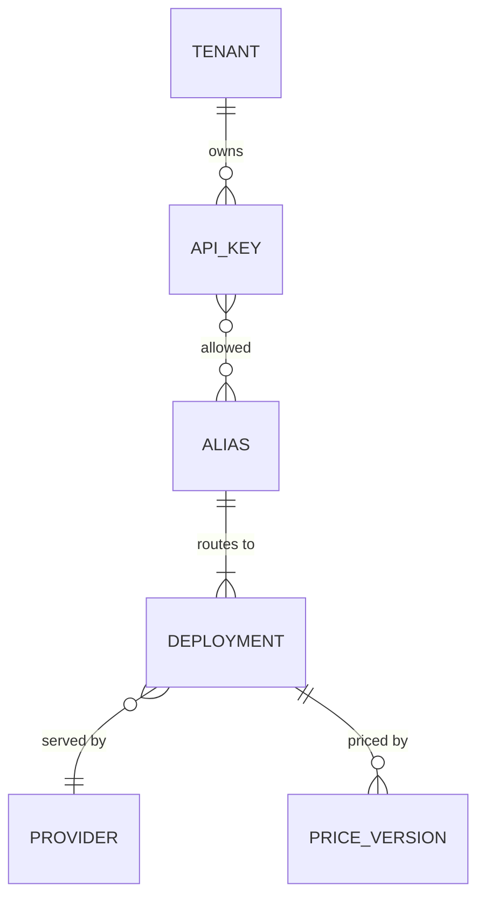

| Entity | Key fields |
| --- | --- |
| `TENANT` | `tenantId`, `monthlyBudgetMicros`, `schedulingWeight` |
| `API_KEY` | `keyId`, `tenantId`, `secretSha256`, `scopes`, `rpm`, `tpm`, `status` |
| `ALIAS` | `alias`, `defaultMaxTokens`, `firstByteTimeoutMs` |
| `DEPLOYMENT` | `deploymentId`, `provider`, `providerModel`, `priority`, `weight`, `maxConcurrentPerCluster`, `contextWindow` |
| `PROVIDER` | `provider`, `baseUrl`, `credentialSecretRef` |
| `PRICE_VERSION` | `deploymentId`, `effectiveFrom`, input / output / cache-read / cache-write micros per million tokens |

Configuration is versioned in git and validated at startup: an unknown provider, missing price, or duplicate id makes the pod fail readiness, and old pods keep serving.

API key record (stored hashed; the plaintext is shown once at issuance):

```yaml
keys:
  - keyId: "7QW"
    tenantId: billing-team
    secretSha256: "3f0a9c...e1"            # SHA-256 of the secret part; the plaintext is shown once at issuance
    scopes: [chat, usage:read]
    allowedAliases: [chat-smart, chat-fast]
    limits: { rpm: 600, tpm: 400000 }
    status: ACTIVE
```

Price table (placeholders; self-hosted vLLM priced by an internal chargeback rate or 0):

```yaml
prices:
  - deploymentId: anthropic-opus
    effectiveFrom: "2026-07-01T00:00:00Z"
    inputMicrosPerMTok: <placeholder>
    outputMicrosPerMTok: <placeholder>
    cacheReadMicrosPerMTok: <placeholder>
    cacheWriteMicrosPerMTok: <placeholder>
  - deploymentId: vllm-local
    effectiveFrom: "2026-07-01T00:00:00Z"
    inputMicrosPerMTok: 0                   # self-hosted: priced by an internal chargeback rate, or 0
    outputMicrosPerMTok: 0
```

### 8.2 Redis key design

| Key | Type | Value | TTL | Writer | Reader |
| --- | --- | --- | --- | --- | --- |
| `rl:rpm:{keyId}` | Hash `{tokens, ts}` | Token bucket | 2 min idle | Gateway (Lua) | Gateway |
| `rl:tpm:{keyId}` | Hash `{tokens, ts}` | Bucket in LLM tokens | 2 min idle | Gateway (Lua) | Gateway |
| `cache:v1:{tenantId}:{sha256}` | String (gzip JSON) | Response + usage + model + created_at | 1 h default (per alias) | Gateway | Gateway |
| `usage:dedup:{requestId}` | String | `1` | 48 h | Aggregator (Lua) | Aggregator |
| `usage:agg:{tenantId}:{yyyyMMdd}` | Hash | `{alias}|{field}` → integer | 40 days | Aggregator | Usage API |
| `usage:month:{tenantId}:{yyyyMM}` | String | Cost micros (budget checks) | 40 days | Aggregator | Gateway |
| `gw:flags` | Hash | Deployment enable flags | none | Admin API | Gateway (poll 5 s) |

- The **tenant id is inside the cache key**: identical prompts from two tenants never share an entry (no leakage, at the cost of a lower hit rate).
- Rate-limit keys are **per API key**, so one leaked or runaway key can be throttled without affecting the tenant's other keys.
- With Redis Cluster (not required here), keys touched by one Lua script must share a hash slot; the dedup + aggregate script would use hash tags such as `{tenantId}`.

### 8.3 Cache entry format

```json
{
  "v": 1,
  "providerModel": "claude-opus-5-5",
  "deploymentId": "anthropic-opus",
  "adapterVersion": "1.3.0",
  "createdAt": "2026-08-01T10:15:30Z",
  "response": { "content": "...", "finishReason": "STOP", "toolCalls": [] },
  "usage": { "promptTokens": 412, "completionTokens": 48 }
}
```

Stored gzip-compressed; entries over 256 KB uncompressed are not cached.

### 8.4 S3 usage archive layout

```text
s3://acme-llm-usage/usage/v1/dt=2026-08-01/hour=10/part-<aggregatorPod>-<firstOffset>-<lastOffset>.jsonl.gz
```

- The aggregator flushes every 5 minutes or 10,000 events.
- Offsets are committed only after both the Redis updates and the S3 object are written. A crash after the PUT but before the commit rewrites the same records into a new object; the offset range in the file name identifies duplicates, and queries (Athena) dedup on `requestId`.

### 8.5 Transaction boundaries

| Operation | Atomicity |
| --- | --- |
| RPM check-and-consume | Atomic (one Lua script) |
| TPM reserve / settle | Each atomic; separate operations |
| Cache get / put | Single commands |
| Usage aggregate update | Atomic per event: `SET dedup NX EX` then `HINCRBY`s only if the SET succeeded |
| Kafka offset commit vs Redis/S3 writes | Not atomic; safe because writes are idempotent |

**Figure 8.2 — Where each kind of state lives**

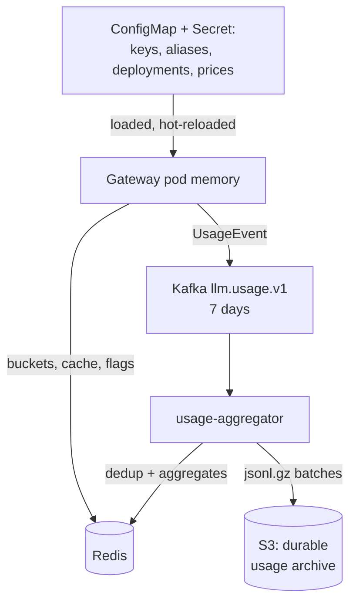

<div style="page-break-before: always;"></div>

## 9. Core Algorithms and Data Structures

### 9.1 Provider abstraction and normalization

1. **Problem:** every provider has its own request format, auth, streaming protocol, usage fields, and errors.
2. **Steps:** validate the unified request → canonical request (defaults, alias) → adapter checks capabilities (drops unsupported sampling params; routing pre-filters deployments without tool support) → build provider JSON and headers → parse response or stream events → map finish reason and usage → canonical result.
3. **Complexity:** `O(request + response size)`; streaming `O(1)` per chunk plus the accumulator.
4. **Forward compatibility:** unknown stream event types are **ignored**, not fatal.
5. **Trade-off:** lowest common denominator; provider-specific features need extension fields; translation bugs affect everyone.

### 9.2 Model routing (priority tiers + power of two choices)

1. **Filter** candidates: enabled (flags), tenant allowed, capability match, context window ≥ estimated prompt + `max_tokens`, breaker not OPEN (HALF_OPEN only if a probe slot is free), not in 429 cooldown.
2. **Tier:** take the lowest priority number with at least one candidate.
3. **Choose:** if one, take it; otherwise sample two (weighted by `weight`) and pick the lower score:
   `score(d) = ewmaTtftMs(d) × (inFlight(d) + queued(d) + 1) / maxConcurrent(d)`
4. **Order:** `[chosen] + rest of tier by score + lower tiers by priority`.

```java
List<Deployment> route(String alias, CanonicalRequest r, GatewayPrincipal p) {
  List<Deployment> eligible = config.deployments(alias).stream()
      .filter(d -> flags.enabled(d) && p.allows(alias))
      .filter(d -> d.capabilities().supports(r))
      .filter(d -> d.contextWindow() >= estimator.estimate(r) + r.maxTokens())
      .filter(d -> breakers.allowsCall(d) && !health.inCooldown(d))
      .toList();
  if (eligible.isEmpty()) throw new NoHealthyDeploymentException(alias);
  int best = eligible.stream().mapToInt(Deployment::priority).min().getAsInt();
  List<Deployment> tier = eligible.stream().filter(d -> d.priority() == best).collect(toCollection(ArrayList::new));
  Deployment first = tier.size() == 1 ? tier.get(0) : p2c(tier);
  List<Deployment> ordered = new ArrayList<>(List.of(first));
  tier.stream().filter(d -> d != first).sorted(comparingDouble(health::score)).forEach(ordered::add);
  eligible.stream().filter(d -> d.priority() > best).sorted(comparingInt(Deployment::priority)).forEach(ordered::add);
  return ordered;
}
```

**Figure 9.1 — Routing decision**

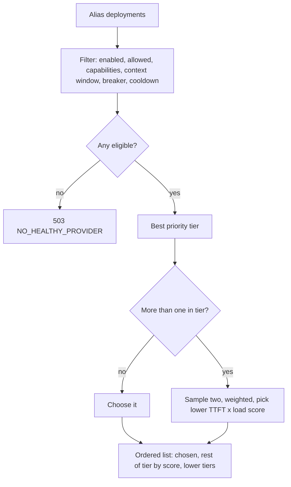

- **Complexity:** `O(D)` filtering (D ≤ ~5); P2C `O(1)`.
- **Why TTFT, not total latency:** total latency mostly reflects requested output length; TTFT reflects provider queueing and prefill.
- **Why not least-outstanding over all candidates:** herding; every pod's stale view sends to the same "best" backend.
- **Fast errors don't win:** only successful first tokens update the EWMA; errors feed the breaker.
- **Limitations:** local per-pod view; EWMA reacts with delay.

### 9.3 Concurrent request scheduling (bulkheads + deficit round-robin)

1. **Problem:** backends degrade sharply when overloaded (provider queues, GPU KV-cache pressure, 429/529s).
2. **Idea:** a concurrency cap per deployment at its measured knee, plus a bounded wait queue in the gateway served fairly across tenants. Waiting happens where it is cheap and fair.
3. **DRR:** one FIFO per tenant, a ring of tenants with non-empty queues, a deficit counter per tenant with a quantum = its `schedulingWeight`; `poll()` visits tenants in ring order and serves a tenant while its deficit covers the head request's cost (cost = 1 request).
4. **Worked example (ILLUSTRATIVE):** limit 4; tenant A floods 500 requests, tenant B sends 5. With DRR, grants alternate A, B, A, B, … so B's 5 requests are served within about the first 10 grants instead of after A's 500.
5. **Little's law:** a backend with service time S and limit C completes at most `C / S` per second. Above the knee, concurrency raises latency, not throughput; timeouts and retries then lower goodput.
6. **Complexity:** `O(1)` per acquire/release; `O(queued)` memory.
7. **Alternatives:** no limit; a global semaphore (one slow provider consumes all permits); token-weighted DRR (fairer for mixed sizes, more complex).
8. **Trade-off:** per-pod limits approximate the cluster limit; each backend's knee must be measured.

### 9.4 Rate limiting: RPM token bucket and TPM reserve-and-settle

```lua
-- KEYS[1] = rl:rpm:{keyId}; ARGV: capacity, refill_per_ms, now_ms, cost
local cap, rate, now, cost = tonumber(ARGV[1]), tonumber(ARGV[2]), tonumber(ARGV[3]), tonumber(ARGV[4])
local s = redis.call('HMGET', KEYS[1], 'tokens', 'ts')
local tokens = tonumber(s[1]) or cap
local ts = tonumber(s[2]) or now
tokens = math.min(cap, tokens + (now - ts) * rate)
local allowed = 0
if tokens >= cost then tokens = tokens - cost; allowed = 1 end
redis.call('HSET', KEYS[1], 'tokens', tokens, 'ts', now)
redis.call('PEXPIRE', KEYS[1], 120000)
return { allowed, tostring(tokens) }
```

**TPM reserve-and-settle:**
1. Before the call: `estimate = promptTokensEstimate + max_tokens`; reserve it from `rl:tpm:{keyId}` (same script, `cost = estimate`); reject with 429 if it doesn't fit.
2. After the call: `actual = prompt + completion` from provider usage; refund `estimate − actual` (never above capacity). If actual > estimate, charge the difference and allow the bucket to go slightly negative so the next requests wait.
3. Crash between reserve and settle: the reservation expires as the bucket refills; error bounded by one request's estimate.

**Worked example (ILLUSTRATIVE):** a key has 1,200 tokens left; a request estimates 412 prompt + 300 max = 712 → reserved, 488 left. Actual usage 412 + 48 = 460 → refund 252 → 740 left. A later request estimating 1,800 tokens is rejected with 429 and a `Retry-After` computed from the refill rate.

- **Complexity:** `O(1)`; two small hashes per active key.
- **Redis down:** `LocalFallbackLimiter` at `limit / replicas` per pod (fail-soft).

### 9.5 Circuit breakers, timeouts, retries, and fallback

| Breaker setting | Value | Reason |
| --- | --- | --- |
| Sliding window | Count-based, 50 calls | Enough samples |
| Minimum calls | 20 | Don't open on a handful of errors |
| Failure-rate threshold | 50% | Open when half of recent calls fail |
| Slow-call threshold | First byte > 15 s at 80% slow-call rate | A stalling provider is unhealthy |
| Open duration | 30 s | Time to recover |
| Half-open probes | 5 | Close if probes succeed |
| Recorded as failure | Connect errors, timeouts, 5xx, 529 | Provider-side problems |
| Ignored | 400, 401, 403, 404, 413 | Client errors must not open the circuit for everyone |
| 429 | Not a failure; cooldown for `Retry-After` (default 5 s) | Throttling is a capacity signal |

**Figure 9.2 — Breaker state machine**

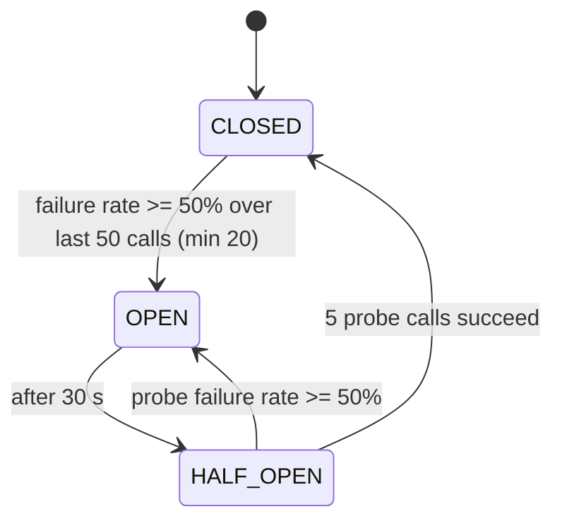

**Timeouts:** connect 2 s; first byte 20 s; idle gap 30 s; total per alias/request. The first-byte timeout makes fallback useful: a stalled provider is abandoned while there is still time to try another.

**Retry and fallback policy:**

```java
Result execute(List<Deployment> candidates, Attempt fn) {
  budget.onRequest();                                  // deposits 0.1 retry tokens per request
  ProviderException last = null;
  for (int i = 0; i < Math.min(candidates.size(), 2); i++) {     // at most 2 attempts total
    Deployment d = candidates.get(i);
    if (i > 0 && !budget.tryAcquireRetry()) break;     // retry budget exhausted: fail fast
    if (deadline.remaining().compareTo(cfg.minAttemptTime()) < 0) break;
    try {
      return breakers.get(d).executeCallable(() -> fn.call(d, deadline.forAttempt()));
    } catch (CallNotPermittedException open) {
      continue;                                        // breaker opened meanwhile; next candidate, no budget used
    } catch (ProviderException e) {
      last = e;
      if (!e.retryable() || committedToClient()) throw e;          // never retry after first streamed byte
      if (e.status() == 429) health.cooldown(d, e.retryAfterOr(Duration.ofSeconds(5)));
    } catch (SaturatedException e) {
      continue;                                        // bulkhead full: try next candidate
    }
  }
  throw last != null ? last : new NoHealthyDeploymentException();
}
```

- Retries go to the **next candidate**, except a connect failure with only one candidate.
- **Retry budget:** each request deposits 0.1 tokens (cap 100); each retry spends 1, so retries are ≤ ~10% of traffic. Without it, a provider outage doubles load on remaining providers, and client retries multiply further (gateway 2× × client 3× = 6×).
- Never retried: 4xx client errors, content filter results, anything after the first streamed byte.
- **Amplification (ILLUSTRATIVE):** 30% injected 503s with 2 same-deployment retries → `1 + 0.3 + 0.09 = 1.39×` upstream load; fallback-first with a 10% budget → ≤ 1.1×.

### 9.6 Response caching and its correctness limits

**Eligibility (all must hold):**

| Rule | Reason |
| --- | --- |
| Not `bypass` and no `Cache-Control: no-store` | Explicit opt-out |
| `temperature == 0` (or omitted where the default is deterministic-leaning), **or** `cache.mode == prefer` | With sampling, users expect different outputs |
| `finish_reason` is `stop` or `tool_calls` | Don't cache truncated, filtered, or errored responses |
| Stream completed normally | Never serve partial responses as complete |
| Response ≤ 256 KB | Memory bound |
| Alias allows caching | Some prompts depend on "now" or user state |

**Key:** `SHA-256(canonical JSON of {tenantId, resolved deployment id, provider model, adapter version, messages, system, max_tokens, temperature, top_p, stop, tools, tool_choice, response_format})` with sorted keys and normalized whitespace. Lookup happens **before** routing using the alias's **primary** deployment; responses from a fallback are stored under the fallback's own model key, preserving "same model, same answer".

**Single-flight within a pod:**

```java
CompletableFuture<CanonicalResponse> f = inFlight.computeIfAbsent(key, k -> new CompletableFuture<>());
if (f is the one we created) { try { r = callProvider(); f.complete(r); store(r); } catch (e) { f.completeExceptionally(e); } finally { inFlight.remove(key); } }
else return f.get(remainingDeadline);
```

Cross-pod duplicates are allowed; a distributed lock per key isn't worth its latency and failure modes.

**Why caching LLM responses is problematic:**
1. **Non-determinism:** even at temperature 0, outputs aren't guaranteed identical; caching makes one sample "the" answer.
2. **Hidden context:** answers depending on time, external state, or identity become stale or wrong.
3. **Model changes:** a provider can update a model behind the same id; TTL bounds staleness.
4. **Privacy:** prompts and responses (possibly personal data) are stored in Redis; mitigated by tenant scoping, TTL, encryption, opt-outs, never logging content.
5. **Poisoning:** prevented by tenant scoping.
6. **Semantic caching is riskier:** it can answer a different question; not implemented.
7. **Low real-world hit rates:** exact matches are rare in chat; templated workloads hit often. Any benchmark hit rate is a workload property.

**Gateway cache vs provider prompt caching:** provider-side prompt caching still runs the model but bills cached input tokens cheaper and lowers TTFT; the gateway cache skips the call entirely. The adapter passes provider cache usage into `cacheReadTokens` / `cacheWriteTokens`.

### 9.7 Token usage tracking and cost calculation

| Situation | Prompt tokens | Completion tokens | `estimated` |
| --- | --- | --- | --- |
| Non-streaming success | Provider usage | Provider usage | false |
| Streaming success (Anthropic) | `message_start` input (+ cache tokens) | Final cumulative `message_delta.output_tokens` | false |
| Streaming success (OpenAI-compatible) | Final chunk usage (`include_usage=true`) | Same | false |
| Interrupted / client disconnected | Provider value if received, else estimate | Tokenizer count of streamed text | true |
| Cache hit | Original usage recorded; **billed 0** | 0 | false |
| Rejected before provider | 0 | 0 | false |

**Estimator:** a model-family tokenizer where available, else a calibrated ~4 characters per token tuned from historical ratios. Used for TPM admission and context checks, never for billing when provider usage exists. Provider token-counting endpoints are used offline for calibration only (per-request calls would add a round trip).

**Cost formula** (integer micro-USD; prices in micro-USD per million tokens, chosen by `effectiveFrom ≤ request time`):

```text
cost_micros = ceil( ( prompt_uncached × input_price
                    + cache_read     × cache_read_price
                    + cache_write    × cache_write_price
                    + completion     × output_price ) / 1,000,000 )
```

`prompt_uncached = promptTokens − cacheReadTokens − cacheWriteTokens` when a provider includes cache tokens in the prompt total; Anthropic reports `input_tokens` excluding cache reads and writes, so the adapter normalizes.

Worked example (ILLUSTRATIVE, placeholder prices):

```text
(412 × 3,000,000 + 48 × 15,000,000) / 1,000,000 = (1,236,000,000 + 720,000,000) / 1,000,000 = 1,956 µ$ ≈ $0.001956
```

| Design choice | Reason |
| --- | --- |
| Integer micro-dollars, `long` arithmetic | No floating-point drift over millions of requests |
| Price versions with effective dates | Price changes don't rewrite history; each event records `priceVersion` |
| Cost computed in the gateway | The event is self-describing; re-aggregation needs no historical config |
| "Estimated cost", not invoice | Provider invoices are authoritative (discounts, batch pricing, taxes) |

### 9.8 Streaming relay and cancellation

- The relay reads provider SSE lines on the request's virtual thread, translates each event, and writes it immediately (`SseEmitter.send` flushes).
- **Client disconnect:** the next write fails (or `onCompletion` / `onError` fires) → `ClientDisconnected` → close the upstream `InputStream`, aborting the HTTP/2 stream or TCP connection → generation (and billing) stops early for providers that stop on disconnect → `PARTIAL` usage recorded.
- **Backpressure:** writes block when the client reads slowly; the upstream read pauses; TCP/HTTP2 flow control pushes back to the provider. Memory stays bounded per stream.

<div style="page-break-before: always;"></div>

## 10. Complete End-to-End Execution Flows

### 10.1 Streaming chat completion (cache miss)

**Figure 10.1a — Streaming request: admission and provider call**

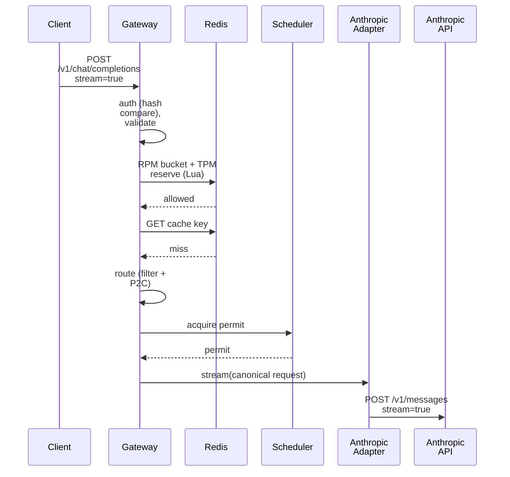

**Figure 10.1b — Streaming request: relay, completion, and accounting**

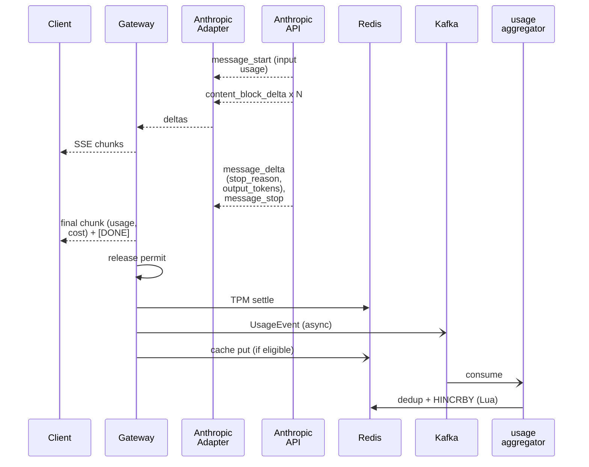

1. **Arrival:** the ALB forwards the request; Tomcat assigns a virtual thread.
2. **Correlation:** `X-Request-Id`, MDC.
3. **Authentication:** parse `gk_live_<keyId>_<secret>`, look up by `keyId`, compare `SHA-256(secret)` in constant time, check status and scope.
4. **Validation and normalization:** schema checks; alias allowed; defaults; canonical request.
5. **Rate limiting:** RPM consume; TPM reservation of `estimatedPrompt + max_tokens`; monthly budget check against `usage:month:{tenant}`.
6. **Cache:** eligibility; `GET cache:v1:{tenant}:{hash}` → miss.
7. **Routing:** filter; P2C; ordered fallbacks.
8. **Scheduling:** bulkhead permit (fast path or fair-queue wait up to 2 s).
9. **Resilience:** breaker permits; deadline computed.
10. **Provider call:** e.g., Anthropic with `system`, `max_tokens`, `stream: true`, `x-api-key`, `anthropic-version`.
11. **Streaming:** events translated; text deltas sent; `thinking` blocks skipped; usage captured from `message_start` and `message_delta`.
12. **Completion:** final chunk with `finish_reason`, usage, cost; `[DONE]`; permit released; breaker success; EWMA TTFT updated.
13. **Async:** TPM settle; usage event to Kafka; cache store if eligible.
14. **Aggregation:** dedup by `requestId`, increment tenant/day and month totals, buffer for S3.

### 10.2 Provider failure before the first byte → fallback

**Figure 10.2 — Transparent fallback on a 529**

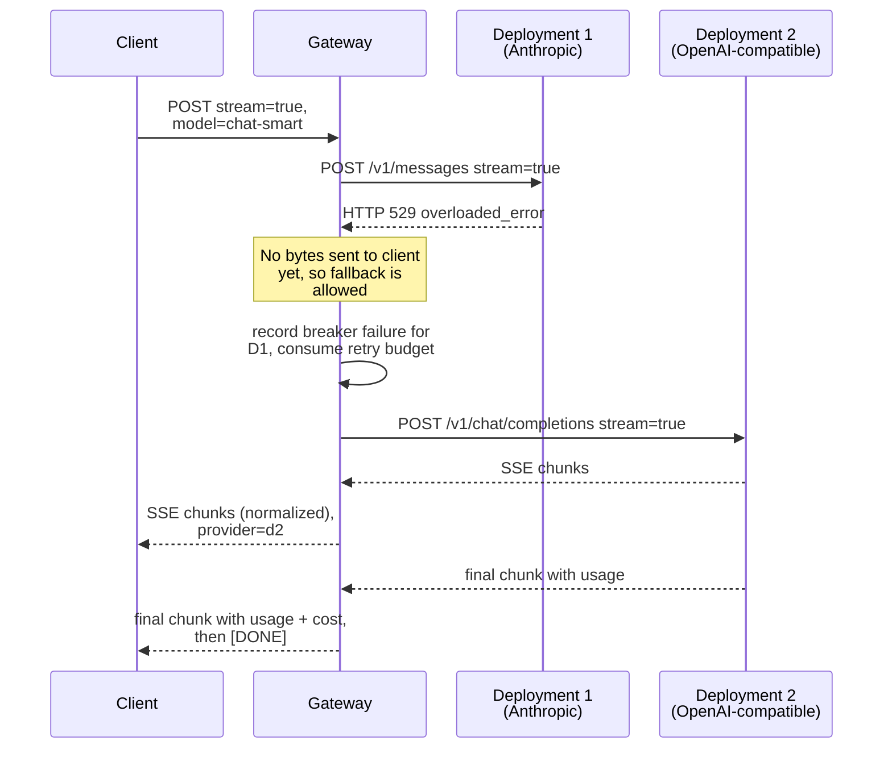

The primary returns 529 (or times out at 20 s waiting for the first byte, or refuses the connection); the breaker records a failure; the retry budget allows one fallback; the client sees one successful stream naming the fallback provider. Usage event: `attempts: 2`, `fallbackUsed: true`.

### 10.3 Provider failure mid-stream

**Figure 10.3 — In-band error after bytes were committed**

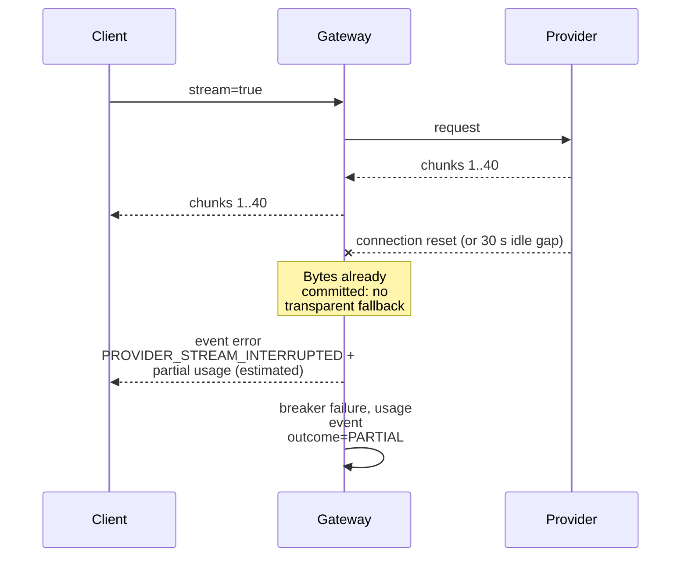

The gateway does not restart on another provider: a different continuation spliced onto text the user saw would be incoherent. The client has the partial text and decides.

### 10.4 Cache hit

1. Auth, limits, validation as above.
2. `GET cache:v1:...` returns an entry.
3. Non-streaming: return with `cached: true`, `X-Gateway-Cache: HIT`, provider fields from the entry, cost 0. Streaming: replay as a few SSE chunks, final chunk, `[DONE]`.
4. TPM settles to 0; a usage event with `cacheHit: true`, billed 0.

Latency: a Redis round trip (~1 ms) + decompression + serialization (ILLUSTRATIVE), versus seconds for a provider call.

### 10.5 Rate limited

1. TPM reservation fails (e.g., estimated 1,800 tokens > 1,200 remaining).
2. `429 RATE_LIMITED` with `Retry-After` from the refill rate and `X-RateLimit-Remaining-Tokens: 1200`.
3. Usage event `outcome: REJECTED`, zero cost; no provider call.

### 10.6 All candidates saturated

1. The primary bulkhead's queue wait times out after 2 s; the fallback's queue is full.
2. `503 PROVIDER_SATURATED`, `Retry-After: 2`.
3. If sustained, HPA scale-out does **not** help: the limit is the provider's.

### 10.7 Client disconnects mid-stream

1. The client closes after 2 s; the next `send` fails; `ClientDisconnected` closes the upstream (aborting generation).
2. Usage `PARTIAL`: input tokens from `message_start` (Anthropic) and completion tokens counted from streamed text (`estimated: true`).
3. Permit released; breaker **not** charged; nothing cached.

### 10.8 Duplicate identical requests and Kafka outage

- **20 identical deterministic requests at once on one pod:** single-flight → 1 provider call, 20 responses, 1 cache write, 20 usage events (19 coalesced, billed 0).
- **Kafka unavailable:** records wait in the 32 MB buffer and retry; once full, `send` fails fast (`max.block.ms=0`), the event is written as a `USAGE_FALLBACK` structured log line, and `llm_gateway_usage_events_failed_total` increments. The client response is unaffected. After recovery an ops job re-publishes; dedup makes it safe.

<div style="page-break-before: always;"></div>

## 11. Concurrency and Distributed Systems

### 11.1 Concurrent request handling

Each request runs on its own virtual thread. Limits are explicit and layered:

| Layer | Limit | Purpose |
| --- | --- | --- |
| ALB / ingress | Connection limits | Edge protection |
| Tomcat | `max-connections` (e.g., 10,000), accept queue | Socket bound per pod |
| Per-pod in-flight guard | e.g., 2,000 | Memory bound; excess gets `503` immediately |
| RPM / TPM per key | Redis buckets | Tenant fairness over time |
| Per-deployment bulkhead | `maxConcurrentPerCluster / replicas` | Keep each backend at its knee |
| Fair queue | Bounded, DRR by tenant | Fairness at contention |
| Upstream connection pool | ≥ bulkhead size | Never the hidden bottleneck |

### 11.2 Race conditions

| Race | Where | Prevention |
| --- | --- | --- |
| Two requests take the last RPM token | Redis bucket | Atomic Lua script |
| Lost TPM refund | Reserve then settle | Each atomic; refunds additive; crash loses ≤ one reservation (self-heals) |
| Permit leak | Bulkhead | `try-with-resources`; release on every path including disconnects |
| Permit granted to a timed-out waiter | Bulkhead | Handoff via `CompletableFuture.complete`, which fails for cancelled waiters; `release()` keeps polling |
| Duplicate provider calls for identical requests | Cache misses | Per-pod single-flight; cross-pod duplicates accepted |
| Double-counted usage | Aggregator redelivery | Lua dedup + increments in one script |
| Breaker state updates | Resilience4j | Internally thread-safe |

### 11.3 Atomicity

Atomic: RPM consume, TPM reserve, TPM settle, aggregate update. **Not** atomic across the request lifecycle: a request can be charged an RPM token and a TPM reservation and then fail at the provider; the TPM reservation is refunded (settle with 0 if no tokens were generated), the RPM token is not (it counts requests, including failed ones).

### 11.4 Ordering

- Stream chunks for one request are delivered in provider order (one thread reads and writes sequentially).
- Usage events are ordered per tenant partition; the aggregator does not depend on order (increments commute).
- No cross-request ordering is guaranteed or needed.

### 11.5 Consistency guarantees

| Data | Guarantee |
| --- | --- |
| Rate limits | Cluster-wide, linearizable per key (single Redis primary); approximate in fallback mode |
| Breaker state | **Per pod**; pods may briefly disagree |
| Bulkhead limits | Per-pod share of a cluster limit; total ≈ the cluster limit |
| Cache | Eventually consistent, TTL-bounded; entries immutable once written |
| Usage aggregates | Eventually consistent (seconds); exactly-once per `requestId` within 48 h |
| S3 archive | At-least-once; dedup by `requestId` downstream |
| Budget enforcement | Soft: aggregates lag by seconds; a burst can exceed slightly |

### 11.6 Duplicates and retries

| Duplicate | Handling |
| --- | --- |
| Client retry after a timeout | Not deduplicated (no idempotency key in v1); cost may double; cacheable requests hit the cache |
| Gateway fallback attempt | ≤ 2 attempts; only before the first byte; recorded as `attempts` |
| Kafka redelivery | Dedup key |
| Re-published fallback-log records | Dedup key |

### 11.7 How provider failures affect requests

| Failure moment | Effect on that request | Effect on others |
| --- | --- | --- |
| Connect refused | Fallback (if budget allows) | Breaker failure count rises |
| HTTP 429 | Fallback; deployment cooldown | New requests skip it during cooldown |
| 529 / 503 / 5xx before body | Fallback | Breaker may open |
| First-byte timeout (20 s) | Abandon; fallback if deadline allows | Breaker slow/failure count |
| Mid-stream disconnect or idle gap | In-band error; partial usage; no fallback | Breaker failure |
| Breaker opens mid-flight | In-flight requests continue | New requests route elsewhere |
| Provider slow but healthy | Longer requests; slots held longer; queue waits grow | P2C shifts traffic within the tier |

### 11.8 Distributed coordination

None beyond Redis atomic scripts and the Kafka group coordinator. No leader election: every pod is identical. Configuration changes propagate by watching mounted files; admin flags by polling Redis.

<div style="page-break-before: always;"></div>

# Part 4: Engineering and Reliability

## 12. Failure Handling and Recovery

### 12.1 Failure-scenario table

| Failure scenario | Why it happens | System behaviour | Recovery mechanism | Remaining risk |
| --- | --- | --- | --- | --- |
| Provider outage (5xx/529) | Provider incident | Fallback; breaker opens after threshold; route elsewhere | Half-open probes after 30 s | Fallback tier may saturate (503) |
| Provider throttling (429) | Over our provider quota | Cooldown for `Retry-After`; fallback | Cooldown expires | None |
| Provider slow / stalled | Overload, stalls | First-byte timeout; slow-call breaker trip; fallback | Probes | Tail latency |
| Provider failure mid-stream | Reset, idle gap | In-band error; partial usage | Client retries with partial text | Partial completion billed (estimated) |
| Network failure to provider | Connectivity | Connect timeout; fallback | Automatic | None |
| Redis unavailable | Outage | 50 ms timeout → local limiter (`limit / replicas`); cache bypass; budget check skipped (alerted) | Automatic on reconnect | Approximate limits; budgets unenforced temporarily |
| Kafka unavailable | Outage | Producer buffer, then structured fallback log | Re-publish from logs; aggregator dedups | Aggregates lag; `complete: false` |
| Aggregator crash | Pod failure | Rebalance to the other replica | Redelivery from last committed offset | None (dedup) |
| S3 write failure | S3 errors | Retry; offsets not committed | Automatic | Archive delayed |
| Gateway pod crash | Pod/node failure | ALB health check; other pods serve | New pod | In-flight requests fail; their usage may be lost |
| Duplicate usage events | Redelivery | Dedup key hit, ignored | — | None within 48 h |
| Client deadline exceeded | Slow provider | `504` before first byte; in-band error after | Client retry | Provider cost without delivered result (recorded `PARTIAL` if known) |
| Key table reload fails | Bad Secret | Keep last good table; alert | Fix the Secret | New / revoked keys not applied until fixed |
| Bad routing config | Invalid YAML | Startup validation fails; pod not ready; rollout halts | Fix and redeploy | None (old pods keep serving) |

### 12.2 Provider outage recovery, step by step

**Figure 12.1 — Primary provider outage and recovery**

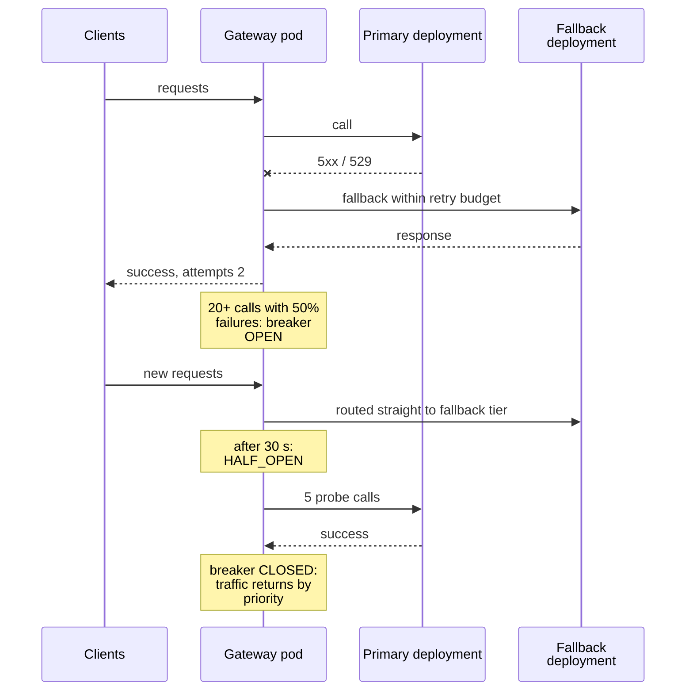

1. Breakers on each pod open independently as failures accumulate (≥ 20 calls, ≥ 50% failures).
2. Routing filters the open deployment; traffic moves to the next priority tier, whose bulkhead absorbs it (queueing if needed).
3. After 30 s each pod's breaker goes half-open and lets 5 probes through.
4. Successful probes close the breaker; traffic returns per priority.
5. Operators can force a cluster-wide drain via `POST /admin/v1/providers/{id}/state` to skip probing during a known incident.

### 12.3 Kafka and Redis outage recovery

**Kafka:** requests continue; the 32 MB buffer (roughly 50K–100K events) absorbs short outages; then events go to the fallback log and `usage_events_failed_total` alerts; after recovery an ops job replays fallback records; dedup prevents double counting; the usage API shows `complete: true` again.

**Redis:** rate limiting switches to the local limiter; the cache is bypassed (providers see more load; bulkheads still protect them); budget enforcement is skipped and alerted; on recovery buckets start full, so a brief allowance burst is possible.

### 12.4 Rolling deploy and scale-in (draining streams)

1. `SIGTERM` → readiness false → ALB stops sending new requests after the deregistration delay (`preStop` sleeps 10 s first).
2. Non-streaming requests finish normally.
3. Streams get up to 100 s; remaining ones receive an in-band `GATEWAY_SHUTTING_DOWN` error and are closed.
4. `producer.flush()` (5 s) for pending usage events.
5. The pod exits within `terminationGracePeriodSeconds: 120`; the ALB deregistration delay is ≥ the drain time.

### 12.5 What the system does and does not guarantee

- **Guaranteed:** provider credentials never leave the gateway; tenants are isolated in cache and usage; a single provider outage does not fail requests that can fall back (before the first byte); usage aggregates are exactly-once per `requestId` within 48 h for events that reach Kafka.
- **Not guaranteed:** transparent recovery after the first streamed byte; idempotency of client retries; strict budget enforcement; strict cluster-wide provider concurrency; zero usage loss (a pod crash before publish, or a Kafka outage beyond the buffer with a failed log fallback).

<div style="page-break-before: always;"></div>

## 13. Performance Engineering

### 13.1 Where the time goes

Provider time dominates: hundreds of milliseconds to the first token and seconds for a full generation. The gateway's work (auth, two pipelined Redis round trips, JSON translation) is a few milliseconds. Performance engineering here means:

1. Don't add queueing in the gateway (thread pools, connection pools).
2. Don't push backends into overload (schedule at their knee).
3. Avoid provider calls where correct (cache).
4. Send work to the faster or less loaded backend (routing).
5. Don't waste capacity on retries (budget, fallback instead of same-backend retries).

ILLUSTRATIVE budget for a non-streaming cache miss:

| Step | Time |
| --- | --- |
| Auth (in-memory lookup + SHA-256) | < 0.1 ms |
| RPM + TPM Lua scripts (pipelined) | 0.5–2 ms |
| Cache GET | 0.3–1 ms |
| Routing + scheduling (no queue) | < 0.1 ms |
| Request translation + JSON | 0.2–1 ms |
| **Provider time** | **0.5–30 s** |
| Response translation | 0.2–1 ms |
| Total gateway overhead | ~2–5 ms (target p99 < 20 ms) |

### 13.2 Bottlenecks in the naive baseline

| Bottleneck | Mechanism | Symptom |
| --- | --- | --- |
| Fixed platform thread pool | Each request holds an OS thread for seconds | Pool exhaustion; Tomcat queueing |
| Small upstream connection pool | Low per-route connection limit | Waiting for a connection with no provider-side cause |
| Load-blind round-robin | Equal traffic to unequal backends | Weak backend overloads while the strong one idles |
| No concurrency control | Backends pushed past their knee | Provider queueing, 429/529s, timeouts |
| Unbounded retries | Failures create more load | Retry storms; goodput collapse |
| No cache | Repeated deterministic prompts all go to providers | Wasted capacity and cost |

### 13.3 The optimizations

| Optimization | What it removes | Cost | How to measure |
| --- | --- | --- | --- |
| OPT-1: Virtual threads + right-sized upstream pools (≥ bulkhead size) | Accidental, unfair, invisible queues | Pinning on `synchronized`; ThreadLocal memory | Live threads, pool wait time, `Server-Timing` queue vs upstream |
| OPT-2: Load-aware routing (P2C on TTFT × load) | Weak backend bottleneck under round-robin | Local view; EWMA lag | Request share vs capacity per deployment |
| OPT-3: Bulkheads at the knee + DRR | Provider-side overload collapse | Must measure each knee; per-pod approximation | TTFT vs in-flight curve; queue wait; 429/529 rate |
| OPT-4: Exact-match cache + single-flight | Repeated deterministic provider calls | Correctness limits; memory; privacy surface | Hit/miss/ineligible counters; latency by cache outcome |
| OPT-5: Retry budget + fallback-first retries | Retry amplification | Some transient errors surface to clients | Upstream attempts / client requests |
| OPT-6: Cheap per-request work | Keys in memory; pipelined Lua; reused `ObjectWriter`; no body logging | — | `Server-Timing` `gw`; JFR CPU profile |

**Cache effect on throughput (ILLUSTRATIVE):** when provider-bound, throughput rises roughly with `1 / (1 − h)` for hit rate h; mean latency falls a lot; **p95 falls much less** (Section 21).

### 13.4 Batching, backpressure, memory, network, scaling

- **Batching:** usage events batched by the producer (`linger.ms=20`, lz4) and by the aggregator (Redis pipelining, S3 files). Request batching to providers is not done: hosted chat APIs don't support it, and vLLM batches continuously across concurrent requests internally, which is exactly why its throughput depends on the concurrency the gateway allows.
- **Backpressure:** slow client → blocking SSE write → upstream read pauses → flow control to the provider; saturated backend → bounded queue → `503`; saturated tenant → `429`; pod overload → in-flight guard `503` + HPA; slow Kafka → producer buffer, never blocking request threads.
- **Memory:** per request a small virtual-thread stack, request/response buffers (prompt ≤ 1 MB), and the stream accumulator; a 2 GiB heap holds ~2,000 typical in-flight requests (enforced by the guard).
- **Network:** SSE adds ~100–200 bytes per chunk; HTTP/2 connection reuse avoids per-request TLS handshakes; cross-AZ hops add ~0.5–1 ms.
- **Scaling:** more pods do **not** add provider capacity. Gateway-bound (CPU/in-flight high, short queues) vs provider-bound (long queues, high TTFT) is distinguished on dashboards.

<div style="page-break-before: always;"></div>

## 14. Benchmarking and Testing

> **Status:** intended plan only. Nothing has been executed; result tables are blank; all numbers are targets or ILLUSTRATIVE. Results will depend heavily on mock-provider parameters, which must be published with any number.

### 14.1 Test plan

| Test | Objective | Expected / assertion |
| --- | --- | --- |
| Unit: adapters | Translation both ways | Recorded fixtures (incl. tool calls, `thinking`, `refusal`, unknown events) → exact canonical content, finish reasons, usage; unknown events ignored |
| Unit: cost calculator | Exact integer arithmetic | Correct micro-dollars; correct price version across an effective date |
| Unit: cache key | Canonical, stable, sensitive | Equal for reordered JSON; different for parameter or tenant change |
| Unit: router | Filtering and P2C | Ineligible excluded; lower score chosen more often over 10K draws |
| **Unit: bulkhead** | Permits, fairness, timeouts | Tenant A floods 500, B sends 5, limit 4 → B served within ~10 grants; no leaks; timed-out waiters never hold permits |
| Integration: Redis Lua | Atomic limits and dedup | 1,000 concurrent consumes on a 100-token bucket → exactly 100 allowed; duplicates counted once |
| Integration: end to end with mock | Full path | Normalized responses; SSE order; usage event with correct tokens and cost |
| API contract | Status codes | 401/403/404/413/400 with documented codes; no provider call |
| Concurrency: single-flight | One call per identical burst | 50 identical requests → mock sees 1 call |
| Concurrency: pinning | No carrier pinning | No pinning traces from gateway code under load |
| Failure: provider errors | Breaker + fallback | 30% 503s → breaker opens; fallback serves; amplification ≤ 1.1 |
| Failure: mid-stream cut | In-band error, partial usage | SSE `error`; `PARTIAL` usage; no cache write |
| Failure: Redis down / Kafka down | Degraded modes | Requests succeed; local limiter; fallback log; aggregates match after replay |
| Recovery: half-open | Return to primary | Breaker closes after probes |
| Stress / soak | Graceful overload; leaks | `503` with `Retry-After` rather than timeouts; flat heap; stable p99 |

The test that most directly supports "concurrent scheduling" is the **bulkhead fairness test**.

### 14.2 Mock provider model

| Parameter | `mock-a` (strong) | `mock-b` (weak) |
| --- | --- | --- |
| Efficient concurrency | TBD (e.g., 24) | TBD (e.g., 12) |
| TTFT | Lognormal, configurable | Same family, slower |
| Output tokens | Long-tailed distribution, capped by `max_tokens` | Same |
| Overload behaviour | When in-flight > capacity, inter-token time scales by `in_flight / capacity` and TTFT adds queue time | Same |
| Fault injection | 503/529/429 rate, stall rate, mid-stream disconnect rate | Same |
| Usage reporting | Exact token counts (ground truth) | Same |

### 14.3 Workload and tools

| Parameter | Value |
| --- | --- |
| Endpoint / alias | `POST /v1/chat/completions`, `chat-bench` (→ `mock-a`, `mock-b`, same priority) |
| Mode | Non-streaming for the A/B claim; streaming separately |
| Clients | 50 k6 VUs, closed loop, zero think time; also 64, 80, 100 |
| Prompt mix | 30% from 200 templated prompts at temperature 0 (cache-eligible); 70% unique |
| Prompt size / `max_tokens` | 200–2,000 tokens / 600 |
| Warm-up / steady / runs | 2 min / 10 min / 3 |
| Rate limits | Raised; any 429 counts as an error |

Tools: k6 (closed-loop and arrival-rate executors), xk6-sse or a JDK client for TTFT, Prometheus + Grafana, JFR / async-profiler (overhead and pinning), and the mock's counters (ground truth for attempts and tokens).

### 14.4 Scenarios

| # | Scenario | Purpose |
| --- | --- | --- |
| L1 | A/B at 50 VUs, non-streaming | ~2× throughput, ~25% p95 |
| L2 | Ablation (no cache; round-robin; no bulkheads; no budget; platform threads) | Attribution |
| L3 | Sweep 25 → 150 VUs | Behaviour beyond 50; find the knee |
| L4 | Streaming at 50 VUs | TTFT p50/p95/p99, in-band error rate |
| L5 | `mock-a` 30% 503/529 for 3 min, then 10% stalls | Breaker, fallback, budget; amplification ≤ 1.1 |
| L6 | `mock-a` fully down 2 min | Failover and recovery |
| L7 | Fixed 100 ms mock latency | Gateway overhead p99 < 20 ms |
| L8 | Ramp 50 → 400 VUs with HPA | Scale-out before p99 degrades |
| L9 | Rolling restart during streaming | Graceful draining |
| L10 | 100K mixed requests | Accounting vs mock ground truth |
| L11 | 50 VUs for 4 h | Leaks, pinning, memory |

### 14.5 Baseline vs optimized

| Aspect | Baseline | Optimized |
| --- | --- | --- |
| Request threads | Tomcat platform threads (200) | Virtual threads |
| Upstream client | Blocking client, small per-route pool (e.g., 20, recorded) | JDK `HttpClient`, per-host limits ≥ bulkhead |
| Routing | Round-robin | P2C on TTFT × load |
| Concurrency control | None | Bulkheads at measured capacity + DRR |
| Cache | Off | On (eligibility rules) |
| Retries | Up to 2 on the same deployment | 1 fallback within a 10% budget |
| Held constant | Pod count and size, mock parameters, workload, Redis/Kafka, k6 node, versions | |

Report the baseline's exact pool and thread settings: a deliberately crippled baseline inflates any ratio.

### 14.6 Metrics

Throughput (successful complete responses / s), p50/p95/p99 (non-streaming), TTFT percentiles, error rate (non-2xx + in-band errors), cache hit rate, gateway overhead (`total − upstream − queue`), queue wait, provider latency, retry amplification, breaker time in OPEN, CPU/memory per pod, tokens and cost vs ground truth.

<div style="page-break-before: always;"></div>

## 15. Deployment and Infrastructure

### 15.1 Docker

```dockerfile
# Representative only; not created in this repository.
FROM eclipse-temurin:21-jre
RUN useradd -u 10001 app
WORKDIR /app
COPY target/llm-gateway.jar app.jar
USER app
ENV JAVA_OPTS="-XX:+UseG1GC -XX:MaxRAMPercentage=75 -Djdk.tracePinnedThreads=short"
EXPOSE 8080
ENTRYPOINT ["sh", "-c", "exec java $JAVA_OPTS -jar app.jar"]
```

The same image runs `gateway` and `aggregator` profiles; `mock-llm` is a separate small image.

### 15.2 Kubernetes resources

| Resource | Purpose |
| --- | --- |
| `Deployment llm-gateway` | Gateway pods (profile `gateway`) |
| `HorizontalPodAutoscaler llm-gateway` | 3–12 replicas on in-flight per pod (target 300) and CPU (70%) |
| `Service` + `Ingress` (ALB) | HTTPS entry; idle timeout 300 s for SSE |
| `Deployment usage-aggregator` | 2 replicas |
| `Deployment mock-a`, `mock-b` | Benchmarks only |
| `ConfigMap llm-routing`, `llm-pricing` | Aliases, deployments, prices (versioned in git) |
| `Secret llm-provider-keys`, `llm-gateway-keys` | Provider keys; hashed gateway keys |
| `ServiceAccount` + IRSA | S3 write for the aggregator |
| `PodDisruptionBudget` | `minAvailable: 2` for the gateway |
| `ServiceMonitor` | Prometheus scraping |

Representative gateway Deployment:

```yaml
apiVersion: apps/v1
kind: Deployment
metadata: { name: llm-gateway, namespace: llm }
spec:
  replicas: 3
  selector: { matchLabels: { app: llm-gateway } }
  strategy: { rollingUpdate: { maxSurge: 1, maxUnavailable: 0 } }
  template:
    metadata: { labels: { app: llm-gateway } }
    spec:
      terminationGracePeriodSeconds: 120
      containers:
        - name: gateway
          image: <account>.dkr.ecr.<region>.amazonaws.com/llm-gateway:1.3.0
          env:
            - { name: SPRING_PROFILES_ACTIVE, value: gateway }
            - { name: SPRING_THREADS_VIRTUAL_ENABLED, value: "true" }
            - name: POD_REPLICAS_HINT
              valueFrom: { configMapKeyRef: { name: llm-runtime, key: replicas } }
          envFrom:
            - secretRef: { name: llm-provider-keys }
          volumeMounts:
            - { name: routing, mountPath: /config/routing }
            - { name: pricing, mountPath: /config/pricing }
            - { name: gateway-keys, mountPath: /config/keys, readOnly: true }
          ports: [{ containerPort: 8080 }]
          readinessProbe: { httpGet: { path: /actuator/health/readiness, port: 8080 }, periodSeconds: 5 }
          livenessProbe:  { httpGet: { path: /actuator/health/liveness,  port: 8080 }, periodSeconds: 10 }
          lifecycle:
            preStop: { exec: { command: ["sh", "-c", "sleep 10"] } }
          resources:
            requests: { cpu: "1", memory: 2Gi }
            limits:   { cpu: "2", memory: 2Gi }
      volumes:
        - { name: routing, configMap: { name: llm-routing } }
        - { name: pricing, configMap: { name: llm-pricing } }
        - { name: gateway-keys, secret: { secretName: llm-gateway-keys } }
```

Representative HPA:

```yaml
apiVersion: autoscaling/v2
kind: HorizontalPodAutoscaler
metadata: { name: llm-gateway, namespace: llm }
spec:
  scaleTargetRef: { apiVersion: apps/v1, kind: Deployment, name: llm-gateway }
  minReplicas: 3
  maxReplicas: 12
  metrics:
    - type: Pods
      pods:
        metric: { name: llm_gateway_inflight_requests }        # exposed via Prometheus Adapter
        target: { type: AverageValue, averageValue: "300" }
    - type: Resource
      resource: { name: cpu, target: { type: Utilization, averageUtilization: 70 } }
  behavior:
    scaleUp:   { stabilizationWindowSeconds: 30,  policies: [{ type: Pods, value: 2, periodSeconds: 60 }] }
    scaleDown: { stabilizationWindowSeconds: 300, policies: [{ type: Pods, value: 1, periodSeconds: 120 }] }
```

**Why in-flight requests instead of CPU alone:** a gateway pod spends most of each request waiting; CPU can sit at 20% while the pod holds thousands of streams and approaches its memory and connection limits. Slow scale-down avoids cutting long streams. **Caveat:** scaling the gateway does not add provider capacity; the per-deployment cluster limit (divided across replicas) keeps total provider concurrency constant regardless of replica count.

### 15.3 Configuration, health checks, resources

| Item | Source | Reload |
| --- | --- | --- |
| Routing (aliases, deployments, limits, timeouts) | ConfigMap file | File watch; validated before swap |
| Prices | ConfigMap file | Same |
| Gateway API keys (hashed) | Secret file | File watch every 60 s |
| Provider credentials | Secret env vars | Pod restart (rotation via rolling update) |
| Replica-count hint for per-pod limits | ConfigMap updated by the deploy pipeline / HPA watcher | File watch |

| Probe | Checks | Deliberately not checked |
| --- | --- | --- |
| Readiness | Key table loaded; config valid; not draining | Redis, Kafka, providers (degraded modes exist; unready-on-provider-outage would cause a full outage) |
| Liveness | App context alive | Any dependency |

Resources: memory request = limit 2 GiB (heap 75%); CPU request 1, limit 2 (watch throttling).

### 15.4 AWS architecture

| Service | Role | Notes |
| --- | --- | --- |
| EKS | Gateway, aggregator, mock, vLLM (GPU node group) | Cluster autoscaler or Karpenter |
| ALB | HTTPS ingress | Idle timeout 300 s; HTTP/2 to clients |
| ElastiCache Redis | Limits, cache, aggregates | Multi-AZ, TLS, AUTH |
| MSK | Usage events | 3 brokers, TLS, IAM auth |
| S3 | Usage archive | Lifecycle to cheaper storage after 90 days |
| Secrets Manager | Provider credentials, key hashes | Synced into Kubernetes Secrets |
| NAT gateway | Egress to hosted providers | Cost and a per-AZ single point of failure; one NAT per AZ |
| CloudWatch | AWS service metrics | Prometheus covers the application |

<div style="page-break-before: always;"></div>

## 16. Observability

### 16.1 Logs

One JSON line per request at completion, **with no prompt or response content**:

```json
{"ts":"2026-08-01T10:15:32.533Z","level":"INFO","requestId":"8f2c1e9a-...","tenant":"billing-team","keyId":"7QW","alias":"chat-smart","deployment":"anthropic-opus","stream":true,"cache":"MISS","status":200,"outcome":"SUCCESS","attempts":2,"fallback":true,"promptTokens":412,"completionTokens":48,"costMicros":2608,"ttftMs":610,"totalMs":2410,"queueMs":3,"gwMs":4.1}
```

`requestId` is propagated to providers where supported and logged by `mock-llm`, so one request can be traced across gateway, provider, and usage pipeline. OpenTelemetry tracing is a future improvement.

### 16.2 Prometheus metrics

| Metric | Type | Use |
| --- | --- | --- |
| `llm_gateway_requests_total{alias,deployment,status,outcome,cache,stream}` | Counter | Throughput, errors |
| `llm_gateway_request_duration_seconds{alias,stream,cache}` | Histogram | p50/p95/p99 |
| `llm_gateway_ttft_seconds{alias,deployment}` | Histogram | Streaming responsiveness; routing input |
| `llm_gateway_provider_duration_seconds{deployment,status}` | Histogram | Provider latency |
| `llm_gateway_overhead_seconds` | Histogram | Gateway-added time |
| `llm_gateway_queue_wait_seconds{deployment}` | Histogram | Scheduler waits |
| `llm_gateway_inflight_requests` | Gauge | HPA metric |
| `llm_gateway_deployment_inflight` / `_queued` | Gauge | Bulkhead utilization |
| `llm_gateway_scheduler_rejections_total{deployment,reason}` | Counter | Saturation |
| `llm_gateway_rate_limited_total{limit}` | Counter | Tenant throttling |
| `llm_gateway_retries_total`, `llm_gateway_fallbacks_total` | Counter | Resilience activity |
| `llm_gateway_retry_budget_exhausted_total` | Counter | Amplification guard |
| `resilience4j_circuitbreaker_state` | Gauge | Breaker state |
| `llm_gateway_cache_requests_total{result}` | Counter | Hit rate |
| `llm_gateway_tokens_total{type,estimated}` | Counter | Token volume |
| `llm_gateway_cost_micros_total` | Counter | Spend rate (estimated) |
| `llm_gateway_usage_events_failed_total` | Counter | Accounting risk |

**Cardinality rule:** no `tenantId`, `requestId`, or `userId` labels on high-volume metrics; per-tenant views come from usage aggregates.

```promql
# p99 end-to-end latency, non-streaming, merged across pods
histogram_quantile(0.99, sum by (le) (rate(llm_gateway_request_duration_seconds_bucket{stream="false"}[5m])))

# Error rate (5xx + in-band stream errors)
sum(rate(llm_gateway_requests_total{outcome=~"PROVIDER_ERROR|PARTIAL"}[5m]))
  / sum(rate(llm_gateway_requests_total[5m]))

# Cache hit rate among eligible requests
sum(rate(llm_gateway_cache_requests_total{result="hit"}[5m]))
  / sum(rate(llm_gateway_cache_requests_total{result=~"hit|miss"}[5m]))

# Estimated spend per hour by alias (USD)
sum by (alias) (rate(llm_gateway_cost_micros_total[1h])) * 3600 / 1e6
```

### 16.3 Dashboards and alerts

Dashboards: gateway overview; providers (latency, TTFT, in-flight vs limit, queues, 429/529/5xx, breaker timeline, cooldowns); cost and tokens (spend/hour, cache savings); resilience (retries, fallbacks, budget exhaustion, amplification); usage pipeline (producer errors, fallback-log count, aggregator lag, S3 errors).

| Alert | Condition | Action |
| --- | --- | --- |
| HighErrorRate | Error rate > 5% for 5 min | Check the provider dashboard |
| LatencyP99 | p99 above alias SLO for 10 min | Queueing vs provider latency |
| CircuitOpen | Breaker OPEN > 2 min | Provider incident; consider manual drain |
| ProviderSaturated | Scheduler rejections > 1% for 10 min | Raise provider limits or capacity |
| RetryBudgetExhausted | Sustained exhaustion | Ongoing provider failure |
| UsageEventsFailing | Failed usage events increasing | Kafka problem; accounting at risk |
| CostBurn | Spend/hour > 2× trailing 7-day average | Runaway client or misrouting |
| PinnedVirtualThreads | Pinning events (benchmark/staging) | Fix the blocking `synchronized` path |

### 16.4 Debugging a production issue

| Symptom | First check | Likely cause | Action |
| --- | --- | --- | --- |
| p99 up, gateway CPU flat | Queue wait, TTFT per deployment | Provider-bound | Don't scale pods; raise provider limits or shift traffic |
| p99 up, high CPU / in-flight | `Server-Timing` gw, JFR | Gateway-bound | Scale pods; check pinning |
| Many 503 `PROVIDER_SATURATED` | Scheduler rejections per deployment | Bulkheads full | Provider capacity; check knee settings |
| Error spike on one provider | Breaker state, 5xx/529 rates | Provider incident | Confirm fallback; manual drain if needed |
| Many 429 from providers | Cooldown events | Provider quota exceeded | Re-size per-key limits; check bulkheads |
| Usage numbers incomplete | `usage_events_failed_total`, aggregator lag | Kafka problem | Replay fallback log; check `complete` flag |
| Spend spike | CostBurn, spend by alias | Runaway client or misrouting | Throttle the key; roll back config |

Trace one request by `requestId` across gateway logs, mock or provider logs, and the usage event.

<div style="page-break-before: always;"></div>

# Part 5: Interview Preparation

## 17. Complete 30-Minute Project Explanation

This is a speaking script for explaining the whole project continuously in about 30 minutes. Each segment has what to say (written to be spoken aloud), the technical details behind the words, the diagram to draw, the points you must not forget, the most likely interruption, and a transition into the next segment.

**Honesty rule for the whole talk:** the resume figures (50+ concurrent clients, ~2× throughput, ~25% p95 reduction, p99/error-rate benchmarking) are **benchmark targets** measured against **mock providers**, not recorded results. All prices are placeholders. Say so the first time you mention a number.

| Time | Segment |
| --- | --- |
| 0–2 min | 1. Problem statement and motivation |
| 2–5 min | 2. Requirements, scope, and technology stack |
| 5–10 min | 3. High-level design and architecture |
| 10–15 min | 4. Low-level design: request path, adapters, threads |
| 15–19 min | 5. Core algorithms: routing, scheduling, rate limiting, resilience |
| 19–23 min | 6. API, data, caching, accounting, and consistency |
| 23–26 min | 7. Failure handling and recovery |
| 26–28 min | 8. Performance engineering and benchmarking |
| 28–30 min | 9. Trade-offs, limitations, and future improvements |

### Segment 1 (0–2 min): Problem statement and motivation

**What to say:**

> "This project is an LLM gateway: one internal service that sits between a company's applications and several large-language-model providers. Before it, every team called providers directly. Each team re-implemented API keys, retries, timeouts, streaming parsers, and cost tracking. Nobody knew total spend per team. One team's burst could exhaust a shared provider rate limit for everyone. When a provider had an outage, every application failed at once. And switching models meant code changes in every service.
>
> The gateway centralizes all of that: one API for every backend, per-application authentication and quotas, routing from a logical model name to the best healthy backend with fallback, streaming that behaves the same regardless of provider, protection of backends under concurrent load, exact token accounting with estimated cost per tenant, and metrics and dashboards.
>
> LLM traffic is unusual for a gateway: requests last seconds to minutes, responses stream token by token, cost is per token rather than per request, providers throttle on tokens per minute, and failures are frequent and partial. So it exercises concurrency control, resilience patterns, streaming I/O, caching correctness, and usage accounting all in one service."

**Technical details to understand:**
- *Inference* = running a trained model to produce output; the gateway does not run models, it routes requests to providers that do.
- *Provider* = Anthropic's Messages API, a hosted OpenAI-compatible API, or a self-hosted vLLM server.
- *Token* = the unit models read and write; billing and rate limits are per token.

**Diagram to draw:** "before" (many apps → many providers, a tangle) vs "after" (apps → gateway → providers).

**Key points to remember:**
- Centralizes keys, limits, routing, resilience, streaming, accounting, observability.
- LLM traffic: long, streaming, token-priced, token-throttled, failure-prone.

**Likely interruption:** *"Why not a shared client library?"* A library still puts provider keys in every service, can't enforce cross-service quotas or fairness, can't fail over centrally, and needs coordinated upgrades. The gateway costs one hop of a few milliseconds.

**Transition:** "Let me be precise about the requirements and the stack."

### Segment 2 (2–5 min): Requirements, scope, and technology stack

**What to say:**

> "Functionally: one endpoint, `POST /v1/chat/completions`, in a Chat-Completions-style schema, streaming and non-streaming. Every request authenticates with a gateway API key mapped to a tenant, scopes, allowed models, and limits. Per-key requests-per-minute and tokens-per-minute limits. Routing of a logical alias like `chat-smart` to one of several provider deployments by priority, health, load, and capability. Normalized responses. Per-deployment timeouts, bounded retries, fallback, and circuit breakers. Concurrency limits per deployment with fair queuing across tenants. A Redis response cache for eligible requests with tenant isolation. Token and cost tracking for every request, published to Kafka, with a per-tenant usage API. Prometheus metrics, Grafana dashboards, and Kubernetes autoscaling with graceful draining of streams.
>
> Non-functionally: the gateway's own added latency should be under 20 milliseconds at p99 on cache misses; it must behave correctly with 50-plus concurrent clients and hundreds of open streams per pod; the A/B targets are about 2× throughput and about 25% lower p95 versus a naive gateway at 50 clients. One provider's outage must not fail requests that can fall back. Usage is recorded for every completed request, with loss only under documented Kafka-outage conditions. Provider credentials never leave the gateway, and tenants can't see each other's cache or usage.
>
> The stack: Java 21 with virtual threads and Spring Boot 3.4 Web MVC, because waiting on providers becomes cheap while the code stays simple and blocking. The JDK `HttpClient` for upstream calls, with HTTP/2 and streaming bodies. Resilience4j circuit breakers. Redis via Lettuce for rate limits and the cache, with atomic Lua scripts. Kafka for usage events. S3 as the durable usage archive, so there's no relational database at all. Micrometer, Prometheus, and Grafana. EKS with an ALB and an HPA. And k6 against a mock provider for benchmarks."

**Technical details to understand:**
- Out of scope: training or hosting models, embeddings and image endpoints, executing tools (tool definitions are passed through), semantic caching, content moderation, billing UI, multi-region.
- Provider token counts are the source of truth; gateway estimates are only for admission control and incomplete streams.
- Prices are versioned configuration with effective dates.

**Diagram to draw:** skip, or a stack list.

**Key points to remember:**
- One endpoint, alias-based routing, RPM + TPM, bulkheads + fair queues, breakers, cache, accounting.
- Virtual threads; no relational database.

**Likely interruption:** *"Why virtual threads rather than WebFlux?"* Most time is spent waiting on providers. Virtual threads make waiting cheap while keeping blocking-style code for stream parsing, scheduling, and timeouts. WebFlux would work and has more built-in backpressure, but it's harder to read. The caveat is pinning on `synchronized` in Java 21.

**Transition:** "Here's how the pieces fit together."

### Segment 3 (5–10 min): High-level design and architecture

**What to say:**

> "Clients call an AWS Application Load Balancer, with its idle timeout raised to 300 seconds so streams aren't cut, which forwards to stateless `llm-gateway` pods, three to twelve of them under an HPA.
>
> Inside a pod, a request passes a filter chain: correlation id, API-key authentication, and rate limiting against Redis. The controller checks the response cache. On a miss, the **router** picks a provider deployment; the **scheduler** admits the request under that deployment's concurrency limit or queues it fairly; the **resilience layer** applies timeouts, retries, and the circuit breaker; and a **provider adapter** translates to and from the provider's API. After the response completes, the **usage recorder** publishes token and cost data to Kafka asynchronously.
>
> Behind the gateway: Anthropic's Messages API, a hosted OpenAI-compatible API, and a self-hosted vLLM server on GPU nodes. Redis holds rate-limit buckets, the response cache, and usage aggregates. Kafka topic `llm.usage.v1` carries usage events to a separate deployment, `usage-aggregator`, which deduplicates them into Redis aggregates and archives them to S3. Prometheus scrapes everything for Grafana.
>
> There are deliberately just two deployables from one codebase: the synchronous gateway and the asynchronous aggregator, separate so a slow S3 or Redis aggregate update never touches request latency. Auth, rate limiting, and routing are modules, not services, because each extra service would add a hop and a failure mode to every request.
>
> State is important here: gateway pods hold only soft state, meaning circuit breakers, health averages, bulkhead counters, and single-flight maps. Losing a pod loses its in-flight requests but no shared state. Rate limits and the cache live in Redis, so they're cluster-wide. Provider concurrency limits are divided across pods, so each pod enforces the cluster limit divided by the replica count."

**Technical details to understand:**
- Request path in one sentence: filters authenticate and charge the rate limiter → controller checks the cache → router picks a deployment → scheduler admits → resilience layer protects → adapter translates → usage recorder publishes after completion.
- Synchronous: auth, admission, cache lookup, routing, scheduling, provider call, streaming. Asynchronous: TPM settle, cache write, usage publish, aggregation and archiving.
- Kafka `llm.usage.v1`: 6 partitions, RF 3, key `tenantId`, 7-day retention, at-least-once with dedup by `requestId`.

**Diagram to draw:** clients → ALB → gateway pod [filters → controller → cache → router → scheduler → resilience → adapters] → Anthropic / OpenAI-compatible / vLLM; Redis next to filters and cache; usage recorder → Kafka → aggregator → Redis + S3; Prometheus → Grafana.

**Key points to remember:**
- Stateless pods with soft state; Redis for shared limits and cache.
- Two deployables: gateway and aggregator.

**Likely interruption:** *"How are provider concurrency limits enforced across pods?"* Each pod takes `cluster_limit / replicas`, recomputed when the replica count changes. It's approximate, but needs no coordination per request; a Redis lease-based semaphore is the strict alternative at the cost of a round trip.

**Transition:** "Let me walk through the request path in the code."

### Segment 4 (10–15 min): Low-level design: request path, adapters, threads

**What to say:**

> "Everything internal works on a provider-neutral **canonical model**: a `CanonicalRequest` with messages, max tokens, sampling parameters, tools, stream flag, and cache mode; and a `CanonicalResponse` with content, tool calls, a normalized finish reason, usage, and time to first token. Adapters translate at the edge. The `ProviderAdapter` interface has `complete` and `stream`. The Anthropic adapter, for example, moves the system prompt into Anthropic's top-level `system` field, sends `x-api-key` and a pinned `anthropic-version` header, parses Anthropic's stream events, reading input tokens from `message_start` and cumulative output tokens from `message_delta`, maps `end_turn` to STOP and `max_tokens` to LENGTH, skips thinking blocks, and ignores unknown event types for forward compatibility. The OpenAI-compatible adapter serves both the hosted API and vLLM.
>
> The controller: normalize to canonical; estimate prompt tokens; **reserve** estimated prompt plus max tokens from the tenant's tokens-per-minute bucket; check the cache; on a miss, route to an ordered candidate list; for non-streaming, run the call through the resilience executor while holding a bulkhead permit; then **settle** the reservation with actual usage, record a usage event with cost, and store in the cache asynchronously.
>
> For streaming, the relay returns an `SseEmitter` and continues on a virtual thread. It tracks a `committed` flag that flips on the first token. Before that, a failure can still become a real HTTP error or a fallback to another provider. After it, the status is already 200, so failures are reported **in-band** as an SSE error event with partial usage. If the client disconnects, the next write fails, the relay closes the upstream stream, which stops generation and billing, and records partial usage.
>
> Threading: one virtual thread per request. Blocking on Redis, on a bulkhead queue, or on an upstream socket parks the virtual thread, not an OS thread, so a pod can hold thousands of streams. One Java 21 caveat: blocking inside `synchronized` pins the carrier thread, so the code uses `ReentrantLock` on blocking paths and checks for pinning in load tests."

**Technical details to understand:**
- Patterns: Adapter (providers), Strategy (routing policies, cache eligibility), Bulkhead, Circuit breaker, Chain of responsibility (filters), Single-flight, Producer–consumer (usage via Kafka), Template method (shared SSE parsing).
- Error mapping before the first byte: 400 / 401 / 403 / 404 / 413 / 429 / 502 / 503 / 504 with codes like `RATE_LIMITED`, `PROVIDER_SATURATED`, `NO_HEALTHY_PROVIDER`, `PROVIDER_TIMEOUT`.
- Permits are `AutoCloseable` and released in try-with-resources on every path.

**Diagram to draw:** the class picture: `ChatController` → `ResponseCache`, `ModelRouter` (→ `HealthTracker`), `ConcurrencyScheduler` (→ `DeploymentBulkhead` → `FairQueue`), `ResilienceExecutor` (→ `ProviderAdapter`, `RetryBudget`), `UsageRecorder` (→ `CostCalculator`).

**Key points to remember:**
- Canonical model + adapters; reserve → call → settle.
- `committed` flag decides fallback vs in-band error.

**Likely interruption:** *"Why not retry mid-stream on another provider?"* Another model, or even the same one, would produce a different continuation spliced onto text the user already saw. The client has the partial text and decides whether to retry.

**Transition:** "The interesting algorithms are in routing, scheduling, rate limiting, and resilience."

### Segment 5 (15–19 min): Core algorithms: routing, scheduling, rate limiting, resilience

**What to say:**

> "**Routing.** An alias maps to deployments with priorities. I filter out ineligible ones: disabled, missing a capability like tools or streaming, context window too small for the estimated prompt plus max tokens, circuit open, or in a 429 cooldown. I take the best priority tier and, if it has several candidates, use **power of two choices**: sample two at random, weighted, and pick the lower score, where score is the EWMA of time-to-first-token times in-flight plus queued plus one, divided by max concurrency. Why not always pick the global best? Every pod decides from slightly stale local data, so they'd all pick the same backend at once and overload it; that's herding. P2C spreads the choice in constant time. Why time-to-first-token and not total latency? Total latency mostly reflects how many tokens the client asked for; TTFT reflects provider queueing and prefill speed. The rest of the tier, then lower tiers, become ordered fallbacks.
>
> **Scheduling.** Each deployment has a bulkhead: a concurrency limit at the backend's efficient 'knee', plus a bounded wait queue. Beyond the knee, extra concurrency doesn't increase a backend's completions; it just slows everything and triggers 429s, timeouts, and retries. The queue is served by **deficit round-robin** across tenants, so a tenant with 500 queued requests can't starve a tenant with one. On release, the permit is **handed directly** to the next live waiter instead of being freed, so a newly arriving request can't barge in.
>
> **Rate limiting.** Requests per minute is a Redis token bucket in an atomic Lua script. Tokens per minute is harder because real usage is only known at the end, so I **reserve** the worst case, estimated prompt plus max tokens, before the call and **settle** after, refunding the difference or charging extra and letting the bucket go slightly negative. If the gateway crashes in between, the bucket refills naturally, so the error is bounded by one request.
>
> **Resilience.** One circuit breaker per deployment per pod: open at 50% failures over the last 50 calls, minimum 20; open for 30 seconds; half-open with 5 probes. Client errors don't count, and a 429 doesn't count either; it sets a cooldown for `Retry-After` seconds, because throttling is a capacity signal, not a health failure. Timeouts: connect 2 seconds, first byte 20 seconds, idle gap 30 seconds. The first-byte timeout is what makes fallback useful. Retries go to the **next candidate**, at most two attempts total, never after the first streamed byte, within a **retry budget** where each request deposits 0.1 tokens and each retry spends one, so retries are at most about 10% of traffic. That prevents retry amplification during outages."

**Technical details to understand:**
- Complexity: routing `O(D)` filtering with D ≤ ~5, P2C `O(1)`; bulkhead acquire/release `O(1)` amortized; bucket operations `O(1)`.
- Little's law: a backend with service time S and concurrency C completes at most C / S requests per second.
- ILLUSTRATIVE amplification: 30% injected 503s with 2 same-deployment retries → 1 + 0.3 + 0.09 = 1.39× load; fallback-first with a 10% budget → ≤ 1.1×.

**Diagram to draw:** a routing flowchart (filter → best tier → P2C → ordered fallbacks) and a bulkhead box (permits + per-tenant queues on a round-robin ring).

**Key points to remember:**
- P2C on TTFT × load; bulkhead at the knee + DRR; handoff on release.
- RPM bucket; TPM reserve-and-settle.
- Breaker 50/50/20/30 s/5; 429 = cooldown; retry budget 10%.

**Likely interruption:** *"Why does limiting concurrency increase throughput?"* Past the knee, extra requests slow every request, and timeouts and retries waste capacity. Holding each backend at its knee and queueing in the gateway keeps goodput at the maximum.

**Transition:** "Let me cover the API contract, the data, the cache, and accounting."

### Segment 6 (19–23 min): API, data, caching, accounting, and consistency

**What to say:**

> "The API shape is intentionally close to the widely used Chat Completions format, so existing clients can switch by changing the base URL. Gateway extensions include `cache.mode` (default, bypass, prefer) and `routing.fallback`. Responses add `provider`, `deployment`, `provider_model`, `usage`, `cost` in integer micro-dollars with a price version, `cached`, and latency breakdowns. Headers report which backend served the request, the cache outcome, rate-limit state, and `Server-Timing` separating gateway overhead, queue wait, and provider time. Streaming uses Server-Sent Events, with a keep-alive comment every 15 seconds and a final chunk carrying usage and cost before `[DONE]`.
>
> There's no relational database. Keys, routes, and prices are versioned configuration in a ConfigMap and a Secret; API keys are stored as SHA-256 hashes and compared in constant time. Redis holds token buckets, the cache, dedup keys, and usage aggregates. Kafka carries usage events; S3 is the durable archive.
>
> The cache is exact-match and deliberately strict. A request is eligible only if not bypassed, temperature is 0 or the client opted in with `prefer`, the response finished normally, the stream completed, the response is under 256 KB, and the alias allows caching. The key is SHA-256 over canonical JSON of the tenant id, deployment, provider model, adapter version, and all request parameters. The tenant id inside the key prevents cross-tenant leakage and poisoning. Within a pod, identical concurrent misses are coalesced with **single-flight**. I'm explicit about the correctness limits: outputs aren't deterministic even at temperature 0, answers can depend on hidden context like today's date, providers can update a model behind the same id, and real chat traffic rarely hits.
>
> Accounting uses provider-reported usage as the source of truth, estimates only for interrupted streams, and computes cost in integer micro-dollars from a versioned price table, so floating-point drift can't accumulate and price changes don't rewrite history. The aggregator deduplicates each event by `requestId` with a Lua script that sets a 48-hour dedup key and increments aggregates only if the key was new, all atomically.
>
> Consistency, stated precisely: rate limits are cluster-wide and atomic per key; breaker state is per pod and can briefly disagree; bulkhead limits are a per-pod share of a cluster limit; the cache is TTL-bounded; usage aggregates are eventually consistent and exactly-once per request within the 48-hour window; budgets are soft because they're checked against aggregates that lag by seconds."

**Technical details to understand:**
- Cost formula: `ceil((uncached_prompt × in + cache_read × cr + cache_write × cw + completion × out) / 1,000,000)`; Anthropic reports cache tokens separately from `input_tokens`.
- Cache lookup happens before routing using the alias's primary deployment in the key; fallback responses are stored under the fallback's own key.
- Kafka producer: `acks=all`, idempotent, `linger.ms=20`, lz4, 32 MB buffer, `max.block.ms=0`.

**Diagram to draw:** the cost formula and the usage pipeline: gateway → Kafka → aggregator (Lua: `SET NX` then `HINCRBY`) → Redis aggregates + S3 files.

**Key points to remember:**
- Chat-Completions-compatible API with gateway extensions; `Server-Timing`.
- Exact-match, tenant-scoped, eligibility-gated cache with single-flight.
- Integer micro-dollars, price versions, dedup by `requestId`.

**Likely interruption:** *"Temperature 0 isn't deterministic. Isn't the cache wrong?"* It changes behaviour from "a fresh sample each time" to "the same sample for the TTL". For classification or extraction that's desirable; for anything else the alias disables caching or clients bypass. It's a product decision, not a correctness guarantee.

**Transition:** "Now, what happens when providers, Redis, Kafka, or pods fail."

### Segment 7 (23–26 min): Failure handling and recovery

**What to say:**

> "Start with a provider failing **before the first byte**, say Anthropic returning 529 overloaded. The breaker records a failure, the retry budget allows one fallback, the next candidate serves the request, and the client sees one successful stream that names the fallback provider. If a provider returns 429, the deployment goes into cooldown for the `Retry-After` period and requests fall back, without charging the breaker.
>
> A **full outage** of a primary: calls fail and fall back; each pod's breaker opens after at least 20 calls with half failing; routing skips it and traffic shifts to the next tier, whose bulkhead may saturate, producing `503 PROVIDER_SATURATED` with `Retry-After`. After 30 seconds each breaker goes half-open, sends 5 probes, and closes if they succeed. Operators can also drain a deployment cluster-wide through an admin endpoint that sets a flag in Redis, polled every 5 seconds. Autoscaling doesn't help here, because the limit is the provider's, not the gateway's.
>
> A failure **mid-stream**: an in-band error event with partial, estimated usage, and a usage event marked `PARTIAL`. No transparent fallback.
>
> **Redis down**: rate limiting falls back to a per-pod local limiter at the limit divided by replicas, the cache is bypassed, and budget checks are skipped with an alert. Requests keep working; providers see more load. Redis is deliberately not a readiness dependency.
>
> **Kafka down**: the producer buffers up to 32 megabytes and retries; it never blocks a request thread. When the buffer fills, events are written to a structured fallback log line and an alert fires; after recovery an ops job re-publishes them, and the aggregator's dedup makes that safe. The usage API reports `complete: false` meanwhile.
>
> A **pod crash** loses its in-flight requests, clients retry, TPM reservations self-heal, and usage for those requests may be lost. **Rolling deploys** drain: a 10-second preStop so the ALB deregisters the pod, graceful shutdown with up to 100 seconds for active streams, then an in-band `GATEWAY_SHUTTING_DOWN` error for any remaining, a final producer flush, all within a 120-second grace period. Readiness checks only the key table, valid config, and not draining, because marking every pod unready during a provider outage would turn it into a total outage."

**Technical details to understand:**
- In-flight requests are not cancelled when a breaker opens; only new calls are affected.
- Client disconnect: release permit, don't charge the breaker, don't cache, record `PARTIAL`.
- Key-table reload failure keeps the last good table; bad routing config fails validation and old pods keep serving.

**Diagram to draw:** the sequence "client → gateway → D1 returns 529 → fallback to D2 → SSE chunks → final usage + cost → [DONE]".

**Key points to remember:**
- Before first byte: fallback. After first byte: in-band error.
- 429 = cooldown, 5xx/529 = breaker; budget prevents amplification.
- Redis and Kafka have degraded modes; neither is a readiness dependency.

**Likely interruption:** *"What happens to in-flight streams when a breaker opens?"* Nothing immediately. Opening a breaker only affects new calls; in-flight streams finish or fail on their own timeouts.

**Transition:** "Finally, the performance work and how I'd prove the claims."

### Segment 8 (26–28 min): Performance engineering and benchmarking

**What to say:**

> "For an LLM request, provider time dominates: hundreds of milliseconds to the first token and seconds for the whole generation. The gateway's own work, auth, a couple of pipelined Redis round trips, and JSON translation, is a few milliseconds. So performance engineering here means: don't add accidental queueing, don't push backends past their knee, avoid provider calls where it's correct, send work to spare capacity, and don't let retries amplify incidents.
>
> The naive baseline has a fixed platform thread pool, a small connection pool, round-robin routing, no concurrency control, no cache, and up to two retries on the same backend. The optimized version adds virtual threads and right-sized connection pools, P2C routing, bulkheads with fair queues, the cache with single-flight, and the retry budget with fallback-first retries.
>
> The benchmark uses 50 k6 virtual users in a closed loop with zero think time, so about 50 requests are always in flight, against two mock providers, a strong and a weak one, whose efficient capacities add up to less than 50. 30% of prompts are templated temperature-0 prompts, which are cache-eligible. In a closed loop, throughput equals clients divided by mean latency, so 2× throughput means mean latency halves. Illustratively, scheduling and routing alone give about 1.4× and the cache provides the rest.
>
> Why would p95 only improve about 25%? Because throughput tracks the **mean** and p95 tracks the **tail**, which is made of long generations that neither caching nor routing makes faster. With a 30% hit rate, the overall p95 becomes roughly the 93rd percentile of the misses. All of these are targets against mock providers, and the results depend on the mock's parameters, which must be published with any number."

**Technical details to understand:**
- p95 mixture formula: `p95_overall = quantile_miss((0.95 − h) / (1 − h))`; with h = 0.3, ≈ 92.9th percentile.
- ILLUSTRATIVE: baseline R̄ = 4.0 s → 12.5 req/s; optimized R̄ ≈ 2.0 s → 25 req/s; p95 8.0 s → 6.0 s = 25%.
- Retry amplification = upstream attempts (mock counters) / client requests.

**Diagram to draw:** a small table: baseline vs optimized per bottleneck.

**Key points to remember:**
- Provider time dominates; gateway overhead target p99 < 20 ms.
- Closed loop: X = N / R̄; p95 improves less than throughput by design.
- Cache share depends on workload; ablation required.

**Likely interruption:** *"Isn't the 2× just a cache artifact?"* Partly, and I'd say so. The ablation separates it. With unique prompts only, I'd expect just the scheduling and routing share.

**Transition:** "Let me close with trade-offs and limitations."

### Segment 9 (28–30 min): Trade-offs, limitations, and future improvements

**What to say:**

> "The key trade-offs: a unified API buys interchangeability at the cost of a lowest common denominator, where provider-specific features need extension fields. Per-pod breakers and limits avoid coordination on every request at the cost of approximate cluster-wide behaviour. The exact-match cache is correct by construction for eligible requests but rarely hits on conversational traffic and stores prompts in Redis. Asynchronous accounting keeps latency and availability decoupled from billing at the cost of eventual consistency and a Kafka-outage fallback. And benchmarking against mock providers is repeatable but depends on the mock's parameters.
>
> Documented limitations: chat completions only; no idempotency key, so client retries can double cost; no content moderation or PII redaction; per-pod breaker and load views can disagree; budgets are soft; usage can be lost if a pod crashes before publishing or Kafka is down longer than the buffer and the log fallback fails; per-pod division of provider limits is approximate; single region with a NAT egress dependency; static API keys; cached responses stored in Redis; and no distributed tracing.
>
> Future improvements, none implemented: an idempotency key with Redis markers, moderation hooks, shared health signals, budget reservations like TPM, a local durable spool for usage, a Redis lease-based semaphore for strict limits, multi-region, OAuth2 client credentials, per-tenant cache encryption, and OpenTelemetry tracing.
>
> In one sentence: the gateway turns many unreliable, token-priced, streaming backends into one dependable API by routing on live health, holding each backend at its efficient concurrency, failing over before the first byte, and accounting for every token off the request path."

**Technical details to understand:**
- If one component had to be cut, it would be the cache: it only helps repetitive deterministic workloads and adds correctness and privacy considerations.
- Scaling pods doesn't add provider capacity; dashboards distinguish gateway-bound from provider-bound.

**Diagram to draw:** none; point back at the architecture.

**Key points to remember:**
- Trade-offs explicit; limitations documented; improvements are future work.

**Likely interruption:** *"Autoscaling added pods but latency didn't improve. Why?"* The bottleneck was provider capacity. More pods just add more queues sharing the same divided provider limit; long bulkhead queues with flat CPU mean provider-bound.

**Closing:** "That's the whole system. I'm happy to go deeper into the scheduler, the streaming relay, or the benchmark math."

**How to practise:** read each "What to say" block aloud with a timer, then redraw the diagram from memory while speaking. If you overrun, shorten Segments 2 and 6; never cut Segments 5 (routing, scheduling, resilience) and 8 (the p95-vs-throughput argument).

<div style="page-break-before: always;"></div>

## 18. Existing Interview Question Bank

These are the project's 45 existing questions and answers (15 easy, 15 medium, 15 hard), reproduced in full. "Hard Q8" and similar references point to questions in this section. Section numbers mentioned inside answers refer to the original project document; the same material is in this booklet (API in Section 7, algorithms in Section 9, failures in Section 12).

**Ground rules for answering:** the resume figures are **BENCHMARK TARGET / UNVERIFIED** against mock providers; configuration values are starting points; prices are placeholders.

### Easy Questions (Top 15)

#### Q1. Give me a quick overview of this project. What problem does it solve?

**Answer:**
- **The problem:** internal teams were calling LLM providers directly. Each team re-implemented keys, retries, timeouts, and streaming parsers. Nobody knew total spend, one team's burst exhausted a shared provider limit, a provider outage broke every app at once, and switching models meant code changes everywhere.
- **The gateway** is a Spring Boot (Java 21) service that provides:
  - One **Chat-Completions-style API** (`POST /v1/chat/completions`, streaming and non-streaming).
  - Per-tenant **API keys** and **RPM/TPM rate limits** (Redis).
  - **Routing** from a logical alias (`chat-smart`) to the healthiest, least-loaded backend, **with fallback**.
  - **Per-backend concurrency limits, fair queuing, and circuit breakers.**
  - An optional **Redis response cache** for deterministic requests.
  - **Token and cost accounting** through Kafka, an aggregator, and Redis plus S3.
  - Prometheus and Grafana, running on EKS with an HPA.
- **Backends:** Anthropic Messages API, a hosted OpenAI-compatible API, and self-hosted vLLM.
- **Honesty line:** "It's a reference design. The 2× and 25% figures are benchmark targets against mock providers."

#### Q2. Why a gateway instead of a shared client library? And why two deployables?

**Answer:**
- **The library approach falls short:** provider keys still sit in every service, there is no cross-service quota or fairness, no central failover or cost view, and upgrades have to be coordinated across teams.
- **What the gateway centralizes:** credentials, limits, routing, resilience, and accounting.
- **Cost:** one network hop, a few milliseconds (ILLUSTRATIVE), against provider calls of 0.5–30 s.
- **Two deployables from one codebase:**
  - **`llm-gateway`:** the synchronous request path. Stateless, so any pod serves any request.
  - **`usage-aggregator`:** the Kafka consumer that updates usage in Redis and S3. It is separate so **slow S3 or aggregate updates never touch request latency**.
- **Why not more services** (auth, rate-limit, router)? Each would add a hop and a failure mode to every request with no isolation benefit at this scale, so they are modules inside the gateway.

#### Q3. Why Java 21 virtual threads instead of WebFlux or a classic thread pool?

**Answer:**
- **The workload:** requests last **seconds to minutes**, and nearly all of that time is spent waiting on a provider.
- **Classic platform threads** (Tomcat's 200): each in-flight request holds an OS thread, so 200 slow streams exhaust the pool and requests queue invisibly. That is part of the baseline's bottleneck.
- **Virtual threads:** a blocking call (Redis, upstream socket, queue wait) **parks** the virtual thread and frees the carrier. A pod can hold thousands of streams with **simple blocking-style code**.
- **WebFlux** would also work and has more built-in backpressure, but reactive code for stream parsing, scheduling, and timeouts is harder to write and debug.
- **Caveats:**
  - **Pinning:** a virtual thread blocking inside `synchronized` pins its carrier in Java 21, so the code uses `ReentrantLock` and checks with `-Djdk.tracePinnedThreads`.
  - **ThreadLocal-heavy** libraries multiply memory per thread.
  - Virtual threads remove the *natural* concurrency limit, so explicit limits are required (Hard Q8).

#### Q4. What is the canonical model, and how do provider adapters work?

**Answer:**
- **Canonical model:** provider-neutral records, `CanonicalRequest` (messages, maxTokens, sampling, tools, stream, cacheMode) and `CanonicalResponse` (content, toolCalls, `FinishReason`, `Usage`, TTFT).
- **The adapter pattern:** a `ProviderAdapter` interface with `complete()` and `stream()`, implemented by `AnthropicAdapter`, `OpenAiCompatibleAdapter` (hosted and vLLM), and `MockAdapter`.
- **What adapters translate:**
  - Endpoint and auth headers (`x-api-key` + `anthropic-version` vs `Authorization: Bearer`).
  - The system prompt (a top-level `system` field vs a system-role message).
  - Stream events, usage fields, finish reasons (`end_turn` → STOP, `max_tokens` → LENGTH), and error codes (429, 529, 5xx).
- **Why:** routing, retries, caching, and billing only ever see the canonical form. **Adding a provider is one adapter plus config.**
- **Forward compatibility:** unknown stream event types are **ignored**, not treated as fatal.
- **Cost:** lowest-common-denominator behavior (Hard Q11).

#### Q5. How does API-key authentication work?

**Answer:**
- Key format: `gk_live_<keyId>_<secret>`. The filter parses it, finds the record by `keyId` in an **in-memory table** (loaded from a mounted Secret and reloaded every 60 s), and compares `SHA-256(secret)` to the stored hash with **`MessageDigest.isEqual`**, a constant-time comparison that avoids timing leaks.
- It then checks `status`, scopes (`chat`, `usage:read`), and `allowedAliases`, and attaches a `GatewayPrincipal` (tenant, limits, aliases).
- **Why in memory:** no Redis or database lookup per request, so auth costs under 0.1 ms (ILLUSTRATIVE).
- **Why plain SHA-256 and not bcrypt:** the secrets are **high-entropy random strings**, not passwords, so brute force isn't feasible and a slow hash would just add latency on every request.
- **Failure behavior:** if the reload fails, the gateway keeps the last good table and alerts. That means newly revoked keys aren't applied until it is fixed, which is a known gap.
- Provider credentials **never leave the gateway**. Clients only hold gateway keys.

#### Q6. What are RPM and TPM limits, and why do you need both?

**Answer:**
- **RPM** (requests per minute) is a **token bucket per API key** in Redis, implemented as an atomic Lua script that refills, checks, and consumes in one call.
- **TPM** (tokens per minute) exists because LLM cost and provider throttling are **per token**, not per request. One 100K-token request costs as much as hundreds of small ones.
- **TPM is tricky because the real token count is known only after the response**, so TPM uses **reserve-and-settle** (Medium Q2).
- **Example key limits:** `rpm: 600`, `tpm: 400000`.
- **Per API key, not per tenant,** so one leaked or runaway key can be throttled without hurting the tenant's other keys.
- **When Redis is down:** a `LocalFallbackLimiter` enforces `limit / replicas` per pod. That is approximate and fail-soft, not fail-open.
- **Response:** `429 RATE_LIMITED` with `Retry-After` and `X-RateLimit-Remaining-*` headers.

#### Q7. What is a circuit breaker, and how is it configured here?

**Answer:**
- **The concept:** stop calling a dependency that is failing, so you **fail fast** instead of waiting on timeouts, and give it time to recover.
- **The states:** CLOSED → (failure rate ≥ 50% over the last 50 calls, minimum 20) → **OPEN** for 30 s → **HALF_OPEN**, which lets 5 probes through → CLOSED if they succeed, or OPEN again.
- **Scope:** **one breaker per deployment, per pod** (Resilience4j).
- **What counts as a failure:**
  - Counted: connect errors, timeouts, 5xx, 529, and **slow calls** (first byte over 15 s at an 80% slow-call rate).
  - Not counted: 400, 401, 403, 404, 413. A client's bad request must not open the circuit for everyone.
  - **429 is not a failure.** It sets a cooldown instead (Medium Q7).
- **Effect on routing:** OPEN deployments are filtered out, so traffic moves to the next tier.
- **In-flight requests aren't cancelled** when a breaker opens. Only new calls are affected.

#### Q8. How does streaming work?

**Answer:**
- The client sends `stream: true` and receives **Server-Sent Events** (`text/event-stream`) via Spring's `SseEmitter`.
- **Chunks:**
  - The first chunk names `provider`, `deployment`, and the model.
  - Delta chunks carry text.
  - A **final chunk** carries `finish_reason`, `usage`, and `cost`, followed by `data: [DONE]`.
- **`: keep-alive` comments every 15 s** while waiting, so the ALB (idle timeout 300 s) and proxies don't close the connection.
- **The relay** reads provider SSE lines on the request's virtual thread, translates each event, and writes it immediately.
- **Errors:**
  - **Before the first byte**, the gateway can still return a real HTTP error (502, 503, 504) or fall back to another provider.
  - **After the first byte**, the status is already `200`, so errors go **in-band** as `event: error`, with partial usage.
- **Cache hits** are replayed as a few SSE chunks.

#### Q9. What is a model alias, and how does routing choose a backend at a high level?

**Answer:**
- **An alias** (`chat-smart`, `chat-fast`) is a logical name that clients use. Config maps it to **deployments**, each with provider, provider model, **priority**, weight, concurrency limit, and context window.
- **Routing in three steps:**
  1. **Filter:** enabled, tenant allowed, capability match (streaming, tools, JSON mode), context window ≥ estimated prompt + `max_tokens`, breaker not OPEN, not in 429 cooldown.
  2. **Pick the best priority tier,** then the better of two random candidates by a load-aware score (Medium Q3).
  3. **Order the rest** as fallbacks: the same tier by score, then lower tiers.
- **Why aliases:** switching or adding a model is a **config change**, with no client code changes.
- **Fallback:** if the chosen deployment fails before the first byte, try the next one (within the retry budget).

#### Q10. What gets cached, and why only some requests?

**Answer:**
- **An exact-match response cache in Redis:** `cache:v1:{tenantId}:{sha256}`, gzip-compressed, **1-hour default TTL**, entries larger than 256 KB not cached.
- **Eligibility (all must hold):**
  - Not bypassed (`cache.mode: bypass` or `Cache-Control: no-store`).
  - `temperature == 0`, **or** an explicit `cache.mode: prefer`.
  - Finished with `stop` or `tool_calls` (not truncated, filtered, or errored).
  - The stream completed normally.
  - The alias allows caching.
- **Why so strict:** LLM outputs are sampled. With temperature > 0 users expect a different answer each time, and caching would silently change that behavior.
- **Tenant id in the key** means two tenants never share an entry (no leakage, no poisoning).
- **Where it helps:** templated, deterministic tasks (classification, extraction). **Conversational traffic rarely hits.**
- **A hit** costs about 1–3 ms (ILLUSTRATIVE) and **bills 0 tokens**.

#### Q11. How are tokens and cost tracked?

**Answer:**
- **The source of truth is provider-reported usage:**
  - Anthropic: `input_tokens` and cache tokens in `message_start`, cumulative `output_tokens` in `message_delta`.
  - OpenAI-compatible: a final chunk `usage` when `stream_options.include_usage=true`.
- **Estimates are used only for:** TPM admission, context checks, and **interrupted streams** (marked `estimated: true`).
- **Cost:** computed in **integer micro-USD** from a **versioned price table** (`effectiveFrom` dates):
  ```text
  cost = ceil((uncached_prompt×in + cache_read×cr + cache_write×cw + completion×out) / 1,000,000)
  ```
- **Why integers:** floating-point sums drift over millions of requests.
- **Why price versions:** price changes don't rewrite history, and each event records its `priceVersion`.
- **Why compute cost in the gateway:** it knows which deployment served the request and when, so the event is self-describing.
- **Caveat:** this is "estimated cost" for attribution and budgets. Provider invoices are authoritative.

#### Q12. Why publish usage to Kafka, and what does the aggregator do?

**Answer:**
- **Why Kafka:** accounting is **off the request path**. A publish happens after the response, never blocks (`max.block.ms=0`), and never affects latency or availability. Kafka is durable and **replayable** (7 days) for re-aggregation.
- **Topic `llm.usage.v1`:** 6 partitions, RF 3, `min.insync.replicas=2`, key `tenantId`. Producer settings: `acks=all`, idempotent, `linger.ms=20`, lz4, 32 MB buffer.
- **The aggregator** (a consumer group):
  - A Lua script does `SET usage:dedup:{requestId} NX EX 48h` and **only if new**, runs `HINCRBY` on `usage:agg:{tenant}:{day}` and the monthly total.
  - It batch-archives events to **S3** every 5 minutes or 10,000 events.
  - It commits offsets only after Redis **and** S3 succeed.
- **Result:** exactly-once aggregates within the 48-hour dedup window. `GET /v1/usage` is **eventually consistent** and shows `freshness_seconds`.

#### Q13. Why is there no relational database?

**Answer:**
- **Keys, routes, and prices** are small, slowly changing **configuration**. They live in YAML (ConfigMap plus Secret), versioned in git and validated at startup. An invalid config fails readiness, and old pods keep serving.
- **Usage** is **append-only analytical data**, which suits Kafka (log) plus S3 (durable archive, queryable with Athena), with Redis for fast aggregates.
- **Request-path state** (rate buckets, cache) is ephemeral, which suits Redis.
- **Trade-offs:** ad-hoc usage queries go through S3/Athena, and key management is config-driven (no self-service UI).
- **When I'd add one:** for self-service key management, complex billing, or audit requirements that need transactional history.

#### Q14. How is it deployed and autoscaled? What do the health checks check?

**Answer:**
- **EKS:** gateway pods (HPA **3–12**), aggregator ×2, a vLLM server on a GPU node group, and an ALB with a **300 s idle timeout** for SSE.
- **The HPA metric is in-flight requests per pod plus CPU.** CPU is a poor signal for I/O-bound streaming pods, which can be at their memory or connection limit while CPU sits idle.
- **Readiness:** key table loaded, routing and pricing config valid, not draining. **Redis, Kafka, and providers are deliberately not checked.** Degraded modes exist, and marking every pod unready during a provider outage would turn it into a full outage.
- **Liveness:** the app context is alive, with no dependency checks.
- **Resources:** 2 GiB memory (request = limit, 75% heap), CPU request 1 and limit 2.
- **Important limit:** scaling pods **doesn't add provider capacity**. If queues are long on every pod, more pods just add more queues.

#### Q15. Your resume claims ~2× throughput and ~25% lower p95 under 50+ concurrent clients. Are those measured?

**Answer:**
- **No. They are benchmark targets**, marked UNVERIFIED, run against **mock providers** with configured capacity and latency.
- **What they mean precisely:**
  - **50+ concurrent clients:** 50 k6 VUs in a **closed loop with zero think time**, so about 50 requests are always in flight at the gateway. Sweeps run from 25 to 150.
  - **~2× throughput:** successful completions per second compared with a naive gateway (platform threads, a small connection pool, round-robin, no bulkheads, no cache, same-deployment retries).
  - **~25% p95:** non-streaming end-to-end latency at the same load.
- **Why p95 improves less than throughput** is a key insight (Hard Q1).
- **Honesty line:** "The cache's share depends on how repetitive the workload is (30% cache-eligible in the benchmark), so I'd show an ablation."

### Medium Questions (Top 15)

#### Q1. Walk me through a streaming cache-miss request end to end.

**Answer:**
1. The ALB forwards to a pod, which assigns a **virtual thread**. `CorrelationFilter` sets `X-Request-Id`.
2. **Auth:** parse the key, constant-time hash compare, scope and alias check.
3. **Validate and normalize** into a `CanonicalRequest` (defaults per alias).
4. **Limits:** RPM bucket, **TPM reservation** of `estimatedPrompt + max_tokens`, and a monthly budget check (`usage:month:{tenant}`).
5. **Cache:** eligible? `GET cache:v1:{tenant}:{hash}` returns a miss.
6. **Route:** filter, then P2C in the best tier, then the ordered fallbacks.
7. **Schedule:** acquire a bulkhead permit (fast path, or a fair-queue wait of up to 2 s).
8. **Resilience:** the breaker permits the call and the deadline is computed.
9. **Adapter:** build the provider request (Anthropic: `system`, `max_tokens`, `stream: true`, `x-api-key`, `anthropic-version`) and open the stream.
10. **Relay:** translate events to SSE chunks, skip `thinking` blocks, and capture usage from `message_start` and `message_delta`.
11. **Finish:** final chunk (usage + cost), `[DONE]`, release the permit, breaker success, update the TTFT EWMA.
12. **Asynchronously:** settle TPM, send the `UsageEvent` to Kafka, store in the cache if eligible.
13. **Aggregator:** dedup, `HINCRBY`, buffer for S3.
- **Gateway overhead (ILLUSTRATIVE):** about 2–5 ms (target p99 < 20 ms) against seconds of provider time.

#### Q2. Explain TPM reserve-and-settle in detail.

**Answer:**
- **The problem:** actual tokens are known only **after** the response. Checking afterwards would let a key launch 50 huge requests at once and blow through its limit.
- **Reserve:** before the call, `estimate = promptTokensEstimate + max_tokens` (the worst-case completion). Run the same token-bucket Lua script with `cost = estimate`. If it doesn't fit, return `429`.
- **Settle:** after the call, `actual = prompt + completion` from provider usage.
  - Refund `estimate − actual`, never going above capacity.
  - If **actual > estimate** (the prompt was underestimated), charge the difference and let the bucket **go slightly negative**, so the key's next requests wait.
- **Cache hit:** settle(0), a full refund. **Failed before generation:** settle with 0.
- **Crash between reserve and settle:** the reservation is simply never refunded, and the bucket **refills naturally**. The error is bounded by one request's estimate.
- **The bucket script:** `tokens = min(cap, tokens + (now − ts) × rate)`, then consume if `tokens ≥ cost`, then `HSET` and `PEXPIRE 120000`, all atomic in Lua.
- **Estimator:** a model-family tokenizer where available, otherwise a calibrated ratio of about 4 characters per token. Provider `count_tokens` endpoints are used **offline** for calibration only, since calling them per request would add a round trip.

#### Q3. Explain the routing algorithm. Why power of two choices, and why score on TTFT?

**Answer:**
- **The score:** `score(d) = ewmaTtftMs(d) × (inFlight(d) + queued(d) + 1) / maxConcurrent(d)`, so lower is better. It combines **speed** (time to first token) with **utilization**.
- **P2C:** within the best priority tier, sample **two** candidates at random (weighted by `weight`) and take the lower score. `O(1)`, and filtering is `O(D)` with D at most about 5.
- **Why not "always pick the global best":** every pod makes the decision from **slightly stale local data**, so they would all pick the same backend at the same moment (**herding**) and overload it. P2C gets most of the balancing benefit while spreading the choices.
- **Why TTFT and not total latency:** total latency depends mainly on **how many tokens the client asked for**, which says nothing about backend health. TTFT reflects provider queueing and prefill speed.
- **Fast errors don't fool it:** only **successful** first tokens update the EWMA. Errors feed the breaker, so a deployment that fails quickly gets removed, not favored.
- **Limitations:** each pod has its own partial view, and the EWMA reacts with a delay.

#### Q4. Walk me through the `DeploymentBulkhead` code. How does it avoid barging and permit leaks?

**Answer:**
- **State:** `inFlight`, `maxConcurrent` (this pod's share), and a bounded `FairQueue` (for example 200 waiters), all guarded by **one `ReentrantLock` per deployment**, held only for counter and queue operations, **never during I/O**.
- **`acquire`:**
  - Fast path: `inFlight < max && queue empty`, so `inFlight++` and return a permit.
  - Otherwise enqueue a `CompletableFuture` waiter. If the queue is full, throw `SaturatedException`, and the caller tries the next candidate.
  - Park on `grant.get(maxWait)`, which is cheap on a virtual thread.
  - On timeout, take the lock. If the grant **was just completed, keep it**. Otherwise `cancel()` and throw.
- **`release`:** poll waiters. `next.grant().complete(permit)` succeeds only for a **live** waiter (it fails on cancelled ones), and then **the slot is handed over with `inFlight` unchanged**. If nobody is waiting, `inFlight--`.
- **Why handoff:** if release decremented and signalled "try again", a newly arriving request could **barge** in and take the slot, breaking FIFO and fairness.
- **No leaks:** `Permit` is `AutoCloseable` and used in try-with-resources, so it is released on every path, including exceptions and client disconnects.
- **Why `ReentrantLock` and not `synchronized`:** it avoids **virtual-thread pinning** in Java 21.
- **Complexity:** `O(1)` amortized, since cancelled waiters are skipped lazily.

#### Q5. How does deficit round-robin fair queuing work here?

**Answer:**
- **Structure:** a FIFO of waiters per tenant, a **ring** of tenants with non-empty queues, and a **deficit counter** per tenant, with a quantum equal to the tenant's `schedulingWeight`.
- **`poll()`:** visit tenants in ring order. Add the quantum to a tenant's deficit, serve its head request while `deficit ≥ cost` (cost = 1 request), then move on. Tenants whose queues empty leave the ring.
- **Effect:** a tenant with **500 queued requests cannot starve** one with 1. The ring alternates between them. A proposed unit test has tenant A flood 500 while B sends 5 with a limit of 4, and B's 5 must be served within the first ~10 grants.
- **Complexity:** `O(1)` amortized enqueue and dequeue, with memory bounded by the queue limit.
- **Why fairness *in the gateway*:** waiting happens where it is **cheap, bounded, and fair**, not inside the provider, where an overloaded backend slows everyone.
- **Weakness:** cost = 1 *request* ignores token size (Hard Q10).

#### Q6. Explain the retry and fallback policy, and the retry budget.

**Answer:**
- **At most 2 attempts in total.** A retry goes to the **next candidate** (fallback), not the same deployment, except for a connect failure when only one candidate exists.
- **Never retried:** non-retryable 4xx, content-filter results, and **anything after the first streamed byte**.
- **Skipped without spending budget:** an OPEN breaker (`CallNotPermittedException`) or a full bulkhead. Just move to the next candidate.
- **Deadline-aware:** don't start an attempt if the remaining deadline is below `minAttemptTime`.
- **Retry budget:** a token bucket where each request deposits **0.1** tokens (cap 100) and each retry spends 1, so **retries are at most about 10% of traffic**.
- **Why a budget:** during an outage, unlimited retries double the load on the remaining providers at the worst moment, and **client retries multiply on top** (gateway 2× × client 3× = 6×).
- **Amplification math (ILLUSTRATIVE):** with 30% injected 503s and 2 same-deployment retries, `1 + 0.3 + 0.09 = 1.39×` upstream load. Fallback-first with a 10% budget gives **≤ 1.1×**, and the breaker then stops traffic to the failing backend entirely.
- **Measured as** `upstream attempts / client requests`, from the mock's counters.

#### Q7. Why handle a provider 429 differently from a 503 or 529?

**Answer:**
- **503/529/5xx/timeouts are health failures:** the provider is broken or overloaded. They count toward the **breaker**, which opens at 50% failures.
- **429 is a capacity signal:** the provider is healthy, but **we** are over our quota. Opening the breaker would wrongly mark it unhealthy for every tenant on every pod.
  - Instead, the deployment enters a **cooldown** for `Retry-After` seconds (default 5 s). Routing skips it, and requests fall back.
- **Client errors** (400, 401, 403, 404, 413) are **ignored** by the breaker. One tenant's malformed requests must not open the circuit for everyone.
- **Slow calls** (first byte over 15 s at an 80% rate) **are** failures: a provider that accepts connections but stalls is unhealthy.
- **Preventing 429s in the first place:** per-key RPM/TPM sized so the sum of active keys stays within provider limits, plus bulkheads and fair queuing so a flooding tenant waits behind others instead of being sent.

#### Q8. What timeouts exist, and why is the first-byte timeout the important one?

**Answer:**

| Timeout | Value | Purpose |
| --- | --- | --- |
| Connect | 2 s | Dead or unreachable endpoint |
| **First byte (TTFT)** | **20 s** (per alias) | Stalled provider |
| Idle gap between chunks | 30 s | Stream hung mid-generation |
| Total | `X-Request-Timeout-Ms` (1–300 s) or the alias default (120 s non-streaming, 600 s streaming) | Overall deadline |
| Bulkhead queue wait | 2 s | Saturation becomes a fast `503` |
| Redis command | 50 ms | Fail into degraded mode quickly |

- **Why first byte matters:** before the first byte the request is **still retryable**. Abandoning a stalled provider at 20 s leaves time to **fall back** within the total deadline. Without it, a stall would consume the whole deadline and fail.
- **Per-attempt deadlines:** each attempt gets `deadline.forAttempt()`, and the executor won't start an attempt with too little time left.
- **Deadline vs TTFT for long generations:** a 600-token generation is slow by nature, not unhealthy, which is why breakers use the **first-byte** slow-call threshold and not total duration.

#### Q9. How is the cache key built, and why does lookup use the primary deployment's model?

**Answer:**
- **Key:** `SHA-256` of **canonical JSON** (keys sorted, whitespace normalized) of `{tenantId, resolved deployment id, provider model, adapter version, messages, system, max_tokens, temperature, top_p, stop, tools, tool_choice, response_format}`.
- **Why the model is in the key:** an alias can route to different models. A hit must return the response **of the model that generated it** (reported in `provider_model`), preserving "same model, same answer."
- **The chicken-and-egg problem:** the key depends on routing, but lookup happens **before** routing (to skip routing on a hit). So lookup uses the alias's **primary** deployment. Responses produced by a fallback are stored under the **fallback's own key**, so a primary-model lookup never returns another model's output.
- **Adapter version in the key:** translation changes invalidate old entries.
- **Single-flight:** concurrent identical misses **on one pod** share one provider call:
  ```java
  f = inFlight.computeIfAbsent(key, k -> new CompletableFuture<>());
  // creator calls provider, completes f, stores, removes; others wait on f
  ```
- **Cross-pod duplicates are accepted.** A distributed lock per key isn't worth its latency and failure modes.
- **Example:** 20 identical concurrent requests on one pod mean 1 provider call, 1 cache write, and 20 usage events (19 coalesced, billed 0).

#### Q10. What happens on a mid-stream provider failure, and on a client disconnect?

**Answer:**
- **The `committed` flag** (an `AtomicBoolean`) is set on the first token. It decides everything that follows.
- **Provider failure after commit** (reset, or a 30 s idle gap):
  - **No fallback:** a different model, or even the same one, would produce a different continuation spliced onto text the user has already seen.
  - Send `event: error` (`PROVIDER_STREAM_INTERRUPTED`, `retriable: true`) with **partial usage** (`estimated: true`).
  - The breaker records a failure, and the usage event has `outcome: PARTIAL`.
  - The client has the partial text and decides whether to retry.
- **Client disconnect:**
  - The next `SseEmitter.send` fails, or `onCompletion`/`onError` fires, so the relay throws `ClientDisconnected`.
  - It **closes the upstream `InputStream`**, aborting the HTTP/2 stream or TCP connection, which **stops generation and billing** early for providers that stop on disconnect.
  - Usage is recorded as `PARTIAL`: input tokens (Anthropic sends them in `message_start`) plus completion tokens counted from the streamed text.
  - The permit is released, the **breaker is not charged** (not the provider's fault), and **nothing is cached**.
- **Before commit:** an ordinary error status (502, 503, 504), or a transparent fallback.

#### Q11. How do usage extraction and cost normalization differ between providers?

**Answer:**

| | Anthropic Messages | OpenAI-compatible |
| --- | --- | --- |
| Input tokens (stream) | `message_start.message.usage.input_tokens` (+ cache read/creation) | Final chunk `usage` (needs `stream_options.include_usage=true`) |
| Output tokens (stream) | Cumulative `output_tokens` in `message_delta.usage` | Final chunk |
| Cache tokens | `cache_read_input_tokens`, `cache_creation_input_tokens`, **excluded** from `input_tokens` | Not reported (or provider-specific) |

- **Normalization trap:** `prompt_uncached = promptTokens − cacheRead − cacheWrite` only when a provider **includes** cache tokens in the prompt total. Anthropic reports them separately, so the adapter must normalize, or cached input gets billed twice.
- **Worked example (ILLUSTRATIVE, placeholder prices):** P_in = 3,000,000 µ$/MTok, P_out = 15,000,000 µ$/MTok, 412 prompt tokens, 48 completion tokens:
  `(412×3,000,000 + 48×15,000,000) / 1,000,000 = 1,956 µ$`.
- **Overflow check:** `tokens × price` fits easily in a `long`.
- **Price lookup** uses `effectiveFrom ≤ request time`, and a unit test straddles an effective date.
- **Gateway cache vs provider prompt caching:** provider caching still runs the model but bills cached input cheaper and cuts TTFT. The gateway cache skips the call entirely. Both are tracked in `Usage`.

#### Q12. Walk me through the usage pipeline's exactly-once mechanics.

**Answer:**
- **Producer:** `acks=all`, idempotent, `max.block.ms=0` (never blocks a request thread). If the 32 MB buffer is exhausted, write a `USAGE_FALLBACK` structured log line and increment `usage_events_failed_total`.
- **Aggregator, per record:** one Lua script:
  ```text
  if SET usage:dedup:{requestId} 1 NX EX 172800 then HINCRBY usage:agg:{tenant}:{day} ... ; INCRBY usage:month:...
  ```
  The dedup check and the increments are **atomic together**, so a redelivered event can't double count.
- **S3:** buffer events and flush every **5 minutes or 10,000 events** to `dt=/hour=/part-<pod>-<firstOffset>-<lastOffset>.jsonl.gz`.
- **Offset commit only after both** Redis (per record) **and** the S3 object succeed.
  - A crash after the S3 PUT but before the commit means the same records are rewritten into a **new object**. The offset range in the filename makes duplicates identifiable, and queries (Athena) **dedup on `requestId`**.
- **Fallback-log re-publish:** an ops job replays `USAGE_FALLBACK` records into Kafka, and dedup makes that safe.
- **Guarantee:** exactly-once aggregates **within the 48-hour dedup window**, and at-least-once records in S3. The window is an edge (Hard Q14).

#### Q13. How are provider concurrency limits enforced across many gateway pods?

**Answer:**
- **Config** gives `maxConcurrentPerCluster` per deployment (for example 64). **Each pod enforces `cluster_limit / replicas`.**
- **The replica count** comes from the Downward API or a ConfigMap updated by the deploy pipeline or HPA watcher. Pods recompute their share when it changes.
- **Why not a distributed semaphore:** a Redis lease per request adds a round trip and a new failure mode **on every request**. Per-pod division needs no coordination.
- **Consequences:**
  - **Under-utilization:** the ALB doesn't spread load perfectly evenly, so a busy pod queues while an idle pod's share sits unused.
  - **Transient over-subscription:** during scaling, until every pod sees the new replica count, the sum of shares can briefly exceed the cluster limit.
  - **Rounding:** for example, 48 / 5 pods.
- **Strict alternative** (listed as a future improvement): a Redis lease-based semaphore for providers with hard contractual limits.
- Rate limits and the cache **are** cluster-wide because they live in Redis. Breakers and health are per pod.

#### Q14. How do you drain streams during a rolling deploy or scale-in?

**Answer:**
1. **`preStop` sleeps 10 s**, so the ALB deregisters the pod before it stops accepting.
2. Readiness turns false, and no new requests arrive.
3. `server.shutdown=graceful` with a **100 s** shutdown phase. Non-streaming requests finish normally.
4. **The drain hook** stops new streams and waits up to 100 s for active ones. Remaining streams get an in-band `GATEWAY_SHUTTING_DOWN` error and are closed.
5. `producer.flush(5 s)` for pending usage events.
6. `terminationGracePeriodSeconds: 120` exceeds the total.
7. The **ALB deregistration delay is ≥ the drain time**, so the ALB doesn't cut connections first.
- **Why it matters:** streams can last minutes. Killing pods on scale-in would cut users off mid-answer, and that is the reason CPU-only autoscaling with fast scale-in is dangerous here.
- **Trade-off:** streams longer than 100 s are still cut. The client gets a clear, retriable error instead of a broken TCP connection.

#### Q15. What still works when Redis is down, and when Kafka is down?

**Answer:**
- **Redis down** (detected by the 50 ms command timeout):
  - Rate limiting falls back to a **per-pod local limiter at `limit / replicas`**. It is approximate but **fail-soft**.
  - The cache is **bypassed**, so all would-be hits become provider calls and provider load rises. Bulkheads still protect the providers.
  - **Budget checks are skipped** (fail-open, alerted).
  - On recovery, buckets start full, so a brief allowance burst is possible.
- **Kafka down:**
  - Requests are unaffected. The producer **buffers up to 32 MB** (roughly 50K–100K events) and retries.
  - When the buffer fills, events go to the **`USAGE_FALLBACK` log** and the alert fires.
  - Aggregates lag, and `GET /v1/usage` returns `complete: false`.
  - After recovery, re-publish the log records. The aggregator dedups them.
- **The design principle:** **neither is a readiness dependency.** The request path degrades instead of failing, and accounting is made eventually complete.

### Hard Questions (Top 15)

#### Q1. Throughput doubled but p95 improved only ~25%. Explain mathematically why that is expected.

**Answer:**
- **Throughput tracks the mean.** In a closed loop with N clients and zero think time, Little's law gives `X = N / R̄`. **2× throughput at fixed N means mean latency halves.**
- **p95 tracks the tail,** and the tail consists of **long generations** (output tokens × per-token time). Neither the cache nor routing makes a 600-token generation faster.
- **The mixture effect of cache hits:** with hit fraction h and near-zero hit latency,
  `p95_overall = quantile_miss((0.95 − h) / (1 − h))`. With h = 0.30, that is the **≈ 92.9th percentile of misses**, only modestly below the miss p95.
- **Scheduling trims queueing from the tail:** in the baseline, slow requests also sat in pools and on the overloaded weak backend. Removing that cuts a *fraction* of the tail, not half.
- **ILLUSTRATIVE numbers:**
  ```text
  Baseline: R̄ = 4.0 s → X = 50/4.0 = 12.5 req/s;  p95 = 8.0 s
  Optimized: R̄ = 0.30×0.005 + 0.70×2.85 ≈ 2.0 s → X = 25 req/s (2.0×)
             92.9th pct of misses = 6.0 s → p95 reduction = (8−6)/8 = 25%
  Without cache: R̄ = 2.85 s → 17.5 req/s (1.4×) from scheduling/routing alone
  ```
- **For streaming,** the user-visible metric is **TTFT**, measured separately. Total stream duration mostly reflects the requested output length.

> **Likely follow-up:** *"Doesn't that contradict Little's law?"* No. Little's law ties throughput to the **mean**, not to any percentile.

#### Q2. The primary provider for `chat-smart` goes fully down. Walk me through the first 60 seconds.

**Answer:**
- **t = 0–a few seconds:** calls fail with 5xx/529 or connect errors. Each failure happens **before the first byte**, so a request **falls back** to the next candidate if the retry budget allows. Most clients see success, with `attempts: 2`, at higher latency.
- **Breakers open per pod:** each pod opens once it has seen at least 20 calls with ≥ 50% failures. A pod with little traffic opens **later**, so its users see errors and fallbacks for longer.
- **The retry budget drains:** at 10% of traffic, a busy pod can exhaust the budget **before** its breaker opens. Some requests then fail fast with `502 PROVIDER_ERROR`. This is the price of preventing amplification.
- **After the breakers open:** routing filters the primary, and **all traffic moves to the fallback tier**.
  - The fallback's bulkhead (its own, often smaller, limit) **saturates**, the fair queues fill, and some requests get `503 PROVIDER_SATURATED` with `Retry-After`.
  - p95 and p99 rise because there is less total capacity.
  - **The HPA doesn't help:** the limit is the provider's, not the gateway's.
- **t = 30 s after each pod's breaker opened:** HALF_OPEN lets 5 probes through. If the provider is still down, the breaker re-opens.
- **Operator lever:** `POST /admin/v1/providers/{id}/state {"enabled": false}` drains the deployment **cluster-wide** (pods poll every 5 s) and skips the probes during a known incident.
- **What the metrics show:** an error-rate spike limited to the opening window, then **latency instead of errors**, plus `CircuitOpen`, `ProviderSaturated`, and `RetryBudgetExhausted` alerts.

#### Q3. Breakers and health are per pod. What problems does that create?

**Answer:**
- **Disagreement:** pods open at different times based on their own traffic. Low-traffic pods detect the failure **later** (minimum 20 calls) and keep sending users to a dead provider for longer.
- **Synchronized probe bursts:** pods whose breakers opened at about the same time all go HALF_OPEN about **30 s later together**. With 12 pods × 5 probes, that is **60 probes** hitting a provider that is just recovering, and possibly 12 breakers closing at once and sending full traffic, a **thundering herd**. Mitigations: **jitter** the open duration per pod, ramp traffic back gradually after closing, and use the cluster-wide admin flag during known incidents.
- **Stale load views:** P2C relies on local `inFlight` and the TTFT EWMA. A pod doesn't see other pods' load on a backend. P2C limits herding, but a slow EWMA can keep sending traffic to a backend that just degraded.
- **Why not share breaker state in Redis?**
  - It would add a dependency on every request path.
  - One noisy pod could open the breaker **cluster-wide**.
  - Pods would flap in sync.
  - The doc lists "share health signals via Redis pub/sub, with care about herding" as a future improvement.
- **Why it is acceptable:** each pod converges within seconds from its own traffic, and total traffic to a failing provider drops as breakers open.

#### Q4. Per-pod division of provider limits is "approximate." Quantify what goes wrong.

**Answer:**
- **Uneven pod load:** the ALB balances connections, not request cost. Long streams cluster unevenly. Example (ILLUSTRATIVE): a cluster limit of 48 over 4 pods gives 12 each. If one pod has 20 waiting while another has 4 in flight, **8 slots sit idle cluster-wide while users queue**, so goodput falls below what the provider allows.
- **Scaling transitions:** the replica-count hint propagates through a ConfigMap and file watch. During scale-in, surviving pods keep their old (smaller) share for a moment, which under-uses capacity. During scale-out, new pods take a share before old pods shrink theirs, so the sum can briefly **exceed** the cluster limit and the provider may return 429/529.
- **Limit semantics mismatch:** hosted providers usually limit **RPM/TPM per organization**, not concurrency. Concurrency is a proxy. The real protection against provider-level 429s is per-key RPM/TPM plus the **cooldown** when 429s happen anyway.
- **Rounding:** 48 / 5 pods means 9 or 10 per pod.
- **When it matters:** contractual hard limits, or a self-hosted vLLM whose knee is sharp (KV-cache pressure).
- **The strict alternative:** a **Redis lease-based semaphore** (acquire with a TTL lease, renew while streaming, release on finish). The costs are a round trip per acquire, lease renewal for long streams, and a Redis dependency on the hot path. That is why it is a listed future improvement, not the default.

#### Q5. Clients can double-pay by retrying after a timeout. Design an idempotency key for this gateway.

**Answer:**
- **The current gap (v1):** `POST /v1/chat/completions` is **not idempotent**. A client that retries after a timeout may trigger a second provider call and double cost. Only cache-eligible requests are deduplicated, and only by accident.
- **Design (listed as a future improvement, sketched here):**
  1. The client sends `Idempotency-Key`, scoped by **tenant** (`idem:{tenant}:{key}`), plus a **request hash** so the same key with a different body returns `409`.
  2. **In-flight marker:** `SET idem:... {state: IN_PROGRESS, requestHash, pod} NX EX <total deadline + margin>`.
     - If the SET succeeds, this request proceeds.
     - If the marker exists and is `IN_PROGRESS`, either **wait** for it (poll or pub/sub) or return `409 IN_PROGRESS` with `Retry-After`.
     - If the marker is `COMPLETED`, **replay** the stored response.
  3. On completion, store the normalized response with a TTL (for example 24 h, size-capped).
- **The hard parts:**
  - **Streaming replay:** a duplicate arriving mid-stream can't easily attach to the original's live SSE without a pub/sub fan-out. A simpler contract is "the duplicate gets `409` until complete, then a replay."
  - **Pod crash while `IN_PROGRESS`:** the marker's TTL expires and a retry runs again. It may double bill, but it never hangs forever.
  - **Partial streams:** do you store and replay a `PARTIAL` result, or allow re-execution? Probably allow re-execution, since partial results aren't cached either.
  - **Cost:** one extra Redis round trip per request that carries a key.

#### Q6. Where can usage accounting be wrong or lost, and how big can a budget overshoot get?

**Answer:**
- **Loss windows:**
  1. **A pod crashes** between response completion and the Kafka `send` (a small window per request). No event exists, and the provider still bills.
  2. **A Kafka outage longer than the 32 MB buffer** *and* a failed log-fallback pipeline.
  3. In-flight requests on a crashed pod: no event, although TPM reservations self-heal.
- **Accuracy limits:**
  - **Interrupted streams** use **estimated** completion tokens (tokenizer count of the streamed text). The provider may bill differently, for example for tokens generated but not yet streamed.
  - Gateway prices are placeholders or config. **Discounts, batch pricing, and taxes** mean provider invoices are authoritative, so the gateway's number is for **attribution**.
- **Budget overshoot (soft enforcement):** the check reads `usage:month:{tenant}`, which **lags by seconds**. Worst case, approximately: `overshoot ≈ in-flight requests for the tenant × max cost per request + spend during aggregator lag`. ILLUSTRATIVE: 40 concurrent requests × (100K prompt + 4K completion tokens) on a premium model can overshoot by a meaningful amount at the moment the budget flips.
- **Fixes:**
  - **Reserve budget in Redis per request**, like TPM: reserve the worst-case cost, then settle. This is listed as a future improvement.
  - A **local durable spool** (disk) for usage events, or a synchronous publish for high-value tenants.
  - Reconcile periodically against provider usage exports.
- **Visibility today:** `usage_events_failed_total` and the aggregator's `complete` flag make loss **visible**, not silent.

#### Q7. Go deeper on cache correctness. What can go wrong even with strict eligibility?

**Answer:**
- **Non-determinism:** even at temperature 0, providers don't guarantee identical outputs (batching, floating point, model updates). The cache turns "a fresh sample" into "**the same sample for an hour**." That is a product decision, not a correctness guarantee.
- **Hidden context:** a prompt like "What's today's date?" or one that depends on external or user state replays stale answers, and the key can't see that dependency. Per-alias flags turn caching off for time-sensitive or personalized aliases.
- **Silent model updates:** a provider can change a model behind the same id. `adapterVersion` and `providerModel` in the key don't catch that. Only the **TTL** bounds the staleness.
- **Dropped parameters:** for deployments that reject `temperature`, "temperature 0" can't be enforced, so eligibility must come from `cache.mode: prefer` or alias policy, not from the field.
- **Outage-time hit-rate collapse (a subtle one):** lookups use the **primary** deployment's model in the key. During a primary outage, traffic is served by the fallback and stored under the **fallback's** key, but lookups keep using the primary key, so they **miss**. The hit rate drops exactly when capacity is scarcest. This is a deliberate trade-off for "same model, same answer." An alternative is to look up the fallback key when the primary is known to be OPEN.
- **Privacy:** prompts and responses (possibly PII) sit in Redis for an hour. Mitigations: tenant scoping, TTL, encryption in transit and at rest, opt-out, never logging content. Future: per-tenant value encryption and shorter TTLs for sensitive aliases.
- **Semantic caching** would add a worse failure mode, a confident answer to a *different* question, so it is not implemented.

#### Q8. What are the pitfalls of virtual threads in this design?

**Answer:**
- **Pinning (Java 21):** a virtual thread blocking inside `synchronized` (or native code) **pins its carrier thread**. With few carriers (roughly one per core), a handful of pinned threads stall the whole pod.
  - Mitigation: `ReentrantLock` in gateway code, `-Djdk.tracePinnedThreads=short` in load tests, and a `PinnedVirtualThreads` alert in staging.
  - Third-party libraries (JDBC drivers, older HTTP clients) may still use `synchronized`. Java 24 removed most pinning, but the project targets 21 LTS.
- **No natural concurrency limit:** a fixed thread pool used to cap concurrency, accidentally. With virtual threads, a burst can create **unbounded** in-flight work, memory, and upstream calls. That is why the limits are **explicit and layered**:
  - Tomcat `max-connections` (for example 10,000).
  - A per-pod **in-flight guard** (about 2,000) that returns an immediate `503`.
  - Per-key RPM/TPM.
  - Per-deployment bulkheads and bounded queues.
- **ThreadLocal memory:** libraries that cache large objects in ThreadLocals multiply memory by thousands of threads.
- **CPU-bound work** (JSON on huge prompts, gzip) still occupies carriers. It's fine at this scale, but there is no free lunch.
- **Debugging:** thread dumps with thousands of virtual threads need JFR or `jcmd Thread.dump_to_file`.
- **The bottom line:** "Virtual threads make waiting cheap. They don't make capacity infinite, so every queue still needs a bound."

#### Q9. A client reads a stream very slowly. What does that do to the system, and is it an attack vector?

**Answer:**
- **The mechanism:** SSE writes **block** when the client's TCP window is full. The relay stops reading upstream, and HTTP/2/TCP flow control pushes back to the provider. Memory stays bounded per stream, which is good.
- **The hidden cost:** the request **keeps its bulkhead permit** for the whole slow read. Provider slots are scarce (sized at the backend's knee), so **a few slow clients reduce capacity for everyone**. Others see longer queue waits or `503 PROVIDER_SATURATED`.
- **As an attack:** a tenant that opens many streams and reads them at a trickle is a slowloris against provider capacity. It is bounded by RPM/TPM, fair queuing (it can't take *all* slots ahead of others), the per-pod in-flight guard, the **total stream deadline** (600 s default), and the provider's own idle behavior.
- **Possible improvement:** **decouple** provider read speed from client read speed. Buffer the provider's output in gateway memory up to a cap (for example a few hundred KB per stream). The provider finishes at generation speed and **the permit is released early**, while the gateway drains the buffer to the slow client.
  - Trade-off: memory per stream, and losing end-to-end backpressure once the cap is reached (then block, or abort with an error).
- **Monitoring:** permit hold time vs provider generation time per request. A large gap points to slow consumers.

#### Q10. What are the limitations of the fairness guarantee?

**Answer:**
- **Token-blind cost:** DRR uses **cost = 1 request**. A tenant sending 100K-token prompts gets the same share of *slots* as one sending 100-token prompts, yet consumes far more provider time and TPM. A token-weighted variant would use estimated tokens as the cost. The doc mentions it, and it is more complex: estimates can be wrong, and large requests risk starvation without care.
- **Per pod, per deployment:** fairness is enforced **inside each pod's queue for one deployment**. A tenant whose traffic is spread across 12 pods gets a fair share on each pod. Globally that may or may not be fair, depending on how the ALB spread the tenants.
- **Only at contention:** DRR orders the **queue**. With no queue (the fast path), whoever arrives first gets the slot. Over time, fairness comes from **RPM/TPM**, not DRR.
- **Weights are static config** (`schedulingWeight`). There is no dynamic priority (for example interactive vs batch) unless it is modeled as separate keys or aliases.
- **Across deployments:** fallback can push a tenant's traffic onto another deployment's queue and compete with tenants there, so fairness is not cross-deployment.
- **Why it is still valuable:** it removes the worst case, **one flooding tenant starving everyone at the moment of contention**, at `O(1)` cost.

#### Q11. What does normalization hide, and when does fallback silently change behavior?

**Answer:**
- **Lowest common denominator:** provider-specific features (Anthropic prompt-caching controls, thinking configuration, special response formats) need **explicit extension fields**, or they are simply unavailable. Translation bugs affect **every** client at once.
- **Dropped parameters:** some deployments reject `temperature` or `top_p`. The adapter **drops** them and reports this in `X-Gateway-Dropped-Params`. A client asking for temperature 0 may silently get the deployment's default sampling.
- **Fallback changes the model:** `chat-smart` falling back from one provider's large model to another's means **different quality, style, tool-calling behavior, and refusal policy**. The response names the `provider_model` (and `fallbackUsed` is in usage), but clients that ignore those fields won't notice.
  - Mitigation: `routing.fallback: false` to pin, and aliases grouped by **equivalence class**, not just "any model."
- **Thinking blocks are skipped:** reasoning content isn't forwarded as text, so clients can't see it even if they want it.
- **Context window is the minimum across deployments** (`GET /v1/models`), so any request that fits can go anywhere. That under-reports the primary's real capacity.
- **Tools:** passed through and never executed. Deployments without tool support are filtered out, which can shrink the candidate set to one (no fallback).
- **Interview line:** "Normalization buys interchangeability. The cost is that 'same alias' doesn't mean 'same behavior,' so the response always says which model actually answered."

#### Q12. Do a security review of this design. What would you harden first?

**Answer:**
- **Done well:**
  - Provider credentials live only in the gateway (Secrets Manager → K8s Secret).
  - Gateway keys are stored **hashed** and compared in constant time.
  - **Tenant-scoped** cache keys (no leakage or poisoning), and the usage API only shows a key's own tenant.
  - `metadata` is never sent to providers, and **no prompt or response content** is logged.
  - The provider error messages relayed to clients are **sanitized** (`PROVIDER_REJECTED`).
  - Prometheus labels exclude tenant, request, and user ids.
- **Gaps:**
  1. **Static API keys:** no rotation automation, no IP allowlists, and **revocation waits for the 60 s reload** (or longer if the reload fails, since the last good table is kept). Harden with OAuth2 client credentials or JWT, and automated rotation.
  2. **Cached responses in Redis:** encrypt values with a per-tenant key and use shorter TTLs for sensitive aliases.
  3. **No content moderation or PII redaction:** the gateway forwards whatever clients send to third-party providers. Add pre/post hooks.
  4. **Prompt injection** is not addressed. Tools are passed through, not executed, which limits the blast radius **at the gateway**, but clients executing tool calls remain exposed.
  5. **NAT egress** is a dependency and a single point of failure per AZ. PrivateLink would help where providers support it.
  6. **Admin endpoints** (drain a provider cluster-wide) rely on an `admin` scope on a static key, which is high impact if leaked.
- **First priority:** key lifecycle (rotation, fast revocation), because a leaked key means spend and data exposure across every provider.

#### Q13. What breaks first at 10× the traffic?

**Answer:**
- **Provider capacity.** That was already the bottleneck by design. The gateway can't create capacity, so 10× demand means **more `503 PROVIDER_SATURATED` and 429s** unless contracts, limits, or self-hosted capacity grow. The dashboards separate "gateway-bound" (CPU and in-flight high, short queues) from "provider-bound" (long queues, high TTFT).
- **Redis on the hot path:** every request does RPM plus TPM Lua (pipelined into one round trip), a cache `GET`, a TPM settle, and possibly a cache `SET`. At 10×, a single Redis primary sees roughly 3–5 ops per request, which is still fine for Redis in absolute terms, but:
  - Large gzip cache values use **network bandwidth**.
  - **Hot keys:** one high-volume API key's bucket lives on one shard.
  - Moving to **Redis Cluster** requires **hash tags** so multi-key Lua scripts (dedup + aggregate) stay on one slot. The doc notes this.
- **Pods:** the HPA scales 3 to 12. Beyond that, raise the max. Per-pod limit division gets **coarser** with more pods (rounding, uneven load), which strengthens the case for a distributed semaphore.
- **Kafka (6 partitions):** usage events are small, so it is fine. Aggregator parallelism is capped at 6 consumers, so add partitions if aggregation lags.
- **NAT gateway bandwidth and cost** for hosted-provider egress.
- **Per-pod breakers** at 12+ pods amplify the probe-burst problem (Hard Q3).
- **Not a problem:** gateway CPU per request (a few ms of work) and memory (the in-flight guard bounds it).

#### Q14. Usage aggregates are "exactly-once." Where exactly does that guarantee end?

**Answer:**
- **Mechanism:** one Lua script does `SET usage:dedup:{requestId} NX EX 48h` and runs the increments **only if the SET succeeded**, atomically. Redelivery within 48 hours is a no-op.
- **Where it breaks:**
  1. **After 48 hours,** the dedup key expires. Re-publishing `USAGE_FALLBACK` log records **after a long Kafka outage**, or an aggregator lagging more than 48 hours, would **double count** events that were already applied. Operational rule: re-publish within the window, or rebuild instead of replaying incrementally.
  2. **Rebuilding aggregates** from Kafka (7 days) or S3 can't be incremental, because the dedup keys for old events are gone. You must **clear the affected aggregate keys first** and recompute from a deduplicated source (S3 deduplicated on `requestId`).
  3. **Redis data loss** (failover with async replication): the most recent script effects (dedup key **and** increments together) can be lost. Their Kafka offsets were already committed, so those events are **undercounted** unless the consumer group is rewound past the failover time. Rewinding is safe, because the dedup keys of events that survived block double counting. When in doubt, rebuild the aggregates from S3, since they are derived state.
  4. **S3 archive:** at-least-once by design. Duplicates are identifiable by offset range in the filename and are deduplicated at query time.
  5. **Lost events** (a pod crash before publish) are outside the guarantee entirely. Exactly-once applies only to events that exist.
- **Precise statement:** "Exactly-once per `requestId` **within the 48-hour dedup window**, for events that reached Kafka. S3 is the durable record, at-least-once, deduplicated downstream."

#### Q15. A skeptical interviewer attacks your benchmark. Defend it.

**Answer:**
- **First, the status:** all figures are **targets** against **mock providers**, with blank result tables.
- **Likely attacks, and honest responses:**
  - *"Isn't 2× just a cache artifact?"* Partly. In the illustrative decomposition, scheduling and routing give about **1.4×**, and the 30%-hit-rate cache adds the rest. The **hit rate is a workload property**, so with unique prompts I'd expect only the scheduling share. The ablation measures each part.
  - *"Was the baseline a strawman?"* Report its exact thread and pool settings, **and** compare against a "reasonably tuned naive" baseline (adequate pools, round-robin, no cache, no bulkheads). The claim should survive mostly through routing and bulkheads on **heterogeneous** backends. On a single homogeneous backend, routing contributes nothing.
  - *"Mock providers aren't real."* True. They make A/B comparisons repeatable, cheap, and deterministic. Results depend on the mock's capacity, latency, and **long-tailed output-length** parameters, which must be published with the results. Real providers are used only for functional smoke tests.
  - *"50 clients is tiny."* The interesting regime is **contention for limited provider capacity** (50 in flight against about 36 efficient slots, ILLUSTRATIVE). Gateway scale is tested separately (L8), and a sweep covers 25–150.
  - *"Closed loop hides overload?"* It is stated explicitly. With think time, 50 clients would mean far fewer in flight (`N × R̄ / (R̄ + Z)`).
  - *"Do retries hide errors?"* Report **retry amplification** next to the error rate.
  - *"p99 statistics?"* 10 minutes at about 25 req/s is about 15,000 samples, so p99 is ranked among the slowest 150, which is acceptable. Merge histograms, never average percentiles.
- **Closing line:** "I'd present the mechanism and the ablation. The numbers are only as good as the mock model and the baseline, and I'd publish both."

### Follow-Up Drill

| Question | Likely follow-up | Where answered |
| --- | --- | --- |
| Easy Q1 | "Does the gateway run models?" | Section 3.5 |
| Easy Q2 | "Why not split auth into its own service?" | Easy Q2 |
| Easy Q3 | "What is virtual-thread pinning?" | Hard Q8 |
| Easy Q4 | "How do you add a new provider?" | Easy Q4 |
| Easy Q5 | "Why SHA-256 and not bcrypt?" | Easy Q5 |
| Easy Q6 | "How can TPM be enforced before you know the tokens?" | Medium Q2 |
| Easy Q7 | "Why isn't a 429 a breaker failure?" | Medium Q7 |
| Easy Q8 | "What happens if the provider fails mid-stream?" | Medium Q10 |
| Easy Q9 | "Why power of two choices?" | Medium Q3 |
| Easy Q10 | "Is temperature 0 deterministic?" | Hard Q7 |
| Easy Q11 | "Why integer micro-dollars?" | Easy Q11 |
| Easy Q12 | "What if Kafka is down?" | Medium Q15 |
| Easy Q13 | "When would you add a database?" | Easy Q13 |
| Easy Q14 | "Why not autoscale on CPU?" | Easy Q14 |
| Easy Q15 | "Why does p95 improve less than throughput?" | Hard Q1 |
| Medium Q1 | "Where is the gateway's own latency?" | Medium Q1, Section 13.1 |
| Medium Q2 | "Can a tenant exceed its TPM?" | Medium Q2 |
| Medium Q3 | "What if a backend fails fast?" | Medium Q3 |
| Medium Q4 | "What is barging?" | Medium Q4 |
| Medium Q5 | "Is DRR token-aware?" | Hard Q10 |
| Medium Q6 | "What is retry amplification?" | Medium Q6 |
| Medium Q7 | "What does a cooldown do to routing?" | Medium Q7 |
| Medium Q8 | "Why is the first-byte timeout important?" | Medium Q8 |
| Medium Q9 | "Why lookup with the primary model?" | Medium Q9, Hard Q7 |
| Medium Q10 | "Does the breaker count client disconnects?" | Medium Q10 |
| Medium Q11 | "How do you avoid double-billing cached input?" | Medium Q11 |
| Medium Q12 | "What happens after 48 hours?" | Hard Q14 |
| Medium Q13 | "What goes wrong during scaling?" | Hard Q4 |
| Medium Q14 | "What happens to streams longer than 100 s?" | Medium Q14 |
| Medium Q15 | "Why aren't Redis and Kafka readiness checks?" | Medium Q15 |
| Hard Q1 | "Doesn't that contradict Little's law?" | Hard Q1 follow-up |
| Hard Q2 | "When does the HPA help?" | Hard Q2 |
| Hard Q3 | "Why not share breaker state?" | Hard Q3 |
| Hard Q4 | "When would you use a distributed semaphore?" | Hard Q4 |
| Hard Q5 | "How would you replay a stream for a duplicate?" | Hard Q5 |
| Hard Q6 | "How big can a budget overshoot be?" | Hard Q6 |
| Hard Q7 | "Why does the hit rate drop during outages?" | Hard Q7 |
| Hard Q8 | "What limits do you need if threads are free?" | Hard Q8 |
| Hard Q9 | "Is a slow reader a DoS vector?" | Hard Q9 |
| Hard Q10 | "Is fairness global?" | Hard Q10 |
| Hard Q11 | "How do clients know fallback changed the model?" | Hard Q11 |
| Hard Q12 | "What would you harden first?" | Hard Q12 |
| Hard Q13 | "What breaks at 10×?" | Hard Q13 |
| Hard Q14 | "How do you rebuild aggregates safely?" | Hard Q14 |
| Hard Q15 | "Isn't 2× just the cache?" | Hard Q15, Section 21 |

<div style="page-break-before: always;"></div>

## 19. Architecture Decisions and Trade-offs

### 19.1 Decision-comparison table

| Decision | Chosen | Alternative | Why chosen | Disadvantage | When the alternative wins |
| --- | --- | --- | --- | --- | --- |
| Concurrency model | Spring MVC on Java 21 virtual threads | Spring WebFlux | Simple blocking code; thousands of in-flight requests | Pinning pitfalls; less built-in backpressure | Teams fluent in reactive; heavy backpressure needs |
| API shape | Chat-Completions-like unified schema + extensions | Pass-through per provider | Clients switch by base URL; providers interchangeable | Lowest common denominator | Heavy use of provider-specific features |
| Provider integration | Adapters over raw HTTP (JDK `HttpClient`) | Provider SDKs | One HTTP/streaming/timeout model; control of pooling and cancellation | Track API changes manually | Rapidly changing provider features |
| Routing | Priority tiers + P2C on TTFT × load | Round-robin; global least-outstanding | Load- and health-aware without herding | Local view; EWMA tuning | Homogeneous backends (round-robin is enough) |
| Scheduling | Per-deployment bulkheads + DRR in the gateway | Let providers queue or reject | Backends at max goodput; fairness; fast explicit rejections | Limits must be measured; per-pod approximation | — |
| Resilience | Breakers, first-byte timeouts, fallback-first single retry with a budget | Generic retries with backoff | Avoids retry storms; uses spare capacity | Some transient errors surface | — |
| Rate limiting | Redis token buckets, RPM + TPM reserve-and-settle | Fixed windows; provider limits only | Cluster-wide, smooth, token-aware | Redis dependency; estimate-based admission | — |
| Cache | Exact-match, tenant-scoped, eligibility-gated, TTL | Semantic cache; no cache | Correct by construction for eligible requests | Low hit rates on chat; privacy surface | No repetitive deterministic traffic (no cache) |
| Usage accounting | Gateway computes cost; Kafka; aggregator → Redis + S3 | Synchronous DB writes per request | No latency or availability coupling; replayable | Eventual consistency; Kafka fallback needed | Strict, real-time billing |
| Storage | No relational DB | PostgreSQL for keys and usage | Keys are small config; usage is append-only analytics | Ad-hoc queries via S3/Athena; config-driven keys | Self-service key management, complex billing |
| Autoscaling | HPA on in-flight + CPU | CPU only | In-flight reflects real load for I/O-bound pods | Needs Prometheus Adapter; no provider capacity | — |
| Benchmarking | Mock providers with capacity/latency models | Real providers | Controlled, repeatable, free | Results depend on mock parameters | Functional smoke tests (real providers) |

### 19.2 The most probed decisions

**Virtual threads vs WebFlux.** Most time is waiting on providers; virtual threads make waiting cheap while keeping straightforward code for stream parsing, scheduling, and timeouts. The cost is Java 21 pinning and the loss of the natural thread-pool concurrency limit, which is why limits are explicit and layered.

**Bulkheads in the gateway vs letting providers queue.** Pushing a backend past its knee raises latency for everyone and triggers 429/529s, timeouts, and retries. Queueing in the gateway is cheap, bounded, fair across tenants, and turns overload into fast explicit `503`s.

**Per-pod limits and breakers vs shared state.** Per-pod state avoids a Redis round trip or distributed coordination on every request; the cost is approximate cluster-wide behaviour and possible synchronized probe bursts.

**Exact-match cache vs semantic cache.** Exact match is correct by construction for eligible requests; semantic matching can confidently answer a different question. If only one component could be cut, it would be the cache.

<div style="page-break-before: always;"></div>

## 20. Limitations and Future Improvements

| Category | Limitation | Improvement (not implemented) |
| --- | --- | --- |
| Functional | Chat completions only; no embeddings / images / batch APIs | Add endpoints with the same adapter pattern |
| Functional | No idempotency key; client retries can double cost | `Idempotency-Key` with Redis in-flight markers and response replay |
| Functional | No content moderation or PII redaction | Pre/post-processing hooks with a moderation provider |
| Correctness | Per-pod breaker and load views can disagree | Share health signals via Redis pub/sub (careful about herding) |
| Correctness | Budgets are soft (aggregate lag) | Reserve budget in Redis per request like TPM |
| Accounting | Usage loss if a pod crashes before publishing, or Kafka is down beyond the buffer and the log pipeline fails | Local durable spool or synchronous publish for high-value tenants |
| Scalability | Per-pod division of provider limits is approximate | Redis lease-based distributed semaphore (a round trip per request) |
| Reliability | Single region; NAT egress dependency | Multi-region active-passive; PrivateLink where supported |
| Security | Static API keys | OAuth2 client credentials / JWT; IP allowlists; rotation automation |
| Security | Cached responses stored in Redis | Per-tenant value encryption; shorter TTLs for sensitive aliases |
| Performance | Exact-match cache only | Provider prompt-caching controls; semantic cache only for opted-in FAQ aliases with evaluation |
| Observability | No distributed tracing | OpenTelemetry spans across gateway → provider → usage pipeline |

<div style="page-break-before: always;"></div>

## 21. Numerical Claims Defence

> All figures are **UNVERIFIED** and are **BENCHMARK TARGETS** against mock providers. Numeric examples are **ILLUSTRATIVE**.

### 21.1 Claim G1: "50+ concurrent clients"

| Item | Detail |
| --- | --- |
| What it means | The A/B runs use 50 concurrent client sessions issuing requests back to back; extra runs at 64–150 show behaviour above 50 |
| Definition | k6 VUs in a closed loop with zero think time; each VU has exactly one request in flight |
| Formula | In-flight at the gateway ≈ VUs; throughput `X = N / R̄` |
| Concurrency model | 50 in flight at the gateway; at most the bulkhead limits at the mocks (ILLUSTRATIVE 24 + 12 = 36); ~14 wait in the gateway queue |
| Confounder | With think time Z, in-flight = `N × R̄ / (R̄ + Z)`; for R̄ = 2 s, Z = 8 s, 50 clients ≈ only 10 in flight |
| Status | BENCHMARK TARGET / UNVERIFIED |

**20-second answer:** "Fifty k6 virtual users in a closed loop with no think time, so about fifty requests in flight at the gateway at all times, competing for backends that can efficiently serve fewer than that. I also ran the sweep above fifty to see where it degrades."

### 21.2 Claim G2: "~2× throughput"

| Item | Detail |
| --- | --- |
| What it means | Successful completions per second roughly double vs the baseline at 50 concurrent clients |
| Formula | `X_opt / X_base`; closed loop `X = N / R̄`, so 2× throughput at fixed N ⇔ mean latency halves |
| Workload | 30% cache-eligible templated prompts, 70% unique; non-streaming |
| Responsible changes | Cache hits (~30% of provider work removed); routing + bulkheads keep both backends efficient; no accidental pool queueing |
| Confounders | **Hit rate is set by the workload**; mock capacity ratios change the routing gain; baseline pool settings |
| Limitations | With unique prompts only, only the scheduling/routing share remains; on a single homogeneous backend, routing contributes nothing |
| Status | BENCHMARK TARGET / UNVERIFIED |

ILLUSTRATIVE decomposition (closed loop, N = 50):

```text
Baseline:  R̄_base = 4.0 s            → X_base = 50 / 4.0 = 12.5 req/s
Optimized: hit rate h = 0.30, hit latency ≈ 0.005 s
           scheduling + routing cut mean miss latency to R̄_miss = 2.85 s
           R̄_opt = 0.30 × 0.005 + 0.70 × 2.85 ≈ 2.0 s
                                       → X_opt = 50 / 2.0 = 25 req/s  (2.0×)
Without the cache (h = 0): R̄ = 2.85 s → X = 17.5 req/s (1.4×) from scheduling/routing alone
```

### 21.3 Claim G3: "~25% p95 latency reduction"

| Item | Detail |
| --- | --- |
| What it means | At 50 clients, p95 of non-streaming requests is ~25% lower than baseline |
| Formula | `(p95_base − p95_opt) / p95_base`; mixture with hit fraction h: `p95_overall = quantile_miss((0.95 − h) / (1 − h))` |
| Why less than throughput | Throughput tracks the **mean**; p95 tracks long generations that caching and routing can't shorten; with h = 0.30 the overall p95 is the ~92.9th percentile of misses; scheduling trims only the queueing component |
| ILLUSTRATIVE | Baseline p95 8.0 s; optimized miss 92.9th percentile 6.0 s → 25%, while mean halves 4.0 → 2.0 s |
| Limitation | Streaming latency is better described by TTFT; the claim is non-streaming total latency |
| Status | BENCHMARK TARGET / UNVERIFIED |

**60-second answer:** "Throughput at fixed concurrency follows the mean, and the mean improves a lot because 30% of requests become cache hits and queueing at the weak backend disappears. The 95th percentile is set by long generations, which don't get faster. With a 30% hit rate, the overall p95 becomes roughly the 93rd percentile of the misses, and scheduling trims the queueing on those slow requests, giving about 25% rather than 50%."

### 21.4 Claim G4: "Benchmarking p99 latency and error rates"

| Item | Detail |
| --- | --- |
| What it means | The suite reports p99 and error rate under normal load, faults, outages, and autoscaling, not only averages or p95 |
| Definitions | p99 = 99th percentile (non-streaming total; streaming TTFT). Error rate = (non-2xx + in-band stream errors + incomplete streams) / total |
| Aggregation | Merge histograms across pods with `histogram_quantile(0.99, sum by (le)(...))`; never average percentiles |
| Sample size (ILLUSTRATIVE) | 10 min at 25 req/s = 15,000 samples → p99 ranked among the slowest 150 |
| Limitation | No numeric p99 or error target is on the resume; targets would be set per alias |
| Retry amplification | `upstream attempts / client requests`; ILLUSTRATIVE 1.39× with naive retries vs ≤ 1.1× with fallback-first + budget |
| Status | BENCHMARK TARGET / UNVERIFIED |

### 21.5 How factors move the numbers

| Factor | Throughput | p95 | p99 / errors |
| --- | --- | --- | --- |
| Provider latency (TTFT, tokens/s) | Dominant term in R̄ | Dominant | Stalls → timeouts |
| Cache hit rate h | ≈ `1/(1−h)` boost when provider-bound | Moves p95 to miss-quantile `(0.95−h)/(1−h)` | Small effect |
| Streaming vs non-streaming | Same provider work | User-visible latency is TTFT | Mid-stream failures can't fall back |
| Scheduling | Backends at max goodput | Removes overload queueing | Fewer timeouts and 429/529s |
| Circuit breaker | Avoids wasting capacity | — | Fewer errors after the opening window |
| Retry policy | Unbounded retries reduce goodput | Retries add latency | Amplification under faults |

<div style="page-break-before: always;"></div>

## 22. Final Revision Sheets

### A. One-Page Project Summary

- **What:** an internal LLM gateway (Java 21 virtual threads, Spring Boot) giving apps one Chat-Completions-style API over Anthropic, a hosted OpenAI-compatible API, and self-hosted vLLM.
- **Request path:** filters (request id, hashed API key, RPM bucket, TPM reservation) → cache (exact-match, tenant-scoped) → router (filter, priority tier, P2C on TTFT × load, fallbacks) → bulkhead (per-deployment permits, DRR queue) → resilience (breaker, timeouts, fallback-first retry, 10% budget) → adapter → response (JSON or SSE) → async: TPM settle, usage event, cache store.
- **Streaming:** SSE; keep-alive every 15 s; final chunk with usage and cost; before first byte → fallback possible; after → in-band error.
- **Accounting:** provider-reported usage; integer micro-USD from versioned prices; Kafka → aggregator (Lua dedup by `requestId`, 48 h) → Redis aggregates + S3 archive.
- **Degraded modes:** Redis down → local limiter, no cache; Kafka down → buffer then fallback log.
- **Deployment:** EKS, ALB idle 300 s, HPA 3–12 on in-flight (300) + CPU, graceful drain up to 100 s within a 120 s grace period.
- **Numbers (all targets, mock providers):** 50 closed-loop clients, ~2× throughput, ~25% p95 reduction, p99/error-rate reporting.

### B. Architecture at a Glance

**Figure 22.1 — The whole system on one page**

```mermaid
flowchart TB
  C["Clients"] --> ALB["ALB"] --> F["Filters: auth,<br/>RPM, TPM reserve"]
  F --> CA["Cache: exact match,<br/>single-flight"]
  CA -->|"miss"| RT["Router: tiers + P2C"]
  RT --> BH["Bulkhead +<br/>DRR queue"]
  BH --> RS["Resilience: breaker,<br/>timeouts, budget"]
  RS --> AD["Adapters"]
  AD --> P["Anthropic / OpenAI-<br/>compatible / vLLM"]
  F <--> R[("Redis")]
  CA <--> R
  AD -.->|"usage event<br/>after completion"| K["Kafka<br/>llm.usage.v1"]
  K --> AG["usage-aggregator"]
  AG --> R
  AG --> S3[("S3")]
```

### C. Important Technologies

| Technology | Role |
| --- | --- |
| Java 21 virtual threads + Spring MVC | Cheap waiting, simple code |
| JDK `HttpClient` | Upstream HTTP/2 + SSE, cancellation |
| Resilience4j | Breakers per deployment per pod |
| Redis (Lettuce) | Buckets, cache, dedup, aggregates, flags |
| Kafka (MSK) | Usage events, 7 days |
| S3 | Durable usage archive |
| Micrometer / Prometheus / Grafana | Metrics, dashboards, alerts |
| EKS + ALB + HPA | Deployment, ingress, autoscaling |
| k6 + mock-llm | Benchmarks |

### D. Important Algorithms

| Algorithm | Purpose | Complexity |
| --- | --- | --- |
| Canonical model + adapters | Provider abstraction | `O(size)` |
| Priority tiers + P2C | Health- and load-aware routing without herding | `O(D)` filter, `O(1)` choice |
| Bulkhead with handoff | Concurrency at the knee, no barging | `O(1)` amortized |
| Deficit round-robin | Tenant fairness | `O(1)` amortized |
| Token bucket (Lua) | RPM | `O(1)` |
| TPM reserve-and-settle | Token-aware admission | `O(1)` |
| Circuit breaker | Fail fast, recover with probes | `O(1)` |
| Retry budget | Prevent amplification | `O(1)` |
| SHA-256 canonical cache key + single-flight | Safe reuse, coalescing | `O(request size)` |
| Integer cost formula | Exact accounting | `O(1)` |

### E. Important APIs and Data Concepts

| Item | Key fact |
| --- | --- |
| `POST /v1/chat/completions` | Alias in `model`; streaming via SSE; `cache.mode`, `routing.fallback` |
| Status codes | 401 / 403 / 404 / 413 / 429 / 502 / 503 / 504 before first byte; in-band `error` after |
| `GET /v1/models` | Min context window across deployments |
| `GET /v1/usage` | Own tenant; `freshness_seconds`; `complete` flag |
| `rl:rpm:{keyId}`, `rl:tpm:{keyId}` | Per-key buckets |
| `cache:v1:{tenantId}:{sha256}` | 1 h default TTL; ≤ 256 KB |
| `usage:dedup:{requestId}` | 48 h |
| `llm.usage.v1` | 6 partitions, key `tenantId`, `max.block.ms=0` |
| No relational DB | Config + Redis + Kafka + S3 |

### F. Top 20 Things I Must Remember

1. The gateway routes and protects; it never runs models or executes tools.
2. One Chat-Completions-style endpoint; aliases map to deployments.
3. API keys hashed with SHA-256, compared in constant time, held in memory.
4. RPM = token bucket; TPM = reserve estimated prompt + `max_tokens`, settle after.
5. Router filters, takes the best priority tier, then P2C on `EWMA(TTFT) × (inFlight + queued + 1) / maxConcurrent`.
6. TTFT, not total latency, reflects backend health.
7. Bulkhead per deployment per pod at the knee; DRR fair queue; permit handoff prevents barging.
8. Breaker: 50-call window, min 20, 50% failures, open 30 s, 5 probes.
9. 429 → cooldown, not a breaker failure; client 4xx ignored.
10. Timeouts: connect 2 s, first byte 20 s, idle 30 s.
11. At most 2 attempts, to the next candidate, within a 10% retry budget; never after the first byte.
12. After the first byte: in-band SSE error, partial usage, no fallback.
13. Client disconnect closes the upstream stream, records `PARTIAL`, doesn't charge the breaker.
14. Cache: exact match, tenant-scoped, temperature 0 or `prefer`, completed responses only, single-flight per pod.
15. Cost in integer micro-USD from versioned prices; computed in the gateway.
16. Usage via Kafka; aggregator dedups by `requestId` (48 h) atomically in Lua.
17. Redis and Kafka are not readiness dependencies; degraded modes exist.
18. HPA on in-flight per pod; more pods don't add provider capacity.
19. Closed loop: X = N / R̄; p95 improves less than throughput (mixture-percentile argument).
20. All numbers are targets against mock providers.

### G. Interview-Day Checklist

Without looking at this booklet, I can:

- [ ] Explain why a gateway beats a shared library.
- [ ] Draw the request path from ALB to adapter, plus the usage pipeline.
- [ ] Explain the canonical model and the Anthropic stream-event mapping.
- [ ] Explain routing with P2C and why TTFT.
- [ ] Explain the bulkhead code, handoff, and DRR fairness.
- [ ] Explain TPM reserve-and-settle with an example.
- [ ] Explain breaker settings, 429 cooldowns, timeouts, and the retry budget.
- [ ] Explain before-first-byte vs after-first-byte failure handling.
- [ ] Explain cache eligibility and its correctness limits.
- [ ] Explain the cost formula and usage dedup.
- [ ] Explain degraded modes for Redis and Kafka.
- [ ] Explain why p95 improves less than throughput, with the formula.
- [ ] Deliver the 30-minute explanation within time.
