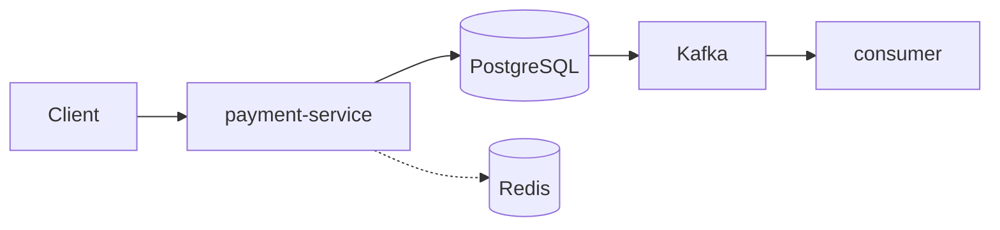
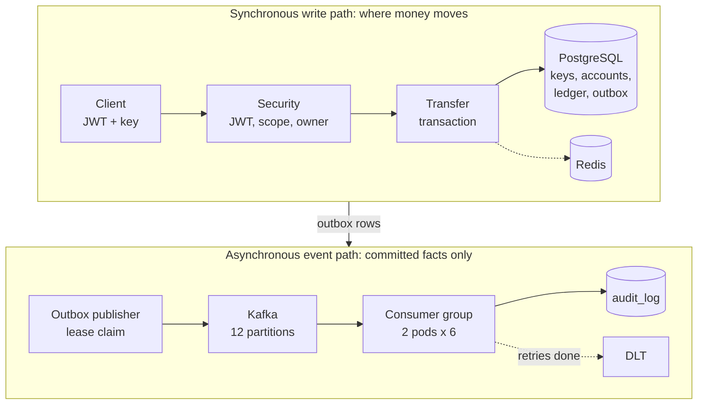
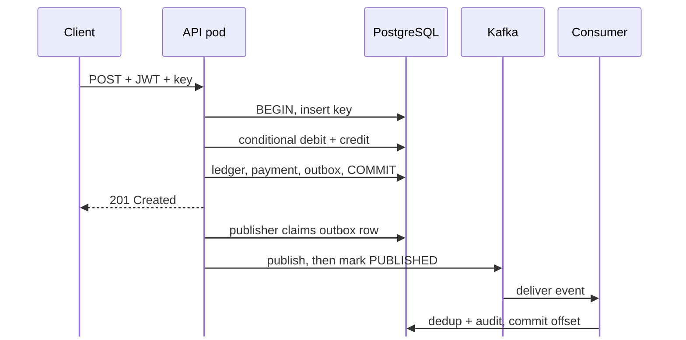
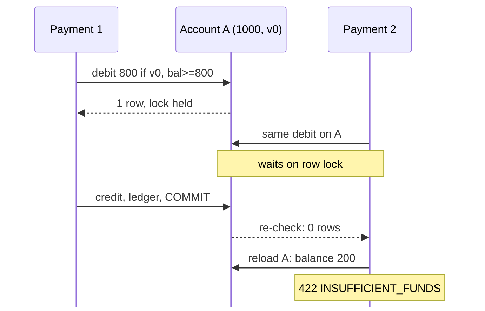

# High-Concurrency Payment & Transaction Processing System — Interview Playbook

*A secure, fault-tolerant payment backend for internal account-to-account transfers. Java 21, Spring Boot, PostgreSQL, Kafka, Redis, Docker and Kubernetes. Everything you need to explain the project, defend each resume bullet and answer the likely follow-ups in a 30–45 minute interview.*

**Resume bullets this booklet defends**

1. Built Spring Boot microservices with ACID transactions, OAuth2/JWT auth, idempotency keys and optimistic locking for concurrent payments.
2. Designed Kafka event processing with retries, consumer groups and DLQs, sustaining 10K+ requests/min at less than 200 ms p95 latency.
3. Optimized PostgreSQL indexing, connection pooling & Redis caching, reducing p95 latency ~40% and DB CPU ~30%; deployed on Kubernetes.

# Part 1: Project Fundamentals

## 1.1 What is this project?

**What it does.** The system moves money between two accounts that live inside the same platform, for example from Alice's wallet to Bob's wallet. A client calls `POST /payments` with a source account, a destination account and an amount. The backend checks who is calling, makes sure the source account has enough money, debits one account, credits the other, records the movement in a ledger, and then tells other parts of the company ("a payment completed") through Kafka.

**The problem it solves.** Moving money looks like two simple updates, but in a real backend thousands of requests arrive at the same time, networks time out, clients retry, and servers crash halfway through. Without careful design you get the classic failures: the same payment charged twice because the client retried, an account going negative because two payments read the same balance at the same moment, money debited from Alice but never credited to Bob because the server crashed between the two updates, or an audit system that silently misses events.

**Who would use it.** Any product with internal balances: wallets, marketplaces paying sellers, gaming credits, a company's internal treasury. The backend is the "money core" that other services call.

**Scope boundary to say out loud.** This is internal transfers in one currency. No card networks, external banks, foreign exchange, refunds or multi-region deployment. It is two Spring Boot services, not a full banking platform.

**What makes it technically interesting.** Correctness under concurrency and failure, not raw speed. The project shows four separate races and how each is closed: overspending (optimistic locking), duplicate retries (idempotency keys), concurrent duplicates (unique-index locking), and the "database committed but the event was lost" problem (transactional outbox).

> **Analogy:** Think of a bank branch with one official ledger book (PostgreSQL). Tellers (API pods) can serve customers in parallel, but every transfer is written into the book in one go, both lines or neither. Each customer gets a numbered ticket (idempotency key), so if they come back and ask again, the teller looks up the ticket instead of paying twice. A clerk later photocopies new entries for the audit office (outbox to Kafka); if the clerk is late, the money is still correct.

> **Example:** Alice has 1,000 cents. She sends 800 to Bob, her phone times out, and she taps "Pay" again. At the same moment a second, different 800-cent payment from Alice arrives. Correct outcome: exactly one 800-cent payment succeeds, the retry returns the same result instead of paying again, the other payment is rejected with `INSUFFICIENT_FUNDS`, Alice ends at 200, Bob gains 800, and one `PAYMENT_COMPLETED` event reaches the audit consumer.

## 1.2 Fundamentals required for this project

Every term below comes from the three resume bullets, plus the few ideas needed to understand the architecture.

| Resume bullet | Concepts you must be able to explain |
|---|---|
| 1. Spring Boot microservices with ACID transactions, OAuth2/JWT auth, idempotency keys and optimistic locking for concurrent payments | Spring Boot services, ACID, double-entry ledger, OAuth2/JWT, idempotency keys, optimistic locking |
| 2. Kafka event processing with retries, consumer groups and DLQs, 10K+ requests/min at < 200 ms p95 | Transactional outbox, Kafka topics/partitions/offsets, consumer groups, retries + DLQ, at-least-once + idempotent consumers, p95 and throughput |
| 3. PostgreSQL indexing, connection pooling and Redis caching, ~40% lower p95 and ~30% lower DB CPU; Kubernetes | B-tree and partial indexes, connection pooling (HikariCP), Redis cache-aside, Docker and Kubernetes |

### Spring Boot microservices

- **Simple:** Spring Boot is a Java framework that provides a web server, database access, security and configuration out of the box. "Microservices" means the system is split into separately deployable services.
- **Technical:** Two services. `payment-service` owns the REST API, security, the money transaction and the outbox publisher. `payment-consumer` reads Kafka events and writes audit rows. Each is its own Kubernetes Deployment and scales independently.
- **Why it matters:** Slow side effects (audit) run elsewhere and can fail or lag without touching payment latency.
- **In this project:** Accounts stay inside `payment-service` on purpose; a separate account service with its own database would need a distributed transaction for every transfer.
- **Interview angle:** "Two services sharing one database is not textbook microservices." Agree honestly: it is an accepted trade-off because the consumer never writes balances; if it needed its own database, it would persist audit rows from Kafka into its own store.

### ACID transactions

- **Simple:** A transaction is a group of database changes that behaves as one unit: either everything happens or nothing does.
- **Technical:** Atomicity (all-or-nothing), Consistency (constraints such as `balance >= 0` always hold), Isolation (concurrent transactions do not see each other's half-done work; here PostgreSQL `READ COMMITTED`), Durability (after `COMMIT` the change survives a crash because it is in the write-ahead log on disk).
- **Why it matters:** A transfer touches several rows: two balances, a payment row, two ledger rows, an idempotency row and an outbox row. A crash between them must never leave money half-moved.
- **In this project:** All of those writes happen in one PostgreSQL transaction. The `COMMIT` is the financial commit point; Kafka and Redis are deliberately outside it.
- **Interview angle:** "Which isolation level and why not SERIALIZABLE?" `READ COMMITTED` plus a conditional `UPDATE` already prevents overspending; `SERIALIZABLE` would add overhead and retry errors to every transaction.

### Double-entry ledger

- **Simple:** Every movement of money is written twice: once as a debit on the account it left, once as a credit on the account it entered. The two always add up to zero.
- **Technical:** A successful transfer inserts one `DEBIT` row and one `CREDIT` row with the same `payment_id`, amount and currency. The `accounts.balance_minor` column is a stored running total of those entries, kept for fast checks. Money is stored as integers in minor units (cents), never floating point.
- **Why it matters:** The ledger is the audit trail. You can always prove that `balance = opening + credits − debits`, and you can reconcile or investigate any discrepancy.
- **In this project:** Database constraints enforce row-level rules (`amount > 0`, at most one debit and one credit per payment). Equality of debit and credit is guaranteed by writing both in the same transaction and checked by integration tests, because a single-row `CHECK` cannot compare two rows.
- **Interview angle:** "Why store a balance if the ledger already has it?" It is a deliberate denormalisation for O(1) balance checks inside the debit `UPDATE`; the ledger remains the history.

### OAuth2 and JWT authentication

- **Simple:** The user logs in with an identity provider, which hands back a signed token. The payment API checks the signature instead of storing sessions.
- **Technical:** A JWT (JSON Web Token) is `header.payload.signature`. The payload carries claims such as `sub` (user id), `exp` (expiry), `iss` (issuer), `aud` (audience) and scopes. `payment-service` is an OAuth2 **resource server**: Spring Security fetches the issuer's public keys (JWKS), verifies the signature and claims, and rejects bad tokens with `401`. Keycloak issues tokens in development.
- **Why it matters:** Stateless authentication scales horizontally: any pod can validate any request with no shared session store.
- **In this project:** Authentication (who are you) is the JWT. Authorisation is two layers: scopes such as `payments.write` say what kind of action is allowed, and an ownership check (`accounts.owner_id = jwt.sub`) says which rows you may touch. A valid token cannot debit someone else's account (`403`).
- **Interview angle:** "Did you build OAuth2?" No. The service validates tokens; it does not issue them. Say "OAuth2 resource server with JWT validation".

### Idempotency keys

- **Simple:** The client attaches a unique ID to a payment request. If it sends the same request again, the server recognises the ID and returns the original result instead of paying again.
- **Technical:** The client sends an `Idempotency-Key` header. Inside the money transaction the server first inserts `(subject, idempotency_key, request_hash)` into a table whose primary key is `(subject, idempotency_key)`. Only the transaction whose insert succeeds may debit. A later duplicate hits the unique constraint, and the server returns the stored response. A different body with the same key gets `409 IDEMPOTENCY_KEY_REUSED`.
- **Why it matters:** A timeout is ambiguous: the client cannot tell "not executed" from "executed but the reply was lost". Retrying without a key risks a double charge; not retrying risks a lost payment.
- **In this project:** The key insert is in the same transaction as the debit, so "key recorded" and "money moved" commit together. If two copies arrive at once, PostgreSQL makes the second insert wait on the first; the loser never debits.
- **Interview angle:** "Why not a Redis lock?" A Redis lock lives outside the money transaction, so there is a window where the lock and the payment disagree. The unique index is the lock and the record at the same time.

### Optimistic locking (conditional update)

- **Simple:** Instead of locking an account before reading it, you read freely and, when writing, say "update only if nothing changed since I read it and there is still enough money".
- **Technical:** Each account row has a `version` column. The debit is one statement: `UPDATE accounts SET balance = balance − :amt, version = version + 1 WHERE id = :id AND version = :v AND balance >= :amt`. If it updates 0 rows, the service reloads the row: insufficient funds is returned as `422` and not retried; a changed version with enough money is a conflict and the whole transaction is retried (at most 3 attempts, then `409 CONCURRENT_UPDATE`). Accounts are always updated in ascending id order to avoid deadlocks.
- **Why it matters:** It prevents the lost update: two requests both read 1,000, both subtract 800, and the account ends at −600 or one write overwrites the other.
- **In this project:** It is not lock-free. The `UPDATE` holds a short row lock until commit; a waiting `UPDATE` re-checks its `WHERE` clause on the new row and matches 0 rows. What we avoid is holding a long `SELECT FOR UPDATE` lock from the start of the request.
- **Interview angle:** "Optimistic vs pessimistic?" Pessimistic (`SELECT FOR UPDATE`) suits a few very hot accounts; optimistic suits traffic spread over many accounts where conflicts are rare.

### Transactional outbox

- **Simple:** Instead of sending a Kafka message directly, the service writes "an event needs to be sent" into a table in the same database transaction as the payment. A background publisher sends it later.
- **Technical:** This solves the dual-write problem: PostgreSQL and Kafka are two systems, and you cannot commit both atomically without two-phase commit. Commit-then-publish loses the event if the pod dies in between; publish-then-commit can announce a payment that rolled back. The outbox row commits with the money. The publisher claims rows with `FOR UPDATE SKIP LOCKED` and a 30-second lease, sends them with `acks=all`, then marks them `PUBLISHED`.
- **Why it matters:** Every committed payment eventually produces an event, and Kafka outages never block payments.
- **In this project:** The publisher runs every 200 ms in each `payment-service` pod; leases stop two pods from claiming the same row at once. A crash after the broker acknowledges but before marking `PUBLISHED` causes a re-send, so delivery is at-least-once.
- **Interview angle:** "Why not Debezium (CDC)?" Polling needs no extra infrastructure; the cost is ~200 ms event delay and some DB queries. CDC is the upgrade if lag matters.

### Kafka: topics, partitions and offsets

- **Simple:** Kafka is a durable, append-only log of messages. Producers write to the end; consumers read at their own pace and can re-read.
- **Technical:** A topic (`payment.events`) is split into partitions (12 here). Each message is appended to one partition, chosen by hashing its key (`sourceAccountId`), and gets an increasing offset. Order is guaranteed only within a partition. Messages stay for the retention period (7 days) whether or not they were read.
- **Why it matters:** It decouples the payment path from slower work: the consumer can be down for an hour and catch up later without data loss.
- **In this project:** Kafka carries already-committed facts (`PAYMENT_COMPLETED`). It never creates, confirms or rolls back money; PostgreSQL does. Keying by source account keeps one account's events on one partition.
- **Interview angle:** "Does Kafka give exactly-once payments?" No. Payments are exactly-once in the database; Kafka delivery is at-least-once and consumers deduplicate.

### Consumer groups

- **Simple:** A consumer group is a team of consumers that share the work of reading a topic, each partition handled by exactly one member.
- **Technical:** Kafka assigns partitions to group members. With 12 partitions, 2 pods × 6 listener threads = 12 consumers, one per partition. If a pod dies, a rebalance moves its partitions to survivors. Each consumer commits its offset (its bookmark) after processing; after a crash, consumption resumes from the last committed offset.
- **Why it matters:** It gives parallelism and failover for free. More consumers than partitions sit idle, so partitions set the maximum parallelism.
- **In this project:** Group `payment-audit-consumers` writes `audit_log`. The offset is committed after the database write, so a crash in between causes redelivery, which is why the consumer deduplicates on `eventId`.
- **Interview angle:** "How would you scale consumption?" Add pods up to the partition count; beyond 12, add partitions (planned up front, because changing the count remaps keys).

### Retries, dead-letter queues and idempotent consumers

- **Simple:** If processing a message fails, try again a few times; if it still fails, park it in a separate "dead-letter" topic so it does not block everything behind it.
- **Technical:** Spring Kafka's `DefaultErrorHandler` retries transient errors with exponential backoff (1 s, 2 s, 4 s). After the retry budget, `DeadLetterPublishingRecoverer` publishes the original record plus exception headers to `payment.events.DLT` and commits the offset so the partition moves on. Poison messages (bad JSON) skip retries and go straight to the DLT. Duplicates are absorbed by unique keys on `processed_events.event_id` and `audit_log.payment_id`.
- **Why it matters:** Without a DLQ, one bad message blocks its partition forever; without dedup, at-least-once delivery creates duplicate audit rows.
- **In this project:** DLT replay is a manual operations step after the bug is fixed; dedup makes replay safe.
- **Interview angle:** "What is the downside of in-process retries?" A failing record blocks its partition for up to ~7 s of backoff; non-blocking retry topics are the alternative.

### Redis caching (cache-aside)

- **Simple:** Keep frequently read data in fast memory so the database does less work.
- **Technical:** Cache-aside: on a read, check Redis; on a miss, read PostgreSQL and store the value with a TTL. After a transfer commits, the service deletes the two accounts' keys. Account metadata lives 60 s; balances 5 s. Redis also holds a best-effort rate limiter.
- **Why it matters:** GET traffic stops competing with payments for database connections and CPU.
- **In this project:** Redis is never in the debit path; debits always read PostgreSQL. If Redis is down, reads go to the database and payments continue. A GET balance can be up to ~5 s stale (the "cache-aside fill race": a slow read can re-insert an old value after the delete), and the TTL bounds that.
- **Interview angle:** "Why not keep balances in Redis?" It cannot atomically debit one key, credit another and write a durable ledger. A cache that decides money becomes a second source of truth.

### Database indexing

- **Simple:** An index is like a book's index: it lets the database jump to the rows it needs instead of scanning the whole table.
- **Technical:** PostgreSQL's default B-tree index finds a row in O(log n). Composite indexes cover multi-column lookups (`(subject, idempotency_key)`). Partial indexes store only rows matching a condition, e.g. outbox rows that are still `PENDING`, so the publisher's poll touches the small backlog, not 7 days of published rows.
- **Why it matters:** Without them, the outbox poll (5 times a second per pod) and cleanup jobs would repeatedly scan growing tables, burning CPU and evicting useful pages from memory.
- **In this project:** Primary keys serve the hot path; partial indexes serve the outbox claim and cleanup; composite indexes serve payment history. Every index adds a small write cost.
- **Interview angle:** "How do you know an index is used?" `EXPLAIN (ANALYZE, BUFFERS)` and `pg_stat_statements` before and after.

### Connection pooling (HikariCP)

- **Simple:** Opening a database connection is slow, so the app keeps a pool of open connections and lends them to requests.
- **Technical:** HikariCP holds a fixed set of connections (20 per API pod in the optimised setup). A request borrows one for its transaction and returns it. If all are busy, requests wait; that waiting is pure added latency. By Little's law, connections needed ≈ transactions per second × transaction duration.
- **Why it matters:** An uncontended transfer is roughly 10–25 ms of real work (illustrative), so a 200 ms p95 budget is mostly about queueing. A too-small pool makes requests queue; a too-large pool overloads PostgreSQL.
- **In this project:** Total connections (`pods × pool size`) must stay below PostgreSQL's `max_connections` with headroom. Short transactions with no network calls inside keep connection hold time low.
- **Interview angle:** "Why not just make the pool huge?" Beyond the database's cores, extra connections add context switching and lock contention, not throughput.

### Latency percentiles and throughput

- **Simple:** p95 latency of 200 ms means 95 of every 100 requests finished within 200 ms. Throughput is requests completed per unit time.
- **Technical:** Sort all durations in the measurement window; p95 is the value at the 95th-percentile rank. Averages hide slow outliers. 10K requests/min ≈ 167 per second. Percentiles from different pods are merged from histograms, never averaged.
- **Why it matters:** The resume numbers are stated this way, so you must know exactly what they mean.
- **In this project:** They refer to `POST /payments`, measured client-side with k6 at a fixed arrival rate. They are benchmark targets, not recorded results (Q24, Part 6).
- **Interview angle:** "Why p95 and not average?" The average can look fine while 1 in 20 users waits seconds.

### Docker and Kubernetes deployment

- **Simple:** Docker packages the app and its dependencies into an image; Kubernetes runs many copies of that image, restarts crashed ones and routes traffic to healthy ones.
- **Technical:** Two Deployments (2 replicas each), a ClusterIP Service, a ConfigMap (URLs, pool size) and a Secret (passwords). Readiness probes include the database, so a pod that cannot reach PostgreSQL gets no traffic; liveness probes do not, so a DB outage does not cause restart loops. Graceful shutdown drains in-flight requests.
- **Why it matters:** Rolling updates, self-healing and independent scaling of API and consumer.
- **In this project:** PostgreSQL, Kafka and Redis are provided dependencies. API scaling is capped by the database connection budget; consumer scaling by partitions.
- **Interview angle:** "Would you autoscale on CPU?" Optionally (min 2, max 4), but the real ceiling is the database, so replicas × pool size must stay within its connection limit.

> **Resume flag:** Four phrases could create a stronger impression than the design supports. Say them precisely: (1) "microservices" means two services sharing one PostgreSQL, a deliberate trade-off; (2) "OAuth2/JWT auth" means a resource server validating tokens, not an authorization server; (3) "optimistic locking" is a version-checked conditional `UPDATE` that still takes a short row lock, not lock-free; (4) "10K+ requests/min at < 200 ms p95" sits in the Kafka bullet but refers to `POST /payments` throughput; Kafka then carries about 10K events/min. All four numbers on the resume are benchmark targets, not measured results.

# Part 2: High-Level Design and Architecture

## 2.1 Technology stack

| Technology | Purpose in the project | Why it was selected |
|---|---|---|
| Java 21 + Spring Boot 3 | REST API, transactions, security, Kafka listeners | Mature JDBC transactions, Spring Security resource server and Spring Kafka; lets the project focus on payment correctness instead of plumbing |
| PostgreSQL 16 | Source of truth: accounts, payments, ledger, idempotency keys, outbox, audit | ACID transactions, constraints, row-level locking and unique indexes do the hard concurrency work |
| HikariCP | Database connection pool | Fast, bundled with Spring Boot, exposes wait-time metrics |
| Apache Kafka | Durable asynchronous delivery of `PAYMENT_COMPLETED` events | Replayable log, partitions for parallelism, consumer groups for failover |
| Redis 7 | Cache for account metadata and GET balance; best-effort rate limiting | Sub-millisecond reads; TTLs; safe to lose |
| Spring Security + Keycloak | JWT validation (Keycloak issues tokens in dev) | Standard OAuth2 resource-server support; stateless |
| Docker + Kubernetes | Packaging, replicas, probes, rolling updates | Independent scaling of API and consumer; self-healing |
| k6, Micrometer, Prometheus | Load testing and metrics | Arrival-rate load generation; p95 histograms, pool and outbox metrics |

**How they work together.** A request enters `payment-service`, Spring Security validates the JWT, and HikariCP lends a connection for one PostgreSQL transaction that moves the money and records an outbox row. After commit the service deletes two Redis keys and replies. Separately, the outbox publisher ships committed events to Kafka, and `payment-consumer` (a consumer group) turns them into audit rows. Kubernetes runs and scales both services.

## 2.2 High-level architecture

**In simple words.** There is one synchronous path where money moves (client → API → PostgreSQL), one asynchronous path where other systems hear about it (PostgreSQL outbox → Kafka → consumer), and one read path that is accelerated by a cache (API → Redis, falling back to PostgreSQL). Money only ever flows through the first path.

**Figure 1 — The simple picture: one write path, one event path, one read cache**

**Component responsibilities**

| Component | Responsibility |
|---|---|
| `payment-service` | Validates JWT, scopes and ownership; runs the transfer transaction (idempotency insert, conditional debit/credit, ledger, payment, outbox); deletes Redis keys after commit; runs the outbox publisher; serves GETs via cache-aside |
| PostgreSQL | Authoritative balances, payments, ledger, idempotency keys, outbox; enforces `CHECK`, `UNIQUE` and foreign-key constraints |
| Kafka `payment.events` | Durable, replayable fan-out of committed payment facts |
| `payment-consumer` | Consumer group that deduplicates on `eventId`, writes `audit_log`, retries transient failures, sends poison messages to the DLT |
| Redis | Account-metadata and balance cache for GETs; best-effort rate limiter. Never authorises a debit |
| Kubernetes | Two Deployments with probes, rolling updates and independent replica counts |

**Figure 2 — Detailed HLD. Top lane: the request commits one transaction (dotted: Redis keys deleted after commit). Bottom lane: outbox rows flow to Kafka and the consumer group; poison messages go to the DLT**

**How components communicate.** Client to API: synchronous HTTPS/JSON. API to PostgreSQL: JDBC through HikariCP, one transaction per transfer. API to Redis: synchronous commands with a 50 ms timeout, best effort. Publisher to Kafka: asynchronous produce with `acks=all`. Kafka to consumer: pull-based, offsets committed after the database write.

**Complete data flow.**
1. **Write path (synchronous, one transaction):** insert idempotency key → conditional debit and credit in id order → insert payment, two ledger rows and an outbox row → store the response on the key row → `COMMIT` → delete Redis keys → `201 Created`.
2. **Event path (asynchronous):** publisher claims `PENDING` outbox rows → produces to Kafka → marks `PUBLISHED` → consumer group writes `processed_events` + `audit_log` → commits offset.
3. **Read path (cache-aside):** `GET /balance` → Redis hit returns `cached: true`; miss reads PostgreSQL and sets the key with a 5 s TTL.

The event path only reads committed facts and the read path never feeds the write path. That one-way flow is why Kafka or Redis failures cannot corrupt balances.

**Where data is stored.** Everything durable is in PostgreSQL: `accounts` (balance, version, owner), `payments`, `ledger_entries`, `idempotency_keys` (kept 24 h), `outbox_events` (published rows deleted after 7 days), `processed_events` and `audit_log`. Kafka keeps events for 7 days. Redis keeps disposable copies with TTLs.

**How it scales.**
- **API:** add `payment-service` pods; the ceiling is the database connection budget (`pods × 20 < max_connections − headroom`) and the single PostgreSQL primary.
- **Consumers:** add pods up to the 12 partitions (2 × 6 threads today).
- **Reads:** Redis absorbs repeated GETs.
- **Hot spots:** one very busy account serialises on its row; conflicts become retries and occasional `409`s.

**What happens when a major component fails**

| Failure | What the system does | Effect on money |
|---|---|---|
| PostgreSQL down | Requests fail fast with `503`; readiness removes pods from the Service; clients retry with the same key later | None: nothing committed |
| Kafka down | Payments continue; outbox rows accumulate; publishers drain them when Kafka returns | None; audit is delayed |
| Redis down | Cache and rate limiter bypassed; reads go to PostgreSQL | None; GETs slower |
| API pod crashes mid-transaction | PostgreSQL rolls the transaction back; client retries | None |
| API pod crashes after commit | Client times out, retries with same key, gets the stored result; another pod publishes the outbox row | Money moved exactly once |
| Consumer pod crashes | Rebalance; partitions move; uncommitted records redelivered; dedup absorbs them | None |

## 2.3 Important architectural decisions

**1. PostgreSQL is the single source of truth for money.**
*Chosen:* all financial state and the event intent in one relational database. *Why:* ACID transactions, constraints and row locks give correctness without inventing anything. *Alternative:* Redis or Kafka as the ledger (event sourcing). *Why not:* Redis cannot atomically debit, credit and durably log; Kafka-first designs need extra machinery to reject overspends before acceptance. *Trade-off:* one primary is the write-scaling ceiling.

**2. Optimistic conditional update instead of pessimistic locks or SERIALIZABLE.**
*Chosen:* `UPDATE … WHERE version = :v AND balance >= :amt` under `READ COMMITTED`, ordered by account id, bounded retries. *Why:* conflicts are rare when traffic is spread over many accounts; locks are held only for the short update-to-commit window. *Alternative:* `SELECT … FOR UPDATE` at the start, or `SERIALIZABLE`. *Why not:* longer lock hold time, or serialization failures across all transactions. *Trade-off:* hot accounts see retries and some `409 CONCURRENT_UPDATE`.

**3. Idempotency key inserted inside the money transaction.**
*Chosen:* the unique `(subject, key)` insert is the first statement of the transfer transaction. *Why:* the key and the debit commit or roll back together; PostgreSQL's unique index blocks a concurrent duplicate. *Alternative:* Redis `SETNX` lock or a separately committed "reserve" row. *Why not:* both create a window where the lock and the payment disagree. *Trade-off:* a blocked duplicate holds a connection while it waits.

**4. Transactional outbox instead of publishing directly to Kafka.**
*Chosen:* write the event row in the same transaction; a lease-based poller publishes it. *Why:* no lost events, and Kafka availability never blocks payments. *Alternative:* commit-then-publish, two-phase commit, or Debezium CDC. *Why not:* the first loses events on crash, 2PC couples availability, CDC adds infrastructure. *Trade-off:* ~200 ms event delay and at-least-once delivery.

**5. Two services, one shared database.**
*Chosen:* `payment-service` owns all money tables; `payment-consumer` only writes audit tables. *Why:* avoids distributed transactions while keeping slow work off the request path. *Alternative:* a separate account service with its own database. *Why not:* every transfer would need 2PC or a saga across two money owners. *Trade-off:* a known microservices anti-pattern, accepted and documented with a migration path.

**6. Redis only as a fail-open read cache.**
*Chosen:* cache GETs with short TTLs, delete after commit, never read Redis for debits. *Why:* speed without risking money. *Alternative:* authorise debits from cached balances. *Why not:* a stale cache would approve overspends. *Trade-off:* GET balance can be up to ~5 s stale.

# Part 3: How the Project Works

## 3.1 One complete end-to-end request flow

Alice transfers 800 cents to Bob. Figure 3 shows the sequence; the numbered steps explain each one.

**Figure 3 — End-to-end payment flow: synchronous commit, asynchronous event**

1. **Request arrives.** The client sends `POST /api/v1/payments` with a bearer JWT, an `Idempotency-Key` header and `{source, destination, amount, currency}`. Kubernetes routes it to any `payment-service` pod.
2. **Authentication and validation.** Spring Security verifies the JWT signature (cached JWKS), expiry, issuer, audience and the `payments.write` scope. The body is validated; a Redis rate limiter checks the caller (skipped if Redis is down).
3. **Transaction begins.** HikariCP lends a connection; PostgreSQL `BEGIN`.
4. **Idempotency insert.** `INSERT INTO idempotency_keys (subject, key, request_hash)`. If it succeeds, this request owns the payment. A savepoint is set right after it.
5. **Load and authorise.** Both accounts are read by primary key; the service checks Alice owns the source, both accounts are `ACTIVE` and currencies match.
6. **Conditional debit and credit.** In ascending account-id order: debit Alice only if her version is unchanged and her balance ≥ 800; credit Bob only if active. Each `UPDATE` bumps the version.
7. **Ledger, payment and outbox.** Insert the `payments` row (`COMPLETED`), a `DEBIT` and a `CREDIT` ledger row with the same amount, and an `outbox_events` row (`PENDING`). Store the `201` response body on the idempotency row.
8. **Commit.** PostgreSQL makes all of it durable at once. This is the financial commit point.
9. **Post-commit cleanup.** Best-effort `DEL` of both accounts' Redis keys; failures are only logged.
10. **Response.** `201 Created` with the payment id and status.
11. **Event publication (asynchronous).** Within ~200 ms a publisher claims the outbox row with a lease, produces `PAYMENT_COMPLETED` to Kafka (key = Alice's account id), and marks it `PUBLISHED` after the broker acknowledges.
12. **Consumption.** The consumer that owns that partition inserts into `processed_events` (dedup) and `audit_log`, commits its offset, and may delete the Redis keys again.

## 3.2 Important alternative scenarios

**Scenario A: The client times out and retries.** The first request committed but the pod died before replying. The retry (same key, same body) fails its key insert with a unique violation, rolls back, re-reads the stored response in a fresh transaction and returns it with `200`. No second debit. If both copies arrive together, the second insert waits on the first; it then either replays (first committed) or proceeds as the only payer (first rolled back). Details in Q7 and Q21.

**Scenario B: Two different payments race for the same balance.** This is the case optimistic locking exists for (Figure 4).

**Figure 4 — Two 800-cent debits against a 1,000-cent balance: exactly one succeeds** [scale=0.70]

Without the predicate, both updates would subtract 800 and the account would reach −600 (and the `CHECK (balance >= 0)` constraint would then throw instead of returning a clean business error).

**Scenario C: A consumer keeps failing on one event.** A transient database error is retried after 1 s, 2 s and 4 s; if all attempts fail, the record goes to `payment.events.DLT` with exception headers, the offset is committed and the partition continues. Money is unaffected because it committed earlier. After a fix, operators replay the DLT; consumer dedup makes replay safe. (Kafka being fully down is covered in Q17.)

## 3.3 Important guarantees and limitations

| Property | Guaranteed? | Where it comes from |
|---|---|---|
| No negative balance | Yes | Conditional `UPDATE` predicate + `CHECK (balance >= 0)` |
| No partial transfer (debit without credit) | Yes | One transaction; savepoint for business failures |
| At most one financial effect per (subject, key) within 24 h | Yes | Composite primary key insert inside the transaction |
| Balanced ledger per payment | Yes, by transaction + tests | Both rows written together; cross-row equality is not a `CHECK` |
| Event eventually published for every committed payment | Yes, while PostgreSQL is intact | Outbox row committed with the money; leases reclaim stuck rows |
| Event published exactly once | No | At-least-once; consumers deduplicate |
| Global event ordering | No | Ordered per partition (per source account) only, and even that is weakened by multiple publishers |
| Fresh GET balance | No | Up to ~5 s stale from Redis |
| Duplicate protection without a key | No | The key is required; a new key per retry is a new payment |

**Where consistency comes from:** PostgreSQL alone, through transactions, row locks, unique indexes and constraints. Kafka and Redis add speed and decoupling, never correctness. **Failures** are handled by rolling back (nothing committed), replaying (committed, reply lost), re-publishing (event not yet sent) and deduplicating (event sent twice). **Accepted trade-offs:** eventual audit, slightly stale reads, retries on hot accounts, a single-primary write ceiling, and a shared database between two services.

# Part 4: Complete Interview Explanation

## 4.1 Two-minute explanation

> **Say it aloud:** "I built a payment backend for internal account-to-account transfers, like moving money between two wallets on the same platform. The hard part isn't speed, it's staying correct when thousands of requests arrive at once, clients retry after timeouts, and servers crash halfway.
>
> It's two Spring Boot services on Kubernetes, with PostgreSQL as the single source of truth. When a transfer comes in, the service validates the caller's JWT and checks they own the source account. Then, in one ACID transaction, it inserts the client's idempotency key, debits and credits the two accounts with a version-checked conditional update so concurrent payments can't overspend, writes a double-entry ledger, and writes an outbox row. That commit is the moment money moves.
>
> A background publisher reads the outbox and sends a payment-completed event to Kafka, where a consumer group writes audit records with retries and a dead-letter topic. Redis caches read-only account data but never decides a balance.
>
> My main contribution was closing four races: duplicate retries with idempotency keys, overspending with optimistic locking, concurrent duplicates with unique-index locking, and lost events with the transactional outbox. I sized it for 10K payment requests a minute at under 200 ms p95; those are benchmark targets with a documented test method, not production measurements."

## 4.2 Five-minute explanation

> **Say it aloud:** "**Problem.** The goal was a payment backend that moves money between internal accounts safely under concurrency. Four things go wrong in naive designs: a client retries after a timeout and gets charged twice; two payments read the same balance and both succeed, overspending; a crash leaves money debited but not credited; and the database commits but the event to downstream systems is lost.
>
> **Requirements.** Functionally: create accounts, transfer funds, query balances and payment status, authenticated with JWT and authorised by account ownership. Non-functionally: no negative balances, no double payments, no partial transfers, events that are never lost, and a target of 10K transfer requests per minute at under 200 ms p95.
>
> **Technology.** Java and Spring Boot for the services, PostgreSQL because ACID transactions and row locks do the hard correctness work, Kafka for durable asynchronous events, Redis as a read cache, and Kubernetes to run two independently scalable deployments.
>
> **Architecture.** [Draw Figure 1.] `payment-service` handles the API, security and the money transaction. PostgreSQL holds accounts, payments, the ledger, idempotency keys and an outbox table. A publisher inside each API pod ships outbox rows to a Kafka topic with 12 partitions. `payment-consumer` is a consumer group that writes audit rows.
>
> **Request flow.** The JWT is validated, then one transaction: insert the idempotency key; update both accounts in id order with `WHERE version = v AND balance >= amount`; insert the payment, a debit and a credit ledger row, and an outbox row; commit. After commit I delete the Redis keys and return 201.
>
> **Key decisions.** I keep money in one database to avoid distributed transactions. I use optimistic locking because traffic spreads over many accounts. The idempotency key lives in the same transaction as the debit, so a concurrent duplicate blocks on the unique index and never pays. And I use an outbox because publishing to Kafka after commit can lose events if the pod dies.
>
> **Reliability and performance.** If Kafka is down, payments continue and the outbox drains later. If Redis is down, reads go to the database. Consumers retry 1, 2 and 4 seconds, then send poison messages to a DLT, and deduplicate on event id. For latency, the real enemy is queueing, so I tuned HikariCP, added partial indexes for the outbox poll, and cached GETs in Redis. The resume numbers are targets I designed for and wrote a k6 methodology to verify."

## 4.3 Ten-minute explanation

> **Say it aloud:** "**Motivation.** Payments are a good test of backend fundamentals because every shortcut shows up as lost or duplicated money. I scoped it to internal transfers in one currency so the project is about correctness, not integrating card networks.
>
> **Architecture.** [Draw Figure 2.] Two services. `payment-service` is an OAuth2 resource server: it validates JWTs from Keycloak, then checks scopes and ownership, so even a valid token cannot touch someone else's account. It owns the transfer transaction and runs the outbox publisher. `payment-consumer` reads `payment.events` as a consumer group and writes audit rows. Both share one PostgreSQL. I'll be upfront that sharing a database is an anti-pattern; I accepted it because the consumer never writes balances, and splitting account ownership into another service would force two-phase commit or a saga on every payment.
>
> **The transaction, step by step.** First, insert `(subject, idempotency_key)`. That composite primary key is effectively a mutex: if two identical requests arrive together, the second insert waits on the first transaction's uncommitted row. When the first commits, the second gets a unique violation, rolls back, opens a fresh transaction and replays the stored response. If the first rolled back, the second proceeds. Either way exactly one debit happens.
>
> Next, I set a savepoint and update both accounts in ascending id order, which prevents A-to-B and B-to-A transfers from deadlocking. The debit is a conditional update with the version and the balance in the WHERE clause. Under READ COMMITTED, a waiting update re-checks its WHERE clause after the lock is released. So with a 1,000 balance and two 800 debits, one updates a row and the other updates zero. Then I reload the row and classify: balance too low means 422 insufficient funds, no retry; version changed but funds still sufficient means retry the whole transaction, up to three times, then 409. It's not lock-free: the update holds a row lock until commit. What I avoid is a long `SELECT FOR UPDATE` at the start of every request.
>
> Then I write the payment, two ledger rows with the same amount, and an outbox row, store the response on the key row, and commit.
>
> **Why the outbox.** Kafka and PostgreSQL can't commit atomically. If I commit then publish, a crash in between loses the event. If I publish then commit, I might announce a payment that rolled back. The outbox row commits with the money. Every 200 ms a publisher claims pending rows using `FOR UPDATE SKIP LOCKED` and a 30-second lease, sends them with `acks=all`, and marks them published. If it crashes after Kafka acknowledges but before marking, the event is sent twice. That's at-least-once, so the consumer deduplicates on event id and the audit table has a unique payment id.
>
> **Kafka processing.** The topic has 12 partitions keyed by source account, so one account's events stay ordered on one partition. Two consumer pods with six threads give one thread per partition. Offsets are committed after the database write. Transient failures retry with 1, 2 and 4 second backoff; after that the record goes to a dead-letter topic so the partition isn't blocked, and replay is a manual step after a fix.
>
> **Caching.** Redis caches account metadata for 60 seconds and balances for 5 seconds, with deletes after commit. A GET can still be up to five seconds stale because of a cache-aside fill race, but debits never read Redis, so staleness can never cause an overspend.
>
> **Performance.** An uncontended transfer is about ten indexed statements and a commit, roughly 10 to 25 milliseconds. So the 200 ms p95 budget is mostly about queueing for connections and row locks. The levers are a right-sized HikariCP pool, partial indexes so the outbox poll scans only the backlog, short transactions with no network I/O inside, and Redis taking GET traffic off the database. I'd verify with k6 at a fixed arrival rate of 167 POSTs per second, a two-minute warm-up, a ten-minute steady window, baseline versus optimised, three runs each. The 10K per minute, 200 ms, 40% and 30% figures are targets; I wouldn't call them production measurements.
>
> **Failure handling.** PostgreSQL down: fast 503s, readiness pulls pods, clients retry with the same key. Pod crash before commit: rollback. After commit: replay. Kafka down: outbox backlog. Consumer crash: rebalance and redelivery.
>
> **Limitations and next steps.** Single PostgreSQL primary, so writes don't scale out; hot accounts serialise; events are at-least-once and only per-partition ordered; reads can be briefly stale. With more time I'd add pessimistic locking or sub-account bucketing for very hot accounts, CDC instead of polling, time-partitioned idempotency tables, and OpenTelemetry tracing."

# Part 5: Interview Questions and Answers

## 5.1 Basic understanding

#### Q1. What does your payment system do, in one minute? [Easy]

It is a backend that moves money between two internal accounts, for example between two wallets on the same platform. A client calls `POST /payments` with a JWT and an idempotency key. The service validates the caller and checks they own the source account, then performs the transfer as a single PostgreSQL transaction: it records the idempotency key, debits the source with a version-checked conditional update, credits the destination, writes a double-entry ledger, and writes an outbox row. After commit, a publisher sends a `PAYMENT_COMPLETED` event to Kafka, and a consumer group writes audit records with retries and a dead-letter topic. Redis caches read-only account data. The emphasis is correctness under concurrency and failure: no double payments, no overspending, no half-finished transfers and no lost events.

**Related follow-up:** "What is out of scope?" External banks, card networks, FX, refunds and multi-region.

#### Q2. Why is moving money between two accounts harder than two UPDATE statements? [Easy]

Because they run amid concurrency and failures. A crash between debit and credit leaves money missing, so both need one atomic transaction. Two requests can read the same balance at once and both subtract, overspending the account (the lost-update race). A client that times out cannot tell whether the first attempt ran, so a naive retry charges twice. And other systems must hear about the payment, but the database and Kafka cannot commit together, so an event can be lost. The fixes, in order: ACID transaction, optimistic conditional update, idempotency key, transactional outbox.

#### Q3. Walk me through what happens during a normal transfer request. [Easy]

Spring Security validates the JWT (signature, expiry, issuer, audience, scope). One PostgreSQL transaction then: inserts the idempotency key (success means this request owns the payment); loads both accounts and checks ownership, status and currency; updates them in id order, with the debit conditional on an unchanged version and sufficient balance; inserts the payment, a debit and a credit ledger row and an outbox row; stores the response on the key row; commits. After commit it deletes the two Redis keys and returns `201`. Asynchronously, the outbox publisher sends the event to Kafka and the consumer writes the audit row. (Full step list in 3.1.)

**Related follow-up:** "Which step is the commit point?" The PostgreSQL `COMMIT`. Kafka and Redis are outside it.

#### Q4. Where is the source of truth, and why there? [Easy]

PostgreSQL is the only source of truth for money: balances, payments, the ledger, idempotency keys and the outbox. A relational database gives exactly what money needs: multi-row ACID transactions, constraints such as `balance >= 0`, unique indexes that act as locks, and row-level locking for concurrent updates. Kafka is a delivery mechanism for facts that are already committed; it never creates or confirms money. Redis is a disposable cache; if it lost all data, balances would still be correct. Keeping one authority also means there is no second copy that can disagree, which is the root of many financial bugs. The trade-off is that a single PostgreSQL primary is the write-scaling ceiling; sharding accounts would be the next step at much larger scale.

## 5.2 Core concepts

#### Q5. What does ACID mean, and how does each letter apply to a transfer? [Easy]

Atomicity: the key insert, both account updates, the payment row, both ledger rows and the outbox row commit together or not at all, so a crash cannot leave a debit without a credit. Consistency: database rules always hold after a commit; here `CHECK (balance_minor >= 0)`, positive amounts, foreign keys, and one debit plus one credit per payment. Isolation: concurrent transactions do not see each other's uncommitted changes; the project uses PostgreSQL's `READ COMMITTED` plus a conditional update, which is enough to stop overspending without the cost of `SERIALIZABLE`. Durability: once `COMMIT` returns, the change is in PostgreSQL's write-ahead log on disk and survives a crash of the database or the JVM. The design also refuses `synchronous_commit = off`, because that trades durability of acknowledged payments for latency.

**Related follow-up:** "Can a CHECK constraint guarantee debit equals credit?" No, it sees one row only; the transaction and tests guarantee it.

#### Q6. Why did you use idempotency keys? [Easy]

Because clients retry, and a timeout is ambiguous. If a client sends a payment and the connection drops, it cannot know whether the server never received it, failed, or succeeded and lost the reply. Not retrying risks losing a payment; retrying blindly risks paying twice. An idempotency key is a client-generated unique id for one logical payment. The server inserts `(subject, key, request_hash)` as the first statement of the money transaction, with `(subject, key)` as the primary key. If the insert succeeds, this request is the first and proceeds. If it fails with a unique violation, the payment already happened (or is in flight), so the server returns the stored response instead of debiting again. The check must be atomic with the debit: if the key were recorded in a separate step, a crash or race between the two could leave a key without a payment or a payment without a key.

**Related follow-up:** "What if the same key arrives with a different amount?" Request hashes differ, so it returns `409 IDEMPOTENCY_KEY_REUSED` with no financial effect.

#### Q7. What happens if two identical requests with the same key arrive at exactly the same time? [Medium]

Both open transactions and both try to insert the same `(subject, key)`. PostgreSQL lets the first insert proceed and makes the second **wait**, because a unique index entry from an uncommitted transaction blocks conflicting inserts. The waiting request has not touched any account yet. Two outcomes follow. If the first transaction commits (success or a stored business error), the second insert fails with `23505 unique_violation`, which aborts its transaction; the application rolls back, opens a new transaction, reads the stored row, checks the request hash and returns the original response with `200`. If the first transaction rolls back (crash, deadlock, version conflict), its uncommitted key disappears, the second insert succeeds, and the second request becomes the only one allowed to debit. In both cases exactly one session runs the debit. This is why the unique index, not an application-level check-then-insert, is the lock.

**Related follow-up:** "Different users sending the same key?" Different `subject`, different row; they are independent payments.

#### Q8. Explain optimistic locking and how it prevents overspending. [Easy]

Optimistic locking assumes conflicts are rare: you read without locking and make the write conditional on nothing having changed. Each account row has a `version`. The debit is `UPDATE accounts SET balance = balance − 800, version = version + 1 WHERE id = A AND version = 0 AND balance >= 800`. With a balance of 1,000 and two concurrent 800 debits, the first update matches and takes a short row lock. The second waits on that lock; when the first commits, PostgreSQL re-evaluates the second's `WHERE` clause on the new row (balance 200, version 1) and updates zero rows. The service then reloads: balance 200 < 800, so it returns `422 INSUFFICIENT_FUNDS` and does not retry. If the version changed but funds were still sufficient, it would retry the whole transaction, up to three times. The result: exactly one payment succeeds and the balance never goes negative.

**Related follow-up:** "Is that lock-free?" No; the update holds a row lock until commit. It avoids long upfront locks, not all locks.

#### Q9. Why both idempotency keys and optimistic locking? Isn't one enough? [Medium]

They solve different races. An idempotency key protects against the **same** payment being executed twice, for example a client retrying after a timeout or sending two copies at once. It does nothing when two **different** payments, with different keys, compete for one balance; both keys are new, so both would proceed. Optimistic locking protects against that second case: two different payments cannot both debit the same balance if only one fits, because the conditional update lets only one win. Conversely, optimistic locking does not stop a retry with no key from creating a second, perfectly valid payment, because the second attempt sees a fresh version and enough money. Using only idempotency leaves overspending; using only locking leaves double charges. The cost is two mechanisms to implement and test, which is acceptable for money.

#### Q10. What is double-entry bookkeeping and how is it represented? [Easy]

Double-entry means every movement is recorded as two equal and opposite entries: a debit on the account money left and a credit on the account money entered. The sum over all entries is always zero, so money is never created or destroyed by accident. Here each successful transfer inserts two rows into `ledger_entries` with the same `payment_id`, the same amount in integer cents and the same currency, one `DEBIT` and one `CREDIT`. The `accounts.balance_minor` column is a running total kept for fast checks, and tests verify `balance = opening + credits − debits`. A unique constraint on `(payment_id, entry_type)` stops two debits for one payment, but equality of the two amounts is guaranteed by writing both from the same variable in the same transaction. In an interview, mention that money is never stored as floating point, because binary floats cannot represent cents exactly.

#### Q11. Explain JWT and OAuth2 as used in this project. [Easy]

OAuth2 is a framework for delegated authorisation; in this project it is used through the "resource server" role. An identity provider (Keycloak in development) authenticates the user and issues a JWT access token. A JWT has three Base64 parts: a header, a payload of claims (`sub`, `exp`, `iss`, `aud`, scopes) and a signature. `payment-service` never stores sessions; on every request Spring Security verifies the signature against the provider's public keys (cached from its JWKS endpoint) and checks expiry, issuer, audience and scope. Invalid tokens get `401`. Then authorisation happens in two layers: scopes such as `payments.write` grant a capability, and the service checks `accounts.owner_id = jwt.sub` for the specific account. A valid token for Alice still gets `403` if it tries to debit Bob's account. Because validation is stateless, any pod can serve any request.

**Related follow-up:** "How do you revoke a JWT?" You mostly can't before expiry; use short lifetimes and token introspection for high-value operations.

## 5.3 Kafka, outbox and reliability

#### Q12. What is the transactional outbox pattern and why did you need it? [Easy]

It solves the dual-write problem. After a payment commits, Kafka must hear about it, but PostgreSQL and Kafka are two systems with no shared transaction. If the service commits and then publishes, a crash in between loses the event: the money moved but audit never runs. If it publishes first and then the transaction rolls back, downstream systems hear about a payment that never happened. With the outbox, the event is written as a row in `outbox_events` inside the same transaction as the payment, so the event intent is exactly as durable as the money. A background publisher then reads pending rows and sends them to Kafka, marking them `PUBLISHED` after the broker acknowledges. If Kafka is down, rows simply wait. The cost is a small delay (the poll runs every 200 ms) and at-least-once delivery.

**Related follow-up:** "Why not `@TransactionalEventListener(AFTER_COMMIT)`?" It still loses the event if the JVM dies right after commit.

#### Q13. Several API pods run the outbox publisher. How do you stop them sending the same row? [Medium]

Each publisher claims a batch with a short transaction: `UPDATE outbox_events SET status = 'PUBLISHING', claimed_by = me, lease_until = now() + 30 s WHERE id IN (SELECT id … WHERE status = 'PENDING' OR (status = 'PUBLISHING' AND lease_until < now()) ORDER BY created_at LIMIT 50 FOR UPDATE SKIP LOCKED)`, and commits that claim. `SKIP LOCKED` means two publishers polling at the same moment skip each other's locked rows instead of waiting, and the committed lease means other publishers ignore the row until it expires. Kafka sends happen **after** the claim commits, so no database lock is held across network I/O. On acknowledgement the row is marked `PUBLISHED`. If a publisher dies, its lease expires and another pod reclaims the row. One duplicate window remains: Kafka acknowledged but the pod crashed before marking `PUBLISHED`. That is why delivery is at-least-once and consumers deduplicate.

#### Q14. What are consumer groups and how did you size them? [Easy]

A consumer group is a set of consumers that share a topic: Kafka assigns each partition to exactly one member, so members process different partitions in parallel, and if one dies its partitions are reassigned to the others (a rebalance). Each member tracks an offset per partition, the position of the next message to read, and commits it after processing. The topic `payment.events` has 12 partitions. The target is 10K+ payments per minute, about 167 events per second, roughly 14 per partition, so 12 partitions give comfortable headroom. Two consumer pods with six listener threads each give 12 consumers, one per partition, and losing a pod still leaves six threads. Adding more consumers than partitions does not help; extra consumers sit idle. The partition key is `sourceAccountId`, which keeps one account's events in order on one partition.

**Related follow-up:** "Can you add partitions later?" Yes, but keys remap to new partitions, breaking per-key ordering across the change, so plan the count up front.

#### Q15. How do retries and the dead-letter queue work in the consumer? [Easy]

When the consumer's database write fails, Spring Kafka's `DefaultErrorHandler` retries the same record with exponential backoff: 1 s, then 2 s, then 4 s, but only for errors marked transient, such as a database timeout. Errors that will never succeed, such as malformed JSON or a validation failure, are marked non-retryable and skip retries. When retries are exhausted, `DeadLetterPublishingRecoverer` publishes the original record, plus headers describing the exception, to `payment.events.DLT` and commits the offset, so the partition moves on instead of being blocked forever by a poison message. Money is unaffected because it was already committed. Operators inspect the DLT, fix the bug and replay the records; consumer deduplication makes replay safe even if some had already been processed.

**Related follow-up:** "Downside?" In-process retries block that partition for the backoff time; separate retry topics avoid this at the cost of more topics.

#### Q16. Kafka is at-least-once. How do you prevent duplicate side effects? [Medium]

Duplicates can come from two places: the outbox publisher re-sending after a crash between the broker's ack and marking the row published, and the consumer being redelivered a record after a crash between its database write and its offset commit. The consumer is therefore idempotent. Every event carries an `eventId` equal to the outbox row id. Processing one record is one database transaction that inserts into `processed_events` (primary key `event_id`) and `audit_log` (unique `payment_id`). If the event was already processed, the insert conflicts and the record is treated as already done, then its offset is committed. The dedup table keeps rows for 14 days, longer than the topic's 7-day retention, so any redelivered or replayed event is still recognised. An idempotent Kafka producer alone is not enough, because it only removes duplicates from one producer session, not from two different publisher pods.

#### Q17. What happens if Kafka is completely down for ten minutes? [Easy]

Payments keep working, because Kafka is not part of the money transaction: each transfer still commits its `PENDING` outbox row and returns `201`. Publishers fail to send; claimed rows wait for their 30-second lease to expire and are reclaimed. `outbox_pending` and the oldest-pending-age metric rise and alert. When Kafka returns, publishers drain the backlog automatically (batches of 50 every 200 ms, roughly 250 events/s per pod, above the 167/s steady state). Audit is delayed, not lost; duplicates from reclaimed leases are absorbed by consumer dedup. Readiness deliberately excludes Kafka so a broker outage does not remove API pods.

## 5.4 Performance and caching

#### Q18. How does Redis caching work here, and why is it not used for debits? [Easy]

The pattern is cache-aside. On `GET /accounts/{id}` or `GET /balance`, the service checks Redis; on a hit it returns the cached value, on a miss it reads PostgreSQL and stores the value with a TTL of 60 seconds for metadata and 5 seconds for balances. After a transfer commits, the service deletes both accounts' keys; the consumer may delete them again as a supplement. Debits never read Redis: the conditional `UPDATE` always uses the PostgreSQL row. The reason is that a cache is stale by definition. A race called the cache-aside fill race shows it: a slow GET reads the old balance, a transfer commits and deletes the key, then the slow GET writes the old balance back. The 5-second TTL bounds that staleness for reads, but if debits trusted the cache, staleness would become overspending. Redis is also fail-open: if it is down, reads go to the database and payments are unaffected.

#### Q19. How do indexing and connection pooling reduce latency and database CPU? [Medium]

Latency at load is mostly waiting, not working. An uncontended transfer is about ten primary-key statements and a commit, roughly 10–25 ms (illustrative), so the p95 budget is consumed by queueing for a pooled connection or a row lock. **Connection pooling:** HikariCP keeps a fixed set of open connections. With a pool of 5 per pod, bursts of 167 transfers per second plus uncached GETs exceed available connections and requests queue inside Hikari; queueing delay grows sharply as utilisation approaches 100%. Raising the pool to 20 per pod (staying under PostgreSQL's connection limit) removes most of that wait. **Indexing:** without partial indexes, the outbox poll (five times a second per pod) and cleanup jobs scan whole tables, including days of published rows, which burns CPU and pushes useful pages out of memory. A partial index on pending rows makes the poll proportional to the small backlog. **Redis** removes repeated GET queries. The expected effect is lower POST p95 mainly from the pool and indexes, and lower DB CPU mainly from indexes and Redis.

**Related follow-up:** "How would you prove which change helped?" An ablation: indexes only, then plus pool, then plus Redis, at the same load.

#### Q20. How does the system scale, and what limits it? [Easy]

The API is stateless, so you add `payment-service` pods; JWT validation needs no shared session. The real ceiling is PostgreSQL: one primary takes all writes, and each pod's pool adds connections, so replicas × pool size must stay under `max_connections` with headroom (e.g. 2 × 20 for the API plus 2 × 10 for consumers, under 100). Consumers scale up to the 12 partitions; reads scale with Redis. Two limits matter: one very hot account serialises on its row (retries and some `409`s), and writes cannot exceed what one primary can commit. At larger scale: shard accounts, bucket hot accounts into sub-accounts, and use read replicas only for history, never for balance decisions, because replica lag would make them unsafe.

## 5.5 Failures, trade-offs and resume defence

#### Q21. What happens if the pod crashes after the commit but before replying? [Easy]

From the database's point of view the payment is complete: the money moved, the ledger and the outbox row are committed, and the idempotency row stores the `201` response. The client sees a timeout or connection reset. A well-behaved client retries with the same idempotency key and body, possibly reaching another pod. That pod's key insert fails with a unique violation, it opens a fresh transaction, finds the stored response with a matching hash and returns it with `200` and the same payment id. No second debit happens. The outbox row is published by whichever pod's publisher claims it next, so the event is not lost either. This scenario is exactly why idempotency exists: the client cannot distinguish "never happened" from "happened, reply lost", and the key makes retrying safe in both cases.

#### Q22. Why not use SELECT FOR UPDATE or the SERIALIZABLE isolation level? [Medium]

`SELECT … FOR UPDATE` (pessimistic locking) locks the account rows at the start of the request and holds them until commit. It is correct, but locks are held longer, including during validation and other statements, so concurrent transfers on busy accounts queue behind each other and deadlock risk grows. It offers no extra correctness over a conditional update whose `WHERE` clause re-checks balance and version. `SERIALIZABLE` makes PostgreSQL detect any non-serialisable interleaving and abort one transaction with `40001`; that adds tracking overhead and retry work to every transaction, including ones that never conflict. The chosen design keeps `READ COMMITTED`, uses a single conditional `UPDATE` (short lock from update to commit), orders updates by id to avoid deadlocks, and retries rare conflicts. Pessimistic locking would be reasonable for a small set of extremely hot accounts, which is listed as a future improvement.

#### Q23. What are the main limitations, and what would you improve? [Easy]

Scope: internal single-currency transfers; no refunds, holds or external rails. Scalability: one PostgreSQL primary caps writes; hot accounts serialise on one row. Consistency: events are at-least-once and ordered only per partition; GET balances can be ~5 s stale; idempotency keys expire after 24 h. Architecture: two services share one database. Operations: the polling outbox adds a few hundred ms of event delay; in-process consumer retries briefly stall a partition. With more time: pessimistic locks or sub-accounts for hot accounts, Debezium CDC, non-blocking retry topics, time-partitioned idempotency and outbox tables, a synchronous standby, mTLS, OpenTelemetry tracing, and actually running the benchmark to fill the results table.

#### Q24. What exactly does "10K+ requests/min at under 200 ms p95" mean, and how would you measure it? [Medium]

It means at least 10,000 `POST /payments` requests per minute, about 167 per second, each a full ACID transfer, with 95% of them completing in under 200 ms, measured at the client. GET traffic is additional and not counted, and Kafka should then carry about 10K `PAYMENT_COMPLETED` events per minute. The method: k6 with an **open-loop arrival-rate** executor at 167 POST/s, so the generator keeps sending even when the server slows (a closed loop would hide latency, called coordinated omission); about 500 GET/s on top; 10,000 seeded accounts so contention is realistic; unique idempotency keys; a 2-minute warm-up discarded and a 10-minute steady window; three runs; report achieved versus offered rate, p95 and p99, error rate, and run SQL invariant checks afterwards. Percentiles from different pods are merged from histograms, never averaged. Honestly, 167 transfers per second is modest for PostgreSQL; the point is doing it with idempotency, conditional updates, a ledger and an outbox in every transaction.

**Related follow-up:** "Is it measured?" No. It is a benchmark target with a written methodology; the results table is still empty.

#### Q25. How would you justify the ~40% p95 and ~30% DB CPU reductions? [Medium]

Both are A/B targets at the same offered load, not measured results. The baseline is the same code with a small Hikari pool (5 per pod), only the indexes required for correctness, and Redis off. The optimised run uses a pool of 20, partial indexes for the outbox claim and cleanup, history indexes, and Redis for GETs. The reduction formula is `(baseline − optimised) / baseline`, for example 300 ms to 180 ms is 40% (illustrative arithmetic only). The p95 gain is expected mainly from removing connection-pool waiting; the CPU gain mainly from replacing repeated sequential scans with partial-index lookups and moving GET queries to Redis. Evidence required: absolute p95 and CPU for both configurations, three runs each, identical POST and GET rates, an ablation showing each lever's share, `pg_stat_statements` deltas, and disclosure of the baseline settings. A percentage is only as honest as its baseline; an artificially tiny pool would inflate it.

#### Q26. If you had to design this for 100× the traffic, what would change? [Hard]

At about 17K transfers per second, one PostgreSQL primary would be the bottleneck for commits and WAL writes. I would shard accounts by id range or hash across several PostgreSQL clusters. Transfers within one shard stay a single local transaction. Cross-shard transfers can no longer be one ACID transaction, so they would become a saga: debit the source shard and record a pending transfer with an outbox event, credit the destination shard idempotently, and compensate with a reversing entry if the credit fails. Idempotency keys would be partitioned by time and dropped by partition. Hot accounts (for example a merchant receiving many payments) would be split into sub-accounts. The outbox would move to CDC (Debezium) to cut polling load, Kafka partitions would increase, and consumers would scale with them. I would keep the core rule: one authoritative store per account, and every cross-system step idempotent.

#### Q27. Why did you call it microservices if both services share one database? [Medium]

I'd answer directly: it's two independently deployable Spring Boot services, and they do share one PostgreSQL database, which is a known microservices anti-pattern. The split exists for operational reasons: the consumer scales and fails independently of the API, so slow audit work never touches payment latency. The shared database is a deliberate trade-off for correctness. All financial tables (accounts, payments, ledger, idempotency, outbox) are written only by `payment-service`; the consumer writes only `processed_events` and `audit_log`. The alternative that would be genuinely wrong is splitting account ownership into a separate service with its own database, because then every transfer would need two-phase commit or a saga across two owners of money. If the consumer later needed independence, it would stop using this database and persist audit rows from Kafka into its own store, with no change to the money path.

#### Q28. What did you personally design or implement, and what is still unverified? [Easy]

Be precise. The design and intended implementation cover: the transfer transaction (idempotency insert as mutex, savepoint, id-ordered conditional updates, reload-and-classify, bounded retries), the double-entry ledger schema and its invariants, JWT resource-server security with ownership checks, the lease-based transactional outbox, the Kafka consumer group with retries, DLT and deduplication, cache-aside with post-commit invalidation, the indexing and pooling plan, Kubernetes manifests with probes, and a k6 benchmark methodology with SQL invariant checks. What is not verified: none of the throughput, latency or percentage figures has a recorded run; they are benchmark targets. Say so without being asked if the interviewer probes numbers: "These are the targets I designed for, and I wrote the test procedure; I wouldn't present them as production measurements." That honesty is usually respected and protects the rest of your answers.

# Part 6: Final Revision Sheet

### 1. Project in one paragraph

Spring Boot backend for internal transfers. One PostgreSQL ACID transaction per transfer: idempotency key, conditional debit/credit, double-entry ledger, outbox row. A publisher relays events to Kafka; a consumer group audits with retries, DLT and dedup. Redis caches GETs only. Two services on Kubernetes, one database.

### 2. Architecture in one diagram

<b>Sync:</b> Client → API (JWT, owner) → PostgreSQL txn [key → debit/credit → ledger, outbox] → COMMIT → 201

<b>Async:</b> outbox → publisher (lease) → Kafka (12 partitions) → consumer group → audit_log / DLT

### 3. Stack and responsibilities

- **Spring Boot:** API, security, transactions, Kafka listeners
- **PostgreSQL:** the only source of truth
- **Kafka:** async, at-least-once event delivery
- **Redis:** fail-open read cache, rate limiter
- **HikariCP:** connection pool (20 per API pod)
- **Kubernetes:** 2 Deployments, probes, scaling

### 4. Five most important concepts

1. ACID transaction as the commit point
2. Idempotency key = unique insert inside the transaction
3. Optimistic conditional `UPDATE` (version + balance)
4. Transactional outbox (dual-write problem)
5. At-least-once delivery + idempotent consumer

### 5. Five key decisions

1. Money only in PostgreSQL
2. Conditional update, not pessimistic locks
3. Key insert inside the money transaction
4. Polling outbox, not publish-after-commit
5. Two services, one DB (accepted)

### 6. Five likely questions

1. Why idempotency keys? Concurrent duplicates?
2. How do you stop overspending?
3. Why the outbox?
4. What if Kafka / Redis / a pod fails?
5. What do the numbers mean; measured?

### 7. Main limitations

Single PostgreSQL primary; hot accounts serialise; at-least-once, per-partition-ordered events; GET balance ≤ 5 s stale; shared database; internal single-currency transfers only; numbers not yet measured.

### 8. Numerical claims and evidence status

| Claim | Meaning | Status |
|---|---|---|
| 10K+ req/min | ≥ 167 POST/s, k6 open loop | Target, unverified |
| < 200 ms p95 | Those POSTs, client-side | Target, unverified |
| ~40% p95 | Baseline vs optimised, same load | Target, unverified |
| ~30% DB CPU | PostgreSQL CPU, same load | Target, unverified |

### 9. Ten things to remember

1. The commit point is PostgreSQL `COMMIT`, nothing else.
2. Money is integer cents; never floats.
3. `(subject, idempotency_key)` primary key is the mutex.
4. Concurrent duplicate: second insert **waits**, then replays or wins.
5. 0-row debit → reload → low balance = `422`, version change = retry (max 3) → `409`.
6. Update accounts in ascending id order to prevent deadlocks.
7. Optimistic here still takes a short row lock; not lock-free.
8. Outbox: claim with `SKIP LOCKED` + 30 s lease, send after the claim commits.
9. Consumer: retries 1/2/4 s → DLT; dedup on `eventId` (14 days > 7-day retention).
10. Redis never authorises a debit; Kafka never confirms money.

