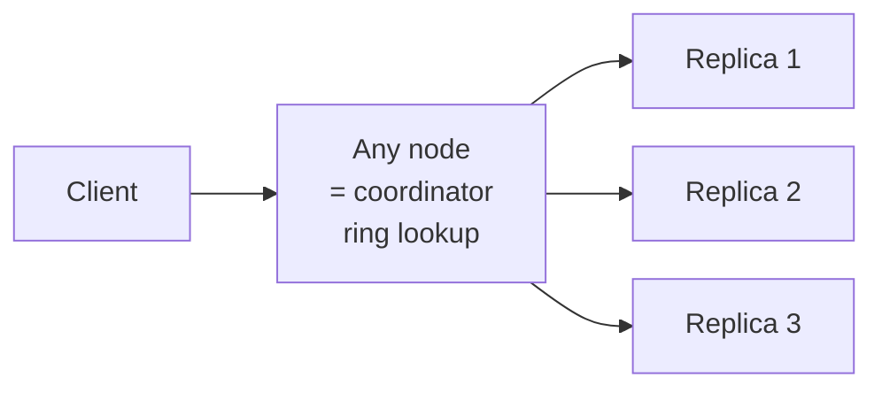
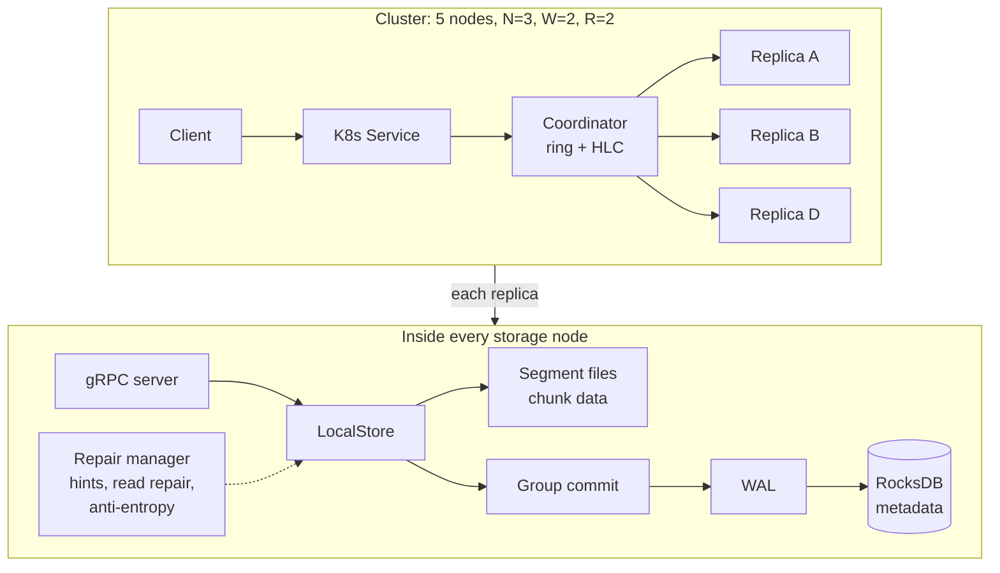
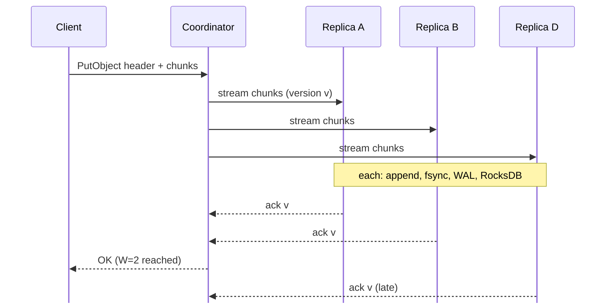
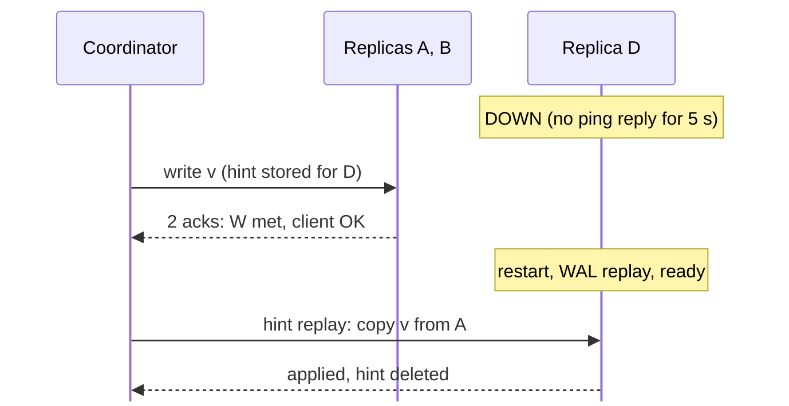

# Distributed Object Storage System — Interview Playbook

*A Dynamo-style, leaderless object store in C++20. Storage nodes talk gRPC, place objects with consistent hashing and virtual nodes, replicate with tunable N/W/R quorums, verify every chunk with CRC32C, survive crashes with a write-ahead log, keep metadata in RocksDB and repair replicas in the background. Everything you need for a 30–45 minute interview.*

**Resume bullets this booklet defends**

1. Built storage nodes using gRPC, consistent hashing and configurable replication, with checksum-based integrity validation and concurrent I/O.
2. Implemented write-ahead logging, async replica repair and concurrent I/O, enabling recovery from node failures while maintaining availability.
3. Benchmarked 1,000 concurrent requests, achieving 10K ops/min with less than 200 ms p95 latency; optimised I/O to reduce CPU overhead ~25%.

# Part 1: Project Fundamentals

## 1.1 What is this project?

**What it does.** It stores files ("objects") such as images, model files, logs and backups across several machines. A client calls `PutObject(bucket, key, bytes)` to store an object and `GetObject(bucket, key)` to read it back. Behind that simple API, the system decides which machines hold the object, keeps three copies, checks every byte for corruption, and keeps working when a machine dies.

**The problem it solves.** A single disk is a single point of failure: when it dies, the data and the service go with it. Copying files around by hand gives no integrity guarantee and no automatic recovery. Real object stores (Amazon S3, Google Cloud Storage) and databases such as Dynamo, Cassandra and Riak solve this with a small set of ideas: spread data with a hash ring, replicate it, use quorums to stay available, log writes before applying them, checksum everything, and repair replicas in the background. This project implements those ideas end to end.

**Who would use it.** Backend services that need to store blobs (user uploads, ML model artifacts, backups) and want durability and availability without a central metadata server.

**What happens without it.** One machine failure means lost data or downtime; silent bit rot goes unnoticed until a user downloads a corrupted file; adding a server means manually reshuffling data.

**What makes it technically interesting.** There is no master. Any node can coordinate any request, every node computes placement on its own, replicas can temporarily disagree, and the system still converges. It touches distributed systems (hashing, quorums, repair), storage engines (WAL, fsync, append-only files, RocksDB) and high-concurrency C++ I/O in one project.

> **Analogy:** Imagine a library with five branches and no head office. Every book's title is turned into a number on a circular dial; the three branches clockwise from that number keep a copy. Any branch can take your request and phone the three owners. A book counts as safely shelved once two of the three confirm it is on the shelf. If one branch is closed, the others leave a note ("give them a copy when they reopen"), and once in a while branches compare inventories to catch anything the notes missed.

> **Example:** A client uploads `photos/cat.jpg` (2.5 MiB). The node it reaches hashes the key onto the ring and finds its three replicas: nodes 2, 3 and 4. It streams three chunks (1 MiB, 1 MiB, 0.5 MiB), each with a CRC32C checksum, to all three. Nodes 2 and 3 write the data, make it durable with their WALs and acknowledge; the client gets `OK` after those two acknowledgements. Node 4 acknowledges a few milliseconds later. If node 4 had been down, the coordinator would store a hint and copy the object to node 4 when it returns.

**Scope boundary.** Not S3-compatible, not a file system, no multipart upload, no erasure coding, no cross-region replication, no linearizable consistency, no automatic large-scale rebalancing. Default cluster: 5 nodes, N=3, W=2, R=2.

## 1.2 Fundamentals required for this project

| Resume bullet | Concepts you must be able to explain |
|---|---|
| 1. Storage nodes using gRPC, consistent hashing and configurable replication, checksum integrity, concurrent I/O | Object storage, gRPC, consistent hashing, virtual nodes, replication factor N, quorums, leaderless design, CRC32C, concurrent I/O |
| 2. Write-ahead logging, async replica repair, concurrent I/O, recovery from node failures with availability | WAL and crash recovery, group commit, RocksDB metadata, append-only segments, hinted handoff, read repair, anti-entropy |
| 3. 1,000 concurrent requests, 10K ops/min, < 200 ms p95, ~25% lower CPU | Benchmark metrics, Little's law, CPU per operation |

### Distributed object storage

- **Simple:** An object store saves blobs of bytes under a name (bucket + key) and returns them whole; no folders, no partial updates.
- **Technical:** Objects up to 64 MiB are streamed in 1 MiB chunks. Each write creates a new immutable version; deletes write a tombstone. Chunk bytes live in local files; per-object metadata (version, size, chunk locations, checksums) lives in RocksDB.
- **Why it matters:** Immutability makes replication and repair simple: copying version v to another node never conflicts with a half-applied update.
- **In this project:** Five identical nodes; each object lives on three of them.
- **Interview angle:** "How is this different from a database?" No queries, no transactions across keys; just put, get, head, delete and best-effort list, with durability and availability as the main goals.

### gRPC and Protocol Buffers

- **Simple:** gRPC is a way for programs to call functions on other machines as if they were local, using a compact binary format.
- **Technical:** Services are defined in `.proto` files and code is generated for client and server. gRPC runs on HTTP/2, which multiplexes many calls over one connection, supports **streaming** RPCs (a Put is a client stream of chunks, a Get is a server stream), carries deadlines and status codes, and applies flow control (backpressure).
- **Why it matters:** Streaming 64 MiB objects in chunks with deadlines and backpressure would need framing and flow control built by hand over raw TCP.
- **In this project:** Each node hosts two services on one port: client-facing `ObjectStore` (Put, Get, Head, Delete, List) and internal `ReplicaService` (replica writes and reads, repair digests, ping). The C++ callback API keeps threads from blocking.
- **Interview angle:** "Why not REST/JSON?" Binary protobuf, streaming, deadlines and code generation for both services; REST would add JSON parsing cost and no native streaming flow control.

### Consistent hashing

- **Simple:** A way to decide which servers hold a key so that adding or removing a server moves only a small fraction of the keys.
- **Technical:** Hash both servers and keys onto the same 64-bit circle (xxHash64 here). A key belongs to the first servers found walking clockwise from its position. Lookup is a binary search over the sorted ring tokens: O(log V). With plain `hash(key) % nodes`, changing the node count remaps almost every key.
- **Why it matters:** No central directory is needed, and membership changes move only about `1/nodes` of the data.
- **In this project:** Every node builds the same ring from the same node list, so any node can compute placement locally. A **ring epoch** number travels in every write and ping; a replica rejects writes stamped with a different epoch, preventing writes under a stale placement.
- **Interview angle:** "How many keys move when a sixth node joins?" Roughly one sixth: only the arcs just before the new node's tokens change owner.

### Virtual nodes

- **Simple:** Instead of placing each server once on the ring, place it many times so the load spreads evenly.
- **Technical:** Each physical node gets 128 tokens (`hash(node_name + "#" + i)`), so 5 nodes give 640 points. With one token per node, arcs are uneven and one node could own far more than its share; with many tokens, per-node load deviation shrinks roughly with `1/sqrt(vnodes)`.
- **Why it matters:** Balanced storage and traffic, and when a node fails its load is spread over **all** survivors rather than dumped on one neighbour.
- **In this project:** The preference list for a key is the first N **distinct physical** nodes clockwise, skipping extra tokens of a node already chosen, so three copies never land on one machine.
- **Interview angle:** "Trade-off of more vnodes?" A bigger ring in memory and more ranges for anti-entropy to compare; 128 is a common middle ground.

### Configurable replication (N and the preference list)

- **Simple:** Keep N copies of each object on N different machines; N is a setting.
- **Technical:** N (default 3) is cluster-wide. For each key the coordinator computes the **preference list**, the N owners, and sends a Put to all of them in parallel: synchronous up to W acknowledgements, asynchronous for the rest.
- **Why it matters:** N copies survive N−1 disk losses and also serve reads.
- **In this project:** No "which replicas have it" table exists; placement is always computed from the ring. Pod anti-affinity puts pods on different machines.
- **Interview angle:** "Why 3?" Survives one failure while a second is being repaired; standard durability/cost balance. Erasure coding would cut storage overhead but is out of scope.

### Quorum reads and writes (N, W, R)

- **Simple:** A write is successful once W of the N replicas have it; a read asks R replicas and takes the newest answer.
- **Technical:** If `R + W > N`, every read set overlaps every successful write set in at least one replica, so a read after a successful write sees it (absent a newer concurrent write). Default N=3, W=2, R=2. Write latency is the W-th fastest replica; read latency the R-th fastest. Consistency is per request: `ONE`, `QUORUM` or `ALL`.
- **Why it matters:** Writing to all N blocks on the slowest or a dead replica; writing to one risks data loss. Quorums give availability with one replica down.
- **In this project:** For reads, the coordinator asks **all** live replicas for metadata and proceeds when the first R answer, which cuts tail latency. N=3, W=3, R=1 would favour reads; W=1 risks loss.
- **Interview angle:** "Does R + W > N make it strongly consistent?" No. It gives read-your-writes after a successful write, not linearizability (see Q19).

### Leaderless (Dynamo-style) design and last-writer-wins

- **Simple:** There is no primary copy. All replicas are equal, any node can coordinate, and conflicting versions are settled by a rule every node applies the same way.
- **Technical:** Each write gets a version `(hybrid logical clock timestamp, node id)`. An HLC stays close to wall-clock time but never goes backwards and advances when nodes see each other's timestamps. Every replica applies a version only if it is **greater** than the one it holds: last-writer-wins (LWW). The node id breaks ties.
- **Why it matters:** No leader election, no failover, and replicas converge to the same winner without talking to each other. Retries, repairs and replays are all safe because "apply if newer" is idempotent.
- **In this project:** The cost: two concurrent writes to one key silently keep only one, and clock skew can let an earlier write win. That is acceptable for immutable blobs where concurrent writers per key are rare.
- **Interview angle:** "Why not vector clocks?" They detect conflicts and return siblings to the client to resolve, which is more correct but more complex; LWW keeps metadata tiny.

### CRC32C checksums (integrity validation)

- **Simple:** A checksum is a short fingerprint of data. Recompute it later; if it differs, the data was corrupted.
- **Technical:** CRC32C is a 32-bit cyclic redundancy check with hardware instructions on x86 (SSE4.2) and ARM, roughly 10+ GB/s per core. It detects all single-bit and short burst errors and random corruption with probability `1 − 2^-32`. It is not cryptographic and does not stop deliberate tampering.
- **Why it matters:** Disks, memory and network buffers can flip bits silently; TCP checksums and disk ECC miss real-world cases.
- **In this project:** End to end: the client computes a CRC per chunk and one for the whole object; the coordinator and each replica verify before writing; replicas verify on every read; the client verifies on download; a background **scrubber** re-reads sealed files. WAL records and segment headers have their own CRCs. A mismatch returns `DATA_LOSS`, the read switches to another replica, and repair rewrites the bad copy.
- **Interview angle:** "Why not SHA-256?" Roughly 10–20× slower without special instructions, and integrity, not security, is the goal.

### Write-ahead logging (WAL) and crash recovery

- **Simple:** Before changing your records, write a short note in a log saying what you are about to commit. After a crash, re-read the log to finish or redo the work.
- **Technical:** A Put touches two stores: chunk data in segment files and metadata in RocksDB. Order: `fdatasync` the chunk data; append a `PUT_COMMIT` record (key, version, chunk locations, CRC) to the WAL and `fdatasync` it; apply metadata to RocksDB; acknowledge. The WAL record is the single commit point. On restart the node replays WAL records after `applied_lsn` (stored in RocksDB), verifying each record and the chunks it references; a torn final record is truncated because it was never acknowledged.
- **Why it matters:** A crash between "data written" and "metadata updated" can never lose an acknowledged write or leave metadata pointing to missing data.
- **In this project:** RocksDB's own WAL is disabled (`disableWAL=true`) because this WAL covers both stores; `atomic_flush` plus an `applied_lsn` stored in every batch keeps RocksDB consistent. The WAL is truncated after each RocksDB flush, which bounds recovery time.
- **Interview angle:** "Why fsync data before the commit record?" So a durable commit record can never reference data that is not on disk.

### Group commit

- **Simple:** Instead of flushing to disk once per write, collect many writes and flush them together.
- **Technical:** `fdatasync` has a fixed cost (often milliseconds on cloud disks). One committer thread gathers up to 256 pending commits or waits up to 2 ms, then performs one `fdatasync` for the touched segments, one WAL append and one WAL `fdatasync`, applies the batch to RocksDB and completes every waiting write. Amortised flush cost per write = flush latency / batch size.
- **Why it matters:** Durability normally caps write throughput; group commit makes durability cheaper as concurrency rises.
- **In this project:** At low load a write may wait up to 2 ms for a batch; under load, a hundred concurrent Puts can share one flush. It is one of the main levers behind the CPU-reduction target.
- **Interview angle:** "Doesn't batching hurt latency?" Slightly at very low load; under concurrency it reduces queueing behind individual flushes, so p95 usually improves.

### RocksDB as the metadata store

- **Simple:** RocksDB is an embedded key-value database (a library inside the process, not a server) that is fast for small records.
- **Technical:** It is an LSM tree: writes go to an in-memory memtable and are flushed to sorted SST files that are merged by background compaction. It offers fast point lookups (with bloom filters), ordered iteration, atomic multi-key `WriteBatch` and column families.
- **Why it matters:** Metadata is small, read on every request, needs atomic updates and ordered scans (for listing and repair digests).
- **In this project:** Column families hold the latest version per key, a ring-ordered index for anti-entropy, hints, segment accounting and node state. Chunk data is **not** stored in RocksDB: multi-MB values would be rewritten repeatedly by compaction (10× or more write amplification).
- **Interview angle:** "Why not SQLite or a central SQL database?" SQLite serialises writers; a remote database adds a network hop and a single point of failure.

### Append-only segment storage

- **Simple:** Write all chunks one after another into a few big files instead of creating one small file per chunk.
- **Technical:** Each node has 4 I/O shards, each with one active 1 GiB pre-allocated segment file. A writer reserves space with an atomic `fetch_add` on the file's tail offset, then writes with `pwrite` at that offset, so many threads write in parallel without a lock. Each record has a self-describing header (key hash, version, chunk index, CRCs). Full segments are sealed; a compactor later copies live records out of mostly-dead segments.
- **Why it matters:** File-per-chunk costs `open`, `write`, `fsync`, `close` and a directory `fsync` per chunk, plus inode churn; appends to a few open files are cheaper and let one flush cover many chunks.
- **In this project:** A crash after `pwrite` but before commit leaves unreferenced bytes; they are harmless garbage because no committed metadata points to them.
- **Interview angle:** "Cost?" Space must be reclaimed by compaction (write amplification ≤ 2× at a 50% live threshold), and recovery must find each segment's valid tail.

### Hinted handoff (hints)

- **Simple:** If a replica misses a write because it is down, the coordinator writes itself a note to deliver that write later.
- **Technical:** When a preference-list replica is down, times out or errors, the coordinator stores a durable **hint** ("node X should have key K at version ≥ v") in its own RocksDB. Every 10 s it replays hints to nodes that are back up, copying the version from a healthy replica, rate-limited to 50 MiB/s so repair never starves foreground traffic.
- **Why it matters:** Writes keep succeeding with one replica down, and the missing copy is restored within seconds of the node returning.
- **In this project:** This is a **strict** quorum: only the N owners count toward W, and data is never written to a substitute node. Dynamo's original "hinted handoff" uses a sloppy quorum that writes to a stand-in node; here the hint lives at the coordinator instead. Say "hinted repair" or "hints at the coordinator" to be precise.
- **Interview angle:** "What if the coordinator dies with hints?" Hints are durable in RocksDB and resume after restart; if its disk is lost, anti-entropy still finds the gap.

### Read repair and anti-entropy

- **Simple:** Read repair fixes stale copies that a read happens to notice; anti-entropy periodically compares replicas to catch everything else.
- **Technical:** **Read repair:** when the R metadata answers show a replica with an older or missing version, the coordinator serves the newest version and schedules a background write to the stale replica. **Anti-entropy:** every 10 minutes per vnode range, two replicas split the range into 64 buckets and exchange a digest per bucket (XOR of hashes of key + version + tombstone). Matching digests mean "in sync"; for mismatched buckets they exchange key lists and push or pull the newer versions.
- **Why it matters:** Hints can be lost (coordinator disk failure), and a replaced node starts empty; only a full comparison can guarantee convergence.
- **In this project:** The three mechanisms layer: hints fix known misses, read repair fixes what readers notice, anti-entropy fixes the rest. Merkle trees (Cassandra) localise differences in O(log k) exchanges; bucketed digests are simpler and fine at millions of keys per node. Deletes keep tombstones for 24 h so anti-entropy cannot resurrect a deleted object.
- **Interview angle:** "Why keep tombstones?" A replica that missed the delete would otherwise look like it has a newer object and copy it back.

### Concurrent I/O

- **Simple:** Many requests read and write disks at the same time without blocking each other or creating a thread per request.
- **Technical:** gRPC callback (reactor) API, so network threads never block; a fixed I/O thread pool (8 threads) for blocking `pread`/`pwrite`; one group-commit thread for durability; lock-free offset reservation for appends; 1,024 striped locks only for the metadata read-compare-write; admission control capping in-flight requests per node at 512; and end-to-end backpressure through gRPC flow control (a slow replica slows the coordinator's reads from the client).
- **Why it matters:** Thread-per-request at 1,000 client sessions means hundreds of threads, context switching and memory growth.
- **In this project:** No lock is ever held across a network call or an `fdatasync`. Overload becomes fast `RESOURCE_EXHAUSTED` errors that clients retry with backoff, instead of unbounded queues.
- **Interview angle:** "Why does your resume say concurrent I/O twice?" Bullet 1 is the request-handling model; bullet 2 is concurrent writes during recovery and repair. Be ready to explain both concretely.

### Benchmark metrics: ops/min, p95, concurrency and CPU per op

- **Simple:** Throughput is operations completed per minute; p95 is the latency 95% of operations beat; concurrency is how many clients are active; CPU per op is how much processor time each operation costs.
- **Technical:** 10K ops/min ≈ 167 client-visible Get+Put operations per second (internal replica RPCs not counted). Little's law: requests in flight = throughput × latency, so 167 ops/s at 30 ms is only about 5 in flight. CPU per op = total node CPU time / successful ops at the same offered load.
- **Why it matters:** These are the resume's numbers; you must state exactly what they mean and that they are targets.
- **In this project:** A C++ load generator drives 1,000 sessions over 64 HTTP/2 channels, open-loop, 70% Get / 30% Put.
- **Interview angle:** "1,000 requests at the same time?" No: 1,000 concurrent client sessions; a separate burst test fires 1,000 simultaneously (Q25).

> **Resume flag:** Say these precisely. (1) "Benchmarked 1,000 concurrent requests … achieving" reads like a measured result; all four numbers are benchmark targets with a written method, and "1,000" means concurrent client **sessions**, not 1,000 requests executing at once. (2) "Maintaining availability" holds when at most one replica of a key is down (N=3, W=2); with two down, quorum writes to those keys fail. (3) If you say "hinted handoff", add that it is a strict-quorum variant with hints held by the coordinator, not Dynamo's sloppy quorum. (4) "Concurrent I/O" appears in two bullets; have one concrete answer ready (callback gRPC, bounded I/O pool, lock-free appends, group commit, admission control).

# Part 2: High-Level Design and Architecture

## 2.1 Technology stack

| Technology | Purpose in the project | Why it was selected |
|---|---|---|
| C++20 | Storage-node binary, client library, load generator | Explicit control of threads, buffers and syscalls, which is exactly what the CPU optimisation measures |
| gRPC + Protocol Buffers | Client API and node-to-node replication, repair and heartbeats | HTTP/2 multiplexing, streaming RPCs, deadlines, flow control, code generation |
| RocksDB | Per-node metadata: latest versions, ring index, hints, segment state | Embedded, atomic batches, ordered iteration, fast point lookups |
| Append-only segment files | Chunk data | Few syscalls and fsyncs; sequential writes; no LSM write amplification for large values |
| CRC32C (Abseil) | Chunk, object, WAL and record checksums | Hardware-accelerated, industry standard for storage integrity |
| xxHash64 | Ring positions for keys and virtual nodes | Fast, uniform, non-cryptographic |
| Docker + Kubernetes StatefulSet | Packaging; 5 pods with stable names and their own persistent volumes | Storage nodes need stable identity and their own disk after rescheduling |
| Prometheus metrics (auxiliary) | Latency histograms, repair queues, CPU | Observability; not a resume technology |

**How they work together.** A client's gRPC stream reaches any node. That node uses xxHash64 and the ring to find the three owners, forwards chunks over internal gRPC streams, and each owner writes chunks into its segment files, commits through its WAL (with group commit) and records metadata in RocksDB. CRC32C is checked at every hop. Kubernetes gives each node a stable DNS name (`storage-node-0..4`) and its own disk, which is what the ring and the WAL depend on.

## 2.2 High-level architecture

**In simple words.** Every node runs the same program and plays two roles. As a **coordinator**, it accepts a client request, works out which three nodes own the key, sends the request to them, waits for enough answers (the quorum) and replies. As a **replica**, it stores its copy durably and serves reads. There is no master, no metadata server and no ZooKeeper. Background repair keeps replicas in sync.

**Figure 1 — The simple picture: any node coordinates, three replicas store**

**Component responsibilities**

| Component | Responsibility |
|---|---|
| gRPC server | Hosts `ObjectStore` (clients) and `ReplicaService` (peers) on one port; callback reactors |
| Coordinator | Version assignment (HLC), preference list, quorum fan-out and wait, read resolution, hint creation, read-repair scheduling |
| Ring manager | Builds an immutable ring snapshot from the node list, 128 vnodes per node and the ring epoch |
| Failure detector | Pings peers every 1 s; `SUSPECT` after 3 s and `DOWN` after 5 s without reply |
| LocalStore | Facade for local persistence: segment appends, commit, reads, tombstones |
| WAL + group committer | Durable commit log; batches commits and flushes once per batch |
| RocksDB metadata | Latest version per key, ring-ordered index, hints, segment accounting, `applied_lsn` |
| Repair manager | Replays hints, executes read repairs, runs anti-entropy, rate-limited |
| Scrubber / compactor | Re-verifies sealed segments; reclaims space from mostly-dead segments |
| Admission controller + I/O pool | Caps in-flight requests (512) and runs blocking disk I/O on 8 threads |

**How components communicate.** Client to any node: gRPC `ObjectStore` over HTTP/2, synchronous (the client waits for the quorum); Put is a client stream of chunks, Get a server stream. Coordinator to replicas: gRPC `ReplicaService` streams, synchronous until W acknowledgements, then asynchronous for the rest. Node to node heartbeats: unary `Ping` every second with a 500 ms deadline. Repair: background RPCs (`ReplicaReadChunks`, `ReplicaWrite`, `RangeDigest`, `RangeKeys`), rate-limited. Disk I/O happens only on I/O threads, never on gRPC callback threads. When the coordinator is itself a replica, it calls `LocalStore` directly.

**Complete data flow.**
1. **Put:** client streams chunks → coordinator verifies CRC, assigns HLC version, computes preference list → streams to all N replicas → each replica appends to a segment, then group commit (fsync data → WAL record → fsync WAL → RocksDB) → acknowledges → coordinator replies after W acks → late acks or failures handled in the background (hints).
2. **Get:** metadata requests to all live replicas → at R answers choose the highest version → stream chunks from one replica (local if possible), verifying CRC per chunk → client verifies the object CRC → stale replicas queued for read repair.
3. **Repair (background):** hints, read-repair queue and anti-entropy digest mismatches → read from a healthy replica → write to the lagging one.

**Figure 2 — Detailed HLD. Top lane: how a request reaches its replicas. Bottom lane: what every node runs internally**

**Where data is stored.** Chunk bytes: 1 GiB append-only segment files on each replica's persistent volume. Metadata: RocksDB on the same volume. Commit log: WAL segments of 64 MiB, truncated after RocksDB flushes. Hints: the coordinator's RocksDB. The ring is not stored; every node computes it from configuration. There is no global metadata store; metadata is replicated with the data by the same quorum write.

**How it scales.**
- **Capacity:** add nodes; with 5 nodes and N=3 each node holds about 60% of keys. A new node bumps the ring epoch and anti-entropy streams it the ranges it now owns (manual, not autoscaled).
- **Throughput:** requests spread across all nodes through the Kubernetes Service; per-node concurrency is bounded by the I/O pool and admission control.
- **Hot keys:** served by their three replicas only; reads can use `consistency=ONE` to spread load.

**What happens when a major component fails**

| Failure (N=3, W=2, R=2) | Effect | Recovery |
|---|---|---|
| One replica of a key down | Reads and writes still succeed; hints queue for it | Node returns → WAL replay → hint replay → anti-entropy |
| Two replicas of a key down | Quorum operations fail with `UNAVAILABLE`; `ONE` reads still work | Bring a node back |
| Node crash and restart | Same disk; WAL replay restores metadata | Automatic; hints and anti-entropy fill the gap |
| Corrupt chunk on disk | CRC mismatch → `DATA_LOSS` → read served from another replica | Repair rewrites the bad copy |
| Disk permanently lost | Node replaced with an empty volume | Anti-entropy rebuilds its ranges at ≤ 50 MiB/s |
| Coordinator dies mid-request | Client stream breaks; client retries on another node | Puts have unknown outcome; retry writes a newer version |

## 2.3 Important architectural decisions

**1. Leaderless quorum replication instead of a leader per shard.**
*Chosen:* Dynamo-style N/W/R quorums, any node coordinates. *Why:* no leader election or failover logic, availability with a replica down, tunable per request. *Alternative:* primary-backup or Raft per shard. *Why not:* needs leader election, failover and a replicated log; more work, less availability during leader changes. *Trade-off:* not linearizable; failed writes have unknown outcome.

**2. Last-writer-wins with hybrid logical clock versions.**
*Chosen:* versions `(HLC, node id)`, apply only if newer. *Why:* deterministic convergence, 12 bytes of metadata, idempotent apply. *Alternative:* vector clocks with siblings. *Why not:* clients would have to merge conflicting blobs, which makes little sense for immutable objects. *Trade-off:* one of two concurrent writes is silently lost; clock skew can favour the faster clock.

**3. Consistent hashing with 128 virtual nodes.**
*Chosen:* xxHash64 ring, preference list of N distinct nodes. *Why:* no directory service; minimal movement on membership change; even load. *Alternative:* modulo hashing, rendezvous hashing or a central placement table. *Why not:* modulo reshuffles almost everything; a directory is a new single point of failure. *Trade-off:* balance is statistical; the ring must match everywhere (epoch).

**4. Strict quorum with coordinator-held hints.**
*Chosen:* only the N owners count; hints stored at the coordinator. *Why:* data only ever lives on its owners, so repair stays simple. *Alternative:* sloppy quorum writing to a substitute node. *Why not:* more availability but data on non-owners complicates repair and consistency. *Trade-off:* two owners down blocks writes for those keys.

**5. Own WAL with group commit; RocksDB for metadata only; segments for data.**
*Chosen:* one commit record spanning data and metadata, RocksDB WAL disabled. *Why:* a single commit point and amortised fsync. *Alternative:* fsync per write, RocksDB's WAL as the commit point, or blobs inside RocksDB. *Why not:* per-write fsync is slow; RocksDB's WAL does not cover segment data; large values in an LSM tree cause heavy write amplification. *Trade-off:* custom replay code must be tested at crash points.

**6. Callback gRPC with a bounded I/O pool and admission control.**
*Chosen:* non-blocking reactors, 8 I/O threads, 512 in-flight cap. *Why:* thread count independent of client count; overload becomes fast errors. *Alternative:* synchronous thread-per-RPC server. *Why not:* hundreds of threads under 1,000 sessions. *Trade-off:* reactor code is harder to write.

# Part 3: How the Project Works

## 3.1 One complete end-to-end request flow

A client uploads `photos/cat.jpg` with the default `QUORUM` consistency.

**Figure 3 — Quorum Put with N=3, W=2: the client gets OK after two durable acknowledgements** [scale=0.72]

1. **Arrival.** The client opens a `PutObject` stream to any node through the Kubernetes Service (or directly). That node is the coordinator.
2. **Admission and validation.** The admission controller checks the in-flight count (over 512 → `RESOURCE_EXHAUSTED`); a bearer token is checked; the first message must be a valid header (bucket, key, size, object CRC).
3. **Placement and version.** The coordinator hashes the key, binary-searches the ring snapshot and takes the first three distinct physical nodes clockwise. It stamps a version from its hybrid logical clock.
4. **Replica selection.** Replicas the failure detector marks `DOWN` get a hint immediately. If fewer than W replicas are alive, it fails fast with `UNAVAILABLE` before sending any data.
5. **Streaming.** For each 1 MiB chunk: verify its CRC, then forward it to every open replica stream (local writes go to the I/O pool). gRPC flow control means a slow replica slows the client's stream rather than filling memory.
6. **Replica write.** Each replica verifies the chunk CRC, reserves space in a segment with an atomic add, writes it with `pwrite`, and after the last chunk verifies the whole-object CRC and submits a commit.
7. **Durability (group commit).** The committer batches commits: `fdatasync` the segments, append the WAL record, `fdatasync` the WAL, apply the metadata to RocksDB under a per-key lock (only if the version is newer). Then the replica acknowledges.
8. **Quorum.** After W=2 acknowledgements the coordinator returns `OK(version, crc)` to the client.
9. **Background completion.** The third acknowledgement arrives later; if it fails, a hint is stored and replayed when that node is healthy.

**The read path (GetObject) in brief.** The coordinator sends metadata reads to all live replicas, waits for the first R=2, chooses the highest version (a tombstone means `NOT_FOUND`), then streams chunks from one replica holding that version, verifying each CRC. If a chunk fails its CRC, it continues from that chunk on another replica. Any replica that answered with an older version is queued for read repair.

## 3.2 Important alternative scenarios

**Scenario A: One replica is down during a Put.** Figure 4 shows the timeline.

**Figure 4 — Replica D is down: the write succeeds on A and B, and a hint brings D up to date when it returns** [scale=0.72]

The client never sees the failure. Durability is temporarily two copies instead of three; a second failure among the same key's replicas would block writes to that key until a node returns.

**Scenario B: A chunk is corrupt on disk.** A replica's disk flips a bit in a sealed segment. On the next read (or scrubber pass), the stored CRC does not match, so the replica returns `DATA_LOSS` for that chunk. The coordinator continues the same stream from that chunk index on another replica holding the same version, so the client receives a complete, verified object. The repair manager then rewrites a fresh copy onto the bad replica and the corrupt record is marked dead.

**Scenario C: A node crashes and restarts.** Peers stop getting ping replies and mark it `DOWN` within ~5 s; writes for its keys go to the other two replicas plus hints. Kubernetes restarts the pod with the same persistent volume. Recovery: open RocksDB and read `applied_lsn`; replay WAL records after it, checking each record's CRC and that the chunks it references exist; truncate a torn final record (it was never acknowledged); find each active segment's valid tail and resume appending after it; flush RocksDB. The node reports ready, peers replay hints, and anti-entropy confirms convergence. Recovery time is bounded by the WAL tail since the last flush (illustratively, a few seconds).

## 3.3 Important guarantees and limitations

| Guarantee | Holds? | Condition / reason |
|---|---|---|
| Acknowledged write is durable | Yes | On ≥ W replicas, fsynced before ack; survives any number of process crashes and up to W−1 disk losses before repair |
| Read-your-writes | Yes, conditionally | Same key, `R + W > N`, write returned `OK`, no concurrent writer |
| Linearizability | No | Leaderless quorums with LWW are not linearizable |
| Monotonic reads | No (in general) | Two reads via different coordinators can hit different quorums; read repair shortens regressions |
| Eventual consistency | Yes | Replicas converge after repair if writes stop |
| Failed write has no effect | No | "Unknown outcome": a failed Put may have committed on fewer than W replicas and appear later |
| No corrupt data returned silently | Yes | CRC checked at every hop; mismatches become errors and repairs |
| Concurrent writes both kept | No | LWW keeps one |

**Where consistency comes from:** deterministic placement (same ring everywhere, guarded by epoch), deterministic conflict resolution (total order on versions) and idempotent apply ("apply only if newer"). Together they make each key behave like a last-writer-wins register: replicas can apply updates in any order, any number of times, and still converge. **Failures** are handled by quorums (stay available), hints, read repair and anti-entropy (converge), WAL replay (recover locally) and CRCs (detect corruption). **Accepted trade-offs:** no linearizability, silent loss of concurrent writes, unknown outcomes on failed writes, manual topology changes.

# Part 4: Complete Interview Explanation

## 4.1 Two-minute explanation

> **Say it aloud:** "I built a distributed object store in C++, in the style of Amazon's Dynamo. The problem is storing blobs like images or model files across machines so that losing one machine loses nothing and doesn't stop service.
>
> Every node runs the same gRPC server and there's no master. When a request arrives, the node it lands on becomes the coordinator: it hashes the key onto a consistent-hash ring with 128 virtual nodes per server and takes the first three distinct servers clockwise as replicas. A write streams 1 MB chunks, each with a CRC32C checksum, to all three in parallel, and succeeds once two of them have made it durable. A read asks the replicas for metadata, takes the newest version from the first two answers, and streams the data from one of them, verifying checksums.
>
> On each node, data goes into append-only segment files, a write-ahead log with group commit is the commit point, and RocksDB holds metadata, so a crash never loses an acknowledged write. If a replica is down, the coordinator stores a hint and replays it later; reads repair stale copies; and a periodic anti-entropy process compares replicas and fixes anything else.
>
> The benchmark target was 10K operations a minute at under 200 ms p95 with 1,000 client sessions, and about 25% less CPU per operation after the I/O optimisations. Those are targets with a documented method, not production measurements."

## 4.2 Five-minute explanation

> **Say it aloud:** "**Problem and requirements.** I wanted a storage engine that keeps objects durable and available across node failures without a central metadata server. Requirements: put, get, head, delete; N copies with configurable read and write quorums; integrity checks on every byte; crash recovery; background repair; and safe handling of many concurrent clients.
>
> **Technology.** C++ for explicit control over threads, buffers and syscalls; gRPC for streaming RPCs with deadlines and flow control; RocksDB as an embedded metadata store; CRC32C for hardware-fast checksums; and Kubernetes StatefulSets, because storage nodes need stable names and their own disks.
>
> **Architecture.** [Draw Figure 2.] Five identical nodes. Each is both a coordinator for requests it receives and a replica for keys it owns. Placement uses consistent hashing with 128 virtual nodes per server, so adding a node moves only about a fifth of the data and a failed node's load spreads across all survivors. Every node computes the same ring, so there's no lookup service.
>
> **Write path.** The coordinator assigns a version from a hybrid logical clock, streams chunks to all three replicas and replies after two durable acknowledgements. On each replica the order matters: write chunk data and fsync, append a commit record to the WAL and fsync, then update RocksDB, then acknowledge. Group commit batches many writes into one fsync.
>
> **Read path.** Ask all live replicas for metadata, use the first two, pick the highest version, stream from one replica, verify every chunk.
>
> **Key decisions.** Leaderless quorums instead of a leader per shard, because there's no election or failover and it stays available with one replica down. Last-writer-wins with HLC versions, so replicas converge without coordination; the trade-off is that concurrent writes to one key keep only one. My own WAL instead of RocksDB's, because a write spans the data files and the metadata, and I need one commit point for both.
>
> **Reliability.** Hints for missed writes, read repair for stale replicas, anti-entropy every ten minutes, WAL replay on restart, and checksums checked at every hop with a background scrubber.
>
> **Performance.** The I/O optimisations were append-only segments instead of a file per chunk, group commit with a single WAL, and avoiding buffer copies. The resume's 10K ops/min, sub-200 ms p95 and 25% CPU figures are benchmark targets I designed for."

## 4.3 Ten-minute explanation

> **Say it aloud:** "**Motivation.** I wanted one project that exercises the core ideas behind Dynamo, Cassandra and object stores, in C++ so the costs I'm optimising, syscalls, copies and threads, are visible.
>
> **Architecture.** [Draw Figure 2.] Five nodes on Kubernetes as a StatefulSet, so each pod keeps its name and its persistent volume across restarts. A client can hit any node through a Service. There's no master and no ZooKeeper: the ring comes from a static node list plus an epoch number, and liveness comes from one-second heartbeats.
>
> **Placement.** Keys and 128 tokens per node are hashed onto a 64-bit ring; a key's preference list is the first three distinct physical nodes clockwise. Virtual nodes balance ownership and spread a dead node's load. An epoch stamped on every write rejects nodes with a stale ring.
>
> **Quorums.** N=3, W=2, R=2. Because R plus W is greater than N, any read set overlaps any successful write set, so you read your own write. But I'm careful to say this is not linearizable: concurrent reads and writes can see old, then new, then old. And a failed write has an unknown outcome, because it might have landed on one replica and later spread through repair. So clients treat errors as 'unknown' and retry, which is safe because a retry just writes a newer version with the same bytes.
>
> **Conflict resolution.** Each write gets a version: a hybrid logical clock timestamp plus the node id. Every replica applies a version only if it's newer than what it has. That one rule makes client retries, hint replays, read repairs and WAL replays all idempotent, and every replica converges on the same winner. The cost is last-writer-wins: two concurrent writers to one key lose one write silently, and clock skew can favour the node with the faster clock.
>
> **Node internals.** Chunk bytes go into big append-only segment files. A writer reserves space with an atomic fetch-add on the tail and writes with pwrite, so there's no lock on the data path. Metadata goes into RocksDB, which is great for small records and ordered scans but bad for multi-megabyte values because compaction would keep rewriting them. The WAL ties them together: fsync the data, append and fsync a commit record, then apply to RocksDB. I disabled RocksDB's own WAL because mine covers both stores, and I store an applied-LSN in every RocksDB batch so recovery knows where to start replaying. Group commit means one fsync covers up to 256 writes.
>
> **Integrity.** CRC32C is computed by the client per chunk and verified at every hop and by a background scrubber. A mismatch becomes DATA_LOSS, the read continues from another replica, and repair rewrites the bad copy.
>
> **Failures.** If a replica is down, writes still meet W=2 and the coordinator stores a hint, replayed every ten seconds once the node is back, rate-limited so repair doesn't hurt foreground latency. Reads that notice a stale replica trigger read repair. Anti-entropy compares 64 bucket digests per range every ten minutes and catches anything the others missed, including a node whose disk was replaced. Deletes are tombstones kept for 24 hours so anti-entropy can't resurrect them. On restart a node replays its WAL tail, truncates any torn record, and rejoins.
>
> **Concurrency.** Callback reactors never block; disk I/O runs on an eight-thread pool, durability on one committer thread, and admission control caps 512 in-flight requests per node. No lock is held across a network call or an fsync.
>
> **Performance and numbers.** The baseline wrote one file per chunk with an fsync each, used RocksDB's WAL as well as mine, copied buffers on every read and re-serialised chunks per replica. The optimised path removes each of those, which should cut CPU per operation by about a quarter. I'd measure CPU per op from cgroup counters at the same offered load, with an ablation per change. The load generator runs 1,000 client sessions with open-loop arrivals at 167 ops per second; by Little's law only a handful are actually in flight, which I'd say openly. All of the numbers are targets.
>
> **Limitations and next steps.** No linearizability or conditional writes, manual topology changes, strict quorums block writes when two replicas are down, full-mesh heartbeats don't scale past a few dozen nodes, and three full copies cost 3× storage. Next I'd add Merkle trees or incremental digests, SWIM gossip, zone-aware placement, erasure coding for cold data and Raft-replicated metadata for keys that need compare-and-swap."

# Part 5: Interview Questions and Answers

## 5.1 Basic understanding

#### Q1. What does your distributed object store do? [Easy]

It stores objects (blobs of bytes up to 64 MiB) under a bucket and key, across a cluster of storage nodes, and keeps them durable and available when nodes fail. Clients call `PutObject`, `GetObject`, `HeadObject` and `DeleteObject` over gRPC. Any node can coordinate a request: it finds the key's three replicas on a consistent-hash ring, writes to them in parallel and replies after two have durably stored the data (W=2), or reads metadata from replicas and returns the newest version (R=2). Each node makes writes crash-safe with a write-ahead log, stores metadata in RocksDB and data in append-only segment files, and checks CRC32C checksums everywhere. Background repair (hints, read repair, anti-entropy) brings lagging replicas back in sync. It is a Dynamo-style, leaderless design, not S3-compatible and not a file system.

#### Q2. What is an object store, and how is it different from a file system or a database? [Easy]

An object store saves whole blobs under a flat key and returns them whole (put, get, head, delete, list); an overwrite creates a new immutable version. A file system adds directories, partial writes, appends, renames and POSIX semantics, which are much harder to distribute. A database adds queries, indexes and often multi-key transactions. Object stores give those up for easy scaling: because an object is written once as a unit, copying a version to another node is always safe and conflicts reduce to "which version is newest". This project follows that model: 1 MiB chunks, immutable versions, tombstones for deletes, garbage collection of superseded chunks.

#### Q3. Walk me through a Put request. [Easy]

The client streams a header and 1 MiB chunks to any node, which becomes the coordinator. It checks admission (≤ 512 in flight) and the header, hashes the key onto the ring to find three replicas, and stamps a version from its hybrid logical clock. It streams each chunk, after verifying its CRC32C, to all three replicas. Each replica verifies the CRC, appends the chunk to a segment file, and after the last chunk submits a commit. A group-commit thread flushes the data, appends a commit record to the WAL, flushes the WAL and updates RocksDB, then the replica acknowledges. After two acknowledgements the coordinator replies `OK` with the version. The third replica's acknowledgement arrives in the background; if it fails, the coordinator stores a hint to repair it later.

**Related follow-up:** "Why wait for two, not three?" Waiting for all three blocks on the slowest or a dead replica; two of three keeps writes available with one node down.

#### Q4. Walk me through a Get request. [Easy]

The coordinator sends a lightweight metadata read to all live replicas and resolves at the first R=2 answers: highest version wins; a tombstone or nothing means `NOT_FOUND`. It then streams chunks from one replica holding that version (itself if possible), verifying each CRC; the client verifies chunks and the object CRC. A failed chunk continues from the same index on another replica. Replicas that returned older versions are queued for read repair. Asking all replicas but waiting for two cuts tail latency for a few extra metadata reads.

#### Q5. Why consistent hashing instead of `hash(key) % number_of_nodes`? [Easy]

With modulo hashing, the node for a key depends on the node count, so going from 5 to 6 nodes changes the owner of roughly 5 in 6 keys and you must copy almost all the data. Consistent hashing places both nodes and keys on the same circular hash space; a key belongs to the next nodes clockwise. Adding a node only takes over the arcs just before its positions, about `1/(nodes+1)` of the keys; removing one hands its arcs to neighbours. Every node can compute placement locally with a binary search over the sorted ring, so no central directory is needed. Here the ring uses xxHash64 and 128 virtual nodes per server, and the preference list is the first three distinct physical servers clockwise. An epoch number in every write stops a node with an outdated ring from writing to the wrong replicas.

**Related follow-up:** "Alternatives?" Rendezvous (highest-random-weight) hashing, jump consistent hash, or a placement directory.

#### Q6. What are virtual nodes and why do you need them? [Easy]

With one position per server on the ring, the arcs between servers are random lengths, so one server can own far more keys than another, and when a server dies, its whole arc falls on a single neighbour, doubling that neighbour's load. Virtual nodes give each physical server many positions (128 here, so 640 in a five-node cluster). Each server then owns many small arcs, and the law of large numbers evens out the total: imbalance shrinks roughly with one over the square root of the vnode count. When a server fails, its many small arcs are inherited by many different neighbours, spreading the extra load across all survivors. The preference list skips additional tokens of a node that is already selected, so three replicas always land on three different machines. The cost is a larger ring structure and more ranges to compare during anti-entropy.

#### Q7. Explain N, W and R, and why R + W > N matters. [Easy]

N is how many replicas store each object (3). W is how many must acknowledge a write before it counts as successful (2). R is how many replicas a read consults before answering (2). If R + W > N, any set of R replicas must overlap any set of W replicas in at least one node, by simple counting: 2 + 2 = 4 > 3. So a read that follows a successful write always includes at least one replica that has the write, and because the read takes the highest version, it returns that write (unless a newer write has happened). Tuning changes the trade-off: W=3, R=1 gives fast reads but any replica failure blocks writes; W=1, R=1 is highly available but only eventually consistent and risks losing a write if that one replica dies before repair. Consistency is selectable per request: `ONE`, `QUORUM`, `ALL`.

#### Q8. Why did you use gRPC? [Easy]

Three reasons: streaming, efficiency and built-in reliability features. Objects can be 64 MiB, so a Put is a client-streaming RPC (a header, then 1 MiB chunks) and a Get is a server-streaming RPC; HTTP/2 flow control gives backpressure automatically, so a slow replica slows the sender instead of exhausting memory. Protocol Buffers are compact binary messages with generated C++ code for both the client-facing `ObjectStore` service and the internal `ReplicaService`. gRPC also provides deadlines that propagate to downstream calls, standard status codes (`UNAVAILABLE`, `DEADLINE_EXCEEDED`, `DATA_LOSS`, `RESOURCE_EXHAUSTED`), connection multiplexing (many calls on one connection) and keepalives. The C++ callback API lets a few threads serve many concurrent streams. Raw TCP would require building framing, flow control and deadline propagation by hand; REST/JSON would add parsing cost and lack native streaming backpressure.

## 5.2 Durability, integrity and repair

#### Q9. What is a write-ahead log and why do you need one? [Easy]

A WAL is an append-only file where you durably record that an operation committed, before (or while) applying it to your main data structures, so a crash can never leave you in a half-updated state. Here a Put touches two places: chunk bytes in segment files and metadata in RocksDB. Without a single commit point, a crash between them could leave metadata pointing at missing data, or data that nothing points to, or an acknowledged write that vanished. The replica therefore fsyncs the chunk data, appends a `PUT_COMMIT` record (key, version, size, checksum, chunk locations) to the WAL and fsyncs it, then updates RocksDB, and only then acknowledges. On restart it replays every WAL record after the last applied sequence number. Anything acknowledged is in the WAL; anything not in the WAL was never acknowledged.

**Related follow-up:** "Doesn't the WAL slow writes?" Group commit amortises the flush across many writes (Q21).

#### Q10. Why CRC32C, and where exactly do you verify it? [Easy]

Data can be silently corrupted in a disk sector, in RAM or in a network buffer, and neither TCP's checksum nor disk ECC catches every case. CRC32C is a 32-bit checksum that is hardware-accelerated on modern CPUs (around 10 GB/s per core), detects all single-bit and short burst errors and random corruption with very high probability, and is the industry standard in storage (Google Cloud Storage, iSCSI, ext4 metadata). The client computes one CRC per chunk and one for the whole object, and the checksum is verified end to end: by the coordinator on receipt, by each replica before writing, by the replica on every read, by the client on download, and by a background scrubber over sealed segments. WAL records and segment headers carry their own CRCs to detect torn writes. It is not a cryptographic hash, so it protects against accidents, not attackers.

#### Q11. Why RocksDB for metadata but not for the object data? [Easy]

Metadata (latest version, size, chunk locations, checksums) is small, read on every request, and needs atomic multi-key updates and ordered iteration for listing and range digests. RocksDB is an embedded LSM-tree key-value store that provides exactly that: point lookups with bloom filters, a block cache, atomic `WriteBatch` and column families, without a network hop or a separate server. Object data is the opposite: large, immutable and read sequentially. In an LSM tree, values are rewritten every time compaction merges files, so storing megabyte chunks there would multiply disk writes by ten or more. Data therefore goes into append-only segment files, and RocksDB stores only `(segment, offset, length)` pointers. RocksDB's own WAL is disabled, because the project's WAL is the commit point for both stores.

#### Q12. What is hinted handoff in your design? [Easy]

When a replica is down, slow or erroring, the coordinator still completes the write if W replicas acknowledge, and records a durable hint in its own RocksDB: "node X should have key K at version ≥ v". Every 10 seconds a repair loop copies that version from a healthy replica to each target that is back up and deletes the hint, retrying with backoff; repair traffic is capped at 50 MiB/s to protect foreground latency. Because applying a version is idempotent ("only if newer"), a replay racing a normal write is harmless. Precision: Dynamo's original hinted handoff writes data to a substitute node (sloppy quorum); here the quorum is strict, data never lives on a non-owner, and the hint sits at the coordinator.

**Related follow-up:** "What if hints are lost?" Anti-entropy still finds the gap on its next cycle.

#### Q13. What is the difference between read repair and anti-entropy? [Easy]

Both fix lagging replicas but find problems differently. **Read repair** is opportunistic: during a Get, if one replica returns an older or missing version, the coordinator serves the newest and schedules a background write to the stale replica; it fixes only keys being read. **Anti-entropy** is systematic: every 10 minutes per vnode range, two replicas compare 64 bucket digests (XOR of hashes of key, version, tombstone); for mismatched buckets they exchange key lists and copy the newer side. It catches everything, including unread keys, lost hints and rebuilt empty disks. Merkle trees need fewer exchanges at huge scale; bucketed digests are simpler at millions of keys per node.

#### Q14. What happens when a storage node fails, and how does it recover? [Easy]

Peers ping every second and mark a node `DOWN` after 5 s; failed RPCs and Kubernetes readiness also notice. If it was coordinating a request, the client's stream breaks and the client retries elsewhere. If it was a replica, writes still meet W=2 with the other two and coordinators store hints; reads use the remaining two. Affected keys temporarily have two copies. On restart with the same volume, the node replays its WAL, truncates a torn tail, finds segment ends and rejoins; hints and anti-entropy fill gaps (Scenario C). If the disk is lost, a fresh node starts empty and anti-entropy streams all its ranges from peers, rate-limited.

#### Q15. What does "Dynamo-style leaderless" mean, and what does it imply for consistency? [Easy]

There is no primary replica for a key: all replicas accept writes, any node can coordinate, and consistency comes from quorums plus a deterministic conflict rule instead of a leader ordering writes. Benefits: no leader election, no failover pause, writes continue with a replica down. Implications: eventual consistency with tunable strength. With R + W > N you get read-your-writes after a successful write, but not linearizability or monotonic reads across coordinators; concurrent writes are settled by last-writer-wins (one is lost); and a failed write may still partially apply. Amazon's Dynamo, Cassandra and Riak make the same trade-off; systems that need strict ordering, such as compare-and-swap, use leader-based consensus like Raft (Q28).

#### Q16. What exactly is "concurrent I/O" in your resume? [Easy]

Many reads and writes hit disks and network at once, safely and with bounded resources. Concretely: callback gRPC (no thread per request); blocking `pread`/`pwrite` on a fixed 8-thread I/O pool; one group-commit thread batching flushes; parallel appends to one segment file, each writer reserving its own byte range with an atomic `fetch_add` and writing with positional `pwrite`; a short striped per-key lock only for the metadata version compare; admission control at 512 in-flight requests per node. Concurrent writes to one key are resolved by version, not by cross-node locks, and no lock is held across a network call or an fsync. In bullet 2 the same machinery also lets repair and recovery writes run alongside live traffic.

#### Q17. What are the main limitations, and what would you improve? [Easy]

Consistency: not linearizable, no compare-and-swap, last-writer-wins can lose concurrent writes, failed writes have unknown outcomes. Availability: two replicas down blocks writes for those keys. Scale: full-mesh heartbeats and full-range anti-entropy suit about eight nodes; topology changes are manual. Efficiency: 3× storage; 4 KiB alignment wastes space on tiny objects; non-replica coordinators add a hop. Security: static tokens, TLS off by default, no encryption at rest. Improvements: Merkle trees and SWIM gossip, a ring-change planner, zone-aware placement, erasure coding for cold data, replica-aware client routing, mTLS, Raft-replicated metadata for conditional writes, and running the benchmark to replace targets with measurements.

## 5.3 Deeper design questions

#### Q18. How do you resolve concurrent writes to the same key? [Medium]

Every write gets a version from the coordinator: a hybrid logical clock (HLC) timestamp plus the coordinator's node id as a tie-breaker. An HLC is `max(wall clock, highest timestamp seen)` with a counter, so it stays near real time, never runs backwards, and moves forward when nodes exchange timestamps in pings and write headers. Every replica applies an incoming version only if it is greater than the stored one, holding a per-key striped lock during that read-compare-write. Because all replicas use the same total order, they all keep the same winner regardless of arrival order: last-writer-wins. The cost is that two genuinely concurrent writes keep only one, silently, and if node A's clock is 300 ms ahead, a write through A at t=0 can beat a write through B at t=100 ms. That is acceptable for immutable blobs with rare concurrent writers; applications needing read-modify-write must serialise writes themselves.

**Related follow-up:** "Why not vector clocks?" They detect concurrency and return siblings for the client to merge, which is more correct but complicates the API for blobs.

#### Q19. Is your system strongly consistent? [Medium]

No, and it is important to say why precisely. With N=3, W=2, R=2, quorums overlap, so after a write returns `OK`, a later read returns it or something newer: read-your-writes. But it is not linearizable. A read concurrent with a write can see the new version on one quorum and a later read can hit a different quorum that still has the old one (until read repair runs), so clients can observe new-then-old. Monotonic reads are not guaranteed across coordinators. Concurrent writes are resolved by last-writer-wins, not by a single ordering authority. And a write that fails or times out may have committed on one replica and become visible later through repair: the "unknown outcome" rule. What it does guarantee: acknowledged writes are durable, replicas converge (eventual consistency) and no corrupt data is returned silently. Strong consistency would need consensus (Raft) per shard.

#### Q20. Why your own WAL when RocksDB already has one? [Medium]

Because a Put modifies two stores and RocksDB's WAL protects only RocksDB. The chunk bytes go into segment files and the metadata into RocksDB; atomicity across both needs one commit point that covers both. The project's WAL record (`PUT_COMMIT`) contains the chunk locations and checksums, so recovery can check that the data it points to really exists before applying it. With that WAL authoritative, RocksDB's own WAL would be a second, redundant log write per operation, so writes use `disableWAL=true`. To keep RocksDB consistent after a crash, every RocksDB batch also writes `applied_lsn`, the highest WAL sequence number it contains, and `atomic_flush` makes all column families flush together. After a crash, RocksDB recovers to its last flush, `applied_lsn` says how far that state goes, and the node replays its WAL from the next record. The trade-off: correctness now depends on custom replay code, which must be tested by killing the process at every crash point.

#### Q21. What is group commit and why does it make writes faster? [Medium]

Durable writes need `fdatasync`, which forces data to stable storage and has a fixed cost per call, typically sub-millisecond on local NVMe and several milliseconds on cloud volumes. If each Put did its own flushes (data, plus RocksDB's WAL), throughput would be capped by flush latency and CPU would be spent in the kernel. With group commit, writers enqueue their commit and wait on a future. One committer thread takes up to 256 pending commits or whatever arrived within 2 ms, flushes the touched segment files once, appends all the WAL records, flushes the WAL once, applies the metadata to RocksDB in one batch, and completes every waiting writer. The number of flushes drops from one per write to one per batch, so the cost per write falls as concurrency rises. The trade-off is up to 2 ms of extra latency at very low load and a single committer thread, which is fine at hundreds of commits per second.

#### Q22. A Put times out. What should the client do, and is a retry safe? [Medium]

The client must treat the outcome as unknown. A timeout or `UNAVAILABLE` can happen after one or even two replicas committed (the response was lost), or before any did. In a leaderless store a partially applied write is not rolled back: a replica that committed keeps that version, and repair may later spread it. The safe action is to retry the same bytes, possibly through another node, with backoff. The retry gets a new, higher version from its coordinator, and all replicas apply it because it is newer, superseding the earlier attempt; the old version's chunks become garbage and are compacted later. Since the content is identical, the final state is the same as if the first attempt had succeeded: Puts are effectively idempotent for identical content, so no server-side deduplication table is needed. A request id is logged so the attempts can be correlated. A Put that returned `OK` is durable on at least W replicas.

#### Q23. Why a strict quorum rather than a sloppy quorum? What if two of three replicas are down? [Medium]

In a sloppy quorum (as in the original Dynamo), if an owner is down, the coordinator writes to the next healthy node on the ring as a stand-in, which holds the data plus a hint and hands it back later. That keeps writes available even when several owners are down, but data then lives on nodes that do not own it, which complicates repair, reads and reasoning about where copies are. This project uses a strict quorum: only the three owners count toward W. Data only ever lives on its owners, so repair and anti-entropy stay simple. The consequence: with two of a key's three replicas down, a `QUORUM` write cannot reach W=2, so it fails fast with `UNAVAILABLE` (the coordinator checks before sending data); reads at `QUORUM` also fail, but `consistency=ONE` reads still work. Writes resume when a node returns. Optional sloppy quorum is listed as a future improvement.

#### Q24. How would you add a sixth node? [Medium]

It is an operator action: add `storage-node-5` to the StatefulSet and bump the node list and ring epoch in configuration. Every node builds the new ring; the new node's 128 tokens take over the arcs just before them, about a sixth of the keyspace. Replicas reject writes stamped with the old epoch, so a stale coordinator cannot write under the wrong placement. Anti-entropy finds the new node's ranges empty and streams those keys from existing replicas, rate-limited. Once digests match, old owners no longer in the preference list drop those keys after confirming N copies. It is manual and coarse; a planner that streams only moved ranges is a listed improvement.

## 5.4 Numbers and resume defence

#### Q25. What does "1,000 concurrent requests at 10K ops/min" actually mean? [Medium]

10K ops/min is about 167 client-visible operations per second (Gets and Puts that return `OK`), on a mix of 70% reads and 30% writes with object sizes of 4 KiB, 64 KiB and 1 MiB at 40/50/10%. Internal replica RPCs are not counted, even though each Put creates three replica writes. "1,000 concurrent" must be read as 1,000 concurrent **client sessions**: the load generator runs 1,000 logical clients over 64 HTTP/2 connections with open-loop Poisson arrivals totalling 167 ops/s. By Little's law, in-flight requests = throughput × latency, so at 167 ops/s and ~30 ms mean latency only about five requests are actually executing at once. If 1,000 were in flight continuously at 167 ops/s, mean latency would be about 6 seconds, contradicting p95 < 200 ms. The 1,000 sessions test the concurrency model (no thread explosion, bounded memory); a separate burst scenario fires 1,000 requests simultaneously. These are benchmark targets, not recorded results.

#### Q26. How did the I/O optimisations reduce CPU by about 25%, and how would you prove it? [Medium]

The baseline wrote each chunk to its own file (open, write, fsync, close, plus a directory fsync), used RocksDB's WAL in addition to its own (two logs, two flushes), allocated a fresh buffer and copied each chunk on every read, and re-serialised each chunk once per replica. The optimised path appends to pre-allocated segment files with lock-free offset reservation, uses group commit with a single WAL, reads into pooled buffers handed to gRPC without a copy, and forwards already-serialised bytes to replicas. Kernel CPU falls (fewer syscalls and filesystem metadata operations) and user CPU falls (fewer copies and allocations). The metric is CPU time per operation summed across all storage pods from cgroup counters, at the same offered load: `(baseline − optimised) / baseline`, e.g. 1,600 µs → 1,200 µs = 25% (illustrative). Proof needs three runs per build, an ablation per change, flame graphs showing filesystem and memcpy frames shrinking, and the server threading change measured separately so it does not inflate the I/O number. It is a target, not a measurement.

#### Q27. How would you measure p95 < 200 ms correctly? [Easy]

At the client, from the **intended** send time to completion (Put: response received; Get: last byte received). Measuring from the actual send time hides queueing when the generator falls behind (coordinated omission). Use open-loop arrivals, a 3-minute warm-up excluded and a 10-minute window (~100,000 samples, so p95 is the 95,190th smallest) in an HDR histogram. Report p95 and p99 overall, per operation and per size class, because 1 MiB objects can hide a much worse p95 inside a mixed number. Cross-check with server histograms, measure the disk's fsync floor with fio, report failure periods separately, and take the median of three runs.

#### Q28. Why not use Raft per shard instead of leaderless quorums? [Hard]

Raft gives each shard a leader that orders all writes through a replicated log, which provides linearizable reads and writes and makes compare-and-swap easy. The costs are leader election, failover pauses when the leader dies (writes stop until a new leader is elected), all writes funnelling through one node per shard, and significantly more code: log replication, snapshots, membership changes. A leaderless quorum design has no election and no failover pause, any replica can accept writes, and it stays available with a replica down; its costs are weaker consistency (last-writer-wins, unknown outcomes, no linearizability). For an object store holding immutable blobs, where concurrent writers to one key are rare and availability matters most, leaderless is a good fit; for metadata that needs conditional updates, such as bucket policies or a manifest that must not lose concurrent edits, Raft would be the right tool. A sensible hybrid is Raft-replicated metadata with quorum-replicated data, which is listed as a future improvement.

# Part 6: Final Revision Sheet

### 1. Project in one paragraph

A Dynamo-style, leaderless object store in C++. Any node coordinates: hash the key onto a consistent-hash ring (128 vnodes per node), take three distinct replicas, stream 1 MiB chunks with CRC32C to all three, reply after two durable acks (N=3, W=2, R=2). Each replica appends data to segment files, commits through a WAL with group commit, and keeps metadata in RocksDB. Hints, read repair and anti-entropy converge replicas; WAL replay recovers crashes. Five pods in a Kubernetes StatefulSet.

### 2. Architecture in one diagram

<b>Put:</b> Client → any node (coordinator: ring lookup, HLC version) → 3 replicas in parallel → each: segment append → fsync → WAL record → fsync → RocksDB → ack → OK at W=2

<b>Get:</b> metadata from all live replicas → first R=2 → highest version → stream chunks from one replica, CRC checked → read repair for stale replicas

<b>Repair:</b> hints (every 10 s) · read repair · anti-entropy (10 min, 64 bucket digests)

### 3. Stack and responsibilities

- **C++20:** node binary, client, load generator
- **gRPC/protobuf:** client API, replication, repair, pings
- **RocksDB:** metadata, hints, ring index
- **Segment files:** chunk data
- **CRC32C:** integrity everywhere
- **K8s StatefulSet + PVC:** stable names and disks

### 4. Five most important concepts

1. Consistent hashing + virtual nodes
2. Quorums: R + W > N
3. LWW with HLC versions; "apply only if newer"
4. WAL commit point + group commit
5. Hints → read repair → anti-entropy

### 5. Five key decisions

1. Leaderless quorums, not Raft
2. LWW, not vector clocks
3. Strict quorum, hints at coordinator
4. Own WAL; RocksDB for metadata only
5. Callback gRPC + bounded I/O pool

### 6. Five likely questions

1. Why consistent hashing? What are vnodes?
2. Explain N/W/R. Is it strongly consistent?
3. What happens when a node dies?
4. Why a WAL? How does recovery work?
5. What do 1,000 concurrent / 10K ops/min mean?

### 7. Main limitations

Not linearizable; concurrent writes lose one; failed writes have unknown outcome; two replicas down blocks writes; manual topology; full-mesh heartbeats; 3× storage; numbers unmeasured.

### 8. Numerical claims and evidence status

| Claim | Meaning | Status |
|---|---|---|
| 1,000 concurrent | 1,000 client sessions, 64 channels | Target, unverified |
| 10K ops/min | ≈ 167 client Get+Put/s, 70/30 mix | Target, unverified |
| < 200 ms p95 | Client-side, intended send → last byte | Target, unverified |
| ~25% CPU | CPU µs per op, same load, I/O path only | Target, unverified |

### 9. Ten things to remember

1. Any node can coordinate; no master, no ZooKeeper.
2. Preference list = first 3 **distinct physical** nodes clockwise.
3. 2 + 2 > 3 → read-your-writes, not linearizable.
4. Put order: data fsync → WAL record fsync → RocksDB → ack.
5. RocksDB WAL disabled; `applied_lsn` tells replay where to start.
6. Group commit: ≤ 256 commits or 2 ms per fsync.
7. CRC32C checked by client, coordinator, replica (write and read), scrubber.
8. Failed Put = unknown outcome; retry writes a newer version.
9. Failure detector: ping 1 s, SUSPECT 3 s, DOWN 5 s; tombstones kept 24 h.
10. "1,000 concurrent" = sessions; Little's law ≈ 5 in flight.

