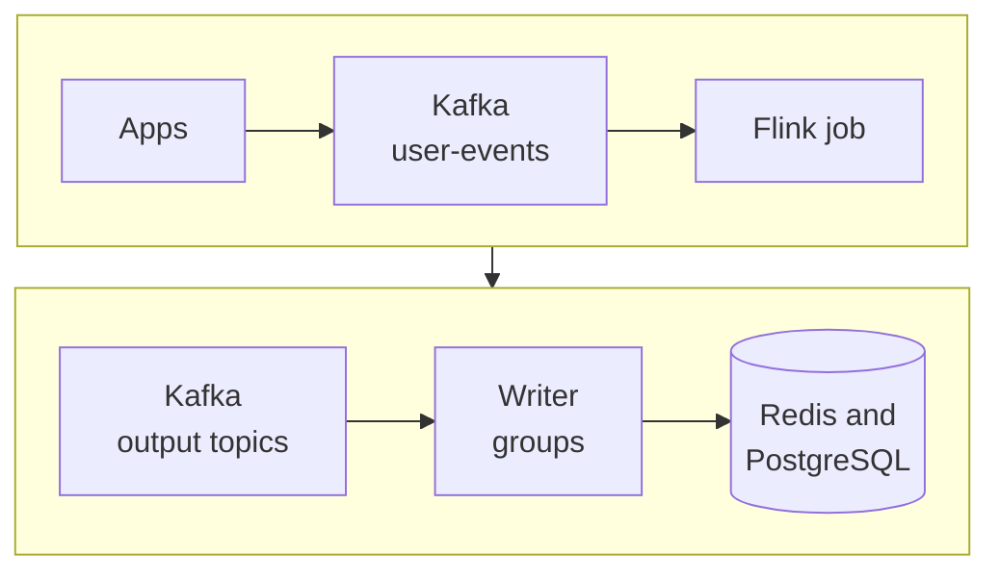
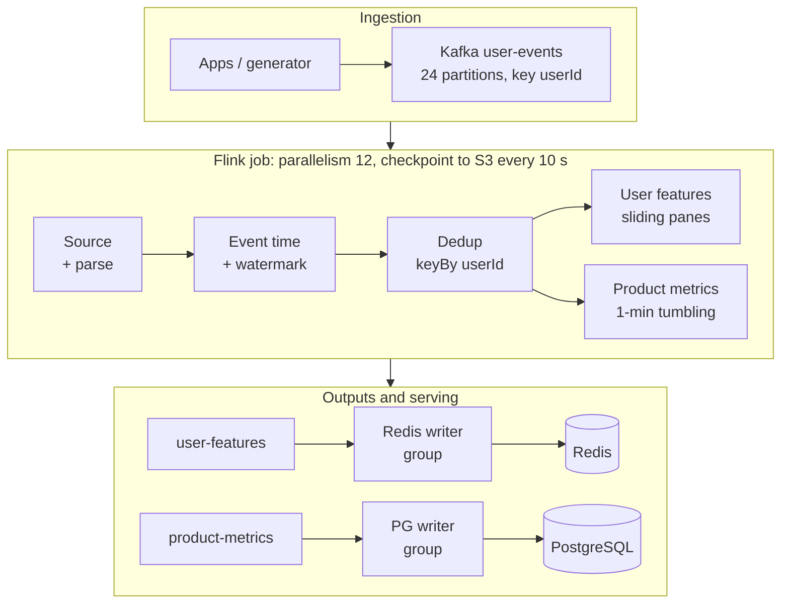
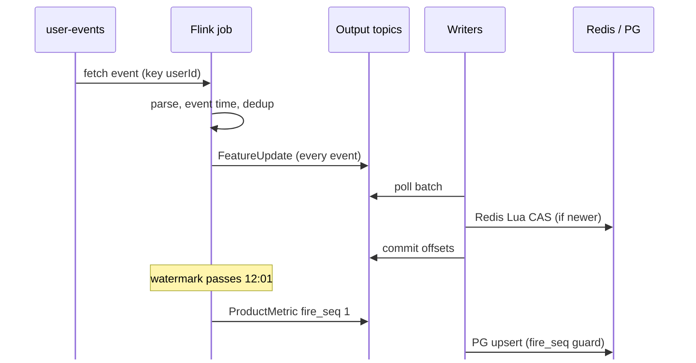
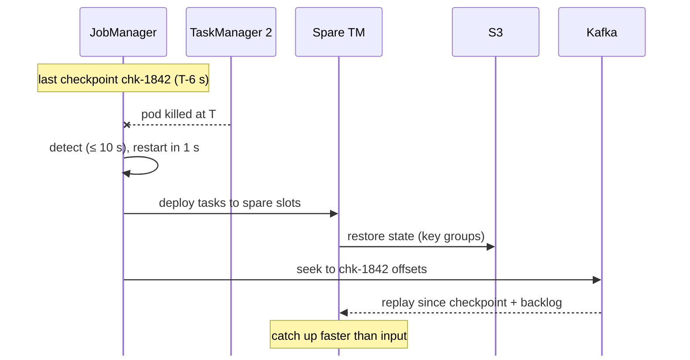

# Real-Time Event Processing Platform — Interview Playbook

*A fault-tolerant streaming platform: user-activity events flow through Kafka into an Apache Flink job that applies event-time windows, watermarks, keyed state, deduplication and checkpointing, then serves online user features in Redis and per-minute product analytics in PostgreSQL. Java, Kafka, Flink, PostgreSQL, Redis, AWS and Kubernetes. Everything you need for a 30–45 minute interview.*

**Resume bullets this booklet defends**

1. Built distributed Kafka + Flink pipelines with event-time windows, checkpointing and deduplication for reliable real-time stream processing.
2. Implemented consumer-group scaling and backpressure handling, sustaining 10K+ events/sec with under 1 sec p95 latency under concurrent I/O.
3. Added checkpoint recovery & event replay, achieving less than 30 sec recovery; optimised partitioning and parallelism, improving throughput ~2x.

# Part 1: Project Fundamentals

## 1.1 What is this project?

**What it does.** An e-commerce app emits a stream of user-activity events: product views, clicks, add-to-cart actions and purchases. This platform processes that stream continuously and produces two kinds of results within about a second:

1. **Online user features** for ML models, for example "how many products has this user viewed in the last 5 minutes?" or "how much has this user spent in the last hour?". A recommendation or fraud model reads them from Redis in single-digit milliseconds.
2. **Real-time product analytics**: views, clicks, cart-adds, purchases and revenue per product per minute, stored in PostgreSQL for dashboards and SQL queries.

**The problem it solves.** Batch jobs that run every hour are too slow for features a model needs right now. But streaming is hard: events arrive **out of order** (phones buffer while offline), are **duplicated** (producers retry), and come in **bursts**. Machines fail mid-computation. The platform must give correct counts despite all of that, without losing or double-counting events, at 10K+ events per second.

**Who would use it.** ML teams needing fresh features, product and growth teams watching live dashboards, and any backend that wants "what is happening right now" metrics.

**What happens without it.** Features are stale (computed hours ago), counts are wrong whenever events arrive late or twice, and a crash means either lost events or double counting.

**What makes it technically interesting.** Time semantics (event time versus arrival time), state that must survive failures, exactly-once state updates with external stores that are outside Flink's control, backpressure, and recovery in under 30 seconds.

> **Analogy:** Think of a stadium turnstile counter. Fans (events) arrive at many gates (partitions), sometimes late or walking through twice. Counters at each gate (Flink tasks) keep tallies per section; every ten seconds everyone photographs their tally sheets and gate positions at the same moment (checkpoint), so if a counter faints, a replacement restores the photo and re-counts from that gate position. The scoreboard (Redis/PostgreSQL) is only ever overwritten with full totals, so re-sending a total never inflates it.

> **Example:** At 12:00:58 a user views product `p-55310` on a phone. The event reaches Kafka at 12:00:58.010, Flink processes it, and within ~250 ms Redis shows `views_5m = 14` for that user. Separately, the view is added to product `p-55310`'s minute window `[12:00, 12:01)`. When the watermark passes 12:01 (about 5 seconds later), Flink emits that minute's totals, and PostgreSQL gets one row. If the same event arrives again (a producer retry), dedup drops it; if a different view of that minute arrives at 12:02:10, the window is re-emitted with corrected totals.

**Scope boundary.** No public ingestion API (producers write to Kafka directly), no ML model, no offline feature store, no dashboard UI, single AWS region.

## 1.2 Fundamentals required for this project

| Resume bullet | Concepts you must be able to explain |
|---|---|
| 1. Kafka + Flink pipelines, event-time windows, checkpointing, deduplication | Kafka topics/partitions/offsets, Flink, event time, watermarks, tumbling/sliding windows, keyed state, dedup, checkpointing |
| 2. Consumer-group scaling, backpressure, 10K+ events/s, < 1 s p95 | Consumer groups, backpressure, delivery semantics and idempotent sinks, Redis and PostgreSQL serving, throughput and latency metrics |
| 3. Checkpoint recovery and replay < 30 s; partitioning and parallelism ~2× | Recovery and replay, partitions versus parallelism |

### Kafka topics, partitions and offsets

- **Simple:** Kafka is a durable, append-only log. Producers add events to the end; consumers read at their own pace and can go back and re-read.
- **Technical:** A topic is split into partitions. An event's key (here `userId`) is hashed to pick its partition, so one user's events stay in order on one partition. Each event gets an increasing **offset**. Events are kept for the retention period (7 days on `user-events`) regardless of who read them, replicated 3 times with `acks=all` and `min.insync.replicas=2`.
- **Why it matters:** Kafka is the buffer that absorbs bursts and slow consumers, and the source of truth for **replay**: any result can be recomputed from the raw events.
- **In this project:** Input topic `user-events` (24 partitions); output topics `user-features` and `product-metrics` (12 partitions each); a dead-letter topic for malformed events and a topic for very late events. The broker stamps each event's arrival time (`LogAppendTime`), used to measure latency.
- **Interview angle:** "Why not RabbitMQ?" It deletes messages on acknowledgement and has no partitioned replay; replay is central here.

### Consumer groups

- **Simple:** A consumer group is a team of consumers sharing a topic; each partition is read by exactly one member at a time.
- **Technical:** Kafka's group coordinator assigns partitions to members and reassigns them (a **rebalance**) when members join or leave. Each member commits offsets after processing; a replacement resumes from the last committed offset. Maximum useful parallelism = number of partitions.
- **Why it matters:** Adding a pod adds throughput automatically; a crashed pod's partitions move to survivors.
- **In this project:** The `result-writer` application runs as two consumer groups: `features-redis-writer` reads `user-features` and writes Redis; `metrics-pg-writer` reads `product-metrics` and writes PostgreSQL. Offsets are committed only **after** the write succeeds. The cooperative-sticky assignor moves only the partitions that must move, so other writers keep working during a rebalance.
- **Interview angle:** "Does Flink use consumer-group rebalancing?" No: Flink's Kafka source assigns partitions to its own subtasks and stores offsets in checkpoints. Consumer-group scaling in this project is the writers.

### Apache Flink

- **Simple:** Flink is a distributed engine that runs a continuous data-processing program over a never-ending stream, keeping state and recovering from failures.
- **Technical:** A **JobManager** coordinates (scheduling, checkpoints, recovery); **TaskManagers** run the work in **slots**. A job is a graph of operators (source → parse → dedup → features / windows → sinks); each operator runs as several parallel **subtasks**. `keyBy(userId)` hash-partitions the stream so all events for one key reach the same subtask. Each subtask is single-threaded for its keys, so state needs no locks.
- **Why it matters:** It provides true event-time processing with watermarks, large keyed state on RocksDB, and exactly-once state through checkpoints.
- **In this project:** One job (`activity-pipeline`) at parallelism 12 on 3 TaskManagers × 4 slots, plus one idle spare TaskManager for fast recovery. Deployed with the Flink Kubernetes Operator on EKS.
- **Interview angle:** "Why not Kafka Streams or Spark?" Kafka Streams ties scaling to partitions and keeps state in changelog topics; Spark Structured Streaming is micro-batch with a higher latency floor.

### Event time versus processing time

- **Simple:** Event time is when something actually happened (on the user's phone). Processing time is when the server happens to handle it.
- **Technical:** Each event carries `eventTime`. Flink assigns it as the record's timestamp, and windows are defined in event time. Processing-time windows would count a view that happened at 12:00:59 but arrived at 12:01:03 in the wrong minute, and replaying the same events would give different answers.
- **Why it matters:** Event time gives deterministic, replayable results that match reality even when data is late or out of order.
- **In this project:** Analytics windows and feature panes use event time. Latency is measured with the Kafka append time instead, because event time includes delays the platform does not control (an offline phone).
- **Interview angle:** "Downside?" Results must wait for the watermark, and late data needs a policy.

### Watermarks

- **Simple:** A watermark is Flink's running estimate of "event time has now reached t; I don't expect more events older than t".
- **Technical:** With bounded out-of-orderness B = 5 s, each source partition emits `watermark = max event time seen − 5 s` every 200 ms. An operator's watermark is the **minimum** across its inputs. A window fires when the watermark passes its end. Partitions with no data for 30 s are marked idle so they do not hold the watermark back; alignment pauses partitions running more than 30 s ahead (important during replay).
- **Why it matters:** Watermarks decide when a window's result is complete enough to emit, trading latency (wait longer) against completeness (fewer late events).
- **In this project:** A minute window fires about 5 s after its end. Events up to 2 minutes late (**allowed lateness**) re-fire the window with corrected totals; later events go to the `user-events.late` topic instead of being silently dropped. Events stamped more than 10 minutes in the future are rejected, because one bad clock would otherwise push the watermark ahead and make everyone else late.
- **Interview angle:** "What stalls a watermark?" An idle or stuck partition, since the operator takes the minimum.

### Tumbling and sliding windows

- **Simple:** A tumbling window is a fixed, non-overlapping bucket (12:00–12:01, 12:01–12:02). A sliding window is a moving range such as "the last 5 minutes".
- **Technical:** Product metrics use Flink `TumblingEventTimeWindows` of 1 minute keyed by `productId`, with an incremental aggregate (one accumulator update per event). User features need a fresh "last 5 minutes" on **every** event, so they use a pane-based sliding window in keyed state: ten 30-second panes; each event increments one pane, and the feature is the sum of the panes in range.
- **Why it matters:** Flink's native sliding window of 5 minutes sliding every 30 s puts each event into 10 windows and only emits every 30 s; features would be up to 30 s stale.
- **In this project:** Each window firing carries the **full** total (not a delta), so writing it twice is harmless. The pane approach means "last 5 minutes" is really 4.5–5 minutes, a documented approximation.
- **Interview angle:** "When would you use a session window?" For activity bursts separated by inactivity gaps, such as user sessions; not needed here.

### Keyed state and the RocksDB state backend

- **Simple:** Keyed state is a small per-key memory that Flink keeps for you, e.g. "the event ids I've seen for this user".
- **Technical:** After `keyBy`, each key belongs to one of 256 **key groups** (the max parallelism), and each key group is owned by exactly one subtask. Flink offers `ValueState`, `MapState` and timers per key. The RocksDB backend stores state on local SSD (larger than memory) and supports **incremental checkpoints** that upload only new files to S3.
- **Why it matters:** Counting, deduplication and windows all need memory across events, and that memory must survive failures.
- **In this project:** Per user: seen event ids, 5-minute and 1-hour panes, last activity; per product: open window accumulators. Illustratively about 1 GB for 500K active users. A timer clears a user's state 65 minutes after their last event.
- **Interview angle:** "Why 256 max parallelism?" It is the number of key groups and is fixed in the state; you can rescale up to 256 without migration.

### Deduplication

- **Simple:** Drop an event if the same event id has already been processed recently.
- **Technical:** Keyed by `userId`, each subtask keeps `MapState<eventId, eventTime>` with a 15-minute TTL. If the id is present, drop the event and count a duplicate; otherwise store it and forward. Keying by user reuses the shuffle the features need anyway; duplicates always carry the same user, so they reach the same subtask.
- **Why it matters:** Producers retry sends after timeouts, reusing the same `eventId`; without dedup, counts and revenue would be inflated.
- **In this project:** Dedup state is checkpointed with the Kafka offsets, so after recovery a replayed event is treated exactly as the first time. Duplicates more than 15 minutes apart are not caught (documented limit). A Bloom filter was rejected: a false positive would drop a real purchase.
- **Interview angle:** "Isn't the idempotent Kafka producer enough?" It removes only broker-level duplicates from internal retries in one producer session, not application retries.

### Checkpointing

- **Simple:** Every 10 seconds Flink takes a consistent snapshot of all its state together with the exact Kafka positions it had read, and saves it to S3.
- **Technical:** The JobManager injects numbered **barriers** into every source. A barrier separates "before checkpoint n" from "after". Each operator snapshots its state when the barrier has arrived on all inputs (aligned), then forwards it. When every operator has acknowledged, the checkpoint is complete. It is a variant of the Chandy-Lamport snapshot algorithm. Unaligned checkpoints (used after a 5 s alignment timeout) also snapshot in-flight buffers so barriers do not wait behind backpressured data.
- **Why it matters:** State and input positions are consistent with each other: on recovery, rewinding Kafka to the saved offsets and restoring the saved state means every event affects state exactly once.
- **In this project:** Every 10 s, exactly-once mode, RocksDB incremental to S3, last 3 retained, up to 3 consecutive failures tolerated.
- **Interview angle:** "Does this make outputs exactly-once?" No; outputs emitted after the last checkpoint are re-emitted after recovery (Q18).

### Delivery semantics and idempotent sinks

- **Simple:** At-least-once means nothing is lost but something may arrive twice; exactly-once means each event has its effect once. Idempotent means applying something twice has the same effect as once.
- **Technical:** Kafka → Flink state is exactly-once (checkpoints). Flink → output topics is **at-least-once**. Writers → stores is at-least-once delivery made **effectively-once** by idempotent, monotonic writes: Redis features are written with a Lua compare-and-set that ignores updates older than the stored `as_of_event_time_ms`; PostgreSQL rows are upserted with absolute totals and a guard `WHERE new.fire_seq >= old.fire_seq`.
- **Why it matters:** A transactional (exactly-once) Kafka sink only makes output visible when a checkpoint completes, which would add 10+ seconds and break the < 1 s target.
- **In this project:** A crash between a write and its offset commit just causes the same values to be written again.
- **Interview angle:** "What is effectively-once?" At-least-once delivery plus idempotent processing, so stored state equals the exactly-once result.

### Backpressure

- **Simple:** When a downstream step is slower than the input, it signals upstream to slow down instead of dropping data or running out of memory.
- **Technical:** Flink uses **credit-based flow control**: a receiving task grants credits (free network buffers) to its senders; with no credit, senders stop, their buffers fill, and pressure propagates back to the Kafka source, which simply reads more slowly. Kafka holds the difference as **consumer lag**. To diagnose, find the most downstream operator that is busy (near 1000 ms/s) but not itself backpressured.
- **Why it matters:** Bursts and slow stores are normal; the system must degrade into lag, not data loss or crashes.
- **In this project:** Flink writes to Kafka (fast), so a slow Redis or PostgreSQL shows up as **writer lag**, not Flink backpressure. Writers use bounded batches of 500 and scale up to 12 replicas; network buffer timeout lowered to 20 ms with buffer debloating keeps latency low.
- **Interview angle:** "What does backpressure do to checkpoints?" Aligned barriers queue behind full buffers; unaligned checkpoints avoid that.

### Failure recovery and event replay

- **Simple:** After a crash, rewind to the last saved snapshot and re-process from there. Separately, operators can deliberately re-process past events to fix a bug.
- **Technical:** **Recovery replay** (automatic): restore the last completed checkpoint, seek sources to its offsets, re-process events since then and catch up the backlog. **Operational replay** (manual): deploy a job version from a savepoint, or with fresh state from Kafka offsets at a timestamp T (within the 7-day retention), and let it overwrite results.
- **Why it matters:** Correct results after failures and the ability to fix past mistakes without a separate batch system.
- **In this project:** Recovery time = detection + restart delay + slot allocation + state restore + backlog drain, with drain = backlog / (catch-up rate − input rate). A **spare TaskManager** removes 15–60 s of pod scheduling. For operational replay, start ~1 hour before the period of interest so dedup and feature state are warm.
- **Interview angle:** "Why is replay safe for Redis and PostgreSQL?" Overwrite semantics and monotonic guards.

### Partitions versus parallelism

- **Simple:** Partitions split the input; parallelism is how many copies of each operator run. They must be balanced.
- **Technical:** Each Kafka partition is read by exactly one source subtask. With 6 partitions over 4 subtasks, assignment is 2, 2, 1, 1, so two subtasks each carry a third of the load and cap the job. After `keyBy`, load depends on key groups, not partitions. Partition counts should be planned up front, because adding partitions remaps keys.
- **Why it matters:** A pipeline runs only as fast as its slowest subtask.
- **In this project:** Baseline 6 partitions at parallelism 4; optimised 24 partitions at parallelism 12 (2 each, even) with max parallelism 256. Plus removing Kryo serialisation, one redundant shuffle and per-record writes. This is the basis of the ~2× target.
- **Interview angle:** "Isn't that just more machines?" Partly: the baseline left slots idle on the same cluster, which must be disclosed (Q21).

### Redis online features

- **Simple:** Redis is an in-memory key-value store; the ML model reads a user's latest features from it in about a millisecond.
- **Technical:** One hash per user, `feat:u:{userId}`, with fields such as `views_5m`, `purchase_amount_1h_minor`, `last_event_type` and `as_of_event_time_ms`, TTL 2 hours refreshed on each write. Writers send pipelined Lua scripts (`EVALSHA`) in batches of 500; each script atomically compares event times and writes only if newer.
- **Why it matters:** Features must be served in single-digit milliseconds and must never move backwards in time, even during replays.
- **In this project:** Values are "as of the user's latest event time", not "as of now"; a consumer should treat them as stale if that time is more than 5 minutes ago. A missing key means no recent activity.
- **Interview angle:** "What if Redis fails over and loses recent writes?" The next update for that user rewrites the full feature set; TTL bounds staleness.

### PostgreSQL product analytics

- **Simple:** Per-minute product metrics are stored as rows in a relational table so dashboards can query them with SQL.
- **Technical:** Table `product_metrics_minute`, primary key `(product_id, window_start)`, daily partitions for retention. Writers batch 500 upserts per transaction: `INSERT … ON CONFLICT (product_id, window_start) DO UPDATE SET … WHERE EXCLUDED.fire_seq >= t.fire_seq`.
- **Why it matters:** SQL gives ad-hoc queries (top products, conversion rates) and joins with the product catalogue.
- **In this project:** Absolute totals plus the `fire_seq` guard mean duplicates overwrite with the same values and an older firing can never overwrite a newer late correction.
- **Interview angle:** "Why not ClickHouse or Druid?" Minute-grain data is small; PostgreSQL is on the stack and supports upserts. A columnar store is the upgrade for heavy scans.

### Throughput and latency metrics

- **Simple:** Throughput is events processed per second; p95 latency is the delay that 95% of events beat.
- **Technical:** **Processing** throughput counts events Flink consumes and fully processes per second, valid only while consumer lag stays flat; **ingestion** throughput (events appended to Kafka) can be much higher. Processing latency = time the feature is visible in Redis − the event's Kafka append time. Recovery time (RTO) = failure until lag returns to its normal band and stays there for 30 s.
- **Why it matters:** These definitions are the resume numbers; vague definitions are easy to challenge.
- **In this project:** 10K events/s across 12 subtasks is about 830 events/s per subtask. A healthy event takes roughly 50–250 ms end to end (illustrative), leaving headroom under 1 s for checkpoint alignment and bursts.
- **Interview angle:** "Measured or target?" Targets with a documented method (Part 6).

> **Resume flag:** Say these precisely. (1) "Consumer-group scaling" applies to the result-writer services; Flink's Kafka source assigns partitions itself, and Flink scales by changing parallelism from a savepoint. (2) "10K+ events/sec under 1 sec p95" means **processing** throughput at stable lag and **processing** latency (Kafka append → Redis), not ingestion rate, not event-time latency, and not analytics, which by design wait for the minute window plus the watermark. (3) "< 30 sec recovery" is defined for a TaskManager failure with a spare TaskManager; JobManager failover can take longer. (4) "~2×" compares against a disclosed baseline that left slots idle. (5) The design gives exactly-once **state** and effectively-once **results**, not end-to-end exactly-once delivery. All four numbers are benchmark targets, not measurements.

# Part 2: High-Level Design and Architecture

## 2.1 Technology stack

| Technology | Purpose in the project | Why it was selected |
|---|---|---|
| Java 17 | Flink job, writers, event generator | First-class Flink and Kafka APIs |
| Apache Kafka (Amazon MSK) | Input log, output topics, DLQ and late topics | Durable, partitioned, replayable; consumer groups |
| Apache Flink 1.20 | Parsing, event time, dedup, features, windows, checkpoints | True event-time processing, RocksDB keyed state, barrier checkpoints, credit-based backpressure |
| RocksDB state backend + S3 | Large keyed state; incremental checkpoints and savepoints | State larger than memory; checkpoint time proportional to changes |
| Redis (ElastiCache) | Online user features | Sub-millisecond hash reads, Lua for atomic compare-and-set, TTL |
| PostgreSQL (RDS) | Per-minute product analytics | SQL, upserts, partitioning |
| Kubernetes (EKS) + Flink Operator | Runs Flink, writers and generator; savepoint-based upgrades | Declarative deployments, HA, scaling |
| Prometheus + Grafana | Lag, busy/backpressure, checkpoint and latency metrics | Flink and Kafka metrics in one place |

**How they work together.** Producers append events to Kafka. Flink reads them, keeps per-user and per-product state in RocksDB, snapshots that state with the Kafka offsets to S3 every 10 seconds, and writes results to two Kafka output topics. Two consumer groups of a small Java writer service move those results into Redis and PostgreSQL with idempotent writes. Everything runs on EKS in one AWS region across three availability zones.

## 2.2 High-level architecture

**In simple words.** Events go into one Kafka topic. One Flink job cleans them, removes duplicates and computes two things from the same event: per-user features (updated on every event) and per-product minute totals (emitted when each minute closes). Flink writes both to Kafka, and small writer services copy them into Redis and PostgreSQL.

**Figure 1 — The simple picture: Kafka in, Flink in the middle, Kafka out, writers to the stores** [scale=0.72]

**Component responsibilities**

| Component | Responsibility |
|---|---|
| Producers / `event-generator` | Send JSON events keyed by `userId` with `acks=all`; the generator also injects duplicates, disorder and late events for tests and benchmarks |
| Kafka `user-events` | Durable input log (24 partitions, RF 3, 7 days); replay source |
| Flink `activity-pipeline` | Parse and validate (bad events to DLQ), assign event time and watermarks, dedup, user features, product windows, late-event routing, checkpoints |
| Kafka `user-features`, `product-metrics` | Durable outputs (12 partitions each) that decouple processing from serving |
| `features-redis-writer` group | Batch compare-and-set writes of features to Redis |
| `metrics-pg-writer` group | Batch idempotent upserts of minute metrics to PostgreSQL |
| S3 | Checkpoints, savepoints, JobManager HA metadata |
| Redis / PostgreSQL | Serving stores for models and dashboards |

**How components communicate.** All pipeline links are asynchronous and pull-based. Producers to Kafka: Kafka producer with idempotence. Kafka to Flink: Flink's `KafkaSource`, offsets stored in checkpoints. Inside Flink: network shuffles on `keyBy` with credit-based flow control. Flink to output topics: `KafkaSink`, at-least-once. Writers: Kafka consumer groups with manual offset commits after each batch is written. Model services read Redis with `HGETALL`; dashboards query PostgreSQL.

**Figure 2 — Detailed HLD: ingestion, the Flink job's operators, and the output and serving lane**

**Complete data flow and how one event feeds both outputs.** After parsing and dedup (keyed by `userId`), the stream splits. **Path 1, user features:** on the same subtask (no extra shuffle), the event updates that user's panes and Flink immediately emits a `FeatureUpdate` with the full current feature set to `user-features`; the Redis writer applies it. **Path 2, product analytics:** the same event is re-shuffled by `productId` to the window operator and added to its minute's accumulator; when the watermark passes the minute's end, a `ProductMetric` with `fire_seq = 1` goes to `product-metrics`, and the PostgreSQL writer upserts it. Malformed events go to `user-events.dlq`; events later than the 2-minute allowed lateness go to `user-events.late`.

**Where data is stored.** Raw events: Kafka, 7 days (the replay source). Dedup sets, panes and open windows: Flink keyed state in RocksDB on local SSD, snapshotted to S3. Outputs: Kafka, 3 days. Serving copies: Redis (TTL 2 h) and PostgreSQL (daily partitions). Redis and PostgreSQL are derived and can be rebuilt by replay.

**How it scales.**
- **Kafka:** partitions are planned up front (24 input); increasing them later remaps keys.
- **Flink:** change parallelism by restarting from a savepoint; source parallelism ≤ partitions; keyed parallelism ≤ 256.
- **Writers:** add replicas to each consumer group, up to 12 (the output partition count).
- **Stores:** scale Redis and PostgreSQL vertically; Redis cluster mode if needed.

**What happens when a major component fails**

| Failure | What happens | Effect on results |
|---|---|---|
| TaskManager crash | JobManager restarts tasks on surviving + spare slots from the last checkpoint; sources rewind | None for state; recent outputs re-emitted (idempotent) |
| JobManager crash | New leader reads the latest checkpoint pointer (Kubernetes HA + S3) and restores | Same, but may exceed 30 s |
| Kafka broker failure | Leader election moves partitions; producers and consumers fail over | None (RF 3, 2 in-sync) |
| Redis or PostgreSQL down | Writers retry with backoff and do not commit offsets; lag grows; Flink unaffected | Stale reads during the outage; nothing lost |
| Writer pod crash | Group rebalance; uncommitted batch redelivered | None (idempotent writes) |
| Checkpoint failures (S3) | Job continues; after 3 consecutive failures it fails and restarts | More replay after recovery |

## 2.3 Important architectural decisions

**1. Flink for processing.** *Chosen:* Flink. *Why:* event time with watermarks, large keyed state, barrier checkpoints, scaling independent of partitions. *Alternative:* Kafka Streams or Spark Structured Streaming. *Why not:* Kafka Streams couples scaling to partitions and keeps state in changelog topics; Spark is micro-batch with higher latency. *Trade-off:* operating a JobManager, checkpoints and the operator.

**2. Event time with a 5 s watermark bound and 2 min allowed lateness.** *Chosen:* event-time windows with late re-firing and a late topic. *Why:* deterministic, replayable results that tolerate moderate disorder. *Alternative:* processing-time windows. *Why not:* wrong buckets for late events and different results on replay. *Trade-off:* analytics wait about 5 s past each window end; very late events need a separate correction path.

**3. A Kafka hop between Flink and the stores.** *Chosen:* Flink → output topics → writer consumer groups → stores. *Why:* a slow database becomes writer lag instead of Flink backpressure and slow checkpoints; writers scale independently; stores can be rebuilt from the output topics. *Alternative:* Flink sinks writing directly to Redis and PostgreSQL. *Why not:* a slow store would stall the whole job. *Trade-off:* one extra hop (about 5–50 ms) and one more deployable.

**4. At-least-once output with idempotent sinks.** *Chosen:* at-least-once `KafkaSink`, absolute values and monotonic guards downstream. *Why:* sub-second latency. *Alternative:* exactly-once transactional Kafka sink. *Why not:* output becomes visible only after each checkpoint commits, adding 10+ s. *Trade-off:* every sink must be idempotent.

**5. Pane-based sliding features in keyed state.** *Chosen:* ten 30 s panes, updated per event. *Why:* per-event freshness with one pane update per event. *Alternative:* Flink's native sliding window. *Why not:* results only every 30 s, and each event updates 10 windows. *Trade-off:* "5 minutes" is 4.5–5 minutes; custom code to test.

**6. 24 partitions, parallelism 12, a spare TaskManager.** *Chosen:* even partition assignment with headroom, max parallelism fixed at 256, one idle TaskManager. *Why:* removes stragglers (~2× target) and pod scheduling from recovery (< 30 s target). *Alternative:* 6 partitions at parallelism 4; rely on Kubernetes to reschedule. *Why not:* uneven load; 15–60 s to get a new pod. *Trade-off:* broker overhead and paying for idle capacity.

# Part 3: How the Project Works

## 3.1 One complete end-to-end request flow

A user views a product at 12:00:58. Figure 3 shows the two output paths.

**Figure 3 — One event: a feature update reaches Redis within a second; the product window reaches PostgreSQL after the minute closes** [scale=0.72]

1. **Produce.** The app sends the event keyed by `userId` with `acks=all`. The broker appends it to partition `hash(userId) % 24`, stamps the append time, replicates it to two in-sync followers and acknowledges.
2. **Fetch.** The Flink source subtask that owns that partition fetches a batch.
3. **Validate.** The event is parsed; malformed JSON, missing fields or a timestamp more than 10 minutes in the future go to the DLQ side output, and the stream continues.
4. **Event time.** The timestamp is set from `eventTime`; the partition's watermark tracker updates its maximum.
5. **Shuffle by user.** `keyBy(userId)` sends the event to the subtask that owns the user's key group.
6. **Dedup.** If the `eventId` is already in the user's 15-minute set, drop it; otherwise remember it and continue.
7. **User features.** On the same subtask, update the 30-second pane, recompute `views_5m` and the other features as of the user's latest event time, and emit a `FeatureUpdate` to `user-features`.
8. **Product window.** The deduplicated event is also shuffled by `productId` and added to the `[12:00, 12:01)` accumulator.
9. **Serve features.** The Redis writer polls a batch, runs the compare-and-set script for each user (write only if newer), then commits its offsets. The feature is visible about 50–250 ms after the Kafka append (illustrative).
10. **Window fires.** Once the operator's watermark (the minimum over its inputs) passes 12:01, at roughly 12:01:05, the window emits its full totals with `fire_seq = 1`.
11. **Serve analytics.** The PostgreSQL writer upserts the row in a batch transaction, then commits offsets.
12. **Checkpoint (concurrently, every 10 s).** Barriers capture source offsets and all state to S3.

## 3.2 Important alternative scenarios

**Scenario A: A duplicate event.** A producer times out waiting for an acknowledgement and resends the same event (same `eventId`). Both copies land on the same partition because they share the key. The first passes dedup and is processed; the second finds its id in the user's `MapState` and is dropped, incrementing a duplicates metric. If the copy arrived more than 15 minutes later, it would not be caught (documented limit).

**Scenario B: A late event.** The minute `[12:00, 12:01)` fired at watermark 12:01 with `fire_seq = 1`. An event with time 12:00:40 arrives when the watermark is 12:02:10, within the 2-minute allowed lateness: the accumulator is updated and the window re-fires with `fire_seq = 2` and full corrected totals, which the guarded upsert writes over the older row. Another event with time 12:00:50 arrives at watermark 12:03:30, beyond lateness: it goes to `user-events.late` for an optional correction job instead of being silently dropped. The feature path handles the same event independently: if it is within the user's 5-minute pane range it is counted, otherwise skipped.

**Scenario C: A TaskManager dies (checkpoint recovery).**

**Figure 4 — TaskManager failure: restart on spare slots, restore the checkpoint, rewind Kafka and catch up** [scale=0.69]

The JobManager notices the lost TaskManager through the broken connection (seconds) or the 10 s heartbeat timeout. Because `keyBy` connects every task to every other, the whole job restarts after a 1 s delay. The scheduler needs 12 slots: 8 from the healthy TaskManagers and 4 immediately from the spare (without it, Kubernetes would need 15–60 s to schedule and start a new pod). Subtasks restore their key groups from checkpoint `chk-1842` (local copies where possible, S3 otherwise), sources seek to the checkpoint's offsets, and the ~6 seconds of events since the checkpoint are reprocessed; outputs for them are re-emitted and absorbed by idempotent writes. Then the backlog that built up during the outage drains at the job's maximum rate. Recovery is declared when lag is back in its normal band for 30 s.

## 3.3 Important guarantees and limitations

| Guarantee | Holds? | Where it comes from |
|---|---|---|
| Each event affects Flink state exactly once | Yes | Checkpoint = offsets + state; rewind on recovery |
| No acknowledged event lost | Yes | Kafka RF 3, `acks=all`, `min.insync.replicas=2`, 7-day retention |
| Output records delivered exactly once | No | At-least-once sink; duplicates after recovery |
| Stored results equal exactly-once results | Yes, after convergence | Absolute values + monotonic guards (`as_of_event_time_ms`, `fire_seq`) |
| Duplicates removed | Within 15 min | Keyed `MapState` with TTL |
| Window results final at first firing | No | Late re-firings within 2 min can correct them |
| Very late events counted in analytics | No | Routed to `user-events.late` |
| Redis and PostgreSQL agree at every instant | No | Independent outputs with different timing |
| Per-user ordering | Yes | Same key → same partition → same subtask |

**Where consistency comes from:** checkpoints tie state to input positions, Kafka retention makes everything recomputable, and idempotent, monotonic sink writes make re-delivery harmless. **Failures** are handled by restoring and replaying (Flink), retrying without committing offsets (writers) and buffering as lag (Kafka). **Accepted trade-offs:** analytics wait for windows plus the watermark; a 15-minute dedup horizon; very late events excluded; approximate pane boundaries; JobManager failover may exceed 30 s.

# Part 4: Complete Interview Explanation

## 4.1 Two-minute explanation

> **Say it aloud:** "I built a real-time event processing platform on Kafka and Apache Flink. An e-commerce app sends user events like views, clicks and purchases, and the platform turns them, within about a second, into two things: per-user features in Redis that ML models read, like 'views in the last five minutes', and per-product, per-minute analytics in PostgreSQL for dashboards.
>
> Events go into a Kafka topic keyed by user. A single Flink job parses them, assigns event time with watermarks so late and out-of-order events land in the right window, removes duplicates using keyed state, updates sliding-window user features on every event, and computes one-minute tumbling windows per product. Flink writes results to Kafka output topics, and two consumer groups of writer services apply them to Redis and PostgreSQL with idempotent writes.
>
> For reliability, Flink checkpoints its state and Kafka offsets to S3 every ten seconds, so after a failure it rewinds and every event affects state exactly once; the sinks are idempotent, so re-sent results are harmless. A spare TaskManager makes recovery fast.
>
> The targets were 10K events per second at under one second p95 processing latency, under 30-second recovery, and about 2× throughput from rebalancing partitions and parallelism. Those are benchmark targets with a written method, not production measurements."

## 4.2 Five-minute explanation

> **Say it aloud:** "**Problem.** Two consumers need the same event stream processed in near real time: ML models need fresh per-user features, and analysts need per-product minute metrics. Events arrive out of order, sometimes twice, and in bursts, and machines fail. Results must still be correct.
>
> **Requirements.** Ingest into Kafka; validate and route bad events aside; event time with five seconds of tolerated disorder; dedup within 15 minutes; per-user sliding features updated on every event; one-minute product windows with two minutes of allowed lateness; idempotent writes to Redis and PostgreSQL; automatic recovery; and replay from any time in the last seven days.
>
> **Technology.** Kafka as the durable, replayable log. Flink because it has real event-time processing, large keyed state on RocksDB, and barrier-based checkpoints. Redis for millisecond feature reads, PostgreSQL for SQL analytics, all on EKS with S3 for checkpoints.
>
> **Architecture.** [Draw Figure 2.] Producers write to `user-events`, 24 partitions keyed by user. The Flink job runs at parallelism 12: source and parse, event time and watermarks, dedup keyed by user, then the stream splits. User features stay on the same subtask; product metrics are re-keyed by product into tumbling windows. Both go to Kafka output topics, and two writer consumer groups apply them to the stores.
>
> **Key decisions.** I put a Kafka hop before the stores so a slow database shows up as writer lag instead of backpressuring Flink. I chose at-least-once output with idempotent sinks over Flink's transactional sink, because the transactional one only publishes after each checkpoint, which would cost ten seconds of latency. For features I used 30-second panes in keyed state so 'last five minutes' updates on every event.
>
> **Reliability and performance.** Checkpoints every ten seconds give exactly-once state; Redis writes use a Lua compare-and-set on event time and PostgreSQL upserts are guarded by a fire sequence, so duplicates and replays are harmless. Backpressure is Flink's credit-based flow control, with Kafka absorbing bursts as lag. For throughput, I moved from six partitions at parallelism four, which left two subtasks overloaded, to 24 at parallelism 12, and removed Kryo serialisation and a redundant shuffle. The 10K per second, sub-second p95, 30-second recovery and 2× numbers are targets I designed for."

## 4.3 Ten-minute explanation

> **Say it aloud:** "**Motivation.** Stream processing is where time semantics, state, exactly-once, backpressure and recovery all meet. I scoped it to one realistic case, e-commerce activity, with two very different outputs: per-event features and per-minute analytics.
>
> **Architecture.** [Draw Figure 2.] Kafka on MSK with `user-events` at 24 partitions, replication three, seven-day retention, keyed by user so one user's events stay ordered. The broker stamps append time, which I use for latency measurement. One Flink job, deployed by the Flink Kubernetes Operator, on three TaskManagers with four slots each, plus a spare.
>
> **Time.** Each event carries its own event time. Watermarks are max event time seen minus five seconds, emitted per partition, and an operator's watermark is the minimum of its inputs. Idle partitions are excluded after 30 seconds so they don't freeze the watermark, and I reject events more than ten minutes in the future, because one bad clock would push the watermark ahead and make everyone else late. A minute window fires about five seconds after it ends. Up to two minutes late, it re-fires with corrected totals; beyond that, events go to a late topic rather than being silently dropped.
>
> **State.** After `keyBy(userId)`, each user lives in one of 256 key groups owned by exactly one subtask, so state needs no locks. Dedup is a MapState of event ids with a 15-minute TTL. Features use ten 30-second panes for five minutes and twelve five-minute panes for one hour of purchases. Each event updates one pane, and the feature is the sum, emitted immediately. Product metrics are a standard tumbling window with an incremental aggregate. State lives in RocksDB on local SSD, around a gigabyte for half a million active users, illustratively.
>
> **Checkpoints.** Every ten seconds the JobManager injects barriers at the sources. Each operator snapshots when the barrier has arrived on all inputs, so the checkpoint is a consistent cut of offsets plus state. If backpressure delays alignment for more than five seconds, Flink switches to unaligned checkpoints. RocksDB checkpoints are incremental, so only new files go to S3.
>
> **Outputs and exactly-once.** State is exactly-once, but output to Kafka is at-least-once: anything emitted after the last checkpoint is emitted again after recovery. I made that harmless downstream. Feature updates carry the full feature set and an as-of event time, and the Redis writer uses a Lua script that ignores anything older than what's stored. Window results carry full totals and a fire sequence, and the PostgreSQL upsert only overwrites when the sequence is the same or newer. Writers commit Kafka offsets only after the write succeeds, so a crash in between just rewrites the same values. That's effectively-once.
>
> **Scaling and backpressure.** Writers are consumer groups, so I scale them by adding pods up to 12, and the cooperative-sticky assignor keeps rebalances small. Inside Flink, credit-based flow control propagates pressure back to the source, and Kafka holds the backlog as lag. To diagnose I look for the most downstream operator that is busy but not backpressured. I also lowered the network buffer timeout to 20 milliseconds so shuffles don't add 100 milliseconds each.
>
> **Recovery.** If a TaskManager dies, detection takes a few seconds, up to the ten-second heartbeat timeout; the job restarts after one second on the surviving slots plus the spare, restores state from the last checkpoint, rewinds Kafka, replays the few seconds since the checkpoint and then drains the backlog. Recovery time is detection plus restart plus restore plus drain, and drain depends on headroom: backlog divided by catch-up rate minus input rate. That's why the throughput work matters for recovery too. Operational replay is a separate tool: start a job from a timestamp, an hour early to warm state, and let it overwrite results.
>
> **Performance and numbers.** The baseline had six partitions at parallelism four, so two source subtasks each carried a third of the input, and Kryo serialisation plus a redundant shuffle added per-record cost. The optimised version has 24 partitions at parallelism 12, POJO serialisation, one fewer shuffle and batched writes. I'd measure max sustainable throughput with a step ramp where lag stays flat and p95 stays under a second, three runs, plus an ablation. All four numbers are targets, and I'd disclose that part of the 2× is using slots the baseline left idle.
>
> **Limitations.** Late events beyond two minutes are excluded from analytics, dedup only covers 15 minutes, hot keys concentrate on one subtask, partition counts are fixed up front, JobManager failover can exceed 30 seconds, and it's single-region. Next I'd add a correction job for the late topic, two-phase aggregation for hot keys, a schema registry with Avro, and autoscaling."

# Part 5: Interview Questions and Answers

## 5.1 Basic understanding

#### Q1. What does your real-time event processing platform do? [Easy]

It consumes a stream of user-activity events (views, clicks, add-to-cart, purchases) from Kafka and, with an Apache Flink job, turns them into two continuously updated results. First, online user features in Redis, such as views, clicks and purchases in the last 5 minutes and spend in the last hour, updated on every event and read by ML models in milliseconds. Second, per-product, per-minute analytics in PostgreSQL for dashboards. The job handles out-of-order events with event time and watermarks, removes duplicates with keyed state, and checkpoints its state with the Kafka offsets every 10 seconds so it can recover without losing or double-counting events. Results go through Kafka output topics to writer consumer groups that write the stores idempotently. Targets: 10K+ events/s, under 1 s p95 processing latency, under 30 s recovery.

#### Q2. Why put Kafka in front of Flink? [Easy]

Kafka is a durable, replicated, append-only log that decouples producers from processing. Producers write at their own rate; Flink reads at its own rate; bursts and slow periods become consumer lag rather than data loss. Events are retained for 7 days, so Kafka is the source of truth for replay: after a failure, Flink rewinds to checkpointed offsets, and after a bug fix, operators can reprocess from any point in the retention window. Partitioning by `userId` gives per-user ordering and lets Flink read partitions in parallel. Replication factor 3 with `acks=all` and `min.insync.replicas=2` means an acknowledged event survives a broker failure. A traditional queue such as RabbitMQ deletes messages on acknowledgement and has no partitioned replay, which would make recovery and backfills much harder.

#### Q3. Explain Kafka topics, partitions and offsets as used here. [Easy]

A topic is a named log; this project has `user-events` (input), `user-features` and `product-metrics` (outputs), plus a dead-letter and a late-events topic. Each topic is divided into partitions, which are the unit of parallelism and ordering: `user-events` has 24. The producer hashes the key (`userId`) to choose the partition, so all of one user's events go to one partition and stay in order. Each event in a partition gets a sequential offset, and a consumer's position is just "the next offset to read" per partition. Flink stores those offsets inside its checkpoints; the writer services commit them to Kafka after writing. Order is guaranteed only within a partition, not across partitions. Partition counts are chosen up front because adding partitions later changes which partition a key maps to, which breaks per-key ordering across the change.

#### Q4. What are consumer groups and how did you use them for scaling? [Easy]

A consumer group is a set of consumers sharing a topic, where Kafka assigns each partition to exactly one member. Adding members spreads partitions across more consumers; if one dies, its partitions are reassigned in a rebalance, and the replacement resumes from the last committed offset. In this project the `result-writer` service runs as two groups: `features-redis-writer` on `user-features` and `metrics-pg-writer` on `product-metrics`. Each writer polls up to 500 records, writes them as a batch (pipelined Lua scripts to Redis or one PostgreSQL transaction) and only then commits offsets. To scale, I add replicas up to the 12 partitions per output topic; beyond that, extra replicas sit idle. The cooperative-sticky assignor moves only the partitions that need to move, and a revocation hook flushes and commits the current batch before giving a partition up.

**Related follow-up:** "Does Flink scale the same way?" No; Flink assigns Kafka partitions to its own source subtasks and scales by changing parallelism from a savepoint.

#### Q5. What is Apache Flink and why did you choose it? [Easy]

Flink is a distributed stream-processing engine. You write a program as a graph of operators; Flink runs many parallel copies of each operator across TaskManagers, routes records between them (for example by key), keeps per-key state, and coordinates consistent checkpoints so the job can recover after failures. I chose it for three features this project depends on: true **event-time** processing with watermarks and allowed lateness; large **keyed state** on RocksDB with incremental checkpoints; and **barrier checkpoints** that give exactly-once state with low overhead. It also has credit-based backpressure and scales independently of Kafka partition counts. Kafka Streams is a lighter alternative, but its parallelism is tied to partitions and its state is backed by changelog topics. Spark Structured Streaming processes micro-batches, which raises the latency floor. The cost of Flink is operational: a JobManager, checkpoints and an operator to manage.

#### Q6. What is the difference between event time and processing time? [Easy]

Event time is when the event actually happened, recorded by the client in `eventTime`. Processing time is the wall-clock time of the machine handling it. They differ because phones buffer while offline, networks delay, and Kafka partitions are read at different speeds. If windows used processing time, a view at 12:00:59 that arrived at 12:01:03 would be counted in the 12:01 minute, and replaying the same events tomorrow would give different results. With event time, the event goes into its true minute, and results are deterministic and replayable. The cost is waiting: Flink must decide when a minute is complete, which is what watermarks are for. Latency, by contrast, is measured from Kafka append time, because event time includes delays the platform cannot control, such as a phone that was offline for four minutes.

#### Q7. What is a watermark? [Easy]

A watermark is a special marker flowing with the data that says "event time has progressed to t; no more events with timestamps at or before t are expected". Here the sources use a bounded out-of-orderness strategy: watermark = largest event time seen on that partition minus 5 seconds, emitted every 200 ms. Each operator's watermark is the minimum of its input watermarks, because the slowest input determines what is safe. When the watermark passes a window's end, the window fires. So a minute window `[12:00, 12:01)` emits at roughly 12:01:05 in event time. Watermarks are a heuristic, so some events can still arrive later; allowed lateness (2 minutes) handles those by re-firing the window, and anything later goes to a late topic. Idle partitions are excluded after 30 seconds so they cannot stall the minimum.

#### Q8. Explain tumbling versus sliding windows in your design. [Easy]

A tumbling window divides time into fixed, non-overlapping intervals, such as each minute. Product analytics use 1-minute tumbling event-time windows keyed by `productId`, with an incremental aggregate that updates one accumulator (views, clicks, cart-adds, purchases, revenue) per event and emits once when the watermark passes the end, plus late corrections. A sliding window covers a moving range, such as "the last 5 minutes". Online features need that value fresh on every event, so I built a pane-based sliding window in keyed state: the 5 minutes are ten 30-second panes; each event increments its pane, and the feature is the sum of panes in range relative to the user's latest event time. Flink's built-in sliding window (5 minutes, sliding every 30 s) would put each event in 10 windows and only emit every 30 seconds, making features up to 30 s stale. The cost is pane-aligned boundaries: "5 minutes" is really 4.5 to 5.

#### Q9. How do you deduplicate events? [Easy]

Producers retry sends after timeouts and reuse the same `eventId`, so the same event can appear twice in Kafka. After `keyBy(userId)`, a dedup operator keeps, for each user, a `MapState` of event ids seen in the last 15 minutes (with a state TTL). For each event it checks `contains(eventId)`: if present, the event is dropped and a duplicates counter increments; if not, the id is stored and the event continues. Keying by user rather than by event id reuses the shuffle the feature operator needs, and duplicates always share the same user, so they reach the same subtask. Because dedup state is part of the checkpoint, after a recovery the replayed events see exactly the state they saw the first time. Duplicates more than 15 minutes apart are not removed; a Bloom filter was rejected because its false positives would drop real events, such as a purchase.

#### Q10. What is checkpointing, in simple terms? [Easy]

Every 10 seconds, Flink saves a consistent snapshot of the whole job: the Kafka offset each source had reached, and all operator state (dedup sets, feature panes, open windows), as of the same logical point in the stream. It does this without stopping processing by sending barrier markers through the data; each operator snapshots its state when the barrier passes it. The snapshot goes to S3, incrementally for RocksDB so only new files upload. If anything fails, Flink restores the last complete snapshot and rewinds Kafka to its offsets, so every event after that point is processed again against exactly the state that existed before it. That is why the state is exactly-once even though some events are processed twice physically. The last three checkpoints are retained, and three consecutive checkpoint failures fail the job rather than letting it run without protection.

#### Q11. How does one event contribute to both user features and product analytics? [Easy]

After parsing, timestamping and dedup (keyed by user), the deduplicated stream feeds two branches. The **feature branch** stays on the same subtask without another shuffle (the stream is re-interpreted as already keyed by user): it updates that user's 30-second pane and 1-hour purchase pane, recomputes the features as of the user's latest event time and immediately emits a `FeatureUpdate` to the `user-features` topic, so Redis reflects it within about a second. The **analytics branch** re-shuffles the same event by `productId` to the window operator, which adds it to that product's current-minute accumulator; the result is emitted only when the watermark passes the minute's end, then written to PostgreSQL. So one event changes a per-user value immediately and a per-product value about a minute later, through independent outputs with different timing.

#### Q12. What is backpressure and how does your pipeline handle it? [Easy]

Backpressure is what happens when a downstream step cannot keep up with the input. Flink handles it with credit-based flow control: each receiving task tells its senders how many free network buffers it has (credits); a sender only transmits with credit. When a receiver slows, credits run out, the sender's output buffers fill, the sender blocks, and the pressure propagates upstream until the Kafka source simply reads more slowly. Nothing is dropped and memory stays bounded; the backlog waits in Kafka as consumer lag. In this design Flink writes to Kafka output topics, which rarely slow down, so a slow Redis or PostgreSQL shows up as lag in the writer consumer groups instead, and I can scale those groups independently. To find the bottleneck inside Flink, look for the most downstream operator that is busy but not itself backpressured, then raise its parallelism, fix skew or reduce per-record cost.

## 5.2 Reliability and recovery

#### Q13. What happens when a TaskManager fails? [Easy]

The JobManager detects the lost TaskManager within seconds through the broken connection, or at most the 10-second heartbeat timeout. Because the job's `keyBy` shuffles connect every task to every other, the whole job is cancelled and restarted after a 1-second delay. The scheduler needs 12 slots: 8 come from the two healthy TaskManagers and 4 immediately from the spare TaskManager, avoiding 15–60 seconds of waiting for Kubernetes to schedule a new pod. Each subtask restores its key groups' state from the last completed checkpoint (from local disk if it ran there before, otherwise from S3); sources seek back to the checkpointed offsets; events since the checkpoint are reprocessed and their outputs re-emitted, which idempotent sinks absorb. Finally the backlog accumulated during the outage drains at maximum throughput. Recovery is complete when lag is back in its normal band for 30 seconds; the target is under 30 s.

#### Q14. What is event replay, and how is it different from checkpoint recovery? [Easy]

Checkpoint recovery is automatic replay after a failure: Flink restores the latest checkpoint and re-reads Kafka from the offsets stored in it, usually just seconds of data. Operational replay is a deliberate re-processing of history, for example after fixing a bug that undercounted add-to-cart events for three hours. The operator deploys the corrected job either from a savepoint or with fresh state starting at Kafka offsets for a timestamp T, writing to the same output topics. T is chosen about an hour before the period of interest so dedup and feature state are warm. Watermark alignment keeps partitions in step while reading history fast. Because window outputs are full totals and feature writes are guarded by event time, the recomputed results simply overwrite the wrong ones. Replay is only possible within Kafka's 7-day retention, and each run is recorded in a `replay_runs` table for auditability.

#### Q15. Why is there a Kafka hop between Flink and Redis/PostgreSQL? [Easy]

If Flink wrote directly to the stores, a slow or failing database would backpressure the entire job, slow down checkpoints and delay every result, and scaling the sinks would mean rescaling Flink. With Flink writing to Kafka output topics and separate writer consumer groups applying them, a database problem becomes writer lag only; Flink keeps processing and checkpointing normally. Writers scale independently by adding pods. The output topics are also a durable buffer: Redis or PostgreSQL can be rebuilt by replaying the topic into them without re-running Flink. And Redis or PostgreSQL failures never fail Flink checkpoints. The cost is one extra hop, about 5–50 ms, against a 1-second budget, plus one more service to deploy and monitor.

#### Q16. What happens if Redis goes down for a minute? [Easy]

Flink is unaffected because it writes to the `user-features` Kafka topic, not to Redis. The Redis writers' batch writes fail; they retry with exponential backoff (100 ms up to 5 s) and do **not** commit their Kafka offsets, so no update is lost. Lag on `user-features` grows and an alert fires; after 60 seconds without a successful write the writer's readiness turns false (an alert, not a restart loop). Model services reading Redis see stale or failed reads during the outage. When Redis returns, writers drain the backlog with large batches; the Lua compare-and-set ensures updates are applied monotonically by event time, so a delayed older update can never overwrite a newer one. If ElastiCache failed over to a replica that missed the last few writes, the next update for each affected user rewrites its full feature set.

#### Q17. What are the main limitations, and what would you improve? [Easy]

Correctness limits: events later than 2 minutes are excluded from analytics; dedup covers only 15 minutes; sliding features use pane-aligned boundaries; outputs are at-least-once (made safe by idempotent sinks). Scalability: partition counts are fixed up front; hot keys (a bot user or a flash-sale product) concentrate on one subtask. Reliability: JobManager failover can exceed 30 s; single region. Data quality: JSON without a schema registry; producers are trusted. Operations: rescaling is manual. Improvements: a batch correction job reading the late topic, HyperLogLog for distinct counts, two-phase (salted) aggregation for hot keys, Avro or Protobuf with a schema registry, the Flink autoscaler and KEDA for writers, a standby JobManager, MirrorMaker for a second region, and an offline feature sink to S3 for training. And run the benchmarks to turn targets into measured results.

## 5.3 Deeper design questions

#### Q18. Your state is exactly-once but output is at-least-once. Why not use Flink's exactly-once Kafka sink? [Medium]

Flink's exactly-once `KafkaSink` writes output inside Kafka transactions that commit only when a checkpoint completes. Downstream consumers reading with `read_committed` therefore see results only after each checkpoint, so output latency is at least the 10-second checkpoint interval and typically around 15 seconds, which breaks the under-1-second target. Instead, the sink is at-least-once: results appear immediately, and after a recovery any results emitted since the last checkpoint are emitted again. That duplication is harmless because every downstream write is idempotent and monotonic: feature updates carry the full feature set and an as-of event time, and window results carry full totals and a fire sequence, so writing them twice produces the same stored state. The combination is often called effectively-once: at-least-once delivery plus idempotent application equals the exactly-once result in the stores. The trade-off is that every sink must be designed that way.

#### Q19. How exactly are the Redis and PostgreSQL writes idempotent? [Medium]

**Redis:** each `FeatureUpdate` contains the user's full feature set and `as_of_event_time_ms`. The writer runs a Lua script atomically per key: read the stored `as_of_event_time_ms`; if the incoming value is older, ignore it; otherwise `HSET` all fields and refresh the 2-hour TTL. Redis executes scripts one at a time, so there is no race between writers, and equal times are accepted, so a replayed identical update is a harmless overwrite. **PostgreSQL:** each `ProductMetric` carries absolute window totals and a `fire_seq` (1 for the on-time firing, 2+ for late re-firings). The writer upserts `ON CONFLICT (product_id, window_start) DO UPDATE … WHERE EXCLUDED.fire_seq >= t.fire_seq`. Applying the same row twice writes the same values; an older firing arriving after a newer correction is rejected. In both stores the writer commits Kafka offsets only after the write succeeds, so the only failure mode is re-applying, which these rules make safe.

#### Q20. How are late events handled? [Medium]

There are three layers. First, the watermark itself tolerates 5 seconds of disorder: a minute window waits until the watermark (max event time minus 5 s) passes its end, so moderately out-of-order events are counted in the first firing. Second, **allowed lateness** of 2 minutes keeps the window's state after it fires; a late event within that period updates the accumulator and the window re-fires with full corrected totals and an incremented `fire_seq`, which the guarded upsert writes over the earlier row. Third, events later than the window end plus 2 minutes are sent to a side output, the `user-events.late` topic, instead of being silently dropped, so an optional batch job can correct history. The feature path is separate: a late event is counted if it falls inside the user's current 5-minute pane range, otherwise skipped. The trade-off is state size (windows kept 2 extra minutes) versus completeness.

#### Q21. How did partitioning and parallelism changes improve throughput about 2×? [Medium]

The baseline had 6 input partitions and job parallelism 4. Each partition is read by one source subtask, so assignment was 2, 2, 1, 1: two subtasks each carried a third of all input and capped the whole pipeline, and keyed operators at parallelism 4 saturated. The optimised job uses 24 partitions at parallelism 12, two partitions per subtask, evenly, with headroom to grow to 24, and max parallelism fixed at 256 so state can be rescaled later. Per-record cost also fell: flat POJOs replaced Kryo fallback serialisation, a redundant second `keyBy` was removed (the stream is re-interpreted as keyed after dedup), and writers batch instead of writing per record. Illustratively, if one subtask handles ~2,000 events/s, a subtask carrying a third of the input caps the job at ~6,000/s; balancing removes that cap. To be honest: part of the gain is using slots the baseline left idle on the same cluster, which I would disclose, and an ablation would separate partitioning from per-record savings. It is a target, not a measurement.

#### Q22. What do "10K+ events/sec" and "under 1 sec p95" mean, and how would you measure them? [Medium]

10K events/s is **processing** throughput: events the Flink job consumes and fully processes (parse, dedup, features, windows, outputs) per second, summed over source subtasks, and it only counts while consumer lag stays flat. Kafka can ingest far more; if ingestion exceeds processing, lag grows without bound and the claim is false. Measure over 30 minutes after a 5-minute warm-up and check that the lag trend is flat. The p95 is **processing latency** for features: time the update is acknowledged by Redis minus the event's Kafka append timestamp (stamped by the broker, so client clocks don't matter), carried through the pipeline. It excludes event-time delay (a phone offline for minutes) and does not apply to analytics, which by design wait for the minute plus the watermark. Report p95 and p99 from merged histograms, never averaged percentiles, with writer throughput reported separately. Both are benchmark targets.

#### Q23. What goes into the under-30-second recovery, and why the spare TaskManager? [Medium]

Recovery time = detection + restart delay + slot allocation + state restore + backlog drain. Illustratively: detection 2–5 s through connection loss (at most 10 s heartbeat timeout); restart delay 1 s; slot allocation about 1 s with a spare TaskManager versus 15–60 s for Kubernetes to schedule a pod, pull the image and start a JVM; state restore a few seconds with incremental RocksDB checkpoints and local recovery; and drain = backlog ÷ (catch-up rate − input rate). At 10K events/s, 15 seconds down creates ~150K events of backlog; with a catch-up rate of 20K/s, draining takes about 15 s. That shows why throughput headroom from the 2× work is part of recovery, and why the spare matters most: without it, slot allocation alone can exceed 30 s. "Recovered" means lag back in its pre-failure band for 30 seconds, not merely "job running". The target applies to TaskManager failures; JobManager failover is reported separately.

#### Q24. How does keyed state work, and why the RocksDB backend? [Medium]

After `keyBy`, Flink hashes each key into one of 256 key groups (the max parallelism), and each subtask owns a contiguous range of key groups. All events for one user therefore reach the same subtask, which processes them on one thread, so per-key state needs no locks and has no races. State types used: `MapState` for dedup ids, `ValueState` for pane rings and last activity, window accumulators, and event-time timers to clear a user's state 65 minutes after their last event. The RocksDB backend stores state on local SSD rather than the JVM heap, so it can exceed memory (about a gigabyte here) without garbage-collection pressure, and it supports incremental checkpoints that upload only newly created files. The heap backend is faster per access but limited by memory and does full snapshots. On rescaling, key groups are reassigned to the new subtasks from a savepoint; max parallelism cannot change without state migration, which is why it is chosen before the first deployment.

#### Q25. What can make watermarks go wrong, and how do you guard against it? [Medium]

Two classic problems. **Stalled watermarks:** an operator's watermark is the minimum over its inputs, so one idle partition (no events) or one stuck source subtask holds back every window, and analytics stop firing. The guard is idleness detection: a partition with no data for 30 seconds is excluded from the minimum until it receives data again. **Runaway watermarks:** a producer with a clock an hour ahead sends events whose timestamps push the watermark far forward; suddenly everyone else's correct events are "late" and diverted. The guard is validation: events more than 10 minutes ahead of their Kafka append time go to the DLQ with reason `FUTURE_TIMESTAMP`. A third issue arises during replay: partitions read at different speeds can spread far apart in event time, making window state explode; watermark alignment pauses partitions more than 30 seconds ahead of the slowest. Monitor the watermark lag metric to catch these.

#### Q26. Input traffic doubles to 20K events/s. What do you do? [Medium]

First, find the bottleneck with metrics: busy versus backpressured time per operator, source lag, writer lag, checkpoint durations. If Flink is the limit, raise parallelism by taking a savepoint and restarting at a higher value, for example from 12 to 24, which matches the 24 partitions (source parallelism cannot usefully exceed partitions) and stays within max parallelism 256 for keyed operators; add TaskManagers for the extra slots and keep a spare. If a few hot keys are the limit, parallelism will not help; use pre-aggregation or key salting. If writers lag, add replicas up to 12 per output topic, or increase output partitions. Check Redis and PostgreSQL write capacity, since batching may need tuning. Check that checkpoints still complete well within the interval with larger state. And re-run the recovery test: with less headroom, backlog drain takes longer, so the 30-second target must be re-verified at the new rate.

#### Q27. How do checkpoint barriers produce a consistent snapshot, and what are aligned versus unaligned checkpoints? [Hard]

The checkpoint coordinator tells every source to record its current Kafka offsets and inject barrier n into its output. Barriers flow in order with the records, so on every channel everything before barrier n belongs to the checkpoint and everything after does not. An operator with several inputs **aligns**: when barrier n arrives on one input, it buffers further records from that input until barrier n arrives on all inputs; then it snapshots its state (RocksDB flushes and hard-links files, then uploads asynchronously) and forwards the barrier. When all sinks acknowledge, the checkpoint is complete. The result is a consistent cut: state reflects exactly the records before the recorded offsets, the Chandy-Lamport idea applied to dataflows. Under backpressure, barriers queue behind full buffers and alignment can take long, delaying checkpoints. **Unaligned** checkpoints let the barrier overtake buffered records and include those in-flight buffers in the snapshot, so checkpoints finish quickly at the cost of larger snapshots. This project starts aligned and switches to unaligned if alignment exceeds 5 seconds.

#### Q28. What did you design, and what is not yet verified? [Easy]

The design and intended implementation cover: the Kafka topic layout and partitioning; the Flink topology (validation with DLQ, event time and watermarks with idleness and alignment, keyed dedup, pane-based features, tumbling windows with allowed lateness and a late topic); checkpoint and recovery configuration including the spare TaskManager; the writer consumer groups with idempotent Redis and PostgreSQL writes; the replay procedure; Kubernetes and AWS deployment; and a benchmark plan with a load generator that injects duplicates, disorder and late events. None of the four numbers (10K events/s, under 1 s p95, under 30 s recovery, ~2×) has a recorded run; they are benchmark targets with defined measurement methods. If an interviewer probes, say so plainly: "Those are the targets I designed and wrote the test procedure for; I wouldn't present them as production measurements." That precision usually earns more trust than the number itself.

# Part 6: Final Revision Sheet

### 1. Project in one paragraph

Kafka `user-events` (24 partitions, keyed by user) feeds one Flink job (parallelism 12): parse and validate, event time with a 5 s watermark, dedup by user (15 min), pane-based sliding user features updated per event, and 1-minute tumbling product windows with 2 min allowed lateness. Results go to Kafka output topics; two writer consumer groups apply them idempotently to Redis (features) and PostgreSQL (analytics). Checkpoints every 10 s to S3 give exactly-once state; a spare TaskManager speeds recovery. EKS on AWS.

### 2. Architecture in one diagram

<b>Pipeline:</b> Apps → Kafka user-events (24 partitions) → Flink [parse → watermark → dedup] → user features | product windows → Kafka user-features / product-metrics → writer groups → Redis / PostgreSQL

<b>Side paths:</b> checkpoints → S3 every 10 s · malformed → DLQ · later than 2 min → late topic

### 3. Stack and responsibilities

- **Kafka:** durable, replayable log; consumer groups
- **Flink:** event time, state, windows, checkpoints
- **RocksDB + S3:** large state, incremental snapshots
- **Redis:** per-user features, Lua CAS, TTL 2 h
- **PostgreSQL:** minute analytics, guarded upsert
- **EKS + Flink Operator:** deploy, savepoints, HA

### 4. Five most important concepts

1. Event time + watermarks + allowed lateness
2. Keyed state (key groups, one thread per key)
3. Checkpoint barriers = consistent cut
4. Exactly-once state, effectively-once results
5. Credit-based backpressure; Kafka holds lag

### 5. Five key decisions

1. Flink over Kafka Streams / Spark
2. Kafka hop before the stores
3. At-least-once sink + idempotent writes
4. Pane-based sliding features
5. 24 partitions / parallelism 12 / spare TM

### 6. Five likely questions

1. Event time vs processing time? Watermarks?
2. How is dedup done? Limits?
3. What is checkpointing; what happens on failure?
4. Why not exactly-once sink?
5. What do 10K/s, < 1 s, < 30 s, 2× mean?

### 7. Main limitations

Events > 2 min late excluded; dedup only 15 min; pane approximation; hot keys; fixed partition counts; JobManager failover may exceed 30 s; single region; numbers unmeasured.

### 8. Numerical claims and evidence status

| Claim | Meaning | Status |
|---|---|---|
| 10K+ events/s | Processing throughput, flat lag, 30 min | Target, unverified |
| < 1 s p95 | Redis ack − Kafka append time | Target, unverified |
| < 30 s recovery | TaskManager kill → lag normal for 30 s | Target, unverified |
| ~2× throughput | Max sustainable, 6/p4 vs 24/p12 | Target, unverified |

### 9. Ten things to remember

1. Kafka key = `userId` → per-user order.
2. Watermark = max event time − 5 s; operator takes the minimum.
3. Window fires ~5 s after end; re-fires ≤ 2 min; later → late topic.
4. Dedup: `MapState` of event ids per user, TTL 15 min.
5. Features: ten 30 s panes, emitted on every event.
6. Checkpoint every 10 s; unaligned after 5 s alignment.
7. Redis CAS on `as_of_event_time_ms`; PG guard `fire_seq >=`.
8. Writers commit offsets **after** writing.
9. Consumer-group scaling = writers (≤ 12); Flink scales by parallelism.
10. RTO = detect + restart + slots + restore + drain.

