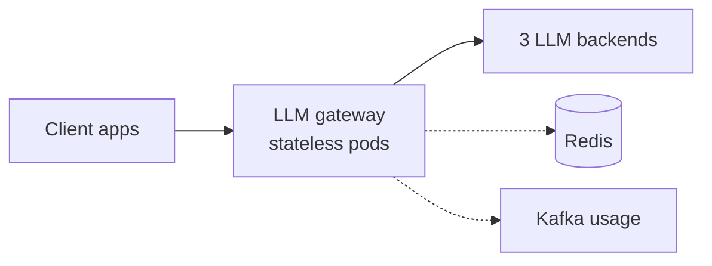
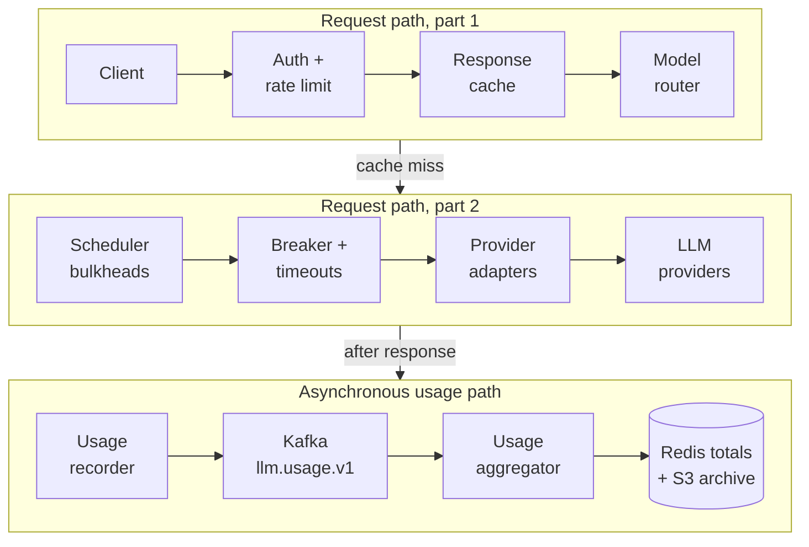
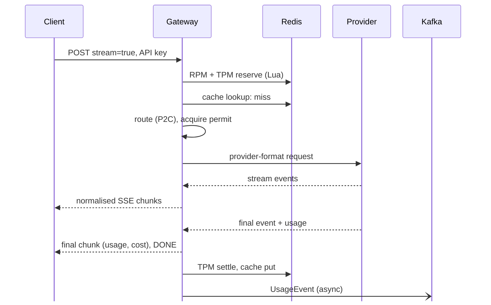
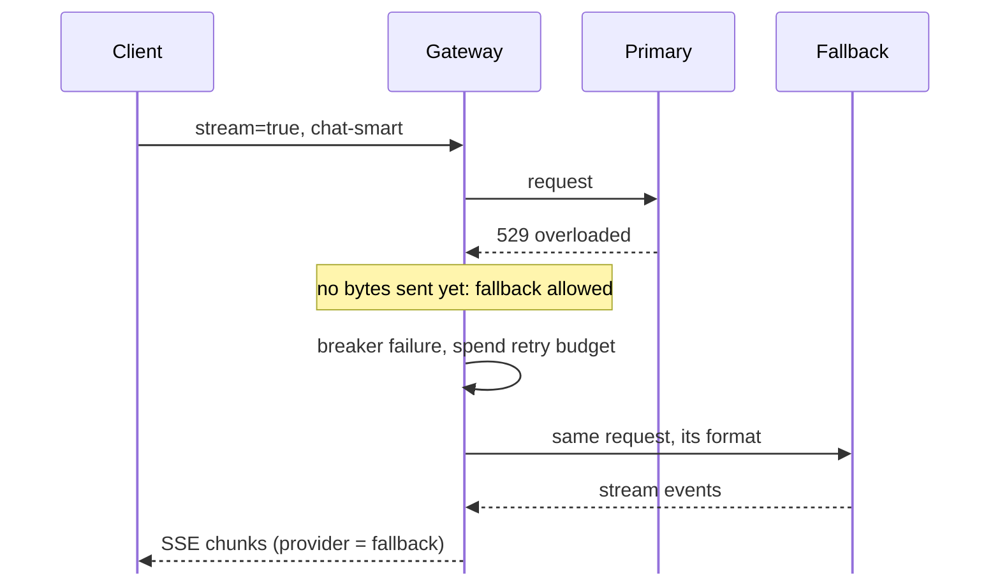

# LLM Gateway & Inference Router — Interview Playbook

*A Spring Boot gateway that gives internal applications one authenticated, rate-limited, observable API for chat completions across several LLM backends. It routes each request to a healthy backend, streams tokens, protects backends with concurrency scheduling and circuit breakers, caches eligible responses in Redis, and tracks tokens and cost through Kafka. Java, Spring Boot, Redis, Kafka, Kubernetes and AWS. Everything you need for a 30–45 minute interview.*

**Resume bullets this booklet defends**

1. Built unified LLM API with authentication, rate limiting, model routing, streaming and circuit breakers, supporting multiple inference backends.
2. Implemented Redis caching and concurrent scheduling, improving throughput ~2x & reducing p95 latency ~25% under 50+ concurrent clients.
3. Added token/cost tracking & Prometheus/Grafana observability; deployed on Kubernetes with autoscaling, benchmarking p99 latency and error (wording as on the resume; see the flag in 1.2).

# Part 1: Project Fundamentals

## 1.1 What is this project?

**What it does.** Applications inside a company send chat requests to one endpoint, `POST /v1/chat/completions`, with a logical model name such as `chat-smart`. The gateway authenticates the caller, applies rate limits, checks a cache, picks a healthy backend (a hosted Anthropic model, a hosted OpenAI-compatible model, or a self-hosted vLLM server), translates the request into that provider's API, streams the answer back in one consistent format, and records how many tokens were used and what they cost.

**The problem it solves.** Without a gateway, every team calls providers directly. Each re-implements API keys, retries, timeouts, streaming parsers and cost tracking. Nobody knows total spend per team. One team's burst exhausts a shared provider limit for everyone. When a provider has an outage, every application fails at once. Switching models means code changes in every service.

**Why LLM traffic is special.** Requests last seconds to minutes and stream; cost is per token, not per request; providers throttle on tokens per minute; failures are frequent and partial (overloaded, stalled, cut mid-stream); and the true token count is known only at the end of a response.

**Who would use it.** Internal product teams building chatbots, summarisation, classification or extraction features, plus the platform team that owns provider contracts and budgets.

**What makes it technically interesting.** Concurrency control for long-lived requests, resilience patterns (timeouts, retries, circuit breakers, fallback), streaming I/O, cache correctness for non-deterministic outputs, and accurate usage accounting, all in one service.

> **Analogy:** The gateway is like a hotel concierge desk for taxis. Guests (applications) show their room key (API key) at one desk. The concierge limits how many rides each guest books per hour (rate limiting), knows which taxi companies are running and how busy each is (routing and health), never sends more cars to one company than it can handle (bulkheads), switches company if one stops answering (circuit breaker and fallback), reuses a booking if the same trip was just booked (cache), and keeps a ledger of every fare charged to each room (usage and cost).

> **Example:** A support-tool team sends a streaming request with `model: chat-smart`. The gateway verifies the key, reserves 1,800 tokens from the team's per-minute budget, sees the request is not cacheable (temperature 0.7), routes it to the Anthropic deployment (the primary, currently healthy and lightly loaded), acquires one of that deployment's concurrency slots, and streams tokens back as they arrive. At the end it reports 412 prompt and 48 completion tokens and an estimated cost, refunds the unused token reservation, and publishes a usage event to Kafka; an aggregator adds it to the team's daily totals.

**Scope boundary.** Chat completions only; no model hosting, embeddings, content moderation, tool execution or invoicing; single region. Benchmarks use a mock provider because real providers are rate-limited, costly and non-deterministic.

## 1.2 Fundamentals required for this project

| Resume bullet | Concepts you must be able to explain |
|---|---|
| 1. Unified LLM API with authentication, rate limiting, model routing, streaming, circuit breakers, multiple backends | Gateway pattern, provider adapters, API-key auth, token bucket, TPM reserve-and-settle, routing, SSE streaming, circuit breakers, timeouts/retries/fallback |
| 2. Redis caching and concurrent scheduling, ~2× throughput, ~25% lower p95, 50+ concurrent clients | Response caching, bulkheads, fair queuing, benchmark metrics |
| 3. Token/cost tracking, Prometheus/Grafana, Kubernetes autoscaling, p99 and error rates | Usage and cost accounting, Kafka usage pipeline, observability, autoscaling |

### LLM gateway and unified API

- **Simple:** One front door for all LLM calls, so applications talk to one API and the gateway handles the providers.
- **Technical:** A reverse proxy specialised for LLM traffic. Clients send a Chat-Completions-style request with a logical **alias** (`chat-smart`); the gateway centralises auth, quotas, routing, normalisation, streaming, resilience, caching and accounting. Two deployables, one codebase: the stateless `llm-gateway` and the `usage-aggregator`.
- **Why it matters:** Cross-cutting concerns are implemented once; providers become interchangeable configuration; spend and reliability become visible.
- **In this project:** Existing OpenAI-style client libraries work by changing the base URL. Auth, rate limiting and routing are modules inside the gateway, not separate services, to avoid extra network hops on every request.
- **Interview angle:** "Isn't the gateway a single point of failure?" It is stateless and horizontally scaled behind a load balancer; shared state lives in Redis and Kafka.

### Provider abstraction and adapters

- **Simple:** Each provider speaks a slightly different language; an adapter translates between the gateway's standard format and that provider's API.
- **Technical:** The **Adapter pattern** with a canonical model. The controller builds a canonical request; an adapter (`AnthropicAdapter`, `OpenAiCompatibleAdapter` for the hosted model and vLLM, `MockAdapter`) maps it to provider JSON and headers, parses the response or stream events, and maps finish reasons, usage fields and errors back to canonical form. Unknown stream event types are ignored for forward compatibility.
- **Why it matters:** Routing, retries, caching and billing only ever see the canonical form, so adding a provider is one new adapter.
- **In this project:** Adapters use the JDK `HttpClient` directly rather than each provider's SDK, giving one consistent model for connection pooling, timeouts, streaming and cancellation.
- **Interview angle:** "Downside?" Lowest common denominator: provider-specific features (e.g. Anthropic prompt-caching controls) need explicit extension fields.

### Authentication with API keys

- **Simple:** Each application gets a secret key; the gateway checks it on every request and knows which team (tenant) is calling.
- **Technical:** Keys look like `gk_live_<keyId>_<secret>`. The gateway looks up the record by `keyId` in an in-memory table (loaded from a Kubernetes Secret synced from AWS Secrets Manager), compares `SHA-256(secret)` with the stored hash in constant time, checks status and scope, and attaches a principal: tenant, scopes, allowed aliases and limits.
- **Why it matters:** Identity is needed for quotas, isolation (cache and usage per tenant) and cost attribution. Provider credentials never leave the gateway.
- **In this project:** No database or Redis lookup per request; keys are hashed so a leaked table does not reveal secrets; constant-time comparison avoids timing attacks.
- **Interview angle:** "Why not OAuth2/JWT?" Callers are internal services; static keys are simpler. OAuth2 client credentials and key rotation are listed improvements.

### Rate limiting with a token bucket

- **Simple:** Each key has a bucket of tokens that refills at a steady rate; each request takes a token; an empty bucket means "slow down" (HTTP 429).
- **Technical:** Bucket state `{tokens, last_refill_ts}` lives in a Redis hash per API key. A Lua script, which Redis runs atomically, refills `tokens = min(capacity, tokens + elapsed × rate)`, consumes if enough remain, and returns allowed or not. Capacity allows short bursts; the rate sets the sustained limit.
- **Why it matters:** One tenant must not exhaust a shared provider quota. Redis makes the limit cluster-wide across all gateway pods; the atomic script prevents two pods from both spending the last token.
- **In this project:** Requests-per-minute (RPM) uses this bucket directly. A 429 includes `Retry-After` computed from the refill rate. If Redis is down, each pod falls back to a local limiter at `limit / replicas` (fail-soft rather than fail-open).
- **Interview angle:** "Why not a fixed window counter?" It allows double bursts at window boundaries; a sliding log stores every request. The token bucket is smooth and O(1).

### Tokens-per-minute limits: reserve and settle

- **Simple:** LLM providers limit tokens, not just requests, but you only know how many tokens a request used after it finishes. So the gateway reserves a worst-case amount first and refunds the difference later.
- **Technical:** Before the call: `estimate = estimated prompt tokens + max_tokens`; reserve it from a second token bucket (`rl:tpm:{keyId}`) or reject with 429. After the call: `actual = prompt + completion tokens` from the provider; refund `estimate − actual`. If the estimate was too low, charge the difference and let the bucket go slightly negative so the next requests wait.
- **Why it matters:** A request asking for 4,000 output tokens costs far more provider capacity than one asking for 50; RPM alone cannot express that.
- **In this project:** The prompt estimate uses a tokenizer where available, else about 4 characters per token, calibrated from history; it is used only for admission, never for billing. If a pod crashes between reserve and settle, the reservation is simply lost and refills over time.
- **Interview angle:** "What if estimates are wrong?" The settle step corrects the bucket; the error is bounded by one request.

### Model routing

- **Simple:** Choose which backend serves this request: prefer the primary, avoid unhealthy or overloaded ones, and keep a list of fallbacks.
- **Technical:** An alias maps to deployments with priorities. Filter out deployments that are disabled, not allowed for the tenant, missing a needed capability (streaming, tools, JSON mode), whose context window is too small, whose circuit is open, or that are in a 429 cooldown. Take the best priority tier; if it has several candidates, use **power of two choices**: sample two (weighted) and pick the lower score `EWMA time-to-first-token × (in-flight + queued + 1) / max concurrency`. Return the chosen one followed by ordered fallbacks.
- **Why it matters:** Traffic flows toward healthy, fast, lightly loaded backends without every pod herding onto the same "best" one.
- **In this project:** Time to first token reflects provider queueing and health; total latency mostly reflects how many tokens were requested. Errors feed the circuit breaker, not the latency average, so a fast-failing backend is removed, not favoured.
- **Interview angle:** "Why not least-loaded globally?" Every pod's view lags, so all pods pick the same backend at once; P2C avoids that herd effect.

### Concurrency limits and bulkheads

- **Simple:** Give each backend a fixed number of request "slots". When the slots are full, new requests wait in the gateway instead of overloading the backend.
- **Technical:** A **bulkhead** (named after ship compartments) is a per-deployment concurrency limit. Each pod holds `cluster limit / replicas` permits per deployment. A request acquires a permit before calling the provider and releases it on every path (success, error, client disconnect). Throughput of a backend is at most `concurrency / service time` (Little's law); past its "knee", more concurrency only adds latency and provider errors.
- **Why it matters:** Overloaded backends collapse (provider 429/529s, GPU memory pressure in vLLM, retry storms); one slow provider must not consume capacity meant for others.
- **In this project:** The limit per backend is set at its measured knee. Waiting happens in the gateway, where it is cheap and fair; after 2 seconds the request falls back to the next candidate or gets `503 PROVIDER_SATURATED` with `Retry-After`.
- **Interview angle:** "Does autoscaling the gateway help when a backend is saturated?" No; the limit is the provider's capacity, not the gateway's.

### Fair queuing

- **Simple:** When requests must wait for a backend slot, serve tenants in turn, so one busy team cannot starve the others.
- **Technical:** Each deployment's wait queue is bounded and organised per tenant, served by **deficit round-robin (DRR)**: each tenant's queue gets a quantum of service per round, and leftover credit carries over. A tenant sending 1,000 requests and another sending 10 both make progress.
- **Why it matters:** A plain FIFO queue gives capacity to whoever sends the most, which is exactly the noisy-neighbour problem the gateway exists to solve.
- **In this project:** Fairness at the moment of contention complements rate limits, which give fairness over time. Queue full or wait timeout means fast rejection instead of a slow timeout.
- **Interview angle:** "Is it fair for request size?" Counting requests is approximate; token-weighted scheduling would be fairer for mixed sizes but more complex.

### Circuit breakers

- **Simple:** If a backend keeps failing, stop calling it for a while so you fail fast and give it time to recover, then test it with a few requests.
- **Technical:** Resilience4j breaker per deployment per pod. **CLOSED**: calls flow and outcomes are recorded in a sliding window of the last 50 calls. If at least 20 calls were made and ≥ 50% failed (or ≥ 80% were slow, first byte > 15 s), it goes **OPEN**: calls are rejected immediately for 30 s. Then **HALF-OPEN**: 5 probe calls; success closes it, failure re-opens it. Connect errors, timeouts, 5xx and 529 count as failures; client errors (400, 401, 404) do not.
- **Why it matters:** Without it, every request waits for timeouts against a dead provider, holding slots and threads, and retries pile more load on it.
- **In this project:** A provider 429 is treated as a capacity signal, not a health failure: it puts the deployment in a cooldown for `Retry-After` seconds instead of opening the breaker. Routing skips open deployments, so traffic falls back automatically.
- **Interview angle:** "Breaker state is per pod. Is that a problem?" Pods may briefly disagree; each converges from its own traffic, and no shared state is needed on the request path.

### Timeouts, retries and fallback

- **Simple:** Give up on slow calls quickly enough to try somewhere else, retry only when it is safe, and never let retries multiply load during an outage.
- **Technical:** Timeouts: connect 2 s, first byte (time to first token) 20 s, idle gap between chunks 30 s, plus a total deadline. Retries go to the **next candidate** (fallback), not the same deployment; at most 2 attempts in total; only before the first byte has been streamed to the client. A **retry budget** (each request deposits 0.1 tokens, each retry spends 1) caps retries at about 10% of traffic.
- **Why it matters:** Unlimited retries cause **retry amplification**: during an outage, gateway retries × client retries can multiply load several times on the remaining providers at the worst moment.
- **In this project:** The first-byte timeout is what makes fallback useful: a stalled provider is abandoned while there is still time to try another. 4xx errors and content-filter results are never retried.
- **Interview angle:** "Why not exponential backoff on the same provider?" During overload that adds load to the struggling backend; fallback uses spare capacity elsewhere.

### Streaming with Server-Sent Events (SSE)

- **Simple:** Instead of waiting for the whole answer, the client receives tokens as they are generated, over one long-lived HTTP response.
- **Technical:** SSE is a one-way stream of `data:` lines over HTTP with `Content-Type: text/event-stream`. The gateway reads the provider's stream line by line, translates each provider event into a canonical chunk and writes it to the client immediately, ending with a final chunk carrying usage and cost and a `[DONE]` marker. If the client reads slowly, writes block and the upstream read pauses, so TCP/HTTP2 flow control pushes back to the provider and memory stays bounded.
- **Why it matters:** Users see the first token in hundreds of milliseconds instead of waiting seconds for the full answer.
- **In this project:** If the client disconnects, the gateway closes the upstream stream to stop generation (and billing) and records partial usage. The AWS load balancer idle timeout is raised to 300 s so long streams are not cut. Each request runs on a Java 21 virtual thread, so thousands of open streams are cheap.
- **Interview angle:** "Why SSE rather than WebSockets?" One-way server-to-client streaming over plain HTTP is all that is needed, and it is what providers and OpenAI-style clients use.

### Response caching in Redis

- **Simple:** If exactly the same request was answered recently, return the stored answer instead of calling the model again.
- **Technical:** Exact-match cache. Key = SHA-256 of the canonical JSON of tenant, deployment, provider model, adapter version, messages and all generation parameters (sorted keys). Value = gzip-compressed normalised response with usage, TTL 1 hour by default. Only **eligible** requests are cached: temperature 0 (or an explicit opt-in), finish reason `stop` or `tool_calls`, a complete stream, ≤ 256 KB, and an alias that allows caching. **Single-flight** makes concurrent identical misses within one pod share one provider call.
- **Why it matters:** A hit takes a few milliseconds instead of seconds, costs nothing and frees a backend slot for a miss.
- **In this project:** The tenant id is inside the key, so tenants never see each other's entries. Cache hits are reported with cost 0. The hit rate depends entirely on the workload: templated, deterministic prompts hit often; conversational traffic rarely.
- **Interview angle:** "Why is caching LLM output risky?" Non-determinism, hidden time or user context, model updates and privacy (Q22).

### Token usage and cost accounting

- **Simple:** For every request, record how many input and output tokens were used and what that cost, per team and per model.
- **Technical:** Token counts come from the provider's usage fields (for streams: Anthropic's `message_start` and final `message_delta`; OpenAI-compatible final chunk with usage enabled). For interrupted streams, the gateway estimates completion tokens from the text actually streamed and marks `estimated: true`. Cost = Σ tokens × price, with prices in integer **micro-dollars per million tokens** from a versioned price table with effective dates; cache-read and cache-write tokens use their own prices.
- **Why it matters:** Cost is per token, prices change, and attribution per team drives budgets.
- **In this project:** Integer arithmetic avoids floating-point drift over millions of requests; each event records the price version, so price changes never rewrite history. Illustratively, 412 prompt tokens at 3,000,000 µ$/MTok plus 48 completion tokens at 15,000,000 µ$/MTok is 1,956 µ$ (placeholder prices). It is an estimate for attribution, not an invoice.
- **Interview angle:** "Why compute cost in the gateway?" The event becomes self-describing; re-aggregation never needs historical configuration.

### Kafka-based asynchronous usage processing

- **Simple:** After each response, the gateway drops a usage record onto Kafka and moves on; a separate service adds up the records.
- **Technical:** Topic `llm.usage.v1`: 6 partitions, replication 3, keyed by tenant, 7-day retention; producer with `acks=all`, idempotence, batching and `max.block.ms=0` so a full buffer never blocks a request thread. The `usage-aggregator` consumer group runs a Redis Lua script per event: `SET usage:dedup:{requestId} NX` and, only if that succeeded, increment the tenant's daily and monthly totals. It also batches raw events to S3 every 5 minutes or 10,000 events, and commits offsets after both writes.
- **Why it matters:** Accounting never adds latency to responses and never makes them fail; events are durable and replayable for re-aggregation.
- **In this project:** Delivery is at-least-once, and the dedup key makes aggregates count each request once within 48 hours. If Kafka is down, events are written as structured log lines and re-published later; dedup makes that safe.
- **Interview angle:** "Why not write usage to a database per request?" That couples every response to database latency and availability.

### Observability, p99 and error rates

- **Simple:** Measure what the gateway is doing (latency, errors, tokens, cost, cache hits, breaker states) and show it on dashboards with alerts.
- **Technical:** Micrometer metrics scraped by Prometheus and shown in Grafana (latency and time-to-first-token histograms, errors, tokens, cost, cache, breakers, queue wait). p99 is the latency 99% of requests beat; error rate = (non-2xx + in-band stream errors + incomplete streams) / total. Percentiles across pods come from merged histograms, never averages.
- **Why it matters:** For an LLM gateway, the tail (timeouts, fallbacks, overloaded backends) is where problems show; averages hide it.
- **In this project:** Benchmarks also report **retry amplification** = upstream attempts / client requests, because retries can lower the error rate while overloading providers.
- **Interview angle:** "Why p99 as well as p95?" p95 shows what most users see; p99 shows timeouts and fallback behaviour.

### Kubernetes deployment and autoscaling

- **Simple:** Run several identical gateway pods and add more automatically when load rises.
- **Technical:** EKS behind an ALB (idle timeout 300 s for streams). The HPA scales gateway pods 3–12 on **in-flight requests per pod** (custom metric via the Prometheus Adapter) plus CPU. Pods are stateless and drain open streams before terminating.
- **Why it matters:** Pods are I/O-bound, so CPU stays low even when a pod is full of open streams; CPU alone scales too late.
- **In this project:** Per-deployment concurrency limits are divided by the replica count and recomputed on scaling; the aggregator scales as a consumer group (≤ 6 partitions).
- **Interview angle:** "What does autoscaling not fix?" Provider capacity; if a backend is saturated, more gateway pods just queue more.

### Benchmark metrics: throughput, p95 and 50 concurrent clients

- **Simple:** The test keeps 50 clients busy sending requests back to back, and compares a naive gateway with the optimised one.
- **Technical:** k6 closed loop: 50 virtual users, zero think time, so ~50 requests in flight. By Little's law throughput = N / mean latency, so 2× throughput at fixed N means mean latency halves. Cache hits shift p95 to a lower quantile of the misses, so p95 improves less than the mean.
- **Why it matters:** These definitions are what the resume numbers mean.
- **In this project:** Mock providers with a fixed capacity model; 30% cacheable templated prompts; 2-minute warm-up, 10-minute window. Targets, not measurements (Q24).
- **Interview angle:** "How much came from the cache?" Show an ablation: scheduling and routing alone, then plus cache.

> **Resume flag:** Say these precisely. (1) "Production LLM Gateway" is a production-grade design benchmarked against mock providers, not a system that served real production traffic. (2) "~2× throughput and ~25% lower p95 under 50+ concurrent clients" are A/B targets against a naive baseline gateway, with a workload in which 30% of requests are cacheable; real gains depend on how repetitive the traffic is. (3) "Authentication" is per-tenant API keys, not OAuth. (4) "Streaming and circuit breakers" include a hard rule: no transparent fallback once tokens have been streamed. (5) The third bullet on the resume ends with "error"; it should read "error rates". (6) Cost is an estimate for attribution, not an invoice. None of the numbers is a recorded measurement.

# Part 2: High-Level Design and Architecture

## 2.1 Technology stack

| Technology | Purpose in the project | Why it was selected |
|---|---|---|
| Java 21 + Spring Boot (Web MVC on virtual threads) | Gateway and aggregator services; SSE streaming; Actuator | Blocking-style code for adapters and streaming that still holds thousands of concurrent requests cheaply |
| JDK `HttpClient` | Upstream provider calls, streaming bodies, HTTP/2 | One connection, timeout and cancellation model for every provider |
| Resilience4j | Circuit breakers per deployment | Standard, thread-safe, exports metrics |
| Redis (ElastiCache) | Rate-limit buckets, response cache, usage aggregates, dedup keys | Atomic Lua scripts, sub-ms reads, TTLs |
| Kafka (MSK) | Asynchronous usage events | Durable, decoupled, replayable for re-aggregation |
| Amazon S3 | Long-term raw usage archive | Cheap, durable; queried with Athena |
| Micrometer → Prometheus → Grafana | Metrics, dashboards, alerts | Histograms for percentiles; counters for tokens and cost |
| Kubernetes (EKS), HPA, ALB | Deployment, autoscaling, ingress for long streams | In-flight-based autoscaling; configurable idle timeouts |
| k6 + mock provider | Benchmarks | Repeatable, free, controllable latency and capacity |

**How they work together.** Spring Boot hosts the request path. Redis is consulted twice per request (rate limits, cache) through atomic scripts. The JDK client talks to providers through adapters, guarded by Resilience4j breakers and the gateway's own bulkheads. After the response, a usage event goes to Kafka; the aggregator updates Redis totals and archives to S3. Prometheus scrapes every pod; the HPA reads the in-flight metric to scale pods.

## 2.2 High-level architecture

**In simple words.** Every request passes through a fixed pipeline inside one stateless pod: check who you are and whether you are within limits, see if the answer is already cached, pick a backend, wait for a slot on that backend, call it through its adapter with timeouts and a circuit breaker, stream the answer back, and finally publish a usage record. Accounting happens afterwards, in a different service, through Kafka.

**Figure 1 — The simple picture: one gateway in front of three LLM backends (Anthropic, a hosted OpenAI-compatible model, self-hosted vLLM)** [scale=0.74]

**Component responsibilities**

| Component | Responsibility |
|---|---|
| Filters (correlation, auth, rate limit) | Request id; API-key verification and tenant principal; RPM bucket and TPM reservation in Redis |
| Chat controller | Validate, normalise, coordinate cache → route → execute → respond (JSON or SSE) |
| Response cache | Eligibility, canonical key, Redis get/put, per-pod single-flight |
| Model router | Alias → eligible deployments → priority tier → P2C choice + ordered fallbacks |
| Concurrency scheduler | Per-deployment bulkhead permits; bounded DRR fair queue per tenant |
| Resilience executor | Circuit breaker per deployment; connect/first-byte/idle/total timeouts; fallback-first retry with budget |
| Provider adapters | Translate canonical ↔ Anthropic / OpenAI-compatible / mock; parse streams; map usage and errors |
| Usage recorder | Settle TPM, compute cost, publish `UsageEvent` to Kafka asynchronously |
| `usage-aggregator` | Consumer group: dedup by request id, increment Redis totals, archive to S3 |

**How components communicate.** Client to gateway: HTTPS through the ALB, JSON or SSE, synchronous and long-lived for streams. Gateway to providers: HTTPS (HTTP/2 where supported) with keep-alive connection reuse, one client per provider. Gateway to Redis: atomic Lua scripts and simple commands, sub-millisecond. Gateway to Kafka: asynchronous producer, fired after the response completes. Kafka to aggregator: consumer group, at-least-once. Prometheus scrapes pods every 15 s.

**Complete data flow.**
1. **Admission:** authenticate key → RPM bucket → TPM reservation (estimate) → monthly budget check.
2. **Cache:** if eligible, look up the tenant-scoped key; a hit returns immediately with cost 0.
3. **Execution:** route (filter + P2C) → acquire a bulkhead permit (fair queue up to 2 s) → breaker check → adapter builds the provider request → stream or receive the response → normalise.
4. **Completion:** final chunk with usage and cost → release permit → record breaker success and time to first token.
5. **After the response:** TPM settle (refund), cache write if eligible, usage event to Kafka.
6. **Aggregation (other service):** dedup by request id → Redis daily/monthly totals → S3 archive.

**Figure 2 — Detailed HLD: the synchronous request pipeline (two rows) and the asynchronous usage pipeline** [scale=0.72]

**Where data is stored.** API keys, routing and pricing: configuration (Secrets Manager / ConfigMap, versioned in git). Rate-limit buckets, cache entries, dedup keys and usage aggregates: Redis (with TTLs). Usage events: Kafka for 7 days and S3 long-term; the S3 archive is the durable usage record. Circuit-breaker and health state: in each pod's memory. There is no relational database.

**How it scales.**
- **Gateway pods:** stateless; HPA 3–12 on in-flight requests per pod plus CPU.
- **Provider limits:** each pod gets `cluster limit / replicas` permits per deployment, an approximation that avoids a distributed semaphore on every request.
- **Shared limits and cache:** cluster-wide through Redis.
- **Aggregator:** consumer group up to 6 partitions.

**What happens when a major component fails**

| Failure | What the gateway does | Effect |
|---|---|---|
| One provider down or overloaded | Breaker opens per pod; routing skips it; fallback to next tier | Higher latency on the remaining backend, few errors |
| Provider fails mid-stream | In-band SSE error, partial usage recorded; no transparent retry | Client decides whether to retry |
| Redis down | Local per-pod limiter at `limit / replicas`; cache bypassed | Requests continue; limits approximate |
| Kafka down | Producer buffer, then structured-log fallback records; re-published later | Responses unaffected; usage delayed |
| Gateway pod crash | ALB health checks remove it; its open streams are cut | Clients retry; no shared state lost |
| All candidates saturated | `503 PROVIDER_SATURATED` with `Retry-After` after 2 s queue wait | Fast, explicit rejection |

## 2.3 Important architectural decisions

**1. Gateway with adapters over raw HTTP, not per-provider SDKs or a pass-through proxy.** *Why:* one canonical model lets routing, fallback, caching and billing work across providers; one HTTP/streaming/timeout model. *Alternative:* SDK per provider, or a proxy per provider. *Why not:* inconsistent timeouts and streaming; no normalisation. *Trade-off:* must track provider API changes; lowest-common-denominator API.

**2. Priority tiers with power-of-two-choices routing.** *Why:* load- and health-aware without herding. *Alternative:* round-robin or global least-outstanding. *Why not:* round-robin overloads the weaker backend; global least-loaded herds because every pod's view lags. *Trade-off:* each pod has a partial, slightly delayed view.

**3. Bulkheads with fair queuing in the gateway.** *Why:* keeps each backend at its most efficient concurrency, isolates providers from each other and tenants from each other, and turns overload into fast explicit rejections. *Alternative:* let providers queue or reject. *Why not:* provider overload collapses goodput and triggers retry storms. *Trade-off:* each backend's knee must be measured; per-pod limits are approximate.

**4. Fallback-first retries with a budget; no retries after the first streamed byte.** *Why:* avoids retry amplification and never splices two different generations together. *Alternative:* generic retries with backoff on the same backend. *Why not:* adds load to the failing backend at the worst moment. *Trade-off:* some transient errors surface to clients.

**5. Exact-match, tenant-scoped, eligibility-gated cache.** *Why:* correct by construction for deterministic requests; cheap hits. *Alternative:* semantic (embedding-similarity) cache, or no cache. *Why not:* semantic matches can answer a different question. *Trade-off:* low hit rate on conversational traffic; cached data is a privacy surface.

**6. Asynchronous usage pipeline through Kafka.** *Why:* accounting adds no latency and cannot fail a response; events are replayable. *Alternative:* synchronous database write per request. *Why not:* couples availability and latency to a database. *Trade-off:* usage totals are eventually consistent (seconds); budgets are soft.

# Part 3: How the Project Works

## 3.1 One complete end-to-end request flow

A streaming request with `model: chat-smart` and a cache miss. Figure 3 shows the sequence.

**Figure 3 — Streaming chat completion, cache miss: admission in Redis, provider stream relayed, usage published after completion** [scale=0.72]

1. **Arrival.** The ALB forwards the request to a gateway pod; it runs on its own virtual thread.
2. **Correlation.** A request id is accepted or generated and attached to logs and response headers.
3. **Authentication.** The key's `keyId` locates the record; `SHA-256(secret)` is compared in constant time; status and scope are checked; the tenant principal is attached.
4. **Validation.** Schema checks, alias allowed for this tenant, defaults applied, canonical request built.
5. **Rate limiting.** RPM bucket consume and TPM reservation (`estimated prompt + max_tokens`) in Redis; monthly budget check. A failure returns `429` with `Retry-After`.
6. **Cache.** Not eligible here (sampling enabled), so skipped; an eligible miss would continue the same way.
7. **Routing.** Filter the alias's deployments, choose the primary by power of two choices, keep ordered fallbacks.
8. **Scheduling.** Acquire a permit from that deployment's bulkhead, immediately or after a fair-queue wait of up to 2 s.
9. **Resilience.** The breaker permits the call; the deadline is computed.
10. **Provider call.** The adapter builds the provider request (for Anthropic: the system field, `max_tokens`, `stream: true`, auth headers) and opens the stream.
11. **Streaming.** Each provider event is translated; text deltas go to the client as SSE chunks immediately; usage fields are captured.
12. **Completion.** A final chunk with finish reason, usage and cost, then `[DONE]`; the permit is released; the breaker records success; the time-to-first-token average is updated.
13. **After the response.** TPM settle refunds unused tokens; the response is cached if eligible; a `UsageEvent` is sent to Kafka.
14. **Aggregation.** The aggregator dedups by request id, increments the tenant's daily and monthly totals in Redis and buffers the event for S3.

## 3.2 Important alternative scenarios

**Scenario A: The primary provider fails before the first token (fallback).**

**Figure 4 — Provider fails before any byte is sent: the breaker records it and the request falls back** [scale=0.72]

The primary returns 529 overloaded (or times out at 20 s waiting for its first byte, or refuses the connection). No bytes have reached the client, so the gateway may switch: the breaker records a failure, the retry budget allows one fallback, and the next candidate serves the request. The client sees one successful stream whose `provider` field names the fallback; the usage event records `attempts: 2, fallbackUsed: true`. If failures continue, the primary's breaker opens and routing skips it until probes succeed.

**Scenario B: The provider fails mid-stream.** Forty chunks have been sent when the provider connection resets (or the 30 s idle-gap timeout fires). The bytes are already with the client, so the gateway does **not** silently restart on another provider: that would splice a different continuation onto text the user already saw. It sends an in-band SSE error event (`PROVIDER_STREAM_INTERRUPTED`) with partial usage (completion tokens counted from the streamed text, marked estimated), records a breaker failure and a usage event with outcome `PARTIAL`. The client has the partial text and decides whether to retry.

**Scenario C: A tenant exceeds limits, or every backend is saturated.** If the TPM reservation does not fit (for example, 1,800 estimated tokens but 1,200 remaining), the gateway returns `429 RATE_LIMITED` with `Retry-After` computed from the refill rate and remaining-token headers; no provider call is made and the usage event has outcome `REJECTED`. If the tenant is within limits but the primary's bulkhead queue wait exceeds 2 s and the fallback's queue is full, the gateway returns `503 PROVIDER_SATURATED` with `Retry-After: 2`. Scaling the gateway would not help: the limit is the providers' capacity, so the alert points to provider limits.

## 3.3 Important guarantees and limitations

| Property | Guarantee |
|---|---|
| Rate limits | Cluster-wide and atomic per key (single Redis primary); approximate in Redis-down fallback mode |
| Provider protection | In-flight per backend ≤ sum of per-pod permits ≈ cluster limit |
| Streaming | Chunks delivered in provider order; no transparent retry after the first byte |
| Fallback | At most 2 attempts, only before the first byte, within a ~10% retry budget |
| Cache | Tenant-isolated, TTL-bounded, only complete eligible responses; entries immutable |
| Usage aggregates | Eventually consistent (seconds); each request counted once within the 48 h dedup window |
| Usage archive | At-least-once records in S3; deduplicated by request id downstream |
| Budgets | Soft: checked against aggregates that lag by seconds |
| Client retry after timeout | Not deduplicated (no idempotency key in v1); cost may double |

**Where consistency comes from:** atomic Redis scripts for limits and aggregates, deterministic cache keys, and idempotent aggregation by request id. **Failures** are handled by timeouts, breakers and fallback (providers), fail-soft local limits and cache bypass (Redis), buffering and log fallback (Kafka), and health-check removal (pods). **Accepted trade-offs:** per-pod breaker and load views, approximate per-pod limits, soft budgets, possible usage loss only under a documented Kafka-plus-logging failure, and low cache hit rates on conversational traffic.

# Part 4: Complete Interview Explanation

## 4.1 Two-minute explanation

> **Say it aloud:** "I built an LLM gateway in Java and Spring Boot. Teams in a company were calling several LLM providers directly, each re-implementing keys, retries and streaming, with no view of cost, and one provider outage broke everyone. The gateway gives them one API, chat completions with a logical model name, in front of a hosted Anthropic model, a hosted OpenAI-compatible model and a self-hosted vLLM server.
>
> Each request is authenticated with a per-team API key and checked against token-bucket rate limits in Redis, both requests per minute and tokens per minute. Eligible deterministic requests can be served from a Redis cache. Otherwise a router picks a healthy, lightly loaded backend, a scheduler gives each backend a fixed number of concurrent slots with fair queuing between teams, and circuit breakers and first-byte timeouts let it fall back to another provider when one fails. Adapters translate between our standard format and each provider, and responses stream back as server-sent events.
>
> After each response, a usage event with tokens and cost goes to Kafka, and an aggregator keeps per-team totals. It runs on Kubernetes with autoscaling on in-flight requests and Prometheus and Grafana dashboards. Against a naive gateway with mock providers, the targets were about 2× throughput and 25% lower p95 at 50 concurrent clients; those are benchmark targets, not production numbers."

## 4.2 Five-minute explanation

> **Say it aloud:** "**Problem.** LLM traffic has unusual properties: requests last seconds and stream, cost is per token, providers throttle on tokens per minute, and failures are frequent and partial. Without a gateway every team handles that separately, nobody knows the spend, and one noisy team or one provider outage hurts everyone.
>
> **Requirements.** One unified API with streaming; per-tenant authentication and limits; routing by logical model name with fallback; protection of backends under concurrency; a safe response cache; exact token and cost accounting; metrics; autoscaling on Kubernetes.
>
> **Technology.** Spring Boot on Java 21 virtual threads so thousands of long requests are cheap with simple blocking code; Redis for atomic rate-limit scripts, the cache and usage totals; Kafka for usage events; Resilience4j for breakers; Prometheus and Grafana; EKS with an ALB.
>
> **Architecture.** [Draw Figure 2.] Inside one stateless pod: auth and rate limit, cache, router, scheduler, resilience layer, adapters, then the providers. After the response, a usage recorder publishes to Kafka and a separate aggregator service updates Redis totals and archives to S3.
>
> **Request flow.** Verify the hashed key, consume a request token and reserve the estimated tokens from the tenant's buckets, check the cache, route with power of two choices on time-to-first-token times load, wait for a bulkhead slot in a fair queue, call through the adapter, stream normalised chunks, then settle the token reservation and publish usage.
>
> **Key decisions.** Bulkheads in the gateway, because pushing a backend past its knee only adds latency and errors. Fallback-first retries with a budget, never after the first streamed byte. An exact-match, tenant-scoped cache, because semantic caching can answer a different question. Usage through Kafka so accounting never slows or fails a response.
>
> **Reliability and performance.** Breakers open per deployment and routing skips them; Redis outages fall back to local limits; Kafka outages fall back to log records that are re-published, with dedup by request id. The throughput gain comes from removing hidden queues, sending traffic to the faster backend, keeping backends at their efficient concurrency, and cache hits for the repetitive share of traffic. Those 2× and 25% figures are A/B targets against mock providers."

## 4.3 Ten-minute explanation

> **Say it aloud:** "**Motivation.** I wanted a project where concurrency control, resilience, streaming, caching and accounting all matter at once, and LLM traffic is exactly that. Requests are long and streamed, cost is per token, and providers fail partially.
>
> **Architecture.** [Draw Figure 2.] Two services from one codebase. The gateway is stateless and does the whole request path; the usage aggregator consumes Kafka. Redis holds rate-limit buckets, the cache and aggregates. Config holds keys, routing and prices. No relational database.
>
> **Abstraction.** Clients send a Chat-Completions-style request with an alias. Adapters translate to Anthropic's Messages API or to OpenAI-compatible APIs for the hosted model and vLLM, and translate responses, stream events, finish reasons, usage fields and errors back to one canonical form. Everything downstream only sees that canonical form, so adding a provider is one adapter.
>
> **Limits.** Authentication is a per-team API key, hashed, compared in constant time, from an in-memory table. Rate limiting is two token buckets in Redis, updated by an atomic Lua script so pods can't double-spend: requests per minute, and tokens per minute. Tokens are tricky because the real count is only known at the end, so I reserve the estimated prompt plus max tokens before the call and refund the difference after. If Redis is down, each pod enforces its share locally.
>
> **Routing and scheduling.** An alias maps to deployments with priorities. I filter by health, capability and context window, take the best tier, and pick between two random candidates by time-to-first-token times load, which avoids herding. Each deployment has a concurrency limit per pod, set at its throughput knee, because past that a backend just gets slower and starts returning 429s. Waiting requests sit in a deficit-round-robin queue per tenant, so a team sending a thousand requests can't starve a team sending ten. After two seconds a request falls back or gets a fast 503.
>
> **Resilience.** Timeouts are layered: connect, first byte, idle gap and total. The first-byte timeout matters most, because it abandons a stalled provider while there's still time to try another. Retries go to the next candidate, at most two attempts, within a budget of about 10% of traffic, to prevent retry amplification during outages. Breakers open at 50% failures over the last 50 calls and probe after 30 seconds. A provider 429 is treated as a capacity signal with a cooldown, not a failure. And once any token has been streamed, I never fall back silently: the client gets an in-band error with partial usage, because splicing two different generations would corrupt the answer.
>
> **Caching.** Exact matches only, eligible requests only, with the tenant and every parameter in the key and single-flight per pod. It's opt-in by alias and TTL-bounded, because outputs aren't deterministic even at temperature zero, prompts can depend on hidden context, models change, and cached data is user data.
>
> **Accounting.** Token counts come from the provider's usage fields; only interrupted streams are estimated. Cost is integer micro-dollars from a versioned price table, computed in the gateway so each event is self-describing. Events go to Kafka keyed by tenant; the aggregator deduplicates by request id inside a Lua script and increments daily and monthly totals, and archives to S3.
>
> **Operations and numbers.** Prometheus histograms for latency and time to first token, error rates including in-band errors, retry amplification; Grafana dashboards; HPA on in-flight requests. The benchmark is k6 with 50 closed-loop clients against mock providers, naive gateway versus optimised. Doubling throughput at fixed concurrency means halving mean latency; p95 improves less because cache hits only shift which part of the miss distribution sets it. Both figures are targets.
>
> **Limitations.** Breaker and load views are per pod; budgets are soft; client retries can double cost because there's no idempotency key yet; the exact-match cache hits rarely on chat traffic; single region. Next: idempotency keys, OAuth2 client credentials, OpenTelemetry tracing, strict distributed limits for providers that need them, and per-tenant cache encryption."

# Part 5: Interview Questions and Answers

## 5.1 Basic understanding

#### Q1. What is your LLM gateway, and why does a company need one? [Easy]

It is a stateless Spring Boot service that sits between internal applications and several LLM providers, exposing one Chat-Completions-style API with logical model names. Without it, every team integrates each provider directly: separate keys, retry logic, timeout settings, streaming parsers and cost tracking, no central view of spend, one team's burst consuming a shared provider quota, and a provider outage breaking every application at once. The gateway centralises those concerns: per-tenant authentication, request and token rate limits, routing to a healthy backend with fallback, consistent streaming, backend protection through concurrency limits and circuit breakers, a safe response cache, and token and cost accounting through Kafka. Providers become configuration: switching a team from one model to another is a routing change, not a code change. The trade-off is one more hop (kept to milliseconds) and a critical service that must be highly available, which is why it is stateless and horizontally scaled.

#### Q2. Walk me through a normal streaming request. [Easy]

Auth filter: verify the hashed API key, attach the tenant. Rate-limit filter: one Redis Lua call takes a request token and reserves estimated tokens. Controller: cache lookup if eligible; on a miss, the router picks a deployment, the scheduler grants a permit, the breaker allows the call and the adapter sends the provider-format request. Provider events are translated and streamed to the client as SSE chunks. At the end: a final chunk with usage and cost, permit released, unused tokens refunded, cache write if eligible, usage event to Kafka. (Full steps in 3.1.)

#### Q3. How does the provider abstraction work? [Easy]

The gateway defines a canonical request and response model: messages, system prompt, generation parameters, tools, a canonical streamed chunk, finish reason and usage. Each provider has an adapter implementing the same interface. The Anthropic adapter, for example, moves the system prompt into Anthropic's `system` field, requires `max_tokens`, sets `x-api-key` and `anthropic-version` headers, and parses events such as `message_start`, `content_block_delta` and `message_delta`, mapping `stop_reason` and usage into canonical fields. The OpenAI-compatible adapter serves both the hosted model and the self-hosted vLLM server, enabling usage reporting in the final stream chunk. Adapters drop unsupported sampling parameters, reject unsupported features (routing pre-filters by capability) and ignore unknown stream event types for forward compatibility. Routing, retries, caching and billing never see provider-specific formats.

**Related follow-up:** "How do you support a provider-only feature?" Explicit extension fields, accepting that it breaks pure interchangeability.

#### Q4. How does authentication work? [Easy]

Each calling application gets an API key of the form `gk_live_<keyId>_<secret>`. Key records (key id, SHA-256 hash of the secret, tenant, scopes, allowed aliases, limits, status) are stored in AWS Secrets Manager, synced into a Kubernetes Secret and loaded into memory in every pod, with periodic reload and "keep the last good table" if reload fails. On each request the filter parses the key, finds the record by key id, hashes the presented secret and compares it with the stored hash using a constant-time comparison so response timing reveals nothing. It checks status and scope and attaches a principal used by every later step: limits, allowed aliases, cache scoping and cost attribution. Storing only hashes means a leaked table does not expose usable keys; keeping it in memory means no per-request lookup. Provider credentials are separate and never leave the gateway.

#### Q5. How does your token-bucket rate limiter work? [Easy]

Each API key has a bucket in Redis: a capacity (maximum burst) and a refill rate (sustained limit), stored as `{tokens, last_timestamp}`. A Lua script, atomic inside Redis, adds `elapsed × rate` tokens (capped at capacity), then takes one if available and returns allowed; otherwise the gateway replies `429` with `Retry-After` from the refill rate. Atomicity means two pods cannot both spend the last token, and Redis makes the limit cluster-wide. Idle keys expire after 2 minutes. Unlike a fixed-window counter there is no double burst at window edges; unlike a sliding log, memory is O(1) per key.

#### Q6. Why limit tokens per minute as well as requests, and how do you do it before you know the token count? [Easy]

Providers meter and throttle on tokens, and requests vary enormously: one asking for 4,000 output tokens uses far more capacity and money than one asking for 50. Requests-per-minute alone would let a tenant exhaust a shared token quota with a few huge requests. The difficulty is that the true count is known only after the response. So the gateway uses **reserve and settle**. Before the call it estimates `prompt tokens + max_tokens` (a tokenizer where available, else about four characters per token, calibrated from history) and takes that amount from a second token bucket; if it does not fit, the request is rejected with `429`. After the call it reads the actual usage from the provider and refunds the difference; if the estimate was low, it charges the extra and the bucket can briefly go negative. A crash between reserve and settle just loses one reservation, which the bucket refills over time.

#### Q7. How does model routing work? [Easy]

A client asks for an alias such as `chat-smart`, configured with several deployments and priorities, for example Anthropic as priority 1 and an OpenAI-compatible model as priority 2. The router first filters out deployments that are disabled, not allowed for this tenant, missing a needed capability (streaming, tools, JSON mode), whose context window is smaller than the prompt plus `max_tokens`, whose circuit breaker is open, or which are cooling down after a provider 429. It takes the best remaining priority tier. If that tier has several deployments, it samples two at random (weighted) and picks the one with the lower score: average time to first token multiplied by current load relative to capacity. The output is an ordered list: the chosen deployment, then the rest of the tier, then lower tiers, used for fallback.

**Related follow-up:** "Why power of two choices?" It captures most of the benefit of picking the least-loaded backend while avoiding all pods herding onto the same one.

#### Q8. What is a circuit breaker and how is yours configured? [Easy]

A circuit breaker wraps calls to a dependency and stops calling it when it is clearly failing, so requests fail fast instead of waiting for timeouts, and the dependency gets time to recover. It has three states. **Closed:** calls go through and outcomes are recorded in a sliding window. **Open:** calls are rejected immediately. **Half-open:** a few trial calls test recovery. Here there is one Resilience4j breaker per deployment in each pod: a window of the last 50 calls, at least 20 calls before deciding, opening at 50% failures or 80% slow calls (first byte over 15 s), staying open 30 s, then 5 probe calls. Connect errors, timeouts, 5xx and 529 count as failures; client errors such as 400 or 401 do not, so a bad request cannot open the circuit for everyone. A 429 triggers a cooldown instead. When a breaker opens, routing skips that deployment and traffic falls back.

#### Q9. What are bulkheads, and why does the gateway need concurrency limits? [Easy]

A bulkhead isolates resources so one failing part cannot sink the whole system. Here each backend deployment gets a fixed number of concurrent request permits per pod (its cluster-wide limit divided by the number of gateway pods). A request must acquire a permit before calling that backend and releases it on every exit path. The reason is that LLM backends degrade sharply past a certain concurrency: a self-hosted vLLM server's GPU memory and batch scheduler saturate, and hosted providers return 429 or 529 errors that trigger retries. By Little's law a backend with service time S and C slots completes at most C/S requests per second; beyond its knee, more concurrency adds only latency. Keeping each backend at its knee maximises useful throughput, and separate bulkheads mean a slow provider cannot consume capacity meant for the others. Excess requests wait in the gateway's fair queue or get a fast `503`.

#### Q10. How does streaming work through the gateway? [Easy]

With `stream: true` the client gets a Server-Sent Events response, a long-lived HTTP response of `data:` lines. On the request's virtual thread, the gateway reads provider events one at a time, translates each into a canonical chunk and writes it to the client immediately, capturing usage from the provider's first and last events. The stream ends with a chunk carrying usage and cost, then `[DONE]`. A slow client blocks the write, which pauses the upstream read, so flow control pushes back to the provider and memory stays bounded. A client disconnect closes the upstream connection (stopping generation and billing) and records partial usage. The ALB idle timeout is 300 s so long generations are not cut.

#### Q11. How does response caching work, and when is a response cacheable? [Easy]

An exact-match Redis cache. The key is a SHA-256 of canonical JSON (sorted keys) of everything that affects the answer: tenant, deployment, provider model, adapter version, messages and all generation parameters; with the tenant inside, teams never share entries. A response is stored only if eligible: temperature 0 or an explicit alias opt-in, no client bypass, normal finish (`stop` or `tool_calls`), a completed stream, under 256 KB, and an alias that allows caching (off for time-sensitive or personalised ones). Entries are gzipped with a 1-hour default TTL; a hit returns in milliseconds with cost 0. Single-flight makes identical concurrent misses in a pod share one provider call.

#### Q12. How do you track tokens and cost? [Easy]

From the provider: the usage object for normal responses; for Anthropic streams, input tokens from the first event and output tokens from the final `message_delta`; for OpenAI-compatible streams, the final chunk with usage enabled. Only interrupted streams are estimated (from the text actually streamed) and marked `estimated: true`. Cost = tokens × price per million, in integer micro-dollars, with separate input, cache-read, cache-write and output prices from a table versioned by effective date; each event records its price version. Example: 412 prompt tokens at a placeholder $3/M plus 48 output tokens at $15/M = 1,956 µ$. Cache hits bill zero. It is an estimate for attribution and budgets, not an invoice.

#### Q13. Why send usage through Kafka instead of writing it directly? [Easy]

A synchronous write would put a database or Redis call on every response's critical path, adding latency and failing responses when the store is slow or down. Instead the gateway publishes a self-describing `UsageEvent` (request id, tenant, alias, provider, tokens, cost, price version, outcome, latencies) after the response completes, with a producer that never blocks a request thread. Kafka keeps events 7 days, replicated, keyed by tenant. The `usage-aggregator` consumer group updates per-tenant totals in Redis and archives to S3; because the log is replayable, aggregates can be rebuilt after a bug fix. If Kafka is down, events go to structured logs and are re-published later.

#### Q14. What exactly does Redis do in this system? [Easy]

Four jobs: **rate limiting** (RPM and TPM token buckets per key, atomic Lua, consistent across pods); the **response cache** (tenant-scoped, TTL); **usage aggregation** (48-hour dedup keys per request id plus per-tenant daily and monthly totals); and **budgets and flags** (monthly spend for soft budget checks, deployment enable flags polled by pods). It is not a durable source of truth: the S3 archive is the durable usage record and configuration lives in Secrets and ConfigMaps. If Redis fails, requests continue with local per-pod limits and no cache, and aggregation catches up from Kafka (Q27).

#### Q15. How is it deployed and autoscaled on Kubernetes? [Easy]

On EKS: an ALB with a 300-second idle timeout for long streams, gateway pods (3–12), two aggregator pods, vLLM on a GPU node group, and managed Redis (ElastiCache), Kafka (MSK), S3 and Secrets Manager. The HPA scales on **in-flight requests per pod** plus CPU, because pods mostly wait on providers and CPU stays low even when a pod is full of streams. On scaling, each pod recomputes its share of each provider's concurrency limit; on scale-in or rollout, it stops taking new requests and drains open streams. Autoscaling adds gateway capacity, not provider capacity.

#### Q16. What do you monitor, and why p99 and error rate? [Easy]

Prometheus scrapes Micrometer metrics every 15 s: total-latency and time-to-first-token histograms by alias and deployment, errors by reason (including in-band stream errors), tokens and cost per tenant, cache hit/miss/ineligible, breaker state, bulkhead queue wait and Kafka publish failures. Grafana shows percentiles, error rate, spend per hour and provider health; alerts fire on error spikes, open breakers, saturation and publish failures. p95 is what most users see; p99 exposes timeouts, fallbacks and overloaded backends. Error rate counts non-2xx responses plus streams that errored or never completed, and benchmarks report retry amplification so a low error rate cannot hide excessive retries.

#### Q17. What are the main limitations, and what would you improve? [Easy]

Functional: chat only; no idempotency key (a client retry after a timeout can pay twice); no moderation or PII redaction. Correctness: per-pod breaker and load views; soft budgets; approximate per-pod provider limits. Accounting: usage lost only if a pod crashes before publishing, or Kafka and the log pipeline both fail. Caching: exact-match, so low hit rates on chat; cached data sits in Redis. Security: static API keys. Operations: single region, no tracing. Improvements: idempotency keys, OAuth2 client credentials and rotation, budget reservation in Redis, leased distributed permits where strict limits matter, per-tenant cache encryption, OpenTelemetry, multi-region active-passive.

#### Q18. What did you build, and what is not yet verified? [Easy]

The design and intended implementation include: the unified API and canonical model; adapters for Anthropic, a hosted OpenAI-compatible API and self-hosted vLLM; hashed API-key auth; Redis RPM and TPM buckets with reserve-and-settle; routing with priority tiers and power of two choices; per-deployment bulkheads with deficit round-robin fair queues; Resilience4j breakers, layered timeouts and a fallback-first retry budget; SSE streaming with cancellation; the eligibility-gated cache with single-flight; cost accounting and the Kafka usage pipeline; Prometheus metrics and Grafana dashboards; EKS deployment with HPA on in-flight requests; and a k6 benchmark against mock providers. Not verified: the ~2× throughput and ~25% p95 figures have no recorded run; they are A/B targets. The p99 and error-rate benchmarks are designed scenarios without numeric results. Also, the system has not served real production traffic, so present "production" as "production-grade design".

## 5.2 Deeper design questions

#### Q19. Why don't you retry or fall back once streaming has started? [Medium]

Because the client already holds part of the answer. LLM generation is not deterministic: if the gateway silently restarted the request on another provider after 40 chunks, the second provider would generate a different text from the beginning, and the gateway would either have to resend from the start (duplicating what the user saw) or splice the new provider's continuation onto the old text, producing an incoherent answer that looks valid. Neither is acceptable. So the rule is: fallback is allowed only before the first byte is committed to the client. Before that point, connection errors, 5xx, 529 and first-byte timeouts can safely move to the next candidate. After it, a provider disconnect or a 30-second idle gap produces an in-band SSE error event (`PROVIDER_STREAM_INTERRUPTED`) with partial usage, the breaker records a failure, and the client, which has the partial text, decides whether to retry. The 20-second first-byte timeout is what makes early fallback practical.

#### Q20. Explain your retry strategy and the retry budget. What is retry amplification? [Medium]

Retry amplification is when retries multiply load during an outage. If a backend fails 30% of requests and the gateway retries twice on the same backend, upstream attempts become about 1 + 0.3 + 0.09 = 1.39 per request, adding nearly 40% load to a backend that is already failing; if clients also retry three times, the total multiplies further (gateway 2× × client 3× = 6× in the worst case). The gateway limits this three ways. Retries go to the **next candidate**, not the same deployment, so they use spare capacity elsewhere. There are at most **two attempts** in total, and only before the first streamed byte. And a **retry budget** caps retries globally: every request deposits 0.1 tokens into a bucket (capped at 100) and every retry spends one, so retries cannot exceed about 10% of traffic; when the budget is empty, requests fail fast. Meanwhile breakers stop traffic to the failing backend entirely. Benchmarks report `upstream attempts / client requests` to show amplification stays near 1.1.

#### Q21. Why fair queuing? Isn't rate limiting enough? [Medium]

They work on different time scales. Rate limits enforce fairness over a minute: each key gets its RPM and TPM. But at any given moment a backend has, say, 16 free slots per pod, and requests from many tenants are waiting for them. With a plain FIFO queue, a tenant that just sent a burst of 500 requests, all within its own generous limit, fills the queue, and a tenant sending 5 requests waits behind all 500. Deficit round-robin keeps a sub-queue per tenant and serves them in rounds: each tenant gets a quantum per round and unused credit carries over, so a small tenant's request is served within one round no matter how much a large tenant has queued. The queue is bounded, and a waiter that exceeds 2 seconds falls back to another deployment or gets `503`. The limitation is that it counts requests, not tokens; token-weighted scheduling would be fairer for mixed request sizes but is more complex.

#### Q22. Why is caching LLM responses risky, and how did you make it safe? [Medium]

Several reasons. **Non-determinism:** even at temperature 0, providers do not guarantee identical outputs, so caching freezes one sample as "the" answer; fine for classification or extraction, wrong for creative or conversational tasks. **Hidden context:** an answer that depends on today's date, external data or the user is wrong when replayed, and the key cannot see that dependency. **Model changes:** a provider may update the model behind the same name. **Privacy:** prompts and answers may contain personal data, and caching stores it. **Poisoning:** shared keys would let one tenant seed answers another receives. Mitigations: strict eligibility (temperature 0 or explicit opt-in, normal finish, complete stream, size limit), per-alias opt-in that is off for time-sensitive or personalised aliases, the tenant and exact model inside the key, a TTL, encryption in transit and at rest, no content logging, and client bypass. Semantic (similarity-based) caching was rejected because it can answer a different question.

#### Q23. How do usage aggregates avoid double counting? [Medium]

Kafka delivery to the aggregator is at-least-once: if the aggregator crashes after updating Redis but before committing its offset, the same events are delivered again; re-publishing log-fallback records after a Kafka outage can also duplicate events. So aggregation is idempotent per request id. For each event, a single Lua script runs atomically in Redis: `SET usage:dedup:{requestId} 1 NX EX 172800` (set only if absent, expire after 48 hours); only if that set succeeded does it `HINCRBY` the tenant's daily hash fields (requests, cache hits, prompt tokens, completion tokens, cost in micro-dollars) and the monthly total. A duplicate finds the key already present and changes nothing. Offsets are committed after the Redis updates and after the S3 batch containing those records is written; a crash after the S3 write can produce a duplicate archive file, which is identifiable by its offset range, and downstream queries dedupe on request id.

#### Q24. How would you explain the ~2× throughput and ~25% p95 claims? [Medium]

Both are A/B targets at 50 concurrent clients in a closed loop (each client sends its next request as soon as the previous completes) against mock providers with a fixed capacity model. The baseline is a naive gateway: 200 platform threads, a small per-route connection pool, round-robin routing, no bulkheads, no cache, and two retries on the same backend. The optimised gateway adds virtual threads and sized pools (no hidden queues), load-aware routing (more traffic to the faster backend), bulkheads at each backend's knee, the cache with single-flight, and the retry budget. In a closed loop, throughput = clients / mean latency, so 2× throughput at 50 clients means mean latency halves. p95 improves less, about 25%, because the slowest requests are long generations that no routing or cache can shorten; cache hits remove requests from the fast end and shift the 95th percentile to a lower quantile of the misses. With 30% of the workload cacheable, the cache contributes significantly, so an ablation must show scheduling-only versus cache gains.

#### Q25. Per-pod limits and per-pod breakers: how do they relate to cluster-wide provider limits? [Medium]

A provider may allow, say, 64 concurrent requests in total. Enforcing that exactly would require a distributed semaphore, a Redis round trip on every acquire and release, plus lease handling for crashed pods. Instead each pod holds `64 / replicas` permits per deployment, recomputed when the HPA changes the replica count (pods read the count from configuration). The total in-flight is then at most the sum of pod limits, approximately the cluster limit; the approximation is that one pod can be full while another has free permits. Breakers are also per pod: each pod judges a provider from its own traffic, so pods may briefly disagree about health, but each converges quickly, and there is no shared state on the hot path. Rate limits and the cache, by contrast, are shared through Redis because fairness and cache hits must be cluster-wide. Strict distributed limits with leased permits in Redis are an option for providers that punish overshoot.

#### Q26. Why power of two choices instead of round-robin or least-loaded? [Medium]

Round-robin ignores both load and speed: if one backend is fast with high capacity and another is slow with low capacity, round-robin sends each half the traffic, and the weak backend becomes the bottleneck for half of all requests. Picking the globally least-loaded backend sounds ideal, but each pod's view of load is local and delayed; every pod sees the same backend as "least loaded" at the same moment and sends everything there, overloading it (herding), and then all switch together. Power of two choices samples two candidates at random (weighted) and picks the better of those two by score: average time to first token × (in-flight + queued + 1) / capacity. Research and practice show this captures most of the benefit of least-loaded selection while the randomness prevents herding. Time to first token is used rather than total latency because total latency mostly reflects how many tokens the client requested, while time to first token reflects provider queueing and health.

#### Q27. What happens if Redis goes down? [Medium]

Redis holds rate-limit buckets, the cache and aggregates, so each degrades separately without stopping requests. **Rate limiting** switches to a local in-memory limiter in each pod at `limit / replicas`, an approximation that remains protective (fail-soft) instead of disabling limits (fail-open), which could let one tenant exhaust a provider quota during the outage. **Cache** lookups are bypassed and writes skipped, so every request goes to providers; latency and cost rise for the cacheable share. **TPM settle** cannot run; when Redis returns, buckets refill naturally. **Budget checks** use the last known values or are skipped, since budgets are soft anyway. **Aggregation** pauses: the aggregator cannot update totals, so it stops committing Kafka offsets, and events wait in Kafka (7-day retention) until Redis returns, then drain with dedup preventing double counts. Alerts fire on Redis errors. Requests keep flowing throughout.

#### Q28. How would you make budget and provider-limit enforcement strict across all pods? [Hard]

Today both are approximate: budgets are checked against aggregates that lag by seconds, and provider concurrency is divided per pod. For **strict budgets**, treat spend like TPM: before each call, reserve the estimated maximum cost (prompt estimate plus `max_tokens` at current prices) against the tenant's remaining monthly budget with an atomic Redis script, rejecting if it would exceed; after the call, settle with the actual cost. Reservations need a TTL so a crashed pod's reservation expires, and the authoritative monthly total must be reconciled from the S3 archive. For **strict provider concurrency**, use a distributed semaphore in Redis: a sorted set of leased permits keyed by request id with expiry timestamps; acquire = remove expired leases and add one if the count is below the limit, atomically in Lua; release = remove. Leases bound the damage from crashed pods. The costs: an extra Redis round trip on every request, Redis becoming a harder dependency (a fallback mode is still needed), and lease-tuning edge cases. I would apply it only to providers or tenants where overshoot is expensive, keeping the per-pod approximation elsewhere.

# Part 6: Final Revision Sheet

### 1. Project in one paragraph

A stateless Spring Boot gateway giving internal apps one Chat-Completions-style API across Anthropic, a hosted OpenAI-compatible model and self-hosted vLLM. Per request: hashed API-key auth, Redis RPM + TPM token buckets (reserve and settle), exact-match tenant-scoped cache, P2C routing on TTFT × load, per-deployment bulkheads with DRR fair queues, breakers + first-byte timeouts + fallback within a retry budget, adapters, SSE streaming. Usage and cost go to Kafka; an aggregator dedups and totals in Redis, archives to S3. EKS with HPA on in-flight requests; Prometheus/Grafana.

### 2. Architecture in one diagram

<b>Request:</b> Client → auth + rate limit (Redis) → cache → router (P2C) → scheduler (bulkhead, fair queue) → breaker + timeouts → adapter → provider → SSE back

<b>After the response:</b> usage recorder → Kafka llm.usage.v1 → aggregator (dedup) → Redis totals + S3 archive

### 3. Stack and responsibilities

- **Spring Boot / Java 21:** request path, SSE, virtual threads
- **Redis:** buckets, cache, aggregates, dedup
- **Kafka:** async usage events
- **Resilience4j:** circuit breakers
- **Prometheus/Grafana:** p95/p99, errors, cost
- **EKS + HPA + ALB:** scale on in-flight; 300 s idle

### 4. Five most important concepts

1. Token bucket + TPM reserve/settle
2. Bulkheads + fair queuing (Little's law knee)
3. Circuit breaker states; 429 = cooldown
4. Fallback only before the first byte; retry budget
5. Exact-match cache eligibility and its risks

### 5. Five key decisions

1. Adapters over raw HTTP, canonical model
2. P2C routing, not round-robin / global least-loaded
3. Queue in the gateway, not at providers
4. Exact, tenant-scoped cache; no semantic cache
5. Usage through Kafka, not synchronous writes

### 6. Five likely questions

1. Why a gateway? What happens on a request?
2. How do rate limiting and TPM work?
3. What happens when a provider fails (before / mid-stream)?
4. Why is caching LLM output risky?
5. What do 2× and 25% under 50 clients mean?

### 7. Main limitations

Per-pod breaker/limit views; soft budgets; no idempotency key; low cache hit rate on chat; static keys; single region; mock-provider benchmarks; numbers unmeasured.

### 8. Numerical claims and evidence status

| Claim | Meaning | Status |
|---|---|---|
| 50+ concurrent clients | k6 closed loop, 50 VUs, zero think time | Target, unverified |
| ~2× throughput | Completions/s, optimised vs naive, mock providers | Target, unverified |
| ~25% p95 drop | Same load, non-streaming end-to-end | Target, unverified |
| p99 and error rates | Reported under normal, fault, outage, scaling runs | Method defined, no numbers |

### 9. Ten things to remember

1. API key: hashed, in memory, constant-time compare.
2. RPM and TPM are Redis token buckets via atomic Lua.
3. TPM: reserve prompt estimate + `max_tokens`, refund after.
4. Route: filter → best tier → P2C on TTFT × load.
5. Bulkhead per deployment per pod = cluster limit / replicas.
6. Breaker: 50-call window, ≥ 20 calls, 50% → open 30 s → 5 probes.
7. Timeouts: connect 2 s, first byte 20 s, idle 30 s.
8. ≤ 2 attempts, next candidate, ~10% budget, never after first byte.
9. Cost in integer micro-dollars, versioned prices; cache hit = 0.
10. Aggregator Lua: `SET dedup NX` then `HINCRBY`.

